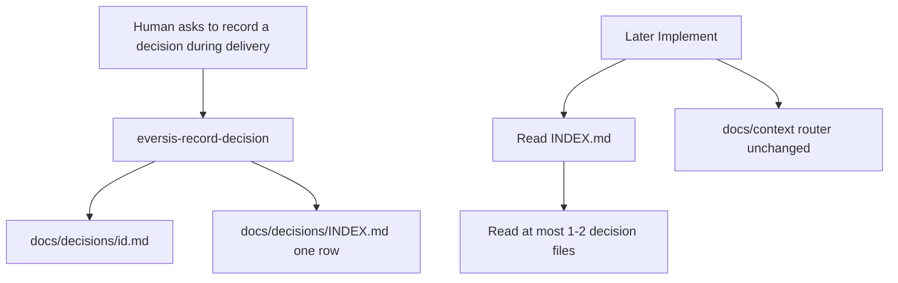

# AC-16 - Implementation Plan

## Task Details

| Field            | Value                                                                 |
| ---------------- | --------------------------------------------------------------------- |
| Jira ID          | AC-16                                                                 |
| Title            | Give architecture decisions a durable home                            |
| Description      | Decisions made during delivery live in `docs/decisions/`, separate from task write-ups and from domain knowledge. A later Implement run finds one through `docs/decisions/INDEX.md` and at most 1–2 decision files. |
| Priority         | Medium                                                                |
| Related Research | `docs/specs/ac-2/ac-2.research.md` Question 16 (accepted `"Research is ok. Make the plan for AC-16"`) |

## Wildly Important Goal

**Goal**: An architecture decision recorded during delivery is stored in `docs/decisions/` and a later Implement run can open it from `docs/decisions/INDEX.md` without reading every historical task folder.

**Success Measure**: This repo contains `docs/decisions/INDEX.md` plus one framework decision file, `.ai/rules/orchestration/agent-core.md` tells the agent to read that index and at most 1–2 decision files, and `eversis-record-decision` writes only a local file under `docs/decisions/` when a human asks during delivery.

**Do NOT touch / do NOT add**:

- Copying Earth Online As-Is Pack rows, Q-003, or Q-004 into this repo
- A `status` field or any lifecycle enum on decisions or on `docs/context/` entries (AC-18)
- A third Fine draft, a Confluence comment, or any change to `eversis-fine-handoff` (AC-17)
- Writing decisions through `eversis-promote-domain-knowledge` or the GitLab API
- A new slash-command prompt, website page, or MCP tool
- Semantic, full-text, or graph retrieval

## Proposed Solution

The home is `docs/decisions/` at the repo root. `docs/decisions/INDEX.md` is a two-column table (`id`, one-line title). Each decision is one markdown file `docs/decisions/<id>.md` with the fields taken from the As-Is Pack decision-log columns, plus a stable id and the title that the index shows: `id`, `title`, `date`, `context`, `decision`, `who`, `source`.

Reading stays beside the existing domain-knowledge router. `docs/context/<project>/INDEX.md` remains the only router for reference knowledge. `docs/decisions/INDEX.md` is cheap and always safe to read. Full decision files have their own cap of 1–2, separate from the 1–2 cap on `docs/specs/` consumption, so opening a decision does not spend the task-history budget.

Writing happens when a human asks, during research, plan, or Implement. The skill `eversis-record-decision` (`user-invocable: true`) creates the file and the index row in the working tree. The file ships in the task's normal commit. The skill does not run at Fine, does not open a GitLab merge request, and writes nothing when nobody asked.

This repo gets one example, `0001-decisions-home`, stating the decision this ticket itself made: the home is `docs/decisions/`, the read path is the index plus 1–2 files, the write path is the human-invoked local file, and Earth Online rows stay in the consumer repo. New installs scaffold an empty `docs/decisions/INDEX.md` and a README when those files are absent. The deliverables list in `agents-md-standard.md`, `AGENTS.md`, and `templates/AGENTS.template.md` gains this fourth path.

## Current Implementation Analysis

### Already Implemented

- Domain-knowledge router — `.ai/rules/orchestration/agent-core.md` — one `docs/context/<project>/INDEX.md`, then one component, then at most 1–2 consumed files. Decisions are not on this path.
- Promotion to `docs/context/<project>/` — `.ai/skills/eversis-promote-domain-knowledge/SKILL.md` — Fine-time draft, GitLab API write, `user-invocable: false`. Stays the writer for facts, not for decisions.
- Fine drafts — `.ai/skills/eversis-fine-handoff/SKILL.md` — QA comment and optional promotion draft. The third draft belongs to AC-17.
- Skill discovery — `mcp/eversis-collections-mcp/src/skills.ts` — lists every `.ai/skills/*/SKILL.md`. A new folder shows up without an MCP code change.
- Install scaffold for the deliverables folders — `scripts/lib/setup-agent-collections/scaffolding.sh` — creates `docs/context/`, `docs/plans/`, `docs/specs/` READMEs when missing, and does not overwrite existing files.
- Deliverables list — `docs/architecture/agents-md-standard.md`, `AGENTS.md`, `templates/AGENTS.template.md` — three paths today.

### To Be Modified

- `.ai/rules/orchestration/agent-core.md` — add the decisions read (index, then at most 1–2 files, cap separate from specs) and the sentence that a human request during delivery loads `eversis-record-decision`.
- Generated host copies of that rule — refreshed only by `npm run sync:adapters`, not by hand.
- `docs/architecture/agents-md-standard.md` — fourth deliverable path and the install-scaffold row.
- `AGENTS.md` and `templates/AGENTS.template.md` — same fourth row.
- `docs/context/README.md` and the README text inside `scripts/lib/setup-agent-collections/scaffolding.sh` — stop calling `docs/context/` the ADR home; point decisions at `docs/decisions/`.
- `scripts/lib/setup-agent-collections/scaffolding.test.sh` and `scripts/setup-agent-collections.test.sh` — assert the new scaffold files.

### To Be Created

- `docs/decisions/INDEX.md` — two-column index, including the example row.
- `docs/decisions/0001-decisions-home.md` — the one framework decision.
- `docs/decisions/README.md` — what the catalog is, the record fields, and that Earth Online content is not stored here.
- `.ai/skills/eversis-record-decision/SKILL.md` — human-invoked local write.
- Installer branch in `scaffold_project` — create `docs/decisions/README.md` and an empty `docs/decisions/INDEX.md` when absent.

## Open Questions

| #   | Question | Answer | Status |
| --- | --- | --- | --- |
| 1   | Do Earth Online decision-log rows ship in this repo? | No. Human: "EOG jest poza scope". | ✅ Resolved |
| 2   | How does a later run find a decision? | `docs/decisions/INDEX.md`, then at most 1–2 files, beside the `docs/context/` router. Human: "ok". The 1–2 cap is separate from the specs consumption cap. | ✅ Resolved |
| 3   | When is the file written? | During delivery, when a human asks. Local file in the working tree, normal task commit. Human: "Decyzja zapada w trakcie dostawy". Not a Fine draft. | ✅ Resolved |
| 4   | Where is the home? | `docs/decisions/`. Closed in Question 11 on 2026-09-22. | ✅ Resolved |

## Technical Context

Project conventions, coding standards, and patterns discovered during planning. Downstream agents MUST read this section instead of re-discovering the same context.

### Project Instructions

- `AGENTS.md` — framework SSOT is `.ai/`; specs live under `docs/specs/<issue-kebab>/`.
- `.ai/rules/orchestration/agent-core.md` — read budget for `docs/context/` and `docs/specs/`. Host copies are generated; edit the SSOT and run `npm run sync:adapters`.
- `.cursor/rules/eversis-project-stack.mdc` — this repo is the framework. Do not load product UI or backend skills. Quality commands are listed below.
- `docs/specs/ac-2/ac-2.research.md` Question 16 — scope of this plan. Do not reopen Q1–Q3.

### Architecture & Patterns

- Rules and skills are markdown under `.ai/`. Adapters package rules; they do not own the text.
- Skills are discovered by directory name under `.ai/skills/`. No registry edit.
- Domain knowledge writes go through the GitLab API because `docs/context/` may be an external checkout. `docs/decisions/` is a native folder of the current repo, so the write is a working-tree file.
- Installer scaffold creates missing docs READMEs and never overwrites an existing file (`scaffolding.sh`).
- `docs/context/<project>/INDEX.md` stays two columns. Do not add a decision column there.

### Tech Stack

- Framework content: Markdown.
- Installer: Bash (`scripts/lib/setup-agent-collections/scaffolding.sh`).
- Adapter sync: Node (`node adapters/sync.mjs`), invoked as `npm run sync:adapters`.
- No application runtime, no database, no new npm dependency.

### Code Style & Standards

- Match the voice and heading style of neighboring skills (`eversis-promote-domain-knowledge` for step structure; this new skill is the opposite write path).
- Skill frontmatter: `name`, `description`, `user-invocable: true`.
- Decision id: lowercase kebab-case, unique, stable. The example id is `0001-decisions-home`.
- Index table header: `| id | title |`. One row per file. Title is one sentence.

### Testing Patterns

- After any edit to `.ai/rules/orchestration/agent-core.md`: `npm run sync:adapters:check`.
- After scaffold changes: `bash scripts/lib/setup-agent-collections/scaffolding.test.sh` and `bash scripts/setup-agent-collections.test.sh`.
- Docs and skill tasks with no runner: a deterministic file check, stated in that task's Definition of Done.
- Do not add a unit test framework for a markdown skill.

### Database Patterns

- Not applicable. No database.

### Additional Context

- Record fields, in order: `id`, `title`, `date`, `context`, `decision`, `who`, `source`. No `status`.
- The skill asks for any missing field. It does not invent `who`.
- If the human did not ask to record a decision, the skill writes nothing. Most tasks have no decision file.
- `npm run sync:adapters` rewrites generated Cursor and Claude copies of `agent-core.md`. Hand-editing those copies is out of scope.

## Implementation Plan

### Phase 1: Catalog and write step

**Goal**: A decision has a file shape, an index row, and a human-invoked way to create both in the working tree.

**Description**: Create the catalog in this repo, including one framework decision that shows the shape, and the skill that writes the next one only when a human asks.

**Verification:** `docs/decisions/INDEX.md` contains the row for `0001-decisions-home`, and `.ai/skills/eversis-record-decision/SKILL.md` states `user-invocable: true`.

#### Task 1.1 - [CREATE] Decision catalog and the example decision

**Description**: Add the catalog README, the two-column index, and `0001-decisions-home`. The example records the decision made in Question 16: home `docs/decisions/`, read path index plus 1–2 files beside the context router, write path is a human-invoked local file during delivery, Earth Online rows stay out of this repo. Source points at `docs/specs/ac-2/ac-2.research.md` Question 16. Date is 2026-09-22. `who` is the person named on AC-16 (Piotr Niemirski).

**Files:** `docs/decisions/README.md` (create), `docs/decisions/INDEX.md` (create), `docs/decisions/0001-decisions-home.md` (create)

**Definition of Done**:

- [x] `docs/decisions/INDEX.md` has exactly the columns `id` and `title`, and one data row whose id is `0001-decisions-home`.
- [x] `docs/decisions/0001-decisions-home.md` contains `id`, `title`, `date`, `context`, `decision`, `who`, and `source`, and does not contain a `status` field.
- [x] `docs/decisions/README.md` states that Earth Online As-Is Pack rows are not stored in this framework repo.
- [x] `rg -n "DHI-348|EOE23-775" docs/decisions` returns no matches.

**Clues**: Do not copy the five As-Is Pack rows. The example is a decision of this framework, not of Earth Online.

#### Task 1.2 - [CREATE] Human-invoked record skill

**Description**: Add `eversis-record-decision`. It runs only when a human asks to record a decision during research, plan, or Implement. It writes `docs/decisions/<id>.md` and one index row in the working tree. It stops when a required field is missing instead of inventing `who`. It does not call the GitLab API, does not write under `docs/context/`, does not add a Fine draft, and does not set `status`.

**Files:** `.ai/skills/eversis-record-decision/SKILL.md` (create)

**Definition of Done**:

- [x] Frontmatter has `user-invocable: true` and a description that names a human request during delivery.
- [x] The skill text forbids a write when the human did not ask, a write outside `docs/decisions/`, a GitLab API commit, a Fine draft, and a `status` field.
- [x] The skill lists the seven record fields from Technical Context.

**Clues**: `mcp/eversis-collections-mcp/src/skills.ts` lists skill folders automatically. Do not edit the MCP server. Do not add a prompt under `.ai/prompts/`.

### Phase 2: Read path and install contract

**Goal**: A later Implement run is told to read the index, and a new install scaffolds the empty catalog.

**Description**: Put the read rule next to the existing context router, regenerate host copies, and teach the deliverables standard plus the installer about the fourth path. The context README stops describing itself as the ADR home.

**Verification:** `npm run sync:adapters:check` and `bash scripts/lib/setup-agent-collections/scaffolding.test.sh` and `bash scripts/setup-agent-collections.test.sh`.

#### Task 2.1 - [MODIFY] Decisions read in the orchestration rule

**Description**: In `agent-core.md`, after the domain-knowledge router, add a decisions read. `docs/decisions/INDEX.md` is always safe to read. After it, load at most 1–2 full decision files. That cap is separate from the `docs/specs/` consumption cap of 1–2. `docs/context/<project>/INDEX.md` remains the only router for reference knowledge. When a human asks to record a decision during delivery, follow `eversis-record-decision` and do not wait for Fine. Then run adapter sync so generated host rules match.

**Files:** `.ai/rules/orchestration/agent-core.md` (modify)

**Definition of Done**:

- [x] `agent-core.md` names `docs/decisions/INDEX.md`, the 1–2 file cap, and `eversis-record-decision`.
- [x] The same file still says there is exactly one in-repo router for `docs/context/`, and still names the specs consumption cap of 1–2.
- [x] Run `npm run sync:adapters:check`.

**Clues**: Edit only the SSOT rule. `npm run sync:adapters` writes the Cursor and Claude copies. Do not hand-edit `.cursor/rules/eversis-agent-core.mdc`.

#### Task 2.2 - [MODIFY] Deliverables list and installer scaffold

**Description**: Add `docs/decisions/` to the deliverables list in the standard, the root `AGENTS.md`, and the install template. In `scaffold_project`, create `docs/decisions/README.md` and an empty two-column `docs/decisions/INDEX.md` when they are absent, and do not overwrite them when they exist. Remove "ADRs" from the `docs/context/` README sentence in both the committed README and the heredoc in `scaffolding.sh`, and point that sentence at `docs/decisions/`. Extend the scaffold tests to require the new files on a fresh install.

**Files:** `docs/architecture/agents-md-standard.md` (modify), `AGENTS.md` (modify), `templates/AGENTS.template.md` (modify), `docs/context/README.md` (modify), `scripts/lib/setup-agent-collections/scaffolding.sh` (modify), `scripts/lib/setup-agent-collections/scaffolding.test.sh` (modify), `scripts/setup-agent-collections.test.sh` (modify)

**Definition of Done**:

- [x] `docs/architecture/agents-md-standard.md`, `AGENTS.md`, and `templates/AGENTS.template.md` each list `docs/decisions/`.
- [x] `docs/context/README.md` and the context README heredoc in `scaffolding.sh` do not call `docs/context/` the ADR home.
- [x] `scaffold_project` creates `docs/decisions/INDEX.md` only when that file is absent.
- [x] Run `bash scripts/lib/setup-agent-collections/scaffolding.test.sh`.
- [x] Run `bash scripts/setup-agent-collections.test.sh`.

**Clues**: The committed `docs/decisions/INDEX.md` from Task 1.1 already has the example row. The installer must not replace that file on a re-run. The empty index is only for a consumer tree where the file is missing.

### Phase 3: Code Review

**Goal**: The catalog, the read rule, and the write skill match Question 16 before the work is called done.

**Description**: Final verification of the full implementation. This phase is mandatory and always comes last.

**Verification:** `npm run sync:adapters:check`

#### Task 3.1 - [REUSE] Code review by Code Reviewer

**Description**: Run **Code Reviewer** via `eversis-review.md` on the AC-16 diff. There is no e2e suite for this markdown and bash change. Pass the Definition of Done of Tasks 1.1, 1.2, 2.1, and 2.2 as the acceptance checks.

**Files:** `docs/decisions/INDEX.md` (reuse), `docs/decisions/0001-decisions-home.md` (reuse), `.ai/skills/eversis-record-decision/SKILL.md` (reuse), `.ai/rules/orchestration/agent-core.md` (reuse), `scripts/lib/setup-agent-collections/scaffolding.sh` (reuse)

**Definition of Done**:

- [x] Run `npm run sync:adapters:check`
- [x] Code review passes with no blocking findings
- [x] Review outcome documented in Changelog

**Clues**: Blockers to look for: an Earth Online row in `docs/decisions/`, a `status` field, a Fine-handoff edit, a GitLab write in the new skill, or a second `docs/context/` router.

## Security Considerations

- Decision files are ordinary repo documents. They use the same git access as the rest of the repo. The example must not contain credentials, tokens, or customer payloads from the As-Is Pack beyond the already-public fact that those rows stay in the consumer repo.
- The skill writes only under `docs/decisions/` in the working tree. It does not take a `GITLAB_TOKEN` and does not push.

## Quality Assurance

Acceptance criteria checklist to verify the implementation meets the defined requirements:

- [x] A recorded decision lives in `docs/decisions/<id>.md` and has a row in `docs/decisions/INDEX.md`, not only inside a closed task write-up.
- [x] The record shape uses the As-Is columns (`date`, `context`, `decision`, `who`, `source`) plus `id` and `title`. The Earth Online rows are not in this repo.
- [x] `.ai/rules/orchestration/agent-core.md` sends a later Implement run to `docs/decisions/INDEX.md` and then at most 1–2 decision files, without reading every `docs/specs/` folder.
- [x] `eversis-record-decision` writes a local file only after a human asks during delivery.
- [x] `npm run sync:adapters:check` passes after the rule edit.
- [x] `bash scripts/setup-agent-collections.test.sh` passes after the scaffold edit.

## Improvements (Out of Scope)

- Migrating As-Is Pack section 6, Q-003, and Q-004 into `docs/decisions/` of the EOG repo.
- Knowledge `status` lifecycle and the "tasks since last audit" counter (AC-18).
- Confluence footer comment when domain knowledge is promoted (AC-17).
- The website map of what exists today versus later phases (AC-20).
- A command to add a domain-knowledge fact without closing a ticket (AC-22).

## Human gates

1. ~~Approve research~~ — done (`"Research is ok. Make the plan for AC-16"`)
2. ~~Approve this plan~~ — done (`"Plan is ok. Implement"`)
3. ~~Implement → Review → Fine~~ — done (review PASS 2026-09-22; QA draft pasted 2026-09-23, not posted)

Historical: no plan-review file was written. The human accepted this plan in gate 2. Do not treat the missing file as plan review still required, and do not reopen implementation.

## Fine

**Draft QA comment — review before posting to Jira**

---

### 📝 QA Summary

**Task Context:** Architecture decisions now have a durable home, separate from closed task write-ups and from domain knowledge.

**Main Changes:**
- A decision recorded during delivery is stored in its own catalog, with a one-line index a later run can open first.
- The later run reads the index, then at most two full decision records. It does not walk every old task folder to find them.
- Recording happens when a person asks in the delivery chat. Nothing is written on its own at the end of a ticket.
- One example decision is already in the catalog: the choice that this catalog is the home. Earth Online decision-log rows were not copied in.
- A new install creates an empty catalog when one is not already there, and leaves an existing catalog untouched.

---

**✅ Verification List:**

**Manual Testing:**
- [ ] Open the decisions index and confirm it has one row for the example decision about the catalog itself.
- [ ] Open that decision and confirm it names who decided, the date 22 Sep 2026, and the source research, and that it has no status field.
- [ ] Confirm the decisions folder does not contain Earth Online go-live rows.
- [ ] In a delivery chat, ask to record a decision and confirm a new file appears in the working tree only after that ask. Confirm no decision file appears when nobody asked.

**Automation & Technical Notes:**
- **Selectors**: none (no UI).
- **API**: none.
- **Error Handling**: the record step asks for a missing field and does not invent who decided. It does not call GitLab and does not write outside the decisions catalog.
- Adapter sync check, scaffold test, and installer smoke test passed.

## Changelog

| Date       | Change Description        |
| ---------- | ------------------------- |
| 2026-09-22 | Initial plan created      |
| 2026-09-22 | Plan accepted (`"Plan is ok. Implement"`). Execution of Phases 1–2 starts. |
| 2026-09-22 | Task 1.1 done — `docs/decisions/` catalog, INDEX, and `0001-decisions-home`. |
| 2026-09-22 | Task 1.2 done — `.ai/skills/eversis-record-decision/SKILL.md` (`user-invocable: true`). |
| 2026-09-22 | Task 2.1 done — decisions read in `agent-core.md`; adapters synced. |
| 2026-09-22 | Task 2.2 done — deliverables list + installer scaffold for `docs/decisions/`. |
| 2026-09-22 | Code review (Task 3.1) — **PASS**; zero open BLOCKERs; DoD/AC verified; quality commands green. |
| 2026-09-23 | Fine recorded. QA draft pasted from the Implement chat. Not posted to Jira. |

## Code Review Findings

**Verdict: PASS**

Independent review of the AC-16 catalog, read rule, write skill, deliverables list, and installer scaffold against the approved plan and Question 16 scope. No open BLOCKER findings. Every Phase 1–3 Definition of Done item and every Quality Assurance acceptance criterion was re-verified (not only the implementer’s checkboxes).

**BLOCKER:** none

**SUGGESTION:** none

**Verified against named blockers**

- No Earth Online / DHI-348 / EOE23-775 content under `docs/decisions/` (`rg` no matches).
- Example `0001-decisions-home` has no `status` field; seven record fields present.
- `eversis-fine-handoff` and `eversis-promote-domain-knowledge` untouched; no new `package.json` dependency.
- `eversis-record-decision` forbids GitLab API / Fine draft / write without human ask; `user-invocable: true`.
- `agent-core.md` keeps the single `docs/context/` router and the specs 1–2 consumption cap; decisions cap is separate; `.cursor/rules/eversis-agent-core.mdc` and `CLAUDE.md` carry the same decisions sentences (adapter sync).
- `scaffold_project` creates `docs/decisions/INDEX.md` only when absent (`if [[ ! -f ... ]]`).

**Commands run**

| Command | Exit |
| ------- | ---- |
| `npm run sync:adapters:check` | 0 |
| `bash scripts/lib/setup-agent-collections/scaffolding.test.sh` | 0 |
| `bash scripts/setup-agent-collections.test.sh` | 0 |
| `rg -n "DHI-348\|EOE23-775" docs/decisions` | 1 (no matches) |
