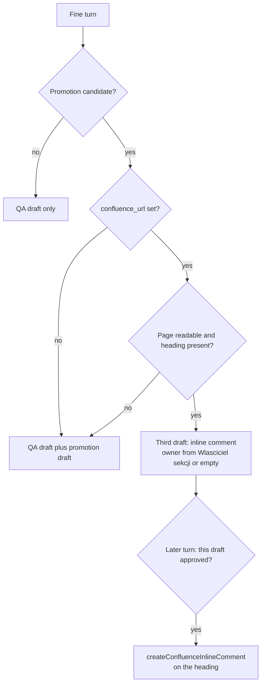

# AC-17 - Implementation Plan

## Task Details

| Field            | Value                                                                                                                                                                                                                                                         |
| ---------------- | ------------------------------------------------------------------------------------------------------------------------------------------------------------------------------------------------------------------------------------------------------------- |
| Jira ID          | AC-17                                                                                                                                                                                                                                                         |
| Title            | Suggest As-Is Pack updates when domain knowledge is promoted                                                                                                                                                                                                  |
| Description      | When Fine has a domain-knowledge promotion candidate whose frontmatter has `confluence_url`, the same turn also drafts an inline Confluence comment for that As-Is Pack section. Publishing waits for a later explicit approval. The page body is not edited. |
| Priority         | Low                                                                                                                                                                                                                                                           |
| Related Research | `docs/specs/ac-17/ac-17.research.md` (accepted `"Accpet the research make the plan"`)                                                                                                                                                                         |

## Wildly Important Goal

**Goal**: A Fine turn that promotes domain knowledge mapped to an As-Is Pack section also shows a separate draft of an inline comment on that section, and publishes it only after its own approval.

**Success Measure**: `eversis-fine-handoff` and `fine-handoff.md` describe the third draft, the example shows a fictional page with an owner and a fictional page without one, and `website/docs/main-flow/workflow/overview.md` draws that third draft. No task calls Confluence against page `3241017366`.

**Do NOT touch / do NOT add**:

- A new frontmatter field `as_is_pack_module`
- `createConfluenceFooterComment`, or any edit of the Confluence page body
- A pack draft when there is no promotion candidate, or when `confluence_url` is null
- A pack draft for a `docs/decisions/` write
- Guessing a section owner when the As-Is Pack line is missing
- Posting a comment on the Earth Online As-Is Pack as part of this repo's Definition of Done
- The "not yet" list on `website/docs/reference/domain-context.md` (AC-20)
- Tightening promotion-after-Fine, or `changelog.md` rollover

## Proposed Solution

Fine already shows a QA comment draft and, when `eversis-promote-domain-knowledge` finds a candidate, a second draft for `docs/context/<project>/`. This plan adds a third draft in that same turn, only when the promotion draft's frontmatter has a non-null `confluence_url`. If the promotion draft omits the field, the skill reads it from the existing component file. A null or missing URL means no third draft. A missing `ssot.confluenceSpaceKey` is not a separate search: the URL is the map.

The draft header is `**Draft: As-Is Pack comment — approve before posting to Confluence**`. It names the page URL, the section heading taken from the URL fragment, the section owner, and a short current-state comment copied from the promotion text. The owner comes from the `Właściciel sekcji:` line directly under that heading. When the line is absent or names nobody, the owner field is empty and the draft still appears. When the page cannot be read, or the heading from the fragment is not on the page, there is no draft.

Publishing is a later turn. The human must approve this draft specifically. The agent then fetches the page again and calls `createConfluenceInlineComment` with `textSelection` equal to that heading, `textSelectionMatchCount` equal to how many times the heading text appears, and `textSelectionMatchIndex` equal to the occurrence the URL fragment identifies. Approval of the QA draft or the promotion draft does not publish this comment.

`eversis-promote-domain-knowledge` stays the writer of `docs/context/`. On an update it keeps an existing `confluence_url` and does not invent one. The workflow overview page and the four sentences that still say the Fine set ends at two drafts are updated to match.

## Current Implementation Analysis

### Already Implemented

- QA draft and optional promotion draft — `.ai/skills/eversis-fine-handoff/SKILL.md` and `.ai/rules/orchestration/fine-handoff.md` — two independent approvals. No third header.
- Promotion frontmatter — `.ai/skills/eversis-promote-domain-knowledge/SKILL.md` and `knowledge-entry.example.md` — includes `confluence_url`, set to null for a new agent-discovered component.
- Import map — `.ai/skills/eversis-import-confluence-knowledge/SKILL.md` — writes `confluence_url` for a component taken from an As-Is Pack section. One-time, Confluence to repo. Does not write back.
- Inline comment tool — Atlassian MCP `createConfluenceInlineComment` — needs `textSelection`, `textSelectionMatchCount`, and `textSelectionMatchIndex`. Not called from Fine today.
- Decisions home — `docs/decisions/` — exists. This plan does not draft a pack comment for a decision file.
- Workflow overview — `website/docs/main-flow/workflow/overview.md` — Fine diagram stops at the promotion draft.

### To Be Modified

- `.ai/skills/eversis-fine-handoff/SKILL.md` — third draft rules and the publish step.
- `.ai/rules/orchestration/fine-handoff.md` — the same rules, so the contract and the skill match.
- `.ai/skills/eversis-fine-handoff/fine-handoff.example.md` — fictional third draft, with an owner and without one.
- `.ai/skills/eversis-promote-domain-knowledge/SKILL.md` — keep an existing `confluence_url` on update; do not set one when it is null.
- `.ai/rules/orchestration/engineering-manager.md` and `.ai/skills/eversis-orchestrating-implementation/SKILL.md` — one sentence so Fine follows the third draft when the skill requires it.
- `website/docs/main-flow/workflow/overview.md` — section "Status: Fine — handoff" and its diagram.
- `website/docs/main-flow/workflow/standard-flow.md`, `frontend-flow.md`, `e2e-flow.md`, and `website/docs/reference/agents/engineering-manager.md` — stop saying the Fine set ends at two drafts.
- `CHANGELOG.md` — one Unreleased Added bullet. `npm run website:changelog:check` copies it to the website changelog.

### To Be Created

- None. The behavior is an extension of Fine handoff, not a new skill.

## Open Questions

| #   | Question                                                  | Answer                                                                                                                                                                                                        | Status      |
| --- | --------------------------------------------------------- | ------------------------------------------------------------------------------------------------------------------------------------------------------------------------------------------------------------- | ----------- |
| 1   | When does the pack draft appear?                          | Same Fine turn as the promotion candidate. Publish later. Human: "Q1. OK".                                                                                                                                    | ✅ Resolved |
| 2   | What maps a topic to a Pack section?                      | Existing `confluence_url`. No `as_is_pack_module`. Human: "Q2. zostać przy confluence_url".                                                                                                                   | ✅ Resolved |
| 3   | Footer or inline comment?                                 | Inline, anchored to the heading in the URL fragment. Human: "Q3. komentarz śródtekstowy".                                                                                                                     | ✅ Resolved |
| 4   | Who is the section owner?                                 | The `Właściciel sekcji:` line under that heading. Empty when the line or the person is missing. Human: "Q4. SECTION OWNER powinien już być określony w dokumencie AS-Is Pack, jeżeli nie ma, pozostaw puste". | ✅ Resolved |
| 5   | Does AC-16 block this plan?                               | No. Human: "Q5. AC-16 jest już done". `docs/decisions/` is in the repo. Jira AC-16 may still say Backlog.                                                                                                     | ✅ Resolved |
| 6   | Does framework delivery comment on the Earth Online page? | No. Human: "Q6. OK".                                                                                                                                                                                          | ✅ Resolved |
| 7   | What if there is no As-Is Pack?                           | No `confluence_url` means no draft. Human: "Q7. OK".                                                                                                                                                          | ✅ Resolved |
| 8   | Does the workflow overview page change?                   | Yes. Human: "Q8. OK".                                                                                                                                                                                         | ✅ Resolved |

## Technical Context

Project conventions, coding standards, and patterns discovered during planning. Downstream agents MUST read this section instead of re-discovering the same context.

### Project Instructions

- `AGENTS.md` — framework SSOT is `.ai/`. Specs live under `docs/specs/<issue-kebab>/`.
- `.cursor/rules/eversis-project-stack.mdc` — this repo is the framework. Do not load product UI, backend, or filter skills. Quality commands are listed under Testing Patterns.
- `.ai/rules/orchestration/fine-handoff.md` — Fine contract. The skill under `.ai/skills/eversis-fine-handoff/` must say the same thing.
- `docs/specs/ac-17/ac-17.research.md` — closed questions. Do not reopen Q1–Q8.

### Architecture & Patterns

- Skills and rules are markdown under `.ai/`. Adapters package rules. Edit the SSOT, then run `npm run sync:adapters`.
- Fine drafts are chat output. Nothing is written in the Fine turn. A later turn publishes only the draft the human named.
- `confluence_url` is a link to a page or a heading anchor. The heading text after `#` is the inline-comment selection.
- `Właściciel sekcji:` sits on the line under the section heading on the As-Is Pack. That line is the only owner source.
- Import stays one-way. This ticket does not turn it into a sync.

### Tech Stack

- Framework content: Markdown.
- Adapter sync: `npm run sync:adapters`, then `npm run sync:adapters:check`.
- Website: Docusaurus. `overview.md` and the four pointer pages are hand-written. `npm run website:build` builds the site. `npm run website:changelog:check` checks `CHANGELOG.md` against `website/src/pages/changelog.md`.
- No application runtime, no database, no new npm dependency.

### Code Style & Standards

- Match the heading style already in `eversis-fine-handoff/SKILL.md` ("Optional second draft"). The new section is "Optional third draft — As-Is Pack comment".
- The third-draft header string is exact: `**Draft: As-Is Pack comment — approve before posting to Confluence**`.
- Do not add code, MCP client wrappers, or tests that call Confluence.

### Testing Patterns

- After edits to `.ai/rules/orchestration/engineering-manager.md` or `fine-handoff.md`: `npm run sync:adapters` and `npm run sync:adapters:check`.
- After `CHANGELOG.md`: `npm run website:changelog:check`.
- After `website/docs/` edits: `npm run website:build`.
- Skill and example tasks with no runner: a deterministic file check, stated in that task's Definition of Done.
- Do not call `createConfluenceInlineComment` or `getConfluencePage` on page `3241017366` to satisfy a task.

### Database Patterns

- Not applicable. No database.

### Additional Context

- A new component from promotion has `confluence_url: null` and produces no pack draft. That is the normal case.
- An update of a component imported from Confluence keeps the URL and can produce the draft.
- Empty owner does not remove the draft.
- Unreadable page, or a heading fragment that is not on the page, removes the draft.
- The comment body is the current-state paragraph from the promotion draft. It is not a diff and not a replacement of the page section.

## Implementation Plan

### Phase 1: Fine contract

**Goal**: The Fine procedure knows when to show the third draft and how a later turn publishes it.

**Description**: Extend the handoff skill, its rule, and its example. Keep `confluence_url` stable on promotion updates. Point the Engineering Manager at the third draft so the Fine turn does not stop after the QA comment.

**Verification:** `npm run sync:adapters:check`

#### Task 1.1 - [MODIFY] Third draft in the Fine handoff skill and rule

**Description**: Add "Optional third draft — As-Is Pack comment" to the skill and the same section to `fine-handoff.md`. The draft appears in the Fine turn only when a promotion draft exists and its `confluence_url` is non-null (read the existing component file when the promotion draft omits the field). Fetch the page to resolve the heading and the `Właściciel sekcji:` line. If the page or the heading is missing, emit no third draft. If the owner line or the person is missing, emit the draft with an empty owner. Do not call Confluence write tools in the Fine turn. The later publish step uses `createConfluenceInlineComment` on that heading and does not edit the page body and does not use a footer comment. QA approval and promotion approval do not publish this draft. A `docs/decisions/` write does not create it.

**Files:** `.ai/skills/eversis-fine-handoff/SKILL.md` (modify), `.ai/rules/orchestration/fine-handoff.md` (modify)

**Definition of Done**:

- [x] Both files contain the header `**Draft: As-Is Pack comment — approve before posting to Confluence**`.
- [x] Both files say the draft is skipped when `confluence_url` is null, when there is no promotion draft, when the page cannot be read, and when the heading is absent.
- [x] Both files say an empty `Właściciel sekcji:` line leaves the owner empty and still shows the draft.
- [x] Both files name `createConfluenceInlineComment` as the publish tool and forbid a page-body edit and a footer comment.
- [x] `rg -n "3241017366" .ai/skills/eversis-fine-handoff .ai/rules/orchestration/fine-handoff.md` returns no matches.

**Clues**: Keep the existing QA section and the promotion section. The third section follows them. `inlineCommentProperties.textSelection` is the heading text.

#### Task 1.2 - [MODIFY] Fictional third-draft example

**Description**: Append an example third draft to `fine-handoff.example.md`. Use a fictional URL `https://example.atlassian.net/wiki/spaces/PROJ/pages/123456/As-is+Pack#Authentication`, heading `Authentication`, and owner `Ada Owner`. Add a second short example where the heading has no `Właściciel sekcji:` line and the owner field is empty. Do not use the Earth Online page id or any real person's name from that page.

**Files:** `.ai/skills/eversis-fine-handoff/fine-handoff.example.md` (modify)

**Definition of Done**:

- [x] The file contains `Draft: As-Is Pack comment — approve before posting to Confluence`.
- [x] The file contains the fictional URL fragment `#Authentication` and the owner `Ada Owner`.
- [x] The file contains one example whose owner field is empty.
- [x] `rg -n "3241017366|Nazar Polekha" .ai/skills/eversis-fine-handoff/fine-handoff.example.md` returns no matches.

**Clues**: Leave the existing QA example in place. The bootstrap example in `eversis-import-confluence-knowledge/bootstrap-report.example.md` already uses `pages/123456/As-is+Pack#Authentication`.

#### Task 1.3 - [MODIFY] Keep confluence_url on promotion update

**Description**: In the promotion skill's update step, state that an existing `confluence_url` is copied into the draft and left unchanged, and that a null URL is not replaced with a guessed Pack link.

**Files:** `.ai/skills/eversis-promote-domain-knowledge/SKILL.md` (modify)

**Definition of Done**:

- [x] The update step says an existing `confluence_url` is preserved.
- [x] The skill does not mention `as_is_pack_module`.
- [x] The skill does not tell the agent to write a Confluence comment.

**Clues**: Do not change Step 6 (GitLab write) or `user-invocable`.

#### Task 1.4 - [MODIFY] Fine turn points at the third draft

**Description**: In the Engineering Manager rule and in orchestration Step 5, add one sentence: when the fine-handoff skill requires the As-Is Pack draft, output it in the same Fine turn, with its own approval. Then regenerate adapter output.

**Files:** `.ai/rules/orchestration/engineering-manager.md` (modify), `.ai/skills/eversis-orchestrating-implementation/SKILL.md` (modify)

**Definition of Done**:

- [x] Both files tell the Fine turn to include the As-Is Pack draft when `eversis-fine-handoff` requires it.
- [x] Run `npm run sync:adapters`.
- [x] Run `npm run sync:adapters:check`.

**Clues**: Do not change the readiness block shape. Do not add a Flow value.

### Phase 2: Workflow overview

**Goal**: A reader of the main workflow page sees the third Fine draft.

**Description**: Update the Fine section and diagram on the overview page. Adjust the four sentences that still say Fine ends at two drafts. Record the behavior in the changelog.

**Verification:** `npm run website:build` and `npm run website:changelog:check`

#### Task 2.1 - [MODIFY] Overview Fine section

**Description**: In "Status: Fine — handoff", add the third draft after domain-knowledge promotion: when the promotion targets a component with `confluence_url`, Fine also drafts an inline comment on that As-Is Pack heading. The owner is the `Właściciel sekcji:` line, or empty. Publishing is a later approval and does not edit the page. Extend the mermaid diagram with that branch. A missing promotion candidate or a null URL leaves the diagram on the existing two drafts.

**Files:** `website/docs/main-flow/workflow/overview.md` (modify)

**Definition of Done**:

- [x] `website/docs/main-flow/workflow/overview.md` contains `Draft: As-Is Pack comment — approve before posting to Confluence`.
- [x] The mermaid block in that file includes a node for the inline Pack comment.
- [x] The page does not say the Fine set ends at two drafts.

**Clues**: Path on the site is `/docs/main-flow/workflow/overview`. Do not edit `website/docs/reference/domain-context.md`.

#### Task 2.2 - [MODIFY] Pointers that say there are only two drafts

**Description**: In each of the four pages, replace the claim that Fine has exactly a second draft or exactly both gates with a pointer to the overview section for the full set: QA draft, promotion draft when there is a candidate, and As-Is Pack comment when that candidate has `confluence_url`.

**Files:** `website/docs/main-flow/workflow/standard-flow.md` (modify), `website/docs/main-flow/workflow/frontend-flow.md` (modify), `website/docs/main-flow/workflow/e2e-flow.md` (modify), `website/docs/reference/agents/engineering-manager.md` (modify)

**Definition of Done**:

- [x] `rg -n "both approval gates" website/docs/main-flow/workflow/standard-flow.md` returns no matches.
- [x] Each of the four files links to the overview Fine section and names the As-Is Pack comment as conditional on `confluence_url`.

**Clues**: Do not rewrite the rest of those pages. Do not change the "exact four-line" wording; that belongs to AC-20.

#### Task 2.3 - [MODIFY] Changelog entry

**Description**: Add one bullet under `## [Unreleased]` / `### Added` in `CHANGELOG.md`: Fine can draft an inline As-Is Pack comment when a promotion candidate has `confluence_url`. Then sync-check the website changelog.

**Files:** `CHANGELOG.md` (modify)

**Definition of Done**:

- [x] `CHANGELOG.md` under `### Added` in `[Unreleased]` contains `confluence_url` and `As-Is Pack`.
- [x] Run `npm run website:changelog:check`.
- [x] Run `npm run website:build`.

**Clues**: `website:changelog:check` rewrites nothing in `--check` mode. If it fails because the website page is stale, run `node scripts/sync-changelog.mjs` without `--check` and then the check again. Do not add a new dependency.

### Phase 3: Code Review

**Goal**: The Fine contract and the overview page match the accepted research, with no Confluence write in the diff.

**Description**: Final verification of the full implementation. This phase is mandatory and always comes last.

**Verification:** `npm run sync:adapters:check`

#### Task 3.1 - [REUSE] Code review by Code Reviewer

**Description**: Run **Code Reviewer** via `eversis-review.md` to review the complete implementation. There are no e2e tests. Pass the skill text, the overview page, and the changelog check.

**Files:** `.ai/skills/eversis-fine-handoff/SKILL.md` (reuse), `.ai/rules/orchestration/fine-handoff.md` (reuse), `website/docs/main-flow/workflow/overview.md` (reuse)

**Definition of Done**:

- [x] Run `npm run sync:adapters:check`
- [x] Code review passes with no blocking findings
- [x] Review outcome documented in Changelog

**Clues**: A blocker is any instruction to edit a Confluence page body, to call the Earth Online page during framework delivery, or to add `as_is_pack_module`.

## Security Considerations

- The Fine turn must not call `createConfluenceInlineComment` or any page-update API.
- The comment is published only after an explicit later approval of that draft.
- The skill must not invent a section owner or look up a Confluence account when the Pack line is empty.
- The example and the skill must not embed the Earth Online page id or names taken from that page.
- No new tokens, scopes, or dependencies.

## Quality Assurance

Acceptance criteria checklist to verify the implementation meets the defined requirements:

- [x] Given a promotion candidate with a non-null `confluence_url` and a heading on the page, the Fine instructions require a separate As-Is Pack draft that names the heading and the `Właściciel sekcji:` person when that line exists.
- [x] Given that draft, the publish instructions use `createConfluenceInlineComment` on the heading and do not edit the page body.
- [x] Given a promotion candidate with `confluence_url: null`, or no promotion candidate, the Fine instructions require no Pack draft.
- [x] Given a heading with no `Właściciel sekcji:` person, the example leaves the owner empty and still shows the draft.
- [x] `website/docs/main-flow/workflow/overview.md` shows the third draft.
- [x] No task in the diff calls Confluence on page `3241017366`.

## Improvements (Out of Scope)

Potential improvements identified during planning that are not part of the current task:

- Update the "not yet" As-Is suggestion line on `website/docs/reference/domain-context.md` (AC-20).
- Anchor the inline comment to a sentence inside the section instead of the heading.
- Fill an empty owner by searching Confluence users.
- Run the comment against the Earth Online As-Is Pack from this framework repo.
- Add `as_is_pack_module` beside `confluence_url`.

## Human gates

1. ~~Approve research~~ — done (`"Accpet the research make the plan"`)
2. ~~Approve this plan~~ — done (`"Plan is OK"`)
3. ~~Implement → Review → Fine~~ — done (review PASS 2026-09-22; QA draft pasted 2026-09-23, not posted)

Historical: no plan-review file was written. The human accepted this plan in gate 2. Do not treat the missing file as plan review still required, and do not reopen implementation.

## Fine

**Draft QA comment — review before posting to Jira**

---

### 📝 QA Summary

**Task Context:** When a finished task proposes a lasting knowledge update that is already tied to an As-Is Pack section, close-out now also offers a comment on that section.

**Main Changes:**
- After a task is marked ready for QA, the usual QA comment still appears.
- If that same close-out also proposes a knowledge update, and that topic is linked to an As-Is Pack section, a separate comment draft appears for that section.
- The draft names the section heading. When the page lists a section owner on the line under the heading, the draft names that person. When that line is missing or names nobody, the owner stays blank and the draft still appears.
- Approving the QA comment, or approving the knowledge update, does not post the Pack comment. Posting it needs its own later yes.
- The Pack page text is left as it is. The suggestion is a comment on the heading, not a rewrite of the section.
- If there is no knowledge update, or the topic has no Pack link, no Pack comment is drafted.

---

**✅ Verification List:**

**Manual Testing:**
- [ ] Close out a task that proposes a knowledge update linked to a Pack section whose heading is on the page. Confirm a separate Pack comment draft appears, with the heading and the section owner when that line names someone.
- [ ] Approve only the QA comment, then only the knowledge update. Confirm the Pack comment is not posted either time.
- [ ] Close out a task whose knowledge update has no Pack link. Confirm no Pack comment draft appears.
- [ ] Use a heading that has no section-owner line. Confirm the draft still appears and the owner is blank.
- [ ] Confirm this delivery does not post a comment on the Earth Online As-Is Pack.

**Automation & Technical Notes:**
- **Selectors**: Not applicable. This is framework guidance and documentation, not an application screen.
- **API**: A later, explicit approval posts with an inline Confluence comment anchored to the heading (`textSelection` is the heading text, with the occurrence count and index). The page body is not updated. A footer comment is not used.
- **Error Handling**: If the Pack page cannot be read, or the heading from the link is not on the page, no Pack comment draft is shown.

## Code Review Findings

**Verdict: PASS**

Reviewed against `ac-17.research.md` and this plan. Independent Code Reviewer context (did not implement).

### Checks run

- `npm run sync:adapters:check` — OK (no drift)
- `rg -n "3241017366" .ai/skills/eversis-fine-handoff .ai/rules/orchestration/fine-handoff.md .ai/skills/eversis-fine-handoff/fine-handoff.example.md` — no matches
- `npm run website:changelog:check` — OK
- Hard blockers: no page-body edit instructions, no Earth Online page id in Fine artifacts, no `as_is_pack_module`
- Read and verified: fine-handoff skill, fine-handoff rule, fine-handoff example, overview Fine section + mermaid, promotion-skill update bullet

### DoD / AC

All Phase 1–2 Definition of Done boxes and all Quality Assurance acceptance-criteria boxes re-verified as accurately checked. Task 3.1 boxes checked in this review.

### BLOCKER

None.

### SUGGESTION

1. `.ai/skills/eversis-fine-handoff/fine-handoff.example.md` — the section heading still says “Example — Fine turn with both drafts”; consider renaming to reflect that a third draft may follow (cosmetic only).
2. `website/docs/main-flow/workflow/overview.md` mermaid — shows skip on null `confluence_url` but not on unreadable page / missing heading; those skips are correctly specified in the skill/rule (docs completeness only).

## Changelog

| Date       | Change Description                                                     |
| ---------- | ---------------------------------------------------------------------- |
| 2026-09-22 | Initial plan created                                                   |
| 2026-09-22 | Plan accepted (`"Plan is OK"`). Implementation starts in a new window. |
| 2026-09-22 | CHECKPOINT: Task 1.1 complete and tested (`sync:adapters:check` OK). Changed: `.ai/skills/eversis-fine-handoff/SKILL.md`, `.ai/rules/orchestration/fine-handoff.md`, generated `CLAUDE.md` and `.cursor/rules/eversis-fine-handoff.mdc`. Next: Task 1.2 fictional third-draft example. |
| 2026-09-22 | RESUMED: Human chose to keep implementation in this session. Continue from Task 1.2. |
| 2026-09-22 | Code review performed (PASS). Zero BLOCKER findings. Task 3.1 DoD checked. See Code Review Findings. |
| 2026-09-23 | Fine recorded. QA draft pasted from the Implement chat. Not posted to Jira. |
