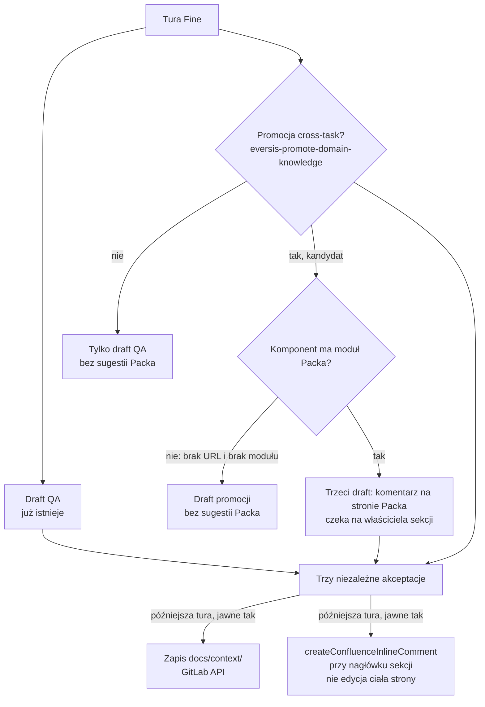

# AC-17 - Analysis Result

## Task Details

| Field | Value |
|---|---|
| Jira ID | AC-17 |
| Title | Suggest As-Is Pack updates when domain knowledge is promoted |
| Description | Subtask AC-2 (Faza 7 z `ac-2.research.md`, Question 9). Przy zamknięciu zadania framework umie już złożyć draft komentarza QA i draft promocji wiedzy domenowej. Nie proponuje jeszcze pasującej aktualizacji Confluence As-Is Pack. Właściciel wiedzy ma dostać osobny draft sekcji Packa, która odpowiada promowanemu tematowi, żeby zewnętrzna strona stanu bieżącego nie rozjechała się z repozytorium. Start dopiero po istnieniu domu decyzji (AC-16). Poza zakresem: edycja struktury strony Packa oraz uruchomienie tego mechanizmu na konkretnej stronie konsumenta jako część dostawy frameworka. |
| Priority | Low |
| Reporter | Piotr Niemirski |
| Created Date | 2026-09-21 |
| Due Date | Not set |
| Labels | context, follow-up |
| Estimated Effort | Not set (Sub-task, projekt `AC`, parent AC-2) |

## Business Impact

As-Is Pack jest zewnętrznym opisem stanu bieżącego. Import (`eversis-import-confluence-knowledge`) kopiuje go raz do `docs/context/`. Potem promocja po Fine aktualizuje tylko repozytorium. Strona w Confluence zostaje przy dacie bootstrapu. AC-17 domyka ten kierunek w drugą stronę: z faktu, który i tak idzie do promocji, powstaje sugestia komentarza na stronie Packa. Właściciel sekcji decyduje, czy opis na stronie nadąży za repozytorium.

Bez tego kolejne zadania w projekcie konsumenckim (wzorzec opisany na EOG w researchu AC-2) będą aktualizować `docs/context/` i zostawiać As-Is Pack w tyle. Framework nie edytuje strony sam — komentarz jest propozycją, nie zapisem.

## Gathered Information

### Knowledge Base & Task Management Tools

- **AC-17** odczytane na żywo (`getJiraIssue`, cloud `eversis.atlassian.net`, 2026-09-22). Status **Backlog**, priorytet Low, assignee Piotr Niemirski. Brak komentarzy, brak linków issue, brak załączników. Parent: **AC-2** (In Progress).
- **Źródło w parent researchu:** `docs/specs/ac-2/ac-2.research.md`, Question 9, wiersz Fazy 7. Tamten wiersz jest zakresem tego ticketu. Question 11 (2026-09-22) ma tylko wiersz portfela: start po AC-16; mechanizm bootstrapu (Faza 2) już wylądował; promocja po Fine nie była zaostrzana.
- **AC-16** (Backlog, Medium): „Give architecture decisions a durable home”. Opis AC-17 każe startować po domu decyzji. Opis AC-16 wprost wyłącza „suggesting Confluence updates” ze swojego zakresu. Katalog `docs/decisions/` nie istnieje. Question 11, pytanie 2, rozstrzygnięte 2026-09-22: dom to `docs/decisions/`, a zapis decyzji jest do zbudowania w AC-16.
- **As-Is Pack EOG** (Confluence, space `EARTHONLINE`, strona `3241017366`) jest seedem opisanym w AC-2, Question 9. Ten research go nie wczytuje ponownie i nie proponuje komentarza na tej stronie. AC-17 wyłącza uruchomienie na konkretnej stronie konsumenta z Definition of Done frameworka — ten sam zakaz ma skill importu.

### Codebase

- **Fine ma dwa drafty, nie trzy.** `.ai/skills/eversis-fine-handoff/SKILL.md` i kontrakt `.ai/rules/orchestration/fine-handoff.md`: obowiązkowy draft QA oraz opcjonalny drugi draft promocji (`**Draft: domain-knowledge promotion to docs/context/<project>/ — approve before writing**`). Zgoda na jeden nie zgadza drugiego. Brak draftu promocji jest zwykłym wynikiem, nie luką. Trzeciego nagłówka (sugestia Packa) nie ma.
- **Promocja pisze tylko do repozytorium.** `.ai/skills/eversis-promote-domain-knowledge/SKILL.md`: ocena cross-task, draft w turze Fine, zapis po osobnej akceptacji przez GitLab API. Frontmatter nowego komponentu (`knowledge-entry.example.md`): `scope`, `source: agent-discovered`, `last_updated`, `tags`, `code_paths`, `confluence_url: null`, `related_specs`. Pola `as_is_pack_module` nie ma.
- **Import idzie w drugą stronę i jest jednorazowy.** `.ai/skills/eversis-import-confluence-knowledge/SKILL.md`: Confluence → `docs/context/`, raz, draft do akceptacji. Dla komponentu ze strony Packa zapisuje `source: confluence` i `confluence_url` (link do strony albo kotwicy sekcji). Dla klastra z `docs/specs/` zostawia `confluence_url` puste (przykład w `bootstrap-report.example.md`). Skill wprost nie pisze nic z powrotem do Confluence i nie jest synchronizacją cykliczną.
- **Klucz przestrzeni jest opcjonalny.** `ssot.confluenceSpaceKey` w `.agent-collections/install-selection.json` (`docs/architecture/install-selection.md`). `null` nie blokuje instalacji. Skill importu ma nazwaną gałąź „No As-Is Pack at all”. To repo frameworka nie ma lokalnego `install-selection.json`.
- **Jedyny komponent w tym repo nie ma mapy na Pack.** `docs/context/agent-collections/INDEX.md` — jeden wiersz, `readiness-contract`. Jego `index.md` ma `source: agent-discovered` i `confluence_url: null`.
- **Kanał komentarza już jest w MCP.** Serwer `atlassian` w tym workspace wystawia `createConfluenceFooterComment` i `createConfluenceInlineComment`. Fine dziś woła `addCommentToJiraIssue` dopiero po osobnej akceptacji. Tego samego wzorca (draft w turze Fine, publikacja w późniejszej turze) AC-17 potrzebuje dla Confluence. Research AC-2, Question 9, odrzuca edycję ciała strony z powodu ryzyka ADF/HTML (odnotowane wcześniej w DHI-630).
- **Audyt nie jest tym mechanizmem.** `eversis-audit-domain-knowledge` ocenia istniejące pliki komponentów. Nie składa komentarza na Confluence.

### Relevant Links

- Jira AC-17 — https://eversis.atlassian.net/browse/AC-17
- Parent AC-2 — https://eversis.atlassian.net/browse/AC-2
- Zależność AC-16 — https://eversis.atlassian.net/browse/AC-16
- `docs/specs/ac-2/ac-2.research.md` — Question 9 Faza 7, Question 11 wiersz AC-17
- `.ai/skills/eversis-fine-handoff/SKILL.md`, `.ai/rules/orchestration/fine-handoff.md`
- `.ai/skills/eversis-promote-domain-knowledge/SKILL.md`, `knowledge-entry.example.md`
- `.ai/skills/eversis-import-confluence-knowledge/SKILL.md`, `bootstrap-report.example.md`
- As-Is Pack EOG (kontekst, poza DoD tego ticketu) — https://eversis.atlassian.net/wiki/spaces/EARTHONLINE/pages/3241017366/As-is+Pack

### Relevant Charts & Diagrams

Kierunek importu (Confluence → repo, raz) zostaje w `eversis-import-confluence-knowledge`. AC-17 dokłada strzałkę przy Fine (repo → komentarz na stronie), tylko gdy promocja ma kandydata zmapowanego na moduł.

## Current Implementation Status

### Existing Components

- Fine handoff — `.ai/skills/eversis-fine-handoff/SKILL.md` — needs extension (trzeci, niezależny draft)
- Kontrakt Fine — `.ai/rules/orchestration/fine-handoff.md` — needs extension (ten sam trzeci draft; kontrakt i skill mają dziś tę samą sekcję „Optional second draft”)
- Promocja wiedzy — `.ai/skills/eversis-promote-domain-knowledge/SKILL.md` — can be reused (krok „czy jest kandydat”); needs extension tylko jeśli plan doda pole mapy na moduł Packa
- Import As-Is — `.ai/skills/eversis-import-confluence-knowledge/SKILL.md` — can be reused (`confluence_url` jako istniejąca mapa); nie przerabiać go na synchronizację zwrotną
- Komentarz Confluence — `createConfluenceInlineComment` — can be reused po akceptacji; dziś nie wołane z Fine. Komentarz stopki odpada (Question 3)
- Dom decyzji — `docs/decisions/` jest w repo (INDEX, README, `0001-decisions-home.md`). Człowiek, 2026-09-22: AC-16 jest done. Jira AC-16 nadal ma status Backlog. Sekwencja nie blokuje planu AC-17

### Key Files and Directories

- `.ai/skills/eversis-fine-handoff/SKILL.md` — miejsce trzeciego draftu i zakazu publikacji w turze Fine
- `.ai/rules/orchestration/fine-handoff.md` — kontrakt, który skill powtarza; oba muszą powiedzieć to samo
- `.ai/skills/eversis-promote-domain-knowledge/knowledge-entry.example.md` — wzorzec frontmatter; dziś `confluence_url: null` dla wiedzy odkrytej przez agenta
- `.ai/skills/eversis-import-confluence-knowledge/SKILL.md` — jedyny zapis `confluence_url` wskazującego sekcję Packa
- `docs/context/agent-collections/readiness-contract/index.md` — przykład komponentu bez mapy na Pack (oczekiwany wynik: brak sugestii)
- `docs/specs/ac-2/ac-2.research.md` — decyzja, że Faza 7 jest osobnym ticketem i startuje po domu decyzji
- `website/docs/main-flow/workflow/overview.md` — sekcja „Status: Fine — handoff” i diagram promocji; dziś dwa drafty. Człowiek, 2026-09-22: ta strona wchodzi w zakres AC-17

## Gap Analysis

### Question 1
#### Kiedy powstaje draft sugestii — w tej samej turze Fine co promocja, czy dopiero po zapisie promocji do repozytorium?

Tekst AC-17 mówi „given a promoted knowledge topic, when close-out runs”. Question 9 mówi wprost: trzeci, opcjonalny draft w `eversis-fine-handoff`, obok QA i promocji, złożony z tych samych faktów co promocja.

Odczyt, który spina oba zdania: „promoted” oznacza kandydata, którego skill promocji już wybrał w tej turze Fine, a nie commit, który już wylądował w GitLabie. Draft Packa pojawia się w tej samej turze, z własnym nagłówkiem i własną akceptacją. Publikacja komentarza czeka na późniejszą turę, tak jak publikacja komentarza QA. Zgoda na draft QA albo na draft promocji nie publikuje komentarza Confluence.

Gdy skill promocji nie znajduje kandydata, sugestia Packa też nie powstaje. To spełnia trzecie kryterium („topic with no Pack module” jest osobnym przypadkiem; brak promocji w ogóle jest wcześniejszym filtrem).

**Decyzja człowieka (2026-09-22):** „Q1. OK”. Draft w tej samej turze Fine co kandydat promocji. Publikacja w późniejszej turze.

### Question 2
#### Po czym poznać, że temat mapuje się na moduł As-Is Pack?

Question 9 zakłada nowe pole frontmatter `as_is_pack_module: M-0X`. Tego pola nie ma w skillu promocji ani w przykładzie wpisu. Jest inne pole, dodane później przez import: `confluence_url`. Dla komponentu wziętego ze strony Packa wskazuje stronę albo kotwicę sekcji. Dla wiedzy `agent-discovered` i dla klastra z `docs/specs/` stoi `null` — jak w `readiness-contract/index.md` i w przykładzie bootstrapu.

Trzecie kryterium akceptacji jest wtedy spełnione bez nowego identyfikatora: brak `confluence_url` (i brak klucza przestrzeni, i brak odnalezionej strony) oznacza brak sugestii. Nowe pole `as_is_pack_module` miałoby sens, gdy kod modułu (`M-0X`) musi przeżyć zmianę kotwicy w URL. Tego wymagania ticket nie zapisuje.

**Decyzja człowieka (2026-09-22):** „Q2. zostać przy confluence_url”. Pola `as_is_pack_module` nie dodajemy. Brak `confluence_url` oznacza brak sugestii.

### Question 3
#### Komentarz stopki czy komentarz śródtekstowy?

Kryterium akceptacji: po publikacji jest to komentarz na stronie Packa, a ciało strony zostaje nietknięte. Oba narzędzia MCP to spełniają. Komentarz śródtekstowy wymaga zakresu tekstu na stronie; kotwica z `confluence_url` tego zakresu nie jest. Komentarz stopki jest komentarzem do całej strony i nie wymaga trafienia w akapit.

**Decyzja człowieka (2026-09-22):** „Q3. komentarz śródtekstowy”. Publikacja idzie przez `createConfluenceInlineComment`. Narzędzie wymaga dokładnego fragmentu tekstu strony, liczby wystąpień i indeksu wystąpienia. Fragmentem jest nagłówek sekcji, na którą wskazuje `confluence_url`. Ciało strony zostaje nietknięte. Komentarz stopki odpada.

### Question 4
#### Kto jest „section owner” i jak draft na niego czeka?

Ticket mówi, że draft czeka na właściciela sekcji. Żaden frontmatter nie trzyma konta Confluence tej osoby. Skill importu wspomina właścicieli sekcji jako powód, żeby nie czytać strony przy każdym odczycie — nie jako katalog tożsamości.

**Decyzja człowieka (2026-09-22):** „Q4. SECTION OWNER powinien już być określony w dokumencie AS-Is Pack, jeżeli nie ma, pozostaw puste”.

Na As-Is Pack EOG (strona `3241017366`, wersja 19) każda sekcja ma linię `Właściciel sekcji:` zaraz pod nagłówkiem, ze wzmianką osoby. Draft kopiuje tę osobę z sekcji wskazanej przez `confluence_url`. Gdy linii nie ma albo nie ma w niej osoby, pole właściciela w drafcie zostaje puste. Puste pole nie kasuje draftu i nie każe zgadywać konta. Publikacja nadal czeka na jawną akceptację w późniejszej turze. Odczyt strony EOG jest wzorcem pola, nie komentarzem składanym na tej stronie w dostawie frameworka.

### Question 5
#### Czy brak domu decyzji (AC-16) blokuje plan AC-17?

Tak, według tekstu AC-17: „Start only after the decisions home exists.” `docs/decisions/` nie istnieje. AC-16 jest w Backlogu. Question 9 uzależnia Fazę 7 od Fazy 4, bo sugestia ma odróżniać wiedzę referencyjną od decyzji.

Zakres AC-17, czytany z tytułu i kryteriów, odpala się na promocji wiedzy domenowej (`docs/context/`), nie na zapisie decyzji. AC-16 sam wyłącza sugestie Confluence. Rozróżnienie na czas AC-17: decyzja zapisana w przyszłym `docs/decisions/` nie wytwarza draftu Packa w tym ticketcie. Sugestia dotyczy tylko kandydata promocji z mapą na moduł.

**Decyzja człowieka (2026-09-22):** „Q5. AC-16 jest już done”. Katalog `docs/decisions/` jest w repo (`INDEX.md`, `README.md`, `0001-decisions-home.md`). Jira AC-16 w tym samym odczycie nadal ma status Backlog i brak resolution. Sekwencja „plan po AC-16” jest zdjęta. AC-17 nadal nie składa draftu Packa przy zapisie decyzji.

### Question 6
#### Czego ten ticket nie dowozi na stronie EOG?

Poza zakresem jest edycja struktury As-Is Pack oraz uruchomienie mechanizmu na konkretnej stronie konsumenta w dostawie frameworka. Zgadza się to ze skillem importu: zmiana skilla w `agent-collections` nie wykonuje bootstrapu na EOG.

Dowód dla przyszłego planu: treść skilla i kontraktu Fine, przykład trzeciego draftu (fikcyjny komponent z ustawionym `confluence_url` i fikcyjny bez niego), oraz brak wywołania MCP wobec strony `3241017366` w ramach Definition of Done. Komentarz na żywej stronie EOG zostaje zadaniem adopcyjnym tego repozytorium, po zaciągnięciu wersji frameworka.

**Decyzja człowieka (2026-09-22):** „Q6. OK”.

### Question 7
#### Co z projektem bez As-Is Pack?

Gdy `ssot.confluenceSpaceKey` jest `null`, albo przestrzeń nie ma strony Packa, albo komponent nie ma `confluence_url`, close-out nie składa sugestii. To jest trzecie kryterium, nie błąd. Gałąź „No As-Is Pack at all” w skillu importu zostaje ścieżką zapisu do `docs/context/` i nie dostaje bliźniaczej ścieżki komentarza.

**Decyzja człowieka (2026-09-22):** „Q7. OK”.

### Question 8
#### Czy strona workflow overview wchodzi w to zadanie?

Tak. Człowiek, 2026-09-22: to zadanie wymaga też aktualizacji `website/docs/main-flow/workflow/overview.md` (ścieżka witryny `/docs/main-flow/workflow/overview`).

Sekcja „Status: Fine — handoff” i podsekcja „Domain-knowledge promotion” opisują Fine jako draft QA plus opcjonalny drugi draft promocji. Diagram ma dwie bramki: komentarz w Jirze i zapis do `docs/context/<project>/`. Trzeciego draftu (komentarz na As-Is Pack) tam nie ma. Po wdrożeniu mechanizmu ta strona ma pokazać trzeci draft, jego osobną akceptację i to, że publikacja jest komentarzem, a nie edycją ciała strony. Brak kandydata promocji i brak mapy na moduł zostają na diagramie jako brak tej strzałki.

To nie jest ticket AC-20. AC-20 (Question 18) trzyma listę „dziś / jeszcze nie” na `website/docs/reference/domain-context.md` i tam sugestia As-Is stoi jako „jeszcze nie”, dopóki mechanizm nie istnieje. Overview jest opisem tego, co Fine robi. Gdy AC-17 ten mechanizm doda, overview opisuje go jako zachowanie, nie jako przyszłą fazę.

Cztery zdania odsyłają do tej sekcji i mówią, że draftów jest dwa („second draft”, „both approval gates”): `standard-flow.md`, `frontend-flow.md`, `e2e-flow.md`, `website/docs/reference/agents/engineering-manager.md`. Plan aktualizuje overview. Te cztery zdania poprawia tylko o tyle, żeby nie twierdziły, że komplet draftów kończy się na dwóch. Szerszej mapy architektury na `domain-context.md` ten ticket nie pisze.

**Decyzja człowieka (2026-09-22):** „Q8. OK”.

## Human gates

1. ~~Pytania 1–8 zamknięte~~ (2026-09-22). ~~Akceptacja researchu~~ — done (`"Accpet the research make the plan"`). Plan: `docs/specs/ac-17/ac-17.plan.md`.
2. ~~Dom decyzji z AC-16~~ — człowiek: „AC-16 jest już done”. Katalog `docs/decisions/` jest w repo. Jira AC-16 nadal Backlog.
3. ~~Approve plan~~ — done (`"Plan is OK. I wil implement in a new window"`).
4. Implement → Review → Fine — human will start this in a new window.

## Changelog

| Date | Change |
| --- | --- |
| 2026-09-22 | Research utworzony jako follow-up do `docs/specs/ac-2/ac-2.research.md` (Question 9 Faza 7, Question 11). Analiza, bez planu. |
| 2026-09-22 | Question 8: człowiek — strona `website/docs/main-flow/workflow/overview.md` wchodzi w zakres. Diagram Fine ma pokazać trzeci draft. |
| 2026-09-22 | Pytania 1–8 zamknięte. Mapa: `confluence_url`. Publikacja: komentarz śródtekstowy przy nagłówku sekcji. Właściciel z linii `Właściciel sekcji:`, pusty gdy jej nie ma. AC-16 done dla tej sekwencji. |
| 2026-09-22 | Research accepted (`"Accpet the research make the plan"`). Plan: `docs/specs/ac-17/ac-17.plan.md`. |
| 2026-09-22 | Plan accepted (`"Plan is OK. I wil implement in a new window"`). |
