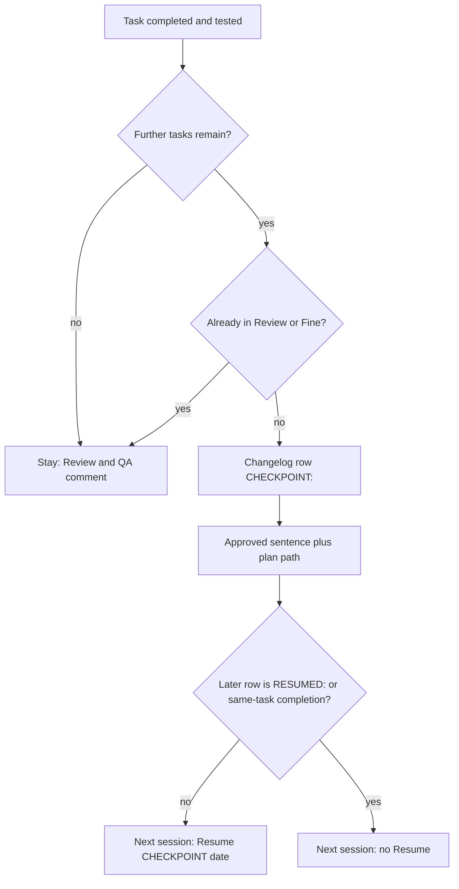

# AC-19 - Implementation Plan

## Task Details

| Field            | Value                   |
| ---------------- | ----------------------- |
| Jira ID          | AC-19                   |
| Title            | Finish session handoff rules that do not depend on window fill |
| Description      | Sub-task of AC-2. A long Implement session must hand off without dropping Review and the QA comment, and a later Changelog note must not hide an unfinished checkpoint. Source of truth for this plan: `docs/specs/ac-2/ac-2.research.md` Question 14, accepted `Accept Research` (2026-09-22). |
| Priority         | High                    |
| Related Research | `docs/specs/ac-2/ac-2.research.md` (Question 14) |

## Wildly Important Goal

**Goal**: Rule 14 hands off a mid-plan Implement session with a checkpoint the next session can still see, and it stays through Review and the QA comment once close-out has started.

**Success Measure**: In `.ai/skills/eversis-orchestrating-implementation/SKILL.md`, rule 14 has no exchange-count trigger, yields to Continuity once Review or Fine has started, tells the person the approved next-step sentence with the plan path, and the readiness scan emits `Resume` for the latest unconsumed `CHECKPOINT:` even when a later non-consuming Changelog row exists. The same scan is in `engineering-manager.md` self-check 1. `npm run sync:adapters:check` passes.

**Do NOT touch / do NOT add**:

- Do not restore a context-window percent trigger for Cursor or Claude Code.
- Do not add the exchange-count trigger to AC-14 or mention Pi Agent in the skill.
- Do not add `preCompact` / `SessionStart` hooks, `agent create-chat`, or `claude --continue` / `--resume` to the rule.
- Do not edit `agent-core.md`, Jira, website pages, or `eversis-fine-handoff`.
- Do not hand-edit generated `.cursor/rules/` or `.claude/` files. `sync:adapters` is the only writer.

## Proposed Solution

One skill owns rule 14. Adapters copy the engineering-manager rule; they do not branch the handoff text per host. This plan edits the two Layer A files and regenerates adapters.

Rule 14 keeps a single agent-observable trigger: the current plan task is completed and tested, and further tasks remain, and the session is not already in Review or Fine. On that trigger the agent writes one Changelog row whose Change Description starts with `CHECKPOINT:`, then tells the person, in these words, with the plan path filled in: „Otwórz nową sesję Implement, wskaż ten plan i nie wznawiaj bieżącego czatu.” The agent cannot close the chat. The sentence is the whole operator instruction. The 5–10 exchange counter is deleted, not narrowed to “after plan approval.”

When Review or Fine has already started, rule 14 does not write a checkpoint and does not end the session. When the completed task is the plan’s last task, rule 13 still proceeds to Fine in the same turn. A non-last task that is completed and tested before Review starts still checkpoints. That is the working-culture handoff from Question 12.

Resume detection scans Changelog rows from the newest backward. It selects the latest row whose Change Description starts with `CHECKPOINT:`. A later row consumes it only when that later description starts with `RESUMED:` or records that the same task is complete. Any other later row, including a rule-12 solution note, leaves the checkpoint visible. The `Resume` line uses the checkpoint row’s date. `Flow` stays `Quick | Full | QA follow-up`.

## Current Implementation Analysis

### Already Implemented

- Rule 14 event trigger and last-task precedence over rule 13 — `.ai/skills/eversis-orchestrating-implementation/SKILL.md` — reuse the event trigger, the `CHECKPOINT:` row shape, and “rule 13 wins on the last task.”
- Optional `Resume` line, not a `Flow` value — same skill and `.ai/rules/orchestration/engineering-manager.md` — reuse the line shape.
- Continuity: Review then Fine in the same session — `agent-core.md` steps 4–5 and the skill’s Continuity section — reuse unchanged. The contradiction is fixed in rule 14.
- Window-fill is already forbidden as a trigger — rule 14 — leave that prohibition in place.
- Adapter generation from `.ai/rules/` — `npm run sync:adapters` — reuse. Do not edit generated files.

### To Be Modified

- Rule 14 and the Step 1 readiness preamble — `.ai/skills/eversis-orchestrating-implementation/SKILL.md` — delete the 5–10 exchange trigger; add Continuity precedence while Review or Fine is in progress; add the approved operator sentence with the plan path; replace “most recent entry starts with CHECKPOINT” with the latest-unconsumed-checkpoint scan (`RESUMED:` or same-task completion).
- Self-check 1 — `.ai/rules/orchestration/engineering-manager.md` — state the same scan, so Layer A does not drift. Do not duplicate the whole rule 14 body.

### To Be Created

- None. No new skill, command, hook, or spec section.

## Open Questions

| #   | Question   | Answer   | Status                |
| --- | ---------- | -------- | --------------------- |
| 1   | One shared operator sentence, or the three host recipes from the comparison note decision 4? | One sentence, verbatim: „Otwórz nową sesję Implement, wskaż ten plan i nie wznawiaj bieżącego czatu.” The agent inserts the plan path. Host CLI recipes stay out of the rule. | ✅ Resolved (`to zdanie jest ok`) |
| 2   | Is `RESUMED:` the consumption marker, beside a row that records the same task complete? | Yes. A later rule-12 note does not consume the checkpoint. | ✅ Resolved (`TAK`) |
| 3   | Does accepting Question 14 authorize deleting the 5–10 counter in this plan? | Yes. `Accept Research` on Question 14 includes that deletion. Do not keep a narrower counter. | ✅ Resolved (`Accept Research`) |

## Technical Context

Project conventions, coding standards, and patterns discovered during planning. Downstream agents MUST read this section instead of re-discovering the same context.

### Project Instructions

- `AGENTS.md` — framework SSOT is `.ai/`. Cursor slash commands are not used by Claude Code. Channel notes may mention `/eversis-implement`; rule 14 must not.
- `.ai/rules/orchestration/engineering-manager.md` — Implement readiness contract. `Resume` is an optional line. Self-check 1 currently inspects specs and does not describe the checkpoint scan.
- `.cursor/rules/eversis-project-stack.mdc` — after substantive edits run `npm run sync:adapters` and `npm run sync:adapters:check` from the repo root. Do not add package dependencies.

### Architecture & Patterns

- Layer A owns the readiness block shape: `engineering-manager.md` and `eversis-orchestrating-implementation/SKILL.md`. Layer B only states “four required lines plus optional signals.” This plan does not add block content to Layer B.
- Rule 14 is a numbered item in “Execution rules and gates.” Edit that item and the Step 1 preamble. Do not renumber rules 1–13.
- Generated host rules come from `npm run sync:adapters`. The skill file is read from `.ai/skills/`; this repo does not ship a full `.cursor/skills` mirror.
- Changelog rows are append-only. Newest row is the last row. Detection walks from the bottom.

### Tech Stack

- Markdown SSOT under `.ai/`.
- Node adapter generator: `npm run sync:adapters`, `npm run sync:adapters:check` (repo root).
- No application runtime, no database, no new dependency.

### Code Style & Standards

- Keep existing documentation comments. Do not shorten them.
- The operator sentence stays in the approved Polish wording inside the English rule. Do not translate it.
- `CHECKPOINT:` and `RESUMED:` are prefixes of the Change Description cell, distinguishable from rule 12’s ordinary rows.

### Testing Patterns

- `npm run sync:adapters` then `npm run sync:adapters:check` from the repo root after the engineering-manager edit.
- Inspectable checks: search the skill for the deleted counter and for the required sentence and prefixes. There is no unit test for this prose rule.
- `eversis_skills_validate` on `eversis-orchestrating-implementation` when the MCP tool is available. A validator warning that is only about body length is not a failure of this task.

### Database Patterns

- Not applicable. This task does not touch a database, schema, or migration.

### Additional Context

- Question 12 keeps the event trigger as a working habit: one plan task finished and tested, state in the Changelog, the next task in a fresh session.
- Plan-review iteration 4 (B1, W3) and the later code-review S1/S2 are the defect list this plan closes. S3 and S4 belong to other subtasks.

## Implementation Plan

### Phase 1: Handoff contract in Layer A

**Goal**: The skill and the engineering-manager self-check describe the same handoff, which is the Wildly Important Goal.

**Description**: Remove the exchange counter, state Continuity precedence during Review and Fine, add the operator sentence, and replace last-row checkpoint detection with a scan for the latest unconsumed `CHECKPOINT:`. Then regenerate adapters so the Cursor engineering-manager rule matches.

**Verification:** `npm run sync:adapters && npm run sync:adapters:check`

#### Task 1.1 - [MODIFY] Rewrite rule 14 and the readiness scan

**Description**: In the orchestration skill, delete the 5–10 exchange trigger from rule 14. Leave the completed-and-tested trigger while further tasks remain, and leave the prohibition on window-fill triggers. Add: if the session is already in Review or Fine, do not write `CHECKPOINT:` and do not end the session; finish Review and the QA comment. Keep the existing last-task precedence (rule 13, Fine in the same turn). After writing a checkpoint, the rule tells the person the approved sentence and inserts the plan path. Replace the Step 1 “most recent entry” check with: from the newest Changelog row backward, take the latest description that starts with `CHECKPOINT:`; if a later row starts with `RESUMED:` or records that same task complete, do not emit `Resume`; otherwise emit `- **Resume:** CHECKPOINT <date>` from that row’s date. `Flow` is unchanged.

**Files:** `.ai/skills/eversis-orchestrating-implementation/SKILL.md` (modify)

**Definition of Done**:

- [x] Rule 14 does not contain an exchange-count trigger (`5-10` / `5–10` prompt/response exchanges).
- [x] Rule 14 still forbids ending the session because of context-window fill.
- [x] Rule 14 says that an in-progress Review or Fine finishes in the session, and that a non-last completed-and-tested task still checkpoints before Review starts.
- [x] Rule 14 contains the sentence „Otwórz nową sesję Implement, wskaż ten plan i nie wznawiaj bieżącego czatu.” and tells the agent to insert the plan path.
- [x] Rule 14 does not contain `agent create-chat`, `claude --continue`, or `claude --resume`.
- [x] The Step 1 preamble detects the latest `CHECKPOINT:` that is not consumed by a later `RESUMED:` row or a later same-task completion row, and does not require the checkpoint to be the last Changelog row.
- [x] `agent-core.md` is unchanged.

**Stop Rule:** Stop if the edit would renumber rules 1–13 or copy the readiness block into a Layer B file.

**Clues**: Rule 14 is one paragraph today. The preamble is the sentence in “Implement readiness (mandatory first output)” that says “most recent entry.” Quote the Polish sentence exactly.

#### Task 1.2 - [MODIFY] Mirror the scan in the engineering-manager self-check

**Description**: Self-check 1 must tell the agent to run the same checkpoint scan the skill preamble now defines, and to emit `Resume` only for an unconsumed checkpoint. Do not paste rule 14’s trigger list into this file. Point at the skill for the scan rules.

**Files:** `.ai/rules/orchestration/engineering-manager.md` (modify)

**Definition of Done**:

- [x] Self-check 1 names the Changelog scan for an unconsumed `CHECKPOINT:` (`RESUMED:` or same-task completion) and the `Resume` line.
- [x] `Flow` enum in this file is still `Quick | Full | QA follow-up`.
- [x] Run `npm run sync:adapters && npm run sync:adapters:check` from the repo root. The generated engineering-manager rule matches this file. No hand edit under `.cursor/rules/` or `.claude/`.

**Stop Rule:** Stop if sync would require editing a file outside Layer A and the generator output.

**Clues**: Self-check 1 is the numbered list under “Self-check before sending the first message.”

### Phase 2: Code Review

**Goal**: An independent review confirms the handoff text matches Question 14, which is what makes the goal trustworthy.

**Description**: Code Reviewer reads the two Layer A files against this plan’s Definition of Done and the Quality Assurance list. No product code and no e2e suite exist for this change.

**Verification:** `npm run sync:adapters:check`

#### Task 2.1 - [REUSE] Code review by Code Reviewer

**Description**: Run **Code Reviewer** via `eversis-review.md` on the Phase 1 diff. Pass any command execution in that review; do not treat a fresh `sync:adapters:check` outside the review as a substitute for the review.

**Files:** `.ai/skills/eversis-orchestrating-implementation/SKILL.md` (reuse), `.ai/rules/orchestration/engineering-manager.md` (reuse)

**Definition of Done**:

- [x] Run `npm run sync:adapters:check` from the repo root.
- [x] Code review passes with no open BLOCKER findings.
- [x] Every Quality Assurance checkbox below is verified against the files, not trusted from Phase 1.
- [x] Review outcome documented in this plan’s Changelog.

**Stop Rule:** Stop after 3 review passes if the same BLOCKER remains, and escalate to the user.

**Clues**: Compare rule 14 to Question 14 items 1–4. Confirm `agent-core.md` and Jira were not edited.

## Security Considerations

- The rule must not instruct the agent to resume the current chat, spawn a host session, or run a CLI that continues the long session. The person opens the next session.
- No credentials, hooks, or new execution surface.

## Quality Assurance

Acceptance criteria checklist to verify the implementation meets the defined requirements:

- [x] Research and plan approvals in the same chat do not by themselves force a checkpoint, because the exchange counter is gone.
- [x] A session already in Review or Fine stays to finish the review and the QA comment.
- [x] After a checkpoint, the agent tells the person: „Otwórz nową sesję Implement, wskaż ten plan i nie wznawiaj bieżącego czatu.” with the plan path filled in.
- [x] A later Changelog note that is not `RESUMED:` and not a completion of that task leaves the unfinished checkpoint visible to the next session.
- [x] Window-fill triggers and Pi Agent support are absent from the edited rule.

## Improvements (Out of Scope)

- AC-14 / AC-21: context-window trigger on Pi Agent only.
- Host hooks that inject `CHECKPOINT:` on session start.
- AC-20: website pages that still say “exact four-line.”
- Publishing an updated AC-19 description to Jira.

## Human gates

1. ~~Approve research~~ — done (`Accept Research`)
2. ~~Approve this plan~~ — done (`Plan is ok. Implement`)
3. ~~Implement → Review → Fine~~ — done (`Plan is ok. Implement`; code review PASS, 0 BLOCKER)

**Superseded by AC-26:** the operator sentence „Otwórz nową sesję Implement, wskaż ten plan i nie wznawiaj bieżącego czatu.” was removed from rule 14. A checkpoint no longer ends the session; the same turn writes `RESUMED:` and the session continues. Do not put that sentence back into the skill. Success Measure and Proposed Solution above keep the AC-19 wording as historical record of what this ticket shipped.

## Changelog

| Date   | Change Description   |
| ------ | -------------------- |
| 2026-09-22 | Initial plan from accepted Question 14. Skill not edited. |
| 2026-09-22 | Code review PASS (0 BLOCKER). Verified Tasks 1.1–1.2 DoD and QA against live Layer A; `npm run sync:adapters:check` OK. |

## Code Review Findings

**Reviewer:** Code Reviewer (independent; did not author the Phase 1 edit)  
**Date:** 2026-09-22  
**Verdict:** PASS  
**Blockers:** 0  
**Suggestions:** 0

### Scope and STRICT FORBIDDEN

- Hand edits limited to `.ai/skills/eversis-orchestrating-implementation/SKILL.md` and `.ai/rules/orchestration/engineering-manager.md`. Generated `.cursor/rules/eversis-engineering-manager.mdc` / Claude packaging match source via `sync:adapters` (exact body match for engineering-manager; `sync:adapters:check` OK).
- `agent-core.md`, Jira, website, and `eversis-fine-handoff` untouched.
- No dependency changes. Documentation comments not shortened.

### Task 1.1 / 1.2 DoD (live verification)

| Check | Result |
| ----- | ------ |
| No `5-10` / `5–10` exchange-count trigger in rule 14 | Met — trigger is completed-and-tested + further tasks; “Do not count prompt/response exchanges.” |
| Context-window fill still forbidden as a trigger | Met |
| In-progress Review/Fine finishes; non-last completed-and-tested still checkpoints before Review | Met |
| Exact Polish operator sentence + insert plan path | Met |
| No `agent create-chat`, `claude --continue`, `claude --resume` | Met |
| Step 1 newest-backward unconsumed `CHECKPOINT:` scan (`RESUMED:` / same-task completion); checkpoint need not be last row | Met |
| `agent-core.md` unchanged | Met |
| Self-check 1 names that scan and `Resume` emission | Met |
| `Flow` remains `Quick \| Full \| QA follow-up` | Met |
| `npm run sync:adapters:check` | Met (exit 0) |

### Quality Assurance

All five QA checkboxes verified true against the skill/rule text (not trusted from Phase 1 checkmarks). Aligns with Question 14 criteria 1–4.

### BLOCKERS

None.

### SUGGESTIONS

None for this pass. Plan-review S1 (“end the session cleanly”) is resolved in the live rule 14 rewrite.
