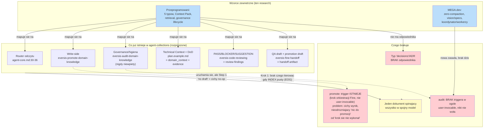
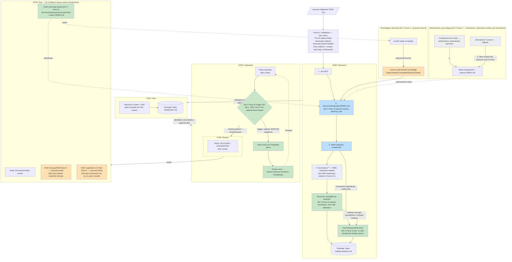
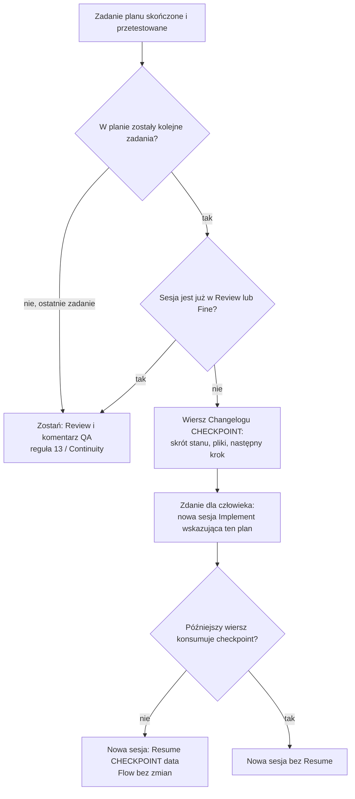

# AC-2 - Analysis Result

## Task Details


| Field                                            | Value                                                                                                                                                                                                                                                                                                                                                                                                                                                                                                                                                                                                                                       |
| ------------------------------------------------ | ------------------------------------------------------------------------------------------------------------------------------------------------------------------------------------------------------------------------------------------------------------------------------------------------------------------------------------------------------------------------------------------------------------------------------------------------------------------------------------------------------------------------------------------------------------------------------------------------------------------------------------------- |
| Jira ID                                          | AC-2                                                                                                                                                                                                                                                                                                                                                                                                                                                                                                                                                                                                                                        |
| Title (dzisiejsza, w Jirze)                      | Give agents a bounded context router so they do not ingest per-task specs                                                                                                                                                                                                                                                                                                                                                                                                                                                                                                                                                                   |
| Title (rzeczywisty zamysł, ustalone w tej sesji) | Zarządzanie kontekstem i wiedzą domenową w cyklu rozwoju aplikacji — architektura dla `agent-collections`                                                                                                                                                                                                                                                                                                                                                                                                                                                                                                                                   |
| Description                                      | **Zakres świadomie rozszerzony w tej sesji** (zob. Question 1) — tekst w Jirze dziś opisuje wyłącznie wąski "bounded context router" (`INDEX.md` → 1 komponent → 1-2 `related_specs`, zakaz glob `docs/specs/`**). Człowiek potwierdził, że intencją AC-2 była od początku **pełna analiza zarządzania kontekstem i wiedzą w całym cyklu rozwoju** — dokładnie zakres dokumentu `przeprogramowani.context-management.md`. Router pozostaje **jednym z elementów** tej analizy, nie całością zadania. Draft zaktualizowanego opisu Jira — zob. sekcja "Draft aktualizacji Jira" pod Gap Analysis, wymaga jawnej akceptacji przed publikacją. |
| Priority                                         | High                                                                                                                                                                                                                                                                                                                                                                                                                                                                                                                                                                                                                                        |
| Reporter                                         | Piotr Niemirski                                                                                                                                                                                                                                                                                                                                                                                                                                                                                                                                                                                                                             |
| Created Date                                     | 2026-09-17                                                                                                                                                                                                                                                                                                                                                                                                                                                                                                                                                                                                                                  |
| Due Date                                         | Not set                                                                                                                                                                                                                                                                                                                                                                                                                                                                                                                                                                                                                                     |
| Labels                                           | claude-code, context, cursor-host, index, sdd                                                                                                                                                                                                                                                                                                                                                                                                                                                                                                                                                                                               |
| Estimated Effort                                 | Not set (Task, project `AC`)                                                                                                                                                                                                                                                                                                                                                                                                                                                                                                                                                                                                                |


## Business Impact

W pierwotnym, wąskim odczytaniu AC-2 dotyczyło jednego mierzalnego ryzyka: agent implementujący `TASK-123` traci bieżące zadanie w wyniku kompresji wywołanej przeszukiwaniem historii `docs/specs/`. To ryzyko pozostaje w mocy i jest w pełni omówione niżej (Question 7-8). Ale w rozszerzonym zakresie stawka jest wyższa: chodzi o to, **czy `agent-collections` ma spójną, przemyślaną architekturę zarządzania kontekstem i wiedzą na każdym etapie cyklu rozwoju** — nie tylko na etapie "agent czyta stare specy".

Dowód zebrany w tej sesji pokazuje, że framework ma dziś **rozproszone, częściowo nakładające się mechanizmy** zbudowane w różnym czasie, przez różne tickety (DHI-630, dzisiejszy AC-1/AC-2), bez jednego dokumentu, który by je spinał w spójny model: router odczytu (`agent-core.md`), promocja wiedzy (`eversis-promote-domain-knowledge`), audyt/higiena (`eversis-audit-domain-knowledge`, nigdy niewpięty), Technical Context w planach (`eversis-creating-implementation-plans`), Definition of Done jako dowód (`plan.example.md`), QA draft po Fine (`eversis-fine-handoff`). Każdy z nich robi kawałek tego, co postulują zewnętrzne wzorce (Przeprogramowani, MEGA.dev) — ale nikt nigdy nie zmapował ich razem jako jeden system. To jest realna luka biznesowa: bez tej mapy kolejne tickety (jak dzisiejszy AC-2) będą dalej odkrywać te same pytania od nowa, tak jak AC-2 nieświadomie powtórzył część ustaleń DHI-630 (zob. `ac-2.research.md` — poprzednia wersja, Question 4-5, zachowane niżej).

## Gathered Information

### Knowledge Base & Task Management Tools

- **AC-2 zweryfikowane na żywo przez `atlassian` MCP** (cloud `eversis.atlassian.net`, projekt `AC` — "Agent Collections", oddzielny od `DHI`). Status **Backlog**, priorytet High. Dzisiejszy tekst opisuje wyłącznie wąski router — **rozbieżny z rzeczywistą intencją zgłaszającego**, ustaloną w tej sesji (zob. Question 1).
- **AC-1** (siostrzany ticket, ta sama data) — rozdziela artefakty BA (`docs/jira-board/`) od SDD (`docs/specs/`). Pozostaje w wąskim, technicznym zakresie, komplementarny do rozszerzonego AC-2, nie wymaga rewizji.
- **DHI-630 / `global-domain-context-ssot`** — bezpośredni poprzednik merytoryczny (722-linijkowy `.research.md` + zatwierdzony `.plan.md`), rozstrzygnął już: strukturę ścieżek — **finalnie, w zatwierdzonym planie**: `docs/context/<project>/INDEX.md` (płasko, bez segmentu pośredniego) + `docs/context/global/` jako osobny, top-level sibling (nie zagnieżdżony pod `<project>/`) — write-path (GitLab API bez checkoutu), model staleness (bez blokady CI, widoczność przez `eversis_context_get`), model fan-out (manualna synchronizacja `eversis_context_sync`). **Korekta (zob. Question 9, poprawka po weryfikacji przy pisaniu Planu):** wcześniejsza wersja tego researchu błędnie cytowała pośrednią, później zastąpioną rewizję ze środka dokumentu `.research.md` (`docs/context/<project>/knowledge/…`) jako rzekomo finalną — plan `.plan.md` (Task 4.2, linia z nagłówkiem draftu Fine) jednoznacznie potwierdza płaską ścieżkę bez `/knowledge/`. Rozszerzony zakres AC-2 **musi** świadomie odnosić się do tych decyzji, nie tylko do nich, ale też do całej reszty architektury wiedzy, którą DHI-630 ustalił tylko częściowo (write-side dla wiedzy domenowej, nie dla pełnego cyklu kontekstu zadania).
- **Dwa materiały źródłowe dostarczone przez człowieka** (lokalne pliki, nie transkrypcje z automatycznego scrapingu):
  - `megadev.context-management.md` — notatki z nagrania "Autonomia Agentów w Rozwoju Oprogramowania — MEGA.dev LIVE" (Adam Gospodarczyk). Materiał **operacyjny/runtime**: dyscyplina sesji, unikanie kompresji, hierarchia koordynator/workerzy, observability, samodoskonalenie reguł.
  - `przeprogramowani.context-management.md` — raport pisany **już ze świadomością architektury `agent-collections`** (cytuje role, `.ai/`, human gates, workflow `Ideate → Implement → Review`). Materiał **architektoniczny**: model warstw kontekstu, Context Pack, retrieval, governance pamięci, staged backlog. **To jest materiał, który najdokładniej odpowiada rzeczywistemu zamysłowi AC-2** — ustalone wprost przez człowieka w tej sesji.

### Codebase

*(Sekcja zachowana z pierwszej wersji researchu — ustalenia pozostają aktualne, rozszerzony zakres ich nie unieważnia, tylko dodaje nowy poziom analizy w Gap Analysis niżej.)*

- **Router już w dużej mierze istnieje**: `.ai/rules/orchestration/agent-core.md:30-36` implementuje sekwencję INDEX → 1 komponent → 1-2 `related_specs`, ale z furtką fallback do `docs/specs/`, która przeczy twardemu zakazowi z pierwotnego tekstu AC-2 (zob. Question 7).
- **MCP już zaimplementowane**: `eversis_context_list/get/sync` w `mcp/eversis-collections-mcp/src/{server.ts,context.ts}`.
- **Write-side już istnieje**: `.ai/skills/eversis-promote-domain-knowledge/SKILL.md` — ocena cross-task, zapis po Fine, human gate, GitLab API. Ścieżka docelowa (`docs/context/<project>/<component>/index.md`) **jest zgodna** z zatwierdzonym planem DHI-630 — zob. korekta w Question 7/9.
- **Governance/higiena już istnieje, ale nigdy niewpięta**: `.ai/skills/eversis-audit-domain-knowledge/SKILL.md` — pięć zamkniętych wyników (Keep/Update/Consolidate/Replace/Delete), `user-invocable: true`, brak automatycznego triggera w orkiestracji.
- **Plan już ma odpowiednik "evidence"/"domain_context"** — `eversis-creating-implementation-plans/plan.example.md`: sekcja Technical Context (stack, konwencje, testy — odpowiednik `domain_context`/`reference_implementations` Przeprogramowanych), Definition of Done z weryfikowalnymi komendami per task (odpowiednik `evidence`), `**Verification:`** per faza. **To nie jest nowy koncept do zbudowania — to już istnieje pod inną nazwą.** Kluczowy wniosek dla Question 3 niżej.
- **Review już ma odpowiednik "review-findings"** — `eversis-code-reviewing`: PASS/BLOCKER/SUGGESTION, PASS jako sprawdzalny predykat (zero BLOCKER + wszystkie DoD/AC zaznaczone) — odpowiednik `review-findings.md` z modelu Przeprogramowanych.
- **Fine już ma odpowiednik "handoff"/"evidence pack"** — `eversis-fine-handoff`: ustandaryzowany QA comment draft, plus opcjonalny drugi draft promocji wiedzy.
- **Brak odpowiednika "decisions"/ADR** — żaden katalog w `agent-collections` nie pełni dziś roli `.ai/decisions/ADR-*.md` z modelu Przeprogramowanych. Decyzje architektoniczne dziś albo giną w treści `*.research.md`/`*.plan.md` (i stają się nieosiągalne po zamknięciu zadania, bo `docs/specs/` nie jest routerem), albo trafiają do `docs/context/<project>/<component>/index.md` jako część opisu komponentu (zmieszane z wiedzą referencyjną, nie oznaczone jako decyzja). **To jest jedyna prawdziwa strukturalna luka** wykryta w tej sesji — nie brakujący mechanizm gdzie indziej, tylko brakujący typ.
- **EOG — empiryczny dowód skali problemu**: 7595 plików, ~20 niezależnie wdrażanych podsystemów, `docs/context/eog/INDEX.md` = 7 linii, 0 wierszy, 1 commit w historii, mimo 28 zamkniętych zadań w `docs/specs/`. Ani promocja, ani audyt nigdy się nie uruchomiły.

### Relevant Links

- Jira `AC-2`, `AC-1` — [https://eversis.atlassian.net/browse/AC-2](https://eversis.atlassian.net/browse/AC-2), `/AC-1`
- `docs/specs/global-domain-context-ssot/` (cały folder) — DHI-630, poprzednik merytoryczny
- `.ai/rules/orchestration/agent-core.md`, `.ai/skills/eversis-promote-domain-knowledge/SKILL.md`, `.ai/skills/eversis-audit-domain-knowledge/SKILL.md`
- `.ai/skills/eversis-creating-implementation-plans/plan.example.md`, `.ai/skills/eversis-code-reviewing/SKILL.md`, `.ai/skills/eversis-fine-handoff.md`
- `mcp/eversis-collections-mcp/src/{server.ts,context.ts}`
- Lokalne materiały człowieka: `.../Docs/Context Management/megadev.context-management.md`, `.../przeprogramowani.context-management.md`, `.../role-context-constrain-pattern.md`
- EOG: `docs/context/eog/INDEX.md`, `docs/specs/*/` (28 folderów)
- Confluence As-Is Pack EOG — [https://eversis.atlassian.net/wiki/spaces/EARTHONLINE/pages/3241017366/As-is+Pack](https://eversis.atlassian.net/wiki/spaces/EARTHONLINE/pages/3241017366/As-is+Pack) (space `EARTHONLINE`, v0.2, 2026-08-28, zweryfikowane na żywo przez `atlassian` MCP) — preferowane źródło bootstrapu, zob. Question 9 Faza 2/7
- Market research (zebrane w tej sesji przez subagenta, cytowane w Question 8): Anthropic "Effective context engineering for AI agents", Liu i in. "Lost in the Middle" (TACL 2024), Chroma "Context Rot" (2026), Aider repo map, `llms.txt`, zagnieżdżone `AGENTS.md`

### Relevant Charts & Diagrams




Legenda: niebieski = materiał zewnętrzny analizowany w tej sesji, czerwony = realna luka, żółty = rekomendowany produkt tej rozszerzonej wersji AC-2 (jedna spójna mapa architektury, nie kolejny rozproszony mechanizm).

**Diagram 2 — planowany przepływ zarządzania kontekstem, wzdłuż cyklu Agent Collections (Research → Plan → Implement → Review → Fine)** (przeprojektowane po uwagach człowieka — pierwsza wersja myliła numerację faz AC-2 z etapami cyklu SDD). Główna, pionowa oś to zawsze pięć etapów cyklu z `agent-core.md`; adnotacje `[AC-2 Faza N]` przy pojedynczych węzłach pokazują tylko **co konkretnie się zmienia** w danym etapie — same etapy i ich kolejność pozostają dokładnie takie, jak dziś.




Legenda: niebieski = router istniejący dziś (Faza 1 go tylko zaostrza), zielony = nowe elementy **w Planie tego AC-2** (Fazy 1-3), pomarańczowy = zaprojektowane w tym researchu, ale odłożone do przyszłych ticketów (Fazy 4/6/7), szary = źródło zewnętrzne (Confluence), nie kod frameworka. Osie pozioma/pionowa = zawsze pięć etapów cyklu `agent-core.md`; adnotacje `[AC-2 Faza N]` = tylko lokalna zmiana w danym węźle, nie nowy etap.

## Current Implementation Status

### Existing Components

*(Zachowane z poprzedniej wersji, wciąż aktualne — zob. też mapowanie w Question 2.)*

- Read-budget routing — `agent-core.md:30-36` — istnieje, wymaga zaostrzenia (Question 7).
- `eversis_context_list/get/sync` — istnieje, gotowe do reużycia.
- `eversis-promote-domain-knowledge` — istnieje, niespójna ścieżka docelowa.
- `eversis-audit-domain-knowledge` — istnieje, nigdy niewpięty w automatyczny trigger.
- `docs/context/<project>/INDEX.md` — wdrożone (scaffolding) w EOG, puste.
- Drugi draft promocji w Fine (`eversis-fine-handoff`) — istnieje.
- **Nowo zidentyfikowane w tej rundzie**: Technical Context + Definition of Done w `plan.example.md` (odpowiednik `domain_context`/`evidence`), PASS/BLOCKER/SUGGESTION w code review (odpowiednik `review-findings`).

### Key Files and Directories

*(Rozszerzone o pliki istotne dla pełnego zakresu.)*

- `.ai/rules/orchestration/agent-core.md`, `spec-driven-development.md`, `engineering-manager.md` — warstwa "rules" (już istnieje jako kategoria).
- `docs/context/<project>/` — warstwa "knowledge" (już istnieje jako kategoria, częściowo).
- `docs/specs/<issue>/` — warstwa "tasks" (już istnieje jako kategoria, pod inną nazwą — "SDD", nie "task state").
- **Brak** dedykowanego katalogu dla warstwy "decisions"/ADR.
- `.ai/skills/eversis-creating-implementation-plans/plan.example.md`, `eversis-code-reviewing/SKILL.md`, `eversis-fine-handoff.md` — rozproszone odpowiedniki "evidence"/"handoff".
- `mcp/eversis-collections-mcp/src/{server.ts,context.ts}` — warstwa retrievalu (dziś: wyłącznie selekcja deterministyczna, poziom 1 z pięciu w modelu Przeprogramowanych — zob. Question 4).

## Gap Analysis

### Question 1

#### Ustalenie zakresu tej rundy — rozbieżność między tekstem Jiry a intencją

**Rozstrzygnięte przez człowieka w tej sesji.** Pierwotny tekst AC-2 w Jirze opisuje wyłącznie wąski "bounded context router". Człowiek potwierdził wprost: *"Ja rozumiałem AC-2 jako zadanie do analizy zarządzaniem kontekstem i wiedzą w ramach rozwoju aplikacji. Dokładnie to o czym jest treść przeprogramowani.context-management.md"* — i wybrał opcję **rozszerzenia AC-2** (nie rozdzielania na dwa tickety) jako sposób postępowania.

**Draft aktualizacji opisu Jira** (do zatwierdzenia przez człowieka, **nie publikowany automatycznie** — zgodnie z regułą frameworka "nigdy nie publikuj do Jiry bez jawnej zgody"):

> **Nowy Goal:** Define and adopt a coherent context-and-knowledge-management architecture for the `agent-collections` application-development lifecycle — covering rule/knowledge/decision/task/evidence layering, per-run context scoping (the bounded INDEX router is one concrete piece of this, not the whole task), session/runtime discipline, and knowledge-lifecycle governance (promotion + audit). Grounded in two external reference models (MEGA.dev operational practice, Przeprogramowani architectural proposal) and validated against a real large legacy monorepo pilot (EOG).
>
> **Zachowane bez zmian:** oryginalne 7 Requirements dot. routera INDEX.md pozostają w mocy jako **jeden z rezultatów** (Phase 1 — zob. Question 9), nie jako cały zakres.

Ten draft **wymaga Twojej jawnej akceptacji** przed wywołaniem `editJiraIssue` — nie zostanie opublikowany w tej turze.

### Question 2

#### Docelowa architektura wiedzy — mapowanie modelu 5 typów (Przeprogramowani) na `agent-collections`

Przeprogramowani proponują pięć odrębnych typów: `rules` (normatywne) / `knowledge` (referencyjne) / `decisions` (ADR) / `tasks` (stan zadania) / `evidence` (dowody). Zamiast traktować to jako nowy system do zbudowania od zera, poniższa tabela mapuje każdy typ na to, co **już istnieje** w `agent-collections` pod inną nazwą — zgodnie z zasadą tego frameworka "reuse istniejących wzorców przed budową nowych".


| Typ (Przeprogramowani) | Odpowiednik w `agent-collections`                                                           | Status                                                                                                                                                                                                                    |
| ---------------------- | ------------------------------------------------------------------------------------------- | ------------------------------------------------------------------------------------------------------------------------------------------------------------------------------------------------------------------------- |
| `rules`                | `.ai/rules/orchestration/`, `.ai/rules/{stack,security,quality,domains}/`                   | **Istnieje, dojrzałe**                                                                                                                                                                                                    |
| `knowledge`            | `docs/context/<project>/<component>/index.md` + `INDEX.md`                                  | **Istnieje**, ale bez rozróżnienia "fakt referencyjny" vs "decyzja" (zob. niżej)                                                                                                                                          |
| `decisions` (ADR)      | —                                                                                           | **Brak.** Jedyna prawdziwa strukturalna luka. Decyzje architektoniczne dziś giną w `*.research.md`/`*.plan.md` (nieosiągalne po zamknięciu zadania) albo mieszają się z wiedzą referencyjną w `docs/context/.../index.md` |
| `tasks` (stan zadania) | `docs/specs/<issue>/` (`*.research.md`, `*.plan.md`, `*.plan-review.md`)                    | **Istnieje**, bogatsze niż propozycja Przeprogramowanych (ma już bramki human-approval, nie tylko stan)                                                                                                                   |
| `evidence`             | Definition of Done w `plan.example.md` + PASS/BLOCKER/SUGGESTION w review + QA draft w Fine | **Istnieje, rozproszone** w trzech miejscach zamiast jednego `evidence.md` per zadanie                                                                                                                                    |


**Rekomendacja:** nie przyjmować dosłownie proponowanej struktury katalogów Przeprogramowanych (`.ai/knowledge/`, `.ai/decisions/`, `.ai/tasks/`, `.ai/indexes/`) — kolidowałoby to z już udokumentowaną, znaną triadą `docs/context`/`docs/specs`/`docs/plans` (`agents-md-standard.md`) i wymagałoby migracji czterech już działających mechanizmów bez wyraźnej korzyści. **Jedyna zmiana strukturalna wartą rozważenia**: dodanie **czwartego elementu do triady** — `docs/decisions/` (lub `docs/context/<project>/decisions/` jako podkatalog, spójnie z resztą triady) dla ADR-ów, które dziś nie mają żadnego stałego miejsca. To jest kandydat na Phase 2 (zob. Question 9), nie coś do wprowadzenia w Phase 1 tego AC-2.

### Question 3

#### Context Pack / Context Contract — czy formalizować manifest per-uruchomienie?

Przeprogramowani proponują `context-pack.yaml` per uruchomienie agenta: `always_include`, `task_context`, `domain_context`, `reference_implementations`, `related_decisions`, `verification`, `budget`. To atrakcyjna koncepcja, ale **duża część jej treści już istnieje rozproszona**: `always_include` ≈ reguły ładowane przez hosta (`CLAUDE.md`/Cursor rules), `task_context` ≈ `docs/specs/<issue>/*.research.md`+`*.plan.md`, `domain_context` ≈ `docs/context/<project>/INDEX.md` → komponent (dokładnie to, co reguluje AC-2 Requirement 3), `reference_implementations` ≈ nieformalne odwołania w treści planu, `verification` ≈ Definition of Done + `**Verification:`** w `plan.example.md`, `budget` ≈ **brak dzisiaj, prawdziwa nowość**.

**Doprecyzowanie `budget`.** To nie jedna liczba globalna — w materiale Przeprogramowanych ma trzy powiązane, ale odrębne przejawy: (1) **operacyjna heurystyka procentowa** ("utrzymywać rozmowę w granicach ok. 40-60% okna" — analogiczna do progu MEGA.dev z Question 5, tylko jako zakres, nie sztywny próg); (2) **formalne pole w manifeście, deklarowane per zadanie**, nie globalnie:

```yaml
budget:
  max_input_tokens: 28000      # sufit docelowy DLA TEGO zadania
  warning_at_tokens: 18000     # niższy próg, wyzwala reakcję zanim dojdzie do sufitu
  refresh_strategy: "checkpoint-and-retrieve"  # co zrobić po przekroczeniu
```

(3) **kryterium selekcji na poziomie 5 retrievalu** ("reranking i budżet tokenowy") — przy zbliżaniu się do budżetu system ma streszczać/odrzucać materiały o niskiej istotności, nie kompresować bezkrytycznie całej historii (różnica jakościowa względem domyślnej auto-kompresji narzędzia).

**Rekomendacja:** nie budować nowego, równoległego pliku YAML per uruchomienie — to koliduje wprost z Requirement 1 pierwotnego AC-2 ("Keep **one** in-repo router... do not add a parallel map") zastosowanym analogicznie do każdego innego nowego formatu kontraktu. Zamiast tego: **formalizować budżet jako pole, nie jako nowy plik** — rozszerzyć istniejący blok **Implement readiness** (`engineering-manager.md`) o piątą/szóstą linię z jawnym budżetem kontekstu (próg + próg ostrzegawczy + strategia po przekroczeniu, w duchu (2) wyżej, powiązane z Question 5) i o status INDEX (nawiązanie do Question 7). To jest jedyny nowy "kontrakt" wart wprowadzenia — pozostałe pola Context Pack już mają swoje miejsce, tylko nienazwane wspólnym słowem.

### Question 4

#### Retrieval — czy `agent-collections` potrzebuje wyszukiwania semantycznego/grafowego?

Przeprogramowani proponują pięć poziomów retrievalu: (1) selekcja deterministyczna wg roli/fazy/ścieżki, (2) metadane + pełnotekstowe, (3) semantyczne, (4) relacje grafowe (`task → feature → module → API contract → ADR → test suite → deployment/runbook`), (5) reranking + budżet. Dzisiejszy `agent-collections` realizuje wyłącznie **poziom 1** (deterministyczna selekcja przez reguły + `eversis_context_list/get`) — nie ma indeksu pełnotekstowego, semantycznego ani grafu relacji.

Rynkowa synteza zebrana w tym researchu (Chroma "Context Rot", porównania long-context vs. RAG) wskazuje, że **RAG/semantic retrieval staje się opłacalny wraz ze wzrostem skali i złożoności repo** — ale EOG (20-30 komponentów, jeśli INDEX zostanie właściwie wypełniony) mieści się wciąż komfortowo w reżimie, gdzie deterministyczna selekcja (poziom 1) wystarcza; problem w EOG nie jest brakiem retrievalu, jest brakiem treści do retrievowania (INDEX ma 0 wierszy). **Rekomendacja: nie budować poziomów 3-4 (semantic, graph) teraz.** To realna, ale przedwczesna inwestycja — właściwa dopiero gdy poziom 1 (deterministyczny) faktycznie się nasyci (dziesiątki-setki wypełnionych komponentów w jednym projekcie, czego dziś nie obserwujemy nigdzie w tym frameworku). Odnotować jako kandydata na Phase 3+ (Question 9), uzależnionego od przyszłego pomiaru rzeczywistego rozmiaru `docs/context/` po tym, jak Phase 1 (router + wymuszona promocja) faktycznie zacznie działać.

**Follow-up — jawny trigger rewizji** (dodane po przeglądzie z człowiekiem). Wrócić do poziomów 2-4 retrievalu, gdy zajdzie którekolwiek:

- (a) jeden projekt (np. EOG po Phase 2) ma >40-50 wypełnionych wierszy w jednym `INDEX.md` — punkt, w którym skanowanie jednej linii/komponent przestaje być tanie poznawczo dla agenta;
- (b) audyt (`eversis-audit-domain-knowledge`, Phase 2) systematycznie raportuje trudność dopasowania zadania do właściwego komponentu z samego opisu jednoliniowego;
- (c) pojawi się drugi realny konsument multi-repo (DHI-630, `docs/context/global/INDEX.md`) i deterministyczna selekcja przestanie skalować się między wieloma repo jednocześnie.

Żaden z tych warunków nie jest dziś spełniony (EOG: 0 wierszy) — trigger jest tu po to, żeby pytanie nie zostało zgubione, gdy sytuacja faktycznie się zmieni, a nie po to, by sugerować bliski termin rewizji.

### Question 5

#### Dyscyplina sesji i runtime (MEGA.dev) — zero-compaction, vision/specs, koordynator/workerzy

MEGA.dev (Adam Gospodarczyk) wnosi coś, czego **nie ma** w modelu Przeprogramowanych ani w dzisiejszym `agent-collections`: konkretną, operacyjną zasadę **unikania kompresji kontekstu w ogóle**, nie tylko jej kontrolowania. Zamiast pozwolić na auto-compaction, agent przy zbliżaniu się do ok. 50% okna zapisuje stan do pliku i **kończy sesję**; zadanie przejmuje świeża instancja.

To bezpośrednio domyka motywację, dla której powstał pierwotny (wąski) tekst AC-2: *"agenci... wypełniają okno kontekstowego → kompresja → ginie bieżący TASK-123"*. AC-2 (router) jest **prewencją** (mniej się ładuje); zasada MEGA.dev jest **zaworem bezpieczeństwa** (gdy mimo prewencji sesja i tak urośnie, nie pozwól jej dojść do auto-kompresji). Te dwa mechanizmy się nie zastępują, tylko się uzupełniają.

**Rekomendacja — przyjąć jako nową zasadę operacyjną w `agent-core.md`/`eversis-orchestrating-implementation`:** próg (np. "gdy wątek zbliża się do ok. 50% okna, zapisz stan zadania do pliku [rozszerzenie istniejącego mechanizmu Changelog w planie / `progress-summary.md` w duchu Przeprogramowanych] i zasygnalizuj koniec sesji zamiast kontynuować w stronę auto-kompresji"). To nie wymaga nowego formatu pliku — `docs/specs/<issue>/<issue>.plan.md` już ma Changelog jako miejsce na tego typu zapis. **Nie przyjmować** dosłownie modelu koordynator/workerzy z osobnych procesów CLI — to już jest pokryte (inaczej technicznie, tak samo funkcjonalnie) przez istniejący podział ról EM → Software Engineer/Architect/itd. w `eversis-orchestrating-implementation`; nie ma potrzeby przebudowy na architekturę wieloprocesową.

**Uzupełnienie po przeglądzie `role-context-constrain-pattern.md`** (materiał dostarczony przez człowieka, synteza bez linków źródłowych przy większości twierdzeń — traktowana jako potwierdzenie kierunku, nie jako dodatkowy, niezależnie zweryfikowany dowód pierwotny na równi z market research z Question 8):

1. **Wzorzec ma ustaloną terminologię branżową**: *Context Degradation Avoidance*, *Single-Task Ephemeral Sessions/Ephemeral Agents*, *File-based State Handoff*, *External Memory/Scratchpad Architecture* — MEGA.dev nie jest odosobnionym pomysłem, tylko lokalną realizacją nazwanego, szerzej rozpoznawanego wzorca.
2. **Silniejsze potwierdzenie rekomendacji "role zamiast procesów"**: materiał wprost mapuje *"Orchestrator-Worker via Roles"* na *"EM → Architekt → Deweloper bez osobnych daemontów/procesów CLI"* — zgodne z powyższą rekomendacją. Dodatkowo, ponieważ delegacja w `agent-collections` przez narzędzie Agent (`subagent_type`) już dziś tworzy **świeży, bezstanowy kontekst per wywołanie**, framework **już realizuje** wzorzec "ephemeral stateless subagents" (przypisywany Anthropic, *Building Effective Agents* — post odrębny od *Effective context engineering for AI agents* cytowanego w Question 8) — to nie luka do zamknięcia, tylko coś do **udokumentowania jako już spełnione** w Planie.
3. **Konkretniejsza recepta reloadu sesji (Aider)**: nowa sesja dostaje wyłącznie (1) system prompt/reguły repo, (2) krótkie podsumowanie stanu z planu, (3) `git diff`/listę zmienionych plików — precyzyjniejszy wzorzec tego, co Phase 3 powinien zapisywać/przywracać, niż ogólny opis "zapisz do Changelog" wyżej.
4. **Trzeci, niezależny typ triggera**: społeczność Cursora używa **liczby wymian prompt-odpowiedź (5-10)**, nie procentu okna. Razem z progiem okna (MEGA.dev) i zdarzeniem "zadanie ukończone+przetestowane" (Przeprogramowani, poprzednia tura) daje to **trzy niezależne sygnały**. Rekomendacja: Phase 3 powinien traktować je jako warunek **OR** (którykolwiek pierwszy wyzwala zapis+koniec sesji), nie wybierać tylko jeden. **Punkt o progu okna jest wycofany dla Cursora i Claude Code — zob. DELTA niżej.**
5. **Dodatkowy argument dla luki "decisions"/ADR (Question 6 niżej)**: wzorzec "Memory Bank" (Cline/społeczność Claude Code CLI) dzieli trwały stan na trzy osobne pliki — `activeContext.md`, `progress.md`, `**decisionLog.md`**. Nawet na poziomie pojedynczego zadania branża rozdziela "co robimy" od "co i dlaczego zdecydowaliśmy" — dziś `agent-collections` miesza to w jednym Changelogu planu, bez wydzielonego dziennika decyzji nawet na poziomie jednego zadania, nie mówiąc o poziomie projektu.

**DELTA (2026-09-21) — trigger „okno ~50%" wypada z reguły agenta dla Cursora i Claude Code.** Źródło: `docs/specs/ac-2/Porównanie zarządzania oknem kontekstu  Cursor   Cursor CLI   Claude Code.md`. Człowiek, w `/eversis-implement`, zdecydował: usunąć funkcjonalność progu ~50% dla Claude Code, Cursor IDE i Cursor CLI, bo jako instrukcja dla modelu jest myląca. Zostaje wyłącznie jako follow-up na moment instalacji **PI Agent**.

Ustalenie z porównania, które tę decyzję niesie: procent zapełnienia okna jest widoczny dla człowieka (wskaźnik w Composerze, `/context` w Claude Code), ale **nie jest udokumentowany jako dostępny modelowi** w Cursor IDE, Cursor CLI ani Claude Code. Reguła 14 mówi do agenta. Trigger, którego agent nie umie odczytać, nie jest regułą — jest pozorem pomiaru. **PI Agent** jest jedynym z czterech środowisk, w którym agent dostaje zużycie kontekstu narzędziem (`context_info` / `pi-rolling-compaction`, próg 50% jako gotowa ekstensja). Dlatego próg okna wraca dopiero przy instalacji PI, nie w tej regule i nie w tym planie.

Co ta DELTA zmienia, a czego nie:

- **Wychodzi z AC-2:** trigger „context window ~50%" w regule agenta, dla adapterów Cursor i Claude Code. Plan (Task 3.1) nadal każe go nazwać — to luka planu, nie tej notatki.
- **Zostaje follow-upem, poza Definition of Done AC-2:** przy instalacji PI Agent przywrócić próg ~50% jako instrukcję agenta albo jako ekstensję `pi-rolling-compaction`. Nie projektować tego teraz.
- **Nie rozstrzygnięte tą wiadomością** (zostają otwarte na odświeżenie planu): liczenie 5–10 wymian dopiero po zatwierdzeniu planu; precedencja Continuity nad wszystkimi triggerami w Review i Fine; zdanie dla operatora, jak otworzyć nową sesję. Porównanie je rekomenduje (decyzje 2–4); człowiek w tej turze rozstrzygnął tylko próg okna.

### Question 6

#### Governance pamięci — status lifecycle i "context hygiene"

Przeprogramowani proponują status lifecycle (`draft → proposed → approved → deprecated → superseded`) i okresowe zadania "context hygiene". **Framework już ma odpowiednik higieny** — `eversis-audit-domain-knowledge` (Keep/Update/Consolidate/Replace/Delete) — ale nigdy niewpięty w żaden trigger (zob. Question 2 w poprzedniej wersji researchu, zachowane w Codebase wyżej).

**Decyzja człowieka (ta tura): opcja 1 wchodzi do Planu AC-2 (Phase 2), opcja 2 formalnie jako follow-up.**

1. **W Planie AC-2 (Phase 2, nie Phase 1 — poprawka literówki z poprzedniej wersji):** wpiąć `eversis-audit-domain-knowledge` w istniejący przepływ jako lekki, okresowy krok — np. licznik "zadań od ostatniego audytu" jako metadana w `docs/context/<project>/INDEX.md`, widoczny w bloku Implement readiness (spójnie z Question 3), bez pełnego statusu lifecycle.
2. **Follow-up (nie w tym Planie):** pełny status lifecycle (`draft/proposed/approved/deprecated/superseded`) na wpisach `docs/context/` — wymaga zmiany frontmatter i workflow obu skilli (`promote`/`audit`), większa zmiana niż uzasadnia sam Phase 2. Powiązane z Question 9 — ten follow-up pokrywa się z tabelą stagingu "5. Knowledge status lifecycle": nowy ticket do założenia po zakończeniu AC-2, nie osobny byt.

### Question 7

#### Router INDEX.md — pierwotne pytania z Jiry i wykryte sprzeczności (Phase 1, szczegóły techniczne)

*(Zachowane z poprzedniej wersji researchu — te ustalenia pozostają w mocy i stanowią rdzeń Phase 1, zob. Question 9.)*

- **Spec catalog** (open question z Jiry): nie budować nowej struktury — sformalizować istniejący `changelog.md` (rollover w `eversis-promote-domain-knowledge`) jako jedyny oficjalny katalog wskaźników, dziś opcjonalny, uczynić obowiązkowym przy przekroczeniu progu.
- **Fail closed dla pustego INDEX** (open question z Jiry): nie blokować CI/gita (DHI-630 już odrzucił blokadę dla pokrewnego problemu staleness) — miękki, widoczny sygnał w bloku Implement readiness (`- **Context:** INDEX empty — 0 components indexed after N completed tasks`), połączony z Question 6 (licznik od ostatniego audytu).
- `**generate_summary_map`/narzędzia "chapter"** (open question z Jiry): **nie** — to jest tooling `.docx` (BA docs writer), inny format, inny cel; zamknąć jako rozstrzygnięte negatywnie.
- **Furtka fallback do `docs/specs/`** (`agent-core.md:36`): dziś zezwala na dokładnie to zachowanie, które ma być zakazane, gdy komponent nie ma wpisu (czyli niemal zawsze na starcie projektu). **Poprawka po pytaniu człowieka (ta tura):** pierwotna rekomendacja ("nigdy rekurencyjny grep/glob po `docs/specs/`**") myliła dwa różne koszty — *discovery* (grep/glob po nazwach/dopasowaniach tematu, nie ładuje treści, koszt znikomy) i *konsumpcję* (pełne wczytanie treści znalezionych plików, realny koszt tokenowy — to jest to, przed czym AC-2 faktycznie chroni, zgodnie z AS-IS: *"wczytują wiele starych `*.plan.md`"*, nie "wiedzą, że istnieją"). Bez tego rozróżnienia zaostrzenie furtki odcinałoby agenta od jedynego dziś dostępnego źródła wiedzy w projektach, gdzie `INDEX.md` jest pusty (np. EOG — 28 zamkniętych zadań, zero promocji), zanim Phase 2 zdąży cokolwiek przenieść do `docs/context/`. **Zrewidowana rekomendacja:** discovery (grep/glob nazw plików/dopasowań tematu w `docs/specs/*`*) pozostaje **zawsze dozwolone**; pełne wczytanie treści znalezionych plików podlega **temu samemu budżetowi co `related_specs`** (maks. 1-2 pliki), niezależnie od tego, czy trafiły tam przez INDEX, czy przez discovery. Nigdy: pętla wczytująca treść każdego pasującego wyniku bez tego limitu.
- **Niespójność ścieżek — WYCOFANE, błąd tego researchu.** Poprzednie wersje tego dokumentu twierdziły, że `eversis-promote-domain-knowledge` (ścieżka płaska, `docs/context/<project>/<component>/index.md`) jest niespójny z DHI-630. Sprawdzone dokładnie przy pisaniu Planu: **zatwierdzony `global-domain-context-ssot.plan.md`** (Task 4.2, nagłówek draftu Fine: *"propozycja promocji wiedzy do `docs/context/<project>/`"*) potwierdza jednoznacznie płaską ścieżkę, bez segmentu `/knowledge/`. Wcześniejsze twierdzenie opierało się na pośredniej, później zastąpionej rewizji ze środka 722-linijkowego `.research.md` DHI-630, przeczytanej tylko częściowo (offset 1-254 z 723 linii) — nie na finalnym, zatwierdzonym planie. `**eversis-promote-domain-knowledge` nie wymaga żadnej zmiany ścieżki.** To usuwa jeden task z Fazy 2 (zob. Question 9).

### Question 8

#### Skalowalność dla dużych repo legacy (EOG) i synteza rynkowa

*(Zachowane z poprzedniej wersji researchu — wniosek pozostaje w mocy: kompresja do `INDEX.md` jest architektonicznie uzasadniona, zgodna z rekomendacją Anthropic (context engineering, just-in-time, progressive disclosure) i z konwergentnym wzorcem rynkowym (zagnieżdżone `AGENTS.md`, `llms.txt`, token-budżetowana repo map Aidera). Limit ~200 linii nie jest problemem pojemnościowym dla EOG (~20-30 komponentów mieści się z zapasem) — realny problem jest organizacyjny/adopcyjny, potwierdzony empirycznie (0 wierszy mimo 28 zadań). Kluczowe ryzyko: rynkowe odpowiedniki są generowane/automatyczne, `agent-collections` wybrał ręczną kurację + bramkę człowieka — dziedziczy ryzyko staleness, które rynek dziś rozwiązuje automatyzacją, co jest świadomym kompromisem zgodnym z filozofią frameworka (human gates), nie błędem.)*

**Dodatkowa perspektywa skalowalności** (po rozszerzeniu zakresu): jeśli Phase 1 (router + wymuszona promocja) faktycznie zadziała i EOG zacznie realnie wypełniać `INDEX.md`, kolejnym naturalnym pytaniem stanie się hierarchiczny indeks-per-podsystem (`docs/context/eog/portal/INDEX.md` pod jednym wierszem `portal` w głównym indeksie) — zgodnie z konwergentnym wzorcem rynkowym (zagnieżdżone `AGENTS.md`). To pytanie **nie ma dziś sensu rozstrzygać** — EOG ma 0 wierszy, nie 200; problem przepełnienia jest teoretyczny, problem pustki jest realny. Odnotować jako świadomie odłożone (Phase 3+).

### Question 9

#### Staging — co realnie wchodzi do Planu tego AC-2 (Phase 1), a co do przyszłych ticketów

Przeprogramowani proponują 4-etapowy backlog (kontrakty/artefakty → orkiestracja kontekstu → retrieval/observability → governance). To dobrze mapuje się na SDD tego frameworka (fazy w `*.plan.md`) i na powyższe ustalenia. Rekomendowany podział na **ten** Plan AC-2 vs. przyszłe tickety:


| Faza                                                          | Zakres                                                                                                                                                                                                                                                                                                                                                                                                                                                                                                                                         | Czy w Planie AC-2 (Phase 1)?                                                                                                                                                                                               |
| ------------------------------------------------------------- | ---------------------------------------------------------------------------------------------------------------------------------------------------------------------------------------------------------------------------------------------------------------------------------------------------------------------------------------------------------------------------------------------------------------------------------------------------------------------------------------------------------------------------------------------- | -------------------------------------------------------------------------------------------------------------------------------------------------------------------------------------------------------------------------- |
| 1. Router + budżet odczytu                                    | Zaostrzyć `agent-core.md` (usunąć/zawęzić furtkę fallback), spójność Cursor/Claude Code, odrzucić `docs/plan/INDEX.md`                                                                                                                                                                                                                                                                                                                                                                                                                         | **Tak** — to jest oryginalny, wąski tekst AC-2, w pełni gotowy do Planu                                                                                                                                                    |
| 2. Wymuszona promocja + higiena                               | ~~Ujednolicić ścieżkę `eversis-promote-domain-knowledge`~~ — **wycofane, ścieżka już poprawna** (zob. korekta w Question 7). Zakres Fazy 2: lekki licznik audytu w INDEX + sygnał w Implement readiness, **plus zaprojektować (nie: wykonać) mechanizm jednorazowego bootstrapu wstecznego** dla repo z niepustym `docs/specs/` i pustym `INDEX.md`                                                                                                                                                                                            | **Tak (mechanizm), Nie (wykonanie)** — tanie dla części ongoing, domyka "Empty INDEX is a failure mode" (Requirement 4); samo wykonanie bootstrapu na EOG to osobne zadanie w repo EOG, poza Definition of Done tego Planu |
| 3. Zero-compaction / budżet sesji (MEGA.dev)                  | Zapis stanu do Changelog planu zamiast auto-kompresji. **Próg ~50% okna wycofany z reguły agenta dla Cursora i Claude Code** (DELTA Question 5, 2026-09-21) — follow-up dopiero przy instalacji PI Agent                                                                                                                                                                                                                                                                                                                                       | **Tak, bez triggera procentowego dla Cursora i Claude Code**                                                                                                                                                               |
| 4. Typ "decisions"/ADR                                        | Nowy katalog `docs/decisions/` lub `docs/context/<project>/decisions/`, migracja istniejących decyzji z research/planów. **Konkretny seed już istnieje**: sekcja 6 "Decision log" As-Is Pack EOG (Confluence, `EARTHONLINE` space, strona 3241017366) ma dziś 5 gotowych wpisów (data/kontekst/decyzja/kto/źródło) — nie jest to już czysto hipotetyczna potrzeba, tylko realna treść czekająca na docelowe miejsce w repo.                                                                                                                    | **Nie — nowy, osobny ticket w Jirze, założony PO zakończeniu AC-2** (decyzja człowieka, ta tura)                                                                                                                           |
| 5. Status lifecycle (draft/proposed/approved/…)               | Rozbudowa frontmatter + workflow `promote`/`audit`                                                                                                                                                                                                                                                                                                                                                                                                                                                                                             | **Nie — nowy, osobny ticket w Jirze, założony PO zakończeniu AC-2** (decyzja człowieka, ta tura; pokrywa się z follow-up z Question 6, opcja 2)                                                                            |
| 6. Retrieval poziom 2-4 (pełnotekstowy, semantyczny, grafowy) | Indeksowanie, embeddingi, graf relacji                                                                                                                                                                                                                                                                                                                                                                                                                                                                                                         | **Nie — do follow-upu, nie osobny ticket teraz** (decyzja człowieka, ta tura; zob. jawny trigger rewizji w Question 4)                                                                                                     |
| 7. Sync `docs/context/` → As-Is Pack (Confluence)             | Trzeci, opcjonalny draft w `eversis-fine-handoff` (obok QA comment i promocji do `docs/context/`) — sugestia aktualizacji odpowiedniej sekcji As-Is Pack, generowana z tych samych faktów co promocja, publikowana jako komentarz Confluence (`createConfluenceFooterComment`/`createConfluenceInlineComment`, nie edycja strony — ryzyko naruszenia struktury ADF/HTML już odnotowane w DHI-630), zatwierdzana przez właściciela sekcji. Wymaga nowego pola frontmatter (`as_is_pack_module: M-0X`) łączącego komponent z modułem As-Is Pack. | **Nie — nowy, osobny ticket w Jirze, założony PO zakończeniu AC-2** (decyzja człowieka, ta tura)                                                                                                                           |


**Wniosek:** rozszerzony zakres AC-2 daje **pełną mapę** (ten dokument), ale sam Plan implementacyjny powinien objąć tylko Fazy 1-3 z tabeli — to i tak istotnie więcej niż oryginalny wąski tekst Jiry (dodaje Fazę 2 higieny i Fazę 3 zero-compaction), bez rozdmuchania do pełnej przebudowy architektury wiedzy frameworka w jednym ticketcie.

**Bootstrap wsteczny dla istniejących dużych repo — poprawione po dalszym pytaniu człowieka.** Pierwotne sformułowanie tego akapitu było błędne i zostało skorygowane. Sprawdzone dokładnie: `eversis-audit-domain-knowledge` Krok 1 iteruje *"for each `docs/context/<project>/<component>/index.md`"* — po **istniejących** plikach; Krok 3 (under-triggering) próbkuje `docs/specs/` tylko *"for components with active `code_paths`"*, czyli porównując do już istniejącego opisu komponentu. **Gdy `INDEX.md` ma 0 wierszy (EOG), ten skill nie ma po czym iterować — jest no-opem.** "Od ostatniego audytu obejmuje całą historię" (poprzednie sformułowanie) myliło "brak wcześniejszego audytu" z "brak wcześniejszej zawartości do porównania" — to nie jest ten sam przypadek.

**Rzeczywisty wniosek:** ani `eversis-promote-domain-knowledge` (działa tylko na *aktualnie kończonym* zadaniu), ani `eversis-audit-domain-knowledge` (działa tylko na *już istniejących* komponentach) nie realizują bootstrapu od zera. Potrzebny jest **trzeci, dziś nieistniejący mechanizm**: jednorazowy przebieg, który czyta surowe `docs/specs/*/`, klastruje je po dotykanych ścieżkach kodu/temacie i dla każdego klastra ocenia (kryterium jak w `promote-domain-knowledge` Step 1: "czy to cross-task?"), czy utworzyć nowy plik komponentu + wiersz w `INDEX.md`.

**Rozdział zakresu (poprawka):** AC-2 jest implementowane **w repo `agent-collections`** (Delivery Standard: `docs/specs/ac-2/` w agent-collections), dystrybuowane do EOG przez submoduł/vendor bump. Plan AC-2 (Faza 2) powinien **zaprojektować/zbudować mechanizm** bootstrapu jako część frameworka — ale **wykonanie** go na 28 folderach EOG to praca **w repo EOG**, osobne zadanie adopcyjne po zaciągnięciu nowej wersji frameworka, poza Definition of Done tego Planu. Nie mylić "framework dostarcza narzędzie" z "framework wykonuje pracę za konsumenta".

**Confluence As-Is Pack jako preferowane, tańsze źródło pierwszego przebiegu bootstrapu** (dodane po pytaniu człowieka o projekty maintenance z opóźnioną adopcją frameworka). Zweryfikowane na żywo: As-Is Pack EOG (`EARTHONLINE`, strona 3241017366, v0.2, 2026-08-28) jest **znacząco bardziej dojrzały** niż generyczny szablon DAWIS oceniony w DHI-630 (tam: 0/6 checkboxów, głównie placeholdery) — tu: 4/6 "Praca zakończona", z gotową mapą 10 modułów (kandydaci na wiersze `INDEX.md`), 3 w pełni opisanymi modułami w sekcji 9 (niemal gotowa treść `index.md`) i **już istniejącymi ręcznymi odnośnikami do konkretnych folderów `docs/specs/`** (np. DHI-441 → `docs/specs/dhi-441-gdpr-image-removal/`). Dla projektów, gdzie taki dokument istnieje i jest podobnie dojrzały, mechanizm bootstrapu (Faza 2) powinien **sprawdzić go jako pierwszy, tańszy krok** — przed klastrowaniem surowych speców — i sięgać do `docs/specs/` tylko dla modułów, które As-Is Pack sam oznacza jako nieopisane (kolumna "Status docs": ❌/⚠️). Ocena strukturalna z DHI-630 (mismatch "jedna strona vs. jeden-temat-jeden-plik") nie przenosi się wprost na tę, bardziej dojrzałą instancję — sekcja 9 jest już zorganizowana per-moduł, bliżej docelowej granularności.

**Akcje po zakończeniu AC-2** (ustalone z człowiekiem, ta tura — nie wykonywać teraz, tylko odnotować jako zobowiązanie na Fine/po Fine tego zadania):

1. Założyć nowy ticket w projekcie `AC` dla Fazy 4 (typ `decisions`/ADR) — z odniesieniem do gotowego seedu w As-Is Pack EOG (Decision log, sekcja 6).
2. Założyć nowy ticket w projekcie `AC` dla Fazy 5 (status lifecycle) — może być połączony z #1, skoro oba dotyczą tego samego rozszerzenia frontmatter/workflow wokół wiedzy trwałej, decyzja architekta przy zakładaniu.
3. Faza 6 (retrieval poziom 2-4) **nie** dostaje osobnego ticketu teraz — pozostaje jako uśpiony follow-up z jawnym trigger rewizji zapisanym w Question 4, do podjęcia dopiero gdy jeden z trzech warunków tam wymienionych faktycznie zajdzie.
4. Założyć nowy ticket w projekcie `AC` dla Fazy 7 (sync `docs/context/` → As-Is Pack) — po ustabilizowaniu Fazy 2 (promocja) i Fazy 4 (typ decisions), bo Faza 7 zależy od obu (mapowanie komponent↔moduł, rozróżnienie wiedzy referencyjnej od decyzji przy generowaniu sugestii).

**Aktualizacja 2026-09-22:** te tickety już istnieją, jako subtaski AC-2, nie jako osobne Taski zakładane po zamknięciu parenta. Mapowanie kluczy i kolejność: Question 11.

### Question 10

#### DELTA 2026-09-21 — czy opis Jira AC-2 jest zgodny ze stanem wdrożenia?

**Źródło:** `getJiraIssue` na `eversis.atlassian.net` (cloud `24d9ed05-5d0a-4228-ae1a-8e5f10122f36`), klucz `AC-2`, odczyt 2026-09-21. Status **In Progress**. Summary: *Define a context-and-knowledge-management architecture for agent-collections (Phase 1: bounded context router)* — zgodny z celem ticketu. Dwa komentarze QA (21:52 i 20:51) są nowsze i bliższe kodowi niż pole **Description**.

**Werdykt:** **nie — Description nie jest zsynchronizowany z tym, co wylądowało.** Goal i podział Faz 1–3 vs 4–7 nadal trzymają. Requirements 8–11, Phase 2/3 AC, tabela TO-BE, Technical Notes i Delivery Standard opisują stan sprzed plan-review i research DELTA (~50%). Komentarze QA tego nie naprawiają: Description pozostaje SSOT ticketu.


| Ticket (Description)                                                                                                                         | Shipped (2026-09-21)                                                                                                                                                                               | Alignment                                                                         |
| -------------------------------------------------------------------------------------------------------------------------------------------- | -------------------------------------------------------------------------------------------------------------------------------------------------------------------------------------------------- | --------------------------------------------------------------------------------- |
| Phase 1: discovery always / consumption 1–2; one `INDEX.md`; reject `docs/plan(s)/INDEX.md`                                                  | `agent-core.md` + generated Cursor/Claude hosts                                                                                                                                                    | **Aligned**                                                                       |
| Phase 1 req 2: component path already `<component>/index.md` (promote)                                                                       | Promote unchanged; **import** skill was wrong and was fixed to the same path                                                                                                                       | **Partial** — ticket never names the import-path fix                              |
| Phase 1 req 4–5: tighten Fine promotion; make `changelog.md` rollover mandatory at threshold                                                 | Promote skill **not** changed; rollover stays “create if absent” at ~15–20                                                                                                                         | **Not done** (and later plan left promote untouched)                              |
| Phase 2 req 8 / AC: readiness shows **tasks since last audit**                                                                               | Only `Context: N components`; **Audit line deferred to Phase 5**                                                                                                                                   | **Stale — overclaims**                                                            |
| Phase 2 req 9 / Technical Notes: “new skill or new mode”; “design not execute”                                                               | Extended existing `eversis-import-confluence-knowledge` (As-Is first, `docs/specs/` fallback, no-As-Is branch). Not a new skill                                                                    | **Stale mechanism name** — outcome (mechanism exists, not run on EOG) **aligned** |
| Phase 2 AC: “N tasks since last audit”                                                                                                       | Component count, not task-since-audit                                                                                                                                                              | **Stale**                                                                         |
| Soft empty-INDEX signal, no CI/git block                                                                                                     | `Context: 0 components indexed`, non-blocking                                                                                                                                                      | **Aligned** (ticket mixes this with the audit counter)                            |
| Phase 3 req 10 / AC: **three** triggers including window ~50%                                                                                | Two triggers: 5–10 exchanges; done+tested **while further tasks remain**. Window % **removed** for Cursor/Claude Code. Rule 13 wins on last task. `Resume` is an optional line, not a `Flow` value | **Stale — overclaims**                                                            |
| Readiness = exact four lines                                                                                                                 | Four required + optional `Resume` / `Context` / `Reason` (Layer A only)                                                                                                                            | **Stale**                                                                         |
| Technical Notes: zero-compaction in `agent-core.md` + SDD; wire `eversis-audit-domain-knowledge`; touch `eversis-fine-handoff` + `AGENTS.md` | Rule 14 lives only in `eversis-orchestrating-implementation`. Audit skill: one sentence (`source: confluence` + empty `code_paths` → Update). Fine-handoff and `AGENTS.md` **not** edited          | **Stale touch list**                                                              |
| Delivery Standard: “Plan: in progress”                                                                                                       | Plan approved and implemented (Phases 1–3 + Task 3.2 + B1 principle fix)                                                                                                                           | **Stale process line**                                                            |
| Phases 4–7 deferred                                                                                                                          | Still out of shipped `.ai/`                                                                                                                                                                        | **Aligned**                                                                       |


**Co jest zgodne i nie wymaga zmiany opisu merytorycznego:** Goal (Fazy 1–3 w tym ticketcie), discovery/consumption, jeden router, brak blokady CI, bootstrap As-Is-first / nie uruchamiać na konsumencie, MCP bez zmian, mały fix `domain-context.md`, brak przebudowy multi-process.

**Co Description nadal obiecuje, a kod nie dostarcza:**

1. Licznik „tasks since last audit” w readiness (wymóg 8 + Phase 2 AC).
2. Trzy triggery zero-compaction z ~50% okna (wymóg 10 + Phase 3 AC).
3. Nowy skill bootstrapu (Technical Notes) — jest rozszerzenie istniejącego.
4. Wpięcie audytu w orkiestrację i zmiana `eversis-fine-handoff` / `AGENTS.md`.
5. Obowiązkowy rollover `changelog.md` i „tighten so agents actually run” promocji po Fine.

**Draft aktualizacji Description:** pełny tekst do wklejenia jest w `ac-2.plan.md` Phase 5 (appendix). Nie publikować przez `editJiraIssue` bez osobnej akceptacji tego planu i jawnego „publish to Jira”.

### Question 11

#### DELTA 2026-09-22 — analiza podzadań AC-2

**Źródło:** `getJiraIssue` + JQL `parent = AC-2` (cloud `24d9ed05-5d0a-4228-ae1a-8e5f10122f36`), odczyt 2026-09-22. Parent **AC-2** jest **In Progress** (Fazy 1–3 wdrożone, Description zsynchronizowany w Phase 5 planu). Przy tym odczycie siedem subtasków, wszystkie **Backlog**. **Aktualizacja tego samego dnia:** AC-21 przeniesione pod AC-14, więc pod AC-2 zostaje sześć. Faza 6 (retrieval 2–4) słusznie **nie ma** ticketu — żaden trigger z Question 4 nie zaszedł (`docs/context/agent-collections/INDEX.md` ma jeden wiersz: `readiness-contract`).

Prośba tej tury: analiza podzadań, nie plan i nie implementacja. Każde podzadanie, które wejdzie w Implement, dostaje **własny** research i plan. Ta sekcja jest mapą portfela.


| Klucz                                               | Priorytet | Odpowiednik                                                       | Co już jest                                                                                                                    | Co zostaje                                                                                                                                                                                                                                                                                                       |
| --------------------------------------------------- | --------- | ----------------------------------------------------------------- | ------------------------------------------------------------------------------------------------------------------------------ | ---------------------------------------------------------------------------------------------------------------------------------------------------------------------------------------------------------------------------------------------------------------------------------------------------------------- |
| [AC-19](https://eversis.atlassian.net/browse/AC-19) | High      | Reszta Question 5 / plan Human gate 3 / logical-review **S1, S2** | Dwa triggery bez progu okna; rule 13 wygrywa tylko na **ostatnim** tasku planu; linia `Resume` istnieje                        | Licznik 5–10 liczy **całą** sesję, także bramki research/plan, i koliduje z Continuity (Review→Fine w tej samej sesji). Resume patrzy na **ostatni** wiersz Changelogu — późniejsza notatka chowa niedokończony `CHECKPOINT:`. Brak zdania dla człowieka, jak otworzyć nową sesję i wskazać plan.                |
| [AC-16](https://eversis.atlassian.net/browse/AC-16) | Medium    | Question 9 Faza 4                                                 | Brak katalogu decyzji. Seed: Decision log As-Is Pack EOG (sekcja 6)                                                            | Wybrać dom: `docs/decisions/` albo `docs/context/<project>/decisions/`. Question 2 tego nie zamknął.                                                                                                                                                                                                             |
| [AC-18](https://eversis.atlassian.net/browse/AC-18) | Medium    | Question 9 Faza 5 + Open Question 4                               | Audyt istnieje, `user-invocable`, niewpięty. Wyjątek „puste `code_paths` → Update” obejmuje tylko `source: confluence`         | Lifecycle `draft → … → superseded` i trwały licznik „zadań od audytu”. Osobno: logical-review **S3** — `source: docs-specs-cluster` z pustymi `code_paths` nadal czyta się jako `Delete`. AC-18 mówi „freshly imported”, ale nie nazywa tego źródła.                                                             |
| [AC-22](https://eversis.atlassian.net/browse/AC-22) | Medium    | **Poza** tabelą Faz 1–7. Workshop 2026-09-21, story 1.1           | `eversis-promote-domain-knowledge` ma `user-invocable: false` i działa przy Fine. Skilla `eversis-add-domain-knowledge` nie ma | Nowa komenda: draft faktu bez zamykania ticketu, zapis lokalny po akceptacji, bez MR. Nie wolno zrobić z promocji po Fine pozycji w menu komend. Pełny research: `docs/specs/ac-22/ac-22.research.md`.                                                                                                           |
| [AC-17](https://eversis.atlassian.net/browse/AC-17) | Low       | Question 9 Faza 7                                                 | Fine ma draft QA i draft promocji. Trzeciego draftu (komentarz Confluence, nie edycja strony) nie ma                           | Start po AC-16. Faza 2 (mechanizm bootstrapu) już wylądowała; promocja po Fine **nie** była zaostrzana. Analiza 2026-09-22: `docs/specs/ac-17/ac-17.research.md`.                                                                                                                                                |
| [AC-20](https://eversis.atlassian.net/browse/AC-20) | Low       | Plan Open Question 1 / Improvements + logical-review **S4**       | `domain-context.md` ma małą poprawkę routera. Warstwa B w `.ai/` mówi „four required + optional”                               | Wygenerowana strona promptu i część ręcznych stron witryny nadal mówi „exact four-line”. Szersza mapa architektury (decyzje, lifecycle, handoff) nie jest opisana. To dokumentacja, nie budowa faz.                                                                                                              |
| [AC-21](https://eversis.atlassian.net/browse/AC-21) | Low       | DELTA Question 5, follow-up PI                                    | Próg ~50% **wyjęty** z reguły dla Cursora i Claude Code                                                                        | **Nie do implementacji teraz.** Od 2026-09-22 subtask [AC-14](https://eversis.atlassian.net/browse/AC-14) (wcześniej AC-2). AC-14 jest w Backlogu, więc nie ma hosta, na którym reguła mogłaby żyć bez wycieku do Cursora i Claude Code. Workflow projektu AC nie ma statusu Blocked — AC-21 zostaje w Backlogu. |


**Czego żaden subtask nie bierze.** Dwie pozycje z Improvements planu zostały świadomie poza AC-2 i nadal nie mają klucza: zaostrzenie promocji po Fine oraz obowiązkowy rollover `changelog.md` przy progu ~15–20. Nie dokładam ich do tego portfela. S3 (cluster → Delete) **powinien** wejść w AC-18, inaczej zostaje bez właściciela. Szczegół tego ticketu: Question 15.

**Typ issue kłóci się z Question 9.** Tamte fazy miały być osobnymi ticketami **po** zamknięciu AC-2. Dziś są subtaskami otwartego parenta. Skutek: AC-2 zostaje In Progress, dopóki nie skończą się także AC-21 (czeka na AC-14) i AC-20. AC-22 sam wymaga pełnego SDD (własny research i plan) — to zakres Taska, nie subtaska.

**Kolejność, którą ta analiza rekomenduje** (do korekty przy akceptacji DELTY):

1. **AC-19** — jedyny High, niezależny, zamyka sprzeczną regułę, która dotyczy każdej sesji Implement.
2. **AC-16** i **AC-18** równolegle jako dwa Taski. Wspólne słownictwo statusu ustala AC-18; AC-16 nie wprowadza drugiego enumu. AC-18 wciąga S3.
3. **AC-22** może iść równolegle z pkt 2, pod jednym ograniczeniem: „draft do akceptacji” zostaje bramką człowieka, bez nowego enumu statusu. Gdy AC-18 doda enum, zatwierdzony zapis AC-22 mapuje się na `approved`. Research AC-22 (`docs/specs/ac-22/ac-22.research.md`) doprecyzowuje: `source: manual`, puste `code_paths` dozwolone, a wyjątek audytu „puste ścieżki → Update, nie Delete” dla tego źródła zostaje w AC-18 obok S3. To nie wstrzymuje startu AC-22.
4. **AC-17** po AC-16.
5. **AC-20** po AC-19. Fazy, których jeszcze nie ma, opisuje jako przyszłą pracę. Późniejsza zmiana kontraktu w AC-16/18 dostaje krótką poprawkę docs w tamtym ticketcie, nie wstrzymuje AC-20 do końca portfela.
6. **AC-21** dopiero po AC-14.

**Korekta w Question 12:** jeśli licznik 5–10 wypadnie z reguły 14, AC-19 nie jest już łatą tego licznika. Zostają w nim trzy inne luki (Continuity wobec triggera zdarzeniowego, skan `CHECKPOINT:`, zdanie o nowej sesji).

**Pytania otwarte na bramce** (odpowiedź razem z akceptacją albo osobno; nie blokują zapisu tej DELTY):

1. Zostawić AC-16–AC-22 jako subtaski (AC-2 nie schodzi do Done, póki wszystkie nie skończą się), czy promować je do Tasków-rodzeństwa, żeby parent mógł się zamknąć na Fazach 1–3?
2. AC-16: `docs/decisions/` czy `docs/context/<project>/decisions/`? **Rozstrzygnięte 2026-09-22: `docs/decisions/`.** Żaden istniejący skill tam nie zapisuje. `eversis-promote-domain-knowledge` pisze wyłącznie do `docs/context/<project>/`, a `eversis-fine-handoff` pokazuje tylko draft tej promocji. Zapis decyzji jest do zbudowania w AC-16, nie do podpięcia pod promocję wiedzy.
3. Czy S3 (`source: docs-specs-cluster` + puste `code_paths`) dopisać wprost do AC-18? **Rekomendacja w Question 15: tak** — nazwać oba źródła importu. Opis Jira bez zmian do osobnej akceptacji publikacji.

### Question 12

#### DELTA 2026-09-22 — czy utrzymywać licznik 5–10 wymian

**Źródło tej tury:** człowiek, po wyjaśnieniu podstawy reguły: „Nie widzę podstaw żeby utrzymywać zasadę 5-10. Przeprowadź analizę.” Skill nadal zawiera licznik (reguła 14, `.ai/skills/eversis-orchestrating-implementation/SKILL.md`, wprowadzona commitem `0b6633a`, 2026-09-21 21:15). Ta sekcja nie zmienia skilla.

**Werdykt:** licznika 5–10 nie ma za co utrzymać jako reguły agenta dla Cursora i Claude Code. Zostaje drugi trigger reguły 14: zadanie skończone i przetestowane, a w planie zostały kolejne, plus format `CHECKPOINT:` i linia `Resume`.

**Co reguła miała robić.** Długa sesja Implement dochodzi do automatycznej kompresji i gubi bieżące zadanie. Router (Faza 1) jest prewencją: mniej się wczytuje. Reguła 14 miała być zaworem: zapisz stan i skończ czat, zanim kompresja zrobi to sama. Pierwotny sygnał tego zaworu, z MEGA.dev, to około 50% okna. Liczba wymian weszła obok niego jako trzeci sygnał (Question 5, punkt 4).

**Skąd jest liczba.** Jedno zdanie w `role-context-constrain-pattern.md`: społeczność Cursora kończy wątek po około 5–10 wymianach. Research oznacza tę notatkę jako syntezę bez linków przy większości twierdzeń. Nie ma pomiaru sesji Implement w tym frameworku, który by uzasadniał 5, 10 albo przedział między nimi. Po zdjęciu progu okna (DELTA Question 5, zaakceptowana) notatka porównawcza hostów (decyzja 2) zostawiła licznik jako „jedyny sygnał, który agent potrafi policzyć sam”. To jest cały powód, dla którego Task 3.2 kazał go zostawić.

**Dlaczego ten powód nie trzyma reguły.**

1. **Ten sam standard, który zdjął próg okna, osłabia licznik.** Notatka porównawcza (sekcja 2): reguła dla agenta na sygnale, którego agent nie odczytuje, jest niewykonalna. Procent okna odpada, bo model go nie dostaje. Liczby wymian też nic nie wstrzykuje. Agent może co najwyżej oszacować długość transkryptu, który sam właśnie czyta. Po kompresji ta historia znika, więc licznik znika razem z nią — dokładnie w momencie, w którym miał zadziałać. Przedział „około 5–10” nie jest odczytem, jest widełką do zgadywania.
2. **Wdrożone brzmienie nie jest nawet tym, co rekomendowała własna notatka.** Decyzja 2 mówi: liczyć wymiany **po zatwierdzeniu planu**, bo bramki researchu i planu zużywają budżet przed kodem. Question 5 wprost zostawia to nierozstrzygnięte. Skill liczy „w bieżącej sesji”, czyli od pierwszej wiadomości. Typowy Full Flow (research, plan, dwie bramki, implementacja, Review, Fine) przekracza 10 wymian, zanim powstanie linia kodu. Ta sesja jest tego przykładem: analiza podzadań i pytań o regułę, nadal bez planu.
3. **Reguła każe zrobić rzecz, której agent nie potrafi.** Tabela porównawcza: „Agent sam kończy sesję” = nie, w Cursor IDE, Cursor CLI i Claude Code. Decyzja 4: „zakończ sesję” nie ma wykonawcy, dopóki reguła nie powie człowiekowi, jak otworzyć nowy czat. Tego zdania w skillu nie ma.
4. **Koliduje z Continuity.** Continuity każe Review i Fine dokończyć w tej samej sesji. Logical-review S1: na Full Flow próg 5–10 odpala się wcześniej i każe sesję urwać. AC-19 powstało, żeby tę sprzeczność łatać, nie dlatego, że próg został zmierzony.
5. **Przeniesienie na AC-14 niczego nie naprawia.** AC-14 i AC-21 dotyczą progu około 50% okna na Pi, bo tam agent dostaje zużycie kontekstu. Licznik wymian nie jest tym sygnałem. Na Pi też nie ma podstawy pomiarowej, której brakuje tutaj.

**Co zostaje po zdjęciu licznika.** Zawór nie znika. Zostaje trigger zdarzeniowy: bieżące zadanie planu jest skończone i przetestowane, a w planie zostały kolejne — wtedy `CHECKPOINT:` i koniec sesji. Na ostatnim zadaniu nadal wygrywa reguła 13 (Review i Fine w tym samym czacie). Zostaje prewencja Fazy 1 (INDEX, jeden komponent, konsumpcja 1–2 plików). Próg okna zostaje follow-upem Pi, tak jak jest.

**Skutek dla AC-19.** Odpada kryterium „nie liczyć wymian sprzed zatwierdzenia planu” — nie ma czego liczyć. Zostają trzy rzeczy niezależne od liczby 5–10: precedencja Continuity wobec triggera zdarzeniowego w Review i Fine (dziś rule 13 wygrywa tylko na ostatnim zadaniu), rozpoznawanie `CHECKPOINT:`, który nie jest ostatnim wierszem Changelogu (S2), oraz zdanie dla człowieka, jak otworzyć nową sesję (decyzja 4). AC-19 nie kasuje się w całości.

**Rekomendacja:** usunąć z reguły 14 zdanie o 5–10 wymianach. Nie dodawać go do AC-14. Nie publikować zmiany opisu AC-19, dopóki człowiek nie zaakceptuje tej DELTY i nie powie, że opis w Jirze ma być zaktualizowany.

**Decyzja człowieka (2026-09-22), po wyjaśnieniu mechanizmu:** zostawienie triggera zdarzeniowego jest zasadne z punktu widzenia kultury pracy. Chodzi o nawyk: jedno zadanie planu doprowadzone do końca i przetestowane, stan zapisany w Changelogu, następne zadanie w świeżej sesji — zamiast ciągnąć cały plan w jednym czacie. Ta decyzja **nie** przywraca licznika 5–10 i **nie** jest jeszcze zgodą na edycję reguły 14. Skill bez zmian do osobnej akceptacji zdjęcia licznika.

**Czy dodać 5–10 do AC-14 (pytanie człowieka, 2026-09-22): nie.** AC-14 już niesie sygnał, który licznik miał zastępować: około 50% okna, bo Pi wystawia zużycie kontekstu (`context_info`, `getContextUsage()`), a `pi-rolling-compaction` kompaktuje przy tym progu i wplata poprzednie streszczenie w kolejne. Notatka porównawcza, sekcja 7.6, stawia nawet mocniejszą opcję: na Pi reguła checkpointu przy 50% jest zbędna, bo kompaktacja staje się rutyną, nie awarią do wyprzedzenia. Licznik wymian tego nie poprawia — Pi nie wystawia liczby wymian, a `/tree` pozwala wrócić do wcześniejszego punktu w tym samym pliku sesji. Trigger zdarzeniowy zostaje we wspólnej regule 14 i obowiązuje też po instalacji Pi. Nie kopiować go do AC-14.

### Question 16

#### DELTA 2026-09-22 — analiza AC-16 (trwały dom decyzji)

**Źródło:** `getJiraIssue` na `AC-16` oraz `getConfluencePage` na As-Is Pack EOG (strona `3241017366`, wersja 19, 2026-08-28), cloud `24d9ed05-5d0a-4228-ae1a-8e5f10122f36`, odczyt 2026-09-22. Follow-up do wiersza AC-16 w Question 11 i do Fazy 4 w Question 9. Prośba tej tury: analiza AC-16. Plan i implementacja czekają na akceptację tej DELTY. Własny `docs/specs/ac-16/` powstanie dopiero, gdy ten ticket wejdzie w Implement.

**Ticket, stan na ten odczyt.** [AC-16](https://eversis.atlassian.net/browse/AC-16) *Give architecture decisions a durable home* — Sub-task AC-2, **Backlog**, Medium, etykiety `context`, `follow-up`, assignee Piotr Niemirski, utworzony 2026-09-21, zero komentarzy, zero linków. Opis: decyzje podjęte w dostawie mają trafiać do jednego trwałego miejsca, osobno od historii zadań, żeby późniejszy agent widział, co zdecydowano i dlaczego, bez otwierania zamkniętych ticketów. Źródło w opisie: Question 9 Faza 4, lista Improvements planu, seed w decision logu As-Is Pack EOG.

Kryteria akceptacji:

1. Zapisana decyzja żyje w dedykowanym domu decyzji, a nie tylko w zamkniętym write-upie zadania.
2. Przy starcie pracy istniejące wpisy decision logu As-Is Pack są seedem, nie pustym szablonem.
3. Późniejszy bieg Implement znajduje dawną decyzję bez czytania każdego historycznego folderu zadań.

Poza zakresem, wprost w opisie: lifecycle statusu wiedzy (to AC-18) oraz sugestia aktualizacji Confluence (to AC-17).

**Co Question 11 już zamknął.** Dom to `docs/decisions/`, rozstrzygnięte 2026-09-22. `eversis-promote-domain-knowledge` pisze wyłącznie do `docs/context/<project>/`. `eversis-fine-handoff` pokazuje draft tej promocji i nie ma trzeciego draftu na decyzję. Zapis decyzji jest do zbudowania w AC-16. Ta DELTA tego wyboru nie otwiera ponownie.

**Werdykt.** AC-16 jest do zrobienia w repo `agent-collections` jako mechanizm: katalog, sposób zapisu, sposób odczytu. Pięć wierszy Earth Online nie należy do `docs/decisions/` tego repo. Sam katalog bez wpisu w regule odczytu nie spełnia kryterium 3 — agent, który zna tylko router `docs/context/`, decyzji nie znajdzie.

**Seed zweryfikowany na żywo (sekcja 6, „Decision log (retro + bieżący)”).** Pięć wierszy, kolumny Data / Kontekst / Decyzja / Kto / Źródło. Zasada pod tabelą: nowy wpis przy każdym CR i przy zmianie interpretacji wymagań.


| Data       | Kontekst           | Co stoi w kolumnie Decyzja                                                         | Źródło                   |
| ---------- | ------------------ | ---------------------------------------------------------------------------------- | ------------------------ |
| 2026-02-04 | Dashboard / DIMS   | Uruchomienie na Earth Online z codziennym odświeżaniem                             | DHI-348                  |
| 2026-03-24 | FAQ / Keywords     | FAQ Collections i Keywords Library na PROD                                         | DHI-277, DHI-387         |
| 2026-06-02 | Interactive Charts | Interactive Charts na PROD                                                         | EOE23-775                |
| 2026-07    | Visuals            | Zostaje ręczny, hard-coded proces aktualizacji; CMS możliwy w przyszłym kontrakcie | robocza kopia As-Is Pack |
| 2026-07-20 | Future evolutions  | Kandydaci w jednym backlogu, wybór wg potrzeb, danych, ryzyk i budżetu             | DHI-496, DHI-384         |


Trzy pierwsze wiersze to daty wejścia na produkcję, nie wybór architektoniczny. Czwarty jest decyzją procesową (zostaje ręczna aktualizacja). Piąty jest zasadą prowadzenia backlogu. Dwie decyzje o kształcie systemu stoją **poza** tą tabelą: Q-003 (2026-08-28, sekcja 9, moduł M-06) — M-06 i M-07 zostają osobnymi wpisami mapy mimo wspólnego komponentu i serwisu; Q-004 (2026-08-28, sekcja 8) — dodać scenariusz logowania/SSO do checklisty regresji. Kryterium 2, czytane dosłownie („te wpisy są seedem”), zasiałoby katalog datami wdrożeń i pominęło jedyną decyzję, która wygląda jak ADR.

**Granica repo — ten sam podział co bootstrap w Question 9.** AC-16 jest robione w `agent-collections` i rozchodzi się do EOG przez submoduł albo vendor bump. Treść sekcji 6 opisuje produkt Earth Online (`gitlab3.eversis.com/dawis/eog`). Skopiowanie tych pięciu wierszy do `docs/decisions/` tego repo włożyłoby decyzje klienta do produktu frameworka. Framework dostarcza dom, kształt rekordu i ścieżkę odczytu. **Decyzja człowieka (2026-09-22): „EOG jest poza scope.”** Przeniesienie wierszy EOG (sekcja 6 plus Q-003 i Q-004) jest poza Definition of Done AC-16 w tym repo. Przykład w tym repo, jeśli Plan go zażąda, to jedna decyzja **tego** frameworka (dom decyzji to `docs/decisions/`).

Kształt rekordu bierzemy z kolumn sekcji 6 (data, kontekst, decyzja, kto, źródło) plus stabilne id i jednozdaniowy tytuł pod indeks. Pełny szablon ADR (odrzucone alternatywy, konsekwencje, status `superseded`) wykracza poza ticket. Status lifecycle zostaje w AC-18 — AC-16 nie wprowadza drugiego enumu (Question 11).

**Odczyt — kryterium 3 przy dzisiejszej regule.** `agent-core.md` ma jeden router wiedzy: `docs/context/<project>/INDEX.md`, potem jeden komponent, potem konsumpcja 1–2 plików. `docs/decisions/` w tej regule nie występuje. `docs/architecture/agents-md-standard.md` opisuje triadę `docs/context/` / `docs/plans/` / `docs/specs/` i każe ją scaffoldować przy instalacji. Katalog, o którym reguła milczy, spełnia kryterium 1 (jest dom) i oblewa kryterium 3 (agent go nie czyta).

**Decyzja człowieka (2026-09-22): odczyt „ok”.** Router `docs/context/` zostaje jedynym routerem wiedzy referencyjnej. Obok niego, tym samym budżetem co discovery/konsumpcja, dochodzi tani katalog `docs/decisions/INDEX.md` (jedna linia na decyzję) i pełne wczytanie najwyżej 1–2 plików decyzji. To drugi katalog, nie drugi `docs/plan/INDEX.md` i nie powrót do pętli po `docs/specs/`. Decyzje przekrojowe (wiersz 4 i 5 seedu, Q-003) nie mają jednego komponentu, więc link wyłącznie z `docs/context/<project>/<component>/index.md` ich nie znajdzie. Stąd indeks na korzeniu `docs/decisions/`, nie wiersz wewnątrz komponentu.

Skala na dziś jest mała: pięć wierszy w EOG, jeden komponent w `docs/context/agent-collections/INDEX.md` (`readiness-contract`). Próg z Question 4 (40–50 wierszy, zanim deterministyczny skan przestaje być tani) do tego katalogu jeszcze nie stosuje się. Poziomy retrievalu 2–4 nadal czekają na swój trigger.

**Zapis — kryterium 1 przy dzisiejszych skillach.** Promocja po Fine ocenia „czy to wiedza cross-task” i przy granicznych „decyzjach” stosuje regułę drugiego wystąpienia, po czym dopisuje fakt do `docs/context/`. To jest inny typ niż ADR: konwencja albo reguła biznesowa, nie wybór, który ma zostać odnaleziony jako decyzja. Podpięcie decyzji pod promocję włożyłoby je z powrotem w wiedzę referencyjną — lukę, którą Question 2 nazwał jedyną strukturalną. Fine ma dwa drafty (komentarz QA, promocja). Trzeci draft w Fine jest już obiecany AC-17 (komentarz Confluence) i startuje **po** AC-16. AC-16 nie zajmuje tego slotu.

**Decyzja człowieka (2026-09-22): „Decyzja zapada w trakcie dostawy.”** Zapis to osobny, wołany przez człowieka krok w trakcie dostawy (research, plan albo Implement), gdy decyzja zapadła — nie draft przy Fine. Plik ląduje w drzewie roboczym `docs/decisions/` tego repo i idzie zwykłym commitem zadania. Ścieżka GitLab API z promocji jest pod zewnętrzny `domain-context`, nie pod pliki natywne repo. AC-22 (fakt bez zamykania ticketu, zapis lokalny, bez MR) zostaje osobną komendą dla wiedzy, nie dla decyzji. Większość zadań decyzji nie rodzi — brak wpisu jest stanem normalnym, tak jak brak draftu promocji.

Zasada z sekcji 6 („wpis przy każdym CR”) jest polityką dokumentu Confluence dla EOG. Jako reguła frameworka zalałaby katalog datami wdrożeń. Do AC-16 wchodzi próg węższy: zapis, gdy w dostawie zapadł wybór, który później agent ma znaleźć bez folderu zadania. Daty PROD zostają w logu As-Is, dopóki właściciel EOG sam ich nie przeniesie.

**Sąsiedzi, bez rozszerzania zakresu.**


| Ticket | Relacja do AC-16                                                                                                                                                                                                    |
| ------ | ------------------------------------------------------------------------------------------------------------------------------------------------------------------------------------------------------------------- |
| AC-18  | Enum statusu wiedzy. AC-16 go nie dodaje. Wspólne słownictwo, gdy powstanie, nakłada się później.                                                                                                                   |
| AC-17  | Komentarz Confluence po AC-16. Ta DELTA nie projektuje trzeciego draftu Fine.                                                                                                                                       |
| AC-22  | Zapis faktu do `docs/context/` bez zamykania ticketu. Osobna komenda.                                                                                                                                               |
| AC-20  | Mapa architektury na stronie. Standard `agents-md-standard.md` (triada → czwarty katalog) aktualizuje AC-16, bo od niego zależy scaffold nowych instalacji. AC-20 opisuje to później i nie wstrzymuje tego ticketu. |


**Co Plan AC-16 ma objąć, gdy ta DELTA przejdzie bramkę.** Dom `docs/decisions/` plus `INDEX.md`. Kształt rekordu z kolumn sekcji 6, id i tytuł. Krok zapisu wołany przez człowieka, plik lokalny. Jeden tani odczyt indeksu i limit 1–2 plików w regule odczytu (`agent-core.md` i wygenerowane hosty). Jedna linia w standardzie deliverables, żeby instalacja wiedziała o katalogu. Przykład w tym repo: decyzja o samym domu, jeśli Plan uzna, że pusty katalog nie uczy agenta kształtu. Poza DoD: migracja pięciu wierszy i Q-003/Q-004 do repo EOG, enum statusu, draft Confluence, komenda AC-22.

**Pytania otwarte na bramce** (odpowiedź razem z akceptacją albo osobno; nie blokują zapisu tej DELTY):

1. ~~Seed treści EOG zostaje pracą w repo EOG, czy Definition of Done AC-16 w tym repo obejmuje też przeniesienie tych wierszy?~~ **Rozstrzygnięte 2026-09-22: EOG jest poza scope** (`"EOG jest poza scope"`). DoD AC-16 w tym repo to mechanizm. Wiersze sekcji 6 oraz Q-003 i Q-004 nie wchodzą do tego repo.
2. ~~Odczyt: `docs/decisions/INDEX.md` plus 1–2 pliki, obok routera `docs/context/`, czy decyzja jest znajdowana tylko przez link z pliku komponentu?~~ **Rozstrzygnięte 2026-09-22: indeks plus 1–2 pliki** (`"ok"`).
3. ~~Zapis: krok wołany przez człowieka, plik w drzewie roboczym, czy draft przy Fine?~~ **Rozstrzygnięte 2026-09-22: decyzja zapada w trakcie dostawy** (`"Decyzja zapada w trakcie dostawy"`). Plik w `docs/decisions/` w drzewie roboczym, zwykły commit zadania. Draft przy Fine zostaje slotem AC-17.

### Question 14

#### DELTA 2026-09-22 — analiza AC-19 (handoff sesji)

**Źródło:** `getJiraIssue` na `AC-19` (cloud `24d9ed05-5d0a-4228-ae1a-8e5f10122f36`), odczyt 2026-09-22, plus żywy tekst reguły 14 i preambuły readiness w `.ai/skills/eversis-orchestrating-implementation/SKILL.md`, self-check w `.ai/rules/orchestration/engineering-manager.md`, Continuity w `.ai/rules/orchestration/agent-core.md` (kroki 4–5), notatka porównawcza hostów (decyzje 2–4) i plan-review iteracja 4 (`ac-2.plan-review.md`, B1 i W3). Komentarzy w AC-19 nie ma. Prośba tej tury: analiza tego jednego subtaska jako follow-up do tego researchu, nie plan i nie edycja skilla.


| Pole      | Wartość                                                                                                        |
| --------- | -------------------------------------------------------------------------------------------------------------- |
| Klucz     | [AC-19](https://eversis.atlassian.net/browse/AC-19), subtask [AC-2](https://eversis.atlassian.net/browse/AC-2) |
| Tytuł     | Finish session handoff rules that do not depend on window fill                                                 |
| Status    | Backlog                                                                                                        |
| Priorytet | High                                                                                                           |
| Etykiety  | `context`, `follow-up`                                                                                         |
| Utworzone | 2026-09-21                                                                                                     |


**Założenie z Question 12, bez którego ta analiza się rozjeżdża.** Licznik 5–10 ma wypaść z reguły 14. Trigger zdarzeniowy zostaje: zadanie skończone i przetestowane, a w planie zostały kolejne. Zdjęcie licznika nadal nie jest zgodą na edycję skilla. Poniższe kryteria czytam tak, jakby to założenie już obowiązywało. Decyzja 2 z notatki porównawczej (liczyć wymiany od zatwierdzenia planu) **nie** wraca jako węższy licznik.

**Poza zakresem, potwierdzone w opisie AC-19:** przywracanie progu okna na Cursorze i Claude Code oraz wsparcie Pi (AC-14 / AC-21). Hooki `preCompact` / `SessionStart` z notatki porównawczej też zostają poza tym subtaskiem.

#### Kryteria wobec żywego tekstu


| Kryterium AC-19                                                                                                                          | Co skill robi dziś                                                                                                                                                                                                                                                                                                                                                                                                                                                 | Luka                                                                                                                                                                                                                                                                                                                                                                                                                                       |
| ---------------------------------------------------------------------------------------------------------------------------------------- | ------------------------------------------------------------------------------------------------------------------------------------------------------------------------------------------------------------------------------------------------------------------------------------------------------------------------------------------------------------------------------------------------------------------------------------------------------------------ | ------------------------------------------------------------------------------------------------------------------------------------------------------------------------------------------------------------------------------------------------------------------------------------------------------------------------------------------------------------------------------------------------------------------------------------------ |
| 1. Zatwierdzenia researchu i planu w tym samym czacie same nie wymuszają checkpointu, gdy zaczyna się implementacja.                     | Reguła 14 liczy „5–10 prompt/response exchanges **in the current session**” — całą sesję, łącznie z bramkami.                                                                                                                                                                                                                                                                                                                                                      | Przy zdjęciu licznika kryterium jest spełnione przez usunięcie, nie przez przesunięcie startu licznika. Zostawienie licznika i samo „licz od planu” (decyzja 2) **nie** domyka AC-19: ten sam licznik i tak urywa Review.                                                                                                                                                                                                                  |
| 2. Gdy sesja jest w Review albo w domknięciu (QA comment), żaden pozostały trigger handoffu jej nie urywa.                               | Precedencja nad regułą 13 dotyczy wyłącznie przypadku „ukończone zadanie **jest ostatnie** w planie”. Continuity (`agent-core.md` kroki 4–5 i skill) każe dokończyć Review i Fine w tej samej sesji. Licznik 5–10 tej precedencji w ogóle nie podlega — plan-review iteracja 4, B1.                                                                                                                                                                                | Po zdjęciu licznika zostaje kolizja triggera zdarzeniowego z Review. Dziś reguła 13 wygrywa tylko na ostatnim zadaniu. Decyzja 3 z notatki: Continuity wygrywa **w trakcie** Review i Fine, dla każdego pozostałego triggera, nie jako wyjątek jednego przypadku. Handoff **między** zadaniami (zadanie skończone i przetestowane, kolejne zostały, Review jeszcze nie wystartował) zostaje — to jest decyzja kultury pracy z Question 12. |
| 3. Po zapisie checkpointu, skoro agent nie zamknie czatu, mówi człowiekowi dokładny następny krok: nowa sesja Implement wskazująca plan. | Reguła 14 każe „end the session cleanly”. Tabela hostów: agent sam nie kończy sesji ani w Cursor IDE, ani w Cursor CLI, ani w Claude Code.                                                                                                                                                                                                                                                                                                                         | Zdania dla człowieka nie ma. Zapis `CHECKPOINT:` nie otwiera nowego czatu, więc kompaktacja i tak może zajść w tym, który został otwarty.                                                                                                                                                                                                                                                                                                  |
| 4. Późniejsza notatka pod checkpointem nie chowa niedokończonego `CHECKPOINT:` przed następną sesją.                                     | Preambuła Step 1: „the **most recent** entry: if it starts with `CHECKPOINT:` **and** no later entry records that task's completion”. Drugi człon jest martwy, gdy wiersz checkpointu jest ostatni. Każdy późniejszy wiersz (reguła 12, notatka recenzji) sprawia, że ostatni wiersz nie zaczyna się od `CHECKPOINT:`, i `Resume` nie powstaje. To jest W3 z iteracji 4 i S2 z code review planu. Self-check 1 w `engineering-manager.md` tego skanu nie wymienia. | Skan ma szukać ostatniego `CHECKPOINT:`, którego żaden późniejszy wiersz nie skonsumował. „Ostatni wiersz tabeli” nie jest tym warunkiem.                                                                                                                                                                                                                                                                                                  |





#### Co konkretnie ma się zmienić, gdy powstanie plan

Jedna reguła, dwa pliki Layer A. Adaptery tylko przez `sync:adapters`. Bez nowego skilla i bez hooków.

1. **Zdjąć licznik 5–10** z reguły 14 (Question 12). Zostaje trigger zdarzeniowy i zakaz reagowania na procent okna.
2. **Dopisać precedencję Continuity:** gdy sesja jest już w Review albo w Fine, nie pisz `CHECKPOINT:` i nie kończ sesji. Ostatnie zadanie planu nadal idzie regułą 13 od razu do Fine. Zadanie pośrednie, skończone i przetestowane, **zanim** wystartuje Review, nadal dostaje checkpoint — inaczej decyzja kultury pracy z Question 12 znika.
3. **Jedno zdanie dla człowieka** w tej samej regule, po zapisie wiersza. **Decyzja człowieka 2026-09-22 (`to zdanie jest ok`):** „Otwórz nową sesję Implement, wskaż ten plan i nie wznawiaj bieżącego czatu.” Agent wstawia ścieżkę planu. Bez receptur CLI z decyzji 4. Gest Cursora zostaje w notatkach kanału.
4. **Skan checkpointu** w preambule Step 1 skilla i w self-check 1 `engineering-manager.md` (żeby Layer A się nie rozjechał — sugestia S1 z iteracji 4 dotyczyła właśnie tego lustra). Warunek: ostatni wiersz, którego opis zaczyna się od `CHECKPOINT:`, i żaden późniejszy wiersz go nie skonsumował. **Znacznik konsumpcji, decyzja człowieka 2026-09-22 (`TAK`):** wiersz, którego opis zaczyna się od `RESUMED:`, albo wiersz, który wprost zapisuje ukończenie tego samego zadania. Zwykła notatka reguły 12 checkpointu nie zjada. Data na linii `Resume` bierze się z daty wiersza `CHECKPOINT:`, nie z daty późniejszej notatki.

`agent-core.md` kroków 4–5 nie ruszam w tej rekomendacji: Continuity tam już każe zostać. Sprzeczność siedzi w regule 14, która tę Continuity przebija.

**Osobny folder `docs/specs/ac-19/`** powstaje dopiero, gdy ten follow-up wejdzie w Plan. Do tej bramki SSOT analizy jest ta sekcja.

**Pytania na bramce**

1. ~~Czy zdanie dla człowieka zostaje jednym, wspólnym dla hostów?~~ **Tak** — „Otwórz nową sesję Implement, wskaż ten plan i nie wznawiaj bieżącego czatu.” (człowiek, 2026-09-22: `to zdanie jest ok`). Macierz z decyzji 4 nie wchodzi do reguły 14.
2. ~~Czy znacznik `RESUMED:` jest właściwym sposobem skonsumowania checkpointu, obok wiersza „to zadanie ukończone”?~~ **Tak** (człowiek, 2026-09-22).

### Question 15

#### DELTA 2026-09-22 — analiza AC-18 (lifecycle wpisu i sygnał audytu)

**Źródło:** `getJiraIssue` `AC-18` (cloud `24d9ed05-5d0a-4228-ae1a-8e5f10122f36`), odczyt 2026-09-22. Subtask AC-2, status **Backlog**, priorytet Medium, etykiety `context`, `follow-up`. Komentarzy brak. Opis wskazuje Question 9 Fazę 5 i Open Question 4 planu (`Audit` odłożony z Fazy 2, bo nigdzie nie ma trwałego licznika). Ta sekcja nie zmienia skilli ani opisu w Jirze. **DELTA zaakceptowana 2026-09-22 (`Delta Question 15 - ACCEPT`).** Plan: `docs/specs/ac-18/ac-18.plan.md`.

**Werdykt:** AC-18 jest właściwym właścicielem obu odłożonych rzeczy (enum zaufania wpisu oraz licznik „zadań od audytu”) i luki S3. Trzy kryteria akceptacji da się spełnić bez przebudowy MCP i bez automatycznego uruchamiania audytu. Żeby pole statusu nie zostało dekoracją, plan musi rozdzielić dwa istniejące słowniki i nazwać, kto zapisuje każdą wartość.

**Co ticket mówi, a co już jest w repo**


| AC-18                                                                                                                       | Stan 2026-09-22                                                                                                                                                                                                                 | Luka                                                                 |
| --------------------------------------------------------------------------------------------------------------------------- | ------------------------------------------------------------------------------------------------------------------------------------------------------------------------------------------------------------------------------- | -------------------------------------------------------------------- |
| Stany wpisu: `draft`, `proposed`, `approved`, `deprecated`, `superseded`                                                    | Frontmatter komponentu (`eversis-promote-domain-knowledge` Step 4, import Step 4) nie ma pola `status`. `docs/context/agent-collections/INDEX.md` to tabela dwóch kolumn, bez frontmatter, jeden wiersz (`readiness-contract`)  | Brak pola i brak właściciela przejść                                 |
| Przy starcie Implement readiness może pokazać, że audyt jest należny, na podstawie **zapisanego** licznika, nie oszacowania | Opcjonalna linia to tylko `Context: N components indexed` (`eversis_context_list` / `listContext().length`). Plan Open Question 4 odłożył linię `Audit`, bo nie ma gdzie trzymać liczby                                         | Trzeba dodać zapis i odczyt, nie nowy zgadywany próg                 |
| Świeżo zaimportowany temat z pustą listą ścieżek kodu, w audycie, znaczy „zmapuj”, nie „usuń”                               | Wyjątek w `eversis-audit-domain-knowledge` Step 1 obejmuje wyłącznie `source: confluence`. Import Step 6 zapisuje też `source: docs-specs-cluster` i może zostawić `code_paths: []` (klaster po temacie, bez nazwanych ścieżek) | Logical-review **S3** — bez właściciela, jeśli AC-18 go nie wciągnie |


Poza zakresem ticketu, i tak ma zostać: wyszukiwanie semantyczne (Faza 6) oraz **wykonanie** audytu na konkretnym repo konsumenta (ten sam podział co bootstrap: framework dostarcza regułę, EOG jej nie uruchamia w tym ticketcie).

**Dwa słowniki, nie jeden.** Higiena już ma zamknięty zestaw wyników przeglądu: Keep / Update / Consolidate / Replace / Delete (`eversis-audit-domain-knowledge`). To jest werdykt jednej sesji audytu. Enum z AC-18 jest stanem zaufania pliku, który zostaje między sesjami. Scalenie ich w jedno pole gubi oba znaczenia: `Update` nie jest `proposed`, a `Delete` nie jest `deprecated` (plik znika, wiersz `INDEX.md` też). Audyt może **skutkiem** zmienić `status`, ale nazwy wyników zostają.


| Wynik audytu (zostaje) | Co robi z plikiem                              | Skutek dla `status`                                                               |
| ---------------------- | ---------------------------------------------- | --------------------------------------------------------------------------------- |
| Keep                   | Bez zmiany treści                              | Zostaje `approved`. Licznik sesji audytu i tak się zeruje (niżej)                 |
| Update                 | Uzupełnia brak, plik dalej jest bieżącą prawdą | Zostaje `approved`                                                                |
| Consolidate            | Scala duplikaty w jednym wpisie                | Wpisy wchłonięte: `superseded` + `superseded_by`. Wpis, który zostaje: `approved` |
| Replace                | Przepisuje treść na stan obecny                | Zostaje `approved` (treść nowa, zaufanie po audycie nadal jest)                   |
| Delete                 | Usuwa plik i wiersz indeksu                    | Brak pola — pliku nie ma. To nie jest `deprecated`                                |


`deprecated` nie ma dziś odpowiednika w tabeli wyników. To nowy, świadomy wybór człowieka w trakcie audytu: plik zostaje (historia), ale nie jest bieżącą prawdą. Nie dodawać szóstego wyniku audytu. W tym samym kroku, obok pięciu wyników, człowiek może ustawić `deprecated` zamiast Delete, gdy komponent jeszcze istnieje w rozmowie, a nie wolno go czytać jako aktualny.

**AC1 — kto w ogóle zapisuje stan.** Import i promocja commitują dopiero po akceptacji człowieka (`draft-for-review-never-auto-write`; promote Step 5–6). AC-22, według Question 11, ma zostać bramką, a zaakceptowany zapis mapuje się na `approved` — bez drugiego enumu. Question 16 (AC-16) też nie wprowadza tego pola na decyzjach. W tym modelu na dysku nie ma chwili, w której plik wiedzy jest `draft` albo `proposed`.

Rekomendacja, żeby enum z ticketu nie był dekoracją:

- Pole `status` tylko we frontmatter `docs/context/<project>/<component>/index.md`. Tabela `INDEX.md` zostaje przy dwóch kolumnach (inwariant z plan-review B3).
- Każdy zapis, który już dziś przechodzi bramkę, ustawia `approved`: promocja po akceptacji draftu Fine, import po akceptacji, później AC-22 po akceptacji.
- `deprecated` i `superseded` ustawia wyłącznie audyt, ręcznie. `superseded` wymaga `superseded_by: <component>`.
- `draft` i `proposed` zostają **dozwolonymi** wartościami (żeby pole nie rosło ad hoc), ale ten ticket ich nie zapisuje. Oznaczają istniejącą bramkę w czacie, nie stan pliku. **Decyzja człowieka (2026-09-22): OK** — nie zapisywać ich w pliku.
- `docs/context/global/` bez zmian. Audyt już tego zabrania: edycja kopii ze subtree znika przy następnym `eversis_context_sync`.

**Skutek dla routera, inaczej pole nic nie robi.** `agent-core.md` czyta najpierw `INDEX.md`, dopasowuje jeden komponent i traktuje treść tego jednego pliku jako stan obecny. Pole `status` we frontmatter, którego ten krok nie czyta, jest niewidoczne: agent i tak oprze zadanie na starej treści.

Dwa różne „nie używaj tego”:

- **Delete** (już jest): komponentu nie ma. Znika plik i wiersz indeksu. Następny agent nie znajduje tematu — i słusznie, bo nie ma czego znaleźć.
- **`deprecated`:** temat nadal ma nazwę, ale treści nie wolno wdrażać. Usunięcie wiersza wygląda jak „tego nigdy nie zapisano”, więc agent składa wiedzę od nowa ze starych speców albo zakłada nowy komponent. Zostawienie wiersza bez zdania w regule wygląda jak „to jest aktualne”. Środek: wiersz zostaje, dopasowanie nadal zachodzi, a po otwarciu pliku reguła mówi, że treść nie jest bieżącą prawdą i nie wolno na niej oprzeć zadania.
- **`superseded`:** to samo, plus następca w `superseded_by`. Jedno zdanie każe przeczytać tamten jeden plik zamiast starej treści. Nadal jeden komponent, nie skan katalogu.

Zdanie dopisuje się w kroku 3 `agent-core.md`, do pliku, który i tak jest otwierany. Bez trzeciej kolumny w `INDEX.md`, bez dodatkowego odczytu, bez zmiany MCP. Wiersz usuwa wyłącznie wynik Delete. **Decyzja człowieka (2026-09-22): OK.**

**AC2 — licznik, który da się odczytać.** Open Question 4 odrzuciło heurystykę z gita i zgadywanie. Liczba musi być zapisana.

- Miejsce: frontmatter **pliku** `docs/context/<project>/INDEX.md`, nie kolumna tabeli. Klucze: `last_audit` (data ISO albo brak), `tasks_since_audit` (liczba całkowita), `audit_due_after`. **Decyzja człowieka (2026-09-22): próg 5.**
- Kto zwiększa: Fine zakończonego zadania, raz, także gdy promocja nic nie zapisze (Step 1 promote często kończy się bez draftu). Liczenie samych promocji zaniża „zamknięte tickety”. Importu bootstrapu nie liczyć — to nie jest zamknięte zadanie.
- Kto zeruje: zakończenie ręcznego przebiegu `eversis-audit-domain-knowledge` (skill zostaje `user-invocable: true`). Ustawia `last_audit` na dziś i `tasks_since_audit: 0`.
- Czego nie robić: nie wpinać samego audytu w Fine. Skill wprost mówi, że nie rusza się po każdym zadaniu. AC-18 włącza **sygnał**, nie przebieg.
- Odczyt w readiness, linia opcjonalna, nigdy bramka, po `Context`:
  - 0 komponentów — linii `Audit` nie ma (skill audytu i tak nie ma po czym iterować).
  - są komponenty, a `last_audit` nie istnieje — `Audit: never`. To jest należne. Nie dopisywać historycznej liczby (EOG i 28 speców zostałyby zgadywaniem, a wykonanie na konsumencie jest poza tym ticketem).
  - inaczej — `Audit: N since YYYY-MM-DD`, z dopiskiem `due`, gdy `N >= audit_due_after`.
- Bez zmiany MCP. `eversis_context_list` dalej zwraca liczbę wierszy. Linię `Audit` agent czyta z małego frontmatter indeksu. AC-2 świadomie nie ruszało serwera przy linii `Context`.

**AC3 — nazwać oba źródła.** „Freshly imported” w opisie Jira jest intencją, nie nazwą pola. Wyjątek „puste `code_paths` → Update (zmapuj), nigdy Delete” rozszerzyć na `source: confluence` **i** `source: docs-specs-cluster`. Nie rozszerzać na `source: agent-discovered`: promocja wpisuje ścieżki zadania, pusta lista tam znaczy błąd zapisu albo komponent, którego kod zniknął, nie „jeszcze nie zmapowane”. `approved` nie znaczy „zmapowane do kodu” — zaimportowany i zaakceptowany wpis może mieć `status: approved` i `code_paths: []` naraz. AC3 jest regułą audytu, nie stanem z AC1.

**Czego AC-18 nie rusza.** Zaostrzenie promocji po Fine, obowiązkowy rollover `changelog.md`, katalog decyzji (Question 16 / AC-16), komentarz Confluence (AC-17), strona dokumentacji (AC-20), komenda dopisania faktu (AC-22). Równoległa praca z AC-16 jest nadal zgodna z Question 11, pod jednym warunkiem: AC-16 nie wprowadza własnego `status:` na plikach wiedzy. Wspólne słowa, jeśli decyzja kiedyś dostanie stan, bierze z tego enumu, nie odwrotnie. Question 16 już tak to rozdziela.

**Opis Jira.** Dzisiejszy tekst AC-18 jest zgodny z intencją (Faza 5 + odłożony licznik) i za krótki w jednym miejscu: AC3 nie wymienia `source: docs-specs-cluster`. Po akceptacji tej DELTY można dopisać jedno zdanie do kryterium. Nie wołać `editJiraIssue` w tej turze.

**Pytania na bramce** (odpowiedź razem z akceptacją albo osobno; nie blokują zapisu tej DELTY):

1. ~~`draft` i `proposed` zostają nazwami bramki w czacie, bez zapisu w pliku?~~ **Tak** (człowiek, 2026-09-22).
2. ~~Próg `audit_due_after: 5`?~~ **Tak** (człowiek, 2026-09-22).
3. ~~Router: `deprecated` i `superseded` nie są bieżącą prawdą, wiersz indeksu zostaje?~~ **Tak** — jedno zdanie w kroku 3 `agent-core.md` (człowiek, 2026-09-22: `Q3. ok`).

### Question 18

#### DELTA 2026-09-22 — analiza AC-20 (mapa na stronie publicznej)

**Źródło:** `getJiraIssue` na `AC-20` (cloud `24d9ed05-5d0a-4228-ae1a-8e5f10122f36`), odczyt 2026-09-22. Follow-up do wiersza AC-20 w Question 11, do Open Question 1 i listy Improvements w `ac-2.plan.md`, oraz do logical-review S4. Komentarzy w AC-20 nie ma. Prośba tej tury: analiza. Człowiek, 2026-09-22: „Research is ok. Make the plan”. Plan: `docs/specs/ac-20/ac-20.plan.md`. Edycja stron czeka na akceptację planu.


| Pole      | Wartość                                                                                                        |
| --------- | -------------------------------------------------------------------------------------------------------------- |
| Klucz     | [AC-20](https://eversis.atlassian.net/browse/AC-20), subtask [AC-2](https://eversis.atlassian.net/browse/AC-2) |
| Tytuł     | Document the full context-and-knowledge architecture on the public site                                        |
| Status    | Backlog                                                                                                        |
| Priorytet | Low                                                                                                            |
| Etykiety  | `context`, `docs`, `follow-up`                                                                                 |
| Utworzone | 2026-09-21                                                                                                     |


Opis: AC-2 zostawił na stronie domain context jedną poprawkę sformułowania. Szersza mapa — odczyt, promocja, audyt, decyzje, handoff sesji — miała trafić do ticketu dokumentacyjnego. Źródło w opisie: Open Question 1 i Improvements planu. To jest dokumentacja. Nie buduje późniejszych faz.

Kryteria akceptacji:

1. Czytelnik strony domain context widzi, jak indeks, odczyt jednego tematu i limit historii zadań składają się w jedną regułę.
2. Fazy, których jeszcze nie ma (dom decyzji, lifecycle statusu, bogatszy retrieval, sugestie As-Is), są podpisane jako przyszła praca, gdy strona o nich mówi.
3. Wygenerowane strony promptów zgadzają się ze źródłem promptu, a nie ze starym „exact four-line”.

Poza zakresem, wprost w opisie: implementacja tych faz.

**Werdykt (poprawiony 2026-09-22, po zamknięciu pozostałych dzieci AC-2).** Kryterium 1 jest już spełnione przez Task 1.4. Kopia promptu jest już zgodna ze źródłem. Zostaje sekcja mapy na `domain-context.md` oraz trzy strony ręczne, które nadal uczą „exact four-line”. Człowiek zamknął oba pytania bramki tymi zdaniami: „1. Mapa jako sekcja na domain-context.md - OK” i „2. Trzy strony ręczne w tym ticketcie - OK”.

**Kryterium 1 — już jest, nie przepisywać.** `website/docs/reference/domain-context.md`, sekcja „Reading it — budget-aware, not a full-directory scan”: najpierw `docs/context/<project>/INDEX.md`, jeden komponent, nigdy całe drzewo; **discovery** (grep/glob po nazwach w `docs/specs/`**, bez treści) zawsze dozwolone; **consumption** (pełna treść) najwyżej 1–2 pliki, czy trafienie przyszło z `related_specs`, czy z discovery. To jest reguła z Fazy 1. Plan Task 1.4 kazał dopisać ją do istniejącej strony i nie przebudowywać układu. Ta DELTA tego układu nie otwiera.

**Kryterium 2 — mapa na tej samej stronie, stan po wdrożeniu dzieci.** Czytelnik ma zobaczyć model bez składania go z historii zadań. Strona już opisuje odczyt, promocję po Fine, dopisanie faktu bez zamykania ticketu (AC-22), import z Confluence i audyt na życzenie. Milczy o katalogu decyzji, statusie wpisu, komentarzu As-Is i checkpointcie sesji. Te cztery są w `.ai/` i na stronie mają być dniem dzisiejszym, bez receptur. Zdanie w Question 17, że AC-20 zostawia sugestię As-Is jako „jeszcze nie”, jest sprzed wdrożenia AC-17.

| Element | Stan po zamknięciu dzieci | Jak ma brzmieć na stronie |
| --- | --- | --- |
| Indeks, jeden temat, limit 1–2 plików historii | Już na stronie | Zostawić akapit Task 1.4 |
| Promocja, dopisanie faktu (AC-22), import, audyt na życzenie, sync | Już na stronie | Zostawić, łącznie z sekcją `eversis-add-domain-knowledge` |
| Checkpoint sesji i linia `Resume` | W regule 14, bez licznika 5–10 | Jedno zdanie i odsyłacz do skilla. Bez liczby wymian |
| Dom decyzji | `docs/decisions/` i odczyt w `agent-core.md` | Dziś. Jedno zdanie, bez instrukcji zakładania katalogu |
| Lifecycle statusu i licznik „zadań od audytu” | Promote zapisuje `status: approved`. Audyt ustawia `deprecated` / `superseded` i zeruje licznik | Dziś. Bez enumu i bez kluczy frontmatter |
| Sugestia aktualizacji As-Is | Trzeci draft w `eversis-fine-handoff`, opis na `overview.md` | Dziś. Odsyłacz do overview. Osobno od importu z Confluence |
| Retrieval pełnotekstowy / semantyczny / graf | Faza 6, bez ticketu | Jedyne „jeszcze nie” |


**Kryterium 3 — kopia promptu jest już zgodna ze źródłem. Trzy strony ręczne nie.**

Źródło `.ai/prompts/public/eversis-implement.md` i kopia `website/docs/reference/prompts/public/eversis-implement.md` mówią „four required lines plus optional signals”. `npm run sync:website-docs` tej luki już nie zamyka. Człowiek włączył trzy strony ręczne do tego ticketu.

To samo wycofane zdanie, pisane ręcznie:


| Strona                                                          | Co mówi dziś                                                                                                                             |
| --------------------------------------------------------------- | ---------------------------------------------------------------------------------------------------------------------------------------- |
| `website/docs/main-flow/workflow/standard-flow.md`              | „exact four-line”                                                                                                                        |
| `website/docs/reference/agents/engineering-manager.md`          | „exact four-line” i opcjonalnie samo `Reason` — bez `Resume` i `Context`                                                                 |
| `website/docs/reference/skills/orchestrating-implementation.md` | „Exactly four bullet lines” i „optional fifth `Reason`”. Strona odsyła do `SKILL.md` jako normy, a potem powtarza węższy, stary kontrakt |


S4 w plan-review kazało zsynchronizować kopię promptu, a szerszy tekst ręczny zostawić przy Open Question 1. AC-20 jest tym ticketem. Samo kryterium 3 nazywa strony wygenerowane. Zostawienie trzech stron ręcznych utrzymałoby stary kontrakt na ścieżce, którą czytelnik otwiera wcześniej niż kopię promptu (standard flow, engineering manager).

**Kolejność.** AC-16, AC-17, AC-18, AC-19 i AC-22 są już w drzewie. AC-20 ich nie buduje i ich stron nie cofa. Sekcja `eversis-add-domain-knowledge` oraz opis trzeciego draftu na `overview.md` zostają.

**Gdzie.** Sekcja na istniejącej `website/docs/reference/domain-context.md`. Człowiek, 2026-09-22: „Mapa jako sekcja na domain-context.md - OK”. `docs/context/README.md` leży w repo, nie na witrynie — poza tym ticketem.

**Co Plan AC-20 ma objąć, gdy ta DELTA przejdzie bramkę.** Zostawić akapit discovery/consumption i sekcję AC-22. Na `domain-context.md` dopisać cztery zdania o tym, co już jest: katalog decyzji, status wpisu, komentarz As-Is (odsyłacz do overview), checkpoint sesji bez liczby wymian. Jedyna pozycja „jeszcze nie” to retrieval Fazy 6. Bez receptur. Kopii promptu nie regenerować — jest zgodna ze źródłem. Na trzech stronach ręcznych zdjąć „exact four-line” / „exactly four bullet” i wymienić opcjonalne `Resume`, `Context`, `Reason`, z odesłaniem normy do `SKILL.md`. Sprawdzenie: wyszukanie `exact four-line` i `exactly four bullet` w `website/docs` zwraca zero, a linia readiness na kopii promptu zostaje zgodna z `.ai/prompts/public/eversis-implement.md`.

Poza Definition of Done: edycja `.ai/`, budowa Fazy 6, opis w Jirze, `docs/context/README.md`, przenoszenie listy triggerów reguły 14 na witrynę.

**Pytania bramki zamknięte (2026-09-22):**

1. ~~Mapa jako sekcja na `domain-context.md`, czy osobna strona?~~ „Mapa jako sekcja na domain-context.md - OK”.
2. ~~Trzy strony ręczne w tym ticketcie, czy tylko kopia promptu?~~ „Trzy strony ręczne w tym ticketcie - OK”.

#### DELTA 2026-09-22 — jedna zmiana strony po zamknięciu dzieci AC-2

Człowiek, 2026-09-22: „To zadanie powinno dotyczyć globalnej zmiany strony po zakończeniu prac nad zadaniami wchodzącymi w skład AC-2. Zrób analizę i zaktualizuj research”. Review `docs/specs/ac-20/ac-20.plan-review.md` (iteracja 1, `REVISIONS NEEDED`, B1) pokazał, że plan z pierwszej akceptacji Question 18 da się zamknąć bez zdania, które z tych zadań aktualizują `docs/context/<project>/INDEX.md`. Ta DELTA to dopisuje. Planu w tej turze nie odświeżam.

**Werdykt.** AC-20 jest jedną aktualizacją `website/docs/reference/domain-context.md` spisaną po tym, jak prace dzieci AC-2 są w drzewie. To nie są cztery dopiski obok zostawionej pętli zapisu. Czytelnik ma rozróżnić, czy mechanizm zmienia wiersz w indeksie projektu. Akapit o odczycie zostaje. Trzy strony ręczne readiness zostają. Kopia promptu zostaje. Propagacja do `docs/context/global/` zostaje w sekcjach, które już ją opisują — to inny ruch niż aktualizacja indeksu projektu.

Poprzednie zdanie „zostawić sekcję AC-22” jest za wąskie. Sekcja zostaje, i dostaje jedno zdanie o wierszu indeksu.


| Zadanie | Czy aktualizuje `docs/context/<project>/INDEX.md` | Co strona ma powiedzieć |
| --- | --- | --- |
| AC-2 | Tak, gdy wiedza jest zapisywana: wiersz indeksu i plik komponentu. Odczyt indeksu już jest na stronie. | Zostawić akapit odczytu. W pętli zapisu powiedzieć, że promocja i import aktualizują wiersz indeksu projektu. |
| AC-22 | Tak. Nowy albo zmieniony fakt aktualizuje wiersz, gdy podsumowanie jest nowe albo zmienione. | Zostawić komendę. Jedno zdanie, że zapis dotyka wiersza `INDEX.md`, nie tylko folderu. |
| AC-18 | Tak, ale nie jako nowa kolumna tabeli. Licznik od audytu jest na pliku indeksu. Fine podbija go nawet wtedy, gdy promocja nic nie zapisze. Status tematu nie jest kolumną indeksu. | Jedno zdanie o liczniku na indeksie projektu i o tym, że status jest przy temacie. Bez nazw statusów i bez kluczy. |
| AC-16 | Nie. Osobny katalog `docs/decisions/INDEX.md`. | Jedno zdanie: decyzja nie jest wierszem w indeksie wiedzy projektu. |
| AC-17 | Nie. Komentarz na stronie Packa. | Odsyłacz do overview. Osobno od importu, który wiersz indeksu zapisuje. |
| AC-19 | Nie. Checkpoint jest wierszem w changelogu planu. | Jedno zdanie i odsyłacz do skilla, bez liczby wymian. |


Jedyna pozycja „jeszcze nie” zostaje przy retrievalu Fazy 6.

Trzy strony ręczne (`standard-flow.md`, `engineering-manager.md`, skrót skilla orkiestracji) dalej tracą „exact four-line” / „exactly four bullet”. Wymieniają opcjonalne `Resume`, `Context` i `Reason` i odsyłają normę do skilla, także dla dalszej linii `Audit`, bez wzoru tej linii. Zdania AC-17 o komentarzu As-Is na `standard-flow.md` i `engineering-manager.md` zostają. `overview.md` bez zmian.

Plan `docs/specs/ac-20/ac-20.plan.md` odświeżony 2026-09-23 po akceptacji tej DELTY (`"DELTA is ok. Make the plan"`). Review iteracji 1 zostaje zapisem sprzed odświeżenia.

Poza Definition of Done, bez zmian względem wcześniejszej Question 18: edycja `.ai/`, budowa Fazy 6, opis w Jirze, `docs/context/README.md`, lista triggerów reguły 14.

**Pytanie bramki zamknięte (2026-09-23).** „DELTA is ok. Make the plan”.

### Question 17

#### DELTA 2026-09-22 — analiza AC-17 (sugestia aktualizacji As-Is Pack)

**Źródło:** `getJiraIssue` na `AC-17` (cloud `24d9ed05-5d0a-4228-ae1a-8e5f10122f36`), odczyt 2026-09-22. Follow-up do Question 9 Fazy 7 i do wiersza AC-17 w Question 11. Prośba tej tury: analiza, nie plan. Pełny raport w szablonie researchu: `docs/specs/ac-17/ac-17.research.md`. Ta sekcja jest skrótem na mapie portfela. Skill importu, promocji i Fine bez zmian.

**Ticket.** [AC-17](https://eversis.atlassian.net/browse/AC-17) *Suggest As-Is Pack updates when domain knowledge is promoted* — Sub-task AC-2, **Backlog**, Low, etykiety `context`, `follow-up`, zero komentarzy. Start po domu decyzji. Poza zakresem: edycja struktury strony Packa i uruchomienie na konkretnej stronie konsumenta w dostawie frameworka.

**Werdykt.** Mechanizmu nie ma. Fine ma draft QA i opcjonalny draft promocji. Import idzie raz, Confluence → `docs/context/`, i wprost nie pisze z powrotem na stronę. Kanał publikacji: `createConfluenceInlineComment` (decyzja Q3). AC-17 dokłada trzeci, niezależny draft w tej samej turze Fine, tylko gdy promocja ma kandydata z `confluence_url`. Publikacja komentarza czeka na późniejszą, jawną akceptację. Ciało strony zostaje.


| Kryterium AC-17                                                                                | Stan 2026-09-22                                                                                                             | Odczyt na plan                                                                                                                                                                                 |
| ---------------------------------------------------------------------------------------------- | --------------------------------------------------------------------------------------------------------------------------- | ---------------------------------------------------------------------------------------------------------------------------------------------------------------------------------------------- |
| Przy close-out, temat zmapowany na moduł Packa daje osobny draft i czeka na właściciela sekcji | Brak trzeciego nagłówka w `eversis-fine-handoff`                                                                            | Draft w tej samej turze co kandydat promocji. „Czeka” = ta sama bramka co QA: człowiek każe opublikować w późniejszej turze. Bez wyszukiwania konta właściciela                                |
| Publikacja jest komentarzem na stronie, nie edycją ciała                                       | MCP ma footer i inline comment; Fine woła tylko `addCommentToJiraIssue`, i to po akceptacji                                 | `createConfluenceInlineComment` przy nagłówku sekcji z `confluence_url` (Q3).                                                                               |
| Temat bez modułu Packa nie daje sugestii                                                       | Promocja zapisuje `confluence_url: null`. Import ustawia URL tylko dla komponentu ze strony. `readiness-contract` ma `null` | Brak `confluence_url` (albo brak `ssot.confluenceSpaceKey`, albo brak strony) = brak draftu. Pole `as_is_pack_module` z Question 9 nie istnieje; rekomendacja: nie dodawać go, zostać przy URL |


**Pytania 1–8 zamknięte (2026-09-22).** „Q1. OK” — draft w tej samej turze co kandydat promocji. „Q2. zostać przy confluence_url”. „Q3. komentarz śródtekstowy” — kotwica to nagłówek sekcji z `confluence_url`. „Q4. SECTION OWNER powinien już być określony w dokumencie AS-Is Pack, jeżeli nie ma, pozostaw puste” — linia `Właściciel sekcji:` pod tym nagłówkiem; puste, gdy jej nie ma. „Q5. AC-16 jest już done” — katalog `docs/decisions/` jest w repo; Jira AC-16 nadal Backlog. „Q6. OK”. „Q7. OK”. „Q8. OK”.

**Strona overview wchodzi w zakres** (człowiek, 2026-09-22). `website/docs/main-flow/workflow/overview.md`, sekcja „Status: Fine — handoff”, rysuje dwa drafty i dwie bramki. Po tym mechanizmie ma pokazać trzeci draft i komentarz śródtekstowy na stronie Packa. AC-20 zostaje przy liście „jeszcze nie” na `domain-context.md`. Cztery odesłania, które mówią „second draft” albo „both approval gates” (`standard-flow.md`, `frontend-flow.md`, `e2e-flow.md`, `engineering-manager.md`), plan poprawia tylko tak, żeby nie zamykały kompletu na dwóch draftach.

## Human gates

1. ~~Approve research~~ — pierwotne „Research jest ok" (2026-09-18). ~~DELTA 2026-09-21 (trigger ~50%)~~ — accepted (`"Research is ok. Update plan"` / `"Ok, implement"`).
2. ~~Approve this DELTA (Question 10)~~ — accepted (`"Accept DELTA"`, 2026-09-21).
3. ~~Approve Phase 5 plan~~ — done (`"Plan is ok"`). ~~publish to Jira~~ — done (`"Publish to Jira"`, 2026-09-21).
4. Implement → Review → Fine for Phase 5 is ticket-text only (`.ai/` already landed).
5. **Question 11 (analiza podzadań, 2026-09-22)** — awaiting approval before any child plan. Nie publikować zmian typów w Jirze z tej DELTY.
6. **Question 12** — trigger zdarzeniowy (`CHECKPOINT:` gdy zadanie skończone i przetestowane, a w planie zostały kolejne) **zostaje**. Uzasadnienie człowieka, 2026-09-22: kultura pracy. Zdjęcie licznika 5–10 z reguły 14 nadal czeka na osobną akceptację. Skill bez zmian.
7. ~~**Question 16 (analiza AC-16, 2026-09-22)**~~ — accepted (`"Research is ok. Make the plan for AC-16"`). Q1 (`"EOG jest poza scope"`), Q2 (`"ok"`), Q3 (`"Decyzja zapada w trakcie dostawy"`). Plan: `docs/specs/ac-16/ac-16.plan.md`. Nie publikować zmian opisu AC-16 w Jirze z tej akceptacji.
8. ~~**Question 14 (analiza AC-19, 2026-09-22)**~~ — accepted (`Accept Research`). Oba pytania były już zamknięte (`RESUMED:`, zdanie dla człowieka). Ta akceptacja obejmuje zdjęcie licznika 5–10 w planie AC-19. Nie publikować zmiany opisu AC-19 w Jirze z tej delty. Skill bez zmian do zatwierdzenia planu.
9. ~~**Question 15 (analiza AC-18, 2026-09-22)**~~ — accepted (`Delta Question 15 - ACCEPT`). Pytania 1–3 były już zamknięte. Nie publikować dopisku do opisu AC-18 w Jirze z tej delty. Skille bez zmian do zatwierdzenia planu.
10. ~~**Question 17 (analiza AC-17, 2026-09-22)**~~ — research accepted (`"Accpet the research make the plan"`). Plan accepted (`"Plan is OK. I wil implement in a new window"`). Plan: `docs/specs/ac-17/ac-17.plan.md`. Implementacja w nowym oknie. Nie publikować zmian opisu AC-17 w Jirze.
11. ~~**Question 18 (analiza AC-20, 2026-09-22)**~~ — accepted (`"Research is ok. Make the plan"`). Pytania 1–2 były już zamknięte. Plan: `docs/specs/ac-20/ac-20.plan.md`. Ta akceptacja nie obejmuje późniejszej DELTY o indeksie projektu.
12. ~~**Question 18 DELTA (jedna zmiana strony po dzieciach AC-2, 2026-09-22)**~~ — accepted (`"DELTA is ok. Make the plan"`). Plan odświeżony i zaakceptowany (`"Plan is ok. Do not start the implementation until I say"`). Implementacja nie zaczęta. Nie publikować opisu AC-20 w Jirze.

## Changelog


| Date       | Change                                                                                                                                                                                                                                  |
| ---------- | --------------------------------------------------------------------------------------------------------------------------------------------------------------------------------------------------------------------------------------- |
| 2026-09-18 | Research utworzony; zakres rozszerzony do architektury kontekstu (Question 1–9).                                                                                                                                                        |
| 2026-09-21 | DELTA Question 5: trigger ~50% okna wypada z reguły agenta dla Cursora i Claude Code.                                                                                                                                                   |
| 2026-09-21 | DELTA Question 10: Description Jira vs to, co wylądowało w Fazach 1–3. Zaakceptowane (`Accept DELTA`).                                                                                                                                  |
| 2026-09-22 | DELTA Question 11: analiza podzadań AC-16–AC-22 względem Question 9, planu i logical-review S1–S4.                                                                                                                                      |
| 2026-09-22 | DELTA Question 12: brak podstaw, żeby utrzymać licznik 5–10 jako regułę agenta. Rekomendacja: usunąć z reguły 14. Skill niezmieniony do akceptacji.                                                                                     |
| 2026-09-22 | AC-21 przeniesione z subtaska AC-2 na subtask AC-14. Nie do implementacji, dopóki AC-14 nie dostarczy hosta Pi. Status Blocked niedostępny w workflow AC.                                                                               |
| 2026-09-22 | DELTA Question 17: analiza AC-17. Trzeci draft Fine (komentarz stopki na As-Is Pack) tylko przy kandydacie promocji z `confluence_url`. Pełny raport: `docs/specs/ac-17/ac-17.research.md`. Skille bez zmian.                           |
| 2026-09-22 | Question 17: człowiek — AC-17 aktualizuje też `website/docs/main-flow/workflow/overview.md` (trzeci draft na diagramie Fine). |
| 2026-09-22 | Question 17: pytania 1–8 zamknięte. Mapa `confluence_url`. Komentarz śródtekstowy. Właściciel z `Właściciel sekcji:`, pusty gdy brak. AC-16 done dla sekwencji. Plan czeka na akceptację researchu. |
| 2026-09-22 | AC-22: osobny research `docs/specs/ac-22/ac-22.research.md` (follow-up do wiersza w Question 11). Mapa portfela bez zmian kolejności.                                                                                                   |
| 2026-09-22 | DELTA Question 16: analiza AC-16. Dom `docs/decisions/` bez zmian. Seed EOG to daty PROD plus dwie decyzje poza tabelą. Mechanizm w tym repo; treść EOG poza DoD.                                                                       |
| 2026-09-22 | Question 16 Q1: człowiek — „EOG jest poza scope”. Przeniesienie wierszy As-Is Pack poza Definition of Done AC-16 w tym repo.                                                                                                             |
| 2026-09-22 | Question 16 Q2: człowiek — „ok”. Odczyt to `docs/decisions/INDEX.md` plus 1–2 pliki, obok routera `docs/context/`.                                                                                                                        |
| 2026-09-22 | Question 16 Q3: człowiek — „Decyzja zapada w trakcie dostawy”. Zapis to plik w drzewie roboczym w trakcie researchu, planu albo Implement. Draft przy Fine zostaje slotem AC-17.                                                          |
| 2026-09-22 | Question 16 accepted (`"Research is ok. Make the plan for AC-16"`). Plan: `docs/specs/ac-16/ac-16.plan.md`.                                                                                                                                 |
| 2026-09-22 | DELTA Question 14: analiza AC-19 wobec czterech kryteriów. Przy zdjęciu licznika 5–10 zostają precedencja Continuity w Review/Fine, zdanie o nowej sesji i skan `CHECKPOINT:` nieograniczony do ostatniego wiersza. Skill niezmieniony. |
| 2026-09-22 | Question 14: `RESUMED:` zaakceptowane jako znacznik konsumpcji checkpointu (obok wiersza ukończenia zadania). Zdanie dla człowieka wyjaśnione, bez wyboru.                                                                              |
| 2026-09-22 | Question 14: zdanie dla człowieka zaakceptowane (`to zdanie jest ok`): „Otwórz nową sesję Implement, wskaż ten plan i nie wznawiaj bieżącego czatu.”                                                                                    |
| 2026-09-22 | Question 14 accepted (`Accept Research`). Plan: `docs/specs/ac-19/ac-19.plan.md`.                                                                                                                                                       |
| 2026-09-22 | DELTA Question 15: analiza AC-18. Dwa słowniki (zaufanie wpisu vs wynik audytu), licznik w frontmatter `INDEX.md`, wyjątek pustych `code_paths` także dla `docs-specs-cluster`. Skille i Jira bez zmian do akceptacji. |
| 2026-09-22 | Question 15: człowiek zamyka pytania 1–2 (`draft`/`proposed` bez zapisu w pliku; `audit_due_after: 5`). Pytanie 3 (router) otwarte, z dopisanym wyjaśnieniem Delete vs deprecated vs superseded. |
| 2026-09-22 | Question 15: człowiek zamyka pytanie 3 (`Q3. ok`). `deprecated` i `superseded` nie są bieżącą prawdą; wiersz indeksu zostaje; jedno zdanie w kroku 3 `agent-core.md`. |
| 2026-09-22 | Question 15 accepted (`Delta Question 15 - ACCEPT`). Plan: `docs/specs/ac-18/ac-18.plan.md`. |
| 2026-09-22 | DELTA Question 18: analiza AC-20. Kryterium odczytu już jest na `domain-context.md`. Zostaje lista „dziś / jeszcze nie” i zdjęcie „exact four-line” z kopii promptu oraz trzech stron ręcznych. Strony bez zmian do akceptacji.         |
| 2026-09-22 | Question 17 accepted (`"Accpet the research make the plan"`). Plan: `docs/specs/ac-17/ac-17.plan.md`. |
| 2026-09-22 | AC-17 plan accepted (`"Plan is OK. I wil implement in a new window"`). |
| 2026-09-22 | Question 18: człowiek zamyka oba pytania (`"Mapa jako sekcja na domain-context.md - OK"`, `"Trzy strony ręczne w tym ticketcie - OK"`). Dom decyzji, lifecycle i komentarz As-Is są dniem dzisiejszym. „Jeszcze nie” zostaje przy Fazie 6. Plan AC-20 czeka na akceptację tej DELTY. |
| 2026-09-22 | Question 18 accepted (`"Research is ok. Make the plan"`). Plan: `docs/specs/ac-20/ac-20.plan.md`. |
| 2026-09-22 | DELTA Question 18: człowiek — „To zadanie powinno dotyczyć globalnej zmiany strony po zakończeniu prac nad zadaniami wchodzącymi w skład AC-2.” AC-20 ma na `domain-context.md` rozróżnić, które z AC-2, AC-16, AC-17, AC-18, AC-19, AC-22 aktualizują `docs/context/<project>/INDEX.md`. Plan bez zmian do akceptacji. |
| 2026-09-23 | Question 18 DELTA accepted (`"DELTA is ok. Make the plan"`). Plan odświeżony: `docs/specs/ac-20/ac-20.plan.md`. |
| 2026-09-23 | AC-20 plan accepted (`"Plan is ok. Do not start the implementation until I say"`). Strony witryny bez zmian. |


