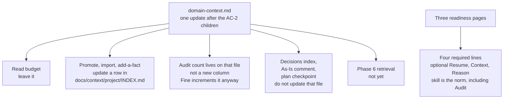

# AC-20 - Implementation Plan

## Task Details

| Field            | Value                                                                 |
| ---------------- | --------------------------------------------------------------------- |
| Jira ID          | AC-20                                                                 |
| Title            | Document the full context-and-knowledge architecture on the public site |
| Description      | After the AC-2 children shipped, one update of the public domain-context page tells a reader which of those mechanisms change a row in `docs/context/<project>/INDEX.md`. Three hand pages stop teaching the retired four-line readiness contract. |
| Priority         | Low                                                                   |
| Related Research | [Question 18 in ac-2.research.md](../ac-2/ac-2.research.md) (DELTA 2026-09-23, accepted) |

## Wildly Important Goal

**Goal**: A reader of `domain-context.md` can tell which finished AC-2 work updates the project knowledge index, and the readiness pages they open first no longer teach the retired four-line contract.

**Success Measure**: The page keeps the read-budget paragraph, states that promote, import, and add-a-fact update a row in `docs/context/<project>/INDEX.md`, states that the audit count lives on that same file and is not a new table column, and states that decisions, the As-Is comment, and the session checkpoint do not update that file. A search for `exact four-line` and `exactly four bullet` under `website/docs` returns nothing. The generated implement prompt still says "four required lines plus optional signals".

**Do NOT touch / do NOT add**:

- Do not edit `.ai/`, including the orchestration skill, promote, audit, fine-handoff, or the implement prompt source.
- Do not regenerate `website/docs/reference/prompts/public/eversis-implement.md`. `npm run sync:website-docs` is not the fix.
- Do not build Phase 6 retrieval, and do not add a ticket for it.
- Do not edit the Jira description, `docs/context/README.md`, or `website/docs/main-flow/workflow/overview.md`.
- Do not copy rule 14's trigger list, an exchange count, status names, or frontmatter keys onto the site.
- Do not rewrite the read-budget paragraph. Do not remove the `eversis-add-domain-knowledge` command from the page.
- Do not describe publishing to `docs/context/global/` as an update of the project index.
- Do not rewrite historical changelog sentences that mention the old contract. Those live outside `website/docs`.

## Proposed Solution

One update of the existing page `website/docs/reference/domain-context.md`, written now that AC-2, AC-16, AC-17, AC-18, AC-19, and AC-22 are in the tree. The read-budget section stays. The write loop stays, and gains the index-row fact. A short section after "Reading it — budget-aware, not a full-directory scan" and before "Tools and skills" groups the six tickets. No procedures.

What the page says about `docs/context/<project>/INDEX.md`:

- AC-2 — promote and import update a row in that index, and they write the component file. The read paragraph already says Research starts at the index.
- AC-22 — add-a-fact updates that row when the summary is new or changed. The command stays. One sentence says the write touches the index row, not only the folder.
- AC-18 — the audit count lives on that index file. Fine increments it even when promotion writes nothing. Topic status is not a column of the index. No status names and no frontmatter keys.
- AC-16 — does not update that file. Decisions use `docs/decisions/INDEX.md`. A decision is not a row in the project knowledge index.
- AC-17 — does not update that file. The As-Is comment is a draft on the Pack page. Link to Workflow Overview. Separate from import, which does write the index row.
- AC-19 — does not update that file. The checkpoint is a row in the plan changelog. One sentence and a link to the orchestration skill. No exchange count.

Phase 6 retrieval (full-text, semantic, or graph) stays the only "not yet".

Three hand pages (`standard-flow.md`, `engineering-manager.md`, `orchestrating-implementation.md`) drop "exact four-line" and "exactly four bullet". They name four required lines (Flow, Research, Plan, Next gate) and optional `Resume`, `Context`, and `Reason`, and they say the skill is the norm for any further optional line, including `Audit`, without the Audit formula. As-Is sentences already on `standard-flow.md` and `engineering-manager.md` stay. `overview.md` stays.



## Current Implementation Analysis

### Already Implemented

- Read budget — `website/docs/reference/domain-context.md`, section "Reading it — budget-aware, not a full-directory scan" — names `docs/context/<project>/INDEX.md`, one component, discovery always allowed, consumption capped at 1–2 files. Leave this section.
- Write skills — same file, "Tools and skills", including `eversis-add-domain-knowledge`. Writes are described as `docs/context/<project>/`. They do not say the index row changes.
- Global publish — same file, "Publishing to the global layer" and the "Share with other repos" step. Leave this. It is not the project-index update.
- As-Is comment — `website/docs/main-flow/workflow/overview.md`, and the Fine sentences on `standard-flow.md` and `engineering-manager.md`. Already shipped by AC-17. Link to overview. Do not edit overview. Do not drop the Fine sentences.
- Generated implement prompt — `website/docs/reference/prompts/public/eversis-implement.md` already says "four required lines plus optional signals" and matches `.ai/prompts/public/eversis-implement.md`. Leave both files.
- Decisions catalog, status lifecycle, audit count, and session checkpoint — present under `.ai/` and `docs/decisions/`. This ticket only describes them on the site.

### To Be Modified

- `website/docs/reference/domain-context.md` — index-row sentences in the write loop, plus the six-ticket section between the read-budget section and "Tools and skills".
- `website/docs/main-flow/workflow/standard-flow.md` — the Quick vs Full paragraph that says "exact four-line". Leave the As-Is Pack comment sentence.
- `website/docs/reference/agents/engineering-manager.md` — the Key Behaviors bullet that says "exact four-line" and optional `Reason` only. Leave the As-Is Pack comment sentence.
- `website/docs/reference/skills/orchestrating-implementation.md` — the contract bullet that says "Exactly four bullet lines" and "optional fifth `Reason`". The example block of four required lines stays. The sentence that the skill file is the norm stays, and it covers `Audit` without the formula.

### To Be Created

- None. The map is a section on a page that already exists.

## Open Questions

| #   | Question | Answer | Status |
| --- | --- | --- | --- |
| 1 | Where does the map live? | A section on `website/docs/reference/domain-context.md`. Not a new page. | ✅ Resolved |
| 2 | Are the three hand pages in this ticket? | Yes. The generated prompt page is already correct and stays untouched. | ✅ Resolved |
| 3 | Does the page say which AC-2 children update `docs/context/<project>/INDEX.md`? | Yes. Promote, import, and add-a-fact update a row. The audit count lives on that file and is not a new column. Decisions, the As-Is comment, and the session checkpoint do not update that file. | ✅ Resolved |

## Technical Context

Project conventions, coding standards, and patterns discovered during planning. Downstream agents MUST read this section instead of re-discovering the same context.

### Project Instructions

- `AGENTS.md` — this repository is the framework product. Public site sources live under `website/docs/`. Generated prompt pages come from `npm run sync:website-docs` and are not hand-fixed.
- `.cursor/rules/eversis-project-stack.mdc` — quality commands include `npm run sync:website-docs:check`, `npm run website:build`, and `npm run website:changelog:check`. This plan does not change `CHANGELOG.md`.
- Specs under `docs/specs/*/` are gitignored in this repository. The plan stays on disk for the Implement session.

### Architecture & Patterns

- Docusaurus site. Hand pages under `website/docs/` are authored Markdown. Prompt pages under `website/docs/reference/prompts/` are generated from `.ai/prompts/` and must not be edited to close this ticket.
- Existing in-page links on `domain-context.md` use site paths such as `./main-flow/workflow/overview#status-fine--handoff` and `./reference/skills/orchestrating-implementation`. Reuse that style. Do not invent a new decisions page.
- The project index stays two columns. Status and the audit count are not new columns. This page says that in prose and does not name the keys.

### Tech Stack

- Documentation site: Docusaurus, built with `npm --prefix website run build` (`npm run website:build` from the repo root).
- Docs sync: `node adapters/website/generate.mjs` (`npm run sync:website-docs`). Check-only: `npm run sync:website-docs:check`.
- No application runtime, package, or MCP change in this ticket.

### Code Style & Standards

- Public pages are English, matching `domain-context.md` and the three hand pages.
- Keep the read-budget heading and paragraph. Add one heading for the six-ticket section. Do not renumber the page.
- Do not document procedures: no catalog-creation steps, no status names, no frontmatter keys, no exchange count, no rule 14 trigger list, no Audit formula.

### Testing Patterns

- Index coverage (fast): `rg -n "docs/decisions/INDEX.md" website/docs/reference/domain-context.md` matches, and the write-loop text names an index row for promote, import, and add-a-fact.
- Readiness wording (fast): `rg -n "exact four-line|exactly four bullet" website/docs` returns no matches.
- Prompt alignment (fast): `website/docs/reference/prompts/public/eversis-implement.md` still contains `four required lines plus optional signals`, and `npm run sync:website-docs:check` exits 0.
- Site build: `npm run website:build`.
- Changelog mirror, only to confirm this ticket did not require a changelog edit: `npm run website:changelog:check`.

### Database Patterns

- Not applicable. This task does not touch a database.

### Additional Context

- Question 18 was accepted with "Research is ok. Make the plan" (2026-09-22). The index DELTA was accepted with "DELTA is ok. Make the plan" (2026-09-23).
- Plan review iteration 1 (`docs/specs/ac-20/ac-20.plan-review.md`) is `REVISIONS NEEDED`. This refresh answers B1, W1, W2, and S1. It does not mark that review approved.
- AC-16, AC-17, AC-18, AC-19, and AC-22 are already in the tree. Describe them as current behavior. Do not reopen them.
- A historical changelog line under `website/src/pages/changelog.md` still says "exact four-line". That file is outside `website/docs` and stays as history.

## Implementation Plan

### Phase 1: Project index on domain-context.md

**Goal**: One page update shows which finished AC-2 work changes `docs/context/<project>/INDEX.md`.

**Description**: Keep the read-budget section. In the write loop, say that promote, import, and add-a-fact update an index row. Add the six-ticket section between that read section and "Tools and skills". Leave the global-publish sections as they are.

**Verification:** `rg -n "docs/decisions/INDEX.md" website/docs/reference/domain-context.md` matches, and the write loop names an index row for promote, import, and add-a-fact.

#### Task 1.1 - [MODIFY] Say which mechanisms update the project index

**Description**: On `website/docs/reference/domain-context.md`, add the facts in Proposed Solution. The new section sits after "Reading it — budget-aware, not a full-directory scan" and before "Tools and skills". The write loop and the add-a-fact paragraph gain the index-row sentence and keep the command. Do not add status names, frontmatter keys, a third index column, a decisions how-to, or an exchange count. Do not edit the read-budget paragraph. Do not describe the global layer as this index update.

**Files:** `website/docs/reference/domain-context.md` (modify)

**Definition of Done**:

- [x] The read-budget section is still present and still says Research starts at `docs/context/<project>/INDEX.md`.
- [x] Promote, import, and `eversis-add-domain-knowledge` are still named, and the page says each of those writes updates a row in that index. Add-a-fact says the row updates when the summary is new or changed.
- [x] The page says the audit count lives on that index file, Fine increments it even when promotion writes nothing, and topic status is not an index column.
- [x] The page says a decision is not a row in that index and names `docs/decisions/INDEX.md`.
- [x] The page says the As-Is comment and the session checkpoint do not update that index. The As-Is sentence links to the Workflow Overview Fine section. The checkpoint sentence links to the orchestration skill page.
- [x] The new section contains no status names, no frontmatter keys, and no exchange count.
- [x] Phase 6 retrieval is described as not built. The global-publish section is still present and is not described as a project-index update.

**Clues**: Reuse `./main-flow/workflow/overview#status-fine--handoff` and `./reference/skills/orchestrating-implementation`. Import writes an index row. The As-Is comment does not.

### Phase 2: Hand pages

**Goal**: The three readiness pages teach four required lines plus optional `Resume`, `Context`, and `Reason`, and they point at the skill for any further optional line, including `Audit`.

**Description**: Edit only the sentences that still say the block is exactly four lines or that `Reason` is a fifth line. Leave the example block of four required lines on the skill summary page. Leave the generated prompt page and `overview.md` unchanged. Leave the As-Is Pack comment sentences on the two files AC-17 already edited.

**Verification:** `rg -n "exact four-line|exactly four bullet" website/docs` returns no matches. `npm run sync:website-docs:check` exits 0.

#### Task 2.1 - [MODIFY] Retire the old readiness wording on three hand pages

**Description**: On each file below, replace the retired wording with four required lines (Flow, Research, Plan, Next gate) and optional `Resume`, `Context`, and `Reason`. Say the skill is the norm for any further optional line, including `Audit`. Do not paste the Audit formula or rule 14. Do not list the three names as a closed set.

**Files:** `website/docs/main-flow/workflow/standard-flow.md` (modify), `website/docs/reference/agents/engineering-manager.md` (modify), `website/docs/reference/skills/orchestrating-implementation.md` (modify)

**Definition of Done**:

- [x] `rg -n "exact four-line|exactly four bullet" website/docs` prints nothing.
- [x] Each of the three files names optional `Resume`, `Context`, and `Reason`, and says the skill is the norm for a further optional line, including `Audit`.
- [x] None of the three files contains `tasks_since_audit` or `audit_due_after`.
- [x] `website/docs/reference/skills/orchestrating-implementation.md` still shows the four-line example block.
- [x] `rg -n "As-Is Pack comment" website/docs/main-flow/workflow/standard-flow.md website/docs/reference/agents/engineering-manager.md` matches both files.
- [x] `website/docs/main-flow/workflow/overview.md` is unchanged.
- [x] `website/docs/reference/prompts/public/eversis-implement.md` still contains `four required lines plus optional signals`.
- [x] Run `npm run sync:website-docs:check`.

**Clues**: Current hits are `standard-flow.md` ("exact four-line"), `engineering-manager.md` ("exact four-line" and optional `Reason` only), and `orchestrating-implementation.md` ("Exactly four bullet lines" and "optional fifth `Reason`"). Do not edit `website/src/pages/changelog.md`.

### Phase 3: Code Review

**Goal**: The site change matches this plan and does not drift the generated prompt, the read-budget paragraph, or the AC-17 Fine sentences.

**Description**: Final verification of the documentation change. This phase is mandatory and always comes last.

**Verification:** `npm run website:build`

#### Task 3.1 - [REUSE] Code review by Code Reviewer

**Description**: Run **Code Reviewer** via `eversis-review.md` to review the complete change. There is no e2e suite for these pages; pass site build and the content searches below to that review.

**Files:** `website/docs/reference/domain-context.md` (reuse), `website/docs/main-flow/workflow/standard-flow.md` (reuse), `website/docs/reference/agents/engineering-manager.md` (reuse), `website/docs/reference/skills/orchestrating-implementation.md` (reuse)

**Definition of Done**:

- [x] Run `npm run website:build`
- [x] Run `npm run website:changelog:check`
- [x] Code review passes with no blocking findings
- [x] Review outcome documented in Changelog

**Clues**: Confirm `.ai/` is untouched, the generated implement prompt is untouched, `overview.md` is untouched, and the new section did not grow a procedure or a status enum.

## Security Considerations

- Public documentation only. Do not add tokens, write credentials, or a new path that publishes to Confluence, GitLab, or Jira.
- The page must not become an operational recipe for audit, promotion, or session resume. Those procedures stay in the skills.

## Quality Assurance

Acceptance criteria checklist to verify the implementation meets the defined requirements:

- [x] A reader of `domain-context.md` still sees index, one topic, and the 1–2 file history cap as one read rule.
- [x] The page says promote, import, and add-a-fact update a row in `docs/context/<project>/INDEX.md`.
- [x] The page says the audit count lives on that file and is not a new column, and that decisions, the As-Is comment, and the session checkpoint do not update that file.
- [x] Phase 6 retrieval is described as not built.
- [x] `rg -n "exact four-line|exactly four bullet" website/docs` returns no matches.
- [x] The generated implement prompt still matches `.ai/prompts/public/eversis-implement.md` (`npm run sync:website-docs:check` exits 0).
- [x] No file under `.ai/` changed for this ticket.

## Improvements (Out of Scope)

- Phase 6 retrieval (full-text, semantic, or graph) has no ticket and is not built here.
- The audit exception for empty `code_paths` still does not name `source: manual`. That residual stays with the audit skill, not this page.
- Jira AC-20 description still mentions future phases that have since shipped. Updating that description needs a separate publish approval.
- Question 11 and older sentences in `ac-2.research.md` still describe the portfolio from before the child tickets shipped. This plan does not rewrite that history.

## Human gates

1. ~~Approve research~~ — done (`"Research is ok. Make the plan"`)
2. ~~Approve the index DELTA~~ — done (`"DELTA is ok. Make the plan"`)
3. ~~Approve this plan~~ — done (`"Plan is ok. Do not start the implementation until I say"`). Start polecony 2026-09-23.
4. ~~Implement → Review → Fine~~ — Fine (2026-09-23). Review PASS. QA draft not posted.

## Changelog

| Date       | Change Description |
| ---------- | ------------------ |
| 2026-09-22 | Initial plan created from accepted Question 18. Map is a section on `domain-context.md`. Three hand pages are in scope. Generated prompt page stays. |
| 2026-09-23 | Refreshed after `"DELTA is ok. Make the plan"`. The page now says which of AC-2, AC-16, AC-17, AC-18, AC-19, and AC-22 update `docs/context/<project>/INDEX.md`. Hand pages name `Audit` as a further optional line without its formula, and they keep the AC-17 As-Is sentences. |
| 2026-09-23 | Plan accepted (`"Plan is ok. Do not start the implementation until I say"`). No website edits in this turn. |
| 2026-09-23 | Implementation of Task 1.1 started; `domain-context.md` now states which mechanisms update the project index. |
| 2026-09-23 | CHECKPOINT: Task 1.1 done and checked. `website/docs/reference/domain-context.md` has the index section and write-loop row sentences. Next step: Task 2.1 on `standard-flow.md`, `engineering-manager.md`, and `orchestrating-implementation.md`. |
| 2026-09-23 | RESUMED: same chat, at the person's request ("Do whole implementation in this chat window"). Checkpoint consumed. Continue Task 2.1 here. |
| 2026-09-23 | Task 2.1 done: three hand pages retire "exact four-line" / "exactly four bullet"; they name four required lines plus optional `Resume`, `Context`, and `Reason`, with the skill as the norm for further optional lines including `Audit`. |
| 2026-09-23 | Code review performed (Task 3.1). Verdict: PASS. Zero BLOCKER findings. Task 1.1 / 2.1 DoD and Quality Assurance acceptance criteria verified checked. |
| 2026-09-23 | Fine. QA comment drafted in the Implement chat. Posted to Jira AC-20 (comment 158645) after explicit approval. |
| 2026-09-23 | Applied the review suggestion: the add-a-fact row in the "What to use" table now names the index-row update. |

## Code Review Findings

**Verdict:** PASS

**Scope reviewed:** Uncommitted website hand pages only — `website/docs/reference/domain-context.md`, `website/docs/main-flow/workflow/standard-flow.md`, `website/docs/reference/agents/engineering-manager.md`, `website/docs/reference/skills/orchestrating-implementation.md`. No `ac-20.research.md` (related research: Question 18 in `docs/specs/ac-2/ac-2.research.md`). `.ai/` not edited. Website page content not changed by this review.

**Testing note:** No unit, integration, or e2e suite applies to these Markdown documentation pages. Verification used content searches and the site quality commands below only.

### BLOCKER

None.

### SUGGESTION

1. **Tools table vs loop prose (non-blocking):** Applied 2026-09-23. The "What to use" row for `eversis-add-domain-knowledge` now names a row in `docs/context/<project>/INDEX.md` when the summary is new or changed, matching the loop and the skill blurb.

### Hard constraints (verified)

| Constraint | Result |
| --- | --- |
| `.ai/` untouched | `git status` / `git diff` show no `.ai/` changes |
| Generated implement prompt untouched; still contains `four required lines plus optional signals` | Match present; `npm run sync:website-docs:check` OK |
| `overview.md` unchanged | No diff |
| Read-budget section not rewritten | Heading + two paragraphs identical to HEAD; new section inserted after |
| New section: no status names, no frontmatter keys, no exchange count, no Audit formula | Grep clean on changed pages |
| Global publish not described as project-index update | "Publishing to the global layer" / step 6 unchanged in role |
| As-Is Pack comment sentences remain on standard-flow + engineering-manager | Both match |
| Four-line example block on orchestrating-implementation still only four required lines | Lines 28–34 unchanged |
| `website/src/pages/changelog.md` not hand-edited to erase history | Not in ticket diff |

### Checks relied on

```bash
rg -n "exact four-line|exactly four bullet" website/docs   # no matches
rg -n "docs/decisions/INDEX.md" website/docs/reference/domain-context.md
rg -n "As-Is Pack comment" website/docs/main-flow/workflow/standard-flow.md website/docs/reference/agents/engineering-manager.md
rg -n "four required lines plus optional signals" website/docs/reference/prompts/public/eversis-implement.md
rg -n "tasks_since_audit|audit_due_after|last_audit" website/docs/reference/domain-context.md website/docs/main-flow/workflow/standard-flow.md website/docs/reference/agents/engineering-manager.md website/docs/reference/skills/orchestrating-implementation.md   # no matches
npm run sync:website-docs:check   # exit 0
npm run website:changelog:check   # exit 0
npm run website:build             # exit 0; "Generated static files in \"build\""
```

### Definition of Done / Acceptance Criteria

- Task 1.1 DoD: all items verified (already checked; re-confirmed).
- Task 2.1 DoD: all items verified (already checked; re-confirmed).
- Task 3.1 DoD: checked in this review.
- Quality Assurance acceptance criteria: all seven items verified and checked.
