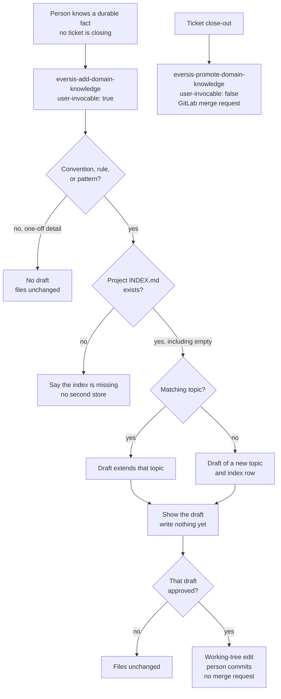

# AC-22 - Implementation Plan

## Task Details

| Field            | Value                                                                 |
| ---------------- | --------------------------------------------------------------------- |
| Jira ID          | AC-22                                                                 |
| Title            | Framework user can draft a domain fact without closing a ticket      |
| Description      | A person starts `eversis-add-domain-knowledge` on purpose, sees a draft of one project-knowledge topic and its index row, and nothing is written until that draft is approved. After approval the files change in the working tree and the person commits. Close-out promotion stays a separate procedure and stays out of the command menu. |
| Priority         | Medium                                                                |
| Related Research | [ac-22.research.md](./ac-22.research.md)                              |

## Wildly Important Goal

**Goal**: A framework user can start one command that drafts a durable project-knowledge fact without closing a ticket, and a later session can find that one topic from the index after the person commits the approved write.

**Success Measure**: The new skill is `user-invocable: true`, close-out promotion stays `user-invocable: false`, an approved draft is a local edit of `docs/context/<project>/` with `source: manual` and `status: approved`, and the public domain-context page lists this command separately from close-out promotion, Confluence import, and periodic cleanup.

**Do NOT touch / do NOT add**:

- Do not set `user-invocable: true` on `eversis-promote-domain-knowledge`, and do not add a public prompt or a `.cursor/commands/` shim.
- Do not call the GitLab API, open a merge request, or run `git commit` from the new skill.
- Do not add a stored `draft` or `proposed` status, and do not write `deprecated` or `superseded` (those stay with the audit skill, AC-18).
- Do not change the audit Delete exception, MCP, the read router, gitignore, or `eversis-fine-handoff`.
- Do not publish into `domain-context` / `docs/context/global/`.
- Do not run the new command against a consumer repository as part of this delivery.
- Do not edit the Jira description.

## Proposed Solution

One new skill, `.ai/skills/eversis-add-domain-knowledge/SKILL.md`, started by the person the same way import and audit already are (`user-invocable: true`). Close-out promotion is unchanged: it still runs at Fine and still publishes through the GitLab API.

The skill and promotion write the same files. They do not share a write mechanism. After the person approves this draft, the skill edits the working tree and stops. The person commits.

Procedure the skill states, in this order:

1. Read `ssot.projectContextPath` from `.agent-collections/install-selection.json`. Do not invent the project folder from the repository name.
2. If `<projectContextPath>/INDEX.md` does not exist, say so and stop. Do not create the directory, a second index, or another store. An index that exists with zero data rows is not missing; the first approved topic adds a row.
3. Accept a fact only when it is a team convention, a confirmed business rule, or a reusable pattern, using the same examples as promotion Step 1. A one-off detail (rename, typo, single timeout) produces no draft and no write. Do not apply promotion's second-occurrence rule: the person is already asserting a durable fact, and starting the command is not itself proof.
4. Look for an existing `docs/context/<project>/<component>/index.md` the way promotion Step 2 does: `code_paths` first, then component name. A match extends that file. No match proposes one new component named after a functional area (`checkout-flow`), never a bucket such as `business-rules`. The draft shows that name so the person can correct it before approval. Empty `code_paths` is allowed.
5. Show the draft and wait. The draft is the proposed component file plus the two-column index row. Write nothing in this step.
6. If the person rejects the draft or the turn ends without approval of that specific draft, leave every project-knowledge file unchanged.
7. If the person approves that draft, write only the working-tree files: the component `index.md`, and the `INDEX.md` row when the summary is new or changed. Stop. Do not run `git commit`, do not create a branch, and do not call GitLab.

New-file frontmatter:

```yaml
---
scope: project
source: manual
status: approved
last_updated: "<ISO date>"
tags: [<relevant tags>]
code_paths: []
confluence_url: null
related_specs: []
---
```

`code_paths` is filled when the fact names paths; otherwise it is an explicit empty array. `related_specs` stays an explicit empty array. Do not point every fact at `docs/specs/ac-22/`.

When extending an existing file: overwrite the descriptive body with the current state, keep existing `related_specs` and existing `source` (so a Confluence seed does not become `manual`), set `status: approved`, and update `last_updated`. Do not stack the old and new descriptions. Do not set `last_consulted`. The index stays two columns.



The public skill page uses this English diagram. The topology matches the chart in the research. `SKILL.md` does not include the diagram.

The public "how knowledge is saved" page is `website/docs/reference/domain-context.md`. Add this command as its own row and short paragraph beside promote, import, and audit. Hand-editing the knowledge files stays described as still possible. The catalog count, the framework-reference sentence that says three domain-context skills, and `CHANGELOG.md` move with the new skill so the website checks still match the tree.

## Current Implementation Analysis

### Already Implemented

- Close-out promotion — `.ai/skills/eversis-promote-domain-knowledge/SKILL.md` — durability bar, topic matching, file shape, `status: approved` on the committed file, GitLab write at Step 6. Leave this file as it is.
- Import — `.ai/skills/eversis-import-confluence-knowledge/SKILL.md` — pattern for `user-invocable: true` and for explicit empty `code_paths` / `related_specs`.
- Audit — `.ai/skills/eversis-audit-domain-knowledge/SKILL.md` — already a person-started command. The empty-`code_paths` Delete exception covers only `source: confluence`. Not edited here.
- Read path — `mcp/eversis-collections-mcp/src/context.ts` and `.ai/rules/orchestration/agent-core.md` — one index, one component. Not edited here.
- Domain-context page — `website/docs/reference/domain-context.md` — three write skills today; Mermaid already enabled in `website/docusaurus.config.ts`.
- Skill catalog — `website/docs/reference/skills/overview.md` declares **48** reusable skills and lists promote, import, and audit. `website/docs/reference/framework-reference.md` says three domain-context skills.

### To Be Modified

- `website/docs/reference/domain-context.md` — fourth write path, section title no longer says "three", hand-edit still allowed.
- `website/docs/reference/skills/overview.md` — count, bullet, description table, and agent–skill matrix row.
- `website/docs/reference/framework-reference.md` — "3 domain-context skills" becomes four, naming the new skill.
- `CHANGELOG.md` — one Unreleased Added bullet for the new command.
- `website/docs/reference/prompts/public/eversis-implement.md` — one-sentence website mirror of the implement prompt, regenerated by docs sync so the published page matches `.ai/prompts/public/eversis-implement.md`. Confirmed during review (2026-09-22): keep it in this change. The sentence is the readiness-block wording already in the prompt source. It is not a behavior change to the new skill.

### To Be Created

- `.ai/skills/eversis-add-domain-knowledge/SKILL.md` — the command.
- `website/docs/reference/skills/add-domain-knowledge.md` — curated skill page with the diagram. `sidebar_position` after the existing domain-context pages (promote 43, import 44, audit 45).

## Open Questions

| #   | Question | Answer | Status |
| --- | --- | --- | --- |
| 1 | Command surface | Skill with `user-invocable: true`. No public prompt and no Cursor command shim. Promotion stays `user-invocable: false`. | ✅ Resolved |
| 2 | Write path after approval | Same files as promotion. Local working-tree edit. Person commits. No GitLab API and no `git commit` from the agent. | ✅ Resolved |
| 3 | Topic shape without a closing ticket | Same paths and frontmatter keys. `source: manual`, `status: approved`, empty `related_specs`, `code_paths` only when the fact has paths. `draft` / `proposed` stay chat-only. | ✅ Resolved |
| 4 | Second-occurrence rule | Not used. One-off details still produce no draft. | ✅ Resolved |
| 5 | Missing index | Missing means `<projectContextPath>/INDEX.md` is absent. Say so and do not create a store. An empty index may gain its first row. | ✅ Resolved |
| 6 | Convention with no code path | One functional component name, shown in the draft. Empty `code_paths` allowed. Audit Delete hazard for `source: manual` stays in AC-18. | ✅ Resolved |
| 7 | Public description | `website/docs/reference/domain-context.md` lists the command separately. The skill page carries the diagram. Catalog count and framework-reference stay in sync. | ✅ Resolved |
| 8 | Gitignore of `docs/context/*/` in this repo | The skill still writes the working tree. It does not change gitignore and does not commit. | ✅ Resolved |

## Technical Context

Project conventions, coding standards, and patterns discovered during planning. Downstream agents MUST read this section instead of re-discovering the same context.

### Project Instructions

- `AGENTS.md` — framework repo. SSOT is `.ai/`. Specs live in `docs/specs/<issue-kebab>/`.
- `.cursor/rules/eversis-project-stack.mdc` — quality commands from the repo root. Do not add package dependencies. Domain skills for product UI/backend are out of policy here.
- `.cursor/rules/eversis-testing-and-terminal.mdc` — after substantive edits, run the checks named in Testing Patterns.
- Delivery standard: research is approved. This plan must be approved before implementation. Review, then Fine with a QA comment draft. Do not post to Jira from the Fine turn.

### Architecture & Patterns

- Skills live in `.ai/skills/eversis-<topic>/SKILL.md` with YAML frontmatter `name`, `description`, `user-invocable`.
- Claude Code shows a skill in the `/` menu unless `user-invocable: false` (`adapters/claude/README.md`). Cursor command shims come from prompts, not from skills.
- Project knowledge path comes from `ssot.projectContextPath` in `.agent-collections/install-selection.json`. The index is `<that path>/INDEX.md`, exactly two columns. A third column is dropped by `mcp/eversis-collections-mcp/src/context.ts`.
- Component files are `docs/context/<project>/<component>/index.md`. Promotion, import, and this command share that path. `source` distinguishes who wrote the fact.
- Skill pages under `website/docs/reference/skills/` are curated. They are not generated from `SKILL.md`. `adapters/website/check-skills.mjs` requires every `.ai/skills/<id>/` id to appear in some file in that directory, and the "N reusable skills" sentence in `overview.md` to match the folder count.
- Mermaid is enabled (`website/docusaurus.config.ts`, `mermaid: true`).

### Tech Stack

- Skills and rules: Markdown.
- Website: Docusaurus, `@docusaurus/theme-mermaid` 3.10.2.
- Adapter check: Node, `adapters/website/generate.mjs` (imports `check-skills.mjs`).
- No application runtime and no database.

### Code Style & Standards

- Match the voice of `eversis-import-confluence-knowledge/SKILL.md` and `eversis-promote-domain-knowledge/SKILL.md`: frontmatter, a short purpose, principles, numbered steps, and an explicit "does not" list.
- Public pages are English, like `promote-domain-knowledge.md` and `domain-context.md`.
- Do not shorten existing documentation comments in files this plan modifies.
- Index rows stay `| component | one-line summary |`.

### Testing Patterns

- Skill and docs tasks have no unit-test runner. Checks are the repo scripts below, from the repository root.
- `npm run sync:website-docs:check` — skill id is mentioned and the overview count matches `.ai/skills/`.
- `npm run website:changelog:check` — `website/src/pages/changelog.md` matches `CHANGELOG.md`.
- `npm run website:build` — Docusaurus build, including Mermaid on the new skill page.
- Do not run `npm run mcp:test` or `bash scripts/setup-agent-collections.test.sh` for this change. MCP and the installer are untouched.
- Inspectable checks for the skill file use `rg` against the paths in each task.

### Database Patterns

- No database. Not applicable.

### Additional Context

- This repository gitignores `docs/context/*/`. Implementing the skill does not include writing a sample topic into that tree.
- `eversis-writing-repo-documentation` applies to the website and changelog tasks. `eversis-implementing-frontend` and `eversis-implementing-backend` do not.
- Delegate the skill file to **Software Engineer** via `eversis-implement-common-task.md`. Delegate the website and changelog tasks to **Repo Docs Writer** via `eversis-repo-docs-writer.md`.

## Implementation Plan

### Phase 1: The command

**Goal**: The person can start a skill that drafts one durable fact and writes it locally only after approval, which is the outcome in the Wildly Important Goal.

**Description**: Add the skill file and leave close-out promotion unchanged. No website edits in this phase, so the skill-count check stays for Phase 2, when the new id is mentioned on a skill page.

**Verification:** `rg -n "user-invocable: true" .ai/skills/eversis-add-domain-knowledge/SKILL.md` and `rg -n "user-invocable: false" .ai/skills/eversis-promote-domain-knowledge/SKILL.md`

#### Task 1.1 - [CREATE] Add eversis-add-domain-knowledge

**Description**: Software Engineer writes the skill using the procedure in Proposed Solution. `user-invocable: true`. The description tells the model this is a person-started draft into project knowledge, not Fine promotion. Include the durability bar, the missing-index stop, match-or-create, the draft gate, the local write, and a "does not" list: no GitLab, no `git commit`, no second store, no second-occurrence rule, no `draft`/`proposed` on disk, no edit of `docs/context/global/`, no change to close-out promotion.

**Files:** `.ai/skills/eversis-add-domain-knowledge/SKILL.md` (create)

**Definition of Done**:

- [x] `.ai/skills/eversis-add-domain-knowledge/SKILL.md` contains `user-invocable: true`, `source: manual`, `status: approved`, and the missing-index stop
- [x] The same file says the agent does not open a merge request and does not run `git commit`
- [x] The same file does not contain a Mermaid diagram
- [x] `.ai/skills/eversis-promote-domain-knowledge/SKILL.md` still contains `user-invocable: false` and the GitLab merge-request write
- [x] Run `rg -n "user-invocable: true" .ai/skills/eversis-add-domain-knowledge/SKILL.md`
- [x] Run `rg -n "user-invocable: false" .ai/skills/eversis-promote-domain-knowledge/SKILL.md`

**Clues**: Copy structure from `.ai/skills/eversis-import-confluence-knowledge/SKILL.md` and the frontmatter keys from promotion Step 4. On extend, keep the existing `source` and `related_specs`. Set `source: manual` and `related_specs: []` only when creating a file.

### Phase 2: Public description

**Goal**: A reader looking up how knowledge is saved sees this command separately, and the skill page shows the approved flow, which is the rest of the Success Measure.

**Description**: Repo Docs Writer updates the domain-context page, adds the curated skill page with the English diagram from Proposed Solution, and aligns the catalog count, the framework-reference sentence, and the changelog. Retitle "The three write skills" so the heading matches four paths. Keep the promote, import, and audit paragraphs.

**Verification:** `npm run sync:website-docs:check` and `npm run website:changelog:check` and `npm run website:build`

#### Task 2.1 - [MODIFY] List the command on the domain-context page

**Description**: In the loop, the "What to use" table, and the write-skills section, add this command as its own entry: person starts it, draft first, local write, person commits. State that close-out promotion remains the Fine procedure and is not this command. State that hand-editing the knowledge files remains possible.

**Files:** `website/docs/reference/domain-context.md` (modify)

**Definition of Done**:

- [x] `website/docs/reference/domain-context.md` contains `eversis-add-domain-knowledge` in the "What to use" table and in the write-skills section
- [x] That page still names `eversis-promote-domain-knowledge`, `eversis-import-confluence-knowledge`, and `eversis-audit-domain-knowledge` as separate rows or paragraphs
- [x] The write-skills heading no longer says there are three write skills
- [x] The page says hand-editing the knowledge files remains possible

**Clues**: Table columns stay "You want to… / Use / Writes to / When". Do not describe a GitLab merge request for this command.

#### Task 2.2 - [CREATE] Skill page with the flow diagram

**Description**: Add a curated page in the same shape as `promote-domain-knowledge.md`: folder path, who starts it, a short purpose, principles (draft before write, one-off produces nothing, missing index stops), and the Mermaid diagram from Proposed Solution. Link to the domain-context page and to close-out promotion.

**Files:** `website/docs/reference/skills/add-domain-knowledge.md` (create)

**Definition of Done**:

- [x] `website/docs/reference/skills/add-domain-knowledge.md` contains a ` ```mermaid ` fence and the node text `eversis-add-domain-knowledge`
- [x] The same fence contains a node for `eversis-promote-domain-knowledge` with `user-invocable: false`
- [x] The page links to `domain-context` and to `promote-domain-knowledge`
- [x] `sidebar_position` is 46

**Clues**: English labels. Same decisions as the research chart: one-off stops, missing index stops, a match extends, approval writes locally, close-out stays a separate path.

#### Task 2.3 - [MODIFY] Catalog count, framework reference, and changelog

**Description**: Mention `eversis-add-domain-knowledge` everywhere promote, import, and audit are listed in the skills overview (bullet, description table, agent–skill matrix). Set the "N reusable skills" sentence to the number of directories under `.ai/skills/` after Task 1.1 (the page currently says 48; this task adds one). In `framework-reference.md`, change the sentence that says three domain-context skills so it names four, including this skill. Add one Unreleased **Added** bullet to `CHANGELOG.md` and sync the website changelog page.

**Files:** `website/docs/reference/skills/overview.md` (modify), `website/docs/reference/framework-reference.md` (modify), `CHANGELOG.md` (modify), `website/src/pages/changelog.md` (modify), `website/docs/reference/prompts/public/eversis-implement.md` (modify — docs-sync side effect, confirmed 2026-09-22)

**Definition of Done**:

- [x] `website/docs/reference/skills/overview.md` contains the string `eversis-add-domain-knowledge`
- [x] `website/docs/reference/framework-reference.md` names `eversis-add-domain-knowledge` in the domain-context skills sentence
- [x] `CHANGELOG.md` Unreleased Added section mentions `eversis-add-domain-knowledge`
- [x] Run `npm run sync:website-docs:check`
- [x] Run `npm run website:changelog:check`
- [x] Run `npm run website:build`

**Clues**: `npm run website:changelog:sync` rewrites `website/src/pages/changelog.md` from `CHANGELOG.md`. Matrix row can match `eversis-audit-domain-knowledge` (id present, checkmark cells empty). Re-count skill folders if another skill landed between this plan and implementation.

### Phase 3: Code Review

**Goal**: An independent review confirms the command, the local write, and the public page match the Wildly Important Goal before Fine.

**Description**: Code Reviewer reviews the skill and the docs. No UI verification and no e2e suite. This phase is last.

**Verification:** `npm run sync:website-docs:check` and `npm run website:changelog:check`

#### Task 3.1 - [REUSE] Code review by Code Reviewer

**Description**: Run **Code Reviewer** via `eversis-review.md` on the complete implementation. There is no e2e suite for this change. Pass is zero open BLOCKER findings and every Definition of Done and Acceptance Criteria checkbox verified.

**Files:** `.ai/skills/eversis-add-domain-knowledge/SKILL.md` (reuse — created in Task 1.1), `website/docs/reference/skills/add-domain-knowledge.md` (reuse — created in Task 2.2), `website/docs/reference/domain-context.md` (reuse), `website/docs/reference/skills/overview.md` (reuse), `website/docs/reference/framework-reference.md` (reuse), `CHANGELOG.md` (reuse)

**Definition of Done**:

- [x] Run `npm run sync:website-docs:check`
- [x] Run `npm run website:changelog:check`
- [x] Code review passes with no blocking findings
- [x] Review outcome documented in Changelog

**Clues**: Check that promotion is still not a command, that the skill does not call GitLab, and that the diagram is on the skill page only.

## Security Considerations

- The skill writes only under the resolved `ssot.projectContextPath`. A missing index is a stop, not a prompt to create another directory.
- The skill does not read or require `GITLAB_TOKEN` and does not call the GitLab API. Close-out promotion keeps that token for its own write.
- A rejected or unapproved draft leaves the files unchanged, so an unwanted fact does not land on disk.
- The skill does not commit, so it cannot push the working tree.
- Do not store credentials in the topic body. The procedure tells the person the fact is a convention, rule, or pattern. It does not add a secret scanner.

## Quality Assurance

Acceptance criteria checklist to verify the implementation meets the defined requirements:

- [x] Given a person starts the new command with a team convention, a confirmed business rule, or a reusable pattern, when they ask for a draft, then the agent shows the topic and the index row and does not write yet.
- [x] Given the fact is a one-off detail, when they ask, then no draft is produced.
- [x] Given a matching topic already exists, when the fact belongs there, then the draft extends that topic instead of adding a second one.
- [x] Given the person approves that specific draft, when the write happens, then the project knowledge files change in the working tree and the person commits. The agent does not open a merge request.
- [x] Given the person rejects the draft or does not approve it, when the turn ends, then the project knowledge files are unchanged.
- [x] Given the project knowledge index is missing, when the person starts the command, then the agent says so and does not create a second place to store the fact.
- [x] Given the approved fact has been committed, when a later session looks up that topic, then it finds that one topic from the index.
- [x] Given a ticket is closing, when promotion runs, then it still uses the existing close-out procedure, and that procedure is not a command the person starts.
- [x] Given the public description of how knowledge is saved, when a reader looks it up, then this command is listed separately from close-out promotion, Confluence import, and periodic cleanup.
- [x] The skill page shows the flow diagram from Proposed Solution.
- [x] Hand-editing the knowledge files remains possible. The skill does not replace it.

## Improvements (Out of Scope)

- AC-18: treat empty `code_paths` on `source: manual` as Update, not Delete, beside the existing `docs-specs-cluster` case (research Question 6).
- AC-18: `deprecated` and `superseded` on the audit skill. This plan only writes `status: approved`.
- AC-16: decisions log. A convention recorded here stays in `docs/context/<project>/`.
- AC-20: broader architecture map. It may mention this command later. It does not block this page.
- Publishing a fact from project knowledge into the shared `domain-context` repository. That remains promotion's later GitLab step.
- Running this command to seed a consumer repository.

## Human gates

1. ~~Approve research~~ — done (`Research is ok. Go to the plan`)
2. ~~Approve this plan~~ — done (`PLAN IS OK. W WILL START IMPLEMENTATION IN THE NEW WINDOW`)
3. ~~Implement → Review → Fine~~ — done (review PASS 2026-09-22; QA draft pasted 2026-09-23, not posted)


Historical: no plan-review file was written. The human accepted this plan in gate 2. Do not treat the missing file as plan review still required, and do not reopen implementation.

## Fine

**Draft QA comment — review before posting to Jira**

---

### 📝 QA Summary

**Task Context:** A person can start a command that drafts one durable project fact without waiting for a ticket to close, and nothing is saved until they approve that draft.

**Main Changes:**
- A person who already knows a team convention, a confirmed business rule, or a reusable pattern can start a new command and see a draft of that topic plus its index row. Nothing is written yet.
- A one-off detail (a rename, a typo, or a single timeout) produces no draft.
- If that topic already exists, the draft updates it instead of adding a second topic.
- After the person approves that specific draft, the project knowledge files change on their machine and they commit. The agent does not open a merge request.
- If they reject the draft, or the turn ends without approval, those files stay unchanged.
- If the project knowledge index is missing, the agent says so and does not create another place to store the fact.
- Closing a ticket still uses the existing close-out procedure. That procedure is not a command the person starts.
- The public description of how knowledge is saved lists this command separately from close-out promotion, Confluence import, and periodic cleanup. The skill page shows the flow diagram. Hand-editing the knowledge files is still possible.

---

**✅ Verification List:**

**Manual Testing:**
- [ ] Start the new command with a team convention, a confirmed business rule, or a reusable pattern. Confirm a draft of the topic and the index row appears, and no project-knowledge file changes before approval.
- [ ] Start it with a one-off detail (rename, typo, or single timeout). Confirm no draft is produced.
- [ ] Start it with a fact that belongs to a topic that already exists. Confirm the draft extends that topic.
- [ ] Approve that specific draft. Confirm the project knowledge files change in the working tree and no merge request is opened.
- [ ] Reject a draft, or end the turn without approving it. Confirm the project knowledge files are unchanged.
- [ ] Start the command when the project knowledge index is missing. Confirm the agent says so and does not create a second store.
- [ ] After an approved fact is committed, start a later session and look up that topic. Confirm it is found from the index.
- [ ] Confirm close-out promotion still runs only when a ticket is closing, and is not a command the person starts from the menu.
- [ ] Open the public page that explains how knowledge is saved. Confirm this command is listed separately from close-out promotion, Confluence import, and periodic cleanup, and that hand-editing is still described as possible.
- [ ] Open the new skill page. Confirm it shows the flow diagram.

**Automation & Technical Notes:**
- **Selectors**: none (no product UI).
- **API**: none. The command does not call GitLab and does not run a commit.
- **Error Handling**: a missing project knowledge index is a stop, with no new directory created. A rejected or unapproved draft leaves files unchanged.
- **Checks already run**: website docs sync check, changelog check, and website build passed before review. Review re-ran the docs sync check and the changelog check; both passed.

## Changelog

| Date       | Change Description                                      |
| ---------- | ------------------------------------------------------- |
| 2026-09-22 | Initial plan created from the approved AC-22 research. |
| 2026-09-22 | Plan approved (`PLAN IS OK. W WILL START IMPLEMENTATION IN THE NEW WINDOW`). Implementacja w nowym oknie. `ac-22.plan-review.md` jeszcze nie istnieje. |
| 2026-09-22 | CHECKPOINT: Task 1.1 complete and verified (`rg` on `user-invocable`). Created `.ai/skills/eversis-add-domain-knowledge/SKILL.md`. Promote skill unchanged. Next: Task 2.1, list the command on `website/docs/reference/domain-context.md`. |
| 2026-09-22 | RESUMED: Task 1.1 checkpoint consumed. Continued in this thread at the person's request ("Implement following the plan"). |
| 2026-09-22 | CHECKPOINT: Task 2.1 complete. `website/docs/reference/domain-context.md` lists `eversis-add-domain-knowledge` in the loop (step 3), the "What to use" table, and "The four write skills", and says hand-editing remains possible. No link to the skill page yet. Next: Task 2.2, create `website/docs/reference/skills/add-domain-knowledge.md`. |
| 2026-09-22 | RESUMED: Task 2.1 checkpoint consumed. New Implement session started Task 2.2. |
| 2026-09-22 | CHECKPOINT: Task 2.2 complete. Created `website/docs/reference/skills/add-domain-knowledge.md` (`sidebar_position` 46) with the English flow diagram and links to domain context and close-out promotion. Next: Task 2.3, catalog count, framework reference, and changelog. |
| 2026-09-22 | RESUMED: Task 2.2 checkpoint consumed. New Implement session continued at Task 2.3. |
| 2026-09-22 | CHECKPOINT: Task 2.3 complete and verified (`sync:website-docs:check`, `website:changelog:check`, `website:build`). Overview count is **50** (folders under `.ai/skills/`). `eversis-add-domain-knowledge` is in the overview bullet, description table, and matrix; framework-reference names four domain-context skills; CHANGELOG Unreleased Added has the new command; website changelog synced. `eversis-record-decision` is named as plain text in the overview (no new page) so the skills check matches 50 folders. Website sync also refreshed `website/docs/reference/prompts/public/eversis-implement.md` by one sentence to match the prompt SSOT. Next: Task 3.1, code review. |
| 2026-09-22 | RESUMED: Task 2.3 checkpoint consumed. Person asked to continue in this window ("Start implementation in this window"). Next: Task 3.1, code review. |
| 2026-09-22 | Code review performed (Task 3.1). Verdict: **not PASS** — one open BLOCKER (out-of-scope change to `website/docs/reference/prompts/public/eversis-implement.md`). Quality checks `sync:website-docs:check` and `website:changelog:check` OK. See Code Review Findings. |
| 2026-09-22 | Solution change confirmed: keep the one-line docs-sync of `website/docs/reference/prompts/public/eversis-implement.md` in this change (person selected amend). File added under To Be Modified and Task 2.3 Files. Next: full re-review. |
| 2026-09-22 | Full re-review performed (Task 3.1, pass 2 of max 3). Verdict: **PASS**. Prior scope BLOCKER closed by plan amendment + verified one-sentence mirror vs SSOT. See Code Review Findings. |
| 2026-09-23 | Fine recorded. QA draft pasted from the Implement chat. Not posted to Jira. |

## Code Review Findings

### Pass 1 — 2026-09-22

**Reviewer:** Code Reviewer (independent; did not implement)  
**Date:** 2026-09-22  
**Verdict:** not PASS

#### Commands run

| Command | Result |
| ------- | ------ |
| `npm run sync:website-docs:check` | OK (prompts no drift; skills 50/50; overview count matches) |
| `npm run website:changelog:check` | OK |

(`npm run website:build` not re-run; checks passed.)

#### Findings

##### BLOCKER

1. **Out-of-scope file change — `website/docs/reference/prompts/public/eversis-implement.md`**  
   Working tree modifies this generated website prompt mirror (one sentence: readiness block wording from "exact four-line" to "four required lines plus optional signals"). That content is unrelated to AC-22. Approved plan **Files** / **To Be Modified** / **To Be Created** lists do not include this path. STRICT FORBIDDEN: every modified file must be covered by the task or plan.  
   Context: SSOT `.ai/prompts/public/eversis-implement.md` already had the new wording (prior AC-2 commit); Task 2.3 website-docs sync regenerated the stale mirror so `sync:website-docs:check` would pass. That does not authorize bundling the unrelated mirror into AC-22 without a plan amendment or a separate change.  
   Remediation (human/implementer): remove this file from the AC-22 change set, or amend the plan to allow the sync side-effect / land the regenerate separately. Reviewer did not revert.

##### SUGGESTION

None.

#### Plan clues verified (AC-22 delivery itself)

- Promote still `user-invocable: false` and still documents GitLab merge-request write — unchanged.
- New skill: `user-invocable: true`; no GitLab / `git commit` / second store / stored `draft`/`proposed` / `docs/context/global/` writes; missing index stops; one-off → no draft; `source: manual` + `status: approved` on create; keep `source`/`related_specs` on extend.
- Mermaid on skill page only (`sidebar_position` 46); not in `SKILL.md`.
- Domain-context lists add separately from promote, import, audit; hand-editing still described.
- Overview count **50**; framework-reference names four domain-context skills including `eversis-add-domain-knowledge`.

#### Definition of Done / Acceptance Criteria

- Phase 1–2 DoD items: left checked (re-verified against files).
- Task 3.1: commands and review changelog checked; **"Code review passes with no blocking findings" left unchecked** (open BLOCKER).
- All Acceptance Criteria items: checked (verified against skill procedure and public pages; no runtime suite).

### Pass 2 — 2026-09-22 (full re-review)

**Reviewer:** Code Reviewer (independent; did not implement)  
**Date:** 2026-09-22  
**Verdict:** PASS

#### Commands run

| Command | Result |
| ------- | ------ |
| `npm run sync:website-docs:check` | OK (prompts no drift; skills 50/50; overview count matches) |
| `npm run website:changelog:check` | OK |

(`npm run website:build` not re-run; review instructions: only if a check fails.)

#### Prior BLOCKER disposition

1. **`website/docs/reference/prompts/public/eversis-implement.md` scope** — **Closed.** Plan Changelog (2026-09-22) records person confirmation to keep the one-line docs-sync; file is listed under To Be Modified and Task 2.3 Files. Working-tree `git diff` is exactly one sentence (readiness-block wording). That sentence matches `.ai/prompts/public/eversis-implement.md` SSOT; `sync:website-docs:check` reports no prompt drift. No other lines in that file changed for AC-22 content.

#### Findings

##### BLOCKER

None open.

##### SUGGESTION

None.

#### Plan clues re-verified

- Promote still `user-invocable: false`, GitLab merge-request write intact, file unmodified in this change.
- New skill: `user-invocable: true`; no GitLab / `git commit`; no Mermaid in `SKILL.md`; Mermaid only on skill page (`sidebar_position` 46).
- No public prompt and no `.cursor/commands/` shim for add-domain-knowledge.
- Domain-context, overview (**50**), framework-reference (four domain-context skills), CHANGELOG Unreleased Added, website changelog — all present and consistent.

#### Definition of Done / Acceptance Criteria

- Phase 1–2 and Task 3.1 DoD items: all verified checked (including “Code review passes with no blocking findings”).
- All Acceptance Criteria items: verified checked (skill procedure + public pages; no runtime suite for this docs/skill change).
