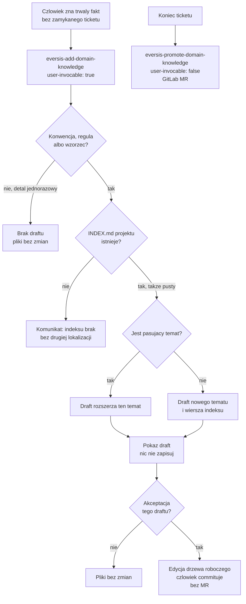

# AC-22 - Analysis Result

Follow-up do [`docs/specs/ac-2/ac-2.research.md`](../ac-2/ac-2.research.md) (Question 11, wiersz AC-22). Tamta sekcja jest mapą portfela. Ten plik jest researchem samego AC-22, wymaganym przez Delivery Standard ticketu, zanim powstanie plan.

## Task Details

| Field | Value |
|---|---|
| Jira ID | AC-22 |
| Title | Framework user can draft a domain fact without closing a ticket |
| Description | Subtask AC-2. Osoba, która już zna trwały fakt, uruchamia komendę i dostaje draft do wiedzy projektowej, bez czekania na zamknięcie ticketu. Nic nie jest zapisywane, dopóki ta osoba nie zaakceptuje tego konkretnego draftu. Po akceptacji pliki zmieniają się w drzewie roboczym; commituje człowiek. Agent nie otwiera merge requestu. |
| Priority | Medium |
| Reporter | Piotr Niemirski |
| Created Date | 2026-09-21 |
| Due Date | Not set |
| Labels | domain-knowledge, follow-up, workshop-2026-09-21 |
| Estimated Effort | Not set (Sub-task, parent AC-2, Backlog). Sizing w `jira-tasks.md`: Small (1–3). |

## Business Impact

Dziś trwały fakt trafia do `docs/context/<project>/` tylko przy Fine, i tylko wtedy, gdy właśnie kończone zadanie go ujawniło. Import z Confluence i audyt są osobnymi komendami, które człowiek uruchamia sam. Między tymi ścieżkami jest luka: osoba, która zna konwencję, regułę albo wzorzec **zanim** jakikolwiek ticket się zamknie, nie ma procedury. Albo edytuje pliki ręcznie bez draftu i bez sprawdzenia, czy temat już istnieje, albo czeka na Fine, które może w ogóle nie nastąpić.

AC-22 domyka tę lukę jedną komendą. Nie zastępuje promocji przy zamknięciu ticketu i nie dokłada czwartej kopii wiedzy. Późniejsza sesja ma znaleźć ten sam temat z `INDEX.md`, tak jak fakt zapisany przy Fine.

## Gathered Information

### Knowledge Base & Task Management Tools

- **AC-22** odczytane na żywo (`getJiraIssue`, cloud `eversis.atlassian.net`, `24d9ed05-5d0a-4228-ae1a-8e5f10122f36`), 2026-09-22. Status **Backlog**, priorytet Medium, typ **Sub-task**, parent **AC-2** (In Progress). Brak komentarzy i brak linków do innych issue. Opis w Jirze zgadza się ze story 1.1 po quality review.
- **Źródło treści:** workshop 2026-09-21, Gate 0 zatwierdzony. Lokalne pliki, nie Confluence:
  - `docs/specs/manual-domain-knowledge/intent-brief.md` — cel, zakres, decyzje (nowy skill, zapis w drzewie roboczym, parent AC-2).
  - `docs/specs/manual-domain-knowledge/extracted-tasks.md` — story 1.1.
  - `docs/specs/manual-domain-knowledge/quality-review.md` — S-01, S-02, S-03 przyjęte (odrzucenie draftu, brakujący indeks, odczyt w późniejszej sesji).
  - `docs/specs/manual-domain-knowledge/jira-tasks.md` — tekst wstawiony do Jiry jako AC-22.
- **Parent:** Question 11 w `ac-2.research.md` stawia AC-22 **obok** Faz 4–7, nie wewnątrz nich. Kolejność z tamtej mapy: AC-22 może iść równolegle z AC-16 i AC-18. Ograniczenie zostaje: akceptacja draftu jest bramką człowieka, bez nowego enumu statusu.
- **Poza zakresem, już nazwane w briefie:** promocja przy Fine jako komenda, edycja ręczna jako zamiennik, import, audyt, lifecycle statusu (AC-18), log decyzji (AC-16), sugestia As-Is (AC-17), handoff sesji (AC-19), mapa publiczna jako osobny ticket (AC-20), próg okna na Pi (AC-21), publikacja do wspólnego `domain-context` w tej samej akcji, uruchomienie komendy na repo konsumenta w ramach dostarczenia frameworka.

### Codebase

- **Promocja przy Fine już istnieje i nie jest komendą.** `.ai/skills/eversis-promote-domain-knowledge/SKILL.md` ma `user-invocable: false`. Kroki 1–5 przygotowują draft; krok 6 zapisuje przez GitLab API (branch, commit, merge request) i wymaga `GITLAB_TOKEN`. Zasada `no-local-checkout` dotyczy tam zapisu zdalnego, nie drzewa roboczego.
- **Skilla `eversis-add-domain-knowledge` nie ma.** Katalog `.ai/skills/` nie zawiera tego folderu.
- **Dwie komendy, które człowiek już uruchamia sam**, to wzorzec powierzchni dla AC-22: `eversis-import-confluence-knowledge` i `eversis-audit-domain-knowledge`, obie `user-invocable: true`. W Claude Code flaga `user-invocable: false` trzyma skill poza menu `/`, a treść zostaje ładowalna przez model (`adapters/claude/README.md`). Cursor nie generuje shimu `.cursor/commands/` ze skilla — shim powstaje z promptu (`.ai/prompts/`). Import i audyt nie mają osobnego promptu publicznego.
- **Kształt tematu jest jeden.** Plik `docs/context/<project>/<component>/index.md` plus jeden wiersz w `docs/context/<project>/INDEX.md`, dokładnie dwie kolumny. Trzecia kolumna jest po cichu odrzucana (`docs/context/agent-collections/readiness-contract/index.md`, `mcp/eversis-collections-mcp/src/context.ts`). Frontmatter promocji: `scope`, `source: agent-discovered`, `status: approved`, `last_updated`, `tags`, `code_paths`, `confluence_url`, `related_specs`. Na zapisanym pliku promocja ustawia wyłącznie `approved`. `draft` i `proposed` zostają nazwami bramki w czacie. `deprecated` i `superseded` ma pisać audyt; skill audytu jeszcze tego pola nie ma. Import używa tego samego kształtu pliku z innym `source` (`confluence` albo `docs-specs-cluster`) i pustymi tablicami, gdy nie ma ścieżek ani speców, i pola `status` nie ustawia.
- **Ścieżka projektu nie jest zgadywana z nazwy repo.** MCP czyta `ssot.projectContextPath` z install selection i dokleja `INDEX.md` (`context.ts`, `listContext`). Brak pliku indeksu daje pustą listę, nie nowy katalog.
- **Audyt źle czyta pusty `code_paths` poza jednym wyjątkiem.** `eversis-audit-domain-knowledge` traktuje „wszystkie ścieżki zniknęły” jako sygnał `Delete`. Wyjątek „puste `code_paths` → `Update`, nigdy `Delete`” obejmuje tylko `source: confluence`. Question 11 oddaje analogiczny błąd dla `source: docs-specs-cluster` do AC-18 (logical-review S3). Źródło ręczne z pustymi ścieżkami wpadłoby w tę samą dziurę.
- **Publiczny opis zapisu** jest ręczną stroną, nie kopią skilla: `website/docs/reference/domain-context.md`, sekcja „The three write skills” i tabela „What to use” (promote, import, audit). `website/docs/reference/framework-reference.md` mówi o trzech skillach domain-context. `adapters/website/check-skills.mjs` wymaga, żeby każdy folder `.ai/skills/<id>/` był wspomniany w `website/docs/reference/skills/*.md` i żeby licznik w `skills/overview.md` zgadzał się z liczbą folderów. Strony skilli są kuratorowane, nie generowane 1:1 z `SKILL.md`.
- **To repo gitignoruje `docs/context/*/`.** Zostaje `docs/context/README.md` (`docs/context/README.md`). Konsument domyślnie commituje `docs/context/`, chyba że instalacja użyła `--gitignore-agent-artifacts`. AC-22 dostarcza skill we frameworku; nie uruchamia go na danych konsumenta.

### Relevant Links

- Jira AC-22 — https://eversis.atlassian.net/browse/AC-22
- Parent AC-2 — https://eversis.atlassian.net/browse/AC-2
- `docs/specs/ac-2/ac-2.research.md` — Question 9 (fazy), Question 11 (wiersz AC-22 i kolejność)
- `docs/specs/manual-domain-knowledge/` — intent brief, extracted tasks, quality review, jira-tasks
- `.ai/skills/eversis-promote-domain-knowledge/SKILL.md` — kształt tematu i ścieżka GitLab, której AC-22 nie kopiuje
- `.ai/skills/eversis-import-confluence-knowledge/SKILL.md` — `user-invocable: true`, puste `code_paths` / `related_specs` jako jawne tablice
- `.ai/skills/eversis-audit-domain-knowledge/SKILL.md` — wyjątek Delete tylko dla `source: confluence`
- `website/docs/reference/domain-context.md` — publiczny opis trzech ścieżek zapisu
- `adapters/claude/README.md` — menu `/` a `user-invocable`

### Relevant Charts & Diagrams



Cztery ścieżki zapisu po tym ticketcie: ta komenda (człowiek startuje, zapis lokalny), promocja przy Fine (nie w menu, GitLab MR), import Confluence (osobna komenda), audyt (osobna komenda, porządki). Publikacja do `domain-context` zostaje późniejszym, osobnym krokiem promocji.

Ten wykres wchodzi w zakres AC-22: strona publiczna skilla (`website/docs/reference/skills/`) pokazuje go jako diagram Mermaid, ten sam przebieg co powyżej. Witryna już renderuje Mermaid (`@docusaurus/theme-mermaid`). `SKILL.md` zostaje procedurą dla agenta i tego wykresu nie dostaje.

## Current Implementation Status

### Existing Components

- Promocja przy Fine — `.ai/skills/eversis-promote-domain-knowledge/SKILL.md` — needs extension tylko w sensie „zostaw bez zmian”; AC-22 jej nie przerabia na komendę
- Import — `.ai/skills/eversis-import-confluence-knowledge/SKILL.md` — can be reused jako wzorzec `user-invocable` i pustych tablic we frontmatter, nie jako procedura do wywołania
- Audyt — `.ai/skills/eversis-audit-domain-knowledge/SKILL.md` — needs extension w AC-18 (wyjątek Delete), nie w tym ticketcie
- Router odczytu — `.ai/rules/orchestration/agent-core.md` — can be reused; AC-22 nie zmienia budżetu odczytu
- Opis publiczny — `website/docs/reference/domain-context.md` — needs modification (czwarta ścieżka, osobno od trzech obecnych)
- Katalog skilli na stronie — `website/docs/reference/skills/overview.md`, `framework-reference.md` — needs modification (wzmianka i licznik)
- Strona skilla — `website/docs/reference/skills/` (nowa, kuratorowana) — needs to be created, z diagramem z sekcji Relevant Charts & Diagrams
- `eversis-add-domain-knowledge` — brak — needs to be created

### Key Files and Directories

- `.ai/skills/eversis-promote-domain-knowledge/SKILL.md` — bar trwałości, dopasowanie tematu, kształt pliku; krok 6 (GitLab MR) jest ścieżką, której nowy skill nie używa
- `.ai/skills/eversis-fine-handoff/SKILL.md` — drugi draft przy Fine zostaje; AC-22 nie dokłada tu pozycji menu
- `website/docs/reference/domain-context.md` — tabela „What to use” i „The three write skills”
- `website/docs/reference/skills/<add-domain-knowledge>.md` — strona skilla; w zakresie jest ten sam diagram Mermaid co w Relevant Charts & Diagrams
- `mcp/eversis-collections-mcp/src/context.ts` — odczyt indeksu; AC-22 nie zmienia MCP
- `docs/context/<project>/INDEX.md` — cel zapisu po akceptacji; w tym repo katalog projektu jest gitignore’owany
- `docs/specs/manual-domain-knowledge/` — zatwierdzony brief, nie zastępuje `docs/specs/ac-22/`

## Gap Analysis

Ustalenia poniżej biorą się z ticketu, Gate 0 i kodu. Jedno rozszerzenie zakresu pochodzi od człowieka (2026-09-22): diagram z tego researchu na stronie skilla (Question 7).

### Question 1
#### Czy „komenda” to nowy prompt i shim Cursora, czy skill z `user-invocable: true`?

Skill. Import i audyt są już tym wzorcem: człowiek je uruchamia, promocja przy Fine ma `user-invocable: false` i zostaje poza menu `/` w Claude Code. Cursor i tak nie buduje `.cursor/commands/` ze skilli. Osobny prompt publiczny dodałby drugą powierzchnię, której import i audyt nie mają. Promocja przy Fine nie dostaje `user-invocable: true`.

Decyzja człowieka (2026-09-22): OK.

### Question 2
#### Czy zapis po akceptacji idzie tą samą ścieżką GitLab co promocja?

Oba zapisy trafiają do tych samych plików: `docs/context/<project>/<component>/index.md` i wiersz w `INDEX.md`. Różni się to, kto i czym je zapisuje po akceptacji draftu.

Promocja przy Fine (krok 6 skilla) woła API GitLaba: odczyt aktualnego pliku, branch, jeden commit, merge request. Potrzebuje `GITLAB_TOKEN`. Człowiek merguje request. Ta ścieżka zostaje przy Fine i przy późniejszej publikacji do wspólnego `domain-context`.

AC-22, po „tak” dla tego draftu, edytuje pliki w drzewie roboczym sesji i na tym kończy. `GITLAB_TOKEN`, branch i merge request nie występują. Komendy `git commit` też nie woła — commit jest ręczny, jak przy zwykłej zmianie w repo. Tak zdecydował Gate 0 i tak brzmi kryterium akceptacji.

Decyzja człowieka (2026-09-22): OK.

### Question 3
#### Co znaczy „ten sam kształt tematu”, skoro nie ma zamykanego ticketu?

Późniejsza sesja szuka tematu tak samo, niezależnie od komendy: jeden wiersz `INDEX.md`, potem jeden plik `docs/context/<project>/<component>/index.md`. „Ten sam kształt” znaczy te same ścieżki i te same klucze frontmatter. Wartości zależą od tego, skąd fakt przyszedł.

Przykład pliku po akceptacji komendy AC-22:

```yaml
---
scope: project
source: manual
status: approved
last_updated: "<ISO date>"
tags: [<relevant tags>]
code_paths: []
confluence_url: null
related_specs: []
---
```

- `source: manual` — fakt podała osoba. Przy Fine zostaje `agent-discovered`. Import już rozróżnia źródła (`confluence`, `docs-specs-cluster`) w tym samym układzie pliku.
- `related_specs: []` — jawna pusta tablica. Promocja przy Fine dopisuje `docs/specs/<task-kebab>/`, bo jest zamykany ticket. Tutaj go nie ma, więc nie wpisywać `docs/specs/ac-22/` do każdego faktu. Ten folder opisuje komendę, nie temat.
- `code_paths` — uzupełnić, gdy fakt ma ścieżki. Inaczej jawna pusta tablica, jak import, nie pominięte pole.
- `confluence_url: null`.
- `status: approved` na pliku, który ląduje na dysku. Skill promocji już tak pisze i wymienia dozwolone wartości: `draft`, `proposed`, `approved`, `deprecated`, `superseded`. `draft` i `proposed` zostają nazwami bramki w czacie — plik powstaje dopiero po akceptacji, więc tych dwóch wartości AC-22 nie zapisuje. `deprecated` i `superseded` zostają przy audycie (AC-18); skill audytu jeszcze pola `status` nie ma.

Korekta wobec pierwszej wersji tej odpowiedzi: „bez pola `status`” było zgodne ze skillem promocji z rana 2026-09-22. Od tego czasu skill promocji ustawia `status: approved` na commicie. Ten sam kształt obejmuje to pole.

Decyzja człowieka (2026-09-22): OK.

### Question 4
#### Czy reguła drugiego wystąpienia z promocji obowiązuje tutaj?

Nie. Tam agent sam ocenia zakończone zadanie i przy granicznych przypadkach czeka na drugi raz. Tutaj człowiek przychodzi z faktem, który już uważa za trwały. Nadal obowiązuje odmowa detalu jednorazowego (zmiana nazwy, literówka, jednorazowy timeout) — prośba o komendę nie jest dowodem trwałości. Przy dopasowanym temacie draft rozszerza ten plik, nie zakłada drugiego.

Decyzja człowieka (2026-09-22): OK.

### Question 5
#### Kiedy indeks jest „brakujący”, a kiedy wolno dodać pierwszy wiersz?

Brakujący oznacza, że plik `INDEX.md` pod `ssot.projectContextPath` nie istnieje. Wtedy agent mówi to wprost i nie tworzy katalogu, drugiego indeksu ani innej lokalizacji faktu. Pusty indeks (same nagłówki, zero wierszy danych) nie jest brakujący — instalator właśnie taki scaffolduje. Pierwszy zaakceptowany temat dodaje wiersz. Ścieżka projektu bierze się z install selection, nie z nazwy folderu repozytorium.

Decyzja człowieka (2026-09-22): OK.

### Question 6
#### Gdzie ląduje konwencja zespołu bez ścieżki kodu?

W jednym temacie nazwanym jak komponent funkcjonalny, tą samą regułą co krok 3 promocji (`checkout-flow`, nie `business-rules`). Draft pokazuje proponowaną nazwę i wiersz indeksu; człowiek koryguje ją przed akceptacją albo odrzuca draft. Brak kotwicy w kodzie nie blokuje draftu i nie tworzy worka „reguły biznesowe”.

Puste `code_paths` przy `source: manual` audyt może dziś odczytać jak `Delete`, bo wyjątek dotyczy tylko `source: confluence`. To ten sam typ luki co S3 (`docs-specs-cluster`), oddany AC-18. AC-22 jej nie naprawia i nie czeka na AC-18, żeby powstać. AC-18, gdy ruszy, dopisuje `source: manual` do tego wyjątku obok `docs-specs-cluster`.

Decyzja człowieka (2026-09-22): OK.

### Question 7
#### Co jest publicznym opisem „jak wiedza jest zapisywana”?

Kryterium mówi o miejscu, w którym czytelnik sprawdza, jak wiedza jest zapisywana. To już jest jedna strona: `website/docs/reference/domain-context.md`, sekcje „The loop”, „What to use” i „The three write skills”. Dziś są tam trzy ścieżki zapisu: promocja przy Fine, import z Confluence, audyt. AC-22 dopisuje czwarty wiersz, osobno od tych trzech. Ręczna edycja plików zostaje opisana jako nadal możliwa.

Osobno każdy skill ma krótką stronę w `website/docs/reference/skills/`. Nowa strona jest potrzebna, bo `check-skills.mjs` wymaga wzmianki o id skilla, a licznik w `skills/overview.md` oraz zdanie o trzech skillach w `framework-reference.md` muszą się zgadzać z liczbą folderów. Na tej stronie skilla jest diagram z sekcji Relevant Charts & Diagrams (ten sam przebieg, blok Mermaid). Diagram nie wchodzi do `SKILL.md`.

AC-20 opisuje szerszą mapę architektury i tej strony nie zastępuje. Nie musi wyjść pierwszy.

Decyzja człowieka (2026-09-22): OK.

### Question 8
#### Czy gitignore `docs/context/*/` w tym repo zmienia kryterium commitu?

Nie zmienia skilla. Zapis to pliki w drzewie roboczym. Czy `git commit` człowieka je obejmie, zależy od gitignore projektu. Domyślny konsument je śledzi. To repo i instalacja z `--gitignore-agent-artifacts` nie. Skill nie zmienia gitignore i nie commituje sam. Kryterium „późniejsza sesja znajduje temat” jest o indeksie w tym drzewie, nie o klonie, który tych plików nie dostał.

Decyzja człowieka (2026-09-22): OK.

## Human gates

1. ~~Approve research~~ — done (`Research is ok. Go to the plan`)
2. ~~Approve plan~~ — done (`PLAN IS OK. W WILL START IMPLEMENTATION IN THE NEW WINDOW`)
3. Implement → Review → Fine — w nowym oknie.

Nie publikować zmian opisu AC-22 w Jirze z tego researchu. Opis jest zgodny z briefem. Question 1–8 mają decyzję OK (2026-09-22).
