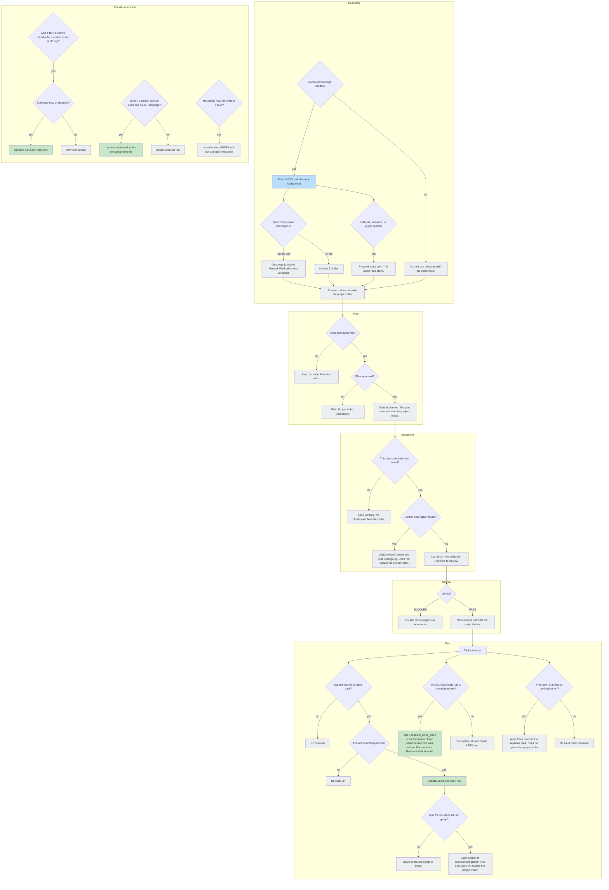

# AC-24 - Implementation Plan

## Task Details

| Field            | Value                   |
| ---------------- | ----------------------- |
| Jira ID          | [AC-24](https://eversis.atlassian.net/browse/AC-24) |
| Title            | Publish the context-and-knowledge architecture diagram on the public site |
| Description      | Add one English mermaid decision tree to the public domain-context page. It shows which writes update `docs/context/<project>/INDEX.md` along Research → Plan → Implement → Review → Fine. |
| Priority         | Low |
| Related Research | [ac-24.research.md](./ac-24.research.md) |

## Wildly Important Goal

**Goal**: A reader of the public domain-context page can see, in one diagram, which writes update the project index and which do not.

**Success Measure**: `website/docs/reference/domain-context.md` contains one mermaid decision tree in the section "What updates the project index", `npm run website:build` succeeds, and the page still contains the group-work diagram.

**Do NOT touch / do NOT add**:

- The AC-20 prose in "What updates the project index", the propagation SVG, and the mermaid under "Working across the whole group yourself"
- The three readiness pages
- Diagram 2 copied onto the site, including the window-fill trigger and the 5–10 exchange trigger
- Phase 6 retrieval
- `.ai/`, the generated implement prompt, `CHANGELOG.md`, and `website/src/pages/changelog.md`
- A new column on `docs/context/<project>/INDEX.md`

## Proposed Solution

Insert one English mermaid figure at the end of the section "What updates the project index" in `website/docs/reference/domain-context.md`, after the sentence "Full-text, semantic, or graph retrieval over the store (Phase 6) is not built yet." and before the heading "Tools and skills". The figure is one diagram with its own decision tree inside Research, Plan, Implement, Review, and Fine. A flat root question is not this figure. The Polish copy in the research is for review; the page stays English.

Delegate the edit to **Repo Docs Writer** via [eversis-repo-docs-writer.md](../../../.ai/prompts/public/eversis-repo-docs-writer.md), following `eversis-writing-repo-documentation`. This task does not change the changelog, so that skill's changelog-edit steps do not run.

The diagram to publish:

Under the figure, add one legend paragraph: green updates the project index (a row, or `tasks_since_audit` in the file header); blue is a read of that index; gray does not update it. State that the Implement checkpoint is a completed-and-tested task while further plan tasks remain, that it does not continue to Review in the same session, and that it is not a window-fill check and not an exchange-count check. Add-a-fact, import, and architecture decisions sit in "Outside one ticket" because they are not a phase of one delivery.

## Current Implementation Analysis

### Already Implemented

- Domain-context page and the AC-20 prose — `website/docs/reference/domain-context.md` — the section the diagram illustrates
- Group-work mermaid — same file, heading "Working across the whole group yourself" — stays
- Propagation SVG — same file, "How it's distributed" — stays
- Mermaid renderer — `website/docusaurus.config.ts` (`mermaid: true`, `@docusaurus/theme-mermaid`) — no config change
- Approved meaning of the tree — `docs/specs/ac-24/ac-24.research.md` — Polish review copy

### To Be Modified

- Domain-context page — `website/docs/reference/domain-context.md` — insert the English decision tree and its legend at the end of "What updates the project index"

### To Be Created

- None. The diagram is new content inside the existing page.

## Open Questions

| #   | Question   | Answer   | Status                |
| --- | ---------- | -------- | --------------------- |
| 1   | Should the site publish Diagram 2? | No. Human: "NO". | ✅ Resolved |
| 2   | Where does the diagram go, and in what format? | End of "What updates the project index", before "Tools and skills". Mermaid, English, on the public page. Human: "OK". | ✅ Resolved |
| 3   | Does Fine always increment the audit count? | No. Fine adds 1 to `tasks_since_audit` only when the index already has a component row, including when promote writes nothing. A missing index or an empty table is left unchanged. | ✅ Resolved |
| 4   | Does this diagram need a changelog line? | No. Human: "NO". | ✅ Resolved |
| 5   | Is one root question enough? | No. Human: "Ten digram jest za płaski. Chodziło mi o drzewo decyzyjne w każdej fazie projektu". Each of Research, Plan, Implement, Review, and Fine has its own decision tree. | ✅ Resolved |

## Technical Context

Project conventions, coding standards, and patterns discovered during planning. Downstream agents MUST read this section instead of re-discovering the same context.

### Project Instructions

- [AGENTS.md](../../../AGENTS.md) — framework repo; public docs live under `website/docs/`
- [.cursor/rules/eversis-project-stack.mdc](../../../.cursor/rules/eversis-project-stack.mdc) — load `eversis-writing-repo-documentation` for this docs edit; do not load frontend, backend, or filter skills
- Research approval quote: `Research is ok.`

### Architecture & Patterns

- One public page, `website/docs/reference/domain-context.md`, Docusaurus markdown with front matter (`sidebar_position`, `title`, `slug`)
- Existing figures on that page: an SVG in a `<figure>`, and a mermaid `flowchart TD` with `\n` inside labels and `style` fills `#BBDEFB`, `#C8E6C9`, `#ECEFF1`
- Path placeholders in mermaid use parentheses, as in `docs/context/(project)/INDEX.md`, because angle brackets break the diagram
- Section order stays: prose paragraphs, then the new diagram, then "Tools and skills"

### Tech Stack

- Docusaurus 3 site in `website/`, mermaid via `@docusaurus/theme-mermaid`
- Package manager: npm. Build from the repo root: `npm run website:build` (`npm --prefix website run build`)
- Changelog drift check: `npm run website:changelog:check` (`node scripts/sync-changelog.mjs --check`). This task must leave `CHANGELOG.md` unchanged, so the check is a guard, not a sync step

### Code Style & Standards

- Public page language is English. Do not translate existing headings or the AC-20 paragraphs
- Match the legend tone already used under the propagation figure: one short paragraph after the diagram
- No new dependency and no new image asset

### Testing Patterns

- Docs change. No unit-test file
- After the edit, from the repo root: `npm run website:build`
- Guard: `npm run website:changelog:check`
- Inspectable checks: the new `flowchart TD` is present once in "What updates the project index"; the heading "Working across the whole group yourself" is still present; the new diagram does not contain `50%` or `5-10`

### Database Patterns

- None. This task does not touch a database.

### Additional Context

- Skill `eversis-fine-handoff`: Fine increments `tasks_since_audit` only when `docs/context/<project>/INDEX.md` already has at least one component row. It does not create a missing index. It does not set `last_audit` and it does not start an audit
- Checkpoint source of truth is rule 14 in `eversis-orchestrating-implementation`: a `CHECKPOINT:` row in the plan Changelog when a non-last task is completed and tested. Window fill is not a trigger. Read only; do not edit the skill

## Implementation Plan

### Phase 1: Publish the decision tree

**Goal**: The public page shows the approved decision tree, which is the picture the Wildly Important Goal asks for.

**Description**: Add the English mermaid from Proposed Solution, plus the legend paragraph, without rewriting the surrounding prose. Repo Docs Writer performs the edit.

**Verification:** `npm run website:build`

#### Task 1.1 - [MODIFY] Insert the decision tree on the domain-context page

**Description**: In `website/docs/reference/domain-context.md`, after the Phase 6 sentence and before `## Tools and skills`, insert the mermaid from Proposed Solution and the legend paragraph. Leave every existing paragraph, the propagation SVG, and the group-work mermaid unchanged. Do not edit `CHANGELOG.md`.

**Files:** `website/docs/reference/domain-context.md` (modify)

**Definition of Done**:

- [x] The section "What updates the project index" contains one `flowchart TD` with a decision diamond inside each of Research, Plan, Implement, Review, and Fine
- [x] That diagram includes the Fine branch that adds 1 to `tasks_since_audit` when a component row already exists, and the branch that does nothing when the index is missing or has no rows
- [x] That diagram does not contain `50%` or `5-10`
- [x] The heading "Working across the whole group yourself" is still in the file, and the AC-20 paragraphs above the new diagram are unchanged
- [x] `CHANGELOG.md` has no new entry for this diagram
- [x] Run `npm run website:build`
- [x] Run `npm run website:changelog:check`

**Stop Rule:** Stop if the mermaid fails the website build. Do not switch the diagram to an SVG or edit Docusaurus config to force it through.

**Clues**: Copy the diagram from Proposed Solution. Use `(project)` in node labels, not angle brackets. Legend colors: green `#C8E6C9`, blue `#BBDEFB`, gray `#ECEFF1`.

### Phase 2: Code Review

**Goal**: An independent review confirms the published tree matches the approved meaning and the out-of-scope list, so the Wildly Important Goal is actually met.

**Description**: Final verification of the page edit. This phase is mandatory and always comes last. There is no e2e suite for this docs change; do not invent one.

**Verification:** `npm run website:build`

#### Task 2.1 - [REUSE] Code review by Code Reviewer

**Description**: Run **Code Reviewer** via [eversis-review.md](../../../.ai/prompts/public/eversis-review.md) on the domain-context page edit. Pass e2e execution to that agent; the agent will find no e2e suite for this change and must not block on that absence.

**Files:** `website/docs/reference/domain-context.md` (reuse)

**Definition of Done**:

- [x] Run `npm run website:build`
- [x] Code review passes with no blocking findings
- [x] Review outcome documented in Changelog

**Stop Rule:** Stop after three review passes if the same blocker remains, and escalate to the human.

**Clues**: Review against the acceptance criteria below. Confirm `.ai/` and `CHANGELOG.md` are untouched.

## Security Considerations

- The change is static markdown on a public docs page. It must not add secrets, tokens, or a remote image URL.
- Mermaid stays in the markdown file. Do not add a dependency or a script to render it.

## Quality Assurance

Acceptance criteria checklist to verify the implementation meets the defined requirements:

- [x] The domain-context page shows one diagram of the current context-and-knowledge architecture
- [x] A reader can tell from the diagram which writes update `docs/context/<project>/INDEX.md` and which do not
- [x] The diagram does not teach the retired window-fill trigger or the 5–10 exchange trigger
- [x] Research, Plan, Implement, Review, and Fine each contain their own decision tree
- [x] The existing group-work diagram on the same page is still there
- [x] `npm run website:build` succeeds
- [x] `CHANGELOG.md` is unchanged

## Improvements (Out of Scope)

- A Polish version of the public domain-context page. The research tree is Polish for review; the site stays English.
- Replacing Diagram 2 inside `docs/specs/ac-2/ac-2.research.md`. That file stays historical.

## Human gates

1. ~~Approve research~~ — done (`Research is ok.`)
2. ~~Approve this plan~~ — done (`Plan is ok.`)
3. ~~Implement → Review → Fine~~ — done (`Dokończ implementację AC-24`)

Historical: no plan-review file was written. The human accepted this plan in gate 2. Do not treat the missing file as plan review still required, and do not reopen implementation.

## Changelog

| Date   | Change Description   |
| ------ | -------------------- |
| 2026-09-23 | Initial plan created |
| 2026-09-23 | Replaced the single-root diagram with a decision tree inside each delivery phase. Human: "Ten digram jest za płaski. Chodziło mi o drzewo decyzyjne w każdej fazie projektu". |
| 2026-09-23 | CHECKPOINT: Task 1.1 done and tested (`npm run website:build`, `npm run website:changelog:check`). Changed files: `website/docs/reference/domain-context.md` (English decision tree and legend), `docs/specs/ac-24/ac-24.plan.md` (Task 1.1 DoD checked, plan gate closed). Next step: Task 2.1 code review. |
| 2026-09-23 | RESUMED: User asked to finish AC-24 in the same chat (quote: "Dokończ implementację AC-24"). |
| 2026-09-23 | Code review performed (Task 2.1). Verdict: PASS. Zero BLOCKER findings. |
| 2026-09-23 | Human asked to split the published figure into two stacked flowcharts, each with a title, and to remove the default `#ffffde` block background. |
| 2026-09-23 | Human asked to split "During one delivery" into smaller sections with subheadings. |
| 2026-09-23 | Human asked for a short description under each diagram section. |
| 2026-09-23 | Human asked for a uniform white diagram background when `data-theme="dark"`. |

## Code Review Findings

**Verdict:** PASS

**Reviewer role:** Independent Code Reviewer (did not implement Task 1.1).

**Checks performed:**

1. **Mermaid drift** — Page mermaid (after the Phase 6 sentence) compared byte-for-byte to the Proposed Solution mermaid in this plan: **identical** (114 lines; no drift).
2. **AC-20 prose / SVG / group heading** — `git diff` shows only insertions after the Phase 6 sentence; AC-20 paragraphs above the diagram unchanged. Propagation SVG (`domain-context-knowledge-propagation.svg`) still present. Heading "Working across the whole group yourself" still present.
3. **Forbidden tokens** — New diagram + legend section contains neither `50%` nor `5-10` / `5–10`.
4. **Changelog** — `CHANGELOG.md` and `website/src/pages/changelog.md` have no task-related edits; `npm run website:changelog:check` OK. No new product changelog entry for this diagram.
5. **`.ai/` scope** — No `.ai/` files modified for this task (`git status` clean under `.ai/`).
6. **`npm run website:build`** — Succeeded from repo root (exit 0).
7. **Tests** — Docs-only change; no unit/e2e suite required; missing e2e not treated as a BLOCKER per plan Task 2.1.

**Findings:**

- BLOCKER: none
- SUGGESTION: none

**Gap analysis:** Expected insert (English decision tree + legend between Phase 6 sentence and `## Tools and skills`) is present and matches the approved contract. Out-of-scope items (Diagram 2, readiness pages, `.ai/`, product `CHANGELOG.md`) untouched.
