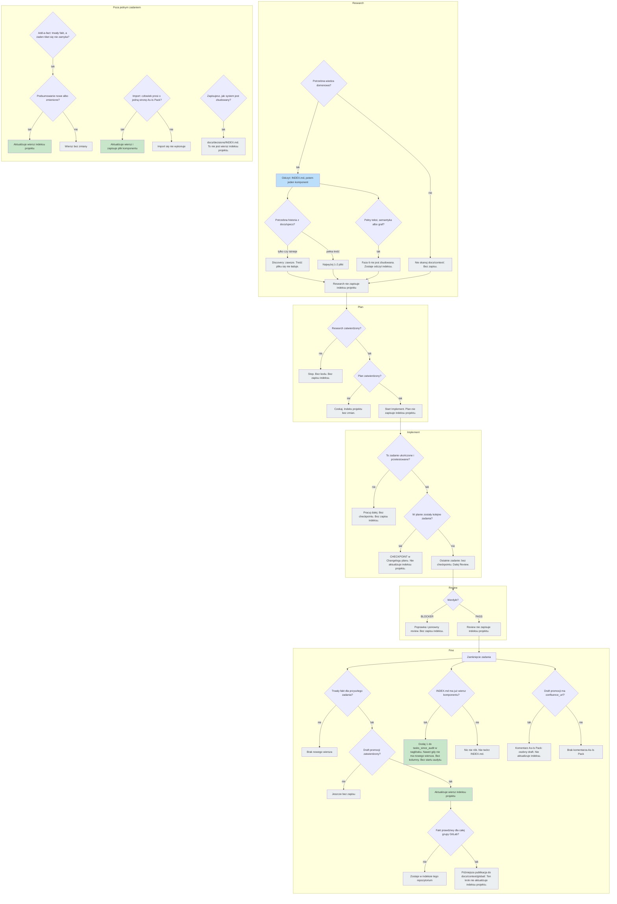

# Opublikowanie diagramu architektury kontekstu i wiedzy — wynik analizy

## Task Details

| Pole | Wartość |
|---|---|
| Jira ID | [AC-24](https://eversis.atlassian.net/browse/AC-24) |
| Tytuł | Publish the context-and-knowledge architecture diagram on the public site |
| Opis | Jeden diagram na publicznej stronie domain-context, pokazujący architekturę kontekstu i wiedzy tak, jak działa teraz, wzdłuż Research → Plan → Implement → Review → Fine. Rodzic: [AC-2](https://eversis.atlassian.net/browse/AC-2). |
| Priorytet | Niski |
| Zgłaszający | Piotr Niemirski |
| Data utworzenia | 2026-09-23 |
| Termin | nie ustawiono |
| Etykiety | brak |
| Szacowany nakład | mały — jeden diagram na jednej istniejącej stronie dokumentacji |

## Business Impact

AC-20 już opisuje prozą, na publicznej stronie domain-context, która skończona praca aktualizuje wiersz w `docs/context/<project>/INDEX.md`. Czytelnik i tak musi złożyć to z kilku akapitów. Jedyny rysunek całej architektury cyklu jest w researchu AC-2 (Diagram 2) i wciąż uczy triggerów oraz przyszłych draftów, które nie są obecnym zachowaniem. Opublikowanie jednego aktualnego diagramu na stronie publicznej pozwala zobaczyć na jednym obrazku, które zapisy dotykają indeksu projektu, a które nie.

## Gathered Information

### Knowledge Base & Task Management Tools

[AC-24](https://eversis.atlassian.net/browse/AC-24) to sub-task w statusie Backlog zadania [AC-2](https://eversis.atlassian.net/browse/AC-2) (In Progress). Na tikecie nie ma strony Confluence, załącznika ani powiązania. Folder `docs/specs/ac-24/` nie istniał przed tym researchem.

Cel z tiketu jest listą wymagań. Diagram ma pokazać:

- Research zaczyna się od `docs/context/<project>/INDEX.md`, potem jeden komponent. Discovery jest zawsze dozwolone. Konsumpcja pełnej treści pliku jest ograniczona do 1–2 plików.
- Promote, import i add-a-fact aktualizują wiersz w tym indeksie.
- Licznik audytu żyje w tym pliku indeksu i nie jest nową kolumną. Fine zwiększa go nawet wtedy, gdy promocja nic nie zapisuje.
- Decyzje używają `docs/decisions/INDEX.md` i nie są wierszem w indeksie wiedzy projektu.
- Komentarz As-Is Pack jest osobnym draftem na Fine i nie aktualizuje indeksu projektu.
- Checkpoint sesji jest wierszem w changelogu planu i nie aktualizuje indeksu projektu.
- Publikacja do `docs/context/global/` to późniejszy, osobny krok udostępnienia, a nie ta aktualizacja indeksu.
- Retrieval fazy 6 (pełnotekstowy, semantyczny albo graf) nie jest zbudowany.

Poza zakresem, z tiketu:

- Nie przerabiać sekcji prozy z AC-20 ani trzech stron readiness.
- Nie kopiować Diagramu 2 na stronę w obecnej postaci.
- Nie budować retrievalu fazy 6.
- Nie edytować `.ai/` ani wygenerowanego promptu implement.

Kryteria akceptacji:

- Strona domain-context pokazuje jeden diagram obecnej architektury kontekstu i wiedzy.
- Z diagramu da się odczytać, które zapisy aktualizują `docs/context/<project>/INDEX.md`, a które nie.
- Diagram nie uczy wycofanego triggera zapełnienia okna ani triggera 5–10 wymian.
- Istniejący diagram pracy grupowej na tej samej stronie zostaje.

`docs/context/agent-collections/INDEX.md` wymienia jeden komponent (`readiness-contract`: blok Implement readiness). Ten komponent nie jest architekturą, którą opisuje ten diagram. Opublikowanym opisem magazynu jest strona `website/docs/reference/domain-context.md`.

### Codebase

Strona docelowa: `website/docs/reference/domain-context.md`. Już zawiera:

- Figurę SVG „How it's distributed”, o propagacji wiedzy w grupie GitLab. Zostaje.
- Flowchart mermaid pod „Working across the whole group yourself” (jedna sesja na repozytorium). Zostaje. To jest diagram, który nazywa tiket.
- Sekcję „What updates the project index”, czyli prozę z AC-20. Już opisuje promote, import, add-a-fact, licznik audytu, decyzje, komentarz As-Is Pack, checkpoint sesji oraz to, że faza 6 nie jest zbudowana. Nowy diagram ilustruje tę sekcję. Nie zastępuje prozy.

Docusaurus już renderuje mermaid (`website/docusaurus.config.ts`: `mermaid: true`, motyw `@docusaurus/theme-mermaid`). Figura pracy grupowej na tej stronie jest w mermaid. Strona publiczna jest po angielsku.

Obecne zachowanie, które diagram ma oddać (sprawdzone względem żywych skilli, nie względem Diagramu 2):

| Zapis albo odczyt | Dotyka `docs/context/<project>/INDEX.md`? | Dokąd naprawdę trafia |
|---|---|---|
| Odczyt w Research | Tylko odczyt. Najpierw indeks, potem jeden komponent. Discovery po `docs/specs/**` jest zawsze dozwolone. Konsumpcja pełnej treści jest ograniczona do 1–2 plików. | Ten sam indeks, jako odczyt |
| Promote | Tak, wiersz, gdy zapisany zostaje trwały fakt | `docs/context/<project>/` |
| Import | Tak, wiersz, plus plik komponentu | `docs/context/<project>/` |
| Add-a-fact | Tak, wiersz, gdy podsumowanie jest nowe albo zmienione | `docs/context/<project>/` |
| Licznik audytu na Fine | Tak, frontmatter `tasks_since_audit` w tym pliku, nie kolumna tabeli. Zwiększany nawet wtedy, gdy promote nic nie zapisuje. Gdy indeksu nie ma albo nie ma wierszy komponentów, Fine nic nie robi i nie tworzy pliku. | Frontmatter tego samego indeksu |
| Decyzja architektoniczna | Nie | `docs/decisions/INDEX.md` |
| Komentarz As-Is Pack | Nie | Osobny draft Fine na stronę Packa |
| Checkpoint sesji | Nie | Wiersz `CHECKPOINT:` w Changelogu planu. Trigger: zadanie ukończone i przetestowane, gdy w planie zostały kolejne zadania. Zapełnienie okna nie jest triggerem. |
| Publikacja do warstwy globalnej | Nie | Późniejsze udostępnienie do `docs/context/global/`, nie ta aktualizacja indeksu |
| Retrieval fazy 6 | Nie zbudowany | — |

Plan i Review nie zapisują indeksu projektu.

Diagram 2 w `docs/specs/ac-2/ac-2.research.md` to rysunek sprzed wdrożenia. Wciąż pokazuje trigger okna ~50%, trigger 5–10 wymian, ADR jako przyszłą fazę i draft As-Is Pack jako przyszłą fazę. To nie jest obecne zachowanie. Tego rysunku nie kopiować na stronę.

### Relevant Links

- https://eversis.atlassian.net/browse/AC-24 — ten sub-task
- https://eversis.atlassian.net/browse/AC-2 — nadrzędne zadanie architektury
- `website/docs/reference/domain-context.md` — strona, na którą trafia diagram
- `docs/specs/ac-2/ac-2.research.md` — Diagram 2, tylko historia

### Relevant Charts & Diagrams

Na stronie są już dwie figury. Obie zostają. To zadanie dodaje trzecią.

Pierwszy szkic był flowchartem cyklu. Drugi był jednym pytaniem „Co się właśnie stało?” z samymi liśćmi. 2026-09-23 człowiek odrzucił ten płaski układ: „Ten digram jest za płaski. Chodziło mi o drzewo decyzyjne w każdej fazie projektu”. Poniższy szkic jest po polsku, do przeglądu. Na stronie publicznej ten sam układ idzie po angielsku.

Każda faza ma własne drzewo. Add-a-fact, import i decyzja architektoniczna są w osobnej ramce, bo nie są fazą jednego zadania. Przykład Fine: promote nie znajduje trwałego faktu, więc nowego wiersza nie ma, a skoro indeks ma już komponent, Fine i tak dodaje 1 do `tasks_since_audit`.

Legenda: zielony = aktualizuje indeks projektu (wiersz albo licznik audytu w nagłówku); niebieski = odczyt tego indeksu; szary = nie aktualizuje go. Checkpoint w Implement nie jest sprawdzeniem zapełnienia okna ani licznikiem wymian i nie prowadzi do Review w tej samej sesji.

## Current Implementation Status

### Existing Components

- Strona domain-context — `website/docs/reference/domain-context.md` — wymaga rozszerzenia (jeden diagram). Proza z AC-20 i mermaid pracy grupowej zostają bez zmian.
- Mermaid na stronie docs — `website/docusaurus.config.ts` — do użycia. Bez nowego renderera.
- Kształt indeksu projektu — `docs/context/<project>/INDEX.md` — tabela dwukolumnowa (komponent, jednozdaniowe podsumowanie) plus frontmatter dla `tasks_since_audit`. Do użycia. Bez nowej kolumny.
- Diagram 2 — `docs/specs/ac-2/ac-2.research.md` — historyczny. Nie używać na stronie.
- Reguła checkpointu orkiestracji — `.ai/skills/eversis-orchestrating-implementation/SKILL.md` — źródło obecnego zachowania checkpointu. Nie edytować.
- Fine handoff — `.ai/skills/eversis-fine-handoff/SKILL.md` — źródło zwiększania licznika audytu i osobnego draftu As-Is Pack. Nie edytować.
- Dom decyzji — `docs/decisions/INDEX.md` — router decyzji. Decyzja nie jest wierszem indeksu projektu.

### Key Files and Directories

- `website/docs/reference/domain-context.md` — jedyna strona, którą to zadanie zmienia.
- `docs/specs/ac-2/ac-2.research.md` — Diagram 2, nie kopiować.
- `.ai/skills/eversis-orchestrating-implementation/SKILL.md` — obecna reguła checkpointu (tylko odczyt).
- `.ai/skills/eversis-fine-handoff/SKILL.md` — zapis licznika audytu i draft As-Is Pack (tylko odczyt).
- `docs/decisions/INDEX.md` — router decyzji nazwany w tikecie.
- `docs/context/agent-collections/INDEX.md` — żywy przykład licznika we frontmatter i tabeli dwukolumnowej.

## Gap Analysis

### Question 1

#### Czy strona ma opublikować Diagram 2?

Nie. Tiket zabrania kopiowania go. Diagram 2 wciąż pokazuje trigger okna ~50%, trigger 5–10 wymian, przyszły draft ADR i przyszły draft As-Is Pack. Żywa reguła checkpointu zapisuje wiersz w Changelogu planu, gdy zadanie inne niż ostatnie jest ukończone i przetestowane, i mówi, że zapełnienie okna nie jest triggerem. Decyzje już żyją w `docs/decisions/`. Komentarz As-Is Pack jest już osobnym draftem Fine i nie aktualizuje indeksu projektu.

**Człowiek, 2026-09-23:** „NO”. Potwierdzone. Strona nie publikuje Diagramu 2.

### Question 2

#### Gdzie na stronie ląduje diagram i w jakim formacie?

W `website/docs/reference/domain-context.md`, zaraz po sekcji „What updates the project index”, a przed „Tools and skills”. Ta sekcja to proza z AC-20, którą obrazek ilustruje. Proza, SVG propagacji i mermaid pracy grupowej zostają tak, jak są.

Mermaid, po angielsku, spójnie z figurą pracy grupowej już obecną na stronie. Docusaurus już to renderuje.

**Człowiek, 2026-09-23:** „OK”. Miejsce i format mermaid są potwierdzone. Sam obrazek to drzewo decyzyjne w „Relevant Charts & Diagrams”, nie wcześniejszy flowchart.

### Question 3

#### Czy Fine zawsze zwiększa licznik audytu?

**Człowiek, 2026-09-23:** „Explain (my idea is to show an example decission three)”. Publiczny diagram jest drzewem decyzyjnym. Gałęzie Fine tego drzewa są wyjaśnieniem licznika.

**Doprecyzowanie, 2026-09-23:** „Ten digram jest za płaski. Chodziło mi o drzewo decyzyjne w każdej fazie projektu”. Płaski korzeń został zastąpiony osobnym drzewem w Research, Plan, Implement, Review i Fine. Wyjaśnienie licznika zostaje drzewem wewnątrz Fine.

Fine robi dwie różne rzeczy i tylko jedna z nich jest opcjonalna.

Promote zapisuje wiersz tylko wtedy, gdy zadanie dało trwały fakt. Wiele zadań nie zapisuje wiersza. To jest normalne.

Licznik audytu jest osobno. To liczba `tasks_since_audit` w nagłówku `docs/context/<project>/INDEX.md`, nie kolumna tabeli. Gdy Fine jest ogłoszone, a ten plik ma już co najmniej jeden wiersz komponentu, Fine dodaje 1. Robi to niezależnie od tego, czy promote zapisał wiersz. Nie ustawia `last_audit` i nie uruchamia audytu.

Gdy pliku indeksu nie ma albo tabela nie ma wierszy komponentów, Fine nic nie robi. Nie tworzy `INDEX.md`.

Przykład, który jest też połówką Fine drzewa decyzyjnego: indeks ma już jeden komponent, a promote nie ma czego zapisać. Nowego wiersza nie ma. Fine i tak dodaje 1 do `tasks_since_audit`. Komentarz As-Is Pack w tym samym zamknięciu to inna gałąź: nie zmienia pliku indeksu.

### Question 4

#### Czy diagram na stronie docs potrzebuje wpisu w changelogu?

**Człowiek, 2026-09-23:** „NO”. Ten diagram nie dostaje wpisu w `CHANGELOG.md`. Plan nie może go dodać.

## Human gates

1. ~~Zatwierdzenie researchu~~ — done (`Research is ok.`)
2. Zatwierdzenie planu (po napisaniu)
3. Implement → Review → Fine
