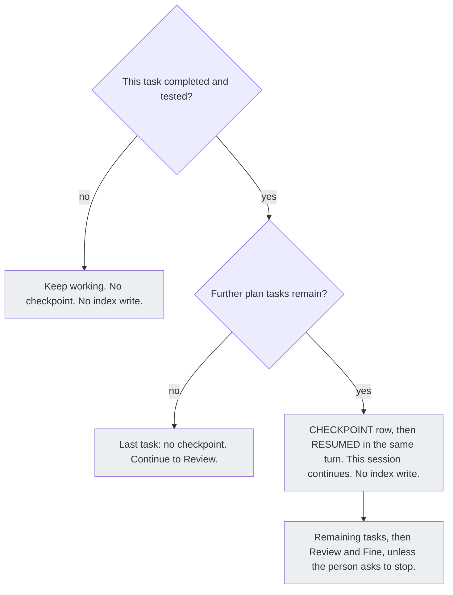

# AC-26 - Implementation Plan

## Task Details

| Field            | Value                   |
| ---------------- | ----------------------- |
| Jira ID          | [AC-26](https://eversis.atlassian.net/browse/AC-26) |
| Title            | CHECKPOINT must not hard-stop Implement; it is only a handoff note |
| Description      | A `CHECKPOINT:` row stays a handoff note. Writing it does not end the current Implement session. The same turn writes `RESUMED:` and the session continues. |
| Priority         | Medium |
| Related Research | [ac-26.research.md](./ac-26.research.md) |

## Wildly Important Goal

**Goal**: Implement keeps going after it writes a `CHECKPOINT:` row, unless the person explicitly asks to stop.

**Success Measure**: Rule 14 no longer tells the person to open a new session; the same turn writes `RESUMED:`; the public Implement diagram says this session continues; `npm run sync:adapters:check`, `npm run website:changelog:check`, and `npm run website:build` succeed.

**Do NOT touch / do NOT add**:

- The resume scan's meaning: a later `RESUMED:` row, or a later row that records that same task complete, still consumes a checkpoint; other later rows do not
- Rule 13 (last plan task goes to Fine in the same turn, with no checkpoint) and the Review/Fine precedence (do not checkpoint a session already in Review or Fine)
- Explicit stop phrases, including `pause before review` and `review later`
- `Flow` values and the shape of the readiness block (`Resume` stays its own optional line)
- `docs/specs/ac-24/`, `docs/specs/ac-2/`, and `docs/context/agent-collections/readiness-contract/`
- Research, Plan, Review, Fine, and "Outside one ticket" diagrams on the domain-context page
- The AC-19 sentence that a checkpoint is a plan-changelog row and does not update the project index
- `website/docs/reference/skills/orchestrating-implementation.md`
- Hand-editing `.cursor/rules/eversis-engineering-manager.mdc` or `website/src/pages/changelog.md`
- Changelog history below `## [Unreleased]`

## Proposed Solution

Change the hard stop, not the note. Rule 14 in `.ai/skills/eversis-orchestrating-implementation/SKILL.md` still fires when a plan task is completed and tested, further plan tasks remain, and the session is not already in Review or Fine. Window fill and exchange count stay non-triggers. The agent still writes one Changelog row whose Change Description starts with `CHECKPOINT:`.

In that same turn it writes the next Changelog row whose Change Description starts with `RESUMED:` and says this session continues. It does not tell the person to open a new session, and it does not end the turn. It continues the remaining plan tasks, including Review and Fine, unless the person explicitly asks to stop.

The existing resume scan then treats that `RESUMED:` row as consumption. A second window opened after both rows does not redo the next task. If the process dies between the two rows, the checkpoint stays unconsumed and a new window can resume. That gap is the handoff the note is for.

`.ai/rules/orchestration/engineering-manager.md` keeps the resume scan and gains one statement of the same contract: the session that writes `CHECKPOINT:` also writes `RESUMED:` in that turn and does not stop. Regenerate the Cursor rule with `npm run sync:adapters`. Do not edit the generated `.mdc` by hand.

On `website/docs/reference/domain-context.md`, change only the Implement subsection: the prose under the Implement heading, that subsection's mermaid, and the legend sentence about the Implement checkpoint. The page stays English. Keep the existing `%%{init:...}%%` line and the gray fills. The Implement chart becomes:

Prose under the Implement heading: a checkpoint is a plan-changelog row when this task is done and tested and later tasks remain. The same turn writes `RESUMED:` and this session continues through the remaining tasks, Review, and Fine, unless the person asks to stop. The checkpoint does not update the project index.

Legend sentence: the Implement checkpoint is a completed-and-tested task while further plan tasks remain. The same turn writes `RESUMED:` and the session continues. It does not update the project index, and it is not a window-fill check and not an exchange-count check.

Record the behavior change as one `### Fixed` bullet under `## [Unreleased]` in `CHANGELOG.md`. Sync the site changelog from that file. Do not hand-edit `website/src/pages/changelog.md`.

Delegate the skill and the engineering-manager rule to **Software Engineer** via [eversis-implement-common-task.md](../../../.ai/prompts/internal/eversis-implement-common-task.md). Delegate the domain-context page and the changelog bullet to **Repo Docs Writer** via [eversis-repo-docs-writer.md](../../../.ai/prompts/public/eversis-repo-docs-writer.md).

## Current Implementation Analysis

### Already Implemented

- Resume scan — `.ai/rules/orchestration/engineering-manager.md` — a fresh session emits `Resume` only for an unconsumed `CHECKPOINT:`. Reuse this scan; `RESUMED:` already consumes the checkpoint.
- Generated Cursor rule — `.cursor/rules/eversis-engineering-manager.mdc` — produced by `npm run sync:adapters` from the SSOT rule. Reuse the generator.
- Last-task and Review/Fine exceptions — `.ai/skills/eversis-orchestrating-implementation/SKILL.md` rule 13 and the precedence sentences inside rule 14. Reuse them.
- Domain-context page — `website/docs/reference/domain-context.md` — English mermaid per phase, with the Implement chart still teaching a stop. Reuse the page and the other charts.
- Changelog pipeline — `CHANGELOG.md` plus `npm run website:changelog:sync` / `npm run website:changelog:check`. Reuse it. The site page is generated.

### To Be Modified

- Rule 14 — `.ai/skills/eversis-orchestrating-implementation/SKILL.md` — remove the instruction to open a new session and stop. Same turn writes `RESUMED:` and continues.
- Engineering-manager rule — `.ai/rules/orchestration/engineering-manager.md` — state that the writing session also writes `RESUMED:` and does not stop. Leave the scan rules in place.
- Generated Cursor rule — `.cursor/rules/eversis-engineering-manager.mdc` — only by `npm run sync:adapters` after the SSOT edit.
- Implement subsection — `website/docs/reference/domain-context.md` — prose, mermaid, and legend, as in Proposed Solution.
- Unreleased notes — `CHANGELOG.md` — one Fixed bullet for this behavior change.

### To Be Created

None.

## Open Questions

| #   | Question   | Answer   | Status                |
| --- | ---------- | -------- | --------------------- |
| 1   | Does this Implement session change the skill? | Yes. The filing sentence only forbade an edit while creating the ticket. Human: `1. Czy ta sesja ma zmienić skill. - tak;` | ✅ Resolved |
| 2   | Does the public domain-context page change? | Yes. Implement section, diagram, and legend. Human: `Yes — update the Implement section, diagram, and legend so they match the new rule.` | ✅ Resolved |
| 3   | What happens if a second window opens while this session continues? | The same turn writes `RESUMED:` after `CHECKPOINT:`, which consumes the checkpoint. Human: `2. Rekomendacja ok;` | ✅ Resolved |
| 4   | Is a `CHECKPOINT:` row still written? | Yes. The row stays. Writing it does not end the session. Last-task and Review/Fine exceptions stay. | ✅ Resolved |

## Technical Context

Project conventions, coding standards, and patterns discovered during planning. Downstream agents MUST read this section instead of re-discovering the same context.

### Project Instructions

- `AGENTS.md` — framework SSOT is `.ai/`. Adapters are generated. Refresh Cursor packaging with `npm run sync:adapters`.
- `.cursor/rules/eversis-project-stack.mdc` — quality commands from the repo root: `npm run sync:adapters`, `npm run sync:adapters:check`, `npm run website:build`, `npm run website:changelog:check`.
- `.cursor/rules/eversis-engineering-manager.mdc` — generated from `.ai/rules/orchestration/engineering-manager.md`. Do not edit the `.mdc` by hand.
- Skill `eversis-writing-repo-documentation` — changelog SSOT is root `CHANGELOG.md`. `website/src/pages/changelog.md` is generated. Run `npm run website:changelog:sync`, then `npm run website:changelog:check`.

### Architecture & Patterns

- Orchestration behavior lives in `.ai/skills/eversis-orchestrating-implementation/SKILL.md` (rule 14) and `.ai/rules/orchestration/engineering-manager.md` (resume scan). These two files are Layer A for the readiness block. This task does not add a readiness line or a `Flow` value.
- The public site explains that behavior. It does not own it. `website/docs/reference/skills/orchestrating-implementation.md` points at the skill and does not copy rule 14.
- Domain-context diagrams are one mermaid per phase, English, with `%%{init: {'themeVariables': {'clusterBkg': 'transparent', 'primaryColor': 'transparent'}}}%%` and gray nodes for steps that do not write the project index.

### Tech Stack

- Markdown SSOT under `.ai/`, generated Cursor rules via `node adapters/sync.mjs`
- Docusaurus site under `website/`
- Package manager: npm. No new dependency.

### Code Style & Standards

- Keep rule 14 as one numbered execution rule. Do not split the checkpoint contract into a second rule.
- Public page copy stays English. Do not paste the Polish session sentence onto the site.
- Changelog bullets match the existing `### Fixed` style under `## [Unreleased]`: a bold lead, then the behavior.

### Testing Patterns

- No unit or e2e suite covers this prose. Do not add a test package.
- After the engineering-manager edit: `npm run sync:adapters` then `npm run sync:adapters:check` from the repo root.
- After the changelog edit: `npm run website:changelog:sync` then `npm run website:changelog:check` from the repo root.
- After the domain-context edit: `npm run website:build` from the repo root.
- Inspectable checks: search the skill for `Otwórz nową sesję` (must be absent) and for `RESUMED:` inside rule 14 (must be present).

### Database Patterns

Not applicable. This change does not touch a database.

### Additional Context

- Dirty files already exist under `website/docs/reference/prompts/` and related site files from other work. Do not revert or extend them. Touch only the files named in this plan.
- `docs/specs/ac-26/` is gitignored local-only, same as other spec folders in this repo.

## Implementation Plan

### Phase 1: Orchestration contract

**Goal**: The skill and the engineering-manager rule tell the agent to write the note and keep working, which is the Wildly Important Goal.

**Description**: Remove the hard stop from rule 14 and align the resume rule so a second window does not repeat a task the first session already continued. Record the change in the product changelog.

**Verification:** `npm run sync:adapters:check` and `npm run website:changelog:check` from the repo root.

#### Task 1.1 - [MODIFY] Remove the checkpoint hard stop

**Description**: Software Engineer edits rule 14 so a completed, tested, non-last plan task still writes one `CHECKPOINT:` row, then in the same turn a `RESUMED:` row, then continues the remaining tasks through Review and Fine. Delete the instruction to open a new session and the statement that this sentence is the whole next step. Keep the non-triggers, the last-task exception, and the Review/Fine precedence.

**Files:** `.ai/skills/eversis-orchestrating-implementation/SKILL.md` (modify)

**Definition of Done**:

- [x] Rule 14 contains a same-turn `RESUMED:` row and says the current session continues
- [x] `.ai/skills/eversis-orchestrating-implementation/SKILL.md` does not contain `Otwórz nową sesję`
- [x] Rule 13 and the Review/Fine precedence sentences are still present

**Stop Rule:** Stop if the edit would delete the `CHECKPOINT:` trigger or the resume scan.

**Clues**: The Polish sentence is only in this file. The resume scan text in Step 1 of the same skill stays; consumption by a later `RESUMED:` is already defined there.

#### Task 1.2 - [MODIFY] Align the engineering-manager resume rule

**Description**: Software Engineer adds the same contract to `.ai/rules/orchestration/engineering-manager.md`: the session that writes `CHECKPOINT:` writes `RESUMED:` in that turn and does not stop. Leave the unconsumed-checkpoint scan as it is. Regenerate the Cursor rule. Do not hand-edit the `.mdc`.

**Files:** `.ai/rules/orchestration/engineering-manager.md` (modify), `.cursor/rules/eversis-engineering-manager.mdc` (modify — generated by `npm run sync:adapters` in this task)

**Definition of Done**:

- [x] The SSOT rule states that writing `CHECKPOINT:` does not end that session and that the same turn writes `RESUMED:`
- [x] The unconsumed-checkpoint scan is still in the SSOT rule
- [x] Run `npm run sync:adapters` and `npm run sync:adapters:check` from the repo root

**Stop Rule:** Stop if sync would require editing the `.mdc` by hand to pass the check.

**Clues**: `adapters/cursor/generate.mjs` copies the SSOT rule into the `.mdc`. A check failure means the generator input and output diverged.

#### Task 1.3 - [MODIFY] Changelog bullet

**Description**: Repo Docs Writer adds one `### Fixed` bullet under `## [Unreleased]` in `CHANGELOG.md` describing that a checkpoint note no longer ends Implement. Sync the generated site page. Do not edit `website/src/pages/changelog.md` by hand and do not rewrite older changelog sections.

**Files:** `CHANGELOG.md` (modify), `website/src/pages/changelog.md` (modify — generated by `npm run website:changelog:sync` in this task)

**Definition of Done**:

- [x] `## [Unreleased]` / `### Fixed` contains one new bullet for the checkpoint stop
- [x] Run `npm run website:changelog:sync` and `npm run website:changelog:check` from the repo root

**Stop Rule:** Stop if the only way to pass the check is a hand edit of `website/src/pages/changelog.md`.

**Clues**: Follow `eversis-writing-repo-documentation`. Match the bold-lead style of the existing Unreleased Fixed bullets.

### Phase 2: Public Implement diagram

**Goal**: A reader of the public page sees that a checkpoint continues the same session, matching the Wildly Important Goal.

**Description**: Update only the Implement subsection so the site no longer teaches a stop before Review.

**Verification:** `npm run website:build` from the repo root.

#### Task 2.1 - [MODIFY] Implement section, diagram, and legend

**Description**: Repo Docs Writer replaces the Implement prose, the Implement mermaid, and the legend sentence with the contract in Proposed Solution. Leave every other diagram and the AC-19 checkpoint sentence unchanged.

**Files:** `website/docs/reference/domain-context.md` (modify)

**Definition of Done**:

- [x] The Implement prose and the legend say the same turn writes `RESUMED:` and the session continues
- [x] The Implement mermaid matches the chart in Proposed Solution, including the init line and gray styles
- [x] The file does not contain `does not continue into Review in the same session` or `does not continue to Review in the same session`
- [x] Run `npm run website:build` from the repo root

**Stop Rule:** Stop if the edit would change a diagram outside the Implement subsection.

**Clues**: The page is already split into one chart per phase. Do not merge those charts back into one figure.

### Phase 3: Code Review

**Goal**: An independent review confirms the stop is gone and the public page matches the skill, which secures the Wildly Important Goal.

**Description**: Final verification of the full implementation. This phase is mandatory and always comes last.

**Verification:** `npm run sync:adapters:check`, `npm run website:changelog:check`, and `npm run website:build` from the repo root.

#### Task 3.1 - [REUSE] Code review by Code Reviewer

**Description**: Run **Code Reviewer** via `eversis-review.md` on the skill, the engineering-manager rule, the generated Cursor rule, the domain-context Implement subsection, and the changelog bullet. There is no e2e suite for this prose change. Do not add one. A missing e2e run is not a blocker.

**Files:** `.ai/skills/eversis-orchestrating-implementation/SKILL.md` (reuse), `.ai/rules/orchestration/engineering-manager.md` (reuse), `.cursor/rules/eversis-engineering-manager.mdc` (reuse), `website/docs/reference/domain-context.md` (reuse), `CHANGELOG.md` (reuse)

**Definition of Done**:

- [x] Run `npm run sync:adapters:check`, `npm run website:changelog:check`, and `npm run website:build` from the repo root
- [x] Code review passes with no blocking findings
- [x] Review outcome documented in Changelog

**Stop Rule:** Stop after 3 review passes if the same blocker remains, and escalate to the person.

**Clues**: Compare the Implement mermaid to Proposed Solution. Confirm other phase diagrams and `docs/specs/ac-24/` are untouched.

## Security Considerations

- The change is markdown in the framework SSOT, a generated rule, a public docs page, and the changelog. It must not add secrets, tokens, remote image URLs, or a new dependency.
- The public diagram stays in the markdown file. Do not add a script to render it.

## Quality Assurance

Acceptance criteria checklist to verify the implementation meets the defined requirements:

- [x] Rule 14 writes `CHECKPOINT:` and, in the same turn, `RESUMED:`, then continues the session
- [x] The skill does not tell the person to open a new session
- [x] A second window treats that `RESUMED:` row as consumption of the checkpoint
- [x] The last plan task still goes to Fine with no checkpoint, and a session already in Review or Fine still finishes
- [x] The domain-context Implement prose, diagram, and legend match that contract and do not say the session stops before Review
- [x] `CHANGELOG.md` has one Unreleased Fixed bullet, and the generated site changelog matches it
- [x] `npm run sync:adapters:check`, `npm run website:changelog:check`, and `npm run website:build` succeed

## Improvements (Out of Scope)

- A lock that prevents two live windows from both passing the gap between the `CHECKPOINT:` row and the `RESUMED:` row
- Updating `website/docs/reference/skills/orchestrating-implementation.md`, which does not copy rule 14
- Rewriting the historical `CHECKPOINT:` row in `docs/specs/ac-24/ac-24.plan.md`

## Human gates

1. ~~Approve research~~ — done (`1. Czy ta sesja ma zmienić skill. - tak;` and `2. Rekomendacja ok;`)
2. ~~Approve this plan~~ — done (`Plan is ok. Implement`)
3. ~~Implement → Review → Fine~~ — done (`Plan is ok. Implement`)

## Code Review Findings

**Verdict: PASS**

**Reviewed:** 2026-09-23 (independent Code Reviewer; did not implement)

**Scope reviewed:** `.ai/skills/eversis-orchestrating-implementation/SKILL.md`, `.ai/rules/orchestration/engineering-manager.md`, `.cursor/rules/eversis-engineering-manager.mdc` (generated), `CLAUDE.md` (generated Resume bullet only), `website/docs/reference/domain-context.md` (Implement subsection), `CHANGELOG.md`, `website/src/pages/changelog.md` (generated).

**Quality gates (exit 0):** `npm run sync:adapters:check`, `npm run website:changelog:check`, `npm run website:build`. No e2e suite for this prose change (not a blocker per plan).

### Findings

| Severity | Finding |
| -------- | ------- |
| — | No open BLOCKER findings. |
| SUGGESTION | Domain-context Implement prose/legend say `RESUMED` without the changelog prefix colon (`RESUMED:`). Meaning matches the contract and the Proposed Solution mermaid; optional consistency polish only. |

### Contract verification

1. Rule 14 still writes `CHECKPOINT:`, then same-turn `RESUMED:`, then continues remaining tasks including Review and Fine unless asked to stop — verified.
2. Skill does not contain `Otwórz nową sesję` — verified (grep: no matches).
3. Rule 13 and Review/Fine precedence sentences remain — verified.
4. Resume scan (later `RESUMED:` consumes checkpoint) remains in skill Step 1 and engineering-manager — verified.
5. engineering-manager states writing `CHECKPOINT:` does not end that session and same turn writes `RESUMED:`; generated `.mdc` and `CLAUDE.md` Resume bullets match SSOT — verified (`sync:adapters:check` OK; no hand edit of `.mdc` required).
6. domain-context Implement prose, mermaid (init + gray styles + `iGo` node), and legend match Proposed Solution; other phase diagrams and AC-19 session-checkpoint sentence unchanged — verified.
7. One Unreleased Fixed bullet in `CHANGELOG.md`; site changelog matches via generator — verified.
8. No new dependency, no secrets — verified (markdown/docs only; no `package.json` changes).

## Changelog

| Date   | Change Description   |
| ------ | -------------------- |
| 2026-09-23 | Initial plan created |
| 2026-09-23 | Code review performed — PASS (zero open BLOCKERs; all DoD and acceptance criteria verified) |
