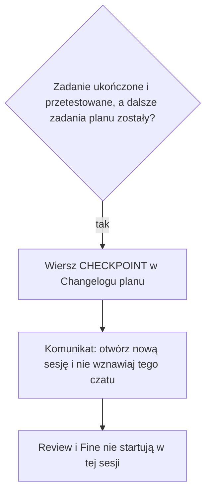
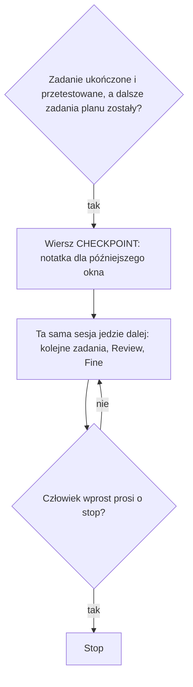

# CHECKPOINT nie kończy Implement — wynik analizy

## Task Details

| Field | Value |
|---|---|
| Jira ID | [AC-26](https://eversis.atlassian.net/browse/AC-26) |
| Title | CHECKPOINT must not hard-stop Implement; it is only a handoff note |
| Description | Reguła 14 w skillu orkiestracji traktuje `CHECKPOINT:` jako twarde zatrzymanie sesji Implement. Wiersz w Changelogu planu ma być tylko notatką na wypadek kontynuacji w innym oknie. Implement ma jechać dalej, chyba że człowiek wprost poprosi o stop. |
| Priority | Medium |
| Reporter | Piotr Niemirski |
| Created Date | 2026-09-23 |
| Due Date | nie ustawiono |
| Labels | brak |
| Estimated Effort | mały–średni: jedna reguła w skillu plus miejsca, które dziś uczą twardego stopu |

## Business Impact

Na [AC-24](https://eversis.atlassian.net/browse/AC-24) agent skończył i przetestował zadanie planu, które nie było ostatnie, zapisał `CHECKPOINT:` i poprosił o nową sesję. Człowiek nie prosił o stop. Review i Fine nie wystartowały w tej sesji. Powtórzenie tego zachowania ucina dostawę w połowie planu i zmusza do ręcznego wznawiania.

## Gathered Information

### Knowledge Base & Task Management Tools

[AC-26](https://eversis.atlassian.net/browse/AC-26) to Task w statusie Backlog. Nie jest sub-taskiem. Nie ma epica, komentarzy, załączników, strony Confluence ani powiązań poza `relates to` [AC-24](https://eversis.atlassian.net/browse/AC-24) (Done). Folder `docs/specs/ac-26/` nie istniał przed tym researchem.

Tiket powstał 2026-09-23. Zdanie „Later analysis only. Do not change the skill as part of filing this ticket.” dotyczy momentu założenia tiketu. Skill w chwili researchu nadal zawiera twardy stop, więc to zdanie jest spełnione jako zakaz edycji przy zakładaniu tiketu.

Źródła nazwane na tikecie:

- `.ai/skills/eversis-orchestrating-implementation/SKILL.md`, execution rule 14
- `.ai/rules/orchestration/engineering-manager.md` (skan niewykorzystanego `CHECKPOINT:` przy starcie nowej sesji)

Zamierzone zachowanie z tiketu:

- Wiersz `CHECKPOINT:` w Changelogu planu jest notatką, z której późniejsze okno może wznowić pracę.
- Zapis tej notatki nie kończy bieżącej sesji Implement.
- Implement idzie przez pozostałe zadania planu, w tym Review i Fine, chyba że człowiek wprost poprosi o stop.

Incydent z AC-24, Changelog planu `docs/specs/ac-24/ac-24.plan.md`:

- `2026-09-23` — `CHECKPOINT:` Task 1.1 done and tested (`npm run website:build`, `npm run website:changelog:check`). Next step: Task 2.1 code review.
- `2026-09-23` — `RESUMED:` człowiek napisał „Dokończ implementację AC-24”.

### Codebase

Repozytorium to framework (SSOT w `.ai/`), nie aplikacja produktowa. Reguła stopu jest prozą w skillu. Nie ma testu, który sprawdza zdanie o nowej sesji.

Obecna reguła 14 (Full Flow, „Zero-compaction session budget”) w `.ai/skills/eversis-orchestrating-implementation/SKILL.md`:

- Trigger: bieżące zadanie planu jest ukończone i przetestowane, dalsze zadania planu zostały, sesja nie jest jeszcze w Review ani Fine.
- Zapełnienie okna kontekstu i liczba wymian nie są triggerem.
- Agent zapisuje jeden wiersz Changelogu, którego opis zaczyna się od `CHECKPOINT:`.
- Potem mówi człowiekowi: „Otwórz nową sesję Implement, wskaż ten plan i nie wznawiaj bieżącego czatu.” To zdanie jest całym następnym krokiem. Agent nie zamyka czatu.
- Wyjątki już zapisane w tej samej regule: sesja już w Review lub Fine kończy review i komentarz QA; ostatnie zadanie planu idzie do Fine w tej samej turze (reguła 13) i nie kończy sesji checkpointem.

Skan wznowienia zostaje obok tego stopu. Nowa sesja szuka najnowszego niewykorzystanego `CHECKPOINT:`. Późniejszy wiersz `RESUMED:` albo wiersz, który zapisuje to samo zadanie jako ukończone, zużywa checkpoint. Inny późniejszy wiersz go nie zużywa. Nowa sesja wypisuje `- **Resume:** CHECKPOINT <data>`. To samo jest w `.ai/rules/orchestration/engineering-manager.md`. Plik `.cursor/rules/eversis-engineering-manager.mdc` jest kopią generowaną (`adapters/cursor/generate.mjs`); po zmianie reguły SSOT trzeba odpalić `npm run sync:adapters`.

Publiczna strona `website/docs/reference/domain-context.md` uczy dzisiejszego stopu, nie tylko braku zapisu do indeksu projektu:

- Sekcja Implement: „it does not continue into Review in the same session.”
- Węzeł diagramu dla dalszych zadań: sam wiersz `CHECKPOINT`, bez gałęzi „jedź dalej”.
- Węzeł ostatniego zadania: „Last task: no checkpoint. Continue to Review.”
- Legenda: „that checkpoint does not continue to Review in the same session”.
- Osobne zdanie „Session checkpoint (AC-19)” mówi tylko, że checkpoint jest wierszem Changelogu planu i nie aktualizuje indeksu.

Strona skilla `website/docs/reference/skills/orchestrating-implementation.md` nie kopiuje reguły 14. Odwołuje się do pliku SSOT. Continuity na tej stronie już mówi, że review i Fine są w tej samej sesji, bez wzmianki o twardym stopie checkpointu.

Komponent `readiness-contract` (`docs/context/agent-collections/readiness-contract/index.md`) rozdziela Layer A (kształt bloku gotowości: skill i `engineering-manager.md`) od Layer B (pliki, które tylko delegują). `Resume` jest osobną linią opcjonalną, nie wartością `Flow`. Ta sesja nie zmienia kształtu bloku, o ile skan wznowienia zostaje.

`eversis_context_list` w tej sesji nie wstał (brak `.agent-collections/install-selection.json` po stronie serwera MCP). Liczbę komponentów wzięto z pliku `docs/context/agent-collections/INDEX.md`: jeden wiersz (`readiness-contract`). Frontmatter: `tasks_since_audit: 4`, `audit_due_after: 5`, brak `last_audit`.

### Relevant Links

- [AC-26](https://eversis.atlassian.net/browse/AC-26) — ten tiket
- [AC-24](https://eversis.atlassian.net/browse/AC-24) — incydent stopu po Task 1.1
- `.ai/skills/eversis-orchestrating-implementation/SKILL.md` — reguła 14
- `.ai/rules/orchestration/engineering-manager.md` — skan `Resume`
- `website/docs/reference/domain-context.md` — publiczny opis, że checkpoint nie wchodzi w Review w tej samej sesji
- `docs/specs/ac-24/ac-24.plan.md` — wiersze `CHECKPOINT:` i `RESUMED:` z 2026-09-23

### Relevant Charts & Diagrams

Dziś, gdy zadanie inne niż ostatnie jest ukończone i przetestowane:

Zamierzone zachowanie z tiketu:

Zapis do `docs/context/<project>/INDEX.md` się nie zmienia. Checkpoint nadal go nie aktualizuje.

## Current Implementation Status

### Existing Components

- Reguła 14 — `.ai/skills/eversis-orchestrating-implementation/SKILL.md` — wymaga zmiany. Twardy stop i polskie zdanie o nowej sesji są tym błędem.
- Skan wznowienia — `.ai/rules/orchestration/engineering-manager.md` — zostaje jako odczyt notatki w nowym oknie. Ewentualna dopiska, że zapis notatki nie kończy bieżącej sesji, zależy od planu.
- Kopia Cursora — `.cursor/rules/eversis-engineering-manager.mdc` — generowana. Zmienia się tylko przez `npm run sync:adapters`, gdy zmieni się reguła SSOT.
- Diagram Implement — `website/docs/reference/domain-context.md` — w zakresie. Sekcja Implement, diagram i legenda mają przestać uczyć stopu przed Review.
- Strona skilla na docs — `website/docs/reference/skills/orchestrating-implementation.md` — nie duplikuje reguły 14. Bez zmiany, o ile plan nie doda tam zdania o stopie.
- Kontrakt gotowości — `docs/context/agent-collections/readiness-contract/index.md` — tylko odczyt. Linia `Resume` zostaje osobnym polem.

### Key Files and Directories

- `.ai/skills/eversis-orchestrating-implementation/SKILL.md` — jedyne miejsce zdania „Otwórz nową sesję Implement…”.
- `.ai/rules/orchestration/engineering-manager.md` — skan niewykorzystanego checkpointu.
- `.cursor/rules/eversis-engineering-manager.mdc` — lustro generowane.
- `website/docs/reference/domain-context.md` — publiczna proza i diagram Implement (sekcja, węzeł `iCkpt`, legenda).
- `docs/specs/ac-24/ac-24.plan.md` — dowód incydentu. Plik historyczny, bez edycji w tym zadaniu.

## Gap Analysis

### Question 1

#### Czy ta sesja Implement zmienia skill, czy zostaje samą analizą?

Tiket mówi „Later analysis only. Do not change the skill as part of filing this ticket.” Skill przy researchu jest niezmieniony, więc zakaz z momentu zakładania tiketu jest już dotrzymany. Wejście `/eversis-implement AC-26` czytam jako tę późniejszą pracę: zmienić regułę 14 tak, żeby zapis `CHECKPOINT:` nie kończył sesji.

**Człowiek, 2026-09-23:** „Explain in polish”. To prośba o wyjaśnienie, nie zamknięcie pytania.

**Człowiek, 2026-09-23:** „1. Czy ta sesja ma zmienić skill. - tak;”

Ta sesja zmienia skill. Zakaz z chwili zakładania tiketu zostaje za nami.

### Question 2

#### Czy publiczna strona domain-context wchodzi w to zadanie?

Po zmianie skillu zdanie „it does not continue into Review in the same session” oraz legenda na `website/docs/reference/domain-context.md` będą fałszywe. Tiket nie wymienia tej strony. Źródła tiketu to skill i `engineering-manager.md`.

**Człowiek, 2026-09-23:** „Yes — update the Implement section, diagram, and legend so they match the new rule.”

Strona wchodzi w zakres: sekcja Implement, diagram i legenda.

### Question 3

#### Co z drugim oknem, gdy ta sama sesja zapisze CHECKPOINT i jedzie dalej?

Tiket chce obu rzeczy naraz: notatka dla późniejszego okna oraz kontynuacja w bieżącej sesji. Dziś checkpoint zostaje niewykorzystany, dopóki późniejszy wiersz nie zaczyna się od `RESUMED:` albo nie zapisuje tego samego zadania jako ukończonego. Samo dokończenie następnego zadania tego nie zużywa. Drugie okno otwarte na tym planie może więc ruszyć ten sam następny krok, podczas gdy pierwsza sesja jeszcze pracuje.

**Rekomendacja analityka:** ta sama sesja, w tej turze co `CHECKPOINT:`, dopisuje zaraz potem wiersz `RESUMED:` i jedzie dalej. Istniejący skan traktuje późniejszy `RESUMED:` jako zużycie checkpointu, więc drugie okno nie powtarza następnego zadania. Jeśli proces padnie między tymi dwoma wierszami, nowe okno nadal wznawia od `CHECKPOINT:` — to jest ten przypadek, na który notatka została wymyślona. Wiersza nie piszemy tylko przy jawnym stopie: tiket każe pisać notatkę i nie kończyć sesji. Zostawienie wyścigu bez zużycia oznacza dwa okna na tym samym następnym zadaniu.

**Człowiek, 2026-09-23:** „What's your recommendations”.

**Człowiek, 2026-09-23:** „2. Rekomendacja ok;”

Zużycie przez `RESUMED:` w tej samej sesji jest zatwierdzone.

### Question 4

#### Czy wiersz CHECKPOINT nadal powstaje?

Tak. Tiket: notatka zostaje; jej zapis nie kończy sesji. Ostatnie zadanie planu nadal idzie do Fine bez checkpointu (reguła 13). Sesja już będąca w Review lub Fine nadal kończy review i komentarz QA. Jawny stop człowieka zostaje, w tym istniejące `pause before review` i `review later`.

Treść pochodzi z opisu tiketu. Potwierdzenie „1. Czy ta sesja ma zmienić skill. - tak;” obejmuje wdrożenie tego zachowania.

## Human gates

1. ~~Approve research~~ — done (`1. Czy ta sesja ma zmienić skill. - tak;` and `2. Rekomendacja ok;`)
2. ~~Approve plan~~ — done (`Plan is ok. Implement`)
3. Implement → Review → Fine
