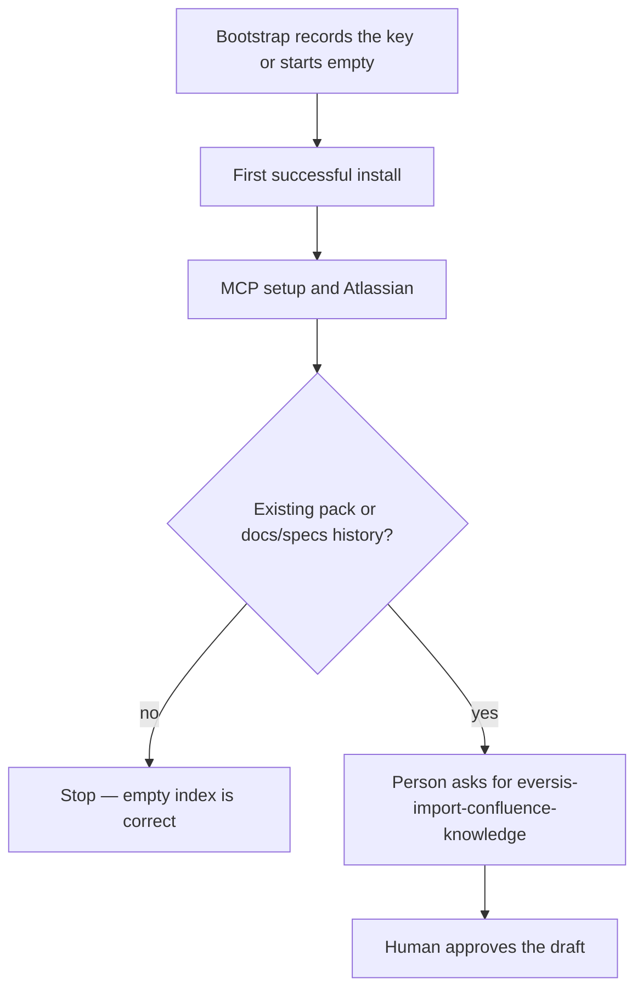

# AC-28 - Implementation Plan

## Task Details

| Field            | Value                                                                 |
| ---------------- | --------------------------------------------------------------------- |
| Jira ID          | [AC-28](https://eversis.atlassian.net/browse/AC-28)                   |
| Title            | Add optional Confluence knowledge import to installation steps        |
| Description      | Document when a consumer runs `eversis-import-confluence-knowledge` after install, without making the installer call Confluence. |
| Priority         | Medium                                                                |
| Related Research | [ac-28.research.md](./ac-28.research.md)                              |

## Wildly Important Goal

**Goal**: A reader of the installation page can tell that `--confluence-space-key` only records a space key, and that `eversis-import-confluence-knowledge` is an optional, human-started step after Atlassian MCP is connected.

**Success Measure**: The installation page has that optional section after First successful install; Start here, the README flag sentence, and the skill reference page agree with it; the sample install commands and the Start here “Done” checklist are unchanged.

**Do NOT touch / do NOT add**:

- Installer scripts, selection schema, and installer tests
- `.ai/skills/eversis-import-confluence-knowledge/SKILL.md` behaviour
- Domain Context step 7 body (link to it; do not copy the split rules)
- A required Start here checklist item, or `--confluence-space-key` inside the sample `bash` blocks
- A Cursor slash command for the skill

## Proposed Solution

Delegate to **Repo Docs Writer** via `eversis-repo-docs-writer`. Add one optional section on `website/docs/getting-started/installation.md` after the First successful install sample, plus a one-sentence pointer from section 4. Align three short surfaces that already mention the flag or the skill so they do not contradict that section. Record the docs change under `CHANGELOG.md` `[Unreleased]` / `### Added`, then sync the generated site changelog.

The new section states, in order:

1. Skip it for a greenfield project and for the sample install on the same page. An empty `docs/context/<project>/INDEX.md` is still a successful install.
2. If a Confluence space key exists, pass `--confluence-space-key` during bootstrap (section 3). That records `ssot.confluenceSpaceKey`. It does not import.
3. Finish MCP setup and connect the Atlassian server.
4. In the consumer project, ask the agent to run `eversis-import-confluence-knowledge`.
5. Review the draft. Files under `docs/context/<project>/` are written only after approval. Link Domain Context for what is written. If there is no space key, the skill can still cluster `docs/specs/` when the person says so.

## Current Implementation Analysis

### Already Implemented

- Flag and selection field — `scripts/setup-agent-collections.sh`, `docs/architecture/install-selection.md` — records the key; reuse, do not change
- Installer log — `scripts/lib/setup-agent-collections/ssot.sh` — already tells the operator to run the skill later
- Flag row — `website/docs/getting-started/installation.md` Useful flags — already says the flag never calls Confluence
- Seed-once explanation — `website/docs/reference/domain-context.md` step 7 — reuse by link

### To Be Modified

- Installation page — `website/docs/getting-started/installation.md` — new optional section after First successful install; one sentence in section 4 pointing at it
- Start here — `website/docs/getting-started/start-here.md` — one optional-next-steps sentence; checklist items 1–7 stay as they are
- README — `README.md` — useful-flags parenthetical says the flag records the key and the skill imports later
- Skill reference — `website/docs/reference/skills/import-confluence-knowledge.md` — “one file per section” becomes one file per component
- Changelog — `CHANGELOG.md` — one Unreleased Added bullet; generated site page is synced, not hand-edited

### To Be Created

- None. This is an edit of existing docs.

## Open Questions

| #   | Question | Answer | Status |
| --- | -------- | ------ | ------ |
| 1   | Should the installer run the skill? | No. Record-only flag stays. | ✅ Resolved |
| 2   | Where does the section go? | After First successful install, not inside the sample commands. | ✅ Resolved |
| 3   | Which other pages change? | Start here (one optional line), README flag sentence, skill reference wording, changelog bullet. | ✅ Resolved |

## Technical Context

Project conventions, coding standards, and patterns discovered during planning. Downstream agents MUST read this section instead of re-discovering the same context.

### Project Instructions

- `AGENTS.md` — framework repo; quality commands include `npm run website:build` and `npm run website:changelog:check`
- `.cursor/rules/eversis-project-stack.mdc` — load `eversis-writing-repo-documentation` for README, CHANGELOG, and `website/docs` edits
- Skill `eversis-writing-repo-documentation` — edit root `CHANGELOG.md` only; `website/src/pages/changelog.md` is generated

### Architecture & Patterns

- Published docs live under `website/docs/` (Docusaurus). Getting-started pages use relative links such as `./mcp-setup` and `../domain-context`.
- Installation page section order today: clone, optional maintainer open, bootstrap, skills and prompts, upgrade, advanced submodule, first successful install.
- Cursor slash commands are generated from `.ai/prompts/` only (`adapters/cursor/generate.mjs`). Skills are not slash commands in this repo.

### Tech Stack

- Docs site: Docusaurus under `website/`
- Package manager: npm
- Changelog sync: `node scripts/sync-changelog.mjs`

### Code Style & Standards

- Match the installation page voice: short steps, tables for flags, admonitions already used on that page (`:::info`, `:::tip`)
- Do not paste the skill’s component-split procedure onto the installation page
- Skill reference page stays a short summary; the procedure stays in `SKILL.md`

### Testing Patterns

- Docs-site build: `npm run website:build`
- Changelog drift: `npm run website:changelog:sync` then `npm run website:changelog:check`
- Per-file checks are text inspections (section present, phrase present, sample bash blocks unchanged)

### Database Patterns

- Not applicable. No database.

### Additional Context

- Delegate implementation to **Repo Docs Writer** with `eversis-repo-docs-writer`.
- `website/src/pages/changelog.md` must not be edited by hand.

## Implementation Plan

### Phase 1: Installation page

**Goal**: The installation page tells the reader when to run the skill, after a successful install.

**Description**: Add the optional section and the section 4 pointer. Leave sample commands and the upgrade section’s “reuse the key” wording in place.

**Verification:** `npm run website:build`

#### Task 1.1 - [MODIFY] Optional seed section and section 4 pointer

**Description**: On the installation page, add a section after First successful install. State the six points in Proposed Solution. In section 4, add one sentence that points at that section. Do not add `--confluence-space-key` to either `bash` sample.

**Files:** `website/docs/getting-started/installation.md` (modify)

**Definition of Done**:

- [x] A heading after First successful install covers the optional seed and says the installer does not run the skill
- [x] The section links to `./mcp-setup`, the Atlassian integration page, and Domain Context
- [x] Section 4 contains one sentence that points at that new section
- [x] Both existing `bash` samples still omit `--confluence-space-key`
- [x] Run `npm run website:build`

**Stop Rule:** Stop if the only way to explain the step is to copy the skill’s split-by-component procedure onto this page.

**Clues**: Domain Context step 7 is the detailed write-up. The installer log in `scripts/lib/setup-agent-collections/ssot.sh` is the sentence to agree with.

### Phase 2: Align the other mentions

**Goal**: Start here, the README, the skill page, and the changelog say the same thing as the new section.

**Description**: One-line and wording fixes only. Do not add a required checklist item.

**Verification:** `npm run website:changelog:check`

#### Task 2.1 - [MODIFY] Start here optional next step

**Description**: Add one sentence to the optional-next-steps line so a project with an As-Is Pack or `docs/specs/` history can follow the new installation section. Leave checklist items 1–7 and the “Done when” sentence unchanged.

**Files:** `website/docs/getting-started/start-here.md` (modify)

**Definition of Done**:

- [x] The optional-next-steps sentence mentions the installation seed section
- [x] Checklist items 1–7 are unchanged, including the “Done when” sentence
- [x] The sentence is absent from the numbered checklist

**Clues**: The current sentence starts with “Optional next steps:”.

#### Task 2.2 - [MODIFY] README flag parenthetical

**Description**: Change the useful-flags mention of `--confluence-space-key` so it says the flag records the key and `eversis-import-confluence-knowledge` is run later by a person.

**Files:** `README.md` (modify)

**Definition of Done**:

- [x] The useful-flags sentence says the flag records the key and does not say the flag itself performs the import

**Clues**: Current parenthetical: “optional, one-time AS-IS import — see `eversis-import-confluence-knowledge`”.

#### Task 2.3 - [MODIFY] Skill reference granularity

**Description**: Replace “one file per section” with one file per component, matching `SKILL.md`. Keep the one-time, not-at-install principle.

**Files:** `website/docs/reference/skills/import-confluence-knowledge.md` (modify)

**Definition of Done**:

- [x] The page says one file per component
- [x] The page still says the import is not run at install time

**Clues**: `SKILL.md` principle `split-not-copy`.

#### Task 2.4 - [MODIFY] Changelog bullet and sync

**Description**: Add one bullet under `CHANGELOG.md` `[Unreleased]` / `### Added` for the optional installation step. Run the changelog sync. Do not hand-edit `website/src/pages/changelog.md`.

**Files:** `CHANGELOG.md` (modify), `website/src/pages/changelog.md` (modify — generated by sync only)

**Definition of Done**:

- [x] `CHANGELOG.md` `[Unreleased]` / `### Added` has one bullet for the optional installation seed step
- [x] Run `npm run website:changelog:sync`
- [x] Run `npm run website:changelog:check`

**Stop Rule:** Stop if sync would require editing the generated page by hand.

**Clues**: Root changelog is the SSOT. Sync script: `node scripts/sync-changelog.mjs`.

### Phase 3: Code Review

**Goal**: An independent review confirms the docs match the ticket and the installer contract is unchanged.

**Description**: Final verification of the documentation diff. This phase is mandatory and always comes last.

**Verification:** `npm run website:build`

#### Task 3.1 - [REUSE] Code review by Code Reviewer

**Description**: Run **Code Reviewer** via `eversis-review.md` on the docs diff. No product code is in scope. No e2e suite applies.

**Files:** `website/docs/getting-started/installation.md` (reuse), `website/docs/getting-started/start-here.md` (reuse), `README.md` (reuse), `website/docs/reference/skills/import-confluence-knowledge.md` (reuse), `CHANGELOG.md` (reuse)

**Definition of Done**:

- [x] Run `npm run website:build`
- [x] Run `npm run website:changelog:check`
- [x] Code review passes with no blocking findings
- [x] Review outcome documented in Changelog

**Stop Rule:** Stop after 3 review passes if the same blocker remains, and escalate to the human.

**Clues**: Confirm sample `bash` blocks and Start here items 1–7 did not change. Confirm no files under `scripts/` changed.

## Security Considerations

- The docs must keep saying the installer never calls Confluence and never stores Atlassian credentials.
- The new section must not include a space key, token, or page body from a real consumer.

## Quality Assurance

Acceptance criteria checklist to verify the implementation meets the defined requirements:

- [x] Installation page has an optional section after First successful install with the record-key, Atlassian, ask-the-agent, and approve-the-draft steps
- [x] Section 4 points at that section in one sentence
- [x] Sample `bash` blocks and Start here items 1–7 are unchanged
- [x] Start here optional-next-steps mentions the new section
- [x] README says the flag records the key and the skill runs later
- [x] Skill reference page says one file per component
- [x] Installer, selection schema, tests, and `SKILL.md` are unchanged
- [x] `npm run website:build` and `npm run website:changelog:check` pass

## Improvements (Out of Scope)

- A Cursor `.cursor/commands/` shim for `eversis-add-domain-knowledge` or `eversis-import-confluence-knowledge` (skills are not prompts; `user-invocable: true` is a Claude Code menu flag)
- Changing Domain Context step 7 beyond the link from the installation page
- Running the import inside `setup-agent-collections.sh`

## Human gates

1. ~~Approve research~~ — done (`/eversis-implement AC-28`)
2. ~~Approve this plan~~ — done (`Ok, implement`)
3. ~~Implement → Review → Fine~~ — Fine declared 2026-09-23 after review PASS

## Code Review Findings

**Reviewer:** Code Reviewer (independent; did not author the change)  
**Date:** 2026-09-23  
**Verdict:** PASS

Independent review against research, this plan’s DoD / QA, and the listed focus checks. Scope is docs-only; `npm run website:changelog:check` re-run OK; `npm run website:build` accepted from the implementer session (links on changed pages resolved). Diff confirms no changes under `scripts/`, selection schema, or `.ai/skills/eversis-import-confluence-knowledge/SKILL.md`. No secrets in the diff.

### Findings

None. Zero BLOCKER. Zero SUGGESTION.

### Focus-check results

| Check | Result |
| ----- | ------ |
| Optional section after First successful install; installer does not run the skill | Met — `## Seed existing project knowledge (optional)`; “The installer never runs this import.” |
| Links to `./mcp-setup`, Atlassian integration, Domain Context | Met |
| Section 4 one pointer sentence | Met |
| Both bash samples omit `--confluence-space-key` | Met (non-interactive example + First successful install) |
| Start here items 1–7 and Done-when unchanged; seed only on optional-next-steps | Met (byte-identical checklist vs HEAD) |
| README: flag records key; does not say flag imports | Met |
| Skill page: one file per component; not at install time | Met |
| No `scripts/` or `SKILL.md` behaviour change | Met |
| No secrets | Met |

### QA checkbox factual status

Every Quality Assurance checkbox is factually met in the files (not merely marked checked). Phase 1–3 DoD items verified the same way.

## Changelog

| Date       | Change Description   |
| ---------- | -------------------- |
| 2026-09-23 | Initial plan created |
| 2026-09-23 | Tasks 1.1 and 2.1–2.4 done. `npm run website:build` and `npm run website:changelog:check` passed. |
| 2026-09-23 | Code review (PASS): zero BLOCKER / SUGGESTION; all DoD and QA checkboxes verified in files. |
| 2026-09-23 | Fine. QA comment drafted; not posted. |
