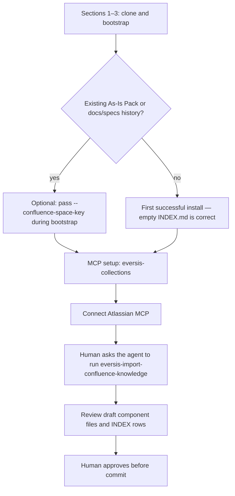

# Installation Confluence import - Analysis Result

## Task Details

| Field | Value |
|---|---|
| Jira ID | [AC-28](https://eversis.atlassian.net/browse/AC-28) |
| Title | Add `eversis-import-confluence-knowledge` to the installation steps |
| Description | Check how best to add the one-time Confluence / specs bootstrap skill to the getting-started installation steps (`website/docs/getting-started/installation.md`). |
| Priority | n/a |
| Reporter | human (chat) |
| Created Date | 2026-09-23 |
| Due Date | n/a |
| Labels | docs, installation, domain-context |
| Estimated Effort | small docs change after this research is approved |

## Business Impact

A consumer that already has a Confluence As-Is Pack or a `docs/specs/` history currently finishes install with an empty `docs/context/<project>/INDEX.md`. The installer can record `ssot.confluenceSpaceKey`, and it logs that the human should run `eversis-import-confluence-knowledge` later, but the installation page never says when or how. Readers can treat the flag as “import happened” or can miss the skill entirely. The install success path (empty sample project, no Confluence) must stay valid without this step.

## Gathered Information

### Knowledge Base & Task Management Tools

No Jira issue was attached. Requirements come from the chat request and from the framework SSOT already in this repo.

Contract already written down (do not reopen it in the plan):

- The skill is a **one-time, human-triggered** bootstrap. It never runs at install time. `--confluence-space-key` **only records** the key. The installer never calls Confluence.
- It prefers one As-Is Pack page when `ssot.confluenceSpaceKey` is set, via the already-connected **atlassian** MCP. It falls back to clustering `docs/specs/` for modules the pack does not cover, or as the only source when there is no pack.
- Output is a **draft** for human review. Nothing is committed to `docs/context/` until the human approves.
- Running it against a consumer repo is that consumer’s adoption task, not this framework repo’s Definition of Done.
- Greenfield / empty sample installs stay empty. Omitting the flag never blocks install.

Sources: `.ai/skills/eversis-import-confluence-knowledge/SKILL.md`, `scripts/lib/setup-agent-collections/ssot.sh` (`note_confluence_space_key`), `docs/architecture/install-selection.md`.

### Codebase

What the installation page already does (`website/docs/getting-started/installation.md`):

- Section 3 lists `--confluence-space-key KEY` in Useful flags: “Records a Confluence space key for later use by `eversis-import-confluence-knowledge` (optional — never calls Confluence itself).”
- The non-interactive example and the “First successful install” sample do **not** pass the flag and do **not** mention the skill.
- Section 4 says every install scaffolds `docs/context/<project>/INDEX.md`, and that `--ssot-source` may seed `docs/context/global/`. It does not mention the import skill.
- Section 5 (Upgrade) says `--upgrade --sync` reuses `ssot.confluenceSpaceKey`. That is correct and should stay a reuse note, not an import step.
- Closing line sends the reader to MCP setup, then Start here checklist item 6.

Surrounding pages:

- `website/docs/getting-started/start-here.md` — “Done” is installer exit 0, skills list works, first Implement readiness block. Domain context is only “confirm INDEX.md exists”. Optional next steps are Quick wins, migration, workflow. The import skill is not there.
- `website/docs/getting-started/mcp-setup.md` — Atlassian is listed as a separate MCP (“Jira and Confluence”). Domain-context tools need the consumer project volume. The import skill is not named.
- `website/docs/getting-started/quick-wins.md` — “Domain context — check what the installer already set up” confirms the empty scaffold and optional `eversis_context_sync`. It does not mention the import skill.
- `website/docs/reference/domain-context.md` — loop step 7 and the “What to use” table already describe the skill: human asks, one pack page, not the installer, not a whole space.
- `website/docs/reference/skills/import-confluence-knowledge.md` — states the one-time / not-at-install rule, but says “one file per section”. The skill SSOT says one file **per component**, consolidating sections. That page is stale relative to `SKILL.md`.
- `website/docs/reference/integrations/atlassian.md` — names the skill as “any agent, on request”.
- Root `README.md` useful-flags sentence says `--confluence-space-key KEY` (optional, one-time AS-IS import — see the skill). That parenthetical is easy to read as “the flag performs the import”. The installation page wording is the accurate one.

Installer behaviour that the docs should match, not replace:

- `note_confluence_space_key` logs either “starting empty; run the skill later” or “Recorded Confluence space key … run the skill in an agent session (not run automatically)”.
- Upgrade preserves `confluenceSpaceKey` when the flag is omitted (`scripts/setup-agent-collections.test.sh`, `selection-ssot.test.sh`).

### Relevant Links

- `website/docs/getting-started/installation.md` — page the request points at
- `.ai/skills/eversis-import-confluence-knowledge/SKILL.md` — behaviour contract
- `website/docs/reference/domain-context.md` — existing “seed once” explanation (step 7)
- `website/docs/getting-started/start-here.md` — first-successful-install checklist (must stay passable without this skill)
- `website/docs/getting-started/mcp-setup.md` and `website/docs/reference/integrations/atlassian.md` — Atlassian MCP prerequisite
- `docs/architecture/install-selection.md` — `ssot.confluenceSpaceKey`
- `scripts/lib/setup-agent-collections/ssot.sh` — log text the docs should agree with
- `README.md` — flag sentence that over-implies the import

### Relevant Charts & Diagrams

Recommended reader order. The skill sits **after** a successful install and **after** Atlassian MCP is connected. It is not a branch inside `setup-agent-collections.sh`.

## Current Implementation Status

### Existing Components

- Installer flag and selection field — `scripts/setup-agent-collections.sh`, `scripts/lib/setup-agent-collections/selection.sh`, `docs/architecture/install-selection.md` — can be reused; do not change behaviour
- Installer log — `scripts/lib/setup-agent-collections/ssot.sh` — can be reused; already tells the operator to run the skill later
- Installation page flag row — `website/docs/getting-started/installation.md` — needs extension (a step), not a rewrite of the flag meaning
- Domain-context “seed once” — `website/docs/reference/domain-context.md` — can be reused as the detailed explanation; installation should link here instead of copying the split rules
- Skill reference page — `website/docs/reference/skills/import-confluence-knowledge.md` — needs modification only if this change touches it (“one file per section” contradicts the skill)
- Start here / quick wins — optional one-line pointers; the required checklist must not gain a new mandatory item
- README useful-flags parenthetical — needs a small wording fix if the install page is updated, so both say “records the key; the skill imports later”

### Key Files and Directories

- `website/docs/getting-started/installation.md` — primary surface for the new optional step
- `website/docs/getting-started/start-here.md` — keep “Done” unchanged; optional pointer only
- `website/docs/getting-started/mcp-setup.md` — prerequisite, not the home of the skill steps
- `website/docs/reference/domain-context.md` — canonical “what the skill writes”
- `.ai/skills/eversis-import-confluence-knowledge/SKILL.md` — do not weaken the “never at install time” rule to make the docs shorter
- `README.md` — flag wording drift

## Gap Analysis

The installation page mentions the flag and never tells the reader to run the skill. The installer log and domain-context page already do. The gap is a missing **optional, ordered step** on the installation page, placed where its prerequisites exist.

### Question 1
#### Should `setup-agent-collections.sh` invoke `eversis-import-confluence-knowledge`?
No. The skill, `note_confluence_space_key`, and `install-selection.md` all say the installer only records the key and never calls Confluence. The skill also needs a live atlassian MCP session and a human approval of the draft. Neither exists inside the shell installer. Do not add a new install phase, hook, or non-interactive import.

### Question 2
#### Where on the installation page should the skill appear?
After the **First successful install** sample, as a new optional section (proposed title: seed existing project knowledge). Not inside sections 1–3, and not as a line in the sample `bash` block that a first-time reader must run.

Reasons:

- Atlassian MCP is configured on the **next** page (`mcp-setup` / Atlassian integration). The skill’s Confluence path cannot run before that.
- Start here’s “Done” criteria do not include a seeded index. An empty `INDEX.md` is the correct result for the sample project in the same page.
- Section 4 already explains that install only scaffolds the index. A long import procedure there would sit before Upgrade and before the reader has MCP. A short sentence in section 4 that points at the new section is enough.
- Section 5 (Upgrade) should keep saying the key is **reused**, not re-imported.
- Domain-context step 7 already explains split-by-component, draft review, and “not a whole space”. The installation section should state the **when / prerequisites / how to ask**, then link to that page and to the skill. Do not copy the process steps from `SKILL.md` onto the install page.

Proposed section content (for the later plan, not written in this turn):

1. When: the consumer already has an As-Is Pack and/or `docs/specs/` history. Skip for a greenfield or the sample install.
2. Record the space key in section 3 with `--confluence-space-key` if you have one. Say again that this does not import.
3. Finish [MCP setup](./mcp-setup) and connect the [Atlassian](../reference/integrations/atlassian.md) server.
4. In the consumer project, ask the agent to run `eversis-import-confluence-knowledge`.
5. Review the draft. Files land under `docs/context/<project>/` only after approval. Link [Domain Context](../domain-context) for what gets written.
6. No space key: the skill can still cluster `docs/specs/` if you tell it to. Do not imply Confluence is mandatory.

### Question 3
#### Should the non-interactive example include `--confluence-space-key`?
No as a required argument. The current example is the empty-start path and matches “omitting the flag never blocks install”. An optional commented flag next to the new section is enough. Putting it in the “First successful install” sample would imply the sample import ran, which the script cannot do.

### Question 4
#### Which other pages change in the same docs pass?
Proposed scope, pending approval of this research:

- **In scope:** `website/docs/getting-started/installation.md` (the new optional section + one pointer from section 4).
- **In scope, one line each:** `website/docs/getting-started/start-here.md` optional-next-steps sentence (not a new required checklist item); `README.md` useful-flags parenthetical so it matches “records the key; run the skill later”.
- **In scope only as a wording fix if we touch the file:** `website/docs/reference/skills/import-confluence-knowledge.md` — replace “one file per section” with the skill’s “one file per component”.
- **Out of scope:** installer code, selection schema, tests, `SKILL.md` behaviour, `domain-context.md` process (already correct; link it), MCP catalog, making the skill part of “first successful install”.

## Human gates

1. ~~Approve research~~ — done (`/eversis-implement AC-28`)
2. Approve plan (once written)
3. Implement → Review → Fine
