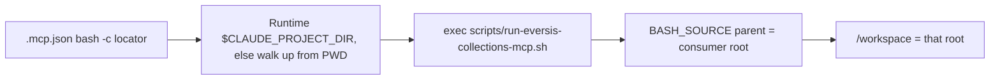

# AC-29 - Implementation Plan

## Task Details

| Field            | Value                   |
| ---------------- | ----------------------- |
| Jira ID          | [AC-29](https://eversis.atlassian.net/browse/AC-29) |
| Title            | Claude Code installer bakes a per-machine path into committed `.mcp.json`, breaking the eversis-collections mount on other clones |
| Description      | Vendored Claude Code consumers (EOG layout) commit `.mcp.json`. The generated `eversis-collections` entry uses `${CLAUDE_PROJECT_DIR:-.}`. The VS Code extension does not set `CLAUDE_PROJECT_DIR` before substitution, so Compose binds `/workspace` to the vendor tree. The fix is a committed wrapper that derives the consumer root from its own path. |
| Priority         | High |
| Related Research | [ac-29.research.md](./ac-29.research.md) |

## Wildly Important Goal

**Goal**: A vendored Claude Code consumer can commit one `.mcp.json` that mounts that clone's own root at `/workspace` on every machine.

**Success Measure**: For Claude plus `--vendor copy` or `--vendor submodule`, generated `.mcp.json` starts `bash -c` with a locator that does not require the project root as cwd. The locator execs `scripts/run-eversis-collections-mcp.sh`. That script sets `CONSUMER_PROJECT_ROOT` to the directory that contains `scripts/` and calls Compose with `-f <that directory>/vendor/agent-collections/docker-compose.yml`.

**Do NOT touch / do NOT add**:

- Cursor `.cursor/mcp.json` generation and `${workspaceFolder}`
- Claude absolute (non-vendored) mode, including the `${AGENT_COLLECTIONS_HOME:-<resolved collections path>}` `-f` fallback — follow-up [AC-30](https://eversis.atlassian.net/browse/AC-30)
- `docker-compose.yml` volume lines
- `rewriteClaudeSyntax` for non-collections servers
- A `targetDir` bake into `CONSUMER_PROJECT_ROOT`

## Proposed Solution

Vendored Claude installs stop putting `docker compose` and `${CLAUDE_PROJECT_DIR:-.}` in `.mcp.json`. The installer writes a fixed script into the consumer repo. `.mcp.json` does not name that script with a cwd-relative path. Claude Code does not promise that a stdio server's working directory is the project root, and config-time `${CLAUDE_PROJECT_DIR:-.}` stays empty on the VS Code extension. The spawn environment is a different step: Claude documents `CLAUDE_PROJECT_DIR` on the started process. The committed entry therefore uses `bash -c` and a bare `$CLAUDE_PROJECT_DIR` (no braces, so `${...}` interpolation does not rewrite it before bash runs).

Invocation contract for the vendored Claude entry:

| Field | Value |
| --- | --- |
| `command` | `bash` |
| `args` | `["-c", "<locator>"]` |
| `type` | `stdio` |
| `env` | absent |

Locator, in order:

1. If `$CLAUDE_PROJECT_DIR/scripts/run-eversis-collections-mcp.sh` is a regular file, exec it.
2. Otherwise walk at most 8 parents of `$PWD`. Accept a directory only when both `scripts/run-eversis-collections-mcp.sh` and `vendor/agent-collections/docker-compose.yml` are regular files there, then exec that script.
3. If neither finds the script, exit non-zero and do not start Docker.

The locator string in JSON must contain the characters `$CLAUDE_PROJECT_DIR` and must not contain `${CLAUDE_PROJECT_DIR`. Config-time substitution of `${VAR}` / `${VAR:-default}` then leaves the token for the spawned shell.

Script contract, installer-owned copy of `templates/run-eversis-collections-mcp.sh`:

1. Resolve the script file from `BASH_SOURCE`, then the consumer root as the parent of the `scripts/` directory.
2. Compose file path is `<consumer root>/vendor/agent-collections/docker-compose.yml`.
3. Exit non-zero when that path is not a regular file.
4. Export `CONSUMER_PROJECT_ROOT` to the consumer root.
5. `exec` `docker` with a fixed argument list: `compose -f <compose file> run --rm -T eversis-collections`.
6. Do not read caller arguments or `CLAUDE_PROJECT_DIR`. The script does not choose paths from `PWD`. Path discovery before exec belongs only to the locator.

`mcp-merge.sh` copies the template to `<target>/scripts/run-eversis-collections-mcp.sh` only when the host is `claude` and `VENDOR_MODE` is `copy` or `submodule` (`MCP_USE_RELATIVE=true`). Each such merge overwrites the script so `--upgrade --sync` refreshes it. Absolute mode and Cursor do not write the script and keep today's JSON.

Existing vendored Claude consumers pick this up by re-running `setup-agent-collections.sh --upgrade --sync`. That migration step belongs in `CHANGELOG.md`.

## Current Implementation Analysis

### Already Implemented

- Host split that writes Cursor `.cursor/mcp.json` and Claude `.mcp.json` — `scripts/lib/setup-agent-collections/mcp-merge.sh` — reuse the split; add the vendored Claude script copy beside it
- `MCP_USE_RELATIVE=true` for `VENDOR_MODE` `copy` and `submodule` — `scripts/lib/setup-agent-collections/mcp-merge.sh` — reuse as the condition for the wrapper
- Compose bind `${CONSUMER_PROJECT_ROOT:-${PWD}}:/workspace` — `docker-compose.yml` — reuse unchanged
- Claude syntax rewrite for non-collections servers — `rewriteClaudeSyntax` in `scripts/lib/setup-agent-collections/mcp-merge.mjs` — reuse unchanged
- Cursor `eversis-collections` entry — same `mcp-merge.mjs` branch — reuse unchanged
- Unit harness `_assert_docker_entry` — `scripts/lib/setup-agent-collections/mcp-merge.test.sh` — reuse for absolute-mode and Cursor cases

### To Be Modified

- Claude vendored branch of the `eversis-collections` entry — `scripts/lib/setup-agent-collections/mcp-merge.mjs` — when `host === 'claude'` and `useRelative`, emit the bash wrapper entry instead of `docker compose` plus `${CLAUDE_PROJECT_DIR:-.}`
- Claude vendored merge — `scripts/lib/setup-agent-collections/mcp-merge.sh` — copy the wrapper template into the consumer `scripts/` directory on that same condition
- Claude copy/submodule cases — `scripts/lib/setup-agent-collections/mcp-merge.test.sh` — assert the wrapper entry and the copied script; keep absolute-mode cases on the current docker entry
- Claude vendor install smoke — `scripts/setup-agent-collections.test.sh` — replace the assertions that require `"command": "docker"` and `${CLAUDE_PROJECT_DIR:-.}/vendor/agent-collections/docker-compose.yml`
- Claude mount wording — `website/docs/getting-started/mcp-setup.md`, `website/docs/reference/integrations/eversis-collections.md`, `README.md` — describe the vendored Claude wrapper; leave Cursor on `${workspaceFolder}`
- Unreleased notes — `CHANGELOG.md` — migration for existing vendored Claude `.mcp.json`, then sync the website copy

### To Be Created

- Wrapper template — `templates/run-eversis-collections-mcp.sh` — the script contract above, with no machine-specific path
- Runtime test — `scripts/lib/setup-agent-collections/run-eversis-collections-mcp.test.sh` — run the template inside a fake consumer tree with a fake `docker` on `PATH` and assert `CONSUMER_PROJECT_ROOT` and the `-f` path; also run the locator with cwd not equal to that root

## Open Questions

| #   | Question   | Answer   | Status                |
| --- | ---------- | -------- | --------------------- |
| 1   | Is the vendored Claude fix the committed wrapper, given this `master` does not bake `targetDir`? | Yes. `.mcp.json` invokes the script. The script derives the consumer root and the vendored compose path at runtime. | ✅ Resolved |
| 2   | Does this task also remove the absolute-mode baked framework path? | No. Tracked as [AC-30](https://eversis.atlassian.net/browse/AC-30). | ✅ Resolved |
| 3   | Does Cursor stay on `${workspaceFolder}`? | Yes. Claude Code only. | ✅ Resolved |

## Technical Context

Project conventions, coding standards, and patterns discovered during planning. Downstream agents MUST read this section instead of re-discovering the same context.

### Project Instructions

- `AGENTS.md` — framework repo; SSOT is `.ai/`; quality commands include `npm run installer:smoke` and `npm run website:changelog:check`
- `.cursor/rules/eversis-project-stack.mdc` — installer work stays in `scripts/` and `templates/`; docs updates load `eversis-writing-repo-documentation` when that task runs
- `.cursor/rules/eversis-testing-and-terminal.mdc` — run the affected checks after code changes
- `.ai/rules/orchestration/spec-driven-development.md` — plan approval before implementation

### Architecture & Patterns

- Installer libraries live in `scripts/lib/setup-agent-collections/*.sh` and are sourced by `scripts/setup-agent-collections.sh`
- MCP JSON shape is built in `scripts/lib/setup-agent-collections/mcp-merge.mjs` from `templates/mcp.json`. Shell only supplies environment: `MCP_HOST`, `MCP_TARGET_DIR`, `MCP_COLLECTIONS_HOME`, `MCP_USE_RELATIVE`, `MCP_SELECTED_IDS`
- Shared templates live under `templates/` (`mcp.json`, `claude-settings.json`, `AGENTS.template.md`)
- Vendored framework path inside a consumer is always `vendor/agent-collections/`
- Claude project MCP file is `<consumer>/.mcp.json`. Cursor file is `<consumer>/.cursor/mcp.json`

### Tech Stack

- Installer: Bash and Node.js (no extra npm dependency)
- MCP server runtime: Docker Compose, unchanged
- Package manager for repo scripts: npm
- Docs site changelog is generated from root `CHANGELOG.md` by `scripts/sync-changelog.mjs`

### Code Style & Standards

- Match existing shell style: `set -euo pipefail` in test scripts, `die` / `log_ok` from `common.sh` in installer libs
- `mcp-merge.mjs` uses Node ESM, `structuredClone`, and early `fail()`
- Do not add a package-manager dependency
- Keep comments that explain host variable limits; do not shorten them

### Testing Patterns

- MCP merge unit tests: `bash scripts/lib/setup-agent-collections/mcp-merge.test.sh` — temp `TARGET_DIR`, source `mcp-merge.sh`, assert JSON with `node -e`
- Installer smoke: `bash scripts/setup-agent-collections.test.sh` (npm script `installer:smoke`) — real `--vendor=copy --agents=claude` install into a temp target
- New wrapper runtime test: `bash scripts/lib/setup-agent-collections/run-eversis-collections-mcp.test.sh`
- Changelog sync check: `npm run website:changelog:check`
- No e2e browser suite applies to this installer change

### Database Patterns

- Not applicable. This task does not touch a database.

### Additional Context

- `docs/context/agent-collections/INDEX.md` has one component, `readiness-contract`. It does not describe MCP mounts. Do not edit it for this task.
- Research approval quote: `Resaerch is ok. Make the plan`
- Delegate code tasks to Software Engineer via `eversis-implement-common-task.md`
- Delegate the docs task to Repo Docs Writer via `eversis-repo-docs-writer.md` and skill `eversis-writing-repo-documentation`

## Implementation Plan

### Phase 1: Vendored Claude wrapper

**Goal**: The committed Claude entry for a vendored consumer no longer uses config-time `${CLAUDE_PROJECT_DIR:-.}` or a machine path, and it can find the wrapper when cwd is not the project root.

**Description**: Add the wrapper template, emit the `bash -c` locator from the Claude vendored merge path, and prove the generated JSON, the locator, and the script's `BASH_SOURCE` path math. Absolute-mode Claude and all Cursor cases stay on their current assertions. This repo cannot launch the VS Code extension; the locator tests stand in for that spawn.

**Verification:** `bash scripts/lib/setup-agent-collections/mcp-merge.test.sh` and `bash scripts/lib/setup-agent-collections/run-eversis-collections-mcp.test.sh` and `bash scripts/setup-agent-collections.test.sh`

#### Task 1.1 - [CREATE] Wrapper template and runtime test

**Description**: Software Engineer adds the installer-owned shell template and a test that runs it in a fake consumer tree. The test puts a stub `docker` first on `PATH` that records its arguments and `CONSUMER_PROJECT_ROOT`, then exits 0.

**Files:** `templates/run-eversis-collections-mcp.sh` (create), `scripts/lib/setup-agent-collections/run-eversis-collections-mcp.test.sh` (create)

**Definition of Done**:

- [x] `templates/run-eversis-collections-mcp.sh` contains no `/Users/` path and no `CLAUDE_PROJECT_DIR`
- [x] The runtime test proves `CONSUMER_PROJECT_ROOT` equals the fake consumer root and the recorded `-f` argument equals `<fake root>/vendor/agent-collections/docker-compose.yml`
- [x] The runtime test proves a missing compose file exits non-zero and does not invoke `docker`
- [x] Run `bash scripts/lib/setup-agent-collections/run-eversis-collections-mcp.test.sh`

**Stop Rule:** Stop if the script needs a path outside `<consumer>/vendor/agent-collections/docker-compose.yml` or starts reading `CLAUDE_PROJECT_DIR`.

**Clues**: Path walk inside the script is the parent of the `scripts/` directory that contains the script. `exec` a fixed `docker compose -f … run --rm -T eversis-collections` argument list. Ignore extra arguments. Locator cases are Task 1.2, after the `-c` string exists.

#### Task 1.2 - [MODIFY] Emit the wrapper for vendored Claude only

**Description**: Software Engineer changes the Claude `useRelative` branch in `mcp-merge.mjs` to the bash entry from Proposed Solution, and copies the template from `mcp-merge.sh` only in that case. Cursor and Claude absolute mode stay as they are today.

**Files:** `scripts/lib/setup-agent-collections/mcp-merge.mjs` (modify), `scripts/lib/setup-agent-collections/mcp-merge.sh` (modify), `scripts/lib/setup-agent-collections/mcp-merge.test.sh` (modify), `scripts/lib/setup-agent-collections/run-eversis-collections-mcp.test.sh` (modify — created in Task 1.1), `templates/run-eversis-collections-mcp.sh` (reuse — created in Task 1.1)

**Definition of Done**:

- [x] A dedicated assert (not `_assert_docker_entry`) checks the vendored Claude entry: `command` is `bash`, `args[0]` is `-c`, `args[1]` contains `$CLAUDE_PROJECT_DIR` and does not contain `${CLAUDE_PROJECT_DIR`, `type` is `stdio`, and there is no `env` object
- [x] `<target>/scripts/run-eversis-collections-mcp.sh` exists after a vendored Claude merge and matches the template
- [x] Case for `VENDOR_MODE=copy` and case for `VENDOR_MODE=submodule` both pass that assert
- [x] Case for `SELECTED_AGENTS=cursor,claude` with `VENDOR_MODE=copy` keeps Cursor on `docker` plus `${workspaceFolder}` and Claude on the wrapper assert
- [x] Claude absolute mode still asserts `${AGENT_COLLECTIONS_HOME:-<resolved>}/docker-compose.yml` and `CONSUMER_PROJECT_ROOT` `${CLAUDE_PROJECT_DIR:-.}`
- [x] Cursor absolute and Cursor copy cases still assert `${workspaceFolder}`
- [x] The runtime test executes the generated `-c` locator with cwd set to a child of the fake consumer: once with `CLAUDE_PROJECT_DIR` set to that root, and once unset, and both reach the script
- [x] The runtime test proves the locator exits non-zero and does not invoke `docker` when `CLAUDE_PROJECT_DIR` is unset and cwd is outside the fake root
- [x] Run `bash scripts/lib/setup-agent-collections/mcp-merge.test.sh`
- [x] Run `bash scripts/lib/setup-agent-collections/run-eversis-collections-mcp.test.sh`

**Stop Rule:** Stop if the absolute-mode Claude JSON or any Cursor JSON assertion must change to make vendored Claude pass. Stop if the only passing locator puts `${CLAUDE_PROJECT_DIR` in the committed JSON.

**Clues**: `useRelative` is already true for both `copy` and `submodule` (`mcp-merge.sh`). `_assert_docker_entry` stays for docker entries only. Overwrite the consumer script on every vendored Claude merge. `mkdir -p` the `scripts/` directory and leave any other files there untouched.

#### Task 1.3 - [MODIFY] Installer smoke assertions

**Description**: Software Engineer updates the `--vendor=copy --agents=claude` smoke checks to the wrapper entry.

**Files:** `scripts/setup-agent-collections.test.sh` (modify)

**Definition of Done**:

- [x] The Claude vendor smoke target has `scripts/run-eversis-collections-mcp.sh` and a `.mcp.json` whose `eversis-collections` command is `bash` and whose `-c` argument contains `$CLAUDE_PROJECT_DIR`
- [x] That `.mcp.json` does not contain `${CLAUDE_PROJECT_DIR` or `${env:`
- [x] `.cursor/mcp.json` is still absent for `--agents=claude`
- [x] Run `bash scripts/setup-agent-collections.test.sh`

**Stop Rule:** Stop if the smoke test can pass only by weakening an unrelated assertion.

**Clues**: Current failing lines once behavior changes are the `"command": "docker"` check and the `${CLAUDE_PROJECT_DIR:-.}/vendor/agent-collections/docker-compose.yml` check around the Claude vendor install (about lines 119–122). Smoke stays `--vendor=copy` only. Submodule coverage is the unit case in Task 1.2, not a second full install.

### Phase 2: Document the vendored Claude entry

**Goal**: Readers and existing consumers can see how a shared vendored `.mcp.json` finds `/workspace` after this fix.

**Description**: Repo Docs Writer updates the MCP setup and integration pages, the README domain-context bullet, and the Unreleased changelog. The migration tells vendored Claude consumers to re-run `setup-agent-collections.sh --upgrade --sync`. Cursor stays described as `${workspaceFolder}`. Absolute mode stays described as it works today, with a pointer that the baked framework path is AC-30.

**Verification:** `npm run website:changelog:check`

#### Task 2.1 - [MODIFY] MCP docs, README, and changelog

**Description**: Repo Docs Writer updates consumer-facing wording and the changelog migration. Run changelog sync so the website page matches `CHANGELOG.md`. Load `eversis-writing-repo-documentation`.

**Files:** `website/docs/getting-started/mcp-setup.md` (modify), `website/docs/reference/integrations/eversis-collections.md` (modify), `README.md` (modify), `CHANGELOG.md` (modify), `website/src/pages/changelog.md` (modify)

**Definition of Done**:

- [x] `website/docs/getting-started/mcp-setup.md` states that vendored Claude Code starts `bash -c`, which execs `scripts/run-eversis-collections-mcp.sh`, and that the script sets `CONSUMER_PROJECT_ROOT`
- [x] `website/docs/reference/integrations/eversis-collections.md` describes that same vendored Claude wrapper and does not present `${CLAUDE_PROJECT_DIR:-.}` as the portable vendored fix
- [x] `README.md` no longer says the installer always writes `CONSUMER_PROJECT_ROOT` into MCP `env` for every host
- [x] `CHANGELOG.md` `[Unreleased]` Migration no longer tells Claude consumers to set `CONSUMER_PROJECT_ROOT` to `${CLAUDE_PROJECT_DIR:-.}`; Cursor guidance stays `${workspaceFolder}`; vendored Claude is told to re-run `--upgrade --sync`
- [x] Run `npm run website:changelog:sync` and then `npm run website:changelog:check`

**Stop Rule:** Stop if the docs change would document AC-30's absolute-mode path as already fixed.

**Clues**: Prompt `eversis-repo-docs-writer.md`. Rewrite the Claude half of the existing Unreleased domain-context Migration bullet. Keep the Cursor `${workspaceFolder}` half. Add the vendored wrapper re-run step in that same Migration section.

### Phase 3: Code Review

**Goal**: An independent review confirms the vendored Claude mount is portable and that Cursor and absolute mode were left alone.

**Description**: Final verification of the full implementation. This phase is mandatory and always comes last.

**Verification:** `bash scripts/lib/setup-agent-collections/run-eversis-collections-mcp.test.sh` and `bash scripts/lib/setup-agent-collections/mcp-merge.test.sh` and `bash scripts/setup-agent-collections.test.sh` and `npm run website:changelog:check`

#### Task 3.1 - [REUSE] Code review by Code Reviewer

**Description**: Run **Code Reviewer** via `eversis-review.md` to review the complete implementation. Pass e2e test execution to that agent — do not run e2e tests outside this review. There is no browser e2e suite for this change; the shell tests above are the verification.

**Files:** `templates/run-eversis-collections-mcp.sh` (reuse), `scripts/lib/setup-agent-collections/mcp-merge.mjs` (reuse), `scripts/lib/setup-agent-collections/mcp-merge.sh` (reuse), `scripts/lib/setup-agent-collections/mcp-merge.test.sh` (reuse), `scripts/lib/setup-agent-collections/run-eversis-collections-mcp.test.sh` (reuse), `scripts/setup-agent-collections.test.sh` (reuse), `website/docs/getting-started/mcp-setup.md` (reuse), `website/docs/reference/integrations/eversis-collections.md` (reuse), `README.md` (reuse), `CHANGELOG.md` (reuse), `website/src/pages/changelog.md` (reuse)

**Definition of Done**:

- [x] Run `bash scripts/lib/setup-agent-collections/run-eversis-collections-mcp.test.sh`
- [x] Run `bash scripts/lib/setup-agent-collections/mcp-merge.test.sh`
- [x] Run `bash scripts/setup-agent-collections.test.sh`
- [x] Run `npm run website:changelog:check`
- [x] Code review passes with no blocking findings
- [x] Review outcome documented in Changelog

**Stop Rule:** Stop after three review passes if the same blocker remains, and escalate instead of declaring pass.

**Clues**: Review scope is the vendored Claude wrapper only. A diff that changes Cursor JSON or the Claude absolute-mode `-f` fallback is a blocker.

## Security Considerations

- The wrapper takes no caller input into the Compose command. The compose path is a fixed suffix under the script's parent directory.
- The upward walk accepts a directory only when both the wrapper and `vendor/agent-collections/docker-compose.yml` exist there, and it stops after 8 parents.
- The script exits before `exec` when that compose file is missing, so a wrong tree is not mounted from `PWD`.
- Committed files must not gain a developer home directory or other absolute host path.
- Docker socket access is unchanged. The MCP client still starts a local Compose project; this task does not broaden that trust boundary.

## Quality Assurance

Acceptance criteria checklist to verify the implementation meets the defined requirements:

- [x] Vendored Claude `.mcp.json` contains no absolute host path and no `${CLAUDE_PROJECT_DIR` brace form; the `-c` locator does contain bare `$CLAUDE_PROJECT_DIR`
- [x] The wrapper sets `CONSUMER_PROJECT_ROOT` from its own location and passes `-f <consumer>/vendor/agent-collections/docker-compose.yml`
- [x] `--vendor copy` and `--vendor submodule` both get the wrapper; absolute Claude mode and Cursor do not
- [x] `mcp-merge` unit tests, the wrapper runtime test, and `scripts/setup-agent-collections.test.sh` pass
- [x] Changelog migration tells existing vendored Claude consumers to re-run `--upgrade --sync`, and `npm run website:changelog:check` passes

## Improvements (Out of Scope)

- [AC-30](https://eversis.atlassian.net/browse/AC-30) — Claude absolute install mode still commits `${AGENT_COLLECTIONS_HOME:-<resolved collections path>}` as the compose `-f` fallback, and still sets `CONSUMER_PROJECT_ROOT` to `${CLAUDE_PROJECT_DIR:-.}`. That consumer-root token is the same mount failure as AC-29, for non-vendored installs only. AC-29 does not change it. AC-30 should cover both holes.
- Discovering the framework checkout when it lives outside the consumer repo and `AGENT_COLLECTIONS_HOME` is unset
- Changing `docker-compose.yml` so `/workspace` does not need `CONSUMER_PROJECT_ROOT`

## Human gates

1. ~~Approve research~~ — done (`Resaerch is ok. Make the plan`)
2. ~~Approve this plan~~ — done (`Plan is ok. Start implement`)
3. Implement → Review → Fine

## Changelog

| Date   | Change Description   |
| ------ | -------------------- |
| 2026-09-24 | Initial plan created |
| 2026-09-24 | Plan review iteration 1 (`REVISIONS NEEDED`, B1). Vendored launch is `bash -c` with runtime `$CLAUDE_PROJECT_DIR` (no braces) and an 8-level upward walk. Script path math stays `BASH_SOURCE` only. Docs DoD rewrites the Claude half of the Unreleased Migration. Absolute-mode `CONSUMER_PROJECT_ROOT` called out under AC-30. |
| 2026-09-24 | Task 2.1 complete — MCP setup, eversis-collections reference, README, and Unreleased Migration document the vendored Claude wrapper; changelog sync + check OK. Phase 3 not marked. |
| 2026-09-24 | Code review performed (iteration 1) — **BLOCKER**. Required shell tests and `website:changelog:check` all exit 0. Cursor JSON and Claude absolute-mode `-f` / `CONSUMER_PROJECT_ROOT` behavior unchanged. Open blocker: empty/unset `$CLAUDE_PROJECT_DIR` expands the first locator branch to `/scripts/run-eversis-collections-mcp.sh` (no `-n` guard); walk correctly requires both wrapper and compose. Task 3.1 “no blocking findings” left unchecked. |
| 2026-09-24 | Review blocker (empty `CLAUDE_PROJECT_DIR` → `/scripts/…`) fixed with a non-empty `[ -n "$CLAUDE_PROJECT_DIR" ]` guard before the first-branch file test, after human confirmation `Nanieś poprawkę i powtórz review`. |
| 2026-09-24 | Full re-review (iteration 2) after blocker fix — **PASS**. Zero open blockers. All DoD and AC boxes verified. Previous empty/`CLAUDE_PROJECT_DIR` first-branch issue closed (`[ -n … ]` + empty-string walk regression). |

## Code Review Findings

**Verdict: PASS** (iteration 2 — full re-review after blocker fix)

### Test commands (re-run by reviewer)

| Command | Result |
| --- | --- |
| `bash scripts/lib/setup-agent-collections/run-eversis-collections-mcp.test.sh` | PASS (12 tests, exit 0) |
| `bash scripts/lib/setup-agent-collections/mcp-merge.test.sh` | PASS (23 tests, exit 0) |
| `bash scripts/setup-agent-collections.test.sh` | PASS (`[smoke] PASS`, exit 0) |
| `npm run website:changelog:check` | PASS (`sync-changelog --check: OK`) |

### Previous BLOCKER — closed

1. **Empty / unset `CLAUDE_PROJECT_DIR` first-branch path** — Fixed in `mcp-merge.mjs`: first branch is now `if [ -n "$CLAUDE_PROJECT_DIR" ] && [ -f "$CLAUDE_PROJECT_DIR/scripts/run-eversis-collections-mcp.sh" ]; then …`. Unit assert requires the `-n` fragment in the locator. Runtime test exports `CLAUDE_PROJECT_DIR=""` from a child cwd and proves the walk still finds the wrapper and yields the correct `CONSUMER_PROJECT_ROOT`. Unset + outside-tree still exits non-zero without docker.

### BLOCKER

None.

### DoD / Acceptance Criteria

Every Definition-of-Done checkbox (Tasks 1.1–1.3, 2.1, 3.1) and every Quality Assurance acceptance-criteria checkbox re-verified as met in this pass. Task 3.1 “Code review passes with no blocking findings” checked.

### Verified OK (not blocking)

- **Walk** requires both `scripts/run-eversis-collections-mcp.sh` and `vendor/agent-collections/docker-compose.yml`; max 8 parents; empty/unset `CLAUDE_PROJECT_DIR` skips the first branch and still walks.
- **Wrapper** (`templates/run-eversis-collections-mcp.sh`): root from `BASH_SOURCE` only; no `CLAUDE_PROJECT_DIR`; no `/Users/` path; missing compose exits non-zero without docker.
- **Hard scope**: Cursor `${workspaceFolder}` / `${env:AGENT_COLLECTIONS_HOME}` and Claude absolute `${AGENT_COLLECTIONS_HOME:-<resolved>}` + `CONSUMER_PROJECT_ROOT` `${CLAUDE_PROJECT_DIR:-.}` unchanged; wrapper copy only for `claude` + `use_relative`.
- **JSON contract**: `bash` / `-c` / bare `$CLAUDE_PROJECT_DIR` / no `${CLAUDE_PROJECT_DIR` / no `env` for vendored Claude.
- **Docs / Migration**: vendored wrapper + `--upgrade --sync`; Cursor stays `${workspaceFolder}`; absolute Claude not claimed fixed (AC-30).
- **STRICT FORBIDDEN**: scope within plan; docs comments not silently shortened; no new package-manager dependencies.

### SUGGESTION

- Optional hardening: a decoy file at `/scripts/run-eversis-collections-mcp.sh` (when creatable) would make the rooted-path failure mode even more explicit; the current `-n` assert plus empty-string walk regression already close the prior blocker.