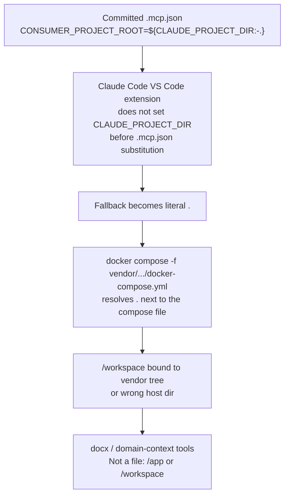
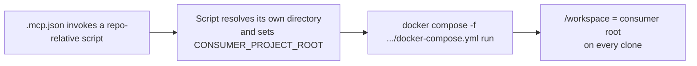

# AC-29 - Analysis Result

## Task Details

| Field | Value |
|---|---|
| Jira ID | [AC-29](https://eversis.atlassian.net/browse/AC-29) |
| Title | Claude Code installer bakes per-machine absolute path into committed .mcp.json, breaking eversis-collections MCP mount on other clones/CI |
| Description | On the Claude Code channel, generated `.mcp.json` is committed. The ticket reports that `mcp-merge.mjs` writes the installing machine's absolute consumer path into the `eversis-collections` entry (`${CLAUDE_PROJECT_DIR:-<targetDir>}` on the compose `-f` path in vendored mode, and `env.CONSUMER_PROJECT_ROOT` in every Claude mode). Teammates, CI, and any other clone then bind `/workspace` to the wrong host directory whenever Claude Code also fails to populate `CLAUDE_PROJECT_DIR` before spawning Docker Compose. Docx and domain-context tools then fail with `Error: Not a file: /app/...` or `Error: Not a file: /workspace/...`. |
| Priority | High |
| Reporter | Piotr Niemirski |
| Created Date | Not returned by the issue fetch used for this research |
| Due Date | Not set |
| Labels | claude-code, eversis-collections, installer, mcp |
| Estimated Effort | Not set |
| Status | In Progress |
| Type | Bug |
| Comments | None |
| Parent / subtasks | None linked |

## Business Impact

Agent Collections consumers who use Claude Code and commit `.mcp.json` (the documented default) cannot share one MCP config across machines. Domain-context tools and docx tools depend on the container `/workspace` mount being the consumer repo. A path that is correct only for the last person who ran the installer makes the MCP server fail for everyone else, including CI. The fix belongs in the framework installer, not as a per-consumer patch.

## Gathered Information

### Knowledge Base & Task Management Tools

Jira [AC-29](https://eversis.atlassian.net/browse/AC-29) is the only source. No Confluence links, attachments, or comments. No parent or subtasks.

Live reproduction recorded on consumer repo DAWIS/eog, branch `agent-collections`, Claude Code via the VS Code extension, `vendor/agent-collections` at that checkout's HEAD:

1. `.mcp.json` used `${CLAUDE_PROJECT_DIR:-.}`. `inspect_document` failed with `Not a file: /app/...`. Compose resolved `.` against `vendor/agent-collections/` (the compose file's directory), not the consumer root.
2. Replacing the fallback with that machine's absolute path fixed the mount for that machine after a session reconnect.
3. Setting `CLAUDE_PROJECT_DIR` in `.claude/settings.local.json` `env` reached Bash subprocesses (`echo $CLAUDE_PROJECT_DIR` was correct) and did **not** reach the step that substitutes `${CLAUDE_PROJECT_DIR:-...}` inside `.mcp.json` before `docker compose` starts. An explicit `/workspace/...` path was used literally, which shows the container's `/workspace` mount itself pointed at the wrong host directory. A full session restart did not change that.

The ticket's recommended installer fix: stop relying on Claude Code to populate `CLAUDE_PROJECT_DIR` for `.mcp.json` substitution. Generate a small committed wrapper (example name `scripts/run-eversis-collections-mcp.sh`) that derives the consumer root from its own on-disk location at runtime and then execs `docker compose`. `.mcp.json` would invoke that repo-relative script. No absolute path would be committed.

Short-term note in the ticket (until that ships): either restore the documented `${CLAUDE_PROJECT_DIR:-.}` behavior, or update tests and docs to match a `targetDir` bake, and if the bake is kept, document that every clone and CI job must regenerate `.mcp.json`.

### Codebase

This checkout is framework `master` (`mcp-merge.mjs` last changed in `68b7965`). It does **not** match the ticket's description of current installer output.

What `scripts/lib/setup-agent-collections/mcp-merge.mjs` writes today for host `claude`:

| Mode | `args` `-f` path | `env.CONSUMER_PROJECT_ROOT` |
|---|---|---|
| Absolute (`VENDOR_MODE` not submodule/copy) | `${AGENT_COLLECTIONS_HOME:-<collections>}/docker-compose.yml` | `${CLAUDE_PROJECT_DIR:-.}` |
| Vendored (`copy` or `submodule`) | `${CLAUDE_PROJECT_DIR:-.}/vendor/agent-collections/docker-compose.yml` | `${CLAUDE_PROJECT_DIR:-.}` |

`<collections>` is `MCP_COLLECTIONS_HOME` (the framework checkout path resolved at install time). That absolute path is baked only into the **compose file** fallback, not into `CONSUMER_PROJECT_ROOT`. `MCP_TARGET_DIR` is required by the script and is not interpolated into the Claude `eversis-collections` entry. Git blame on the consumer-root line shows `${CLAUDE_PROJECT_DIR:-.}` since `68b7965` (2026-09-02). There is no commit on this branch that bakes `targetDir` into `CONSUMER_PROJECT_ROOT`.

`scripts/lib/setup-agent-collections/mcp-merge.test.sh` asserts that same `${CLAUDE_PROJECT_DIR:-.}` token (cases 2, 3, and 4). `scripts/setup-agent-collections.test.sh` asserts the vendored `-f` string `${CLAUDE_PROJECT_DIR:-.}/vendor/agent-collections/docker-compose.yml`. On this HEAD the suite and the script agree. The ticket's report that the suite is red because the script bakes `targetDir` does not describe this tree. It may describe a local edit in the consumer submodule that was never committed here, or a misread of the `AGENT_COLLECTIONS_HOME` fallback (which does bake a host path, but for the framework checkout, not the consumer root).

The failure that **does** match both the live repro and this HEAD:

`docker-compose.yml` bind-mounts `${CONSUMER_PROJECT_ROOT:-${PWD}}:/workspace`. Comments in that file already say `PWD` is often the vendor tree when `-f` points at `vendor/agent-collections/docker-compose.yml`, so the `.` fallback reproduces the original mount bug whenever the host does not expand `CLAUDE_PROJECT_DIR`.

Cursor is a different path: `CONSUMER_PROJECT_ROOT` is `${workspaceFolder}`, and the `-f` path uses `${env:AGENT_COLLECTIONS_HOME}` (absolute mode) or `${workspaceFolder}/vendor/...` (vendored). The ticket does not report Cursor as broken.

Other Claude servers (context7, and any template entry still using `${env:X}` or `${workspaceFolder}`) are rewritten to `${VAR}` / `${CLAUDE_PROJECT_DIR:-.}` by `rewriteClaudeSyntax`. `eversis-collections` is built separately and skipped by that rewrite. The ticket's repro is specifically the collections Docker mount, not those npx/http servers.

Public docs (`CHANGELOG.md`, `website/src/pages/changelog.md`, `website/docs/getting-started/mcp-setup.md`, `website/docs/reference/integrations/eversis-collections.md`) document Claude as `${CLAUDE_PROJECT_DIR:-.}`. That matches this HEAD. They do not mention a `targetDir` bake. They also do not say that the VS Code extension may leave the variable unset, so `.` is what Compose actually sees.

No wrapper script of the kind the ticket recommends exists in this repo.

Related local specs (filenames only; not loaded in full): `docs/specs/mcp-docker-compose-migration/`, `docs/specs/mcp-context-workspace-root/`.

`docs/context/agent-collections/INDEX.md` has one component (`readiness-contract`). It does not describe MCP mount behavior. `last_audit` is absent. `tasks_since_audit` is 13.

### Relevant Links

- [AC-29](https://eversis.atlassian.net/browse/AC-29) — bug report and recommended wrapper-script fix
- `scripts/lib/setup-agent-collections/mcp-merge.mjs` — Claude `.mcp.json` generation
- `scripts/lib/setup-agent-collections/mcp-merge.sh` — host split: Cursor `.cursor/mcp.json`, Claude `.mcp.json`
- `docker-compose.yml` — `/repo` vs `/workspace` mounts
- `website/docs/getting-started/mcp-setup.md` — documented Claude fallback
- `website/docs/reference/integrations/eversis-collections.md` — same fallback in the integration reference

### Relevant Charts & Diagrams

See the failure flowchart under Codebase. Intended runtime after the ticket's recommended fix:

## Current Implementation Status

### Existing Components

- Claude MCP merge — `scripts/lib/setup-agent-collections/mcp-merge.mjs` — needs modification (stop depending on host expansion of `CLAUDE_PROJECT_DIR` for the consumer-root mount)
- Merge driver — `scripts/lib/setup-agent-collections/mcp-merge.sh` — needs extension if a wrapper file must be written next to `.mcp.json`
- Unit tests — `scripts/lib/setup-agent-collections/mcp-merge.test.sh` — needs modification once generated output changes
- Installer smoke — `scripts/setup-agent-collections.test.sh` — needs modification if the vendored `-f` string changes
- Compose mount — `docker-compose.yml` — can be reused; still requires a correct host `CONSUMER_PROJECT_ROOT`
- MCP template — `templates/mcp.json` — Cursor-shaped source; Claude output is rewritten in `mcp-merge.mjs`, not stored as a second template
- Public MCP docs and changelog — `website/docs/getting-started/mcp-setup.md`, `website/docs/reference/integrations/eversis-collections.md`, `CHANGELOG.md`, `website/src/pages/changelog.md` — need modification so they describe the portable Claude entry

### Key Files and Directories

- `scripts/lib/setup-agent-collections/mcp-merge.mjs` — builds the `eversis-collections` stdio entry per host
- `scripts/lib/setup-agent-collections/mcp-merge.sh` — passes `MCP_TARGET_DIR`, `MCP_COLLECTIONS_HOME`, `MCP_USE_RELATIVE`
- `scripts/lib/setup-agent-collections/mcp-merge.test.sh` — asserts current Claude tokens
- `docker-compose.yml` — `${CONSUMER_PROJECT_ROOT:-${PWD}}:/workspace`
- `templates/mcp.json` — framework template before host rewrite

## Gap Analysis

Findings that change how the ticket should be planned, plus questions that are still open.

### Question 1

#### Is the work the wrapper-script fix, given that this HEAD does not bake `targetDir`?

The ticket says `mcp-merge.mjs` already writes `targetDir` into `CONSUMER_PROJECT_ROOT` and that `mcp-merge.test.sh` is red against that. On framework `master` the script and tests both emit `${CLAUDE_PROJECT_DIR:-.}`. The live DAWIS/eog failure (step 1 of the repro) matches **this** HEAD, not a bake. The portable wrapper is still the right fix for that failure. The "update tests to match a bake" mitigation would document a behavior this branch does not have.

Answer (2026-09-24): **OK.** For shared vendored consumers (EOG layout: committed `.mcp.json` plus `vendor/agent-collections/`), the fix is a committed repo-relative wrapper. `.mcp.json` only invokes that script. The script derives the consumer root from its own path at runtime, sets `CONSUMER_PROJECT_ROOT`, and runs `docker compose -f <consumer>/vendor/agent-collections/docker-compose.yml`. No absolute host path is committed. Do not chase a `targetDir` bake; that behavior is not on this `master`.

### Question 2

#### Is the absolute framework path baked into the Claude `-f` fallback in scope?

Absolute (non-vendored) mode writes `${AGENT_COLLECTIONS_HOME:-<resolved collections path>}/docker-compose.yml`. That fallback is a machine-specific path inside committed `.mcp.json`, separate from `CONSUMER_PROJECT_ROOT`. Vendored mode does not bake it (it uses `${CLAUDE_PROJECT_DIR:-.}/vendor/...`, which has the same unset-variable problem as the consumer root).

Answer (2026-09-24): **Follow-up in a new task.** AC-29 stays on the vendored Claude wrapper only. The absolute-mode `-f` fallback `${AGENT_COLLECTIONS_HOME:-<resolved collections path>}/docker-compose.yml` is tracked separately as [AC-30](https://eversis.atlassian.net/browse/AC-30) (split from AC-29). Do not change that fallback in this task.

### Question 3

#### Does Cursor stay on `${workspaceFolder}`?

The ticket's repro and recommended wrapper are Claude Code only. Cursor already expands `${workspaceFolder}` for `CONSUMER_PROJECT_ROOT`.

Answer (2026-09-24): **Tylko Claude Code.** Leave the Cursor entry on `${workspaceFolder}`. Do not change Cursor MCP generation in this task.

## Human gates

1. ~~Approve research~~ — done (`Resaerch is ok. Make the plan`)
2. ~~Approve plan (once written)~~ — done (`Plan is ok. Start implement`)
3. Implement → Review → Fine
