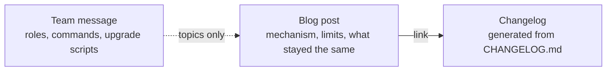

# AC-31 - Analysis Result

## Task Details

| Field | Value |
|---|---|
| Jira ID | [AC-31](https://eversis.atlassian.net/browse/AC-31) |
| Title | Publish a technical blog for framework change write-ups |
| Description | The docs site gains a blog for technical write-ups of framework changes. A post explains how a change behaves and where it stops. It does not reprint the team notice, and it does not replace the changelog. The first post is a technical account of the AC-2 update, in English, and it stands alone for someone who never received the team message. |
| Priority | High |
| Reporter | Not returned by the issue fetch used for this research |
| Created Date | Not returned by the issue fetch used for this research |
| Due Date | Not set |
| Labels | blog, docs, website, workshop-2026-09-24 |
| Estimated Effort | Not set (workshop sizing: Medium) |
| Status | In Progress |
| Type | Task |
| Comments | None |
| Parent / subtasks | None linked. Workshop stories stay local in `docs/specs/blog/extracted-tasks.md`. They are not separate Jira issues. |

## Business Impact

Readers who already saw a short team notice have nowhere on the docs site to learn how a framework change behaves. The changelog is a version ledger. The notice is roles, what to type, and upgrade commands. AC-31 adds a third layer: a technical post that deepens the notice. The first post covers the AC-2 mechanisms (context reads, session continuity, separate stores for business rules and architecture decisions, and the upgrade contract). A post that repeats the notice does not meet the brief.

## Gathered Information

### Knowledge Base & Task Management Tools

Jira [AC-31](https://eversis.atlassian.net/browse/AC-31) is one Task for the whole workshop (same board shape as AC-14 and AC-15). No Confluence links, attachments, comments, parent, or subtasks.

Gate 0 (2026-09-24, Piotr Niemirski) approved the three-layer split: team message = notice, changelog = ledger, blog = technical discussion that deepens the notice and must not repeat it. Story 1.1 was approved the same day. The same reply folded the whole breakdown into this one Task.

Folder name (2026-09-24): workshop artifacts live in `docs/specs/blog/`. The earlier folder name `website-technical-blog` is retired. The live Jira description still cites the old path; it was not edited.

Local workshop artifacts (source context, not a `*.research.md`):

- `docs/specs/blog/intent-brief.md` — approved brief
- `docs/specs/blog/extracted-tasks.md` — three epics, four stories
- `docs/specs/blog/jira-tasks.md` — the single-Task description that was published
- `docs/specs/blog/quality-review.md` — lite review, no suggestions
- `docs/specs/blog/cleaned-transcript.md` — workshop transcript

`docs/context/agent-collections/INDEX.md` lists one component, `readiness-contract`. It does not describe the docs site, the changelog, or a blog. No component file was loaded. `last_audit` is absent. `tasks_since_audit` is 14.

Requirements that the plan must cover, from the ticket:

1. Header Blog entry beside Changelog. Docs, Get started, The Main Flow, Reference, and Advanced / CTO stay where they are.
2. Blog lists posts by title and date, newest first. A post shows title, date, author, and body.
3. Site search returns a published post and still returns docs.
4. A maintainer publishing rule: a post is for a mechanism worth explaining; a one-line fix stays in the changelog only. The draft covers what changed, why the previous behavior was a problem, how it behaves now (including limits), what did not change, and a link to the changelog. Copying the team message (role blocks, chat how-to lines, upgrade scripts) is not acceptable. A human approves the draft before it goes live.
5. First post: technical account of the AC-2 update, in English, standalone.

The first post must explain these behaviors, checked against what shipped:

- Context reads: one matching topic from project knowledge, name-only search of old specs, full text of at most one or two spec files. Shipped wording is in `.ai/rules/orchestration/agent-core.md` (one component from `INDEX.md`, discovery by filename, consumption capped at 1–2 spec files, and a separate cap of 1–2 decision files).
- Session continuity: a finished plan task records a checkpoint and the same session continues through the remaining tasks, review, and the QA draft. A new chat is for a session that actually stopped. Shipped wording is orchestration skill rule 14 and the Unreleased changelog bullet "Checkpoint no longer ends Implement".
- Two stores: business rules and architecture decisions are written in different places, on different requests. Nothing is published to Confluence without an explicit human approval. Domain facts go through `docs/context/` after approval. Architecture decisions go under `docs/decisions/` when a person asks during research, plan, or Implement (`eversis-record-decision`). A decisions write does not publish to Confluence.
- Upgrade contract: project-owned paths stay untouched. A missing decisions folder is added. A submodule layout and a plain file copy are different update paths. Shipped wording is README "Upgrade contract" and "Project-owned files", plus installer scaffolding that creates `docs/decisions/` when it is missing and does not overwrite an existing project-owned file. The post states that contract. It does not paste the two command blocks from the team message.

Out of scope (ticket and brief): republishing the AC-2 team message; replacing or hand-editing the generated changelog; a post for every changelog bullet; generating posts from agent transcripts; comments, newsletter, or a separate CMS; translating the whole docs site; redesigning the docs information architecture (DHI-641) beyond the Blog entry beside Changelog; a post about AC-29.

### Codebase

The docs site is Docusaurus under `website/`. Classic preset sets `blog: false`. There is no `website/blog/` directory. The navbar has no Blog item. Changelog is a right-side link to `/changelog/` (`navbar__link--meta`). Left-side items are Docs, Get started, The Main Flow, Reference, and Advanced / CTO.

Site search is `@easyops-cn/docusaurus-search-local` with `indexBlog: false`.

The changelog page is generated. Root `CHANGELOG.md` is the only editable ledger. `scripts/sync-changelog.mjs` writes `website/src/pages/changelog.md` on `website` `prestart` / `prebuild`. `npm run website:changelog:check` fails on drift. The page header tells editors not to hand-edit it.

The four AC-2 mechanisms are not one released SemVer heading. The checkpoint behavior is an Unreleased bullet. Context-read limits live in the orchestration rule. The upgrade contract and the decisions folder live in the README and the installer. The post still needs a changelog link. The generated page is `/changelog/`.

`docs/specs/*/` is gitignored in this repo. Research and plan files stay local.

No Figma file is linked.

### Relevant Links

- [AC-31](https://eversis.atlassian.net/browse/AC-31) — the Task
- `docs/specs/blog/intent-brief.md` — Gate 0 brief
- [Next.js security update, 22 September 2026](https://nextjs.org/blog/nextjs-security-update-september-22-2026) — shape the brief points at (dated, authored, scoped, explicit about what is and is not affected). Not a design to copy.
- `website/docusaurus.config.ts` — `blog: false`, navbar, `indexBlog: false`
- `CHANGELOG.md` and `website/src/pages/changelog.md` — ledger and generated page
- `README.md` — Upgrade contract and project-owned paths
- `.ai/rules/orchestration/agent-core.md` — context-read limits the first post must match

### Relevant Charts & Diagrams

## Current Implementation Status

### Existing Components

- Docs site — `website/` — needs extension (blog section, navbar item, search index)
- Navbar — `website/docusaurus.config.ts` — needs extension (Blog beside Changelog; existing entries stay)
- Changelog page — `website/src/pages/changelog.md` generated by `scripts/sync-changelog.mjs` — can be reused; do not hand-edit
- Local search — `@easyops-cn/docusaurus-search-local` with `indexBlog: false` — needs modification so a published post is searchable and docs still are
- Blog plugin — classic preset `blog: false`; no `website/blog/` — needs to be turned on and given the first post
- Publishing rule — described in the intent brief; no maintainer checklist file on the site — needs to be written (location is Question 1)
- AC-2 behavior sources — `agent-core.md`, orchestration skill, README upgrade contract, Unreleased changelog — can be reused as the facts the post is checked against; they are not the post

### Key Files and Directories

- `website/docusaurus.config.ts` — blog flag, navbar, search `indexBlog`
- `website/src/pages/changelog.md` — generated ledger page the post links to
- `scripts/sync-changelog.mjs` — changelog generator; out of scope to replace
- `README.md` — project-owned paths and submodule vs copy
- `.ai/rules/orchestration/agent-core.md` — context-read contract
- `.ai/skills/eversis-orchestrating-implementation/SKILL.md` — checkpoint continues the session
- `docs/specs/blog/` — approved brief and story breakdown

## Gap Analysis

Zgłoszenie i zatwierdzony brief zgadzają się co do zakresu. Trzy fakty potrzebne do planu rozstrzygnięto 2026-09-24. Research zatwierdzony 2026-09-24: „Research is ok. Make the plan;”.

### Pytanie 1

#### Gdzie ma leżeć reguła publikacji?

Zgłoszenie wymaga reguły dla osoby, która publikuje wpis. Nie wskazuje pliku. Założenie 3 z warsztatu: reguła to checklista używana przed zatwierdzeniem i nie jest publiczną stroną dokumentacji. Gdyby to założenie odpadło, plan dodałby stronę dla czytelnika.

Odpowiedź (2026-09-24): **Checklista w repozytorium, nie publiczna strona dokumentacji.** Mówi, kiedy zmiana zasługuje na wpis, jaki jest pięcioczęściowy kształt (co się zmieniło, dlaczego poprzednie zachowanie było problemem, jak działa teraz — wraz z granicami, co się nie zmieniło, link do changelogu) oraz że wklejanie bloków ról, instrukcji z czatu i skryptów aktualizacji jest niedopuszczalne.

Potwierdzenie (2026-09-24): „Q1. OK”.

### Pytanie 2

#### Jaka nazwa autora i jaka data mają być na pierwszym wpisie?

Kryteria akceptacji wymagają autora i daty. Zgłoszenie nie podaje żadnego z nich.

Odpowiedź (2026-09-24), korekta: **Imię i nazwisko autora, który wypycha wpis na bloga.** Na wpisie nie ma z góry ustalonego nazwiska. Data to dzień dodania zatwierdzonego tekstu.

### Pytanie 3

#### Jakiego adresu changelogu używa pierwszy wpis?

Nie ma wydanego nagłówka wersji, który obejmowałby wyłącznie cztery mechanizmy z AC-2. Strona na witrynie to `/changelog/`, generowana z głównego `CHANGELOG.md`.

Odpowiedź (2026-09-24): Link wyłącznie do `/changelog/`. Nie dodawać nagłówka w changelogu na potrzeby tego wpisu. Nie edytować ręcznie `website/src/pages/changelog.md`.

Potwierdzenie (2026-09-24): „Q3. OK”.

## Human gates

1. ~~Approve research~~ — done (`Research is ok. Make the plan;`)
2. ~~Approve plan~~ — done (`Plan is ok. Implement`)
3. Approve the first post text before it is treated as live
4. Implement → Review → Fine
