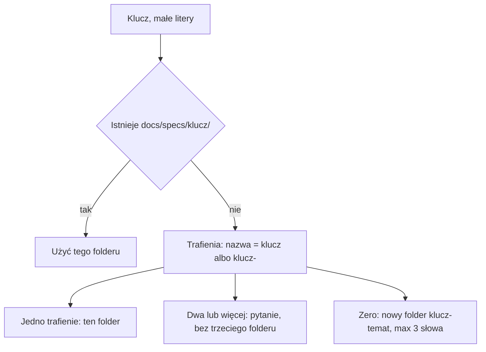

# AC-32 - Implementation Plan

## Task Details

| Field            | Value                                                                 |
| ---------------- | --------------------------------------------------------------------- |
| Jira ID          | [AC-32](https://eversis.atlassian.net/browse/AC-32)                   |
| Title            | Name new spec folders with the ticket key and a short topic          |
| Description      | Nowe foldery spec oraz pliki research i planu zaczynają się od klucza, a po nim jest temat z co najwyżej trzech słów. Implement z samym kluczem otwiera istniejący folder i nie zakłada drugiego katalogu złożonego z samego klucza. Pierwszy nagłówek nowego researchu powtarza ten temat. |
| Priority         | Medium                                                                |
| Related Research | `docs/specs/ac-32/ac-32.research.md`                                  |

## Wildly Important Goal

**Goal**: Nowa praca spec ma folder i pliki z kluczem na początku i krótkim tematem za nim, a Implement z samym kluczem otwiera ten jeden właściwy folder.

**Success Measure**: Delivery Standard, readme speców i blok wklejany do Jiry pokazują kształt `ac-2-context-management`. Przy starcie Implement dokładny folder klucza wygrywa, jeden folder `klucz-temat` jest używany bez tworzenia `docs/specs/<klucz>/`, a dwa takie foldery zatrzymują sesję pytaniem. Szablon nowego researchu ma nagłówek `# <KEY> <topic words> - Analysis Result`.

**Do NOT touch / do NOT add**:

- Zmiana nazw istniejących folderów `docs/specs/`, w tym `ac-2`, `ac-31`, `ac-32`, `blog` i `spec-folder-naming`
- Przepisywanie nagłówków w istniejących plikach research, w tym pauzy w `ac-2-description-snapshot.research.md`
- Wiersz `INDEX.md` na zgłoszenie i zmiana momentu promocji wiedzy
- Limit jednego–dwóch pełnych odczytów plików spec
- Nazwy z tematem na początku (`context-ac-2-management`)
- Edycja opisu Jiry AC-32 i linia Review w `jira-task.example.md`
- Nowe zależności pakietów

## Proposed Solution

Konwencja zostaje tekstem, którego agent się trzyma. Nie powstaje skrypt, który tworzy foldery ani sprawdza liczbę słów. Trzy miejsca mają mówić to samo: zapisana reguła, odczyt przy starcie Implement i pierwszy nagłówek szablonu researchu.

Kształt nowego folderu to `docs/specs/ac-2-context-management/`. Pliki w środku powtarzają tę nazwę: `ac-2-context-management.research.md` i `ac-2-context-management.plan.md`. Temat ma co najwyżej trzy słowa oddzielone myślnikiem. Zdanie, które się nie mieści, idzie do nagłówka, nie do ścieżki.

Odczyt po kluczu, po zamianie na małe litery:

1. Gdy istnieje `docs/specs/<klucz>/`, użyć jego. Foldery `<klucz>-*` obok nie wywołują pytania i nie powstaje drugi katalog.
2. W przeciwnym razie trafienie to nazwa równa kluczowi albo nazwa zaczynająca się od `<klucz>-`. `ac-20` nie jest trafieniem dla `ac-2`.
3. Jedno trafienie: ten folder. Nie tworzyć `docs/specs/<klucz>/`.
4. Dwa lub więcej: sesja staje i pyta, który folder. Nie wybiera w ciszy i nie tworzy trzeciego.
5. Zero trafień: nowy folder `docs/specs/<klucz>-<temat>/` z limitem trzech słów tematu.

Nagłówek nowego researchu: `# <KEY> <topic words> - Analysis Result`. Słowa tematu są sufiksem folderu ze spacjami zamiast myślników. To etykieta, nie zdanie. Krótkie zdanie tylko wtedy, gdy trzech słów w ścieżce nie starcza, żeby ocenić plik. Przed „Analysis Result” zostaje zwykły myślnik szablonu.

Kopie Cursora, Claude i strony dokumentacji powstają z SSOT przez `npm run sync:adapters` i `npm run sync:website-docs`. Ręcznie poprawia się tylko skrót skillu na stronie, którego generator nie nadpisuje.

## Current Implementation Analysis

### Already Implemented

- Delivery Standard — `.ai/rules/orchestration/spec-driven-development.md` — ma tabelę folderu i blok do Jiry; przykład to dziś `docs/specs/task-522/`
- Readme speców — `docs/specs/README.md` — powtarza placeholder `<issue-kebab>/`
- Drugi egzemplarz bloku — `.ai/skills/eversis-jira-task-formatting/jira-task.example.md` — linie folderu i plików bez tematu
- Odczyt Implement — `.ai/skills/eversis-orchestrating-implementation/SKILL.md` — inspekcja `docs/specs/<issue>/`
- Ten sam odczyt — `.ai/prompts/public/eversis-implement.md`, `.ai/rules/orchestration/engineering-manager.md`
- Zapis researchu — `.ai/prompts/internal/eversis-research.md` — folder i plik od samego klucza albo nazwy zadania
- Szablon nagłówka — `.ai/skills/eversis-task-analysing/research.example.md` — `# <TASK_NAME> - Analysis Result`
- Generatory kopii — `npm run sync:adapters`, `npm run sync:website-docs`
- Istniejące foldery i nagłówki — zostają, w tym para `docs/specs/ac-2/` i `docs/specs/ac-2-description-snapshot/`

### To Be Modified

- `.ai/rules/orchestration/spec-driven-development.md` — przykład `task-522` na `ac-2-context-management`; nazwy plików powtarzają folder; blok do Jiry ma ten kształt; temat ma co najwyżej trzy słowa; kształt z tematem na początku nie jest pokazywany jako wzór
- `docs/specs/README.md` — ten sam kształt, żeby readme nie zaprzeczał regule
- `.ai/skills/eversis-jira-task-formatting/jira-task.example.md` — tylko linie folderu, researchu i planu; linia Review zostaje
- `.ai/skills/eversis-orchestrating-implementation/SKILL.md` — odczyt z pięciu kroków powyżej
- `.ai/prompts/public/eversis-implement.md` — to samo zdanie odczytu w inspekcji i w tabeli sygnałów
- `.ai/rules/orchestration/engineering-manager.md` — samokontrola gotowości używa tego odczytu, nie wyłącznie ścieżki równej kluczowi
- `.ai/prompts/internal/eversis-research.md` — nowy plik idzie do folderu `klucz-temat`, a nazwa pliku powtarza folder
- `.ai/skills/eversis-task-analysing/research.example.md` — pierwszy nagłówek `# <KEY> <topic words> - Analysis Result`
- `.ai/skills/eversis-task-analysing/SKILL.md` — jedno zdanie przy kroku szablonu: temat w nagłówku jest etykietą sufiksu, myślnik przed „Analysis Result”, istniejących nagłówków nie przepisywać
- `website/docs/reference/skills/orchestrating-implementation.md` — skrót odczytu zgodny ze skillem; generator skilli tej strony nie nadpisuje

### To Be Created

- Brak nowych plików źródłowych. Kopie pod `.cursor/`, `.claude/` i `website/docs/reference/prompts/` powstają przy synchronizacji.

## Open Questions

| #   | Question | Answer | Status |
| --- | --- | --- | --- |
| 1 | Jaka jest granica klucza przy szukaniu folderu? | Nazwa równa kluczowi pisanemu małymi literami albo `<klucz>-`. `ac-20` nie należy do AC-2. | ✅ Resolved |
| 2 | Co robi Implement, gdy dokładny folder klucza stoi obok folderu z tematem? | Wariant węższy. Dokładny folder wygrywa. Pytanie tylko wtedy, gdy dokładnego folderu nie ma i pasują co najmniej dwa foldery `klucz-temat`. | ✅ Resolved |
| 3 | Jaki jest pierwszy nagłówek szablonu? | `# <KEY> <topic words> - Analysis Result`. Słowa tematu to sufiks folderu ze spacjami. Zdanie tylko wtedy, gdy trzech słów w ścieżce nie starcza. Myślnik szablonu, nie pauza. | ✅ Resolved |

## Technical Context

Projektowe konwencje odkryte przy planowaniu. Agent implementujący czyta tę sekcję i nie odkrywa jej ponownie.

### Project Instructions

- `AGENTS.md` — SSOT jest `.ai/`. Adaptery i strona dokumentacji są kopiami.
- `.cursor/rules/eversis-project-stack.mdc` — po zmianie treści SSOT uruchomić synchronizację adapterów i sprawdzenie kopii strony.
- `.ai/rules/orchestration/spec-driven-development.md` — kanoniczny Delivery Standard. Ta zmiana jest edycją tego pliku.
- `docs/specs/*/` w tym repozytorium jest w gitignore. Śledzony zostaje `docs/specs/README.md`.

### Architecture & Patterns

- Reguły, skille i prompty są markdownem pod `.ai/`. Agent czyta je przy starcie Implement. Nie ma funkcji, która zakłada folder spec.
- `node adapters/sync.mjs` odświeża reguły i komendy Cursora oraz Claude z `.ai/`.
- `node adapters/website/generate.mjs` odświeża kopie promptów pod `website/docs/reference/prompts/`. Skrót skillu `website/docs/reference/skills/orchestrating-implementation.md` jest pisany ręcznie.
- Nazwy plików spec: folder, potem `.research.md` i `.plan.md` o tej samej nazwie bazowej.

### Tech Stack

- Node.js, skrypty `node adapters/*.mjs`, bez nowej zależności
- Menedżer pakietów: npm, skrypty z głównego `package.json`

### Code Style & Standards

- Nie skracać istniejących komentarzy dokumentacyjnych
- Nie edytować plików wygenerowanych ręcznie, gdy źródłem jest `.ai/`
- Tekst reguł i promptów zostaje po angielsku, jak otaczające akapity
- Przykład kanoniczny: `ac-2-context-management`. Nie wprowadzać drugiego przykładu z tematem na początku

### Testing Patterns

- `npm run sync:adapters` zapisuje kopie, `npm run sync:adapters:check` porównuje je ze źródłem
- `npm run sync:website-docs` zapisuje kopie promptów, `npm run sync:website-docs:check` porównuje je ze źródłem
- Dla samych zmian markdownu sprawdzenie jest przez `rg` na ustalonym ciągu
- `npm run mcp:test` i `npm run website:build` nie obejmują tej zmiany. Skrót skillu na stronie jest markdownem dokumentacji, bez zmiany układu

### Database Patterns

- Nie dotyczy. Brak schematu, migracji i zapytań.

### Additional Context

- Research zatwierdzony 2026-09-24 cytatem `Q3. Rekomendacja jest ok; Zamknije reasearch i stwórz plan`.
- Dla AC-2 już istnieją `docs/specs/ac-2/` i `docs/specs/ac-2-description-snapshot/`. Po tej zmianie Implement AC-2 używa `docs/specs/ac-2/` i nie pyta o snapshot.
- Ten plan leży w `docs/specs/ac-32/`, bo folder dokładnego klucza już jest. Nowa konwencja obowiązuje foldery zakładane po niej.

## Implementation Plan

### Phase 1: Kształt w Delivery Standard

**Goal**: Czytelnik reguły, readme speców i bloku do Jiry widzi `ac-2-context-management`, a nie sam klucz i nie temat na początku.

**Description**: Zamiana przykładu i linii nazw plików w trzech źródłach tekstu. Limit trzech słów tematu stoi przy regule nazwy. Linia Review w przykładzie Jiry zostaje, bo jest starsza z innego powodu i nie należy do tego zgłoszenia.

**Verification:** `rg -n "ac-2-context-management" .ai/rules/orchestration/spec-driven-development.md docs/specs/README.md .ai/skills/eversis-jira-task-formatting/jira-task.example.md` oraz `rg -n "task-522" .ai/rules/orchestration/spec-driven-development.md`

#### Task 1.1 - [MODIFY] Przykład i blok Delivery Standard

**Description**: W regule zamienić przykład `docs/specs/task-522/` na `docs/specs/ac-2-context-management/`. Nazwy research i planu powtarzają nazwę folderu. Blok do wklejenia w Jirę używa tego samego kształtu. Dopisać, że temat po kluczu ma co najwyżej trzy słowa. Nie pokazywać `context-ac-2-management` jako wzoru.

**Files:** `.ai/rules/orchestration/spec-driven-development.md` (modify)

**Definition of Done**:

- [x] Tabela folderu i blok Delivery Standard zawierają `ac-2-context-management` oraz nazwy plików `ac-2-context-management.research.md` i `ac-2-context-management.plan.md`
- [x] W pliku jest zdanie, że temat ma co najwyżej trzy słowa
- [x] `rg -n "task-522" .ai/rules/orchestration/spec-driven-development.md` nie zwraca trafień
- [x] `rg -n "context-ac-2-management" .ai/rules/orchestration/spec-driven-development.md` nie zwraca tej nazwy jako wzoru do naśladowania

**Stop Rule:** Zatrzymać się, gdy edycja miałaby zmienić bramki Research, Plan, Review albo Fine. Ta faza zmienia tylko kształt nazwy.

**Clues**: Wiersze tabeli około linii 40 i blok około linii 59. Placeholder `<issue-kebab>` może zostać obok przykładu, jeśli przykład jest `ac-2-context-management`.

#### Task 1.2 - [MODIFY] Readme speców i przykład zadania Jira

**Description**: `docs/specs/README.md` ma podać ten sam kształt folderu i plików. W `jira-task.example.md` zaktualizować tylko linie Spec folder, Research i Plan. Linii Review nie zmieniać.

**Files:** `docs/specs/README.md` (modify), `.ai/skills/eversis-jira-task-formatting/jira-task.example.md` (modify)

**Definition of Done**:

- [x] Oba pliki zawierają `ac-2-context-management` w linii folderu i w nazwach plików research oraz planu
- [x] `jira-task.example.md` nadal zawiera `Review: load eversis-review before Done`
- [x] `rg -n "ac-2-context-management" docs/specs/README.md .ai/skills/eversis-jira-task-formatting/jira-task.example.md` zwraca trafienia w obu plikach

**Stop Rule:** Zatrzymać się, gdy zmiana miałaby objąć `README.md` w korzeniu, `AGENTS.md`, szablon AGENTS albo `scaffolding.sh`. Te pliki mają sam placeholder, bez przykładu `task-522`.

**Clues**: Blok przykładu Jiry jest około linii 87–89 pliku `jira-task.example.md`.

### Phase 2: Odczyt Implement po kluczu

**Goal**: Sam klucz otwiera jeden właściwy folder i nie zakłada obok katalogu złożonego z samego klucza.

**Description**: Ten sam algorytm z Proposed Solution trafia do skillu orkiestracji, promptu Implement, reguły engineering managera i promptu researchu. Research zapisuje nowy plik w folderze `klucz-temat`, a nazwa pliku powtarza folder.

**Verification:** `rg -n "ac-20" .ai/skills/eversis-orchestrating-implementation/SKILL.md .ai/prompts/public/eversis-implement.md .ai/rules/orchestration/engineering-manager.md .ai/prompts/internal/eversis-research.md`

#### Task 2.1 - [MODIFY] Algorytm odczytu w skillu i promptach

**Description**: Wpisać pięć kroków odczytu. Granica klucza odróżnia `ac-2` od `ac-20`. Dokładny folder wygrywa. Jedno trafienie `klucz-temat` nie tworzy `docs/specs/<klucz>/`. Dwa trafienia bez dokładnego folderu zatrzymują sesję pytaniem.

**Files:** `.ai/skills/eversis-orchestrating-implementation/SKILL.md` (modify), `.ai/prompts/public/eversis-implement.md` (modify), `.ai/rules/orchestration/engineering-manager.md` (modify), `.ai/prompts/internal/eversis-research.md` (modify)

**Definition of Done**:

- [x] Skill opisuje wygraną dokładnego folderu, granicę `<klucz>-`, jeden folder z tematem bez tworzenia katalogu samego klucza oraz pytanie przy dwóch folderach `klucz-temat`
- [x] Prompt Implement i reguła engineering managera odsyłają do tego odczytu w kroku inspekcji `docs/specs/`
- [x] Prompt researchu mówi, że nowy folder ma kształt `klucz-temat`, a nazwa pliku research powtarza nazwę folderu
- [x] `rg -n "ac-20" .ai/skills/eversis-orchestrating-implementation/SKILL.md` zwraca zdanie, że `ac-20` nie jest folderem AC-2

**Stop Rule:** Zatrzymać się, gdy implementacja miałaby dodać skrypt zakładający foldery albo zmienić limit odczytu 1–2 plików spec w `agent-core.md`.

**Clues**: Zdanie „inspect `docs/specs/<issue>/`” jest w skillu około opisu gotowości, w prompcie Implement w sygnałach wejścia i w samokontroli engineering managera. W prompcie researchu ścieżka jest w sekcji Output i w zdaniu o nazwie pliku.

### Phase 3: Nagłówek szablonu researchu

**Goal**: Nowy plik research ma w pierwszym nagłówku temat, a stare pliki zostają z dotychczasowym nagłówkiem.

**Description**: Szablon i jedno zdanie w skillu analizy zadania ustalają etykietę tematu i myślnik. Pauza w już napisanym snapshocie zostaje.

**Verification:** `rg -n "<KEY> <topic words> - Analysis Result" .ai/skills/eversis-task-analysing/research.example.md .ai/skills/eversis-task-analysing/SKILL.md`

#### Task 3.1 - [MODIFY] Pierwszy nagłówek szablonu

**Description**: Zmienić pierwszy wiersz `research.example.md` na `# <KEY> <topic words> - Analysis Result`. W kroku 4 skillu dopisać, że słowa tematu są sufiksem folderu ze spacjami, że krótkie zdanie wchodzi tylko gdy trzech słów w ścieżce nie starcza, i że istniejące nagłówki zostają.

**Files:** `.ai/skills/eversis-task-analysing/research.example.md` (modify), `.ai/skills/eversis-task-analysing/SKILL.md` (modify)

**Definition of Done**:

- [x] Pierwszy wiersz `research.example.md` to `# <KEY> <topic words> - Analysis Result`
- [x] Skill mówi, że etykieta tematu odpowiada sufiksowi folderu i że istniejących nagłówków się nie przepisuje
- [x] `rg -n "description snapshot —" docs/specs/ac-2-description-snapshot/ac-2-description-snapshot.research.md` nadal zwraca dotychczasowy nagłówek
- [x] `rg -n "^# AC-32 - Analysis Result" docs/specs/ac-32/ac-32.research.md` nadal zwraca nagłówek tego researchu

**Stop Rule:** Zatrzymać się, gdy zmiana miałaby przepisać nagłówek jakiegokolwiek już istniejącego pliku research.

**Clues**: Skill w kroku 4 odsyła do `./research.example.md` i zakazuje dodawania sekcji. Nowe zdanie stoi przy tym odsyłaczu, bez nowej sekcji.

### Phase 4: Kopie i skrót na stronie

**Goal**: To, co czyta Cursor, Claude i strona dokumentacji, jest tym samym odczytem co skill.

**Description**: Synchronizacja kopii z `.ai/`. Skrót skillu na stronie jest osobną, ręczną stroną i dostaje ten sam skrót odczytu. Plików wygenerowanych nie edytować ręcznie.

**Verification:** `npm run sync:adapters:check` i `npm run sync:website-docs:check`

#### Task 4.1 - [MODIFY] Synchronizacja kopii

**Description**: Po edycjach w `.ai/` uruchomić synchronizację adapterów i kopii promptów na stronie. Nie poprawiać ręcznie `.cursor/rules/eversis-spec-driven-development.mdc`, `.cursor/commands/eversis-implement.md`, `.claude/commands/eversis-implement.md` ani `website/docs/reference/prompts/`.

**Files:** `.cursor/rules/eversis-spec-driven-development.mdc` (modify — przez `npm run sync:adapters`), `.cursor/commands/eversis-implement.md` (modify — przez sync), `.claude/commands/eversis-implement.md` (modify — przez sync), `website/docs/reference/prompts/public/eversis-implement.md` (modify — przez `npm run sync:website-docs`), `website/docs/reference/prompts/internal/eversis-research.md` (modify — przez sync)

**Definition of Done**:

- [x] `npm run sync:adapters` kończy się kodem 0
- [x] `npm run sync:website-docs` kończy się kodem 0
- [x] `npm run sync:adapters:check` kończy się kodem 0
- [x] `npm run sync:website-docs:check` kończy się kodem 0

**Stop Rule:** Zatrzymać się, gdy check zgłasza różnicę w pliku, którego to zgłoszenie nie miało zmieniać, i różnica nie wynika z synchronizacji źródeł z faz 1–3.

**Clues**: Oba skrypty są w głównym `package.json`. Check bez wcześniejszego sync kończy się błędem, jeśli źródło już się zmieniło.

#### Task 4.2 - [MODIFY] Skrót odczytu na stronie skillu

**Description**: W ręcznym skrócie skillu zastąpić samo `docs/specs/<issue>/` skrótem odczytu: dokładny folder wygrywa, inaczej `klucz` albo `klucz-`, jedno trafienie bez katalogu samego klucza, dwa trafienia kończą się pytaniem.

**Files:** `website/docs/reference/skills/orchestrating-implementation.md` (modify)

**Definition of Done**:

- [x] Strona opisuje wygraną dokładnego folderu i pytanie, gdy pasują co najmniej dwa foldery `klucz-temat` bez dokładnego folderu
- [x] `rg -n "ac-2-context-management|klucz-temat|<key>-" website/docs/reference/skills/orchestrating-implementation.md` zwraca co najmniej jedno trafienie opisujące folder z tematem

**Stop Rule:** Zatrzymać się, gdy strona miałaby stać się pełną kopią skillu. Zostaje skrót jednego akapitu odczytu.

**Clues**: Akapit „Implement readiness (mandatory first output)” około linii 26. Generator `adapters/website/generate.mjs` tej strony nie zapisuje.

### Phase 5: Code Review

**Goal**: Niezależny przegląd potwierdza, że reguła, odczyt i nagłówek mówią to samo, a stare foldery i nagłówki zostały.

**Description**: Ostatnia faza. Code Reviewer czyta cały diff względem tego planu. E2E nie ma. Nie uruchamiać testów MCP ani buildu strony spoza tego przeglądu, jeśli review nie znajdzie powodu w zmienionym pliku.

**Verification:** `npm run sync:adapters:check` i `npm run sync:website-docs:check`

#### Task 5.1 - [REUSE] Code review by Code Reviewer

**Description**: Uruchomić Code Reviewera promptem `eversis-review.md` na całości zmian z faz 1–4. Przekazać mu kryteria z Quality Assurance i listę plików, których nie wolno było ruszać.

**Files:** `.ai/rules/orchestration/spec-driven-development.md` (reuse), `.ai/skills/eversis-orchestrating-implementation/SKILL.md` (reuse), `.ai/skills/eversis-task-analysing/research.example.md` (reuse), `docs/specs/README.md` (reuse)

**Definition of Done**:

- [x] `npm run sync:adapters:check` kończy się kodem 0
- [x] `npm run sync:website-docs:check` kończy się kodem 0
- [x] Code review przechodzi bez otwartych BLOCKER
- [x] Wynik review jest wpisany w Changelog tego planu

**Stop Rule:** Zatrzymać się po trzech pełnych przeglądach z tym samym BLOCKEREM i oddać sprawę człowiekowi.

**Clues**: Najwyższe ryzyko to odczyt, który nadal tworzy `docs/specs/ac-2/` obok istniejącego folderu z tematem, oraz granica, która bierze `ac-20` za AC-2.

## Security Considerations

- Zła granica klucza otwiera research innego zgłoszenia. `ac-2` nie może objąć `ac-20`. To jest ryzyko pomylonego kontekstu, nie nowe uprawnienie.
- Brak sekretów, nowych endpointów i zmian auth.
- Nie publikować niczego do Jiry w ramach tej zmiany.
- Foldery `docs/specs/*/` zostają lokalne i gitignore. Nie dodawać ich do gita przy okazji synchronizacji.

## Quality Assurance

- [x] Przykład w Delivery Standard zaczyna się od klucza i ma co najwyżej trzy słowa tematu, w kształcie `ac-2-context-management`
- [x] Nazwy plików research i planu w tej regule powtarzają nazwę folderu
- [x] Blok wklejany do opisu Jiry używa tego kształtu
- [x] `docs/specs/README.md` podaje ten sam kształt
- [x] Wzorcem nie jest nazwa z tematem na początku
- [x] Gdy jest `ac-2-context-management`, a nie ma `ac-2`, Implement dla AC-2 używa folderu z tematem i nie tworzy `docs/specs/ac-2/`
- [x] Gdy istnieje `docs/specs/ac-2/`, Implement dla AC-2 używa jego i nie pyta o `ac-2-description-snapshot`
- [x] Gdy dokładnego folderu nie ma, a pasują dwa foldery `klucz-temat`, sesja pyta i nie tworzy trzeciego
- [x] `ac-20` nie jest trafieniem dla klucza `ac-2`
- [x] Nowy research ma pierwszy nagłówek z tematem i myślnikiem przed „Analysis Result”
- [x] Istniejące nagłówki złożone z samego klucza oraz nagłówek snapshotu z pauzą zostają

## Improvements (Out of Scope)

- Zmiana nazw istniejących folderów spec i przepisywanie ich nagłówków
- Aktualizacja już opublikowanego opisu Jiry AC-32, który nadal wskazuje `docs/specs/spec-folder-naming/`
- Wyrównanie linii Review w `jira-task.example.md` do aktualnego bloku Continuity
- Placeholdery `<issue-kebab>` w korzeniowym `README.md`, `AGENTS.md`, `templates/AGENTS.template.md`, `scripts/lib/setup-agent-collections/scaffolding.sh`, `docs/plans/README.md` i `docs/architecture/agents-md-standard.md`
- Podniesienie limitu pełnych odczytów spec albo zmiana promocji do `INDEX.md`
- Skrypt sprawdzający liczbę słów w nazwie folderu
- `.cursor/rules/eversis-project-stack.mdc` (always applied) still says `docs/specs/<issue-kebab>/` and was left unchanged on purpose.

## Human gates

1. ~~Approve research~~ — done (`Q3. Rekomendacja jest ok; Zamknije reasearch i stwórz plan`)
2. ~~Approve this plan~~ — done (`Plan is ok. I want to implement in the new window`)
3. ~~Implement → Review → Fine~~ — done (review PASS, Fine declared 2026-09-24)

## Changelog

| Date       | Change Description   |
| ---------- | -------------------- |
| 2026-09-24 | Initial plan created |
| 2026-09-24 | Plan approved. Implementation starts in a new window. No code changes in the planning session. |
| 2026-09-24 | Implemented phases 1–4 (naming example, key lookup, research heading, sync). No solution change. |
| 2026-09-24 | Code review performed. Verdict: PASS (0 BLOCKER, 2 SUGGESTION). |

## Code Review Findings

**Reviewer:** Code Reviewer (independent; did not implement)  
**Date:** 2026-09-24  
**Verdict:** PASS

**Checks run:** `npm run sync:adapters:check` (0), `npm run sync:website-docs:check` (0). File reads for QA 1–11 and plan-review W1–W4 (bare `inspect docs/specs/<issue>/` one-liner search).

### PASS

- Phases 1–4 SSOT match the plan: Delivery Standard / README / Jira example use `ac-2-context-management` with ≤3 topic words; research/plan names repeat the folder; topic-first is not the pattern; Spec folder lookup (exact wins, `<key>-` boundary, one topic hit without creating key-only, ask on ≥2, `ac-20` ≠ `ac-2`) is in the orchestration skill and restated without contradiction in Implement, engineering-manager, research prompt, and website skill short.
- Template H1 is `# <KEY> <topic words> - Analysis Result`; existing `# AC-32 - Analysis Result` and snapshot em-dash H1 unchanged.
- Out-of-scope surfaces untouched (root README, AGENTS, templates, scaffolding, plans README, agents-md-standard, project-stack, agent-core); Review line in `jira-task.example.md` still `Review: load eversis-review before Done`; no new package dependencies.
- Generated adapter/website copies drift-free; CLAUDE.md / `.cursor` / `.claude` / website prompt updates are sync-only.
- No leftover operative `inspect docs/specs/<issue>/` one-liner in Phase 2–4 files (plan-review W1/W4 risk closed).

### BLOCKER

_None._

### SUGGESTION

1. **Residual always-applied bare `<issue-kebab>/`** — `.cursor/rules/eversis-project-stack.mdc` and `AGENTS.md` still teach the old placeholder (plan Improvements / W3). Accepted out of scope for AC-32; consider a follow-up so Cursor alwaysApply does not compete with the new example.
2. **Zero-hit topic invention** — Step 5 still lets the agent invent ≤3 topic words with no “ask once if unsure” stop (plan-review W5). Optional clarification in research/Implement prose; not required for this PASS.
