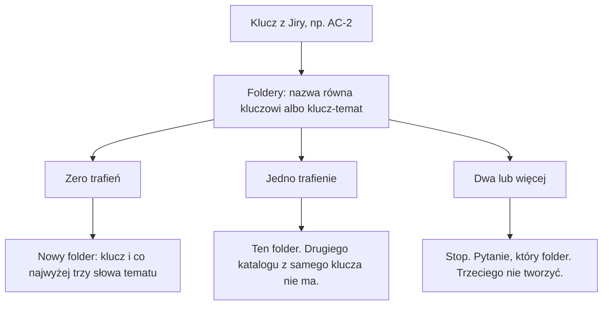

# AC-32 - Analysis Result

## Task Details

| Field | Value |
|---|---|
| Jira ID | [AC-32](https://eversis.atlassian.net/browse/AC-32) |
| Title | Name new spec folders with the ticket key and a short topic |
| Description | Nowe foldery spec oraz pliki research i planu zaczynają się od klucza zgłoszenia, a po nim jest temat z co najwyżej trzech słów. Implement, mając sam klucz, otwiera ten folder i nie zakłada drugiego folderu złożonego z samego klucza. Pierwszy nagłówek nowego pliku research podaje temat. |
| Priority | Medium |
| Reporter | Piotr Niemirski |
| Created Date | 2026-09-24 |
| Due Date | Nie ustawiono |
| Labels | naming, specs, workshop-2026-09-24 |
| Estimated Effort | Nie ustawiono (warsztat: jedno zgłoszenie pod AC-2) |
| Status | In Progress |
| Type | Sub-task |
| Parent | [AC-2](https://eversis.atlassian.net/browse/AC-2) — Define a context-and-knowledge-management architecture for agent-collections (Phase 1: bounded context router), status In Progress |
| Comments | Brak |
| Subtasks | Brak |

## Business Impact

Folder o nazwie samego klucza, na przykład `ac-2`, nie da się ocenić przy wyszukiwaniu po nazwie. Folder, który zaczyna się od tematu, psuje odczyt, którego Implement używa od klucza. AC-32 ma sprawić, żeby zapisana reguła, odczyt folderu i pierwszy nagłówek researchu mówiły to samo: klucz na początku, krótki temat za nim.

Rodzic AC-2 zostaje Taskiem o architekturze kontekstu. To dziecko nie zmienia routera kontekstu ani promocji do `INDEX.md`. Zmienia tylko nazwę nowych artefaktów spec i sposób, w jaki Implement je znajduje.

## Gathered Information

### Knowledge Base & Task Management Tools

[AC-32](https://eversis.atlassian.net/browse/AC-32) jest Sub-taskiem pod AC-2. Brak linków Confluence, załączników, komentarzy i dalszych dzieci. Opis w Jirze jest po angielsku. Ta analiza jest po polsku, bo o to poproszono przy `/eversis-implement`.

Gate 0 (2026-09-24, Piotr Niemirski) zatwierdził brief słowem „Ok”: tekst konwencji w `spec-driven-development.md` (klucz, potem krótki temat) oraz resztę briefu. Story 1.1 zatwierdzono tego samego dnia, razem z limitem trzech słów tematu. Ta sama odpowiedź złożyła cały podział (trzy story) w jedno zgłoszenie pod AC-2.

Artefakty warsztatu leżą w `docs/specs/spec-folder-naming/`. Opis w Jirze w bloku Delivery Standard nadal wskazuje tę ścieżkę (`spec-folder-naming.research.md`). Tego opisu w tej analizie nie zmieniam. Review jakości warsztatu (lite) nie dodał sugestii.

Wymagania, które plan ma pokryć:

1. Przykład w Delivery Standard zaczyna się od klucza i ma co najwyżej trzy słowa tematu, w kształcie `ac-2-context-management`. Nazwy plików research i planu powtarzają nazwę folderu. Blok wklejany do Jiry ma ten sam kształt. `docs/specs/README.md` mówi to samo. Przykład z tematem na początku nie występuje.
2. Gdy istnieje `ac-2-context-management`, a nie ma folderu `ac-2`, Implement dla AC-2 używa folderu z tematem i nie tworzy `docs/specs/ac-2/`. Dwa foldery zaczynające się od tego samego klucza zatrzymują sesję i pytają, który wybrać. Sesja nie wybiera w ciszy i nie tworzy trzeciego folderu.
3. Pierwszy nagłówek szablonu researchu zawiera temat. Istniejące pliki, których nagłówek jest samym kluczem, zostają bez zmian.

Poza zakresem: zmiana nazw istniejących folderów spec; przepisywanie nagłówków w istniejących plikach research; wiersz `INDEX.md` na zgłoszenie albo zmiana momentu promocji; nazwy z tematem na początku.

`docs/context/agent-collections/INDEX.md` ma jeden komponent, `readiness-contract`. Nie opisuje nazw folderów spec. Pliku komponentu nie wczytywałem. `last_audit` nie ma. `tasks_since_audit` wynosi 14.

### Codebase

Repozytorium jest frameworkiem. Odczyt folderu spec nie jest funkcją w kodzie. Jest zdaniem w skillu i w promptach, którego agent ma się trzymać przy starcie Implement: zajrzyj do `docs/specs/<issue>/`.

Dzisiejszy zapis konwencji:

- `.ai/rules/orchestration/spec-driven-development.md` — folder `docs/specs/<issue-kebab>/`, przykład `docs/specs/task-522/`. To jedyne miejsce w repozytorium z przykładem `task-522`. Blok do wklejenia w Jirę używa tego samego placeholdera `<issue-kebab>`, bez tematu.
- `docs/specs/README.md` — ten sam placeholder, bez przykładu `ac-2-context-management`.
- `.ai/skills/eversis-jira-task-formatting/jira-task.example.md` — powtarza blok Delivery Standard. Linia folderu jest starym placeholderem. Linia Review w tym przykładzie jest starsza niż aktualny blok w regule (`load eversis-review before Done` wobec sesji Implement).
- `.ai/skills/eversis-task-analysing/research.example.md` — pierwszy nagłówek to `# <TASK_NAME> - Analysis Result`.
- Odczyt: `.ai/skills/eversis-orchestrating-implementation/SKILL.md`, `.ai/prompts/public/eversis-implement.md`, `.ai/rules/orchestration/engineering-manager.md`, `.ai/prompts/internal/eversis-research.md`. Wszystkie wskazują ścieżkę od klucza albo `<issue-kebab>`, bez sufiksu tematu.

Kopie, które powstają z SSOT:

- `npm run sync:adapters` odświeża reguły Cursora (w tym `.cursor/rules/eversis-spec-driven-development.mdc`) oraz komendy `/eversis-implement`.
- `npm run sync:website-docs` odświeża kopie promptów pod `website/docs/reference/prompts/`.
- Strona `website/docs/reference/skills/orchestrating-implementation.md` jest skrótem pisanym ręcznie. Nadal mówi o `docs/specs/<issue>/`. Generator skilli jej nie nadpisuje.

Inne pliki używają placeholdera `<issue-kebab>` bez przykładu samego klucza: `README.md`, `AGENTS.md`, `templates/AGENTS.template.md`, `scripts/lib/setup-agent-collections/scaffolding.sh`, `docs/plans/README.md`, `docs/architecture/agents-md-standard.md`. Nie pokazują kształtu `task-522`. Nie pokazują też `ac-2-context-management`.

W `docs/specs/` są już foldery, które ten odczyt musi rozróżnić. Dla klucza `ac-2` istnieją dwa katalogi: `ac-2` oraz `ac-2-description-snapshot`. Osobno istnieją `ac-20`, `ac-22` i dalsze numery zaczynające się od znaków `ac-2`. Zwykłe „nazwa zaczyna się od `ac-2`” zaliczyłoby je do AC-2. Granica po kluczu (równa nazwa albo `klucz-`) zostawia przy AC-2 tylko `ac-2` i `ac-2-description-snapshot`.

Nagłówki, których nie wolno ruszać: `# AC-2 - Analysis Result`, `# AC-31 - Analysis Result`. Plik `ac-2-description-snapshot.research.md` ma już nagłówek z tematem: `# AC-2 description snapshot — Analysis Result`. To istniejący plik. Ta zmiana go nie przepisuje.

W tym repozytorium całe `docs/specs/*/` jest w gitignore. Zostaje śledzony `docs/specs/README.md`.

Brak Figmy.

Ten plik leży w `docs/specs/ac-32/ac-32.research.md`, bo tak wygląda dzisiejszy odczyt Implement. Katalog warsztatu `spec-folder-naming` zostaje źródłem briefu. Nagłówek tego pliku jest samym kluczem, bo szablon jeszcze ma stary kształt. Po zmianie szablonu tego nagłówka się nie poprawia: istniejące pliki zostają.

### Relevant Links

- [AC-32](https://eversis.atlassian.net/browse/AC-32) — Sub-task
- [AC-2](https://eversis.atlassian.net/browse/AC-2) — rodzic
- `docs/specs/spec-folder-naming/intent-brief.md` — brief po Gate 0
- `docs/specs/spec-folder-naming/extracted-tasks.md` — trzy story złożone w to jedno zgłoszenie
- `docs/specs/spec-folder-naming/quality-review.md` — lite, bez sugestii
- `.ai/rules/orchestration/spec-driven-development.md` — tekst konwencji i blok do Jiry
- `docs/specs/README.md` — readme, które ma mówić to samo
- `.ai/skills/eversis-orchestrating-implementation/SKILL.md` — zdanie odczytu przy starcie Implement
- `.ai/skills/eversis-task-analysing/research.example.md` — nagłówek szablonu

### Relevant Charts & Diagrams

Dopasowanie „klucz albo klucz-” jest odpowiedzią na pytanie 1 (2026-09-24). `ac-20` nie wchodzi do AC-2. Słowa tematu po myślniku nie biorą udziału w tym wyborze.

## Current Implementation Status

### Existing Components

- Delivery Standard — `.ai/rules/orchestration/spec-driven-development.md` — wymaga zmiany przykładu i bloku do Jiry na kształt `ac-2-context-management`
- Readme speców — `docs/specs/README.md` — wymaga tej samej zmiany, żeby nie zaprzeczał regule
- Przykład zadania Jira — `.ai/skills/eversis-jira-task-formatting/jira-task.example.md` — wymaga tej samej zmiany linii folderu i nazw plików; reszta starszego bloku Review zostaje, dopóki plan jej nie obejmie
- Odczyt Implement — skill orkiestracji, prompt `eversis-implement`, reguła engineering managera, prompt `eversis-research` — wymaga zmiany, żeby sam klucz otwierał folder z tematem
- Szablon researchu — `.ai/skills/eversis-task-analysing/research.example.md` — wymaga tematu w pierwszym nagłówku
- Kopie promptów i reguł — `sync:adapters`, `sync:website-docs` — do odświeżenia po edycji SSOT
- Skrót skillu na stronie — `website/docs/reference/skills/orchestrating-implementation.md` — ręczny; nadal opisuje starą ścieżkę
- Istniejące foldery i nagłówki — `docs/specs/ac-2/`, `docs/specs/ac-31/`, `docs/specs/spec-folder-naming/` i pozostałe — zostają
- Indeks wiedzy — `docs/context/agent-collections/INDEX.md` — bez zmiany

### Key Files and Directories

- `.ai/rules/orchestration/spec-driven-development.md` — przykład `task-522` i blok Delivery Standard
- `docs/specs/README.md` — konwencja czytana z repozytorium
- `.ai/skills/eversis-orchestrating-implementation/SKILL.md` — inspekcja `docs/specs/<issue>/`
- `.ai/prompts/public/eversis-implement.md` — to samo zdanie odczytu, źródło komend i kopii na stronie
- `.ai/prompts/internal/eversis-research.md` — gdzie research zapisuje plik
- `.ai/skills/eversis-task-analysing/research.example.md` — `# <TASK_NAME> - Analysis Result`
- `.ai/skills/eversis-jira-task-formatting/jira-task.example.md` — drugi egzemplarz bloku do Jiry
- `docs/specs/ac-2/` i `docs/specs/ac-2-description-snapshot/` — para, którą nowe kryterium kolizji już dziś widzi
- `docs/specs/spec-folder-naming/` — brief, podział story, transkrypt; nie jest folderem tego zgłoszenia

## Gap Analysis

Brief, podział story i opis AC-32 zgadzają się co do zakresu: reguła, odczyt, nagłówek; stare foldery zostają. Granica klucza, wariant odczytu i kształt nagłówka są rozstrzygnięte.

### Question 1

#### Jaką granicę ma klucz przy szukaniu folderu?

Zdanie „nazwa zaczyna się od klucza” bez granicy po kluczu łączy AC-2 z folderami `ac-20`, `ac-22` i dalszymi. Propozycja: trafienie to nazwa równa kluczowi pisanemu małymi literami albo nazwa, która ma po kluczu myślnik (`ac-2`, `ac-2-context-management`). `ac-20` zostaje folderem AC-20.

Odpowiedź (2026-09-24): **Propozycja ok.** Trafienie to nazwa równa kluczowi albo `klucz-` i temat. Słowa tematu nie wybierają folderu przy starcie Implement od klucza.

Temat w nazwie jest dla osoby i agenta, którzy widzą listę katalogów albo szukają słowa, a nie klucza. `ac-2` nie mówi, co jest w środku. `ac-2-context-management` mówi. Wyszukanie po `context` trafia w nazwę folderu i plików. Odczyt po kluczu AC-2 i tak znajduje ten sam folder dzięki granicy `ac-2` / `ac-2-`.

Doprecyzowanie (2026-09-24): przy discovery agent wolno przeszukuje nazwy plików i tematów w `docs/specs/**` i nie wczytuje treści. Słowa `description-snapshot` w `ac-2-description-snapshot` są wtedy widoczne. Agent może po nich zostawić folder albo go pominąć, zanim otworzy plik. To jest filtr nazwy, nie sprawdzenie, czy treść pasuje do researchu bieżącego zadania. To sprawdzenie jest w pierwszym nagłówku, a pełne otwarcie pliku spec jest ograniczone do jednego lub dwóch plików (`agent-core.md`, Discovery i Consumption). Dlatego temat w ścieżce ma co najwyżej trzy słowa, a zdanie zostaje w nagłówku.

Limit jednego–dwóch pełnych plików spec zostaje poza AC-32. Szeroki temat, który dotyka wielu starych zadań, ma być zebrany w jednym komponencie `docs/context/`, nie w odczycie każdego pasującego researchu. Nazwa folderu pomaga wybrać te jeden–dwa pliki, gdy indeks pokazuje lukę. Nie podnosi limitu.

### Question 2

#### Co robi Implement, gdy dokładny folder klucza już stoi obok folderu z tematem?

Dla AC-2 takie dwa foldery już są: `docs/specs/ac-2/` oraz `docs/specs/ac-2-description-snapshot/`. Kryterium akceptacji mówi, że dwa foldery na ten sam klucz zatrzymują sesję pytaniem. Wtedy każdy kolejny Implement AC-2 pyta, zanim cokolwiek zapisze. Zmiana nazw tych folderów jest poza zakresem, więc pary nie da się usunąć tą zmianą.

Odpowiedź (2026-09-24): **Wariant węższy.** Gdy istnieje folder równy samemu kluczowi, Implement używa jego. Pyta tylko wtedy, gdy dokładnego folderu nie ma i pasują co najmniej dwa foldery `klucz-temat`. Plan zawęża kryterium AC-32 „zawsze pytaj”.

Ustalenie wcześniejsze: standard flow otwiera dokładną ścieżkę `docs/specs/<issue>/`. Folder z tematem obok nie robi z tej ścieżki niejednoznaczności.

### Question 3

#### Jaki dokładnie jest pierwszy nagłówek szablonu?

Kryterium wymaga tematu w nagłówku. Nie podaje znaków. Szablon ma dziś `# <TASK_NAME> - Analysis Result`. Istniejący snapshot używa pauzy: `# AC-2 description snapshot — Analysis Result`. Propozycja dla nowych plików: `# AC-2 context management - Analysis Result` (temat w miejscu `<TASK_NAME>`, zwykły myślnik przed „Analysis Result”, jak w obecnym szablonie).

Wyjaśnienie (2026-09-24), bez wyboru: pierwszy wiersz pliku research jest tym, co widać przy przeszukaniu treści. Sam klucz w nagłówku (`# AC-2 - Analysis Result`) nie mówi, o czym jest plik. Temat wchodzi w miejsce `<TASK_NAME>`. Końcówka przed „Analysis Result” odróżnia wynik analizy od innych nagłówków. Limit trzech słów dotyczy ścieżki folderu. W nagłówku może być krótkie zdanie. Pauza `—` w pliku snapshotu jest wcześniejszym, ręcznym zapisem. Istniejących nagłówków ta zmiana nie przepisuje. Do wyboru zostaje znak przed „Analysis Result”: myślnik szablonu albo pauza jak w snapshocie.

Doprecyzowanie (2026-09-24): w `# AC-2 description snapshot — Analysis Result` słowa „description snapshot” są etykietą tematu, tą samą co sufiks folderu `description-snapshot`, ze spacją zamiast myślnika. To nie jest zdanie opisujące zadanie. Zdanie o zadaniu jest niżej, w polu Description. Miejsce tematu w nagłówku może pomieścić krótkie zdanie, bo limit trzech słów dotyczy tylko ścieżki. Ten plik z tego miejsca nie skorzystał.

Rekomendacja (2026-09-24): w miejscu tematu te same słowa co sufiks folderu, ze spacjami. To etykieta, nie zdanie. Krótkie zdanie tylko wtedy, gdy trzech słów w ścieżce nie starcza, żeby ocenić plik. Znak przed „Analysis Result” zostaje myślnikiem z szablonu: `# AC-2 context management - Analysis Result`. Pauza w snapshocie zostaje w tym jednym, już istniejącym pliku.

Odpowiedź (2026-09-24): **Rekomendacja jest ok.**

## Human gates

1. ~~Approve research~~ — done (`Q3. Rekomendacja jest ok; Zamknije reasearch i stwórz plan`)
2. ~~Approve plan~~ — done (`Plan is ok. I want to implement in the new window`)
3. Implement → Review → Fine
