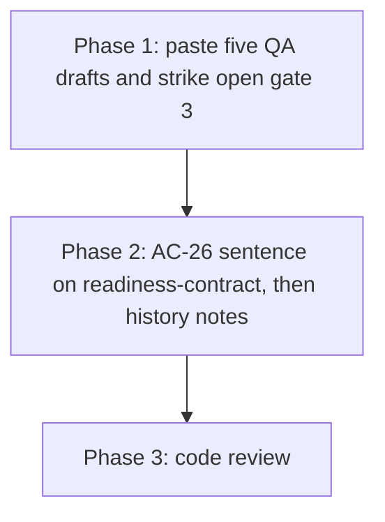

# Close Implement gates - Implementation Plan

## Task Details

| Field            | Value                   |
| ---------------- | ----------------------- |
| Jira ID          | None. Records close-out on AC-16, AC-17, AC-22, AC-23, and AC-25. |
| Title            | Close five Implement gates and record the AC-26 checkpoint on the readiness contract |
| Description      | Paste each existing QA draft into its plan and strike Human gate 3 where it is still open. Then add the AC-26 sentence to the readiness-contract note. Mark the stale AC-20 plan review and the missing plan-review files as history. Do not start a new Implement on those five tickets. |
| Priority         | High                    |
| Related Research | `docs/specs/close-implement-gates/close-implement-gates.research.md` |

## Wildly Important Goal

**Goal**: A later `/eversis-implement` on AC-16, AC-17, AC-22, AC-23, or AC-25 sees a closed Implement gate and the QA draft in the plan, so it does not start that ticket again.

**Success Measure**: Each of those five plans contains the chat QA draft and a struck gate 3; `readiness-contract` states that an AC-26 checkpoint does not end the session; the AC-20 verdict stays `REVISIONS NEEDED` with a history note; no Jira comment is posted and `eversis-audit-domain-knowledge` is not run.

**Do NOT touch / do NOT add**:

- Do not open a new Implement of AC-16, AC-17, AC-22, AC-23, or AC-25, and do not add another `CHECKPOINT:` row.
- Do not post any QA draft to Jira.
- Do not run `eversis-audit-domain-knowledge`, and do not set `last_audit` or reset `tasks_since_audit`.
- Do not edit `docs/specs/ac-2/ac-2.plan.md`, `docs/specs/ac-19/ac-19.plan.md`, `website/docs/reference/domain-context.md`, or the rule 14 heading. Those already match AC-26.
- Do not put „Otwórz nową sesję…” back into the orchestration skill.
- Do not change the AC-20 plan-review verdict to `APPROVED`.
- Do not rewrite suggestion S2, do not crash a session to prove `Resume`, and do not merge the two Layer A files.

## Proposed Solution

Phase 1 only edits the five child plans. For each one, copy the existing Fine draft from the Implement chat into the plan, under a `Fine` heading, starting with `**Draft QA comment — review before posting to Jira**`. Strike gate 3. Add a changelog row that the draft was pasted and not posted. Where that ticket has no `*.plan-review.md`, add one history sentence under Human gates. AC-25 already has an approved plan review, so it does not get that sentence. AC-23’s gate line is already struck; paste the draft and leave the strike in place.

Phase 2 runs only after Phase 1. It adds one sentence to `docs/context/agent-collections/readiness-contract/index.md`: a checkpoint does not end the session, and the same turn writes `RESUMED`. Layer A/B, “`Resume` is not a `Flow` value”, and the two-column index rule stay. The same phase marks AC-18, AC-24, and the AC-20 plan review as history. The audit skill already names `source: manual` in the empty-`code_paths` exception and still excludes `source: agent-discovered`. Phase 2 checks that sentence and does not edit it when it is already true.



## Current Implementation Analysis

### Already Implemented

- AC-26 session contract — `.ai/skills/eversis-orchestrating-implementation/SKILL.md` — rule 14 heading is “Checkpoint handoff note (session continues)”; the same turn writes `RESUMED:` and the session continues
- Parent gate and S1 — `docs/specs/ac-2/ac-2.plan.md` — already state that contract
- AC-19 superseded note — `docs/specs/ac-19/ac-19.plan.md` — under Human gates; the Polish operator sentence stays above as history
- Public checkpoint blurb — `website/docs/reference/domain-context.md` — matches the Implement diagram
- Audit exception — `.ai/skills/eversis-audit-domain-knowledge/SKILL.md` — empty `code_paths` on `source: confluence`, `source: docs-specs-cluster`, or `source: manual` signals `Update`, never `Delete`; `source: agent-discovered` stays outside the exception
- AC-23 gate line — `docs/specs/ac-23/ac-23.plan.md` — already struck; the QA draft is not in the plan yet
- AC-25 plan review — `docs/specs/ac-25/ac-25.plan-review.md` — `APPROVED`

### To Be Modified

- AC-16 plan — `docs/specs/ac-16/ac-16.plan.md` — paste the chat QA draft, strike gate 3, add the missing-plan-review history sentence
- AC-17 plan — `docs/specs/ac-17/ac-17.plan.md` — same, and remove the “new window” wording from the open gate
- AC-22 plan — `docs/specs/ac-22/ac-22.plan.md` — same, and remove “w nowym oknie / ten czat nie implementuje” from the open gate
- AC-23 plan — `docs/specs/ac-23/ac-23.plan.md` — paste the chat QA draft; keep gate 3 struck; add the missing-plan-review history sentence
- AC-25 plan — `docs/specs/ac-25/ac-25.plan.md` — paste the chat QA draft and strike gate 3; no missing-plan-review sentence
- Readiness contract — `docs/context/agent-collections/readiness-contract/index.md` — add the AC-26 checkpoint sentence after Phase 1
- AC-18 plan — `docs/specs/ac-18/ac-18.plan.md` — history sentence only; gate 3 is already struck
- AC-24 plan — `docs/specs/ac-24/ac-24.plan.md` — history sentence only; gate 3 is already struck
- AC-20 plan review — `docs/specs/ac-20/ac-20.plan-review.md` — history note; verdict stays `REVISIONS NEEDED`

### To Be Created

- None. No new skill, page, or plan-review file.

## Open Questions

| #   | Question   | Answer   | Status                |
| --- | ---------- | -------- | --------------------- |
| 1   | Start a new Implement on the five tickets? | No. Paste the existing chat draft and strike the open gate. | ✅ Resolved (`Question 1. OK`) |
| 2   | Which session-policy sentences still change? | Only the AC-26 sentence on `readiness-contract`, after the five gates. The other four records already match AC-26. | ✅ Resolved (`Research is ok`) |
| 3   | Run the knowledge audit in this task? | No. The `manual` exception is already in the audit skill; confirm it and do not run the audit. | ✅ Resolved (`Question 3: No`) |
| 4   | Re-open AC-20 or write the missing plan reviews? | No. History notes only. Verdict stays `REVISIONS NEEDED`. | ✅ Resolved (`Question 4: OK`) |
| 5   | What waits for a later ticket? | The crash-between-rows check, the future Layer A edit habit, and rewriting suggestion S2. | ✅ Resolved (`Research is ok`) |

## Technical Context

Project conventions, coding standards, and patterns discovered during planning. Downstream agents MUST read this section instead of re-discovering the same context.

### Project Instructions

- `AGENTS.md` — framework repo; specs live under `docs/specs/<issue-kebab>/` and are gitignored here
- `.cursor/rules/eversis-project-stack.mdc` — do not load BA Docs or product UI skills; repo-docs skill applies only if a tracked README, CHANGELOG, or `docs/` page is edited. This plan does not edit those.
- `.ai/skills/eversis-fine-handoff/SKILL.md` — a QA draft is labeled `**Draft QA comment — review before posting to Jira**` and is not posted in the Fine turn

### Architecture & Patterns

- Child plans keep Human gates, then Changelog. Paste the draft in a new `## Fine` section immediately after Human gates, before Changelog. If Changelog is already before another section, put `## Fine` after Human gates and do not reorder the rest of the file.
- Strike gate 3 with the existing strike syntax used on gates 1 and 2 of that same file. Quote nothing new. The evidence is the pasted draft plus the existing review PASS row.
- History sentence, verbatim, under Human gates on AC-16, AC-17, AC-18, AC-22, AC-23, and AC-24 only: `Historical: no plan-review file was written. The human accepted this plan in gate 2. Do not treat the missing file as plan review still required, and do not reopen implementation.`
- AC-20 history paragraph, placed after the verdict line, verbatim: `Historical record (2026-09-23). The domain-context page this review asked for has since shipped, and AC-20 Human gate 3 is struck. This verdict stays REVISIONS NEEDED. Do not reopen implementation from this file.`

### Tech Stack

- Markdown plans and one domain-knowledge note. No application runtime.
- Package manager for the repo is npm. This plan does not change TypeScript, the MCP server, or the website.

### Code Style & Standards

- Do not shorten existing documentation. Do not add a package dependency.
- Copy each QA draft verbatim from the chat, including its heading. Do not rewrite it into a new summary.

### Testing Patterns

- No unit or e2e suite covers these local plans. Verification is a file search.
- Phase 1 check: `rg -n "Draft QA comment" docs/specs/ac-16/ac-16.plan.md docs/specs/ac-17/ac-17.plan.md docs/specs/ac-22/ac-22.plan.md docs/specs/ac-23/ac-23.plan.md docs/specs/ac-25/ac-25.plan.md` returns one hit per file, and gate 3 in each file is struck.
- Phase 2 check: `rg -n "RESUMED" docs/context/agent-collections/readiness-contract/index.md` hits the new sentence, and `rg -n "source: manual" .ai/skills/eversis-audit-domain-knowledge/SKILL.md` still hits the existing exception.

### Database Patterns

- Not used.

### Additional Context

- QA draft sources (copy the assistant message that declares Fine and contains the draft):
  - AC-16 — transcript `1fc78672-fa67-42ae-948f-61f42334bfa8`
  - AC-17 — transcript `d3429214-7101-4f29-ac1f-bce0bc1f7bfb`
  - AC-22 — transcript `0fdf119d-d2ee-4a2d-8c5d-db2ff33695ed`
  - AC-23 — transcript `d547786a-a973-4514-bbf9-15e049fc9ef6`
  - AC-25 — transcript `a064e39f-8856-4287-803f-a84e5f7f63a8`
- Those transcripts live under the Cursor project `agent-transcripts` directory. The draft is inside the JSONL line; unescape it when pasting. Do not paste tool-call JSON.
- `docs/specs/*/` is gitignored. `docs/context/agent-collections/readiness-contract/index.md` is tracked.
- This task’s own Fine, after review PASS, still follows `eversis-fine-handoff`, including the audit-counter increment. That increment is not an audit run. Do not start the audit because the counter is already past 5.

## Implementation Plan

### Phase 1: Close the five Implement gates

**Goal**: The five plans show Fine as done, so a later session does not treat review PASS as an unstarted Implement.

**Description**: Paste the chat draft and strike the open gate before any edit to `readiness-contract`. On AC-16, AC-17, AC-22, and AC-23, add the history sentence in the same edit. Leave AC-25’s approved plan review untouched.

**Verification:** `rg -n "Draft QA comment" docs/specs/ac-16/ac-16.plan.md docs/specs/ac-17/ac-17.plan.md docs/specs/ac-22/ac-22.plan.md docs/specs/ac-23/ac-23.plan.md docs/specs/ac-25/ac-25.plan.md`

#### Task 1.1 - [MODIFY] Paste QA drafts and strike gate 3

**Description**: For AC-16, AC-17, AC-22, and AC-25, strike Human gate 3 and add `## Fine` with the verbatim chat draft. For AC-23, add the same `## Fine` section and keep the existing strike. Add a changelog row on each plan: draft pasted from the Implement chat, not posted to Jira. Add the history sentence on AC-16, AC-17, AC-22, and AC-23 only.

**Files:** `docs/specs/ac-16/ac-16.plan.md` (modify), `docs/specs/ac-17/ac-17.plan.md` (modify), `docs/specs/ac-22/ac-22.plan.md` (modify), `docs/specs/ac-23/ac-23.plan.md` (modify), `docs/specs/ac-25/ac-25.plan.md` (modify)

**Definition of Done**:

- [x] Each of the five plans contains `**Draft QA comment — review before posting to Jira**` and the draft body from the named chat
- [x] Gate 3 is struck on AC-16, AC-17, AC-22, and AC-25, and remains struck on AC-23
- [x] AC-17 no longer says the human will start implementation in a new window; AC-22 no longer says this chat does not implement
- [x] The history sentence is present on AC-16, AC-17, AC-22, and AC-23, and absent on AC-25
- [x] This task added no changelog row that starts with `CHECKPOINT:` on AC-16, AC-17, AC-22, AC-23, or AC-25. Rows already there from those tickets stay.
- [x] `rg -n "Draft QA comment" docs/specs/ac-16/ac-16.plan.md docs/specs/ac-17/ac-17.plan.md docs/specs/ac-22/ac-22.plan.md docs/specs/ac-23/ac-23.plan.md docs/specs/ac-25/ac-25.plan.md` prints one match per file

**Stop Rule:** Stop if the named chat has no Fine draft. Do not write a new draft in its place, and do not post to Jira.

**Clues**: Transcript ids are in Technical Context. AC-23’s struck line can stay “done (review PASS, Fine this session)”. Do not reopen the feature work.

### Phase 2: Readiness contract and history notes

**Goal**: The project note that agents read for the readiness block also states the AC-26 checkpoint rule, and stale review files cannot restart finished tickets.

**Description**: Start this phase only after Task 1.1 is done. Add the AC-26 sentence without changing Layer A/B or the `Flow` enum. Annotate the two remaining plans that have no plan-review file, and annotate the AC-20 review as history. Confirm the audit exception already includes `source: manual`.

**Verification:** `rg -n "RESUMED" docs/context/agent-collections/readiness-contract/index.md` and `rg -n "source: manual" .ai/skills/eversis-audit-domain-knowledge/SKILL.md`

#### Task 2.1 - [MODIFY] Record AC-26 on the readiness contract

**Description**: In `readiness-contract/index.md`, after the paragraph that says `Resume` is not a `Flow` value, add that an AC-26 checkpoint does not end the session and that the same turn writes `RESUMED` and the session continues. Leave the Layer A/B lists, the two-column index rule, and `related_specs` as they are. Set `last_updated` to the day of the edit.

**Files:** `docs/context/agent-collections/readiness-contract/index.md` (modify)

**Definition of Done**:

- [x] The note still names Layer A as `engineering-manager.md` and the orchestration skill, and Layer B as the three delegating files
- [x] The note still says `Resume` is not a value of `Flow`
- [x] The note says a checkpoint does not end the session and that the same turn writes `RESUMED`
- [x] The index table in `docs/context/agent-collections/INDEX.md` is still two columns
- [x] `rg -n "RESUMED" docs/context/agent-collections/readiness-contract/index.md` matches the new sentence

**Stop Rule:** Stop if the edit would add `Resume` as a `Flow` value or would start `eversis-audit-domain-knowledge`.

**Clues**: Phase 1 must already be complete. Do not edit the skill or `engineering-manager.md` in this task.

#### Task 2.2 - [MODIFY] Mark leftover review files as history

**Description**: Add the history sentence under Human gates on AC-18 and AC-24. On `ac-20.plan-review.md`, add the history paragraph after the verdict line. Leave the verdict `REVISIONS NEEDED`. In the audit skill, confirm the empty-`code_paths` exception names `source: manual` and still withholds the exception from `source: agent-discovered`. If that sentence is already present, do not edit the skill.

**Files:** `docs/specs/ac-18/ac-18.plan.md` (modify), `docs/specs/ac-24/ac-24.plan.md` (modify), `docs/specs/ac-20/ac-20.plan-review.md` (modify), `.ai/skills/eversis-audit-domain-knowledge/SKILL.md` (reuse)

**Definition of Done**:

- [x] AC-18 and AC-24 contain the history sentence, and their gate 3 lines stay struck
- [x] `ac-20.plan-review.md` still contains `REVISIONS NEEDED` and also contains `Historical record (2026-09-23)`
- [x] The audit skill exception names `source: confluence`, `source: docs-specs-cluster`, and `source: manual`, and says the exception does not apply to `source: agent-discovered`
- [x] `rg -n "source: manual" .ai/skills/eversis-audit-domain-knowledge/SKILL.md` matches that exception
- [x] `eversis-audit-domain-knowledge` was not run

**Stop Rule:** Stop if the only way to “confirm” the exception would be to start an audit run.

**Clues**: The exception sentence is already in the skill as of 2026-09-23. Reuse means read it and leave it.

### Phase 3: Code Review

**Goal**: An independent review confirms the five drafts are in place, the readiness note matches AC-26, and nothing in the out-of-scope list was edited.

**Description**: Final verification of the full implementation. This phase is mandatory and always comes last.

**Verification:** The Phase 1 and Phase 2 `rg` checks, run again by the reviewer.

#### Task 3.1 - [REUSE] Code review by Code Reviewer

**Description**: Run **Code Reviewer** via `eversis-review.md` on the files this plan modifies. There is no e2e suite for these notes. Pass any command execution to that agent.

**Files:** `docs/specs/ac-16/ac-16.plan.md` (reuse), `docs/specs/ac-17/ac-17.plan.md` (reuse), `docs/specs/ac-22/ac-22.plan.md` (reuse), `docs/specs/ac-23/ac-23.plan.md` (reuse), `docs/specs/ac-25/ac-25.plan.md` (reuse), `docs/context/agent-collections/readiness-contract/index.md` (reuse), `docs/specs/ac-18/ac-18.plan.md` (reuse), `docs/specs/ac-24/ac-24.plan.md` (reuse), `docs/specs/ac-20/ac-20.plan-review.md` (reuse)

**Definition of Done**:

- [x] The Phase 1 and Phase 2 `rg` checks pass
- [x] Code review passes with no blocking findings
- [x] Review outcome documented in Changelog
- [x] `docs/specs/ac-2/ac-2.plan.md`, `docs/specs/ac-19/ac-19.plan.md`, and `website/docs/reference/domain-context.md` are unchanged by this work

**Stop Rule:** Stop after three review passes if the same blocker remains. Do not declare PASS to get past it.

**Clues**: A missing Jira post is success, not a finding. A new `CHECKPOINT:` row is a blocker.

## Security Considerations

- QA drafts stay in local, gitignored plans until the person explicitly asks to publish. Do not call Atlassian from this work.
- Do not copy tokens, cloud ids, or page bodies out of the transcripts. The draft text only.

## Quality Assurance

Acceptance criteria checklist to verify the implementation meets the defined requirements:

- [x] AC-16, AC-17, AC-22, AC-23, and AC-25 each contain the chat QA draft, and gate 3 is struck
- [x] `readiness-contract` describes the AC-26 checkpoint and still keeps `Resume` off the `Flow` enum
- [x] AC-16, AC-17, AC-18, AC-22, AC-23, and AC-24 each carry the missing-plan-review history sentence
- [x] AC-20’s plan review is marked historical and still says `REVISIONS NEEDED`
- [x] The audit skill still treats empty `code_paths` on `source: manual` as `Update`, and no audit was run
- [x] No QA comment was posted to Jira

## Improvements (Out of Scope)

- Prove that a crash between `CHECKPOINT:` and `RESUMED:` makes a new window emit `Resume`.
- When the readiness block next changes, edit the skill and `engineering-manager.md` together and run `npm run sync:adapters:check`.
- Rewrite suggestion S2 in `docs/specs/ac-2/ac-2.plan.md` so it no longer describes the old last-row scan as a live bug.
- Publish the five pasted QA drafts to Jira, only after a later explicit request.
- Run `eversis-audit-domain-knowledge` after the person asks for that audit.

## Human gates

1. ~~Approve research~~ — done (`Research is ok`)
2. ~~Approve this plan~~ — done (`Plan is ok. Implement`)
3. ~~Implement → Review → Fine~~ — done (review PASS, Fine 2026-09-23; QA draft not posted)

## Changelog

| Date   | Change Description   |
| ------ | -------------------- |
| 2026-09-23 | Initial plan created from the approved research. Phase 2 does not edit the audit skill when `source: manual` is already in the exception. |
| 2026-09-23 | Plan accepted (`Plan is ok. Implement`). Plan review APPROVED. |
| 2026-09-23 | CHECKPOINT: Task 1.1 done. Five QA drafts pasted; gate 3 struck on AC-16, AC-17, AC-22, AC-25; AC-23 draft pasted and strike kept. Changed: those five plan files. Next: Task 2.1 readiness-contract. |
| 2026-09-23 | RESUMED: this session continues with Task 2.1. |
| 2026-09-23 | Task 2.1 done. `readiness-contract` states the AC-26 checkpoint does not end the session. Layer A/B and the two-column index unchanged. |
| 2026-09-23 | Task 2.2 done. History sentence on AC-18 and AC-24. AC-20 verdict stays `REVISIONS NEEDED` with a history note. Audit skill already named `source: manual`; not edited; audit not run. |
| 2026-09-23 | Solution note: Task 1.1’s checkpoint checkbox now says this task added no new `CHECKPOINT:` row. Pre-existing rows on AC-17, AC-22, and AC-23 stay. |
| 2026-09-23 | Code review PASS. 0 blockers, 0 suggestions. Phase 1/2 `rg` checks re-run; five drafts present; readiness-contract AC-26 sentence present; audit skill exception confirmed unchanged; out-of-scope files untouched. |
| 2026-09-23 | Fine. QA draft produced in this chat. Not posted to Jira. Audit not run. |

## Code Review Findings

**Reviewer:** Code Reviewer (independent of Implement)  
**Date:** 2026-09-23  
**Verdict:** `PASS`  
**Blockers:** 0  
**Suggestions:** 0

### Summary

Phase 1 and Phase 2 match the approved plan and the research close-out intent. Each of AC-16, AC-17, AC-22, AC-23, and AC-25 has exactly one `**Draft QA comment — review before posting to Jira**`, gate 3 is struck, and Fine changelogs say the draft was pasted and not posted. History sentences are on AC-16, AC-17, AC-18, AC-22, AC-23, and AC-24 only. `readiness-contract` still describes Layer A/B, keeps `Resume` off `Flow`, and states the AC-26 checkpoint / same-turn `RESUMED` rule. INDEX.md remains two columns. AC-20 plan review stays `REVISIONS NEEDED` with `Historical record (2026-09-23)`. The audit skill still names `source: manual` in the empty-`code_paths` exception and excludes `source: agent-discovered`; the skill was not rewritten and no audit was run. No new `CHECKPOINT:` row was added on the five child plans (pre-existing rows on AC-17, AC-22, AC-23 remain historical). Out-of-scope files (`ac-2.plan.md`, `ac-19.plan.md`, `website/docs/reference/domain-context.md`, orchestration skill, audit skill) show no edits from this work.

### Commands run

```bash
rg -n "Draft QA comment" docs/specs/ac-16/ac-16.plan.md docs/specs/ac-17/ac-17.plan.md docs/specs/ac-22/ac-22.plan.md docs/specs/ac-23/ac-23.plan.md docs/specs/ac-25/ac-25.plan.md
rg -n "RESUMED" docs/context/agent-collections/readiness-contract/index.md
rg -n "source: manual" .ai/skills/eversis-audit-domain-knowledge/SKILL.md
rg -n "CHECKPOINT:" docs/specs/ac-16/ac-16.plan.md docs/specs/ac-17/ac-17.plan.md docs/specs/ac-22/ac-22.plan.md docs/specs/ac-23/ac-23.plan.md docs/specs/ac-25/ac-25.plan.md
rg -n "Historical: no plan-review file" docs/specs/ac-16/ac-16.plan.md docs/specs/ac-17/ac-17.plan.md docs/specs/ac-18/ac-18.plan.md docs/specs/ac-22/ac-22.plan.md docs/specs/ac-23/ac-23.plan.md docs/specs/ac-24/ac-24.plan.md docs/specs/ac-25/ac-25.plan.md
rg -n "REVISIONS NEEDED|Historical record \(2026-09-23\)" docs/specs/ac-20/ac-20.plan-review.md
rg -n "new window|nowym oknie|nie implementuje" docs/specs/ac-17/ac-17.plan.md docs/specs/ac-22/ac-22.plan.md
rg -c "**Draft QA comment — review before posting to Jira**" docs/specs/ac-16/ac-16.plan.md docs/specs/ac-17/ac-17.plan.md docs/specs/ac-22/ac-22.plan.md docs/specs/ac-23/ac-23.plan.md docs/specs/ac-25/ac-25.plan.md
git status --short -- .ai/skills/eversis-orchestrating-implementation/SKILL.md .ai/skills/eversis-audit-domain-knowledge/SKILL.md website/docs/reference/domain-context.md
git diff --stat HEAD -- .ai/skills/eversis-orchestrating-implementation/SKILL.md .ai/skills/eversis-audit-domain-knowledge/SKILL.md website/docs/reference/domain-context.md
```

### BLOCKERS

None.

### SUGGESTIONS

None.
