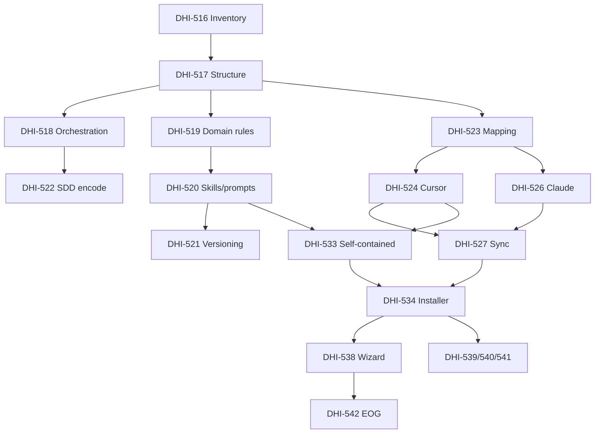

# DHI-515 — Research: How to implement all epic stories

## Task Summary

| Field | Value |
|---|---|
| Jira | [DHI-515](https://eversis.atlassian.net/browse/DHI-515) — Multi-Agent AI Context Isolation & Standard |
| Type | Epic (analysis of full delivery approach for **27 Stories**) |
| Repos | Target: `agent-collections`; Source: `cursor-collections`; Pilot: `eog` |
| Workshop artifacts | `docs/specs/cursor-collection-migration/` (intent, extracted-tasks, jira-tasks, baseline) |
| Research date | 2026-07-30 (CREATE); last DELTA **2026-08-10** |
| Intent | Analysis-only — recommend implementation sequencing and approach; **no code this turn** |

**Goal:** Transform Cursor Collections into a self-contained, multi-agent **Agent Collections** framework (core SSOT + adapters + isolation + install wizard + docs + EOG pilot), with mandatory **spec-driven development** per story.

## Sources Reviewed

- Jira epic DHI-515 + children DHI-516–DHI-542 (baseline / push results)
- BRD `Cursor-Collection-migration.md` (WF-01–05, WNF, phases)
- `docs/specs/cursor-collection-migration/{intent-brief,extracted-tasks,jira-tasks,quality-review}.md`
- `docs/context/agent-collections/task-baseline.md`
- Codebase: `agent-collections` (scaffold + symlinks), `cursor-collections` (full framework)
- Stakeholder decisions Q1–Q6 (docs separation, EOG pilot, dual distribution, install wizard axes, SDD)

## Current System State

> **Historical (2026-07-30).** Live post-delivery snapshot: [Post-delivery readiness DELTA (2026-08-10)](#post-delivery-readiness-delta-2026-08-10).

### `agent-collections` (target)

- Early **scaffold**: local `eversis-project-stack.mdc`, stub `AGENTS.md`, `.cursor/mcp.json`, migration docs under `docs/specs/`.
- **Not self-contained**: `.cursor/{skills,prompts,commands}` and most rules **symlink** to sibling `cursor-collections`.
- Missing: `.ai/` core, adapters, install scripts, MCP package, website, framework documentation package.

### `cursor-collections` (source / Cursor channel)

| Asset | Approx. count | Path |
|-------|---------------|------|
| Rules | 8 | `.cursor/rules/*.mdc` |
| Skills | 45 | `.cursor/skills/eversis-*` |
| Prompts | 28 | `.cursor/prompts/{public,internal}/` |
| Commands | 8 | `.cursor/commands/` |
| MCP | 1 package | `mcp/eversis-collections-mcp/` |
| Install | bash + libs | `scripts/setup-cursor-local.sh` (+ MCP interactive select, vendor modes) |
| Docs site | Docusaurus | `website/` |
| Framework doc | 1 | `documentation/cursor-collection.md` |

Install today: MCP server selection + vendor/link modes; **no AI-agent adapter selection** (Story 5.6 / Q5).

### `eog` (pilot)

- Monorepo: `portal/` (frontend), `cms/` (backend); already consumes Cursor Collections via `scripts/setup-cursor-local.sh`.
- Pilot story: DHI-542 — install Agent Collections, prove isolation + ≥30% context reduction (or justified estimate).

## Story Map (Jira)

| WS | Theme | Keys | Priority band |
|----|--------|------|---------------|
| 1 | Core extraction | DHI-516…522 | Highest/High |
| 2 | Adapters | DHI-523–527 (Claude=526, OpenCode=525) | Highest–Medium |
| 3 | Isolation | DHI-528…530 | High |
| 4 | AGENTS.md | DHI-531…532 | High |
| 5 | Distribution / install | DHI-533…538 | Highest–Medium |
| 6 | Docs / pilot | DHI-539…542 | High–Medium |

Full titles and AC: see `docs/specs/cursor-collection-migration/extracted-tasks.md` and Jira.

## Proposed Target Architecture

```text
agent-collections/
  .ai/                          # SSOT (WF-01)
    rules/{frontend,backend,shared-types,devops,architecture,orchestration}/
    skills/                     # ported, tool-neutral
    prompts/
  adapters/
    cursor/                     # → .cursor/rules/*.mdc + .cursorignore pieces
    claude/                     # → CLAUDE.md + .claudeignore
    opencode/                   # manifest stub only
  AGENTS.md                     # agnostic template + repo reference
  mcp/eversis-collections-mcp/  # resolve skills from .ai/
  scripts/setup-agent-*.sh      # agent + MCP + domain profile axes
  website/                      # Agent Collections brand (no links to cursor-collections docs)
```

**Dual channel:** `cursor-collections` remains Cursor-only distribution; **documentation fully separated** (no cross-repo doc pointers).

## How to Implement — Delivery Model

### Mandatory per-story process (Story 1.7 / inherited AC)

Every story DHI-516–542:

1. `docs/specs/<issue-kebab>/` → `*.research.md` (approve) → `*.plan.md` (approve)
2. `@eversis-implement` with approved plan
3. `@eversis-review` → Fine / QA draft (human posts to Jira)

**Do not** implement the entire epic in one plan. Use this epic research as the **roadmap**; execute **story-by-story** (or small vertical slices) with their own research/plan.

### Recommended waves (critical path)

```text
Wave A — Foundation (unblock everything)
  DHI-516 Inventory
  DHI-517 Core directory structure (.ai/)
  DHI-518 Orchestration rules → core
  DHI-519 Domain rules → core
  DHI-520 Skills/prompts → core
  DHI-522 Encode SDD in core + AGENTS/templates   [can start after 518]

Wave B — Adapters + isolation contract
  DHI-523 Adapter mapping spec
  DHI-524 Cursor adapter
  DHI-526 Claude adapter
  DHI-525 OpenCode stub (can parallel late in wave)
  DHI-527 Adapter sync tooling
  DHI-528 Isolation strategy
  DHI-529 Ignore files
  DHI-531 AGENTS.md template

Wave C — Self-contained distribution
  DHI-533 Bootstrap self-contained repo (drop symlinks)
  DHI-535 Port MCP
  DHI-534 Multi-tool installer base
  DHI-538 Install wizard (agents + MCP)     [Critical]
  DHI-536 Modular profiles
  DHI-532 Reference AGENTS.md in repo
  DHI-530 Monorepo glob scoping (needs adapters + profiles)
  DHI-521 Versioning contract
  DHI-537 Upgrade path (uses install selection record)

Wave D — Docs + validation
  DHI-541 README / getting-started
  DHI-539 Migration guide (Agent Collections–hosted only)
  DHI-540 Docusaurus migrate + rebrand (no cross-links)
  DHI-542 EOG pilot
```

### Suggested first implementation slice (after this research is approved)

| Order | Story | Why first |
|-------|-------|-----------|
| 1 | **DHI-516** | Inventory is blocking; produces classification for all later ports |
| 2 | **DHI-517** | Locks `.ai/` (or equivalent) layout before content moves |
| 3 | **DHI-518** + **DHI-522** | Orchestration + SDD standard — framework identity |

Then plan epic-level or Wave A plan only if stakeholder wants a multi-story plan; otherwise plan each story independently.

## Dependency Graph (high level)



## Requirements & Constraints (carry into plans)

| ID | Constraint |
|----|------------|
| WF-01 | Neutral Markdown core by domain |
| WF-02 | Cursor + Claude adapters; OpenCode stub |
| WF-03 | Synchronized ignores; no cross-tool config pollution |
| WF-04 | Agnostic AGENTS.md |
| WF-05 | Self-contained template; modular profiles; &lt;5 min install |
| WNF-01 | Vendor independence of core |
| WNF-02 | Upgrade without wiping project-owned files |
| WNF-03 | 30–50% context reduction target (pilot) |
| Q5 | Install: **agent adapters** × **MCP servers** × **domain profile** |
| Q6 | **No** documentation coupling between repos |
| SDD | Spec folder + research/plan gates on every story |

## Implementation Approach Notes (for Architect)

1. **Inventory first** — Tag each asset Core / Cursor-specific / Deprecated; do not port Deprecated.
2. **Neutralize, don’t rewrite** — Strip Cursor-only idioms (`@` attach paths, `.mdc` front matter) into adapter layer; keep procedural skill content.
3. **Generate adapters** — Prefer codegen/sync from `.ai/` over hand-maintaining `.mdc` and `CLAUDE.md`.
4. **Installer** — Generalize `setup-cursor-local.sh`: keep MCP catalog UX; add `--agents`; persist selection for upgrade (5.5); idempotent re-run + failure reporting (Gate 1.5 S-01–S-04).
5. **MCP** — Port package; resolve skills from `.ai/`; replace `CURSOR_COLLECTIONS_HOME` with agent-collections home.
6. **Docs** — Copy/rebrand site into `agent-collections`; zero links to `cursor-collections` docs.
7. **EOG** — Treat as consumer install + measurement, not product feature work.

## Risks

| # | Risk | Mitigation |
|---|------|------------|
| 1 | Symlink illusion — clone without sibling fails | Wave C bootstrap early after MVP Cursor adapter |
| 2 | Content neutralization breaks Cursor UX | Cursor adapter golden test against reference project |
| 3 | Dual-channel drift | Version/changelog policy in 1.6 / 5.5; keep Cursor channel thin |
| 4 | Claude surface ≠ Cursor MCP skills | Document capability matrix in mapping spec (2.1) |
| 5 | EOG mid-migration breakage | Pilot on branch; rollback path in migration guide |
| 6 | Epic-sized single plan | Enforce story-level SDD; use this file as roadmap only |

## Assumptions

1. `.ai/` remains preferred core root unless Wave A research for DHI-517 chooses equivalent.
2. OpenCode stays stub through MVP.
3. `cursor-collections` stays live as Cursor distribution (code), not docs portal for Agent Collections.
4. Hard delete of rejected SDD subtasks is out of scope for implement (already Rejected in Jira).

## Open Questions (for stakeholder before / during Wave A plan)

| # | Question | Status |
|---|----------|--------|
| Q1 | Versioning scheme for `.ai/` releases | **Answered 2026-08-04** — see Resolved Decisions |
| Q2 | First consumer install mode for EOG | **Answered 2026-08-04** — stakeholder OK with recommended default |
| Q3 | Minimum Claude MVP surface | **Answered 2026-08-04** — see Resolved Decisions |
| Q4 | Wave A: multi-story plan vs one story at a time | **Answered 2026-08-04** — one story at a time (DHI-516 first) |

## Resolved Decisions (research open questions — 2026-08-04)

| # | Decision |
|---|----------|
| **Q1** | **Semver tags on `agent-collections` repo** as the release unit (e.g. `v0.1.0`). Core (`.ai/`), adapters, installer, and MCP ship together under one version. Do **not** publish `.ai/` as a separate npm package in MVP. Consumers pin via git tag / submodule ref / installer `--version`. Changelog at repo root documents breaking adapter/core changes. A separate package remains a later option if distribution needs force it (WNF-02 upgrade path still works either way). |
| **Q2** | **EOG pilot default: Git submodule** (pinned to a `agent-collections` tag). Rationale: EOG is enterprise monorepo; submodule gives reproducible CI and shared team version. **Local path** remains supported for individual developer machines and fast iteration. **Copy/vendor** is fallback when submodule policy is blocked. Installer must support all three; EOG pilot runbooks use submodule first. |
| **Q3** | **Claude MVP = `CLAUDE.md` + `.claudeignore` + directory/scope guidance** (system/backend-oriented). **Out of Claude MVP:** full skill catalog parity with Cursor MCP, slash-command shims, and interactive skill discovery. Mapping spec (DHI-523) must document this capability gap so Backend teams know Cursor retains MCP skills while Claude gets curated instructions in `CLAUDE.md`. Expanding Claude surface is a follow-up after Cursor+Claude MVP proves isolation. |
| **Q4** | **One story at a time**, starting with **DHI-516**. No Wave A mega-plan unless explicitly requested later. |

## Out of Scope (this research / epic delivery)

- Full OpenCode implementation
- Rewriting rule business content
- Deprecating `cursor-collections`
- Cross-repo documentation links
- EOG product features beyond framework install/isolation
- Creating Jira Sub-tasks for SDD phases (explicitly rejected by stakeholder)

## Wave C research (DELTA — 2026-08-06)

Epik roadmap poniżej nadal obowiązuje. **Szczegółowy research Wave C (PL)** — stan systemu, luki, zależności, Gaps Q1–Q6, kolejność story:

→ [`dhi-515.wave-c.research.pl.md`](./dhi-515.wave-c.research.pl.md) — **Approved** 2026-08-06 (Q1–Q6 = OK / recommended options).

**Plan Wave C (PL):** [`dhi-515.wave-c.plan.pl.md`](./dhi-515.wave-c.plan.pl.md) — **Awaiting plan approval** before any Wave C code.

**Snapshot (2026-08-06):** Wave A core + Wave B adapters/sync/isolation/ignore są na dysku; Wave C nadal zablokowana przez symlinki `.cursor/{skills,prompts,commands}`, brak `mcp/` i `scripts/`, brak wizarda/selection, brak area globs (530), reference `AGENTS.md` (532) niepełne. DHI-521 kontrakt SemVer już w README/CHANGELOG — Wave C konsumuje przez DHI-537.


## Wave D research (DELTA — 2026-08-06)

Epik roadmap poniżej nadal obowiązuje. **Szczegółowy research Wave D (PL)** — docs + validation (541/539/540/542), Gaps Q1–Q7 Resolved:

→ [`dhi-515.wave-d.research.pl.md`](./dhi-515.wave-d.research.pl.md) — **Approved** 2026-08-06 (Q1 OK; Q2 analog cursor-collections paths; Q3 brak hostingu / deferred; Q4–Q7 OK).

**Plan Wave D (PL):** [`dhi-515.wave-d.plan.pl.md`](./dhi-515.wave-d.plan.pl.md) — historically Draft; **Wave D content delivered on disk** by 2026-08-07 (see Post-delivery DELTA below). Treat plan gate as **retroactive / close-out** rather than a blocker for further polish work.

**Snapshot (2026-08-06 — superseded):** Wave C essentials na dysku. Docs paths (Q2): `website/docs/getting-started/` (+ migration page), `documentation/agent-collection.md`. Hosting docs site (Q3): **deferred**. Brak na dysku: pełny `website/` Docusaurus, migration guide, pilot EOG. Jira DHI-539…542 = To Do.

## Post-delivery readiness DELTA (2026-08-10)

**Trigger:** Stakeholder requested comprehensive review of DHI-515 delivery vs initial assumptions, then re-analysis after git changes (`OK UPDATE RESEARCH`).  
**Scope of DELTA:** Epic closure readiness — functional parity with `cursor-collections`, remaining blockers, and recommended close-out work. **Not** a new Wave mega-plan.  
**Git baseline:** `main` @ `c996bb7` (= `origin/main`), clean working tree.

### Current system state (supersedes scaffold snapshot above)

| Area | State (2026-08-10) |
|------|---------------------|
| Self-contained | **Yes** — fresh clone works without sibling `cursor-collections` |
| `.ai/` SSOT | Rules (~11 bodies) + **45** skills + **28** prompts |
| Cursor adapter | **7** generated `.mdc` (+ consumer `eversis-project-stack.mdc`); **no** BA Docs `.mdc` |
| Cursor slash commands | **DHI-598 shipped** — **28** thin HYBRID shims under `.cursor/commands/` from `.ai/prompts` (orphan cleanup + `sync:adapters:check`) |
| `.cursor/prompts` / `.cursor/skills` | **Not** mirrored (documented MVP); skills via MCP + `.ai/` |
| Claude adapter | `CLAUDE.md` + `.claudeignore` (7 rule sections; Claude MVP as Q3) |
| OpenCode | Placeholder only |
| Installer | Agents × MCP × profile (+ interactive agents/profile UX); smoke &lt;5 min |
| MCP | `AGENT_COLLECTIONS_HOME`; skills + docx; `validate_docx` added |
| Ignore triad + area profiles | Present; EOG overlay for `charts/` as “infra” **reverted** (product apps) |
| Website | Local Docusaurus Agent Collections brand; **public hosting deferred** |
| EOG pilot | Live install (local) + MCP cutover **done**; WNF-03 proxy ≥30%; Q5 dual-agent session window **starts 2026-08-10** |
| Quality evidence | `npm run sync:adapters:check` OK (rules + commands + Claude) |

Related follow-on specs (not in original 27-story map): `docs/specs/dhi-598/`, `docs/specs/pilot-feedback-framework-deltas/`, `docs/specs/dhi-515-implement-review-continuity/`, `docs/specs/dhi-542/`.

### Functional comparison vs `cursor-collections` (post DHI-598)

| Capability | `cursor-collections` | `agent-collections` | Verdict |
|------------|----------------------|---------------------|---------|
| Slash `/eversis-*` | 8 commands | **28** commands (SSOT in `.ai/prompts`) | **AC ≥ CC** |
| `@` attach via `.cursor/prompts` | Full prompt tree | No mirror (MVP) | Residual UX gap |
| Skills | `.cursor/skills` + MCP (`CURSOR_*`) | `.ai/skills` + MCP (`AGENT_*`) | Content parity; different path |
| BA Docs role `.mdc` | Present | Missing (adapter README still mentions temporary CC symlinks — **stale**) | Residual |
| Multi-agent + wizard | Cursor-only | Cursor + Claude + profiles | **AC ahead** |
| Isolation / WNF-03 | Cursor-centric | Ignore triad + proxy evidence | **AC ahead** (live Q5 residual) |

### Review findings re-score (2026-08-07 → 2026-08-10)

| ID | Topic | 2026-08-07 | 2026-08-10 | Notes |
|----|-------|------------|------------|-------|
| B1 | Cursor slash / prompts parity | BLOCKER | **PASS** (slash) / **SUGGESTION** (`@` prompts) | DHI-598 closes slash discoverability |
| B2 | Q6 — no deep-links into `cursor-collections` docs/repo | BLOCKER | **BLOCKER** | Still deep-links in `.ai/` prompts/skills (+ product README link) |
| B3 | EOG live pilot (D8) | BLOCKER | **SUGGESTION** (residual) | Install + env cutover done; Q5 sessions + SemVer submodule remain |
| B4 | Per-story SDD folders | BLOCKER | **SUGGESTION** (high) | Added 542/598/continuity/pilot-feedback; still missing `dhi-530`, `532`–`540` |
| B5 | Agent/MCP deselection cleanup | BLOCKER | **SUGGESTION** | MCP deselection + orphan **commands** cleanup exist; adapter surface prune on agent omit still soft |

**Epic closure verdict (analysis):** Architecture MVP + Cursor slash parity = **conditional PASS**. Epic **not Done** while **B2 (Q6)** remains and Q5 session evidence is incomplete.

### Blocker re-score — detailed reference (2026-08-11)

Expanded stakeholder review of B1–B5 (see thread 2026-08-11). Summary:

| ID | Werdykt | Zamknięcie wymaga |
|----|---------|-------------------|
| **B1** | PASS (slash) + SUGGESTION (`@` prompts, BA `.mdc`, skills mirror) | Świadomy MVP — `.cursor/prompts` mirror out of scope unless re-scoped |
| **B2** | **BLOCKER** | Retarget 5 GitHub deep-links in `.ai/` to `agent-collections` paths |
| **B3** | SUGGESTION (residual) | Q5 session checklist + optional submodule SemVer pin (DHI-542 Phase C) |
| **B4** | SUGGESTION (high) | Wave-level SDD waiver **or** retroactive story folders — decision locked in close-out plan |
| **B5** | SUGGESTION | MCP + command orphan cleanup OK; optional agent adapter prune on deselect (S-02 partial) |

**SemVer (EOG follow-up):** After Q5, pin `agent-collections` submodule to a git tag (e.g. `v0.1.0`) so the team shares one framework version — see research Q1 (2026-08-04).

### Resolved decisions (close-out — 2026-08-11)

| # | Decision |
|---|----------|
| **CQ1** | **Close-out scope** = framework repo fixes (B2, B5 partial, BA docs docs-only, area `charts/**`, targeted docs drift) + **ops** Q5 (B3) per DHI-542; **no** new mega-wave |
| **CQ2** | **B4 SDD waiver:** Wave A–D research/plans + delivered code on `main` **suffice** for stories DHI-532–540 and DHI-530 — **no** mandatory retroactive `docs/specs/dhi-*/` backfill in this close-out; add **`delivery-index.md`** traceability table instead |
| **CQ3** | **BA Docs `.mdc`:** **Docs-only** in close-out — remove stale symlink claims; **do not** emit BA `.mdc` rules (deferred; prompts + skills + slash commands cover BA workflow) |
| **CQ4** | **`.cursor/prompts` mirror:** **Out of close-out** — DHI-598 slash shims remain the Cursor packaging for prompts |
| **CQ5** | **Jira status sync:** Human/manual after close-out implement — not automated in this plan |

### Remaining open work (prioritized)

1. **Q6 hygiene (B2)** — Retarget `.ai/` links (see close-out plan Phase 1).
2. **Q5 EOG sessions (B3)** — DHI-542 Phase C; fill `docs/context/eog/pilot-evidence.md`; submodule SemVer pin after Q5.
3. ~~**SDD debt (B4)**~~ — **Waived (CQ2):** delivery-index instead of backfill.
4. **BA Docs Cursor rules (CQ3)** — Docs-only: fix stale symlink claims in `adapters/cursor/README.md`.
5. **Docs drift** — Targeted website/agent wording (close-out plan Phase 4).
6. **Area profile** — Revisit default `charts/**` exclude (close-out plan Phase 3).
7. **Jira hygiene (CQ5)** — Manual sync after implement.

### Adequacy checklist outcome (this DELTA)

| Check | Result |
|-------|--------|
| Latest AC / intent | Same epic AC; DELTA adds post-delivery evidence vs WF/Q decisions |
| Paths / system state | Updated to `main` @ `c996bb7` self-contained MVP + EOG live local install |
| Open questions | No new blocking Qs for roadmap; remaining items are close-out tasks (listed above) |
| Plan coverage | Close-out plan: [`dhi-515.close-out.plan.md`](./dhi-515.close-out.plan.md) — **Draft awaiting approval** |

## Suggested Next Steps

1. ~~**Human approve** this epic research (roadmap).~~ **Done** 2026-08-04.
2. ~~Start **Full Flow** for **DHI-516**…~~ Waves A–D largely **delivered on disk** (see Post-delivery DELTA).
3. ~~**Approve Wave C research**~~ **Done** 2026-08-06 (Q1–Q6 OK).
4. ~~Wave C / Wave D plan gates~~ — Content shipped; close plans as **implemented / retroactive** when convenient.
5. ~~**Approve Post-delivery DELTA**~~ **Done** 2026-08-11 (stakeholder: update research + create plan).
6. ~~**Approve close-out plan**~~ **Done** 2026-08-11 — Phases 1–4 + 6 implemented; O1 OK (`v0.1.0` tag after review PASS).
7. **Q5 EOG sessions** (DHI-542 Phase C) + optional SemVer tag + Jira sync (CQ5).

## Adequacy Checklist (this artifact)

| Check | Result |
|-------|--------|
| Latest AC / intent | Covers all 27 stories + Q1–Q6 decisions + post-delivery re-score |
| Paths / system state | **DELTA 2026-08-10** — self-contained MVP on `main` @ `c996bb7`; EOG live local; DHI-598 commands |
| Open questions | CQ1–CQ5 resolved 2026-08-11; research Q1–Q4 resolved 2026-08-04 |
| Plan coverage | [`dhi-515.close-out.plan.md`](./dhi-515.close-out.plan.md) — close-out implement scope |

## Gate / Approval

| Field | Value |
|---|---|
| Research status (epic roadmap) | **Approved** by stakeholder 2026-08-04 (`OK START FULL FLOW`) |
| Wave C research (PL) | **Approved** 2026-08-06 — [`dhi-515.wave-c.research.pl.md`](./dhi-515.wave-c.research.pl.md) — Q1–Q6 OK |
| Wave C plan (PL) | Content **on disk**; formal close-out optional — [`dhi-515.wave-c.plan.pl.md`](./dhi-515.wave-c.plan.pl.md) |
| Wave D research (PL) | **Approved** 2026-08-06 — [`dhi-515.wave-d.research.pl.md`](./dhi-515.wave-d.research.pl.md) — Q1–Q7 resolved |
| Wave D plan (PL) | Content **on disk**; formal close-out optional — [`dhi-515.wave-d.plan.pl.md`](./dhi-515.wave-d.plan.pl.md) |
| Post-delivery DELTA (2026-08-10) | **Approved** 2026-08-11 — CQ1–CQ5 locked; blocker detail appendix added |
| Close-out plan | **Approved** — [`dhi-515.close-out.plan.md`](./dhi-515.close-out.plan.md) — Phases 1–4 + 6 implemented 2026-08-11 |
| Roadmap approval | **Approved** — Wave C/D + post-delivery DELTA supplements epic roadmap |
| Next | Review + Fine; Phase 5 Q5 (DHI-542); optional git tag **`v0.1.0`** (O1) |

## Changelog

| Date | Change |
|------|--------|
| 2026-07-30 | CREATE — epic-level implementation analysis for DHI-515 (analysis-only `/eversis-implement`) |
| 2026-08-04 | Resolve open questions Q1–Q4 (versioning, EOG install mode, Claude MVP, story cadence) |
| 2026-08-04 | Stakeholder confirmed Q1, Q3, Q4 (Q2 already OK) |
| 2026-08-04 | Research/roadmap **Approved** — Full Flow started at DHI-516 |
| 2026-08-06 | DELTA — pointer to Wave C Polish research `dhi-515.wave-c.research.pl.md` (self-contained distribution); next gate = human approve Wave C before plan |
| 2026-08-06 | Wave C research **Approved** (Q1–Q6 OK); full plan created `dhi-515.wave-c.plan.pl.md` — next gate = plan approval before Implement |
| 2026-08-06 | DELTA — pointer to Wave D Polish research `dhi-515.wave-d.research.pl.md` (docs + validation); next gate = human approve Wave D before plan |
| 2026-08-06 | Wave D research **Approved** (Q1–Q7); full plan created `dhi-515.wave-d.plan.pl.md` — next gate = plan approval before Implement |
| 2026-08-10 | DELTA — Post-delivery readiness after git review (`main` @ `c996bb7`): DHI-598 slash parity, EOG live install, re-scored findings (B2 Q6 still BLOCKER); Suggested Next Steps / Gate updated for close-out |
| 2026-08-11 | DELTA — Blocker re-score appendix; CQ1–CQ5 close-out decisions; Post-delivery DELTA **Approved**; plan [`dhi-515.close-out.plan.md`](./dhi-515.close-out.plan.md) created |
| 2026-08-11 | Close-out **implemented** (Phases 1–4, 6): Q6 links, deselect prune, area profiles, docs drift, delivery-index |
