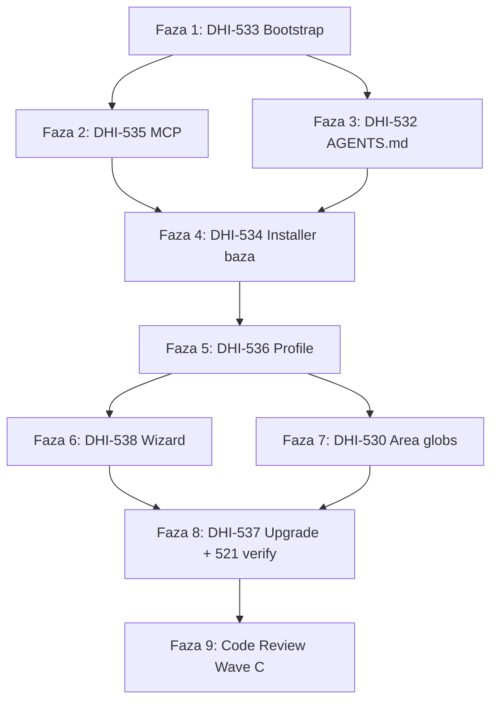

# DHI-515 Wave C — Plan implementacji (PL): Samodzielna dystrybucja

## Task Details

| Field            | Value |
| ---------------- | ----- |
| Jira ID          | [DHI-515](https://eversis.atlassian.net/browse/DHI-515) (Wave C) |
| Title            | Wave C — Self-contained distribution |
| Description      | Zamiana `agent-collections` ze scaffoldu zależnego od sibling `cursor-collections` w samodzielny szablon dystrybucyjny: bootstrap bez symlinków, MCP z `.ai/skills`, installer (local/submodule/copy), profile domenowe, wizard agents×MCP×profil, area globs, upgrade z reuse selection. |
| Priority         | Critical (ścieżka krytyczna epiku) |
| Related Research | [dhi-515.wave-c.research.pl.md](./dhi-515.wave-c.research.pl.md) (zatwierdzony), [dhi-515.research.md](./dhi-515.research.md) (roadmapa epiku) |

### Historyjki w zakresie (kolejność wykonania)

| # | Story | Jira | Temat |
|---|-------|------|--------|
| 1 | 5.1 | [DHI-533](https://eversis.atlassian.net/browse/DHI-533) | Bootstrap self-contained |
| 2 | 5.4 | [DHI-535](https://eversis.atlassian.net/browse/DHI-535) | Port MCP → `.ai/skills` |
| 3 | 4.2 | [DHI-532](https://eversis.atlassian.net/browse/DHI-532) | Reference `AGENTS.md` |
| 4 | 5.2 | [DHI-534](https://eversis.atlassian.net/browse/DHI-534) | Installer baza |
| 5 | 5.3 | [DHI-536](https://eversis.atlassian.net/browse/DHI-536) | Profile domenowe |
| 6 | 5.6 | [DHI-538](https://eversis.atlassian.net/browse/DHI-538) | Wizard agents + MCP (+ profil) |
| 7 | 3.3 | [DHI-530](https://eversis.atlassian.net/browse/DHI-530) | Monorepo glob scoping |
| 8 | 5.5 | [DHI-537](https://eversis.atlassian.net/browse/DHI-537) | Upgrade + reuse selection |
| — | 1.6 | [DHI-521](https://eversis.atlassian.net/browse/DHI-521) | Kontrakt SemVer — **verify only** (docs już są) |

## Wildly Important Goal

**Goal**: Dostarczyć samodzielną dystrybucję Agent Collections (fresh clone bez sibling + installer z trzema osiami + MCP z `.ai/` + upgrade z selection), tak aby konsument mógł wdrożyć framework w &lt; 5 min (bez czasu sieciowego klona) i odblokować Wave D / pilot EOG.

**Success Measure**: Spełnione kryteria agregatu Wave C **C1–C9** z research (symlinki usunięte; MCP listuje skills z `.ai/skills`; installer zapisuje `.agent-collections/install-selection.json`; wizard + `--non-interactive`; profile Frontend/Backend/Fullstack; area globs; reference `AGENTS.md`; upgrade reuse selection / fail-safe; kontrakt 521 respektowany).

**Do NOT touch / do NOT add**:

- Wave D (DHI-539–542): migracja Docusaurus, migration guide konsumencki, pilot EOG pomiar WNF-03
- Pełna implementacja OpenCode (tylko placeholder + warning)
- Deprecacja / merge `cursor-collections`
- Cross-repo linki dokumentacyjne do `cursor-collections`
- Pełny mirror drzewa `.cursor/skills` + `.cursor/prompts` (Q1)
- Alias `CURSOR_COLLECTIONS_HOME` w domyślnym `.cursor/mcp.json` frameworka (Q2)
- Osobny npm package dla `.ai/` (epik Q1)
- Tworzenie Jira Sub-tasków SDD
- Zmiany poza ścieżką krytyczną Wave C bez osobnej aprobaty

## Proposed Solution

Wave C realizujemy **fazami zgodnymi z kolejnością story** z zatwierdzonego research. Każda faza kończy się weryfikacją i może być domknięta Fine/Jira per ticket, ale **ten plan jest jedną mapą wykonawczą** całego Wave C (explicite zażądany mega-plan).

### Zatwierdzone decyzje Gap Q1–Q6 (research OK)

| Gap | Decyzja zamknięta w planie |
|-----|----------------------------|
| **Q1** | MVP **bez** pełnego mirroru skills/prompts w `.cursor/`. UX: MCP (535) + odczyt `.ai/…` + load-by-id / `@`. Slash-commands: **odłożone**; README dokumentuje wejście przez id / `@` (cienki generator commands = Improvement). |
| **Q2** | Env kanoniczne: **`AGENT_COLLECTIONS_HOME`**. W czystym `agent-collections` **brak** aliasu `CURSOR_COLLECTIONS_HOME` w default `mcp.json`. |
| **Q3** | Selection: **`.agent-collections/install-selection.json`** — project-owned-ish; schema: `frameworkVersion`, `agents[]`, `mcpServers[]`, `domainProfile`, `vendorMode`, `linkMode` (+ ewentualne pola pomocnicze). |
| **Q4** | Manifest profili: **`adapters/profiles/*.yaml`** (mapowanie profil → domain folders / skill allowlist); bez hardcode w bashu. |
| **Q5** | Nowy skrypt **`scripts/setup-agent-collections.sh`** + lib; flagi legacy 1:1 gdzie sens (`--vendor`, `--link-mode`, `--mcp-servers`, `--sync`, `--non-interactive`, …) + **`--agents`** + **`--profile`**. |
| **Q6** | Start 533 **dozwolony** przy artefaktach Wave B na dysku; Fine Jira Wave B nie blokuje technicznie. |

### Podejście architektoniczne



1. **533** — usunąć symlinki; materializować BA Docs rules lokalnie lub usunąć z always-apply zgodnie z policy „Do not load”; README quick start bez sibling; `sync:adapters` odtwarza Cursor + Claude (+ OpenCode placeholder).
2. **535** — port `mcp/eversis-collections-mcp/` z resolve na `.ai/skills` + `AGENT_COLLECTIONS_HOME`; update `.cursor/mcp.json`.
3. **532** — wypełnić reference `AGENTS.md` wg standardu (EN product content); lekki refresh po pojawieniu się `scripts/`.
4. **534** — baza installera (vendor/link/sync/merge ignore/seed AGENTS/record selection stub).
5. **536** — profile Frontend / Backend / Fullstack z manifestu.
6. **538** — wizard interactive + non-interactive; S-01…S-03 (partial-fail, deselection, unavailable adapter).
7. **530** — area profiles `frontend-scope` / `backend-scope` / `fullstack` na layoutcie abstrakcyjnym (`apps/web`, `apps/api`).
8. **537** — upgrade czyta selection; fail-safe; respektuje project-owned z README (521).
9. **Review** — Code Reviewer na cały Wave C (lub per faza przy slice delivery — ostateczny gate obowiązkowy).

### Semantyka SDD przy tym planie

Ten dokument jest **planem Wave C**. Wykonanie nadal może iść ticket-by-ticket (research/plan story opcjonalnie DELTA/SKIP gdy ten plan + Wave C research pokrywają AC), ale **bez aprobaty tego planu nie wolno zaczynać kodu**.

## Current Implementation Analysis

### Already Implemented

- Core SSOT `.ai/` (rules, skills ~45, prompts public+internal) — reuse
- `adapters/cursor/generate.mjs` + `rule-map.yaml` + wygenerowane `.cursor/rules/*.mdc` (poza BA Docs symlinkami) — reuse
- `adapters/claude/` generator — reuse (regeneracja `CLAUDE.md`)
- `adapters/opencode/` placeholder — reuse
- `adapters/sync.mjs`, `npm run sync:adapters` / `:check` — reuse / ewentualne extension pod profil
- Ignore triad: `.cursorignore`, `.claudeignore`, `.opencodeignore` — reuse + merge w installerze
- `docs/architecture/isolation-strategy.md` §5 / §8 — spec dla 530/536
- `docs/architecture/adapter-mapping.md` — maturity / emit matrix (skills nie w MVP emit)
- `docs/architecture/agents-md-standard.md`, `templates/AGENTS.template.md` — reuse
- README + CHANGELOG SemVer / upgrade contract (DHI-521) — reuse; 537 operacjonalizuje
- Root `AGENTS.md` w kształcie szablonu z placeholderami — baza do 532
- Legacy wzorzec: `cursor-collections/scripts/setup-cursor-local.sh` + `lib/setup-cursor-local/` — wzorzec portu (nie ślepy copy)
- Legacy MCP: `cursor-collections/mcp/eversis-collections-mcp/` — źródło portu

### To Be Modified

- `.cursor/skills`, `.cursor/prompts`, `.cursor/commands` — **usunąć symlinki** (533); nie zastępować pełnym mirrorem (Q1)
- `.cursor/rules/eversis-ba-docs-*.mdc` — zastąpić lokalnymi plikami lub usunąć (533)
- `.cursor/mcp.json` — `AGENT_COLLECTIONS_HOME` + ścieżka lokalnego MCP (535)
- `AGENTS.md` — pełny reference fill (532); refresh entry points install (po 534)
- `README.md` / `CHANGELOG.md` — quick start self-contained, installer/upgrade ops (533, 534, 537)
- `adapters/sync.mjs` / generatory — ewentualne flagi profilu / area globs (536, 530)
- `package.json` — skrypty build MCP / test installer gdy potrzebne
- `.gitignore` — upewnić się, że selection / vendor paths są poprawnie traktowane

### To Be Created

- `mcp/eversis-collections-mcp/` — portowany pakiet MCP (535)
- `scripts/setup-agent-collections.sh` + `scripts/lib/setup-agent-collections/` (534/538)
- `scripts/lib/.../mcp-server-list.json` — katalog MCP rozszerzony (538)
- `.agent-collections/install-selection.json` schema + zapis z installera (534/538) — plik w konsumencie
- `adapters/profiles/{frontend,backend,fullstack}.yaml` (lub równoważne) (536)
- Area glob / ignore profile wiring dla konsumenta (530)
- Testy: MCP resolveRoot/skills; smoke installer; upgrade fail-safe (535–537)
- Opcjonalnie: `opencode.jsonc` regenerowany przez sync (533)

## Open Questions

| #   | Question | Answer | Status |
| --- | -------- | ------ | ------ |
| Q1 | Mirror skills/prompts/commands po usunięciu symlinków? | Bez pełnego mirroru; slash-commands odłożone + README | ✅ Resolved |
| Q2 | Nazwa env home MCP? | `AGENT_COLLECTIONS_HOME`; bez aliasu w default mcp.json | ✅ Resolved |
| Q3 | Format/lokalizacja selection? | `.agent-collections/install-selection.json` + schema | ✅ Resolved |
| Q4 | Manifest profili domenowych? | `adapters/profiles/*.yaml` | ✅ Resolved |
| Q5 | Nazwy flag / skrypt CLI? | `setup-agent-collections.sh` + legacy 1:1 + `--agents` + `--profile` | ✅ Resolved |
| Q6 | Start Wave C vs Fine Wave B? | Start dozwolony przy artefaktach na dysku | ✅ Resolved |

## Technical Context

### Project Instructions

- `AGENTS.md` — mapa orientacji; product content **EN** (`agents-md-standard.md`); ten plan/research Wave C może być PL jako lokalny artefakt SDD.
- `.cursor/rules/eversis-agent-core.mdc` + `eversis-spec-driven-development.mdc` — lifecycle + gates.
- `.cursor/rules/eversis-engineering-manager.mdc` — orchestracja Implement; readiness block.
- `.cursor/rules/eversis-project-stack.mdc` — skills policy framework-repo (BA Docs „Do not load”; brak backend/frontend app skills).
- `.cursor/rules/eversis-testing-and-terminal.mdc` — po zmianach uruchomić quality commands z stack / package.json.
- Isolation: `docs/architecture/isolation-strategy.md` — area profiles, installer merge ignore §8.1.
- Mapping: `docs/architecture/adapter-mapping.md` — skills/prompts **nie** emitowane do adapterów w MVP; OpenCode = placeholder.

### Architecture & Patterns

```text
agent-collections/
  .ai/                          # SSOT
  adapters/
    cursor|claude|opencode/
    profiles/*.yaml             # NEW — domain profiles (Q4)
    sync.mjs
  mcp/eversis-collections-mcp/  # NEW — port
  scripts/
    setup-agent-collections.sh  # NEW
    lib/setup-agent-collections/
  .agent-collections/           # consumer selection (nie w framework tree jako commit selection)
  templates/AGENTS.template.md
  docs/architecture/
```

- Dual channel: `cursor-collections` żyje osobno; brak shared docs.
- Trzy osie install (epik Q5): **agents** × **MCP servers** × **domain profile**.
- Vendor modes: local / submodule / copy (EOG default = submodule — epik Q2).
- Claude MVP: `CLAUDE.md` + ignore + guidance — bez pełnej parity MCP skills.

### Tech Stack

- Node.js ≥ 18 (MCP + adaptery `*.mjs`)
- TypeScript w pakiecie MCP (jak legacy: `tsc`, testy `node --test` / tsx)
- Bash installer (parity UX z `setup-cursor-local.sh`)
- Package manager: npm (root `package.json` 0.0.1; MCP własny `package.json`)
- Brak aplikacji frontend/backend w tym repo

### Code Style & Standards

- Generowane pliki adapterów: nagłówek GENERATED / nie edytować ręcznie gdzie sync jest SSOT.
- Ignore merge: **dokładać** brakujące klasy frameworka; **nie wipe** consumer entries bez opt-in.
- Project-owned (README): `eversis-project-stack`, `docs/context/`, `docs/plans/`, `docs/specs/`, lokalne rozszerzenia `AGENTS.md`, secrets, lokalne fragmenty MCP/ignore poza merge.
- Nazwy ścieżek open-source only (`apps/web`, `apps/api`) — zakaz nazw klientów w frameworku.
- Selection schema JSON; walidacja przy upgrade (fail-safe).

### Testing Patterns

| Obszar | Komendy / sprawdzenia |
|--------|------------------------|
| Adapter sync | `npm run sync:adapters` ; `npm run sync:adapters:check` |
| MCP | w `mcp/eversis-collections-mcp/`: `npm install`, `npm run build`, `npm test` |
| Installer | smoke bash na pustym katalogu git; opcjonalnie `*.test.sh` wzorowane na legacy |
| Symlink regression | `find .cursor -type l` (poza ewentualnymi świadomymi wyjątkami = 0 do cursor-collections) |
| Docs / DoD | inspectable checks: obecność sekcji README, schema selection, manifest profili |

**Root scripts dziś:** tylko `sync:adapters` / `sync:adapters:check`. Plan może dodać skrypty pomocnicze (np. `mcp:build`, `mcp:test`) bez nowych zależności root bez uzgodnienia — zależności MCP zostają w pakiecie MCP.

### Database Patterns

- N/A — brak warstwy DB w tym zakresie.

### Additional Context

- Stan dysku 2026-08-06 (+ plan): symlinki `.cursor/{skills,prompts,commands}` + BA Docs rules; brak `mcp/` i `scripts/`; `CLAUDE.md` może być obecny; `opencode.jsonc` może być nieobecny; `.cursor/mcp.json` nadal na `CURSOR_COLLECTIONS_HOME`.
- Specs `docs/specs/dhi-*/` gitignored — lokalne.
- Quality-review S-01–S-04 włączone w AC 538/537 (partial-fail, deselection, unavailable adapter, upgrade reuse).

## Implementation Plan

### Phase 1: DHI-533 — Bootstrap self-contained

**Goal**: Usunąć zależność od sibling `cursor-collections`, żeby fresh clone był używalny jako szablon SSOT + adaptery.

**Description**: Usunięcie symlinków Cursor trees i BA Docs rules; dokumentacja quick start; regeneracja adapterów z czystego tree; świadome odłożenie slash-commands (Q1).

**Verification:** `find .cursor -type l` nie wskazuje na `cursor-collections`; `npm run sync:adapters:check` przechodzi; README zawiera quick start bez założenia sibling.

#### Task 1.1 - [MODIFY] Usunięcie symlinków `.cursor/{skills,prompts,commands}`

**Description**: Usunąć trzy symlinki wskazujące na `../../cursor-collections/.cursor/...`. Nie tworzyć pełnego mirroru skills/prompts (Q1). Zaktualizować `.gitignore` / uwagi, jeśli wcześniej ignorowały te ścieżki jako symlink-only.

**Files:** `.cursor/skills` (modify/delete symlink), `.cursor/prompts` (modify/delete), `.cursor/commands` (modify/delete), `.gitignore` (modify jeśli potrzeba)

**Definition of Done**:

- [ ] Żaden z `.cursor/skills`, `.cursor/prompts`, `.cursor/commands` nie jest symlinkiem do `cursor-collections`
- [ ] Brak katalogów pełnego mirroru skills/prompts pod `.cursor/` (zgodnie z Q1)
- [ ] `find .cursor -type l` nie zwraca linków do `cursor-collections` dla skills/prompts/commands

**Stop Rule:** Jeśli Cursor UI twardo wymaga lokalnego `.cursor/skills` — eskaluj do maintainera (wyjątek od Q1); nie implementuj mirror bez potwierdzenia.

**Clues**: Mapping: skills/prompts nie w MVP emit; UX przez MCP po 535.

#### Task 1.2 - [MODIFY] BA Docs rules — lokalnie lub usunięcie

**Description**: Zastąpić symlinki `eversis-ba-docs-planner.mdc` / `eversis-ba-docs-writer.mdc` materializacją z `.ai`/mapy **albo** usunąć je z drzewa rules, jeśli policy framework-repo „Do not load” ma obowiązywać bez always-apply plików.

**Files:** `.cursor/rules/eversis-ba-docs-planner.mdc` (modify/delete), `.cursor/rules/eversis-ba-docs-writer.mdc` (modify/delete), ewentualnie `adapters/cursor/rule-map.yaml` (modify)

**Definition of Done**:

- [ ] Brak symlinków BA Docs do `cursor-collections`
- [ ] `eversis-project-stack.mdc` nadal dokumentuje „Do not load” dla BA Docs w tym repo
- [ ] `npm run sync:adapters` nie przywraca symlinków do sibling

**Clues**: Preferuj spójność z generatorem Cursor — nie trzymaj ręcznych symlinków poza generate.

#### Task 1.3 - [MODIFY] README quick start self-contained + sync regeneracja

**Description**: README: cel, layout, quick start bez sibling checkout; wskazanie na przyszły installer (534) i MCP (535). Uruchomić sync, by Cursor + Claude (+ OpenCode placeholder) odtwarzały się z czystego clone. Udokumentować brak slash-commands (wejście `@` / id).

**Files:** `README.md` (modify), `CHANGELOG.md` (modify — wpis Wave C bootstrap), `CLAUDE.md` (create/modify via sync), `opencode.jsonc` (create via sync jeśli adapter emituje), `package.json` (reuse)

**Definition of Done**:

- [ ] README zawiera sekcję quick start bez wymagania `cursor-collections` obok
- [ ] README wyjaśnia load skills/prompts (`.ai/` + MCP) i brak pełnych slash-commands w MVP
- [ ] `npm run sync:adapters` kończy się sukcesem na drzewie bez symlinków sibling
- [ ] `npm run sync:adapters:check` przechodzi

**Clues**: Kontrakt SemVer (521) zostaje; nie zmieniać Q1 epik.

#### Task 1.4 - [REUSE] Domknięcie AC DHI-533 / Fine story

**Description**: Zweryfikować AC Story 5.1; przygotować Fine/QA draft dla DHI-533 gdy faza gotowa (EM). Bez postowania do Jira bez aprobaty człowieka.

**Files:** `README.md` (reuse), `.ai/` (reuse), `adapters/` (reuse)

**Definition of Done**:

- [ ] AC 5.1 checklist z extracted-tasks spełnione w zakresie bootstrap (core+adapters+docs; scripts mogą być „istnieją jako stub lub wskazane jako następna faza” tylko jeśli AC wymaga scripts — jeśli AC wymaga `scripts` w drzewie, dodać minimalny placeholder README w `scripts/` wskazujący na 534 **albo** dostarczyć skeleton w tej fazie)
- [ ] Brak symlinków do `cursor-collections` w ścieżkach wymienionych w research lukach 533

**Clues**: AC 5.1 mówi „scripts … exist” — minimalny `scripts/README.md` (create) jest akceptowalny do czasu 534, o ile udokumentowany; preferuj skeleton `scripts/` już w 533 jeśli AC jest czytane literalnie.

### Phase 2: DHI-535 — Port MCP → `.ai/skills`

**Goal**: Uruchomić `eversis-collections` MCP z home `agent-collections` bez `CURSOR_COLLECTIONS_HOME`.

**Description**: Port pakietu MCP; zmiana resolveRoot i ścieżek skills; update mcp.json; testy.

**Verification:** `npm test` i `npm run build` w pakiecie MCP; list skills widzi pakiety spod `.ai/skills/eversis-*`.

#### Task 2.1 - [CREATE] Port pakietu `mcp/eversis-collections-mcp/`

**Description**: Skopiować/przenieść źródła z `cursor-collections/mcp/eversis-collections-mcp/` do `agent-collections/mcp/eversis-collections-mcp/`. Zaktualizować opisy package (Agent Collections). Zachować allowlist skryptów, dostosować ścieżki do `.ai/skills/.../scripts/`.

**Files:** `mcp/eversis-collections-mcp/**` (create), root `package.json` (modify — opcjonalne skrypty `mcp:build` / `mcp:test`)

**Definition of Done**:

- [ ] Katalog `mcp/eversis-collections-mcp/` istnieje z `package.json`, `src/`, `tests/`
- [ ] `cd mcp/eversis-collections-mcp && npm install && npm run build` kończy się sukcesem
- [ ] Allowlist skryptów wskazuje na `.ai/skills/...` (nie `.cursor/skills/...`)

**Clues**: Legacy `skillScripts.ts` ma ścieżki `.cursor/skills/...` — przepisać 1:1 na `.ai/skills/...`.

#### Task 2.2 - [MODIFY] resolveRoot + skills API na `.ai/skills` i `AGENT_COLLECTIONS_HOME`

**Description**: Marker walk-up: `.ai/skills`. Env primary: `AGENT_COLLECTIONS_HOME`. Bez aliasu `CURSOR_COLLECTIONS_HOME` w default framework mcp.json (Q2). Zaktualizować komunikaty błędów i testy.

**Files:** `mcp/eversis-collections-mcp/src/resolveRoot.ts` (modify), `mcp/eversis-collections-mcp/src/skills.ts` (modify), `mcp/eversis-collections-mcp/src/validate.ts` (modify), `mcp/eversis-collections-mcp/src/server.ts` (modify), `mcp/eversis-collections-mcp/tests/resolveRoot.test.ts` (modify), inne testy skills (modify)

**Definition of Done**:

- [ ] `findRepoRoot` preferuje `.ai/skills` / `AGENT_COLLECTIONS_HOME`
- [ ] `npm test` w pakiecie MCP przechodzi
- [ ] Opisy tooli MCP mówią o `.ai/skills`, nie `.cursor/skills`

**Clues**: Q2 — nie dodawać aliasu do default config; opcjonalny deprecated alias w kodzie tylko jeśli osobno uzasadnione dla migracji EOG — **poza default mcp.json**.

#### Task 2.3 - [MODIFY] `.cursor/mcp.json` framework + dokumentacja env

**Description**: Przepisanie wpisu `eversis-collections` na `node` + `${env:AGENT_COLLECTIONS_HOME}/mcp/eversis-collections-mcp/dist/index.js` (lub równoważna ścieżka). README: jak ustawić `AGENT_COLLECTIONS_HOME`.

**Files:** `.cursor/mcp.json` (modify), `README.md` (modify)

**Definition of Done**:

- [ ] `.cursor/mcp.json` nie wymaga `CURSOR_COLLECTIONS_HOME`
- [ ] README dokumentuje `AGENT_COLLECTIONS_HOME`
- [ ] Po `npm run build` w MCP, konfiguracja wskazuje na artefakt `dist/index.js` w tym repo

**Clues**: `.cursor/mcp.json` może być w `.gitignore` lokalnie — upewnij się, że szablon dla installera (534) też używa nowej nazwy.

#### Task 2.4 - [REUSE] Weryfikacja discoverability wszystkich portowanych skills

**Description**: Uruchomić list/validate MCP wobec `.ai/skills`; porównać liczbę `eversis-*` z dyskiem.

**Files:** `mcp/eversis-collections-mcp/` (reuse), `.ai/skills/` (reuse)

**Definition of Done**:

- [ ] `npm run build && npm test` w MCP OK
- [ ] Walidacja / list obejmuje wszystkie katalogi `.ai/skills/eversis-*` obecne na dysku (AC 5.4)
- [ ] Brak soft-dependency na sibling `cursor-collections` w ścieżkach resolve

### Phase 3: DHI-532 — Reference AGENTS.md

**Goal**: Repo frameworka demonstruje kompletny, wypełniony `AGENTS.md` (nie placeholdery DHI-532).

**Description**: Wypełnić Areas, Project specifics, install entry points zgodnie ze standardem; EN only.

**Verification:** `AGENTS.md` spełnia wymagane sekcje standardu; brak HTML comment placeholders „DHI-532” / empty monorepo rows wymagających fill.

#### Task 3.1 - [MODIFY] Wypełnienie reference `AGENTS.md`

**Description**: Uzupełnić Monorepo/Areas (core, adapters, mcp, scripts, docs/architecture), Project specifics framework-repo, Channel notes bez obietnicy slash-commands jeśli odłożone. Wskazać `npm run sync:adapters` i (po 534) `scripts/setup-agent-collections.sh`.

**Files:** `AGENTS.md` (modify), `templates/AGENTS.template.md` (reuse — nie psuć template placeholderami konsumenta)

**Definition of Done**:

- [ ] `AGENTS.md` zawiera wszystkie wymagane sekcje ze `agents-md-standard.md`
- [ ] Brak TODO „DHI-532” / pustych placeholderów w Areas dla obszarów frameworka
- [ ] Opisano install/sync entry points dostępne w momencie taska (refresh po 534 jeśli skrypt jeszcze nie istniał — Task 3.2)

**Clues**: Product content EN; nie tłumaczyć `AGENTS.md` na PL.

#### Task 3.2 - [MODIFY] Lekki refresh po pojawieniu się installera (po Phase 4)

**Description**: Po Task 4.x zaktualizować wskazania do `scripts/setup-agent-collections.sh` i selection path, jeśli Phase 3 wykonano wcześniej.

**Files:** `AGENTS.md` (modify)

**Definition of Done**:

- [ ] `AGENTS.md` wymienia faktyczną ścieżkę skryptu install i lokalizację selection (`.agent-collections/install-selection.json`)
- [ ] Channel notes spójne z Q1 (brak fałszywych `/eversis-*` commands jeśli nie wygenerowano)

**Stop Rule:** Wykonać dopiero gdy Phase 4 ma stabilną nazwę skryptu; nie blokować startu Phase 4.

### Phase 4: DHI-534 — Installer baza

**Goal**: Dostarczyć mechanizm instalacji multi-tool (local/submodule/copy) z merge ignore, seed AGENTS, sync adapterów i zapisem selection.

**Description**: Generalizacja legacy `setup-cursor-local.sh` do `setup-agent-collections.sh` (Q5); bez pełnego wizarda agents (to 538), ale z możliwością flag i stubem selection.

**Verification:** Smoke install na pustym git root &lt; 5 min bez sieci; powstaje selection JSON; merge ignore nie wipe’uje consumer entries.

#### Task 4.1 - [CREATE] Skeleton `scripts/setup-agent-collections.sh` + lib

**Description**: Utworzyć skrypt wejściowy i bibliotekę (port selektywny z `scripts/lib/setup-cursor-local/`: paths, vendor, link-mode, git-target, gitignore merge, scaffolding AGENTS, summary, mcp-merge). Przemianować env na `AGENT_COLLECTIONS_HOME`. Zachować flagi legacy 1:1 gdzie 1:1; dodać placeholdery `--agents` / `--profile` (pełna logika w 536/538).

**Files:** `scripts/setup-agent-collections.sh` (create), `scripts/lib/setup-agent-collections/**` (create), `scripts/README.md` (create/modify)

**Definition of Done**:

- [ ] `bash scripts/setup-agent-collections.sh --help` wypisuje flagi w tym `--vendor`, `--link-mode`, `--mcp-servers`, `--sync`, `--non-interactive`, `--agents`, `--profile`
- [ ] Brak twardego hardcode listy skills FE/BE w bashu (manifest w 536)
- [ ] Skrypt nie wymaga sibling `cursor-collections`

**Clues**: Nie nadpisywać znaczenia starych flag; nowa nazwa skryptu (Q5).

#### Task 4.2 - [CREATE] Zapis selection + merge ignore + sync hook

**Description**: Po udanej instalacji zapisać `.agent-collections/install-selection.json` (schema Q3). Merge triad ignore wg isolation §8.1. Wywołać `node adapters/sync.mjs` (lub równoważne) dla wybranych adapterów (domyślnie Cursor-only do czasu 538, jeśli agents nie podano). Seed `AGENTS.md` z template jeśli brak.

**Files:** `scripts/lib/setup-agent-collections/` (modify — created in 4.1), `templates/AGENTS.template.md` (reuse), dokument schema (np. `docs/architecture/install-selection.md` create **lub** sekcja w README)

**Definition of Done**:

- [ ] Po smoke install istnieje `.agent-collections/install-selection.json` z polami: `frameworkVersion`, `agents`, `mcpServers`, `domainProfile`, `vendorMode`, `linkMode`
- [ ] Ignore merge nie usuwa wpisów consumer bez opt-in (inspectable diff / test)
- [ ] Czas instalacji na sample lokalnym &lt; 5 min bez sieci (zanotować wynik w Changelog planu)

**Clues**: Selection jest project-owned-ish — sync/upgrade nie kasuje bez świadomej ścieżki.

#### Task 4.3 - [MODIFY] Dokumentacja trybów install (local / submodule / copy)

**Description**: README: tryby vendor, link-mode, wymagania `AGENT_COLLECTIONS_HOME`, przykład non-interactive minimalny.

**Files:** `README.md` (modify), `CHANGELOG.md` (modify)

**Definition of Done**:

- [ ] README opisuje local + submodule + copy analogicznie do legacy
- [ ] Udokumentowano, że EOG default = submodule (epik Q2) bez implementacji pilota
- [ ] `bash scripts/setup-agent-collections.sh --help` zgodny z README

### Phase 5: DHI-536 — Modularne profile domenowe

**Goal**: Osie profilu domenowego niezależne od wyboru toola (Frontend / Backend / Fullstack).

**Description**: Manifest YAML + integracja z installerem; Fullstack ustawia domyślne area scoping hints pod 530.

**Verification:** Install z `--profile frontend|backend|fullstack` instaluje różny zestaw domain/skills wg manifestu; kombinacja z `--agents` nie miesza osi.

#### Task 5.1 - [CREATE] Manifesty `adapters/profiles/*.yaml`

**Description**: Zdefiniować profile `frontend`, `backend`, `fullstack` mapujące domain folders (rules) + skill allowlist. Nazwy id spójne z flagą `--profile`.

**Files:** `adapters/profiles/frontend.yaml` (create), `adapters/profiles/backend.yaml` (create), `adapters/profiles/fullstack.yaml` (create), opcjonalnie `adapters/profiles/README.md` (create)

**Definition of Done**:

- [ ] Trzy pliki YAML istnieją i wymieniają concretene ścieżki/id z `.ai/`
- [ ] Frontend-only nie obejmuje pełnego katalogu skills backend-only (i odwrotnie) wg AC 5.3
- [ ] Fullstack obejmuje pełny zestaw + notatkę monorepo scoping defaults

**Clues**: Profil domenowy ≠ agents; OpenCode poza zakresem pełnej emisji.

#### Task 5.2 - [MODIFY] Integracja profilu w installerze

**Description**: Czytanie manifestu z bash/node helpera; filtrowanie sync/copy content; zapis `domainProfile` w selection.

**Files:** `scripts/lib/setup-agent-collections/**` (modify), `adapters/sync.mjs` (modify jeśli potrzeba filtra), `adapters/profiles/*.yaml` (reuse — 5.1)

**Definition of Done**:

- [ ] `--profile frontend` / `backend` / `fullstack` zmienia zestaw wdrożonych domain/skills zgodnie z manifestem
- [ ] Selection zapisuje `domainProfile`
- [ ] Smoke: trzy profile na czystym target dają różne, oczekiwane różnice (inspectable)

**Clues**: Unikać hardcode list w bashu — tylko odczyt YAML.

### Phase 6: DHI-538 — Wizard agents + MCP (+ profil)

**Goal**: Interaktywny i non-interactive wybór agents × MCP × profil z idempotencją i partial-fail.

**Description**: Prompt agentów; guard placeholder OpenCode; MCP catalog; summary; S-01…S-03; pełne `--agents` / `--mcp-servers` / `--profile`.

**Verification:** Scenariusze AC 5.6 + quality-review; re-run idempotent; partial-fail listing.

#### Task 6.1 - [CREATE/MODIFY] Oś agents w wizardzie

**Description**: Interaktywne opcje: Cursor only / Claude only / Cursor+Claude / OpenCode placeholder / Multi-agent. Generować tylko odpowiadające adapter outputs. Guard maturity z mapping §6.3.

**Files:** `scripts/lib/setup-agent-collections/` (modify), `scripts/setup-agent-collections.sh` (modify)

**Definition of Done**:

- [ ] Interactive prompt agents spełnia listę AC 5.6
- [ ] OpenCode placeholder nie jest reklamowany jako pełny adapter (warning w summary)
- [ ] Niedostępny adapter → block lub placeholder-only z explicit warning

**Clues**: Quality-review unavailable adapter.

#### Task 6.2 - [MODIFY] Oś MCP + katalog + merge

**Description**: Rozszerzyć `mcp-server-list.json`; merge do `.cursor/mcp.json` (i dokumentacja dla innych tooli jeśli dotyczy). Default `eversis-collections` z `AGENT_COLLECTIONS_HOME`.

**Files:** `scripts/lib/setup-agent-collections/mcp-server-list.json` (create), mcp-merge helpers (create/modify)

**Definition of Done**:

- [ ] `--mcp-servers` działa non-interactive
- [ ] Interactive MCP step pozwala wybrać z katalogu
- [ ] Re-run ze zmienionym zestawem MCP aktualizuje config bez orphanów (chyba że opt-in keep)

#### Task 6.3 - [MODIFY] Idempotencja, partial-fail, deselection, summary

**Description**: Lista completed/failed; safe re-run; deselection z confirm lub docs manual removal; summary: agents + MCP + profile + vendor/link.

**Files:** `scripts/lib/setup-agent-collections/` (modify), `README.md` (modify — recovery)

**Definition of Done**:

- [ ] Partial-fail wypisuje completed vs failed + recovery (AC / S-01)
- [ ] Idempotent re-run tych samych wyborów nie psuje config
- [ ] Deselection udokumentowane (confirm remove **lub** manual) — nigdy ciche stale bez docs
- [ ] Summary konsolowy zawiera agents, MCP, profile, vendor/link

#### Task 6.4 - [CREATE] Testy / smoke wizard non-interactive

**Description**: Skrypt testowy lub udokumentowana procedura smoke dla `--non-interactive --agents=... --mcp-servers=... --profile=...`.

**Files:** `scripts/setup-agent-collections.test.sh` (create) lub `scripts/lib/.../*.test.sh` (create)

**Definition of Done**:

- [ ] Co najmniej jeden automatyczny lub skryptowany smoke non-interactive przechodzi na sample target
- [ ] Selection file zgodny z flagami testu

### Phase 7: DHI-530 — Monorepo glob scoping

**Goal**: Zmaterializować area profiles path scoping niezależnie od toola.

**Description**: Profile `frontend-scope` / `backend-scope` / `fullstack` wg isolation §5; Cursor globs/ignore; Claude `.claudeignore` + guidance w `CLAUDE.md`; powiązanie z domain profile Fullstack defaults z 536.

**Verification:** Na abstrakcyjnym layoutcie `apps/web` + `apps/api` frontend profile nie ładuje backend paths (i odwrotnie); shared-types w obu.

#### Task 7.1 - [CREATE/MODIFY] Definicje area globs + wiring install/adapter

**Description**: Dodać artefakty profilu obszaru (np. fragmenty ignore / rule globs / guidance). Zakaz nazw klientów. Koordynacja z `adapters/profiles/fullstack.yaml`.

**Files:** `adapters/` (modify), `docs/architecture/isolation-strategy.md` (reuse — nie zmieniać SSOT bez potrzeby; implementacja ma być zgodna), ewentualnie `adapters/profiles/area-*.yaml` (create)

**Definition of Done**:

- [ ] Id profili obszarów: `frontend-scope`, `backend-scope`, `fullstack` zgodne z isolation §5
- [ ] Przykładowe globs używają `apps/web/**`, `apps/api/**` (abstract)
- [ ] Install/profile Fullstack ustawia domyślne area scoping

#### Task 7.2 - [MODIFY] Cursor + Claude materializacja scopingu

**Description**: Cursor: path globs w generated rules i/lub dodatkowe wzorce ignore per profil. Claude: `.claudeignore` + sekcja guidance. Nie mylić z triadą framework-root (bez `apps/**` w root triad).

**Files:** `adapters/cursor/` (modify), `adapters/claude/` (modify), consumer ignore templates w scripts (modify)

**Definition of Done**:

- [ ] AC 3.3: frontend profile → Cursor rules scoped do FE paths
- [ ] AC 3.3: backend profile → Claude guidance/ignore podkreśla BE, wyklucza FE-only
- [ ] Shared-types/domain applicable do obu bez duplikacji full stack rules
- [ ] `npm run sync:adapters:check` OK po zmianach generatorów

**Clues**: isolation-strategy §5.1 worked example.

### Phase 8: DHI-537 — Upgrade path + DHI-521 verify

**Goal**: Operacyjny upgrade N→N+1 z reuse selection i fail-safe; weryfikacja kontraktu 521.

**Description**: `upgrade` / `--sync` czyta `.agent-collections/install-selection.json`; regeneruje adaptery; merge ignore; nie nadpisuje project-owned; brak/korupcja selection → fail z instrukcją wizard.

**Verification:** Sample upgrade z selection; test missing/corrupt selection; checklist project-owned z README.

#### Task 8.1 - [MODIFY] Upgrade CLI reuse selection

**Description**: Ścieżka upgrade w installerze: odczyt selection → replay agents/MCP/profile/vendor/link → sync. Domyślnie bez pytania o osie jeśli selection OK.

**Files:** `scripts/setup-agent-collections.sh` (modify), `scripts/lib/setup-agent-collections/` (modify), `README.md` (modify — Upgrade contract ops)

**Definition of Done**:

- [ ] Upgrade/sync z poprawnym selection reuse’uje agents, mcpServers, domainProfile
- [ ] Project-owned paths z README nie są nadpisywane bez opt-in
- [ ] Smoke na sample projekcie udokumentowany w Changelog planu

#### Task 8.2 - [MODIFY] Fail-safe brak/korupcja selection + verify 521

**Description**: Brak lub invalid JSON → exit ≠ 0 + guidance do wizarda; zero „wymyślonego” full multi-agent. Sprawdzić zgodność z README SemVer / Migration (521) — bez reinventowania kontraktu.

**Files:** `scripts/lib/setup-agent-collections/` (modify), `README.md` (reuse/verify), `CHANGELOG.md` (modify — operational upgrade)

**Definition of Done**:

- [ ] Test/scenariusz: missing selection → fail-safe message
- [ ] Test/scenariusz: corrupt selection → fail-safe message
- [ ] README upgrade modes (local/submodule/CLI) spójne z implementacją CLI
- [ ] Brak zmian łamiących Q1 epik (SemVer na repo, nie npm `.ai/`)

#### Task 8.3 - [REUSE] Domknięcie AC C8/C9 i Fine story 537 / 521

**Description**: Checklist C8/C9; Fine draft dla 537; 521 tylko verify/Fine jeśli ticket otwarty.

**Files:** `README.md` (reuse), `CHANGELOG.md` (reuse)

**Definition of Done**:

- [ ] AC 5.5 spełnione
- [ ] C9: kontrakt 521 nie regresowany
- [ ] QA draft przygotowany przez EM przy Fine (bez auto-post Jira)

### Phase 9: Code Review — Wave C

**Goal**: Niezależna weryfikacja jakości całego Wave C przed uznaniem fali za zamkniętą.

**Description**: Code Reviewer (`eversis-review`) na zmiany bootstrap/MCP/installer/profiles/globs/upgrade. Brak UI/Figma — bez UI verification gate.

**Verification:** `npm run sync:adapters:check`; MCP `npm test`; installer smoke; review PASS bez blockerów.

#### Task 9.1 - [REUSE] Code review by Code Reviewer

**Description**: Uruchomić **Code Reviewer** via `eversis-review.md` na komplet implementacji Wave C (lub ostatni slice + delta). Przekazać e2e/smoke installer do agenta review — nie pomijać AC C1–C9.

**Files:** `mcp/` (reuse), `scripts/` (reuse), `adapters/` (reuse), `AGENTS.md` (reuse), `README.md` (reuse)

**Definition of Done**:

- [ ] `npm run sync:adapters:check` przechodzi
- [ ] MCP `npm test` przechodzi
- [ ] Code review bez findings blokujących (PASS lub SUGGESTION-only)
- [ ] Wynik review zapisany w Changelog tego planu

**Stop Rule:** BLOCKER → fix przez właściwego implementera, re-review; max sensownych iteracji, potem eskalacja do człowieka.

**Clues**: Ryzyka z research: podwójne SSOT skills, OpenCode overclaim, selection w złym miejscu, partial install.

## Security Considerations

- Merge MCP/`mcp.json` nie wolno wstrzykiwać nieauforyzowanych remote command paths z niezaufanego katalogu.
- Selection file i ignore merge nie mogą wyciekać sekretów; nie commitować `.env*` / credentials.
- `AGENT_COLLECTIONS_HOME` musi być walidowany jako istniejący katalog z `.ai/skills` przed startem MCP/skryptów (path traversal / allowlist skryptów MCP zachować).
- Vendor copy/submodule: nie nadpisywać secrets konsumenta.
- Allowlist skryptów MCP pozostaje zamknięta (nie auto-discover arbitrary exec).
- Symlink removal: upewnić się, że nie zostają dangling links do zewnętrznych checkoutów.

## Quality Assurance

Acceptance criteria (agregat Wave C + mapowanie):

- [ ] **C1 / DHI-533**: Repo bez symlinków do `cursor-collections`; core + adaptery + skrypty + README self-contained
- [ ] **C2 / DHI-535**: MCP startuje z home `agent-collections`; skills z `.ai/skills/`
- [ ] **C3 / DHI-534**: Install: core, wybrane adaptery, ignore, szablon `AGENTS.md`; local/vendor; zapis selection
- [ ] **C4 / DHI-536**: Profile Frontend / Backend / Fullstack niezależne od toola
- [ ] **C5 / DHI-538**: Wizard + `--non-interactive` (`--agents`, `--mcp-servers`, `--profile`); idempotencja / partial-fail
- [ ] **C6 / DHI-530**: Area profiles na layoutcie abstrakcyjnym
- [ ] **C7 / DHI-532**: Reference `AGENTS.md` wypełniony
- [ ] **C8 / DHI-537**: Upgrade reuse selection; fail-safe
- [ ] **C9 / DHI-521**: Kontrakt SemVer respektowany (verify)
- [ ] Quality-review S-01…S-04 pokryte w 538/537
- [ ] Brak pełnego mirroru `.cursor/skills|prompts` (Q1)
- [ ] Default mcp.json bez `CURSOR_COLLECTIONS_HOME` (Q2)
- [ ] Selection path `.agent-collections/install-selection.json` (Q3)

## Improvements (Out of Scope)

- Cienki generator `.cursor/commands/` z listy publicznych promptów (Q1 alternative)
- Deprecated alias `CURSOR_COLLECTIONS_HOME` w kodzie MCP na jedno minor (tylko jeśli migracja EOG wymusi)
- Wave D: DHI-539 migration guide, DHI-540 Docusaurus, DHI-541 getting-started polish, DHI-542 EOG pilot
- Pełny OpenCode adapter
- Osobne story-level `docs/specs/dhi-53x/*.research.md` jeśli maintainer zechce głębszy SDD per ticket mimo tego planu Wave
- CI job macOS/Linux dla installer smoke
- npm publish MCP (pozostaje private / build from repo)

## Changelog

| Date       | Change Description |
| ---------- | ------------------ |
| 2026-08-06 | CREATE — pełny plan Wave C (PL): fazy 533→535→532→534→536→538→530→537(+521 verify), decyzje Q1–Q6, Technical Context, AC C1–C9 |
| 2026-08-06 | APPROVE — człowiek: OK IMPLEMENT; Full Flow execution start |
| 2026-08-06 | IMPLEMENT — Wave C delivered: bootstrap (no sibling symlinks), MCP `.ai/skills`+`AGENT_COLLECTIONS_HOME`, installer+wizard+profiles+area scope+upgrade fail-safe, reference AGENTS.md; smoke installer ~2s; MCP 45 skills; sync:adapters:check OK; Code Review PASS (SUGGESTION-only) |

## Gate / Approval

| Pole | Wartość |
|------|---------|
| Research Wave C | **Approved** 2026-08-06 — Q1–Q6 = OK (rekomendacje) |
| Plan Wave C | **Approved** 2026-08-06 — człowiek: OK IMPLEMENT |
| Implement kod | **Done** — Wave C phases 1–9 executed |
| Code Review | **PASS** (no blockers) — 2026-08-06 |
| Następny krok | Fine + per-story QA drafts; Jira post / commit tylko po aprobatie człowieka |