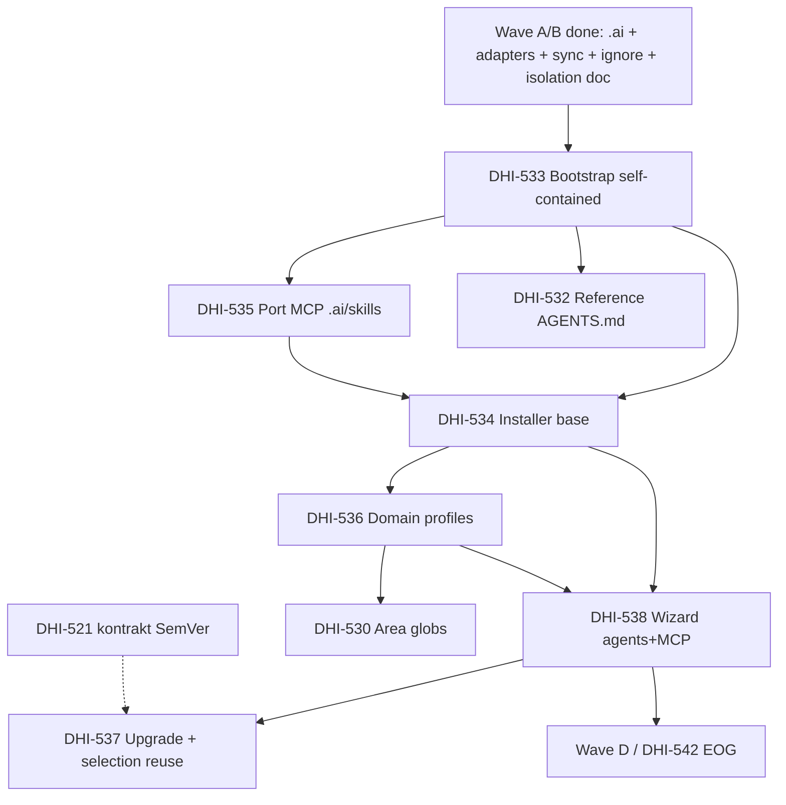

# DHI-515 — Wave C: Research — Samodzielna dystrybucja (Self-contained distribution)

> Research **po polsku** (pełna wersja) na życzenie maintainera.  
> Zakres: **tylko Wave C** z roadmapy epiku [DHI-515](https://eversis.atlassian.net/browse/DHI-515).  
> Roadmapa epiku (EN): [dhi-515.research.md](./dhi-515.research.md) — **Approved** 2026-08-04.  
> Ten dokument **nie** zastępuje story-level SDD (`docs/specs/dhi-53x/`); jest mapą podejścia i zależności przed planami poszczególnych historyjek.

## Szczegóły zadania

| Pole              | Wartość                                                                                               |
| ----------------- | ----------------------------------------------------------------------------------------------------- |
| Jira (epik)       | [DHI-515](https://eversis.atlassian.net/browse/DHI-515) — Multi-Agent AI Context Isolation & Standard |
| Zakres research   | **Wave C — Self-contained distribution**                                                              |
| Typ               | Analiza falowa (multi-story) — **bez kodu w tej turze**                                               |
| Data research     | 2026-08-06                                                                                            |
| Język deliverable | **Polski**                                                                                            |
| Folder spec       | `docs/specs/dhi-515/`                                                                                 |
| Intent            | Research Wave C **Approved**; plan Wave C utworzony — **stop na gate planu** przed Implement          |

### Historyjki Wave C (z roadmapy epiku)

| Kolejność (sugerowana)    | Story | Jira                                                    | Priorytet (extracted) | Temat                                                                                    |
| ------------------------- | ----- | ------------------------------------------------------- | --------------------- | ---------------------------------------------------------------------------------------- |
| 1                         | 5.1   | [DHI-533](https://eversis.atlassian.net/browse/DHI-533) | Critical              | Bootstrap self-contained (usuń symlinki do `cursor-collections`)                         |
| 2                         | 5.4   | [DHI-535](https://eversis.atlassian.net/browse/DHI-535) | High                  | Port MCP → resolve skills z `.ai/`                                                       |
| 3                         | 4.2   | [DHI-532](https://eversis.atlassian.net/browse/DHI-532) | High                  | Reference `AGENTS.md` w repo frameworka                                                  |
| 4                         | 5.2   | [DHI-534](https://eversis.atlassian.net/browse/DHI-534) | Critical              | Multi-tool installer (baza)                                                              |
| 5                         | 5.3   | [DHI-536](https://eversis.atlassian.net/browse/DHI-536) | High                  | Modularne profile domenowe                                                               |
| 6                         | 5.6   | [DHI-538](https://eversis.atlassian.net/browse/DHI-538) | Critical              | Wizard: agenty + MCP (+ profil)                                                          |
| 7                         | 3.3   | [DHI-530](https://eversis.atlassian.net/browse/DHI-530) | High                  | Monorepo glob scoping (profile obszarów)                                                 |
| 8                         | 5.5   | [DHI-537](https://eversis.atlassian.net/browse/DHI-537) | Medium                | Operacyjna ścieżka upgrade (reuse selection)                                             |
| (kontrakt — już w Wave A) | 1.6   | [DHI-521](https://eversis.atlassian.net/browse/DHI-521) | High                  | Kontrakt SemVer / upgrade — **w większości zrobiony**; Wave C konsumuje, nie reinventuje |

**Uwaga mapowania:** DHI-521 jest na liście Wave C w epiku, bo upgrade CLI i selection file materializują się dopiero z installerem — ale **kontrakt dokumentacyjny** (README + CHANGELOG) już istnieje. DHI-537 = warstwa operacyjna.

## Wpływ biznesowy

Wave C zamienia `agent-collections` z **scaffoldu zależnego od sibling** `cursor-collections` w **samodzielny szablon dystrybucyjny** (WF-05):

1. Fresh clone działa bez checkoutu `cursor-collections` obok.
2. Instalacja w projekcie konsumenckim < 5 min (bez czasu sieciowego klona) — local / submodule / copy.
3. Trzy osie instalacji (Q5): **adaptery agentów** × **serwery MCP** × **profil domenowy**.
4. Upgrade N→N+1 bez wycierania plików project-owned (WNF-02) — z zapisem selection.
5. Odblokowanie Wave D (docs + pilot EOG / DHI-542).

Bez Wave C: adaptery i core `.ai/` istnieją, ale konsument nadal nie ma instalera, MCP z `.ai/`, ani izolacji ścieżek monorepo w runtime.

## Kryteria sukcesu Wave C (agregat AC)

| ID  | Kryterium                                                                                                    | Główne story            |
| --- | ------------------------------------------------------------------------------------------------------------ | ----------------------- |
| C1  | Repo bez symlinków do `cursor-collections`; core + adaptery + skrypty + README                               | DHI-533                 |
| C2  | MCP `eversis-collections` startuje z home `agent-collections`; skills z `.ai/skills/`                        | DHI-535                 |
| C3  | Install: core, wybrane adaptery, ignore, szablon `AGENTS.md`; tryby local/vendor; zapis selection            | DHI-534                 |
| C4  | Profile Frontend / Backend / Fullstack niezależne od wyboru toola                                            | DHI-536                 |
| C5  | Wizard interaktywny + `--non-interactive` (`--agents`, `--mcp-servers`, profil); idempotencja / partial-fail | DHI-538                 |
| C6  | Profile obszarów `frontend-scope` / `backend-scope` / `fullstack` na layoutcie abstrakcyjnym                 | DHI-530                 |
| C7  | Reference `AGENTS.md` wypełniony dla tego repo (orientacja, nie placeholdery)                                | DHI-532                 |
| C8  | Upgrade reuse selection; fail-safe przy braku/korupcji pliku selection                                       | DHI-537                 |
| C9  | Kontrakt SemVer już udokumentowany; Wave C nie zmienia Q1                                                    | DHI-521 (done / verify) |

Dziedziczone: **SDD** na każdej historyjce (research → plan → implement → review → Fine).

---

## Zebrane informacje

### Knowledge Base & Task Management

| Źródło                               | Treść istotna dla Wave C                                                                                               |
| ------------------------------------ | ---------------------------------------------------------------------------------------------------------------------- |
| Epik research `dhi-515.research.md`  | Wave C zdefiniowana; Q1–Q4 resolved (SemVer na repo; EOG = submodule; Claude MVP = `CLAUDE.md`+ignore; story-by-story) |
| `extracted-tasks.md` WS5 + 3.3 + 4.2 | Pełne AC Stories 5.1–5.6, 3.3, 4.2                                                                                     |
| `quality-review.md`                  | S-01–S-04: partial-fail, deselection, unavailable adapter, upgrade reuse selection — **włączone do AC 5.5/5.6**        |
| Jira DHI-530…538, 521                | Status **To Do** (stan Jira nie zawsze = stan dysku); AC zgodne z extracted-tasks                                      |
| Decyzje stakeholder                  | Q5 = trzy osie; Q6 = brak linków docs cross-repo; dual channel `cursor-collections` żyje jako Cursor-only              |

### Codebase — stan `agent-collections` (2026-08-06)

#### Co już jest (prerequisites Wave A/B)

| Obszar                     | Stan                                                                                                                                         | Znaczenie dla Wave C                    |
| -------------------------- | -------------------------------------------------------------------------------------------------------------------------------------------- | --------------------------------------- |
| Core `.ai/`                | **Jest** — rules (~17), skills (~45), prompts (16 public + 12 internal)                                                                      | SSOT do dystrybucji                     |
| Adapter Cursor             | **Jest** — `adapters/cursor/generate.mjs` + wygenerowane `.cursor/rules/*.mdc` (8 plików realnych)                                           | Installer wywołuje sync/generate        |
| Adapter Claude             | **Generator jest** — `adapters/claude/`; root `CLAUDE.md` **obecnie nie ma na dysku** (do odtworzenia `sync:adapters`)                       | Bootstrap / installer muszą regenerować |
| OpenCode placeholder       | **Kod adaptera** w `adapters/opencode/`; root `opencode.jsonc` **obecnie nie ma na dysku**                                                   | Wizard: placeholder-only + ostrzeżenie  |
| Sync                       | **Jest** — `adapters/sync.mjs`, `npm run sync:adapters` / `:check`                                                                           | Wejście pod upgrade/install             |
| Isolation strategy         | **Jest** — `docs/architecture/isolation-strategy.md` (profile §5, kontrakty §8)                                                              | Spec dla DHI-530 / 536                  |
| Ignore triad               | **Jest** — `.cursorignore`, `.claudeignore`, `.opencodeignore` (cross-tool + secrets; bez heavy-infra/`apps/`**)                             | Installer: merge klas, nie wipe         |
| AGENTS standard + template | **Jest** — `docs/architecture/agents-md-standard.md`, `templates/AGENTS.template.md`; root `AGENTS.md` w kształcie szablonu z placeholderami | DHI-532 = wypełnienie reference         |
| Versioning (521)           | **Jest** — README upgrade contract + `CHANGELOG.md` (Keep a Changelog + SemVer); `package.json` `0.0.1`                                      | 537 operacjonalizuje CLI/path           |
| MCP package                | **Brak** `mcp/`                                                                                                                              | DHI-535                                 |
| Installer / scripts        | **Brak** `scripts/`                                                                                                                          | DHI-534 / 538                           |
| Website / docs site        | **Brak** (Wave D)                                                                                                                            | Poza Wave C                             |

#### Co nadal blokuje „self-contained” (luka 533)

| Ścieżka                               | Stan                                                                       | Problem                                                              |
| ------------------------------------- | -------------------------------------------------------------------------- | -------------------------------------------------------------------- |
| `.cursor/skills`                      | **Symlink** → `../../cursor-collections/.cursor/skills`                    | Clone bez sibling pada / rozjazd z `.ai/skills`                      |
| `.cursor/prompts`                     | **Symlink** → `../../cursor-collections/.cursor/prompts`                   | j.w.                                                                 |
| `.cursor/commands`                    | **Symlink** → `../../cursor-collections/.cursor/commands`                  | j.w.; mapping MVP: slash commands **nie** są emitowane przez adapter |
| `.cursor/rules/eversis-ba-docs-*.mdc` | **2 symlinki** → cursor-collections                                        | Ostatnie resztki rule symlinków                                      |
| `.cursor/mcp.json`                    | Lokalny plik; `eversis-collections` → `${CURSOR_COLLECTIONS_HOME}/mcp/...` | Zależność od env Cursor Collections                                  |
| Skills SSOT vs UX                     | Skills **żyją w** `.ai/skills/`; Cursor/MCP legacy czyta `.cursor/skills`  | Bootstrap musi zdecydować: mirror / MCP-only / generator             |

#### Stan referencyjny `cursor-collections` (do portu / generalizacji)

| Artefakt    | Ścieżka                                                     | Co brać do Wave C                                                                                                                  |
| ----------- | ----------------------------------------------------------- | ---------------------------------------------------------------------------------------------------------------------------------- |
| Installer   | `scripts/setup-cursor-local.sh` + `lib/setup-cursor-local/` | Baza UX: vendor local/submodule/copy, link-mode, MCP prompt, merge `mcp.json`, scaffolding `AGENTS`, `--sync`, `--non-interactive` |
| Katalog MCP | `mcp-server-list.json`                                      | Rozszerzyć o osie agents + profile; default `eversis-collections`                                                                  |
| MCP server  | `mcp/eversis-collections-mcp/`                              | Port; dziś: walk-up `.cursor/skills` + `CURSOR_COLLECTIONS_HOME`                                                                   |
| Brak        | —                                                           | **Brak** osi `--agents`, **brak** pliku selection do upgrade, **brak** profili domenowych                                          |

Kluczowy fragment legacy MCP (`resolveRoot.ts`): root = katalog z `.cursor/skills` **albo** `CURSOR_COLLECTIONS_HOME`. Po DHI-535: preferencja `.ai/skills` + `AGENT_COLLECTIONS_HOME` (nazwa do potwierdzenia — Gap Q2).

### Relevant Links

- Epik: [https://eversis.atlassian.net/browse/DHI-515](https://eversis.atlassian.net/browse/DHI-515)
- Stories: DHI-521, DHI-530, DHI-532…DHI-538
- `docs/architecture/adapter-mapping.md` — emit matrix; skills/prompts **nie** kopiowane do adapterów w MVP; DHI-535 = resolve z `.ai/`
- `docs/architecture/isolation-strategy.md` — profile obszarów + kontrakt installera na merge ignore
- `docs/specs/dhi-521/dhi-521.research.pl.md` — granica 521 vs 537
- Legacy installer help: `cursor-collections/scripts/setup-cursor-local.sh`

### Diagram zależności Wave C

---

## Current Implementation Status

### Existing Components

| Komponent                   | Ścieżka                                   | Status względem Wave C                                       |
| --------------------------- | ----------------------------------------- | ------------------------------------------------------------ |
| Core skills/prompts/rules   | `.ai/**`                                  | **reuse** — SSOT                                             |
| Cursor generator            | `adapters/cursor/`                        | **reuse** — installer woła sync                              |
| Claude generator            | `adapters/claude/`                        | **reuse** — regeneracja `CLAUDE.md`                          |
| Sync CLI                    | `adapters/sync.mjs`                       | **reuse** / ewentualne **extension** pod `--profile` później |
| Ignore triad                | root `.*ignore`                           | **reuse** + **merge** w installerze                          |
| Isolation strategy          | `docs/architecture/isolation-strategy.md` | **reuse** jako spec DHI-530/536                              |
| AGENTS template             | `templates/AGENTS.template.md`            | **reuse**; reference fill = DHI-532                          |
| Versioning docs             | `README.md`, `CHANGELOG.md`               | **reuse** (521); 537 dodaje kroki operacyjne                 |
| Symlink Cursor trees        | `.cursor/{skills,prompts,commands}`       | **replace** w 533                                            |
| MCP package                 | —                                         | **create** (port) w 535                                      |
| Installer                   | —                                         | **create** (port+generalizacja) w 534/538                    |
| Selection record            | —                                         | **create** w 534/538; **consume** w 537                      |
| Area globs / profile wiring | —                                         | **create** w 530 (+ 536)                                     |

### Key Files and Directories

- `.ai/skills/`, `.ai/prompts/` — kanoniczna treść po 533/535
- `.cursor/rules/` — wygenerowane + project-stack (local) + BA Docs (dziś symlink)
- `.cursor/mcp.json` — do przepisania na `AGENT_COLLECTIONS_HOME` / ścieżkę lokalną
- `adapters/sync.mjs` — punkt wejścia regeneracji
- `templates/AGENTS.template.md` — seed installera
- Legacy: `cursor-collections/scripts/setup-cursor-local*` — wzorzec, nie copy-paste ślepy
- Legacy: `cursor-collections/mcp/eversis-collections-mcp/` — źródło portu

---

## Gap Analysis

### Analiza per story

#### DHI-533 — Bootstrap self-contained

**Luka:** Repo nie jest samodzielne — trzy drzewa Cursor + BA Docs rules = symlinki. Brak `scripts/`, brak `mcp/`. `CLAUDE.md` / `opencode.jsonc` mogą być nieobecne na working tree mimo generatorów.

**Podejście rekomendowane:**

1. Usunąć symlinki `.cursor/skills`, `.cursor/prompts`, `.cursor/commands`.
2. **Skills/prompts:** nie dublować całego drzewa w `.cursor/` jeśli mapping mówi „MVP bez mirror” — zamiast tego:
  - **Preferowane:** Cursor UX przez MCP (po 535) + bezpośredni odczyt `.ai/…`; opcjonalnie **cienki mirror/generacja** tylko jeśli Cursor wymaga plików pod `.cursor/skills` do natywnego Agent Skills UI.
  - **Commands:** albo wygenerować z listy publicznych promptów (stabilne id → pliki command), albo świadomie odłożyć slash-commands i udokumentować wejście przez `@` / id (zgodnie z mapping: commands nie w MVP adapter emit). **Decyzja = Gap Q1.**
3. BA Docs rules: materializować lokalne pliki z `.ai` / mapy albo usunąć z always-apply jeśli policy „Do not load” w tym repo.
4. README quick start bez założenia sibling checkout.
5. Po bootstrap: `node adapters/sync.mjs` musi odtwarzać Cursor + Claude (+ OpenCode placeholder) z czystego clone.

#### DHI-535 — Port MCP

**Luka:** Brak pakietu; resolve i env wskazują na Cursor Collections.

**Podejście:**

1. Skopiować/przenieść `mcp/eversis-collections-mcp/` do `agent-collections`.
2. `listSkills` / `getSkillFile` / validate / script allowlist → ścieżki pod `.ai/skills/<id>/…`.
3. `findRepoRoot`: marker `.ai/skills` (primary); env `AGENT_COLLECTIONS_HOME` (primary); zachować czytanie `CURSOR_COLLECTIONS_HOME` tylko jako **deprecated alias** w okresie przejściowym **albo** zero alias (Gap Q2).
4. Zaktualizować `.cursor/mcp.json` w frameworku i szablon merge installera.
5. Testy: list wszystkich portowanych skills; brak zależności od sibling.

#### DHI-534 — Installer base

**Luka:** Brak `scripts/setup-agent-*.sh`.

**Podejście:** Generalizacja legacy:

| Oś             | Legacy                   | Agent Collections                          |
| -------------- | ------------------------ | ------------------------------------------ |
| Vendor         | local / submodule / copy | **to samo** (Q2: EOG = submodule)          |
| Link mode      | symlink / copy / auto    | zachować                                   |
| MCP            | prompt + `--mcp-servers` | zachować + nowy home                       |
| Agents         | **brak**                 | dodać (szczegóły w 538)                    |
| Profile        | `--minimal` stub         | realne profile w 536                       |
| Selection file | **brak**                 | zapisać JSON/YAML (Gap Q3)                 |
| Sync           | `--sync`                 | wywołać `adapters/sync.mjs` + merge ignore |

AC czasu: < 5 min bez sieci — mierzyć na sample (np. pusty git root).

#### DHI-536 — Modular profiles

**Luka:** Brak definicji deploy domains (które rules/skills lądują przy Frontend-only itd.).

**Podejście:** Osie **niezależne** (Q5):

| Profil domenowy    | Co instaluje (draft)                                                  |
| ------------------ | --------------------------------------------------------------------- |
| Frontend-only      | domains frontend (+ shared-types, orchestration); skills FE-oriented  |
| Backend-only       | backend (+ shared-types, orchestration); mniej FE catalog             |
| Fullstack Monorepo | pełny zestaw + domyślne area scoping (`fullstack` lub oba scope docs) |

Profil domenowy ≠ wybór Cursor/Claude. Mapowanie „które skill foldery” — Gap Q4 (manifest w repo vs hardcode w skrypcie).

#### DHI-538 — Wizard (Critical)

**Luka:** Cała oś agents + quality-review S-01…S-03.

**Podejście:**

1. Prompt agentów: Cursor only / Claude only / Cursor+Claude / OpenCode placeholder / Multi-agent.
2. Guard: adapter `shipped` vs `placeholder` (mapping §6.3) — nie twierdzić, że OpenCode jest pełny.
3. MCP step = rozszerzenie legacy toggle list.
4. Summary: agents + MCP + profile + vendor/link.
5. Idempotencja, partial-fail listing, re-run add agents, deselection z confirm lub docs „manual removal”.
6. `--non-interactive`: `--agents`, `--mcp-servers`, `--profile` (nazwy flag — Gap Q5).

#### DHI-530 — Monorepo glob scoping

**Luka:** Strategy §5 opisuje profile; **nie** zmaterializowano path globs w `rule-map` / ignore konsumenta / CLAUDE guidance.

**Podejście:**

1. Dla Cursor: area globs w generated rules **lub** dodatkowe wzorce ignore per profil (nie mylić z triadą framework-root, która świadomie **nie** ma `apps/`**).
2. Dla Claude: `.claudeignore` + sekcja guidance w `CLAUDE.md` (MVP Claude = jeden plik).
3. Zależność od 536 (install wybiera profil) + adapterów (już są).
4. Nazewnictwo open-source only (`apps/web`, `apps/api`) — zakaz nazw klientów w frameworku.

#### DHI-532 — Reference [AGENTS.md](http://AGENTS.md)

**Luka:** Root `AGENTS.md` ma placeholdery Monorepo/Areas i „DHI-532” TODO; brak pełnego fill (install entry points, maintainer roles fleshed).

**Podejście:** Wypełnić wg `agents-md-standard.md` + stan Wave C (po 533: ścieżki install). Może iść **równolegle wcześnie**, z lekkim refresh po pojawieniu się skryptów install.

#### DHI-537 — Upgrade path

**Luka:** README opisuje tryby; brak CLI upgrade, brak selection reuse, brak testu na sample.

**Podejście:** Po 538: `upgrade`/`--sync` czyta selection; regeneruje adaptery; merge ignore; **nie** nadpisuje project-owned; brak selection → fail z instrukcją wizard.

#### DHI-521 — Versioning (w Wave C)

**Stan:** Kontrakt **zrobiony** (docs). W Wave C: tylko **weryfikacja**, że installer/upgrade respektują README; ewentualny Fine/Jira status jeśli jeszcze otwarte — **nie** nowy research od zera.

### Pytania do stakeholders (Gaps)

#### Gap Q1 — Materializacja skills/prompts/commands w bootstrap (533)

**Pytanie:** Czy po usunięciu symlinków wymagamy lokalnego drzewa `.cursor/skills` + `.cursor/prompts` (+ commands), czy wystarczy `.ai/` + MCP (535) + dokumentacja load-by-id?

**Rekomendacja:** **MVP = bez pełnego mirroru** skills/prompts (zgodnie z `adapter-mapping` emit matrix). Commands: opcjonalny cienki generator z listy publicznych promptów **albo** odłożenie slash-commands z jasnym README. Mirror tylko jeśli Cursor Agent Skills UI jest twardym wymaganiem maintainera.

#### Gap Q2 — Nazwa env home MCP

**Pytanie:** `AGENT_COLLECTIONS_HOME` vs zachowanie `CURSOR_COLLECTIONS_HOME` jako alias?

**Rekomendacja:** Nowa nazwa kanoniczna `AGENT_COLLECTIONS_HOME`; alias deprecated przez jedno wydanie minor **tylko** jeśli migracja EOG/Cursor channel tego wymaga; w czystym `agent-collections` — bez aliasu w default `mcp.json`.

#### Gap Q3 — Format i lokalizacja pliku selection

**Pytanie:** Gdzie zapisywać zapis instalacji (agents, mcp, profile, vendor, version)?

**Rekomendacja:** np. `.agent-collections/install-selection.json` (lub `.cursor/agent-collections-selection.json` tylko dla Cursor-only — gorsze przy multi-agent). Plik **project-owned-ish** (nie kasować przy sync); schema z `frameworkVersion`, `agents[]`, `mcpServers[]`, `domainProfile`, `vendorMode`, `linkMode`.

#### Gap Q4 — Manifest profili domenowych

**Pytanie:** Skąd installer wie, które skills/rules należą do Frontend-only?

**Rekomendacja:** Jawny manifest w repo (np. `adapters/profiles/*.yaml` lub `.ai/profiles/`) mapujący profile → domain folders / skill allowlist; uniknąć hardcode w bashu.

#### Gap Q5 — Nazwy flag CLI

**Pytanie:** Czy trzymać parity z legacy (`--mcp-servers`, `--vendor`, `--link-mode`) i dodać `--agents` + `--profile`, czy nowa komenda `setup-agent-collections.sh` z nowym zestawem?

**Rekomendacja:** Nowa nazwa skryptu (`setup-agent-local.sh` / `setup-agent-collections.sh`) + **znane** flagi legacy gdzie 1:1; nie nadpisywać znaczenia starych flag.

#### Gap Q6 — Kolejność startu Wave C vs dokończenie Wave B Fine

**Pytanie:** Czy wolno zaczynać DHI-533, gdy niektóre story Wave B mają Jira „To Do” / brak Fine, mimo że artefakty są na dysku (528/529/527…)?

**Rekomendacja:** **Tak dla research/plan 533**, jeśli AC Wave B potrzebne na dysku są spełnione (adapters + sync + ignore + isolation doc). Fine Jira nie blokuje technicznie; utrzymaniowo domknąć Fine osobno.

### Odpowiedzi już znane (nie otwierać ponownie)

| ID      | Decyzja                                                              |
| ------- | -------------------------------------------------------------------- |
| Q1 epik | SemVer tag na `agent-collections`; nie npm dla `.ai/` w MVP          |
| Q2 epik | EOG default = **submodule**; local + copy też                        |
| Q3 epik | Claude MVP = `CLAUDE.md` + ignore + guidance; bez pełnego MCP parity |
| Q4 epik | Story-by-story; bez mega-planu Wave bez prośby                       |
| Q5 epik | Osie: agents × MCP × domain profile                                  |
| Q6 epik | Docs channels rozdzielone                                            |

---

## Proponowana kolejność implementacji (po approve research Wave C)

| #   | Story       | Dlaczego teraz                                     | Blokuje                        |
| --- | ----------- | -------------------------------------------------- | ------------------------------ |
| 1   | **DHI-533** | Usuwa iluzję symlinków; warunek „fresh clone”      | Wszystko konsumenckie          |
| 2   | **DHI-535** | Skills discoverability bez sibling                 | Installer MCP merge, Cursor UX |
| 3   | **DHI-532** | Orientacja reference (może lekko równolegle z 533) | Docs / pilot czytelność        |
| 4   | **DHI-534** | Szkielet install (vendor/link/sync/record)         | 536, 538                       |
| 5   | **DHI-536** | Profile domenowe                                   | 538, 530                       |
| 6   | **DHI-538** | Wizard Critical + selection                        | 537, pilot                     |
| 7   | **DHI-530** | Path scoping na żywych profilach                   | WNF-03 / EOG                   |
| 8   | **DHI-537** | Upgrade na żywym selection                         | Utrzymanie konsumentów         |
| —   | **DHI-521** | Verify only / Fine jeśli otwarte                   | —                              |

**Zasada SDD:** ten research Wave C = roadmapa; **każda** historyjka ma własny `docs/specs/dhi-53x/*.research.md` (+ plan) przed kodem. Pierwsza po approve Wave C: **DHI-533** story research → plan.

Nie zaczynać Wave D (539–542) przed essentials Wave C (533 + 534 + 538 minimum do pilota).

---

## Ryzyka

| #   | Ryzyko                                                       | Mitygacja                                                      |
| --- | ------------------------------------------------------------ | -------------------------------------------------------------- |
| 1   | Usunięcie symlinków skills bez MCP → regresja Cursor UX      | Q1: albo mirror, albo 535 w tym samym slice co 533             |
| 2   | Podwójne źródło prawdy `.ai/skills` vs `.cursor/skills`      | Jedno SSOT `.ai/`; mirror tylko generowany/oznaczony GENERATED |
| 3   | Installer skopiowany 1:1 z Cursor zrywa izolację multi-agent | Osie Q5 + ignore merge z isolation-strategy §8.1               |
| 4   | Wizard oferuje OpenCode jako pełny adapter                   | Guard `placeholder` / mapping maturity                         |
| 5   | Selection file w `.cursor/` niewidoczny dla Claude-only      | Lokalizacja poza packaging jednego toola (Q3)                  |
| 6   | DHI-530 bez 536 = globs bez UX wyboru                        | Kolejność 536 → 530                                            |
| 7   | Drift dual-channel cursor-collections                        | Osobny SemVer; brak shared docs (Q6); thin Cursor channel      |
| 8   | Partial install psuje projekty                               | AC S-01: lista completed/failed + idempotent re-run            |

## Założenia

1. Wave A content i Wave B adapters/sync/isolation/ignore są **wystarczające na dysku**, by planować 533.
2. OpenCode pozostaje placeholder przez MVP Wave C.
3. `cursor-collections` zostaje żywym kanałem Cursor (kod), nie portalem docs Agent Collections.
4. Brak mega-planu całej Wave C bez prośby — story-by-story.
5. EOG (542) nie jest w Wave C, ale Wave C musi dostarczyć installer + selection + scoping pod pilot.

## Out of Scope (ten research / Wave C)

- Migracja Docusaurus / rebrand docs site (DHI-540) — Wave D
- Migration guide konsumencki (DHI-539) — Wave D
- Pilot EOG pomiar WNF-03 (DHI-542) — Wave D
- Pełna implementacja OpenCode
- Deprecacja `cursor-collections`
- Cross-repo documentation links
- Tworzenie Jira Sub-tasków SDD (odrzucone)

---

## Adequacy Checklist (ten artefakt)

| Check                     | Wynik                                                                                                                |
| ------------------------- | -------------------------------------------------------------------------------------------------------------------- |
| Latest AC / intent Wave C | Pokryte Stories 5.1–5.6 + 3.3 + 4.2 + granica 521/537; quality-review S-01–S-04 uwzględnione                         |
| Paths / system state      | Zaktualizowany stan 2026-08-06 (symlinki, brak mcp/scripts, adapters obecne, ignore triad, CLAUDE.md absent on disk) |
| Open questions            | Gap Q1–Q6 — **Resolved** (OK = rekomendacje); włączone w plan Wave C                                                 |
| Plan coverage             | **CREATE done** — `[dhi-515.wave-c.plan.pl.md](./dhi-515.wave-c.plan.pl.md)`; oczekuje approve przed kodem           |

## Gate / Approval

| Pole                     | Wartość                                                                                               |
| ------------------------ | ----------------------------------------------------------------------------------------------------- |
| Research status (Wave C) | **Approved** 2026-08-06 — człowiek: Q1–Q6 = **OK** (przyjęte rekomendacje z tego research)            |
| Decyzje Gap Q1–Q6        | Zamknięte → włączone w [dhi-515.wave-c.plan.pl.md](./dhi-515.wave-c.plan.pl.md)                       |
| Plan Wave C              | **Utworzony** — [dhi-515.wave-c.plan.pl.md](./dhi-515.wave-c.plan.pl.md) — **oczekuje approve planu** |
| Następny krok            | Approve planu Wave C → Full Flow execution od **DHI-533** (Phase 1)                                   |
| Implement kod            | **STOP** — nie zaczynać do approve planu                                                              |

### Decyzje zamknięte (2026-08-06)

| Gap   | Status                                                          |
| ----- | --------------------------------------------------------------- |
| Q1–Q6 | **OK** = rekomendacje research przyjęte bez otwierania ponownie |

---

## Changelog

| Data       | Zmiana                                                                                                    |
| ---------- | --------------------------------------------------------------------------------------------------------- |
| 2026-08-06 | CREATE — research Wave C (PL): samodzielna dystrybucja, stan repo, luki, zależności, Gaps Q1–Q6           |
| 2026-08-06 | APPROVE — Q1–Q6 OK; plan Wave C utworzony (`dhi-515.wave-c.plan.pl.md`); gate = approve planu przed kodem |

