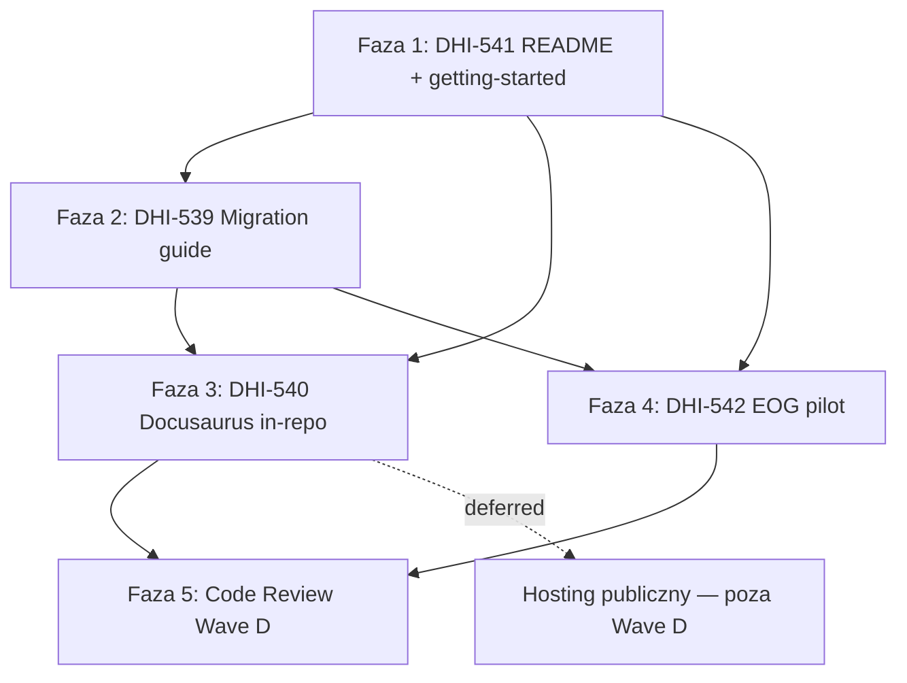

# DHI-515 Wave D — Plan implementacji (PL): Dokumentacja + walidacja

## Task Details

| Field            | Value |
| ---------------- | ----- |
| Jira ID          | [DHI-515](https://eversis.atlassian.net/browse/DHI-515) (Wave D) |
| Title            | Wave D — Docs + validation |
| Description      | Domknięcie epiku od strony adopcji i dowodu: README + getting-started (layout jak cursor-collections), migration guide, migracja/rebrand Docusaurus in-repo (hosting deferred), pilot EOG + pomiar/estymacja WNF-03. |
| Priority         | High / Medium (ścieżka zamknięcia epiku) |
| Related Research | [dhi-515.wave-d.research.pl.md](./dhi-515.wave-d.research.pl.md) (**Approved** 2026-08-06), [dhi-515.research.md](./dhi-515.research.md) (roadmapa epiku) |

### Historyjki w zakresie (kolejność wykonania)

| # | Story | Jira | Temat |
|---|-------|------|--------|
| 1 | 6.2 | [DHI-541](https://eversis.atlassian.net/browse/DHI-541) | README + getting-started (repo / website docs) |
| 2 | 6.1 | [DHI-539](https://eversis.atlassian.net/browse/DHI-539) | Migration guide Cursor Collections → Agent Collections |
| 3 | 6.4 | [DHI-540](https://eversis.atlassian.net/browse/DHI-540) | Migracja + rebrand Docusaurus (`website/`) — build in-repo; hosting deferred |
| 4 | 6.3 | [DHI-542](https://eversis.atlassian.net/browse/DHI-542) | Pilot EOG + pomiar / estymacja WNF-03 (≥30%) |

## Wildly Important Goal

**Goal**: Dostarczyć kompletny kanał dokumentacji Agent Collections (getting-started + migration + Docusaurus in-repo) oraz empiryczny dowód izolacji / WNF-03 na pilocie EOG, bez couplingu docs do Cursor Collections i bez zakładania publicznego hostingu.

**Success Measure**: Spełnione kryteria agregatu Wave D **D1–D11** z research (z D7 = stub readiness / hosting deferred); ścieżki docs jak w Q2; `cd website && npm run build` green; evidence pack EOG dla WNF-03; zero cross-repo doc links.

**Do NOT touch / do NOT add**:

- Publiczny deploy / projekt Vercel / produkcyjny URL docs (Q3 — **brak hostingu**; out-of-band)
- Deprecacja / wyłączenie docs site `cursor-collections`
- Pełna implementacja OpenCode
- Feature work produktu EOG (`portal/` / `cms/` poza install/isolation/measurement)
- Cross-repo documentation portals / redirects do legacy docs
- BA Docs Word (`.docx`) — stack: Do not load
- Tworzenie Jira Sub-tasków SDD
- Automatyczny post do Jira
- Zmiana abstract area globs frameworka na nazwy klienta (`portal`/`cms`) — tylko consumer overlay (Q7)

## Proposed Solution

Wave D realizujemy **fazami zgodnymi z kolejnością story** z zatwierdzonego research: **541 → 539 → 540 → 542**. Każda faza kończy się weryfikacją i może być domknięta Fine/Jira per ticket; **ten plan jest jedną mapą wykonawczą** całego Wave D.

### Zatwierdzone decyzje Gap Q1–Q7 (research Approved)

| Gap | Decyzja zamknięta w planie |
|-----|----------------------------|
| **Q1** | Plan/implement Wave D **dozwolony** przy essentials Wave C na dysku; Fine Jira Wave C nie blokuje. |
| **Q2** | Ścieżki **analogicznie do cursor-collections**: `website/docs/getting-started/{start-here,prerequisites,installation,mcp-setup,quick-wins}.md`; migration = `website/docs/getting-started/migration-from-cursor-collections.md`; framework ref = `documentation/agent-collection.md`; README linkuje `website/docs/…`. |
| **Q3** | **Brak hostingu** — build/rebrand in-repo; publiczny deploy **deferred / out-of-band**; config bez legacy Vercel URL; D7 = stub readiness. |
| **Q4** | Język konsumenckich docs = **EN**. |
| **Q5** | Pilot: min. **5 dni roboczych** **lub** ≥3 sesje FE Cursor + ≥3 BE Claude; checklista kolizji w evidence pack. |
| **Q6** | WNF-03 MVP = **proxy** §7.2 (file count / approx tokens) U vs S; cel ≥30%; else justified estimate + plan poprawy. |
| **Q7** | Area mapping EOG = **consumer overlay** w EOG; framework zostaje przy `apps/web` / `apps/api`. |

### Podejście architektoniczne



1. **541** — content-first `website/docs/getting-started/` (stem’y jak CC) + polish README + WF/WNF traceability; opcjonalnie skeleton `documentation/agent-collection.md`.
2. **539** — migration guide w tej samej kategorii getting-started; refresh README link; zakaz cross-doc links.
3. **540** — pełny port Docusaurus + rebrand + multi-agent pages; green lokalny build; hosting **nie** w DoD.
4. **542** — submodule install w EOG; overlay `portal`/`cms`; okres pilota Q5; proxy WNF-03; findings → guide/backlog/`docs/context/eog/`.
5. **Review** — Code Reviewer na cały Wave D (docs + pilot evidence + brak blockerów Q6).

### Semantyka SDD przy tym planie

Ten dokument jest **planem Wave D**. Wykonanie może iść ticket-by-ticket (research/plan story opcjonalnie DELTA/SKIP gdy ten plan + Wave D research pokrywają AC), ale **bez aprobaty tego planu nie wolno zaczynać implementacji treści/kodu**.

## Current Implementation Analysis

### Already Implemented

- Wave C essentials: installer `scripts/setup-agent-collections.sh`, MCP `mcp/eversis-collections-mcp/`, profiles `adapters/profiles/*`, selection schema, brak symlinków skills — **reuse**
- `README.md` — quick start, install, upgrade, layout — **baza 541** (luki AC)
- `AGENTS.md` / `CLAUDE.md` — reference framework — **reuse**
- `docs/architecture/{isolation-strategy,adapter-mapping,agents-md-standard,install-selection}.md` — źródło treści site + guide — **reuse**
- `CHANGELOG.md` — SemVer / Migration subsections — **reuse**
- Quality scripts: `npm run sync:adapters`, `mcp:build`, `mcp:test`, installer smoke — **reuse**
- Legacy źródło: `cursor-collections/website/**`, `documentation/cursor-collection.md` — **read-only port**
- Pilot consumer: `/Users/piotrniemirski/Documents/Projects/eog` na Cursor Collections — **target 542**

### To Be Modified

- `README.md` — wizja multi-agent, linki do `website/docs/getting-started/…` + migration, WF pointer
- `CHANGELOG.md` — wpisy Wave D / Migration
- Po 540: root `package.json` — skrypty `website` build/validate jeśli potrzebne
- Po 539/542: refresh migration guide (findings pilota)
- EOG (542): `AGENTS.md`, `.cursor/mcp.json`, ignore/overlay, submodule, runbook upgrade

### To Be Created

- `website/docs/getting-started/` — strony CC-analog + migration (541/539)
- `documentation/agent-collection.md` — framework reference (neutral / Agent Collections)
- `website/` — pełny Docusaurus scaffold + port treści + rebrand (540)
- Evidence pack 542 (w `docs/specs/dhi-542/` i/lub `docs/context/eog/`)
- Opcjonalnie: walidator linków docs-site (adaptacja z CC)

## Open Questions

| #   | Question | Answer | Status |
| --- | -------- | ------ | ------ |
| Q1 | Start Wave D vs Fine Wave C? | Essentials na dysku wystarczą | ✅ Resolved |
| Q2 | Ścieżki getting-started / migration? | Mirror CC pod `website/docs/getting-started/` + `documentation/agent-collection.md` | ✅ Resolved |
| Q3 | Hosting / URL? | Brak hostingu — deferred; in-repo build only | ✅ Resolved |
| Q4 | Język docs? | EN | ✅ Resolved |
| Q5 | Okres pilota / kolizje? | 5 dni roboczych lub ≥3+3 sesje + checklista | ✅ Resolved |
| Q6 | Metoda WNF-03? | Proxy §7.2; justified estimate fallback | ✅ Resolved |
| Q7 | Area EOG? | Consumer overlay; framework `apps/*` | ✅ Resolved |

## Technical Context

### Project Instructions

- `AGENTS.md` — mapa orientacji; product content **EN**.
- `.cursor/rules/eversis-agent-core.mdc` + SDD — lifecycle + gates.
- `.cursor/rules/eversis-engineering-manager.mdc` — orchestracja Implement.
- `.cursor/rules/eversis-project-stack.mdc` — skills: `eversis-writing-repo-documentation` **Load when** docs; BA Docs / FE/BE app skills **Do not load**.
- Isolation: `docs/architecture/isolation-strategy.md` §7 WNF-03, §8.2 kontrakt 542.
- Mapping: `docs/architecture/adapter-mapping.md` — capability matrix w migration + site.
- Install selection: `docs/architecture/install-selection.md`.

### Architecture & Patterns

```text
agent-collections/
  README.md                         # linkuje website/docs/… (jak CC)
  documentation/
    agent-collection.md             # NEW — analog cursor-collection.md
  website/                          # NEW (540) — Docusaurus
    docs/
      getting-started/              # 541/539 content-first, potem pełny site
        start-here.md
        prerequisites.md
        installation.md
        mcp-setup.md
        quick-wins.md
        migration-from-cursor-collections.md
      agents/ skills/ prompts/ workflow/ integrations/ …
    docusaurus.config.ts            # rebrand; url placeholder (Q3)
  docs/
    architecture/                   # reuse
    context/eog/                    # 542 optional
  scripts/setup-agent-collections.sh
  mcp/  adapters/  .ai/
```

- Dual channel kodu OK; **docs w pełni rozdzielone** (epik Q6).
- Content-first: 541/539 mogą utworzyć markdown pod `website/docs/getting-started/` zanim 540 doda pełny scaffold.
- Hosting publiczny: **nie** w ścieżce krytycznej Wave D.

### Tech Stack

- Markdown docs (EN)
- Docusaurus (jak legacy `cursor-collections/website/` — Node ≥ 18)
- Bash installer + MCP TypeScript (już na dysku)
- Pilot: EOG monorepo (`portal/`, `cms/`)
- Package manager: npm

### Code Style & Standards

- Brak linków do legacy docs site / shared portals.
- Nazwy ścieżek framework open-source only (`apps/web`, `apps/api`); EOG overlay lokalnie.
- Generowane adaptery: nie edytować ręcznie poza sync.
- Docs site: scrub Cursor-only brand; Claude + isolation pages wymagane.

### Testing Patterns

| Obszar | Komendy / sprawdzenia |
|--------|------------------------|
| Adapter sync | `npm run sync:adapters` ; `npm run sync:adapters:check` |
| MCP | `npm run mcp:build` ; `npm run mcp:test` |
| Installer | `bash scripts/setup-agent-collections.test.sh` |
| Docs site | `cd website && npm install && npm run build` (po 540) |
| Link scrub | `rg` / walidator: brak URL legacy docs site w `website/` i migration |
| Docs DoD | inspectable: sekcje README, obecność stem’ów getting-started, migration TOC |
| Pilot WNF-03 | evidence markdown z liczbami U vs S (≥30% lub justified estimate) |

### Database Patterns

- N/A

### Additional Context

- Specs `docs/specs/dhi-*/` lokalne / gitignored w tym repo.
- Pilot zmiany w EOG — osobne repo; rollback-friendly branch.
- Skill przy implementacji docs: `eversis-writing-repo-documentation`; prompt `eversis-repo-docs-writer`.

## Implementation Plan

### Phase 1: DHI-541 — README + getting-started

**Goal**: Nowy konsument kończy pierwszą udaną instalację według przewodnika o layoutcie jak w cursor-collections; README linkuje kanoniczne ścieżki.

**Description**: Utworzyć `website/docs/getting-started/` ze stem’ami CC; rozszerzyć README (wizja, core/adapters, install, linki); dodać traceability WF/WNF; język EN.

**Verification:** Istnieją pliki stem’ów getting-started; README zawiera linki do `website/docs/getting-started/start-here.md` i (placeholder lub po Phase 2) migration; macierz WF obecna i inspectable.

#### Task 1.1 - [CREATE] Drzewo `website/docs/getting-started/` (stem’y jak CC)

**Description**: Utworzyć kategorię getting-started analogicznie do `cursor-collections/website/docs/getting-started/`: `_category_.json`, `start-here.md`, `prerequisites.md`, `installation.md`, `mcp-setup.md`, `quick-wins.md`. Treść pod Agent Collections: `AGENT_COLLECTIONS_HOME`, `setup-agent-collections.sh`, MCP z `.ai/skills`, brak pełnego mirroru skills (Wave C Q1). Checklist „first successful install” na sample project.

**Files:** `website/docs/getting-started/_category_.json` (create), `website/docs/getting-started/start-here.md` (create), `website/docs/getting-started/prerequisites.md` (create), `website/docs/getting-started/installation.md` (create), `website/docs/getting-started/mcp-setup.md` (create), `website/docs/getting-started/quick-wins.md` (create)

**Definition of Done**:

- [ ] Wszystkie pięć stem’ów CC + `_category_.json` istnieją pod `website/docs/getting-started/`
- [ ] `installation.md` opisuje local/submodule/copy + przykład `--non-interactive`
- [ ] `mcp-setup.md` dokumentuje `AGENT_COLLECTIONS_HOME` (bez wymogu `CURSOR_COLLECTIONS_HOME`)
- [ ] `start-here.md` zawiera checklistę kończącą się „first successful install”

**Clues**: Nie kopiować 1:1 treści Cursor-only; layout plików = CC, treść = Agent Collections.

#### Task 1.2 - [MODIFY] README — wizja, linki, install entry

**Description**: README: krótka wizja multi-agent (core `.ai/` + adapters); linki względne do getting-started (wzorzec CC); install/upgrade; wskazanie architecture. Link do migration: placeholder sekcja „Migration guide (DHI-539)” **albo** defer refresh do Task 2.3.

**Files:** `README.md` (modify), `CHANGELOG.md` (modify)

**Definition of Done**:

- [ ] README linkuje `website/docs/getting-started/start-here.md` (i installation/mcp-setup jak w tabeli CC)
- [ ] README opisuje model core/adapters + komendę install
- [ ] Brak obietnicy publicznego URL docs site (Q3)
- [ ] Treść EN

**Clues**: CC README linkuje `website/docs/…` nawet bez „docs portal” jako jedynego SSOT — ten sam wzorzec.

#### Task 1.3 - [CREATE/MODIFY] Traceability WF-01…05 (+ kluczowe WNF)

**Description**: Dodać macierz WF/WNF → sekcja docs (w `start-here.md` lub `docs/architecture/requirements-traceability.md` + link z README/start-here).

**Files:** `website/docs/getting-started/start-here.md` (modify) **lub** `docs/architecture/requirements-traceability.md` (create) + linki z README

**Definition of Done**:

- [ ] Macierz obejmuje WF-01…WF-05 i kluczowe WNF (co najmniej WNF-02/03) ze wskazaniem sekcji docs / story
- [ ] Inspectable z README lub start-here (jeden hop)

#### Task 1.4 - [CREATE] Skeleton `documentation/agent-collection.md` (opcjonalnie thin)

**Description**: Utworzyć analog `documentation/cursor-collection.md` — skrócony authoritative guide Agent Collections (lub stub z TOC wskazującym na website/docs). Pełna głębia może być rozwinięta w 540.

**Files:** `documentation/agent-collection.md` (create), `README.md` (modify — link)

**Definition of Done**:

- [ ] Plik `documentation/agent-collection.md` istnieje
- [ ] README linkuje go (jak CC linkuje `documentation/cursor-collection.md`)
- [ ] Treść nie jest Cursor-only 1:1 copy bez rebrand

**Stop Rule:** Jeśli maintainer woli pełny port dopiero w 540 — wystarczy stub TOC + „see website/docs”; nie blokować Phase 2.

#### Task 1.5 - [REUSE] Domknięcie AC DHI-541 / Fine story

**Description**: Checklist D1–D3; Fine/QA draft dla 541 gdy faza gotowa (EM). Bez postu Jira bez aprobaty.

**Files:** `README.md` (reuse), `website/docs/getting-started/` (reuse)

**Definition of Done**:

- [ ] D1–D3 spełnione w zakresie 541 (link migration może czekać na 539 refresh)
- [ ] QA draft przygotowany przy Fine (bez auto-post)

### Phase 2: DHI-539 — Migration guide

**Goal**: Konsument Cursor Collections ma bezpieczną ścieżkę cutover + rollback bez couplingu docs.

**Description**: Dodać `migration-from-cursor-collections.md` w kategorii getting-started; ownership local vs core vs generated; capability matrix; zero cross-doc links; refresh README.

**Verification:** Plik migration istnieje z wymaganymi sekcjami; `rg` nie znajduje URL legacy docs site w guide; README linkuje migration.

#### Task 2.1 - [CREATE] `website/docs/getting-started/migration-from-cursor-collections.md`

**Description**: Napisać guide wg spisu z research: kiedy migrować; prerequisites (tag SemVer, vendor submodule preferred); cutover steps; ownership; Cursor vs Claude MVP matrix; rollback; zakaz linków do legacy docs portal.

**Files:** `website/docs/getting-started/migration-from-cursor-collections.md` (create), `website/docs/getting-started/start-here.md` (modify — link w checklist)

**Definition of Done**:

- [ ] Guide zawiera sekcje: cutover, rollback, ownership (local / core / generated), capability matrix
- [ ] Brak deep-linków do legacy docs site / shared portals
- [ ] Env cutover: `CURSOR_COLLECTIONS_HOME` → `AGENT_COLLECTIONS_HOME` udokumentowany
- [ ] Treść EN

**Clues**: Wolno wymienić nazwę produktu i ścieżki kodu sibling jako fakt migracji — nie jako docs portal.

#### Task 2.2 - [MODIFY] Wzorzec consumer overlay (Q7) w migration guide

**Description**: Wyjaśnić, że abstract `apps/web`/`apps/api` zostaje w frameworku; konsumenci jak EOG mapują `portal`/`cms` lokalnie (ignore / docs/context).

**Files:** `website/docs/getting-started/migration-from-cursor-collections.md` (modify)

**Definition of Done**:

- [ ] Sekcja overlay monorepo obecna
- [ ] Brak instrukcji hardcodującej nazwy klientów w `adapters/profiles/` frameworka

#### Task 2.3 - [MODIFY] README link → migration + scrub

**Description**: Podmienić placeholder 541 na realny link; sprawdzić brak cross-doc coupling w README.

**Files:** `README.md` (modify), `CHANGELOG.md` (modify)

**Definition of Done**:

- [ ] README linkuje `website/docs/getting-started/migration-from-cursor-collections.md`
- [ ] D4/D5 (docs side) spełnione dla kanału markdown
- [ ] `rg` na README: brak URL `cursor-collections-*.vercel.app` jako target docs

#### Task 2.4 - [REUSE] Domknięcie AC DHI-539 / Fine story

**Description**: Checklist D4–D5 (docs); Fine/QA draft 539.

**Files:** migration guide (reuse), `README.md` (reuse)

**Definition of Done**:

- [ ] AC Story 6.1 pokryte w zakresie guide + niezależność kanałów docs
- [ ] QA draft bez auto-post Jira

### Phase 3: DHI-540 — Docusaurus migrate + rebrand (hosting deferred)

**Goal**: Pełna strona dokumentacji buduje się lokalnie w `agent-collections/website/` pod marką Agent Collections; multi-agent + isolation; **bez** publicznego deploy.

**Description**: Port scaffoldu z CC; rebrand; sync treści 541/539; nowe strony Claude/isolation; scrub linków; green `npm run build`. Hosting = Improvements / out-of-band.

**Verification:** `cd website && npm run build` sukces; title/brand Agent Collections; brak linków do legacy docs site; coverage sekcji ≥ legacy (getting-started, agents, skills, prompts, workflow, …).

#### Task 3.1 - [CREATE] Port scaffoldu Docusaurus `website/`

**Description**: Skopiować/dostosować szkielet z `cursor-collections/website/` (package.json, config, theme, sidebars, pozostałe drzewo `docs/` poza getting-started już częściowo obecnym). Zachować layout katalogów jak CC.

**Files:** `website/**` (create/modify), root `package.json` (modify — opcjonalne skrypty `docs:build` / `website:build`)

**Definition of Done**:

- [ ] Katalog `website/` ma działający Docusaurus (dependencies lokalne w `website/`)
- [ ] Istniejące pliki getting-started z 541/539 są włączone w sidebar/autogen
- [ ] `cd website && npm install` kończy się sukcesem

**Clues**: Nie nadpisuj treści 541/539 ślepym copy z CC — merge świadomy.

#### Task 3.2 - [MODIFY] Rebrand + config URL (Q3 stub)

**Description**: Title/tagline/footer/meta → Agent Collections. **Nie** reuse `https://cursor-collections-1ztm.vercel.app`. Ustawić `url`/`baseUrl` na placeholder lokalny / TBD (np. localhost lub komentarz w README „hosting deferred”). Udokumentować w README/website, że publiczny hosting jest out-of-band.

**Files:** `website/docusaurus.config.ts` (modify), `README.md` (modify), ewentualnie `website/src/pages/**` (modify)

**Definition of Done**:

- [ ] Widoczny brand Agent Collections (nie Cursor Collections) w config/home
- [ ] Brak legacy Vercel URL jako kanonicznego `url` produkcyjnego
- [ ] README stwierdza: hosting publiczny deferred (Q3)
- [ ] D7 traktowane jako stub readiness (nie live deploy)

#### Task 3.3 - [MODIFY] Port / rewrite treści multi-agent + isolation

**Description**: Przepis pozostałych stron (agents, skills, prompts, workflow, intro, framework-reference sync z `documentation/agent-collection.md`): ścieżki `.ai/`, installer Agent Collections, Claude MVP, isolation summary, install selection/upgrade. Usunąć mylące Cursor-only idiomy.

**Files:** `website/docs/**` (modify), `documentation/agent-collection.md` (modify)

**Definition of Done**:

- [ ] Strony opisują Claude MVP + isolation (nie tylko Cursor)
- [ ] Skills/prompts wskazują `.ai/` + MCP `eversis-collections`
- [ ] Coverage sekcji porównywalne z legacy (inspectable lista katalogów)

#### Task 3.4 - [MODIFY] Scrub cross-doc links + walidacja build

**Description**: Usunąć deep-linki do legacy docs site. Opcjonalnie port/adaptacja walidatora linków. Uruchomić build.

**Files:** `website/**` (modify), opcjonalnie skrypt walidacji (create/modify)

**Definition of Done**:

- [ ] `cd website && npm run build` kończy się sukcesem
- [ ] `rg` w `website/`: brak URL legacy docs Vercel / shared portal jako „see also”
- [ ] D5/D6 spełnione; D7 = stub (green build + docs „hosting TBD”)

**Stop Rule:** Nie tworzyć projektu Vercel / nie deployować — eskaluj hosting do maintainera poza Wave D.

#### Task 3.5 - [REUSE] Domknięcie AC DHI-540 / Fine story

**Description**: Checklist D5–D7 (D7 stub); Fine/QA draft 540 z jasnym zapisem „hosting deferred”.

**Files:** `website/` (reuse), `README.md` (reuse)

**Definition of Done**:

- [ ] AC 6.4 spełnione w zakresie in-repo (bez live hosting)
- [ ] QA draft explicite: hosting out-of-band
- [ ] Bez auto-post Jira

### Phase 4: DHI-542 — Pilot EOG + WNF-03

**Goal**: Potwierdzić izolację multi-agent w EOG oraz ≥30% redukcji kontekstu (proxy) lub justified estimate; findings wracają do guide/backlog.

**Description**: Branch pilota; submodule `agent-collections`; overlay `portal`/`cms`; MCP env; okres Q5; pomiar Q6; runbook; evidence pack; refresh migration.

**Verification:** Evidence pack z liczbami U vs S; checklista kolizji; dokumentacja upgrade; brak zmian hardcodujących klienta w frameworku.

#### Task 4.1 - [CREATE/MODIFY] Install Agent Collections w EOG (submodule)

**Description**: Na branchu pilota w EOG: dodać submodule pinned do taga `agent-collections`; uruchomić `setup-agent-collections.sh` (vendor submodule, agents cursor+claude, sensowny profile). Zamienić `CURSOR_COLLECTIONS_HOME` → `AGENT_COLLECTIONS_HOME` w MCP; zachować inne serwery MCP EOG.

**Files:** EOG: `.gitmodules` (modify/create), `.cursor/mcp.json` (modify), `AGENTS.md` (modify), selection `.agent-collections/install-selection.json` (create via installer)

**Definition of Done**:

- [ ] Submodule wskazuje na tag `agent-collections`
- [ ] Installer zakończony sukcesem; selection zapisane
- [ ] MCP eversis-collections używa `AGENT_COLLECTIONS_HOME`
- [ ] Branch pilota jest rollback-friendly

**Clues**: Epik Q2 — submodule default; local path OK dla indywidualnych devów.

#### Task 4.2 - [CREATE/MODIFY] Consumer overlay area (`portal` / `cms`)

**Description**: Project-owned ignore / lokalne wskazówki scope dla FE=`portal/**`, BE=`cms/**` bez zmiany abstract YAML w frameworku. Udokumentować w `docs/context/eog/` (opcjonalnie) lub evidence pack.

**Files:** EOG ignore triad (modify), opcjonalnie `docs/context/eog/` w agent-collections (create) **lub** evidence w `docs/specs/dhi-542/`

**Definition of Done**:

- [ ] Overlay nie wymaga commitowania nazw `portal`/`cms` do `adapters/profiles/` frameworka
- [ ] Opis overlay jest w evidence lub `docs/context/eog/`
- [ ] Q7 respektowane

#### Task 4.3 - [CREATE] Okres pilota + checklista kolizji (Q5)

**Description**: Uzgodnić i wykonać min. 5 dni roboczych **lub** ≥3 sesje FE Cursor + ≥3 BE Claude. Checklist: obce rules toola, przeciek `cms`→portal, indeksowanie `.cursor` w Claude, itd. Wynik w evidence pack.

**Files:** evidence markdown (create w `docs/specs/dhi-542/` i/lub `docs/context/eog/`)

**Definition of Done**:

- [ ] Evidence zawiera okres/sesje + wynik checklisty kolizji
- [ ] Brak incydentów = PASS; incydenty → lista backlog (nie blokuje proxy WNF-03 jeśli scope mierzalny)

#### Task 4.4 - [CREATE] Pomiar / estymacja WNF-03 (Q6)

**Description**: Proxy §7.2: U vs S dla frontend-scope≈portal i backend-scope≈cms (file count lub approx tokens). Cel ≥30%. Jeśli &lt;30% — justified estimate + plan poprawy profili. Raw numbers w evidence.

**Files:** evidence pack (modify), opcjonalnie skrypt pomocniczy pomiaru (create — tylko jeśli prosty i lokalny)

**Definition of Done**:

- [ ] Evidence zawiera metodę proxy, raw U/S, % redukcji per area
- [ ] Spełnione ≥30% **lub** justified estimate + plan poprawy
- [ ] D10 spełnione

#### Task 4.5 - [MODIFY] Runbook upgrade + refresh migration / backlog

**Description**: Udokumentować upgrade EOG z `setup-cursor-local.sh` / `CURSOR_*` → Agent Collections. Wgrać findings do migration guide i opcjonalnie backlog tickets (draft — bez auto-create Jira bez prośby).

**Files:** `website/docs/getting-started/migration-from-cursor-collections.md` (modify), evidence / `docs/context/eog/` (modify), `CHANGELOG.md` (modify)

**Definition of Done**:

- [ ] D9/D11 spełnione
- [ ] Migration guide zaktualizowany o realia EOG (bez cross-doc links)
- [ ] Findings wypisane (backlog draft w evidence OK)

#### Task 4.6 - [REUSE] Domknięcie AC DHI-542 / Fine story

**Description**: Checklist D8–D11; Fine/QA draft 542.

**Files:** evidence (reuse), migration (reuse)

**Definition of Done**:

- [ ] AC Story 6.3 pokryte
- [ ] QA draft bez auto-post Jira

### Phase 5: Code Review — Wave D

**Goal**: Niezależna weryfikacja jakości całego Wave D przed uznaniem fali za zamkniętą.

**Description**: Code Reviewer (`eversis-review`) na docs site, guides, README, evidence pilota. Brak UI/Figma — bez UI verification gate. E2e produktu EOG poza zakresem.

**Verification:** `website` build green; link scrub; AC D1–D11 (D7 stub); review PASS bez blockerów.

#### Task 5.1 - [REUSE] Code review by Code Reviewer

**Description**: Uruchomić **Code Reviewer** via `eversis-review.md` na komplet Wave D (lub ostatni slice + delta). Przekazać checklistę D1–D11 i ryzyka research (cross-links, hosting overclaim, area overlay).

**Files:** `website/` (reuse), `README.md` (reuse), `documentation/` (reuse), evidence 542 (reuse)

**Definition of Done**:

- [ ] `cd website && npm run build` przechodzi
- [ ] Brak legacy docs-site URLs jako kanonicznych linków w docs Agent Collections
- [ ] Code review bez findings blokujących (PASS lub SUGGESTION-only)
- [ ] Wynik review zapisany w Changelog tego planu

**Stop Rule:** BLOCKER → fix przez właściwego implementera, re-review; potem eskalacja do człowieka.

**Clues**: Pilnuj Q3 — review nie może wymagać live Vercel jako DoD.

## Security Considerations

- Migration/pilot: nie commitować secrets EOG; selection i mcp.json bez credential leakage.
- Submodule pin do zaufanego taga `agent-collections`.
- Allowlist skryptów MCP bez zmian otwierających arbitrary exec.
- Docs nie publikują wewnętrznych URL/hostów poza uzgodnionym zakresem.
- Ignore overlay: nie wipe consumer secrets przy merge.
- Evidence pack: unikać PII / sekretów z sesji IDE.

## Quality Assurance

Acceptance criteria (agregat Wave D + mapowanie):

- [x] **D1 / DHI-541**: README wizja + core/adapters + install + link migration
- [x] **D2 / DHI-541**: Getting-started → first successful install (ścieżki Q2)
- [x] **D3 / DHI-541**: WF/WNF traceability
- [x] **D4 / DHI-539**: Migration cutover + rollback + ownership
- [x] **D5 / DHI-539+540**: Zero ongoing doc links / redirects / shared portals do Cursor Collections docs
- [x] **D6 / DHI-540**: `website/` buduje się; coverage ≥ legacy; rebrand; multi-agent
- [x] **D7 / DHI-540**: Hosting stub readiness (green build + „hosting deferred”) — **nie** live URL
- [ ] **D8 / DHI-542**: EOG install; FE Cursor + BE Claude bez kolizji w okresie Q5
- [x] **D9 / DHI-542**: Runbook upgrade z legacy installera
- [x] **D10 / DHI-542**: WNF-03 ≥30% proxy lub justified estimate
- [x] **D11 / DHI-542**: Findings → guide/backlog/`docs/context/eog/`
- [x] Ścieżki Q2 respektowane (mirror CC)
- [x] Docs konsumenckie EN (Q4)

## Improvements (Out of Scope)

- Publiczny hosting / projekt Vercel (lub równoważny) dla `website/` — **gdy hosting powstanie** (Q3 follow-up)
- Pełny pomiar tokenów IDE (poza proxy §7.2)
- Cienki generator `.cursor/commands/` (Wave C Improvement)
- Pełny OpenCode adapter
- Deprecacja docs site `cursor-collections`
- Automatyczne CI deploy docs
- Osobne story-level `docs/specs/dhi-539|540|541|542/*.research.md` jeśli maintainer zechce głębszy SDD per ticket mimo tego planu Wave

## Changelog

| Date       | Change Description |
| ---------- | ------------------ |
| 2026-08-06 | IMPLEMENT — Wave D docs site + guides + EOG context (hosting deferred; EOG live install residual)
| 2026-08-06 | CREATE — pełny plan Wave D (PL): fazy 541→539→540→542 + review; decyzje Q1–Q7; ścieżki analog CC; hosting deferred |

## Gate / Approval

| Pole | Wartość |
|------|---------|
| Research Wave D | **Approved** 2026-08-06 — Q1–Q7 = decyzje człowieka |
| Plan Wave D | **Approved** — human "OK IMPLEMENT" (2026-08-06) |
| Implement kod / docs content | **In progress / complete per Wave D Fine** |
| Następny krok | Review → Fine per story (541, 539, 540, 542); Jira post only after human approval |
