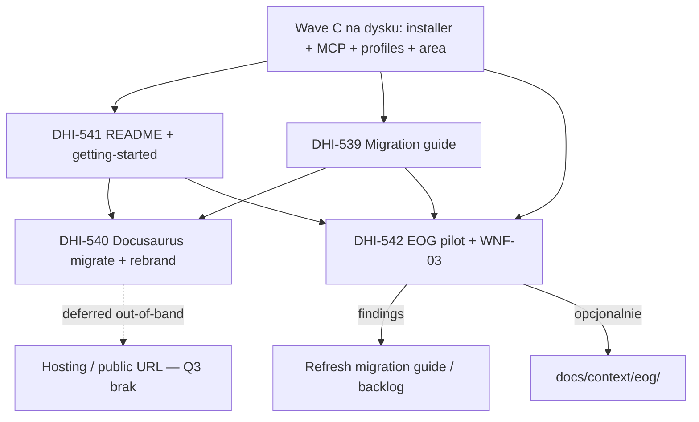

# DHI-515 — Wave D: Research — Dokumentacja + walidacja (Docs + validation)

> Research **po polsku** (pełna wersja) na życzenie maintainera.  
> Zakres: **tylko Wave D** z roadmapy epiku [DHI-515](https://eversis.atlassian.net/browse/DHI-515).  
> Roadmapa epiku (EN): [dhi-515.research.md](./dhi-515.research.md) — **Approved** 2026-08-04.  
> Wave C (PL): [dhi-515.wave-c.research.pl.md](./dhi-515.wave-c.research.pl.md) / [dhi-515.wave-c.plan.pl.md](./dhi-515.wave-c.plan.pl.md).  
> Ten dokument **nie** zastępuje story-level SDD (`docs/specs/dhi-539|540|541|542/`); jest mapą podejścia i zależności przed planami poszczególnych historyjek.

## Szczegóły zadania

| Pole | Wartość |
|---|---|
| Jira (epik) | [DHI-515](https://eversis.atlassian.net/browse/DHI-515) — Multi-Agent AI Context Isolation & Standard |
| Zakres research | **Wave D — Docs + validation** |
| Typ | Analiza falowa (multi-story) — research + plan po approve Gaps |
| Data research | 2026-08-06 |
| Język deliverable | **Polski** |
| Folder spec | `docs/specs/dhi-515/` |
| Intent | Research Wave D **Approved** → Plan Wave D (PL) → **stop na gate planu** przed Implement |

### Historyjki Wave D (z roadmapy epiku)

| Kolejność (sugerowana) | Story | Jira | Priorytet (extracted / Jira) | Temat |
|------------------------|-------|------|------------------------------|--------|
| 1 | 6.2 | [DHI-541](https://eversis.atlassian.net/browse/DHI-541) | Medium | README + getting-started (repo-local) |
| 2 | 6.1 | [DHI-539](https://eversis.atlassian.net/browse/DHI-539) | High | Migration guide z Cursor Collections → Agent Collections |
| 3 | 6.4 | [DHI-540](https://eversis.atlassian.net/browse/DHI-540) | High | Migracja + rebrand Docusaurus (`website/`) |
| 4 | 6.3 | [DHI-542](https://eversis.atlassian.net/browse/DHI-542) | Medium | Pilot EOG + pomiar / estymacja WNF-03 (≥30%) |

**Mapowanie Jira ↔ Story numer:** 6.1 = DHI-539, 6.2 = DHI-541, 6.3 = DHI-542, 6.4 = DHI-540 (kolejność numerów Story ≠ kolejność kluczy Jira).

**Status Jira (2026-08-06):** wszystkie cztery historyjki = **To Do**.

## Wpływ biznesowy

Wave D zamyka epik od strony **adoptera i dowodu**:

1. Nowy konsument rozumie architekturę, instalację i codzienny workflow **bez czytania BRD** (541).
2. Istniejący konsument `cursor-collections` ma bezpieczną ścieżkę cutover + rollback (539), przy **pełnym rozdzieleniu kanałów docs** (Q6).
3. Pełna strona dokumentacji (Docusaurus) żyje w `agent-collections` pod marką Agent Collections — bez linków do docs Cursor Collections (540).
4. Pilot w monorepo **EOG** (`portal/` + `cms/`) potwierdza izolację multi-agent i cel WNF-03 (≥30% redukcji kontekstu lub uzasadniona estymacja) (542).

Bez Wave D: Wave C daje działającą dystrybucję, ale brak przewodników adopcji, portalu docs i empirycznego dowodu w projekcie enterprise.

## Kryteria sukcesu Wave D (agregat AC)

| ID | Kryterium | Główne story |
|----|-----------|--------------|
| D1 | README: wizja, model core/adapters, komenda install, **link do migration guide** | DHI-541 |
| D2 | Getting-started: deweloper kończy pierwszą udaną instalację na sample project | DHI-541 |
| D3 | Traceability WF-01…WF-05 (i kluczowych WNF) → sekcja docs lub deliverable story | DHI-541 |
| D4 | Migration guide: cutover z równoważną/lepszą zdolnością multi-agent; rollback; local vs core vs generated | DHI-539 |
| D5 | Kanały niezależne — **zero** ongoing doc links / redirects / shared portals między repo | DHI-539, DHI-540 |
| D6 | `agent-collections/website/` buduje się lokalnie (`npm run build`); coverage ≥ legacy; rebrand Cursor→Agent; multi-agent (Claude + isolation) | DHI-540 |
| D7 | Hosting / publiczny URL — **odroczony** (brak hostingu na dziś); w Wave D: gotowość stub (green build + config bez fałszywego URL produkcyjnego) | DHI-540 |
| D8 | EOG: install Agent Collections; FE (Cursor) + BE (Claude) bez kolizji kontekstu w uzgodnionym okresie pilota | DHI-542 |
| D9 | Dokumentacja upgrade EOG z `setup-cursor-local.sh` / `CURSOR_COLLECTIONS_HOME` → installer Agent Collections | DHI-542 |
| D10 | Dowód WNF-03: ≥30% redukcji vs unscoped **albo** uzasadniona estymacja + plan pomiaru (proxy z isolation-strategy §7.2) | DHI-542 |
| D11 | Findings → backlog + aktualizacje migration guide + opcjonalnie `docs/context/eog/` | DHI-542 |

Dziedziczone: **SDD** na każdej historyjce (research → plan → implement → review → Fine).

---

## Zebrane informacje

### Knowledge Base & Task Management

| Źródło | Treść istotna dla Wave D |
|--------|---------------------------|
| Epik research `dhi-515.research.md` | Wave D = 541 → 539 → 540 → 542; Q1–Q4 epiku resolved; Q6 = brak coupling docs; EOG = submodule default |
| Wave C research/plan (PL) | Essentials 533+534+538 odblokowują Wave D; Wave D poza zakresem Wave C |
| `extracted-tasks.md` WS6 | Pełne AC Stories 6.1–6.4; zależności 6.1←5.1; 6.4←5.1+6.2; 6.3←5.2+5.3+5.6+3.3 |
| `intent-brief.md` | Q1 Docusaurus → migrate+rebrand; Q2 pilot = EOG |
| Jira DHI-539…542 | Status **To Do**; AC zgodne z extracted-tasks + inherited SDD |
| Decyzje stakeholder | Dual channel kodu OK; **docs w pełni rozdzielone**; Claude MVP bez pełnego MCP parity |

### Codebase — stan `agent-collections` (2026-08-06) pod kątem Wave D

#### Prerequisites Wave C (na dysku — warunek startu Wave D)

| Obszar | Stan | Znaczenie dla Wave D |
|--------|------|----------------------|
| Bootstrap bez sibling symlinków skills/prompts/commands | **Jest** — `.cursor/skills` **nie istnieje** (Q1: bez pełnego mirroru); rules lokalne | Migration guide i getting-started muszą opisywać MCP + load-by-id, nie mirror skills |
| MCP `mcp/eversis-collections-mcp/` | **Jest** — resolve przez `AGENT_COLLECTIONS_HOME` | Docs i pilot: env + `npm run mcp:build` |
| Installer `scripts/setup-agent-collections.sh` | **Jest** — local / submodule / copy; wizard; `--upgrade` | Główna ścieżka w getting-started, migration, pilot |
| Profile domenowe + area | **Jest** — `adapters/profiles/{frontend,backend,fullstack}.yaml` + `area-*-scope.yaml` | Pilot EOG wymaga **mapowania** `portal/`/`cms/` (abstract layout = `apps/web`/`apps/api`) |
| Selection | **Jest** — `.agent-collections/install-selection.json` + `docs/architecture/install-selection.md` | Upgrade path w migration + pilot |
| Isolation strategy | **Jest** — §7 WNF-03 + metoda proxy; §8.2 kontrakt 542 | Empiryczny dowód = DHI-542 |
| README | **Częściowy** — quick start, install, upgrade, layout, SDD | **Brak** linku do migration guide; brak dedykowanego getting-started „first install on sample”; brak macierzy WF→docs |
| `AGENTS.md` / `CLAUDE.md` | **Jest** (reference framework) | Orientacja maintainer; nie zastępują getting-started konsumenckiego |
| `docs/architecture/*` | mapping, isolation, agents-md-standard, install-selection | Materiał do strony docs i traceability |
| `website/` | **Brak** | Cała DHI-540 |
| `documentation/` (framework reference) | **Brak** | Legacy `cursor-collections/documentation/cursor-collection.md` do decyzji portu/rebrand |
| `docs/guides/` / migration | **Brak** | Cała DHI-539 |
| `docs/context/eog/` | **Brak** | Output pilota (542) |
| Scripts docs-site | **Brak** `website` w `package.json` | Po 540: build/validate site |

#### Stan referencyjny `cursor-collections` (źródło treści docs)

| Artefakt | Ścieżka | Co brać do Wave D |
|----------|---------|-------------------|
| Docusaurus site | `website/` (~120 plików `.md` w `docs/`) | Port do `agent-collections/website/`; rebrand tytułów/URL/ścieżek |
| Config | `website/docusaurus.config.ts` | Dziś: title **Cursor Collections**, url `https://cursor-collections-1ztm.vercel.app` → nowy brand; **url hostingu odroczony** (Q3 — brak hostingu); config placeholder / lokalny do czasu decyzji hostingu |
| Sekcje docs | `getting-started/`, `agents/`, `skills/`, `prompts/`, `workflow/`, `integrations/`, `specs/`, `framework-reference.md`, `for-ctos.md`, `use-cases.md` | Przepisać pod core `.ai/` + adapters + installer Agent Collections; dodać Claude + isolation |
| Framework doc | `documentation/cursor-collection.md` | Źródło treści „authoritative Cursor guide” — **nie** kopiować 1:1 jako Cursor-only; zneutralizować / rozdzielić kanały |
| Installer legacy | `scripts/setup-cursor-local.sh` | Tylko jako **źródło porównawcze** w migration guide (nie link do docs site legacy) |

#### Stan pilota `eog` (konsument)

| Fakt | Szczegół |
|------|----------|
| Layout | `portal/` (Next.js FE), `cms/` (Liferay BE), plus `external_integration/`, `e2e/`, handbooks, infra |
| Framework dziś | Cursor Collections — `scripts/setup-cursor-local.sh`, MCP z `CURSOR_COLLECTIONS_HOME` |
| `AGENTS.md` | Opisuje **Eversis Cursor Collections**; mapa obszarów EOG już bogata |
| Submodule agent-collections | **Brak** `.gitmodules` (na 2026-08-06) — pilot musi dodać vendor submodule (epik Q2) lub local path |
| Area profiles framework | Abstract `apps/web/**`, `apps/api/**` — **nie** mapują 1:1 na `portal/`/`cms/` bez consumer overlay |

### Relevant Links

- Epik: https://eversis.atlassian.net/browse/DHI-515
- Stories: https://eversis.atlassian.net/browse/DHI-539 … DHI-542
- `docs/architecture/isolation-strategy.md` — WNF-03 §7, kontrakt 542
- `docs/architecture/adapter-mapping.md` — capability matrix Cursor vs Claude (treść migration + site)
- `docs/architecture/install-selection.md` — selection / upgrade
- Legacy site (tylko źródło portu, **nie** target linków): `cursor-collections/website/`
- Pilot: `/Users/piotrniemirski/Documents/Projects/eog`

### Diagram zależności Wave D



---

## Current Implementation Status

### Existing Components (przydatne Wave D)

| Komponent | Ścieżka | Status względem Wave D |
|-----------|---------|------------------------|
| README (MVP self-contained) | `README.md` | **Częściowy** — baza pod 541; luki AC |
| CHANGELOG | `CHANGELOG.md` | Reuse — sekcje Migration przy breaking |
| Architektura | `docs/architecture/*` | Reuse jako źródło treści site + guide |
| Installer + smoke | `scripts/setup-agent-collections.sh`, `*.test.sh` | Reuse w getting-started i pilot |
| MCP | `mcp/eversis-collections-mcp/` | Reuse w docs i EOG mcp.json |
| Profile / area | `adapters/profiles/*` | Reuse; EOG wymaga customizacji ścieżek |
| Skill docs writer | `eversis-writing-repo-documentation` | Delegacja przy implementacji docs (stack: Load when) |
| Prompt docs | `eversis-repo-docs-writer` | Routing orchestracji dla zadań docs |

### Missing Components (luki Wave D)

| Luka | Story | Uwagi |
|------|-------|-------|
| Drzewo `website/docs/getting-started/` (stem’y CC) | 541 | README ma Quick start, ale brak kategorii getting-started jak w CC |
| Link README → migration guide | 541/539 | Guide jeszcze nie istnieje — kolejność 541→539 + refresh |
| Macierz WF → docs | 541 | Brak |
| Migration guide | 539 | Target: `website/docs/getting-started/migration-from-cursor-collections.md` |
| `website/` Docusaurus + rebrand + multi-agent pages | 540 | Brak katalogu (poza ewentualnym content-first getting-started z 541) |
| Publiczny hosting / URL site | 540 | **Q3 Resolved — brak hostingu**; poza Wave D / out-of-band gdy hosting powstanie |
| Walidacja linków docs-site w tym repo | 540 | Legacy ma `validate-cursor-markdown-links`; agent-collections nie ma jeszcze odpowiednika |
| Install Agent Collections w EOG | 542 | Nadal Cursor Collections |
| Pomiar / estymacja WNF-03 na EOG | 542 | Brak evidence pack |
| `docs/context/eog/` | 542 | Opcjonalny output |

### Relevant Code / Paths (inventory do planu)

```text
# Target (agent-collections) — ścieżki Q2 (analogicznie do cursor-collections)
README.md                                              # 541 polish; linki jak w CC → website/docs/…
website/docs/getting-started/                          # 541+540 (jak CC)
  start-here.md
  prerequisites.md
  installation.md
  mcp-setup.md
  quick-wins.md
  migration-from-cursor-collections.md                 # 539 (nowa strona; CC nie ma migration)
documentation/agent-collection.md                      # analog documentation/cursor-collection.md
website/                                               # 540 pełny port Docusaurus + rebrand
docs/architecture/*                                    # reuse content
docs/context/eog/                                      # 542 optional
scripts/setup-agent-collections.sh                     # documented + used in pilot
adapters/profiles/*                                    # pilot area mapping

# Source (cursor-collections) — read-only port / wzorzec layoutu
website/docs/getting-started/{start-here,prerequisites,installation,mcp-setup,quick-wins}.md
website/**                                             # ~120 md + docusaurus.config.ts
documentation/cursor-collection.md

# Pilot (eog) — consumer changes in 542
AGENTS.md
.cursor/mcp.json                                       # CURSOR_COLLECTIONS_HOME → AGENT_COLLECTIONS_HOME
scripts/setup-cursor-local.sh                          # deprecate / replace path in runbook
portal/, cms/                                          # area scoping validation
```

### Wybrane ścieżki docs (Gap Q2 — Resolved)

Konwencja **mirror `cursor-collections`** (inspected 2026-08-06):

| Artefakt CC | Ścieżka CC | Ścieżka Agent Collections (wybrana) |
|-------------|------------|-------------------------------------|
| Getting Started (kategoria) | `website/docs/getting-started/` | **`website/docs/getting-started/`** (te same stem’y stron) |
| Start here / prereq / install / MCP / quick-wins | `…/start-here.md`, `prerequisites.md`, `installation.md`, `mcp-setup.md`, `quick-wins.md` | **Identyczne nazwy plików** pod `website/docs/getting-started/` |
| Framework reference | `documentation/cursor-collection.md` | **`documentation/agent-collection.md`** |
| README → docs | linki względne do `website/docs/…` | **Ten sam wzorzec** (nawet gdy publiczny hosting jeszcze nie istnieje) |
| Migration guide | *(brak w CC)* | **`website/docs/getting-started/migration-from-cursor-collections.md`** (peer instalacji w tej samej kategorii) |

**Zasada SSOT:** treść konsumencka onboarding żyje pod `website/docs/` (jak CC). Faza 541 może utworzyć drzewo markdown **content-first** pod `website/docs/getting-started/` zanim 540 doda pełny scaffold Docusaurus (`docusaurus.config.ts`, theme, pozostałe sekcje). **Nie** wprowadzać drugiej SSOT w `docs/getting-started.md` ani `docs/guides/` (odrzucenie wcześniejszej rekomendacji flat-file).

---

## Analiza per story

### DHI-541 — README + getting-started (Medium) — **sugerowany start Wave D**

**AC (skrót):** README = wizja + core/adapters + install + link do migration; getting-started → pierwsza udana instalacja; WF traceable do docs.

**Luka:** README jest już użyteczny po Wave C, ale:
1. Nie linkuje migration guide (go nie ma).
2. Brak osobnego przewodnika „sample project first install” z checklistą sukcesu.
3. Brak jawnej macierzy WF-01…05 → sekcje docs.

**Podejście (ścieżki Q2 Resolved):**
1. Utworzyć **`website/docs/getting-started/`** ze stem’ami jak w CC (`start-here`, `prerequisites`, `installation`, `mcp-setup`, `quick-wins`) — content-first; kroki: clone/sample → `AGENT_COLLECTIONS_HOME` → installer non-interactive → weryfikacja adapterów/MCP → smoke.
2. Rozszerzyć README o wizję multi-agent + linki względne do `website/docs/getting-started/…` (wzorzec CC) oraz architecture; link migration po 539.
3. Dodać tabelę traceability WF/WNF (w `start-here` / osobna strona w getting-started lub `docs/architecture/requirements-traceability.md` + link).
4. Język docs: **EN** (Q4 Resolved).

**Zależności:** Wave C essentials na dysku (spełnione). Soft-dep na 539 dla linku migration — kolejność 541→539 z refresh README.

### DHI-539 — Migration guide (High)

**AC (skrót):** cutover z równoważną/lepszą zdolnością multi-agent; rollback; co zostaje local vs core vs generated; niezależne produkty bez doc coupling.

**Luka:** Brak przewodnika.

**Podejście (ścieżka Q2 Resolved):** plik **`website/docs/getting-started/migration-from-cursor-collections.md`**.

Spis treści draft:
1. Kiedy migrować vs kiedy zostać na Cursor Collections (dual channel).
2. Prerequisites: tag `agent-collections`, wybór vendor (submodule preferred dla team).
3. Kroki cutover: backup selection/MCP/ignore → install Agent Collections → zamiana env `CURSOR_*` → `AGENT_*` → `sync` / regenerate adapters → weryfikacja Cursor workflow.
4. Ownership plików: project-owned (stack, `docs/context|specs|plans`, lokalne AGENTS) vs generated (rules z sync) vs framework SSOT (nie edytować w konsumencie).
5. Capability matrix: Cursor (MCP skills) vs Claude MVP (`CLAUDE.md` + ignore) — bez obietnicy parity.
6. Rollback: przywrócenie poprzedniego vendor/link + env + mcp.json; warunki „critical gap”.
7. **Zakaz:** linków do `cursor-collections` docs site / shared portals (wolno wymienić nazwę produktu i ścieżki kodu jako fakt migracji).

**Zależności:** 5.1 layout (jest). Pilot 542 będzie źródłem poprawek do guide (iteracja).

### DHI-540 — Docusaurus migrate + rebrand (High)

**AC (skrót):** `website/` w agent-collections; rebrand; multi-agent + isolation; hosting; zero cross-doc links.

**Luka:** Brak całego site.

**Podejście (Q3 Resolved — brak hostingu):**
1. Skopiować szkielet Docusaurus z `cursor-collections/website/` (config, theme, docs tree) zachowując layout `website/docs/getting-started/` itd.
2. Rebrand: title/tagline/footer/meta; **nie** reuse URL legacy Vercel; w config ustawić **placeholder / lokalny** `url`/`baseUrl` (np. lokalny lub TBD) — **bez** zakładania produkcyjnego hostname.
3. Zsynchronizować treść getting-started z faz 541/539; przepis installation na `setup-agent-collections.sh` + `.ai/` + MCP `AGENT_COLLECTIONS_HOME`.
4. Nowe/rozszerzone strony: core/adapters model, Claude Code MVP, isolation-strategy summary, install selection/upgrade.
5. Skills/prompts/agents pages: ścieżki `.ai/skills`, `.ai/prompts`, MCP tools — usunąć Cursor-only idiomy gdzie mylące.
6. Scrub linków: żadnych deep-linków do legacy docs site; GitHub code channel Cursor Collections = osobny produkt, nie docs portal.
7. Build: `cd website && npm run build` (green) + skrypt root / README; opcjonalnie walidator linków.
8. **Hosting / deploy publiczny: OUT OF BAND / deferred** — poza DoD Wave D do czasu pojawienia się hostingu; AC D7 = stub readiness (green build + dokumentacja „hosting TBD”), nie live URL.

**Zależności:** 5.1 + 6.2 (README/getting-started jako kanoniczne fakty do zsynchronizowania ze site).

### DHI-542 — Pilot EOG + WNF-03 (Medium)

**AC (skrót):** install w EOG; FE Cursor + BE Claude bez kolizji; upgrade z legacy; ≥30% lub uzasadniona estymacja; findings → guide/backlog/`docs/context/eog/`.

**Luka:** EOG nadal na Cursor Collections; brak evidence pack; area globs framework nie znają `portal/`/`cms/`.

**Podejście:**
1. **Branch pilota** w EOG (rollback-friendly).
2. Vendor: **git submodule** do taga `agent-collections` (epik Q2) + `setup-agent-collections.sh --vendor submodule --agents=cursor,claude --profile=…`.
3. Consumer overlays: area globs / ignore dla `portal/**` vs `cms/**` (nie hardcodować nazw klientów w frameworku — mapowanie w EOG).
4. Zamień MCP env na `AGENT_COLLECTIONS_HOME`; zachowaj inne serwery MCP EOG (atlassian, figma, …).
5. Okres pilota: uzgodnić długość i definicję „no reported collisions” (Gap Q5).
6. Pomiar WNF-03 wg isolation-strategy §7.2: zbiór U vs S (file count / tree size / approx tokens); udokumentować proxy; cel ≥30% dla typowego `frontend-scope` (portal) i `backend-scope` (cms).
7. Runbook upgrade (może sekcja w 539 + notatki EOG): kroki, regresja Cursor daily workflow, checklist.
8. Output: evidence markdown (w `docs/specs/dhi-542/` i/lub `docs/context/eog/`), aktualizacje migration guide, backlog fixów.

**Zależności:** 5.2, 5.3, 5.6, 3.3 na dysku (installer/profiles/wizard/area — **spełnione w agent-collections**). Soft-dep na 539/541 dla spójnych runbooków.

---

## Proponowana kolejność implementacji (po approve research Wave D)

| # | Story | Dlaczego teraz | Blokuje |
|---|-------|----------------|---------|
| 1 | **DHI-541** | Najszybsza wartość adopcji; stabilizuje fakty install dla site | Treść 540; czytelność pilota |
| 2 | **DHI-539** | Cutover guide przed/obok pilota; High priority | Rollback w 542; link w README |
| 3 | **DHI-540** | Duży port treści; potrzebuje stabilnych faktów z 541 (+ fragmentów 539); build lokalny | Portal docs in-repo; **hosting deferred** |
| 4 | **DHI-542** | Walidacja enterprise na żywym installerze | Zamknięcie epiku / WNF-03 evidence |

**Zasada SDD:** ten research Wave D = roadmapa; **każda** historyjka ma własny `docs/specs/dhi-53x/*.research.md` (+ plan) przed kodem — chyba że maintainer zatwierdzi wspólny plan Wave D (jak Wave C).

**Uwaga vs wcześniejszy gate epiku:** parent research mówił „nie zaczynać Wave D przed essentials Wave C (533+534+538)”. **Na dysku (2026-08-06) essentials są obecne** (mcp, scripts, profiles, brak symlinków skills). Status Jira Wave C może nadal być To Do / Fine niedomknięte — to **nie blokuje technicznie** research/plan Wave D (analogicznie Gap Q6 Wave C). Potwierdzenie: Gap Q1 poniżej.

---

## Pytania do stakeholders (Gaps) — **Resolved 2026-08-06**

#### Gap Q1 — Czy wolno planować / implementować Wave D przy niedomkniętych Fine Jira Wave C?

**Pytanie:** Artefakty Wave C są na dysku; czy gate „essentials istnieją” wystarczy, czy wymagamy formalnego Done/Fine wszystkich story Wave C?

**Rekomendacja:** **Tak dla research/plan Wave D** przy essentials na dysku (533/534/538/535/536/530). Fine Jira Wave C domknąć osobno; nie blokować docs.

**Decyzja (human):** **OK** — planować Wave D nawet jeśli Fine Jira Wave C nie jest w pełni zamknięte, o ile essentials są na dysku.

**Status:** ✅ **Resolved**

#### Gap Q2 — Ścieżka artefaktów markdown (541 / 539)

**Pytanie:** Gdzie żyją getting-started i migration guide przed (i obok) Docusaurus?

**Rekomendacja (wcześniejsza, odrzucona):** flat `docs/getting-started.md` + `docs/guides/migration-….md`.

**Decyzja (human):** **ANALOGICZNIE DO cursor-collections** — mirror path/layout z sibling `cursor-collections`.

**Wybrane ścieżki (inspected CC 2026-08-06):**

| Artefakt | Ścieżka |
|----------|---------|
| Getting Started | `website/docs/getting-started/` (`start-here.md`, `prerequisites.md`, `installation.md`, `mcp-setup.md`, `quick-wins.md`) |
| Migration | `website/docs/getting-started/migration-from-cursor-collections.md` |
| Framework reference | `documentation/agent-collection.md` (analog `documentation/cursor-collection.md`) |
| README links | względne do `website/docs/…` (jak CC), niezależnie od publicznego hostingu |

**Status:** ✅ **Resolved**

#### Gap Q3 — Hosting i URL site (540)

**Pytanie:** Nowy projekt Vercel / nowy hostname, czy inny hosting? Kto tworzy projekt?

**Rekomendacja (wcześniejsza):** Nowy deployment + hostname przy implementacji 540.

**Decyzja (human):** **JESZCZE BRAK HOSTINGU** — nie ma hostingu/URL dla Docusaurus.

**Implikacja planowa:** Wave D = build + rebrand **in-repo**; publiczny deploy / produkcyjny URL = **deferred / out-of-band**. Config bez fałszywego Vercel URL legacy; placeholder/TBD do czasu hostingu. AC D7 = stub readiness (green `website` build), nie live site.

**Status:** ✅ **Resolved**

#### Gap Q4 — Język dokumentacji konsumenckiej

**Pytanie:** EN (jak obecny README i legacy site) czy PL?

**Rekomendacja:** **EN** dla README / getting-started / migration / website (produkt frameworkowy, dual-channel EN). Research/plan falowe mogą pozostać PL jak ten dokument.

**Decyzja (human):** **OK**

**Status:** ✅ **Resolved**

#### Gap Q5 — Definicja okresu pilota i „brak kolizji” (542)

**Pytanie:** Ile trwa pilot? Jak raportować „no reported context collisions”?

**Rekomendacja:** Minimum **5 dni roboczych** lub **N sesji** (np. ≥3 FE Cursor + ≥3 BE Claude) z checklistą kolizji (obce rules toola, przeciek `cms` do sesji portal, indeksowanie `.cursor` w Claude itd.). Wynik w evidence pack; brak incydentów = PASS; incydenty → backlog + nie blokować estymacji WNF-03 jeśli izolacja ścieżek jest mierzalna.

**Decyzja (human):** **OK**

**Status:** ✅ **Resolved**

#### Gap Q6 — Metoda pomiaru WNF-03 na EOG

**Pytanie:** Twardy pomiar tokenów sesji vs proxy file-count/tree-size z isolation-strategy §7.2?

**Rekomendacja:** MVP = **proxy udokumentowany** (file count lub approx tokens text files) U vs S dla `frontend-scope`≈`portal` i `backend-scope`≈`cms`, cel ≥30%. Jeśli proxy &lt;30%, dołączyć justified estimate + plan poprawy profili (ciężka infra EOG: charts, nginx, docker). Pełny pomiar tokenów IDE = opcjonalne wzmocnienie, nie blocker.

**Decyzja (human):** **OK**

**Status:** ✅ **Resolved**

#### Gap Q7 — Mapowanie area profiles EOG (`portal`/`cms` vs `apps/web`/`apps/api`)

**Pytanie:** Czy framework zmienia abstract layout, czy EOG trzyma consumer overlay?

**Rekomendacja:** **Consumer overlay w EOG** (project-owned ignore / lokalne profile docs w `docs/context/eog/`). Framework zachowuje abstract `apps/*` w `adapters/profiles/area-*.yaml`. Migration guide wyjaśnia wzorzec overlay.

**Decyzja (human):** **OK**

**Status:** ✅ **Resolved**

### Odpowiedzi już znane (nie otwierać ponownie)

| ID | Decyzja |
|----|---------|
| Q1 epik | SemVer tag na `agent-collections`; nie npm dla `.ai/` w MVP |
| Q2 epik | EOG default = **submodule**; local + copy też |
| Q3 epik | Claude MVP = `CLAUDE.md` + ignore + guidance; bez pełnego MCP parity |
| Q4 epik | Story-by-story; mega-plan Wave tylko na prośbę |
| Q5 epik | Osie install: agents × MCP × domain profile |
| Q6 epik | Docs channels **w pełni rozdzielone** — zero cross-repo doc portals |
| Intent Q1 | Docusaurus **migruje** do agent-collections + rebrand |
| Intent Q2 | Pilot = **EOG** |

---

## Ryzyka

| # | Ryzyko | Mitygacja |
|---|--------|-----------|
| 1 | Port 120 stron Docusaurus z Cursor-only idiomatic → treść myląca po rebrand | Checklist scrub + nowe strony multi-agent; sync faktów z README/541 |
| 2 | Przypadkowe „see also” linki do legacy docs (naruszenie Q6) | AC + grep CI / validate links; zakaz w DoD 539/540 |
| 3 | README obiecuje migration guide zanim 539 istnieje | Kolejność 541↔539 lub skeleton + refresh |
| 4 | Area profiles `apps/*` nie działają na EOG `portal`/`cms` → fałszywy FAIL WNF-03 | Overlay konsumencki (Q7); mierzyć na skutecznym scope |
| 5 | Pilot psuje daily Cursor workflow w EOG | Branch + rollback w 539; submodule pin; checklist regresji |
| 6 | Hosting/Vercel poza kontrolą agenta / **brak hostingu** | Q3 Resolved: deploy publiczny **deferred**; Wave D = green lokalny build + stub readiness |
| 7 | Dual-channel drift treści docs vs kod | Site i README opisują **ten sam** tag SemVer; CHANGELOG Migration subsections |
| 8 | Estymacja WNF-03 kwestionowana stakeholder | Przejrzysty proxy §7.2 + raw numbers w evidence pack |

## Założenia

1. Essentials Wave C na dysku są **wystarczające**, by planować i później implementować Wave D (Q1 Resolved).
2. `cursor-collections` pozostaje żywym kanałem **kodu** Cursor; jego docs site może żyć dalej niezależnie.
3. OpenCode pozostaje placeholder — docs nie obiecują pełnego adaptera.
4. Pilot nie obejmuje feature work produktu EOG — tylko framework install/isolation/measurement.
5. Język konsumenckich docs = **EN** (Q4 Resolved).
6. Layout docs = **analog CC** pod `website/docs/…` + `documentation/agent-collection.md` (Q2 Resolved).
7. Publiczny hosting docs site **nie istnieje** w momencie planu — nie blokuje build/rebrand (Q3 Resolved).

## Out of Scope (ten research / Wave D)

- Implementacja kodu / treści docs **przed** approve planu Wave D
- Deprecacja repo `cursor-collections` lub wyłączenie jego docs site
- Pełna implementacja OpenCode
- Feature work w `portal/` / `cms/` EOG
- BA Docs Word (`.docx`) — stack policy: Do not load
- Tworzenie Jira Sub-tasków SDD (odrzucone)
- Automatyczny post do Jira
- **Publiczny hosting / deploy Docusaurus** (Vercel lub inny) — deferred out-of-band (Q3)

---

## Adequacy Checklist (ten artefakt)

| Check | Wynik |
|-------|--------|
| Latest AC / intent Wave D | Pokryte Stories 6.1–6.4 (DHI-539–542); Q6 / intent Q1–Q2; WNF-03 |
| Paths / system state | Zaktualizowany stan 2026-08-06: Wave C essentials na dysku; brak `website/` i migration guide; EOG na Cursor Collections; ścieżki Q2 = mirror CC |
| Open questions | Gap Q1–Q7 — **Resolved** (human 2026-08-06) |
| Plan coverage | Plan Wave D (PL) — CREATE w tej samej sesji po approve research |

## Gate / Approval

| Pole | Wartość |
|---|---|
| Research status (Wave D) | **Approved** 2026-08-06 (Gaps Q1–Q7 = decyzje człowieka) |
| Plan Wave D | **CREATE** — [`dhi-515.wave-d.plan.pl.md`](./dhi-515.wave-d.plan.pl.md) — **Awaiting plan approval** |
| Implement kod / docs content | **STOP** — nie zaczynać do approve planu |
| Następny krok | Człowiek: **Approve plan Wave D** → dopiero wtedy Implement (kolejność 541→539→540→542) |

---

## Changelog

| Data | Zmiana |
|------|--------|
| 2026-08-06 | CREATE — research Wave D (PL): docs + validation; stan repo/EOG/legacy site; luki; zależności; Gaps Q1–Q7 |
| 2026-08-06 | DELTA — Gaps Q1–Q7 **Resolved** (Q1 OK; Q2 analog CC paths; Q3 brak hostingu / deferred; Q4–Q7 OK); status Research **Approved**; ścieżki docs + D7 hosting stub; pointer do planu |
