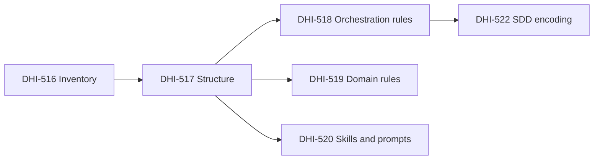

# DHI-517 — Analysis Result: Define core neutral rules directory structure

## Task Details

| Field | Value |
|---|---|
| Jira ID | [DHI-517](https://eversis.atlassian.net/browse/DHI-517) |
| Title | Define core neutral rules directory structure |
| Description | Define `.ai/` (or equivalent) directory layout so neutral rules have a consistent, domain-scoped home (BRD WF-01.1 / WF-01.2; Filar 1) |
| Priority | Highest |
| Reporter | Piotr Niemirski |
| Created Date | 2026-07-30 |
| Due Date | — |
| Labels | `agent-collections`, `core-extraction`, `spec-driven`, `workshop-2026-07-30` |
| Estimated Effort | Small–medium (structure + docs + one sample; no bulk content port) |
| Parent epic | [DHI-515](https://eversis.atlassian.net/browse/DHI-515) |
| Spec folder | `docs/specs/dhi-517/` |
| Research date | 2026-08-04 |
| Prerequisite | [DHI-516](https://eversis.atlassian.net/browse/DHI-516) inventory delivered (`docs/specs/dhi-516/asset-inventory.md`) |

**User story:** As a framework maintainer, I want a defined `.ai/` (or equivalent) directory layout so that all neutral rules have a consistent, domain-scoped home.

## Business Impact

Locks the **SSOT path** for Agent Collections (WF-01). Without an agreed tree, DHI-518–520 cannot place orchestration rules, domain rules, skills, or prompts consistently. Adapters (Wave B), MCP skill resolution (DHI-535), and installer domain profiles (DHI-536) all depend on this layout.

## Acceptance Criteria (from Jira)

1. GIVEN the BRD domain requirements WHEN the core structure is documented THEN folders exist for at least **frontend**, **backend**, **shared-types**, **devops**, **architecture**, and **shared orchestration**
2. GIVEN the structure definition WHEN a sample rule file is placed THEN it uses **neutral Markdown** without Cursor/Claude-specific front matter
3. GIVEN the structure WHEN reviewed THEN it explains how **skills**, **prompts**, and **orchestration contracts** map into the core (not only `.mdc` rules)
4. Inherited SDD AC (spec folder, research, plan, review, Fine)

## Gathered Information

### Knowledge Base & Task Management Tools

- **Jira DHI-517** — structure + sample + mapping doc; not bulk extraction.
- **Sibling Wave A stories:**
  | Key | Summary | Boundary vs DHI-517 |
  |-----|---------|---------------------|
  | DHI-516 | Inventory | Done — classification + target hints |
  | **DHI-517** | **Directory structure** | **This story — empty/stub tree + sample + README map** |
  | DHI-518 | Extract shared orchestration rules | Full agent-core / EM / Fine / testing content → `rules/orchestration/` |
  | DHI-519 | Extract domain-scoped core rules | Fill frontend/backend/devops/architecture/shared-types |
  | DHI-520 | Port skills and prompts | Fill `skills/` and `prompts/{public,internal}/` |
  | DHI-522 | Encode SDD | Lifecycle text in core + AGENTS/templates (after 518) |
- Epic research `dhi-515.research.md` (**Approved**) proposes:

```text
.ai/
  rules/{frontend,backend,shared-types,devops,architecture,orchestration}/
  skills/
  prompts/
```

- Workshop Story 1.2 (`extracted-tasks.md`) matches Jira AC; preferred root name **`.ai/`**.
- Epic Q1: core ships inside **repo semver** (not a separate npm package for `.ai/`).

### Codebase

| Repo | Relevant state |
|------|----------------|
| `agent-collections` | No `.ai/` today; scaffold `.cursor/` (mostly symlinks to `cursor-collections`); local `eversis-project-stack.mdc` |
| `cursor-collections` | Rules flat under `.cursor/rules/*.mdc` (YAML front matter: `description`, `globs`, `alwaysApply`); skills under `.cursor/skills/eversis-*`; prompts under `.cursor/prompts/{public,internal}/` |
| Inventory | Target hints: rules → `.ai/rules/…` + adapter packaging; skills → `.ai/skills/`; prompts → `.ai/prompts/public\|internal/` |

Legacy rules are **not** domain-foldered today; domain folders are a **new** Agent Collections organization. Mapping of which legacy rule lands where is **DHI-518/519**, not this story — except the **sample** proving format.

### Relevant Links

- [DHI-517](https://eversis.atlassian.net/browse/DHI-517)
- [DHI-515](https://eversis.atlassian.net/browse/DHI-515)
- `docs/specs/dhi-515/dhi-515.research.md`
- `docs/specs/dhi-516/asset-inventory.md`
- `docs/specs/cursor-collection-migration/extracted-tasks.md` (Story 1.2)

### Relevant Charts & Diagrams



## Current Implementation Status

### Existing Components

- Epic target tree — `dhi-515.research.md` — **reuse as baseline** (confirm, do not invent alternate root)
- Asset inventory target hints — `asset-inventory.md` — **reuse** for path alignment
- Legacy `.mdc` bodies — **do not port** in DHI-517 (sample only)
- `adapters/`, installer, MCP — **out of scope** (later waves)

### Key Files and Directories

- `docs/specs/dhi-516/asset-inventory.md` — Core target paths
- `.cursor/rules/*.mdc` (via symlink) — format to **avoid** in core (no Cursor YAML)
- `AGENTS.md` — still Cursor-leaning; agnostic rewrite is DHI-531/532 (may briefly mention `.ai/` after this story if plan allows a one-line pointer — optional, not required by AC)

## Proposed Structure (for plan / implement)

**Root:** `.ai/` at `agent-collections` repo root (not under `.cursor/`).

```text
.ai/
  README.md                          # SSOT map: rules / skills / prompts / contracts
  rules/
    frontend/README.md
    backend/README.md
    shared-types/README.md
    devops/README.md
    architecture/README.md
    orchestration/
      README.md
      sample-lifecycle.md            # AC #2 sample (neutral Markdown)
  skills/
    README.md                        # stub — content in DHI-520
  prompts/
    README.md
    public/.gitkeep                  # or README — preserve public/internal split
    internal/.gitkeep
```

**Folder naming:** use `orchestration/` (matches epic tree). Jira “shared orchestration” = this folder’s role, not the directory name `shared-orchestration/`.

**Neutral rule format (sample + future ports):**

| Allowed | Forbidden in `.ai/rules/**/*.md` |
|---------|----------------------------------|
| Plain Markdown headings/lists | YAML/TOML front matter (`description:`, `globs:`, `alwaysApply:`) |
| Tool-agnostic wording (“attach the Implement prompt”, “load skill via MCP”) | Cursor-only syntax as **required** UX (`@eversis-*` as only invocation) |
| Stable kebab-case filenames | `.mdc` extension |
| Optional H1 title | Claude-specific `CLAUDE.md` conventions inside core rule files |

**Sample content intent:** short vendor-neutral sketch of Ideate → Implement → Review + human gates (placeholder). Full extraction = **DHI-518**.

### Mapping contract (AC #3 — must appear in `.ai/README.md`)

| Core asset | Path under `.ai/` | Adapter / consumer role (later stories) |
|------------|-------------------|------------------------------------------|
| Domain & orchestration **rules** | `rules/<domain>/*.md` | Cursor adapter → `.cursor/rules/*.mdc`; Claude → sections in `CLAUDE.md` |
| **Skills** | `skills/eversis-<topic>/` (layout reserved; packages in DHI-520) | MCP `eversis_skills_*` resolves from `.ai/skills/`; Cursor may symlink or generate |
| **Prompts** | `prompts/public/`, `prompts/internal/` | Public = user entrypoints; Internal = EM delegation; Cursor adapter may mirror under `.cursor/prompts/` |
| **Orchestration contracts** | Documented in `rules/orchestration/` + referenced from README (lifecycle, Fine handoff, SDD gates) | Prompt bodies remain under `prompts/`; skills like `eversis-orchestrating-implementation` under `skills/` — **contracts are not only `.mdc`** |

Commands stay **Cursor-specific** (inventory): not under `.ai/`; generated or kept in adapter layer.

## Gap Analysis

**Status:** Approved by maintainer **2026-08-04** (Q1–Q5 OK).

### Question 1
#### Confirm root name `.ai/` vs equivalent?
**Answer (approved):** Use **`.ai/`**.

### Question 2
#### Create empty `skills/` and `prompts/{public,internal}/` in DHI-517, or only `rules/*` domains?
**Answer (approved):** Create **all three** top-level trees now (stubs + README). Do **not** copy 45 skills / 28 prompts yet.

### Question 3
#### Sample rule: which domain and how large?
**Answer (approved):** `.ai/rules/orchestration/sample-lifecycle.md` — short (≈1 screen), neutral Markdown, not a full port of `eversis-agent-core.mdc`.

### Question 4
#### Empty domain folders: README vs `.gitkeep` only?
**Answer (approved):** **README.md per domain** (purpose + “content arrives in DHI-518/519”).

### Question 5
#### Update consumer `AGENTS.md` in this story?
**Answer (approved):** Skip AGENTS.md in DHI-517 (optional only). Full agnostic AGENTS.md = DHI-531/532. Not required by AC.

## Out of Scope (this story)

- Bulk move/neutralize of rules (DHI-518, DHI-519)
- Port of skills/prompts bodies (DHI-520)
- Adapter generation, ignore triad, installer, MCP path rewrite
- Creating `adapters/` tree
- EOG pilot changes
- Renaming `documentation/cursor-collection.md` (DHI-540)

## Risks

| Risk | Mitigation |
|------|------------|
| Scope creep into full content port | Hard boundary: stubs + one sample + README map only |
| Naming drift (`shared-orchestration` vs `orchestration`) | Lock `orchestration/` in research; document alias in README |
| Sample mistaken for production agent-core | Filename `sample-lifecycle.md` + banner in file + DHI-518 ownership note |
| Skills flat vs domain-nested under `.ai/skills/` | Keep **flat** `eversis-*` packages (legacy shape); domain filtering stays install-profile / stack policy (DHI-536), not folder rename in MVP |

## Open Questions

None. Q1–Q5 approved 2026-08-04.

## Suggested Next Steps

1. ~~Approve this research~~ **Done** (Q1–Q5 OK).
2. Create `dhi-517.plan.md` — phases: mkdir tree, READMEs, sample rule, verify AC, review, Fine.
3. Implement after plan approval; `@eversis-review`; Fine QA draft.
4. Then Full Flow for **DHI-518**.

## Adequacy Checklist

| Check | Result |
|-------|--------|
| Jira AC reflected | Yes — six domain folders, neutral sample, skills/prompts/orchestration mapping |
| Paths / system state | Target `agent-collections`; source inventory + epic tree; no `.ai/` yet |
| Open questions | All answered and approved |
| Sibling boundaries | Clear vs DHI-518/519/520 |
| Plan coverage | Plan created after research approval |

## Changelog

| Date | Change |
|------|--------|
| 2026-08-04 | Initial research for DHI-517 Full Flow |
| 2026-08-04 | Research **Approved** — Gap Analysis Q1–Q5 OK |
