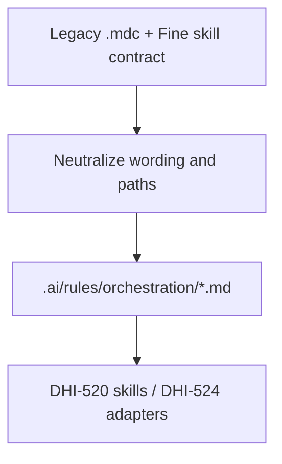

# DHI-518 — Analysis Result: Extract shared orchestration rules to core

## Task Details

| Field | Value |
|---|---|
| Jira ID | [DHI-518](https://eversis.atlassian.net/browse/DHI-518) |
| Title | Extract shared orchestration rules to core |
| Description | Port shared workflow rules (Ideate → Implement → Review, quality gates, Fine handoff, testing discipline) into `.ai/rules/orchestration/` as neutral Markdown so behavior is consistent across AI tools |
| Priority | Highest |
| Reporter | Piotr Niemirski |
| Created Date | 2026-07-30 |
| Due Date | — |
| Labels | `agent-collections`, `core-extraction`, `spec-driven`, `workshop-2026-07-30` |
| Estimated Effort | Medium (neutralize ~4 rule surfaces + Fine contract; no skill/prompt body port) |
| Parent epic | [DHI-515](https://eversis.atlassian.net/browse/DHI-515) |
| Spec folder | `docs/specs/dhi-518/` |
| Research date | 2026-08-04 |
| Prerequisites | [DHI-516](https://eversis.atlassian.net/browse/DHI-516) inventory; [DHI-517](https://eversis.atlassian.net/browse/DHI-517) `.ai/` structure (**done**) |

**User story:** As an engineering manager using any AI agent, I want shared workflow rules (Ideate → Implement → Review, quality gates, handoff contracts) in the core layer so that orchestration behavior is consistent regardless of tool.

## Business Impact

Makes Agent Collections’ orchestration identity real in the SSOT (not only a sample). Unblocks DHI-522 (SDD encoding) and Wave B adapters that must generate tool packaging from core content. Without this, Cursor remains the only place the lifecycle is fully specified.

## Acceptance Criteria (from Jira)

1. Equivalent neutral rules exist in the core **without** Cursor-specific paths or `@` attachment syntax as required invocation
2. Non-technical reader can understand Ideate → Implement → Review and **human gate** expectations
3. No **mandatory** workflow step from the legacy framework is silently dropped
4. Inherited SDD AC (spec folder, research, plan, review, Fine)

## Gathered Information

### Knowledge Base & Task Management Tools

- **Jira DHI-518** — Source notes: `eversis-agent-core.mdc`, orchestration skills; Technical notes: agent-core lifecycle, Fine handoff, testing discipline
- **Workshop Story 1.3** — same AC; Critical
- **Sibling boundaries:**
  | Story | Boundary |
  |-------|----------|
  | DHI-517 | Structure + `sample-lifecycle.md` only — **replace/supersede sample** in this story |
  | **DHI-518** | **Orchestration rules in `.ai/rules/orchestration/`** |
  | DHI-519 | Domain rules (frontend/backend/…); Story 1.4 lists `code-reviewer`, `testing-and-terminal` as domain inputs — see Gap Q1 |
  | DHI-520 | Full skill packages (`eversis-orchestrating-implementation`, `eversis-fine-handoff`) and prompts |
  | DHI-522 | Encode SDD into core + AGENTS/templates (builds on this extraction) |
  | DHI-524+ | Cursor/Claude adapters regenerate `.mdc` / `CLAUDE.md` from core |

### Codebase — legacy orchestration surfaces

Source: `/Users/piotrniemirski/Documents/Projects/cursor-collections`

| Legacy asset | Lines (approx) | Mandatory workflow content |
|--------------|---------------:|----------------------------|
| `.cursor/rules/eversis-agent-core.mdc` | ~53 | Lifecycle Ideate→Implement→Review; Research/Plan/Implement/Review/Fine steps; skills discovery policy; quality bar; hard limits (scope/docs/deps); optional focused rules |
| `.cursor/rules/eversis-engineering-manager.mdc` | ~40 | Load orchestration skill; human gates; **Implement readiness** four-line block first; adequacy checklist; Fine same-turn draft; no Jira post without approval |
| `.cursor/rules/eversis-testing-and-terminal.mdc` | ~14 | After substantive edits: discover lint/typecheck/test commands; fix failures before done |
| `.cursor/rules/eversis-code-reviewer.mdc` | ~21 | PASS/BLOCKER/SUGGESTION; STRICT FORBIDDEN (overlaps agent-core hard limits) |
| Skill `eversis-fine-handoff` | package | Full Fine QA draft contract (label, structure, no auto-Jira) |
| Skill `eversis-orchestrating-implementation` | package | Full Quick/Full flow, readiness contract, routing — **body stays DHI-520**; core must **point** to it by stable id |

**Cursor-specific packaging to strip or rephrase:**

- YAML front matter (`description`, `globs`, `alwaysApply`)
- Phrases like “this **Cursor** framework”, `@eversis-implement`, paths under `.cursor/rules/*.mdc`, “attach with `@`”
- Links that only resolve inside Cursor packaging (keep conceptual names: Implement prompt, Review prompt, Fine handoff skill)

### Target tree (already from DHI-517)

```text
.ai/rules/orchestration/
  README.md
  sample-lifecycle.md   # sample — supersede in DHI-518
```

### Relevant Links

- [DHI-518](https://eversis.atlassian.net/browse/DHI-518)
- `docs/specs/dhi-517/dhi-517.research.md` / `.ai/README.md`
- `docs/specs/dhi-516/asset-inventory.md` (Core target hints)
- `docs/specs/dhi-515/dhi-515.research.md` (Wave A)

### Relevant Charts & Diagrams



## Current Implementation Status

### Existing Components

- `.ai/rules/orchestration/` stub + sample — **reuse folder; replace sample with production files**
- `.ai/README.md` mapping — **update** orchestration section if filenames change
- Legacy `.mdc` bodies — **source for extraction** (do not delete from Cursor channel in this story)

### Key Files and Directories

- Source: `cursor-collections/.cursor/rules/eversis-{agent-core,engineering-manager,testing-and-terminal,code-reviewer}.mdc`
- Source skill contracts: `.cursor/skills/eversis-fine-handoff/SKILL.md` (contract summary only)
- Target: `agent-collections/.ai/rules/orchestration/`

## Proposed Core File Set (for plan / implement)

| Target file | Source(s) | Purpose |
|-------------|-----------|---------|
| `agent-core.md` | `eversis-agent-core.mdc` | Lifecycle, Implement steps, skills discovery (neutral), quality bar, hard limits |
| `engineering-manager.md` | `eversis-engineering-manager.mdc` | Readiness block, gates, Fine same-turn policy, delegates by stable name |
| `testing-and-terminal.md` | `eversis-testing-and-terminal.mdc` | Post-change quality commands discipline |
| `fine-handoff.md` | Fine skill contract (summary) | Mandatory QA draft on Fine; human gate before Jira publish |
| `README.md` | update | Index + **mandatory workflow parity checklist** (AC #3) |
| `sample-lifecycle.md` | remove or replace with stub pointer | Avoid two competing lifecycle docs |

**Neutralization rules (implement must follow):**

1. No YAML / TOML front matter in `.ai/rules/**/*.md`
2. Do not require `@filename` syntax; use stable names (“Implement prompt”, “`eversis-implement`”)
3. Replace `.cursor/skills/…` with “skill package under `.ai/skills/` (after DHI-520) or via MCP `eversis_skills_*`”
4. Replace “Cursor framework” with “Agent Collections”
5. Keep **mandatory** steps: research→approve→plan→approve→implement→review→Fine QA draft (same turn); readiness block on Implement entry; adequacy before SKIP; no auto-Jira comment

## Gap Analysis

**Status:** Approved by maintainer **2026-08-04** (Q1–Q5 OK).

### Question 1
#### Include `eversis-code-reviewer` content in DHI-518 or defer to DHI-519?
**Answer (approved):** **Defer full code-reviewer rule to DHI-519**. Keep STRICT FORBIDDEN / hard limits in `agent-core`. README pointer: code review role standards → DHI-519.

### Question 2
#### Port full `eversis-orchestrating-implementation` / `eversis-fine-handoff` skill **bodies** now?
**Answer (approved):** **No** — bodies = **DHI-520**. This story ports **contracts** into rules only.

### Question 3
#### Keep `sample-lifecycle.md` after production files exist?
**Answer (approved):** **Delete** `sample-lifecycle.md`; README points at `agent-core.md` as lifecycle SSOT.

### Question 4
#### Where should `testing-and-terminal` live given Story 1.4 also mentions it?
**Answer (approved):** **Include in DHI-518 under orchestration**.

### Question 5
#### Stakeholder-readable “plain language” layer vs engineer-precise rules?
**Answer (approved):** Lead **`agent-core.md`** with short plain-language Lifecycle + Human gates; precise steps below. No separate marketing doc.

## Out of Scope (this story)

- Domain rule folders fill (DHI-519)
- Skill/prompt package copies under `.ai/skills` / `.ai/prompts` (DHI-520)
- Adapter generation of `.mdc` / `CLAUDE.md` (Wave B)
- Changing live Cursor behavior in this repo’s `.cursor/` symlinks (still point at legacy until Wave C)
- EOG pilot / installer

## Risks

| Risk | Mitigation |
|------|------------|
| Dropping a mandatory step while neutralizing | Parity checklist in orchestration README vs legacy sources |
| Over-porting skills into rules | Q2: contracts only; skill bodies DHI-520 |
| Dual lifecycle docs (sample + agent-core) | Q3: delete sample |
| Code-reviewer ownership fight with 519 | Q1: defer full reviewer rule |
| Cursor-only wording left in | Explicit neutralization checklist in plan DoD + review |

## Open Questions

None. Q1–Q5 approved 2026-08-04.

## Suggested Next Steps

1. ~~Approve this research~~ **Done** (Q1–Q5 OK).
2. Write `dhi-518.plan.md`.
3. Implement neutralized files under `.ai/rules/orchestration/`; update `.ai/README.md` if needed; review; Fine.
4. Proceed to DHI-519 or DHI-522 per roadmap preference.

## Adequacy Checklist

| Check | Result |
|-------|--------|
| Jira AC reflected | Yes — neutral core, stakeholder-readable lifecycle/gates, no silent drop |
| Paths | Sources in cursor-collections; target `.ai/rules/orchestration/` |
| Open questions | All answered and approved |
| Sibling boundaries | Clear vs 517/519/520/522 |
| Plan coverage | Plan created after research approval |

## Changelog

| Date | Change |
|------|--------|
| 2026-08-04 | Initial research for DHI-518 Full Flow |
| 2026-08-04 | Polish translation added: [dhi-518.research.pl.md](./dhi-518.research.pl.md) |
| 2026-08-04 | Research **Approved** — Gap Analysis Q1–Q5 OK |
