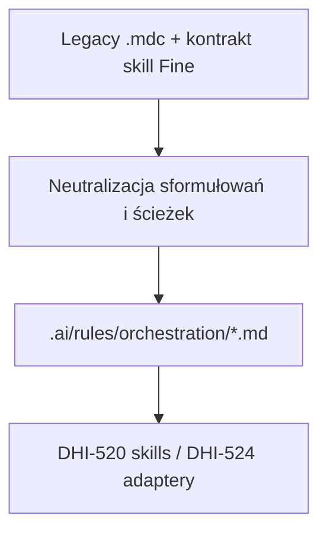

# DHI-518 — Wynik analizy: Wydobycie wspólnych reguł orkiestracji do core

> Tłumaczenie research: [dhi-518.research.md](./dhi-518.research.md)  
> Wersja angielska pozostaje źródłem dla `@eversis-implement` / zatwierdzeń Gate.

## Szczegóły zadania

| Pole | Wartość |
|---|---|
| Jira ID | [DHI-518](https://eversis.atlassian.net/browse/DHI-518) |
| Tytuł | Extract shared orchestration rules to core |
| Opis | Przenieść wspólne reguły workflow (Ideate → Implement → Review, bramki jakości, Fine handoff, dyscyplina testów) do `.ai/rules/orchestration/` jako neutralny Markdown, aby zachowanie było spójne niezależnie od narzędzia AI |
| Priorytet | Highest |
| Reporter | Piotr Niemirski |
| Data utworzenia | 2026-07-30 |
| Termin | — |
| Etykiety | `agent-collections`, `core-extraction`, `spec-driven`, `workshop-2026-07-30` |
| Szacowany nakład | Średni (neutralizacja ~4 powierzchni reguł + kontrakt Fine; bez portu body skilli/promptów) |
| Epik nadrzędny | [DHI-515](https://eversis.atlassian.net/browse/DHI-515) |
| Folder spec | `docs/specs/dhi-518/` |
| Data research | 2026-08-04 |
| Wymagania wstępne | [DHI-516](https://eversis.atlassian.net/browse/DHI-516) inventory; [DHI-517](https://eversis.atlassian.net/browse/DHI-517) struktura `.ai/` (**zrobione**) |

**User story:** Jako engineering manager korzystający z dowolnego agenta AI chcę mieć wspólne reguły workflow (Ideate → Implement → Review, bramki jakości, kontrakty handoff) w warstwie core, aby zachowanie orkiestracji było spójne niezależnie od narzędzia.

## Wpływ biznesowy

Uczynia tożsamość orkiestracji Agent Collections realną w SSOT (nie tylko w sample). Odblokowuje DHI-522 (kodowanie SDD) oraz adaptery Wave B, które muszą generować packaging narzędzi z treści core. Bez tego Cursor pozostaje jedynym miejscem, gdzie cykl życia jest w pełni opisany.

## Kryteria akceptacji (z Jira)

1. W core istnieją równoważne, neutralne reguły **bez** ścieżek Cursor-specific ani składni `@` jako wymaganego sposobu wywołania
2. Czytelnik nietechniczny rozumie Ideate → Implement → Review oraz oczekiwania wobec **bramek ludzkich** (human gates)
3. Żaden **obowiązkowy** krok workflow z legacy frameworka nie zostaje po cichu pominięty
4. Dziedziczone AC SDD (folder spec, research, plan, review, Fine)

## Zebrane informacje

### Baza wiedzy i narzędzia do zadań

- **Jira DHI-518** — Notatki źródłowe: `eversis-agent-core.mdc`, skills orkiestracji; notatki techniczne: cykl agent-core, Fine handoff, dyscyplina testów
- **Workshop Story 1.3** — te same AC; Critical
- **Granice względem siblingów:**
  | Story | Granica |
  |-------|---------|
  | DHI-517 | Tylko struktura + `sample-lifecycle.md` — w tej historii **zastąpić / supersede sample** |
  | **DHI-518** | **Reguły orkiestracji w `.ai/rules/orchestration/`** |
  | DHI-519 | Reguły domenowe (frontend/backend/…); Story 1.4 wymienia `code-reviewer`, `testing-and-terminal` jako wejścia domenowe — zob. Gap Q1 |
  | DHI-520 | Pełne pakiety skilli (`eversis-orchestrating-implementation`, `eversis-fine-handoff`) oraz prompty |
  | DHI-522 | Zakodowanie SDD w core + AGENTS/templates (buduje na tej ekstrakcji) |
  | DHI-524+ | Adaptery Cursor/Claude regenerują `.mdc` / `CLAUDE.md` z core |

### Codebase — legacy powierzchnie orkiestracji

Źródło: `/Users/piotrniemirski/Documents/Projects/cursor-collections`

| Zasób legacy | Linie (ok.) | Obowiązkowa treść workflow |
|--------------|------------:|----------------------------|
| `.cursor/rules/eversis-agent-core.mdc` | ~53 | Cykl Ideate→Implement→Review; kroki Research/Plan/Implement/Review/Fine; polityka discovery skilli; quality bar; hard limits (scope/docs/deps); opcjonalne focused rules |
| `.cursor/rules/eversis-engineering-manager.mdc` | ~40 | Załaduj skill orkiestracji; human gates; najpierw czteroliniowy blok **Implement readiness**; checklista adekwatności; draft Fine w tej samej turze; brak posta na Jira bez zgody |
| `.cursor/rules/eversis-testing-and-terminal.mdc` | ~14 | Po istotnych zmianach: odkryj komendy lint/typecheck/test; napraw błędy przed zakończeniem |
| `.cursor/rules/eversis-code-reviewer.mdc` | ~21 | PASS/BLOCKER/SUGGESTION; STRICT FORBIDDEN (nakłada się na hard limits agent-core) |
| Skill `eversis-fine-handoff` | pakiet | Pełny kontrakt draftu Fine QA (etykieta, struktura, bez auto-Jira) |
| Skill `eversis-orchestrating-implementation` | pakiet | Pełny Quick/Full flow, kontrakt readiness, routing — **body zostaje w DHI-520**; core musi na niego **wskazywać** stabilnym id |

**Packaging Cursor do usunięcia lub przeformułowania:**

- Front matter YAML (`description`, `globs`, `alwaysApply`)
- Sformułowania typu „ten framework **Cursor**”, `@eversis-implement`, ścieżki `.cursor/rules/*.mdc`, „dołącz przez `@`”
- Linki działające tylko w packagingu Cursor (zachować nazwy koncepcyjne: prompt Implement, prompt Review, skill Fine handoff)

### Docelowe drzewo (już z DHI-517)

```text
.ai/rules/orchestration/
  README.md
  sample-lifecycle.md   # sample — supersede w DHI-518
```

### Istotne linki

- [DHI-518](https://eversis.atlassian.net/browse/DHI-518)
- `docs/specs/dhi-517/dhi-517.research.md` / `.ai/README.md`
- `docs/specs/dhi-516/asset-inventory.md` (wskazówki Target Core)
- `docs/specs/dhi-515/dhi-515.research.md` (Wave A)

### Diagramy



## Aktualny stan implementacji

### Istniejące komponenty

- Stub `.ai/rules/orchestration/` + sample — **reuse folderu; zastąpić sample plikami produkcyjnymi**
- Mapowanie `.ai/README.md` — **zaktualizować** sekcję orchestration, jeśli zmienią się nazwy plików
- Body legacy `.mdc` — **źródło ekstrakcji** (nie usuwać z kanału Cursor w tej historii)

### Kluczowe pliki i katalogi

- Źródło: `cursor-collections/.cursor/rules/eversis-{agent-core,engineering-manager,testing-and-terminal,code-reviewer}.mdc`
- Kontrakty skilli: `.cursor/skills/eversis-fine-handoff/SKILL.md` (tylko podsumowanie kontraktu)
- Cel: `agent-collections/.ai/rules/orchestration/`

## Proponowany zestaw plików core (plan / implement)

| Plik docelowy | Źródło(-a) | Cel |
|---------------|------------|-----|
| `agent-core.md` | `eversis-agent-core.mdc` | Cykl życia, kroki Implement, discovery skilli (neutralne), quality bar, hard limits |
| `engineering-manager.md` | `eversis-engineering-manager.mdc` | Blok readiness, bramki, polityka Fine w tej samej turze, delegaci po stabilnej nazwie |
| `testing-and-terminal.md` | `eversis-testing-and-terminal.mdc` | Dyscyplina komend jakości po zmianach |
| `fine-handoff.md` | Kontrakt skill Fine (summary) | Obowiązkowy draft QA przy Fine; bramka ludzka przed publikacją na Jira |
| `README.md` | aktualizacja | Indeks + **checklisty parytetu obowiązkowego workflow** (AC #3) |
| `sample-lifecycle.md` | usunąć lub zastąpić wskaźnikiem | Uniknąć dwóch konkurujących dokumentów cyklu życia |

**Zasady neutralizacji (implement musi przestrzegać):**

1. Brak front matter YAML / TOML w `.ai/rules/**/*.md`
2. Nie wymagać składni `@filename`; używać stabilnych nazw („prompt Implement”, „`eversis-implement`”)
3. Zastąpić `.cursor/skills/…` przez „pakiet skill pod `.ai/skills/` (po DHI-520) lub przez MCP `eversis_skills_*`”
4. Zastąpić „Cursor framework” przez „Agent Collections”
5. Zachować **obowiązkowe** kroki: research→approve→plan→approve→implement→review→Fine QA draft (ta sama tura); blok readiness na wejściu Implement; adequacy przed SKIP; brak auto-komentarza na Jira

## Analiza luk (Gap Analysis)

**Status:** Zatwierdzone przez maintainera **2026-08-04** (Q1–Q5 OK).

### Pytanie 1
#### Czy włączyć treść `eversis-code-reviewer` do DHI-518, czy odłożyć do DHI-519?
**Odpowiedź (zatwierdzona):** **Odłożyć pełną regułę code-reviewer do DHI-519**. Hard limits zostają w `agent-core`.

### Pytanie 2
#### Czy portować teraz pełne **body** skilli?
**Odpowiedź (zatwierdzona):** **Nie** — body = **DHI-520**. Tu tylko kontrakty w rules.

### Pytanie 3
#### Czy zostawić `sample-lifecycle.md`?
**Odpowiedź (zatwierdzona):** **Usunąć**; SSOT cyklu = `agent-core.md`.

### Pytanie 4
#### Gdzie `testing-and-terminal`?
**Odpowiedź (zatwierdzona):** **W DHI-518 pod orchestration**.

### Pytanie 5
#### Osobny doc prostym językiem?
**Odpowiedź (zatwierdzona):** **Nie** — krótka sekcja na górze `agent-core.md`.

## Poza zakresem (ta historia)

- Wypełnianie folderów reguł domenowych (DHI-519)
- Kopie pakietów skill/prompt pod `.ai/skills` / `.ai/prompts` (DHI-520)
- Generowanie adapterów `.mdc` / `CLAUDE.md` (Wave B)
- Zmiana żywego zachowania Cursor w symlinkach `.cursor/` tego repo (nadal wskazują legacy do Wave C)
- Pilot EOG / installer

## Ryzyka

| Ryzyko | Mitygacja |
|--------|-----------|
| Pominięcie obowiązkowego kroku przy neutralizacji | Checklisty parytetu w README orchestration vs źródła legacy |
| Nadmierny port skilli do reguł | Q2: tylko kontrakty; body skilli DHI-520 |
| Dwa dokumenty cyklu życia (sample + agent-core) | Q3: usunąć sample |
| Konflikt własności code-reviewer z 519 | Q1: odłożyć pełną regułę reviewer |
| Pozostałości sformułowań Cursor-only | Jawna checklista neutralizacji w DoD planu + review |

## Otwarte pytania

Brak. Q1–Q5 zatwierdzone 2026-08-04.

## Sugerowane kolejne kroki

1. ~~Zatwierdzić ten research~~ **Zrobione** (Q1–Q5 OK).
2. Napisać `dhi-518.plan.md`.
3. Zaimplementować zneutralizowane pliki; review; Fine.
4. Iść do DHI-519 lub DHI-522 według roadmapy.

## Changelog

| Data | Zmiana |
|------|--------|
| 2026-08-04 | Pierwszy research DHI-518 Full Flow |
| 2026-08-04 | Dodano tłumaczenie PL |
| 2026-08-04 | Research **zatwierdzony** — Gap Analysis Q1–Q5 OK |

## Checklista adekwatności

| Sprawdzenie | Wynik |
|-------------|-------|
| AC z Jira odzwierciedlone | Tak — neutralny core, czytelny cykl/bramki, bez cichego pominięcia |
| Ścieżki | Źródła w cursor-collections; cel `.ai/rules/orchestration/` |
| Otwarte pytania | Rekomendacje Q1–Q5 do zatwierdzenia |
| Granice siblingów | Jasne vs 517/519/520/522 |
| Pokrycie planu | Po zatwierdzeniu research |

## Changelog

| Data | Zmiana |
|------|--------|
| 2026-08-04 | Pierwszy research DHI-518 Full Flow |
| 2026-08-04 | Dodano tłumaczenie PL: [dhi-518.research.pl.md](./dhi-518.research.pl.md) |
