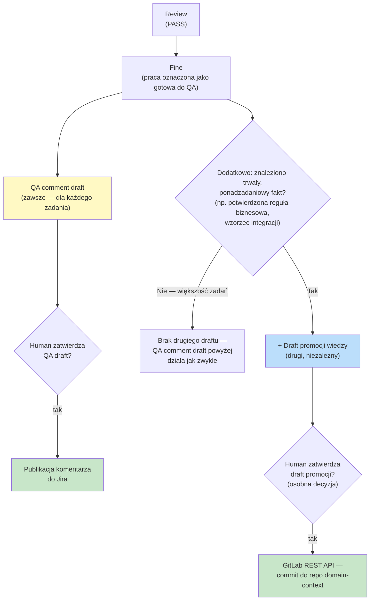
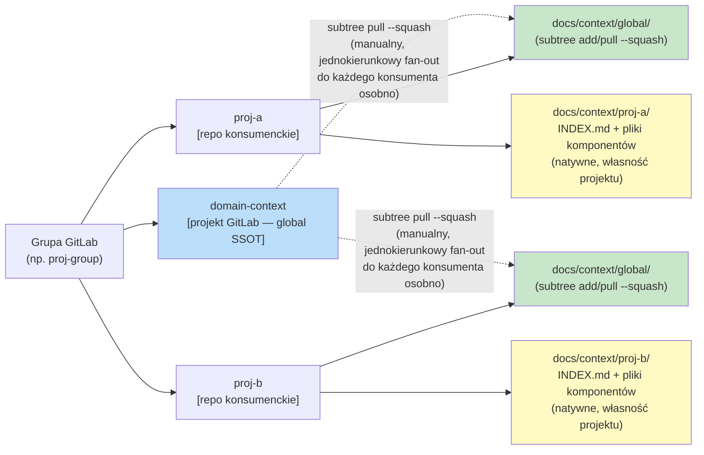

# Website docs — aktualizacja pod mechanizm domain-context SSOT - Implementation Plan

## Task Details

| Field            | Value                   |
| ---------------- | ----------------------- |
| Jira ID          | DHI-630 (follow-up, poza AC głównego zadania) |
| Title            | Zsynchronizować `website/docs/**` ze zaimplementowanym mechanizmem domain-context SSOT |
| Description      | 22 istniejące strony `website/docs/**` opisują serwer MCP, instalator i Fine tak, jakby Fazy 1-6 `global-domain-context-ssot.plan.md` nie istniały (niekompletność), a dwie strony (`isolation.md`, propozycja diagramu do `use-cases.md`) niosą realny wyciek nazwy klienckiej. Ten Plan naprawia 30 znalezisk (WD1-WD30) i dodaje jedną nową stronę koncepcyjną. |
| Priority         | Follow-up (dokumentacyjny, brak wpływu na działający kod) |
| Related Research | [`global-domain-context-ssot-website-docs.research.md`](./global-domain-context-ssot-website-docs.research.md) |

## Wildly Important Goal

**Goal**: Doprowadzić `website/docs/**` do faktycznej i strukturalnej zgodności z mechanizmem domain-context SSOT tak, jak został zaimplementowany (`global-domain-context-ssot.plan.md`, Fazy 1-6), stosując wzorzec czytelności dla mieszanej publiczności (Research §0) na każdej dotkniętej stronie.

**Success Measure**: Wszystkie 30 znalezisk (WD1-WD30) naprawione w cytowanej lokalizacji; `npm run website:build` przechodzi bez błędów (zero broken links, `onBrokenLinks: "throw"`); sweep `grep -rniE "EOG|EOP|PIUW|WUP|DAWIS|docs/context/eog"` po wszystkich dotkniętych/nowych plikach `website/docs/**` zwraca zero trafień.

**Do NOT touch / do NOT add**:
- `website/docs/prompts/**`, `website/docs/skills/**` w całości — osobny, większy problem (W11 z poprzedniego audytu); follow-up po Q2 (zob. Improvements).
- `README.md`, `docs/architecture/install-selection.md` — już zaktualizowane w poprzedniej sesji.
- `website/docs/for-ctos.md`, `website/docs/integrations/overview.md` — brak punktu styku z tym mechanizmem.
- `website/sidebars.ts` — autogenerated (`dirName: '.'`), nowa strona nie wymaga edycji tego pliku.
- Link do `.cursor/skills/eversis-fine-handoff/SKILL.md` w `workflow/overview.md:65` — osobny bug tej samej rodziny co W11, tylko odnotowany.
- Żaden plik produkcyjny/kod (`mcp/`, `scripts/`, `.ai/`) — to zadanie jest wyłącznie dokumentacją `website/docs/**`.
- Węzeł `agent-collections-config` w nowym diagramie — niezaimplementowany, porzucony wariant (zob. Research, sekcja `use-cases.md`, punkt 2).

## Proposed Solution

Naprawić 30 znalezisk plik-po-pliku, w kolejności malejącej dźwigni (Q3=a): najpierw źródło sformułowania "Fine = jeden draft", które jest kopiowane na 4 inne strony (WD24 → WD23/WD25b/WD26/WD27), potem nową stronę koncepcyjną `domain-context.md` (Q1=b — tworzona wcześnie, żeby kolejne fazy mogły się do niej linkować bez tymczasowo zepsutych linków), potem parytet instalator/MCP-setup, sekcja "Domain context" w `integrations/eversis-collections.md` (Q4=b), strony agentów, strony koncepcyjne/getting-started (w tym poprawka wycieku `eog` — WD29), drobne poprawki liczb/tabel, na końcu dopiski niżej-priorytetowe (Q5=a). Każda dotknięta i nowa strona stosuje pięć zasad z Research §0 (gloss żargonu inline, jedno zdanie "po co" przed mechaniką, jeden szablon per typ elementu, krótkie sekcje, żaden termin wyjaśniony wyłącznie linkiem zewnętrznym) — te zasady są już trwale zapisane w `.ai/skills/eversis-writing-repo-documentation/SKILL.md`, więc nie wymagają powtórzenia w każdym tasku, tylko zastosowania.

Diagram na nowej stronie `domain-context.md` to skorygowana, zneutralizowana wersja z Research (sekcja `use-cases.md`, "Skorygowana, uproszczona wersja diagramu") — ograniczona do potwierdzonego w kodzie mechanizmu (`domain-context` repo → `docs/context/global/` przez `git subtree`, dwie warstwy `docs/context/<project>/` + `docs/context/global/`), bez `agent-collections-config` i bez realnych nazw klienckich.

## Current Implementation Analysis

### Already Implemented

Mechanizm, który ten Plan wyłącznie **dokumentuje** (nie modyfikuje) — zaimplementowany i zweryfikowany w `global-domain-context-ssot.plan.md`, Fazy 1-6:

- `--ssot-source`/`--ssot-branch`/`--confluence-space-key` — `scripts/setup-agent-collections.sh`
- Scaffolding `docs/context/<project>/INDEX.md` + best-effort `git subtree add` do `docs/context/global/` — `scripts/lib/setup-agent-collections/ssot.sh`
- `eversis_context_get`/`list`/`sync` — `mcp/eversis-collections-mcp/src/context.ts`, rejestracja w `server.ts`
- Drugi wolumen `${PWD}:/workspace` — `docker-compose.yml`
- Procedura odczytu `docs/context/` w kroku Research — `.ai/rules/orchestration/agent-core.md`
- Opcjonalny drugi draft Fine (promocja wiedzy) — `.ai/rules/orchestration/fine-handoff.md`
- 3 nowe skille — `.ai/skills/eversis-promote-domain-knowledge/`, `eversis-import-confluence-knowledge/`, `eversis-audit-domain-knowledge/`
- Pięć zasad czytelności dla mieszanej publiczności — `.ai/skills/eversis-writing-repo-documentation/SKILL.md`, sekcja "Writing for a Mixed Audience"

### To Be Modified

20 istniejących plików `website/docs/**` (WD1-WD30 poza nowo tworzoną stroną, WD30 wykryte podczas Implement, zob. Changelog):

- `intro.md` (WD1), `framework-reference.md` (WD2, WD3), `isolation.md` (WD4, WD29), `use-cases.md` (WD5), `getting-started/start-here.md` (WD6), `getting-started/prerequisites.md` (WD7), `getting-started/installation.md` (WD8, WD9, WD10, WD30), `getting-started/mcp-setup.md` (WD11, WD12), `getting-started/quick-wins.md` (WD13), `getting-started/migration-from-cursor-collections.md` (WD14, WD15), `integrations/eversis-collections.md` (WD16, WD17, WD18), `integrations/atlassian.md` (WD19), `agents/context-engineer.md` (WD20), `agents/business-analyst.md` (WD21), `agents/code-reviewer.md` (WD22), `agents/engineering-manager.md` (WD23), `workflow/overview.md` (WD24), `workflow/standard-flow.md` (WD25a, WD25b), `workflow/e2e-flow.md` (WD26), `workflow/frontend-flow.md` (WD27), `workflow/workshop-flow.md` (WD28).

### To Be Created

- `website/docs/domain-context.md` — nowa strona koncepcyjna (Q1=b), `sidebar_position` zaraz po `isolation.md`, mirroring jej strukturę (nagłówek, tabela, diagram, link do kanonicznego źródła). Pierwsze użycie `@docusaurus/theme-mermaid` na tej stronie (skonfigurowany, nieużywany dotąd nigdzie w `website/docs/`).

## Open Questions

| #   | Question   | Answer   | Status                |
| --- | ---------- | -------- | --------------------- |
| — | Brak otwartych pytań | Q1-Q5 z Research §5 rozstrzygnięte przez stakeholdera 2026-08-26 (Q1=b, Q2=b+follow-up, Q3=a, Q4=b, Q5=a) | ✅ Resolved |

## Technical Context

### Project Instructions

- `.ai/skills/eversis-writing-repo-documentation/SKILL.md` — właściciel `website/docs/`; sekcje "Writing for Busy Readers" i "Writing for a Mixed Audience" (5 zasad z Research §0) obowiązują na każdej dotkniętej stronie; sekcja "Documentation Targets" i "Workflow" (5 kroków: target+audience → source facts → match neighbors → write → validate).
- `.ai/prompts/public/eversis-repo-docs-writer.md` — kontrakt wykonawczy delegacji dokumentacyjnej: zakres tylko pliki nazwane w tasku, brak zmian w kodzie produkcyjnym, raport z 3 elementami (pliki, weryfikacja, otwarte zależności).
- `.ai/rules/orchestration/agent-core.md` — hard limits: brak edycji poza zakresem, brak cichego skracania komentarzy dokumentacyjnych, brak nowych zależności.

### Architecture & Patterns

- Docusaurus 3.10.2, sidebar w pełni `autogenerated` (`sidebars.ts`, `dirName: '.'`) — kolejność stron przez `sidebar_position` we frontmatter każdej strony, bez edycji `sidebars.ts`.
- Frontmatter konwencja istniejących stron koncepcyjnych (`isolation.md`): `sidebar_position`, `title`, opcjonalnie `slug`.
- `@docusaurus/theme-mermaid` skonfigurowany w `website/docusaurus.config.ts` (`markdown: { mermaid: true }`, `themes: ["@docusaurus/theme-mermaid"]`) — gotowy do użycia, ale **żadna istniejąca strona `website/docs/` dziś go nie używa**; `domain-context.md` będzie pierwszym użyciem — zweryfikować renderowanie manualnie (dev server) przed handoffem, nie zakładać, że `layout: elk` działa bez dodatkowego pluginu (bezpieczniej: domyślny layout mermaid).
- Realny mechanizm dostawy plików root-level (`.claude`/`.cursor`/`.mcp.json`) to `scripts/lib/setup-agent-collections/vendor.sh` (submodule/copy, jednorazowo przy instalacji) — **nie** subtree, **nie** osobny GitLab-projekt `agent-collections-config` (ten węzeł jest niezaimplementowanym, porzuconym wariantem z wcześniejszego szkicu Research — nie opisywać go jako istniejący mechanizm).

### Tech Stack

- Markdown + Docusaurus frontmatter (YAML).
- Build: `npm run website:build` (`docusaurus build`, `onBrokenLinks: "throw"` — łapie każdy zepsuty link wewnętrzny).
- Brak dedykowanego skryptu walidacji linków w tym repo (w odróżnieniu od `cursor-collections`) — `website:build` jest jedynym i wystarczającym narzędziem weryfikacji.

### Code Style & Standards

- Mirror strukturę sąsiednich stron w tym samym katalogu (nagłówki, styl tabel, styl linków) — zasada "Structure mirrors neighbors" z `eversis-writing-repo-documentation/SKILL.md`.
- Wektor neutralności: żadnych realnych nazw klienckich (`EOG`/`EOP`/`PIUW`/`WUP`/`DAWIS`/`eog`) w żadnym dotkniętym lub nowym pliku — użyć `proj`/`proj-a`/`proj-b`, konwencja już przyjęta w `.ai/skills/eversis-promote-domain-knowledge/`.
- Każde zdanie wprowadzające żargon frameworka/AI-agentów pierwszy raz na stronie: gloss inline w jednej linii, wzorcem `login_required (the user must sign in again)` z `eversis-fine-handoff`.
- Weryfikować każde twierdzenie faktograficzne (liczby narzędzi, nazwy flag, ścieżki) wprost względem kodu — nie kopiować liczb z Research bez potwierdzenia w bieżącym stanie repo w chwili implementacji tego Planu.

### Testing Patterns

- `npm run website:build` po każdej fazie dotykającej `website/docs/` — musi przejść bez błędów (zero broken links).
- Dla `domain-context.md` (nowa strona z pierwszym mermaid): dodatkowo `npm run website:install && cd website && npm start` (lub `serve` po `build`), manualna weryfikacja wizualna renderowania diagramu w przeglądarce przed Code Review.
- Brak testów jednostkowych — to zadanie nie dotyka kodu.

### Database Patterns

Nie dotyczy.

### Additional Context

- Numeracja WD1-WD30 w tym Planie odpowiada 1:1 numeracji w Research (§3) — każdy task cytuje swoje WD-numery dla traceability.
- Follow-up Q2 (poprawka liczby skilli w `skills/overview.md`, nowe strony dla 3 skilli) jest **poza tym Planem** — zob. Improvements.

## Implementation Plan

### Phase 1: Fine — opcjonalny drugi draft (najwyższa dźwignia, Q3=a)

**Goal**: Naprawić źródło sformułowania "Fine = dokładnie jeden draft" (`workflow/overview.md`), z którego kopiowane jest to samo zdanie na 4 inne strony — największa dźwignia całego audytu (WD24 = Krytyczna).

**Description**: `workflow/overview.md` linie 63-67 to kanoniczna definicja "Fine", do której linkują `standard-flow.md`, `e2e-flow.md`, `frontend-flow.md`, `agents/engineering-manager.md`. Przepisać ją, żeby wymieniała opcjonalny drugi, niezależny draft promocji wiedzy (nie: "zawsze dwa drafty" — większość zadań ma tylko jeden), z jednym zdaniem "po co" (żeby ustalenia domenowe przetrwały poza pojedynczym zadaniem) przed mechaniką. Powielić analogiczne, krótkie sformułowanie (nie kopiować zdanie-w-zdanie — dopasować do lokalnego kontekstu każdej strony) w pozostałych 4 plikach.

**Diagram (proces Fine — do `workflow/overview.md`, Task 1.1):** pokazuje, że QA comment draft powstaje zawsze, drugi draft tylko warunkowo, i że oba mają **niezależne** bramki zatwierdzenia (zatwierdzenie jednego nie wpływa na drugi) oraz różne mechanizmy publikacji.

**Verification:** `npm run website:build`

#### Task 1.1 - [MODIFY] `workflow/overview.md` — kanoniczna definicja Fine

**Description**: Przepisać sekcję "Status: Fine — handoff" (WD24) o opcjonalny drugi draft promocji wiedzy, z jednym zdaniem "po co" i inline-gloss dla "promocja wiedzy" przy pierwszym użyciu. Osadzić diagram procesu Fine (powyżej) w tej sekcji — pierwsze miejsce, gdzie czytelnik widzi cały proces na raz, nie tylko tekst.

**Files:** `website/docs/workflow/overview.md` (modify)

**Definition of Done**:
- [x] Sekcja opisuje: (a) zawsze jeden QA comment draft, (b) opcjonalny, niezależny drugi draft promocji wiedzy — z jasnym warunkiem "kiedy" (durable, cross-task fact)
- [x] Diagram procesu Fine osadzony w sekcji, zgodny z wersją z tego Planu
- [x] Jedno zdanie "po co" przed mechaniką drugiego draftu
- [x] Termin "promocja wiedzy"/"domain knowledge" glossowany inline przy pierwszym użyciu na tej stronie
- [x] Run `npm run website:build`

**Clues**: Źródło faktu — `.ai/rules/orchestration/fine-handoff.md`, sekcja "Optional second draft — domain-knowledge promotion".

#### Task 1.2 - [MODIFY] Propagacja do 4 stron powiązanych

**Description**: Dopasować analogiczne, krótkie sformułowanie (WD23, WD25b, WD26, WD27) w pozostałych stronach — każda ma własny, krótszy callout linkujący do `workflow/overview.md` po pełny opis, nie duplikat całej sekcji.

**Files:** `website/docs/agents/engineering-manager.md` (modify, WD23), `website/docs/workflow/standard-flow.md` (modify, WD25b), `website/docs/workflow/e2e-flow.md` (modify, WD26), `website/docs/workflow/frontend-flow.md` (modify, WD27)

**Definition of Done**:
- [x] Każdy z 4 plików wspomina opcjonalny drugi draft (nie musi powtarzać pełnego opisu — wystarczy jedno zdanie + link do `workflow/overview.md`)
- [x] Brak dosłownej duplikacji zdania między plikami (każdy dopasowany do lokalnego kontekstu — zgodne z "Structure mirrors neighbors", nie "kopiuj-wklej")
- [x] Run `npm run website:build`

**Stop Rule:** Jeśli którakolwiek z 4 stron ma dodatkowy, nieopisany w Research kontekst dla Fine (np. własną listę kroków sprzeczną z `workflow/overview.md`) — zatrzymać się i zgłosić rozbieżność zamiast nadpisywać.

---

### Phase 2: Nowa strona koncepcyjna `domain-context.md` (Q1=b)

**Goal**: Dać mechanizmowi SSOT (dwie warstwy, 3 narzędzia MCP, 3 skille, `GITLAB_TOKEN`) właściwe miejsce na stronie — analogiczne do `isolation.md` — zamiast rozpraszać go po fragmentach 22 innych stron. Tworzona wcześnie w kolejności faz, żeby Phase 8 (WD5) mogła się do niej bezpiecznie linkować.

**Description**: Nowa strona mirroring strukturę `isolation.md` (nagłówek + jedno zdanie kontekstu, tabela/e, diagram, link do kanonicznego źródła w repo). Zawiera zneutralizowany diagram topologii z Research (sekcja `use-cases.md`) — grupa GitLab → `domain-context` (projekt) + repo konsumenckie → `docs/context/<project>/` (lokalne) + `docs/context/global/` (subtree). Stosuje wszystkie 5 zasad z Research §0 jako pierwszy praktyczny test wzorca.

**Diagram (mechanizm SSOT — do `domain-context.md`, Task 2.1):** finalna wersja, ograniczona do potwierdzonego w kodzie mechanizmu, bez `agent-collections-config` i bez realnych nazw klienckich (`proj`/`proj-a`/`proj-b`).

Legenda kolorów (dopisać pod diagramem na stronie, zgodnie z zasadą "gloss inline"): niebieski = repo źródłowe SSOT; zielony = treść dostarczona przez `subtree`; żółty = treść natywna, własność repo konsumenckiego. Przy odczycie komponentu (`eversis_context_get`) projekt ma pierwszeństwo przed global — jeśli ten sam komponent istnieje w obu warstwach, wygrywa `docs/context/<project>/`.

#### Task 2.1 - [CREATE] `website/docs/domain-context.md`

**Description**: Nowa strona: frontmatter (`sidebar_position` zaraz po `isolation.md`, `title`, `slug: /domain-context`), jedno zdanie "po co" (żeby wiedza domenowa przetrwała poza pojedynczym zadaniem i poza jednym repo), tabela dwóch warstw (`docs/context/<project>/` vs `docs/context/global/` — źródło, kto pisze, kto czyta, jak się synchronizuje), diagram mermaid (wersja powyżej), wzmianka o `GITLAB_TOKEN` (wymagany do publikacji, nigdy generowany/przechowywany przez instalator — link do `docs/architecture/install-selection.md`), link do 3 narzędzi MCP (`eversis_context_get`/`list`/`sync`) i 3 skilli.

**Files:** `website/docs/domain-context.md` (create)

**Definition of Done**:
- [x] Frontmatter kompletny, `sidebar_position` nie koliduje z sąsiednimi stronami
- [x] Diagram mermaid osadzony dokładnie jak w tym Planie — bez `agent-collections-config`, bez żadnej realnej nazwy klienckiej
- [x] Legenda kolorów i zasada pierwszeństwa project-nad-global opisane pod diagramem
- [x] Każdy termin (SSOT, subtree, fan-out) glossowany inline przy pierwszym użyciu
- [x] Sekcje krótkie (2-4 zdania), zgodnie z zasadą 4 (Research §0)
- [x] Run `npm run website:build` — zero broken links
- [ ] Manualna weryfikacja: diagram renderuje się poprawnie w przeglądarce (dev server) — **nie wykonana w tym Implement** (brak dostępu do przeglądarki/`build/` w tej sesji); `npm run website:build` kompiluje diagram bez błędów MDX, co pośrednio potwierdza poprawną składnię, ale nie zastępuje wizualnej weryfikacji renderowania — zalecane przed Fine

**Stop Rule:** Jeśli renderowanie mermaid wymaga dodatkowego pakietu npm poza już zainstalowanym `@docusaurus/theme-mermaid` — zatrzymać się i zgłosić (nowa zależność wymaga zgody, poza autoryzacją tego Planu).

**Clues**: Diagram bazowy — `global-domain-context-ssot-website-docs.research.md`, sekcja `website/docs/use-cases.md`, blok "Skorygowana, uproszczona wersja diagramu"; wersja w tym Planie jest finalna (dodana legenda + zasada pierwszeństwa).

---

### Phase 3: Parytet instalator + MCP setup

**Goal**: Zamknąć najbardziej mechaniczne, bezpośrednie luki — brakujące flagi i kroki, które `README.md` już ma.

**Description**: `installation.md` (WD8, WD9, WD10), `mcp-setup.md` (WD11, WD12), `prerequisites.md` (WD7) — dopisać 3 nowe flagi instalatora, krok scaffoldingu, doprecyzować klasyfikację `docs/context`, dopisać `eversis_context_*` do listy narzędzi MCP, nową podsekcję o drugim wolumenie + wymogu poprawnego cwd (ten sam gotcha co WD7, opisany raz i linkowany, nie duplikowany).

**Verification:** `npm run website:build`

#### Task 3.1 - [MODIFY] `getting-started/installation.md`

**Description**: Dopisać `--ssot-source`/`--ssot-branch`/`--confluence-space-key` do tabeli "Useful flags" (WD8); dopisać krok scaffoldingu `docs/context/<project>/INDEX.md` + best-effort seed do kroku "4. Skills and prompts (MVP)" (WD9); złagodzić zdanie o `docs/context` jako płasko "project-owned, hands off" (WD10) — rozróżnić `INDEX.md` (aktywnie tworzony) od `global/` (aktywnie odświeżany).

**Files:** `website/docs/getting-started/installation.md` (modify)

**Definition of Done**:
- [x] Tabela flag zawiera wszystkie 3 nowe flagi z opisem i wartością domyślną (`--ssot-branch` domyślnie `main`)
- [x] Krok instalacyjny wspomina scaffolding i best-effort seed
- [x] Zdanie o `docs/context` rozróżnia `INDEX.md` od `global/`
- [x] **WD30** (znalezione podczas tego taska): tabela "Vendor modes" zawierała "Team / EOG default" — zastąpione neutralnym "Common team default"
- [x] Run `npm run website:build`

**Clues**: Wzorzec tabeli flag już zaktualizowany w root `README.md` — mirror stamtąd, nie wymyślać nowego formatu.

#### Task 3.2 - [MODIFY] `getting-started/mcp-setup.md` i `getting-started/prerequisites.md`

**Description**: `mcp-setup.md` (WD11) — dopisać `eversis_context_*` do wiersza "What each MCP is used for"; nowa podsekcja (WD12) o drugim wolumenie `${PWD}:/workspace` i wymogu, żeby IDE uruchamiało proces MCP z cwd = root repo konsumenckiego, inaczej narzędzia cicho montują zły katalog bez błędu. `prerequisites.md` (WD7) — jedno zdanie z tym samym gotcha, linkujące do pełnego opisu w `mcp-setup.md` (nie duplikować całego wyjaśnienia).

**Files:** `website/docs/getting-started/mcp-setup.md` (modify), `website/docs/getting-started/prerequisites.md` (modify)

**Definition of Done**:
- [x] `mcp-setup.md` wymienia `eversis_context_*` i ma podsekcję o cwd/drugim wolumenie
- [x] `prerequisites.md` ma jedno zdanie + link, nie duplikat
- [x] Run `npm run website:build`

**Stop Rule:** Brak.

---

### Phase 4: `integrations/eversis-collections.md` — liczba narzędzi + sekcja "Domain context" (Q4=b)

**Goal**: Jedyna strona z rzeczywistym poziomem szczegółu API dla MCP dostaje pełny opis nowej grupy narzędzi, nie tylko poprawioną liczbę.

**Description**: Poprawić "Tool inventory (14 tools)" → 17 (WD16); dopisać wiersz "Domain context" do tabeli grup; dopisać 3 nowe skille do "Which Agents and Prompts Use It" (WD17); przepisać opis "the bind mount" (liczba pojedyncza) na dwa wolumeny z różną logiką rozwiązywania ścieżki (WD18) — usunąć nieprawdziwe już zdanie "no other path configuration is needed" dla przypadku domain-context. Nowa sekcja "Domain context" (Q4=b) z przykładami wywołań `eversis_context_get`/`list`/`sync`, wzorem istniejącej sekcji dla `eversis_skills_*`.

**Verification:** `npm run website:build`

#### Task 4.1 - [MODIFY] Liczby, tabele, opis wolumenów

**Description**: WD16, WD17, WD18 — patrz Description fazy.

**Files:** `website/docs/integrations/eversis-collections.md` (modify)

**Definition of Done**:
- [x] "14 tools" → "17 tools", wiersz "Domain context" w tabeli grup
- [x] "Which Agents and Prompts Use It" zawiera 3 nowe skille
- [x] Opis wolumenów wymienia oba (`.:/repo`, `${PWD}:/workspace`) z osobnym mechanizmem rozwiązywania ścieżki dla każdego
- [x] Run `npm run website:build`

#### Task 4.2 - [CREATE] Sekcja "Domain context"

**Description**: Nowa sekcja, wzorem istniejącej dla `eversis_skills_*` — opis + przykład wywołania dla każdego z `eversis_context_get`/`list`/`sync`, jedno zdanie "po co" przed przykładami.

**Files:** `website/docs/integrations/eversis-collections.md` (modify — ta sama strona co Task 4.1)

**Definition of Done**:
- [x] Sekcja mirroring strukturę sekcji `eversis_skills_*` (nagłówek, opis, przykład per narzędzie)
- [x] Każde z 3 narzędzi ma minimum jeden przykład wywołania
- [x] Run `npm run website:build`

---

### Phase 5: Strony agentów

**Goal**: Agenci, których procedury faktycznie się zmieniły (Research, Context Engineer, Code Reviewer, Business Analyst), mają to odzwierciedlone we własnych stronach.

**Description**: `agents/context-engineer.md` (WD20, najważniejsze pojedyncze znalezisko wśród stron agentów — Context Engineer wykonuje krok Research, którego procedura odczytu `docs/context/` się zmieniła). `agents/code-reviewer.md`/`workflow/standard-flow.md` (WD22, WD25a — dopasować sformułowanie do tej samej budżetowej procedury odczytu, nie "read `docs/context/` when present" które brzmi jak czytanie całego katalogu). `agents/business-analyst.md`/`workflow/workshop-flow.md` (WD21, WD28 — jedno zdanie o relacji `task-baseline.md` do `INDEX.md`).

**Verification:** `npm run website:build`

#### Task 5.1 - [MODIFY] `agents/context-engineer.md`

**Description**: Dopisać `docs/context/` do Responsibilities i tabeli Tool Access (`eversis-collections` MCP, `eversis_context_get`/`list`), z krótkim opisem procedury odczytu (INDEX.md → jeden komponent → linki leniwie) — link do pełnej procedury w `agent-core.md` zamiast duplikować 4-punktową listę.

**Files:** `website/docs/agents/context-engineer.md` (modify)

**Definition of Done**:
- [x] Responsibilities wymienia `docs/context/`
- [x] Tool Access ma wiersz dla `eversis-collections` MCP
- [x] Run `npm run website:build`

#### Task 5.2 - [MODIFY] `agents/code-reviewer.md`, `workflow/standard-flow.md`

**Description**: WD22 — zmienić "Read ... `docs/context/` ... when present" na sformułowanie zgodne z budżetową procedurą (jeden komponent, nie cały katalog). WD25a — dopisać `docs/context/` do listy źródeł Research w `standard-flow.md`.

**Files:** `website/docs/agents/code-reviewer.md` (modify), `website/docs/workflow/standard-flow.md` (modify)

**Definition of Done**:
- [x] `code-reviewer.md` nie sugeruje już czytania całego katalogu
- [x] `standard-flow.md` wymienia `docs/context/` jako źródło Research
- [x] Run `npm run website:build`

#### Task 5.3 - [MODIFY] `agents/business-analyst.md`, `workflow/workshop-flow.md`

**Description**: WD21, WD28 — jedno zdanie wyjaśniające, że `task-baseline.md` jest plikiem-rodzeństwem `INDEX.md` w `docs/context/<project>/`, nie jednym z indeksowanych komponentów (lub odwrotnie — potwierdzić rzeczywiste zachowanie w `.ai/skills/eversis-jira-task-formatting/` przed zapisaniem).

**Files:** `website/docs/agents/business-analyst.md` (modify), `website/docs/workflow/workshop-flow.md` (modify — 2 miejsca: sekwencja numerowana + diagram ASCII, WD28)

**Definition of Done**:
- [x] Oba pliki jednoznacznie i **spójnie ze sobą** opisują relację `task-baseline.md`/`INDEX.md`
- [x] `workshop-flow.md` poprawiony w obu miejscach (WD28)
- [x] Run `npm run website:build`

**Clues**: Sprawdzić `.ai/skills/eversis-jira-task-formatting/SKILL.md` (Step 11) dla faktycznego zachowania przed pisaniem.

---

### Phase 6: Strony koncepcyjne / getting-started — struktura `docs/context` + neutralność

**Goal**: Trzy strony opisujące `docs/context/` jako dowolne, nieustrukturyzowane notatki dostają aktualny, zdefiniowany kształt; naprawiony realny wyciek nazwy klienckiej (WD29).

**Description**: `isolation.md` (WD4 — przeformułować opis `docs/context/`; WD29 — zastąpić `docs/context/eog/` neutralnym `docs/context/<project>/`), `quick-wins.md` (WD13 — ta sama rama co WD4 **oraz** brakujący scenariusz quick-win dla nowego mechanizmu — dwa aspekty tego samego znaleziska, jeden task), `migration-from-cursor-collections.md` (WD14 — dodać `docs/context/global/` jako czwarty rodzaj treści do taksonomii Local/Core/Generated; WD15 — wiersz w capability matrix).

**Verification:** `npm run website:build`; `grep -rniE "EOG|EOP|PIUW|WUP|DAWIS|docs/context/eog" website/docs/isolation.md` (musi zwrócić zero trafień po zmianie)

#### Task 6.1 - [MODIFY] `isolation.md`

**Description**: WD4 — przeformułować akapit o `docs/context/` z "wolnych notatek" na: `docs/context/<project>/INDEX.md` (zawsze scaffoldowany) + pliki komponentów + opcjonalny `docs/context/global/` (subtree). WD29 — zastąpić `Empirical pilot notes live under `docs/context/eog/` when present.` neutralnym `docs/context/<project>/` (lub `docs/context/proj-a/`).

**Files:** `website/docs/isolation.md` (modify)

**Definition of Done**:
- [x] Opis `docs/context/` odzwierciedla dwuwarstwową strukturę
- [x] `eog` zastąpiony neutralnym placeholderem — **blokujące, weryfikować przed innymi punktami tej fazy**
- [x] `grep -rniE "EOG|EOP|PIUW|WUP|DAWIS|docs/context/eog" website/docs/isolation.md` zwraca zero trafień
- [x] Run `npm run website:build`

**Stop Rule:** Nie oznaczać tego taska jako done, jeśli grep zwraca choćby jedno trafienie.

#### Task 6.2 - [MODIFY] `quick-wins.md`, `migration-from-cursor-collections.md`

**Description**: `quick-wins.md` (WD13) — przeformułować ramę `docs/context` (jak WD4) **i** dopisać nowy scenariusz quick-win dla domain-context SSOT (np. "sprawdź `docs/context/<project>/INDEX.md` po instalacji"). `migration-from-cursor-collections.md` (WD14, WD15) — nowy wiersz/kategoria dla `docs/context/global/` w tabeli Ownership model; nowy wiersz w capability matrix Cursor vs Claude.

**Files:** `website/docs/getting-started/quick-wins.md` (modify), `website/docs/getting-started/migration-from-cursor-collections.md` (modify)

**Definition of Done**:
- [x] `quick-wins.md` ma zaktualizowaną ramę **i** nowy scenariusz (dwa oddzielne, weryfikowalne punkty)
- [x] `migration-from-cursor-collections.md` ma nową kategorię w Ownership model i nowy wiersz w capability matrix
- [x] Run `npm run website:build`

---

### Phase 7: Drobne poprawki — liczby i sekcje brakujące

**Goal**: Zamknąć pozostałe, niżej-dźwigniowe, ale wciąż aktywnie mylące braki.

**Description**: `atlassian.md` (WD19 — wiersz dla `eversis-import-confluence-knowledge`), `intro.md` (WD1), `framework-reference.md` (WD2, WD3) — poprawić opis serwera MCP tak, żeby nie sugerował, że robi tylko jedną rzecz przez `AGENT_COLLECTIONS_HOME`; dopisać grupę `eversis_context_*` i 3 nowe skille.

**Verification:** `npm run website:build`

#### Task 7.1 - [MODIFY] `integrations/atlassian.md`

**Description**: WD19 — nowy wiersz dla `eversis-import-confluence-knowledge` jako nowego konsumenta integracji Atlassian.

**Files:** `website/docs/integrations/atlassian.md` (modify)

**Definition of Done**:
- [x] Tabela zawiera wiersz dla `eversis-import-confluence-knowledge`
- [x] Run `npm run website:build`

#### Task 7.2 - [MODIFY] `intro.md`, `framework-reference.md`

**Description**: WD1 — poprawić wiersz sugerujący, że MCP robi jedną rzecz przez `AGENT_COLLECTIONS_HOME`. WD2 — to samo w ASCII-drzewie. WD3 — sekcja "Skills (MCP)" ma dziś tylko `eversis_skills_list`/`get` — dopisać 3 nowe skille i grupę `eversis_context_*` (link do pełnego opisu w `integrations/eversis-collections.md`, nie duplikować).

**Files:** `website/docs/intro.md` (modify), `website/docs/framework-reference.md` (modify)

**Definition of Done**:
- [x] Oba pliki wymieniają domain-context jako drugą, niezależną funkcję serwera MCP (nie tylko `AGENT_COLLECTIONS_HOME`)
- [x] `framework-reference.md` sekcja "Skills (MCP)" wymienia 3 nowe skille
- [x] Run `npm run website:build`

---

### Phase 8: Dopiski niżej-priorytetowe (Q5=a)

**Goal**: Zamknąć pozostałe, celowo najniższej wagi znaleziska — teraz w zakresie Planu po decyzji Q5=a.

**Description**: `use-cases.md` (WD5) — jedno zdanie w sekcji "Extending the framework" wspominające drugi draft Fine jako tańszą alternatywę dla customowych skilli/promptów, z linkiem do nowej strony `domain-context.md` (Phase 2) — **bez** diagramu na tej stronie (decyzja z Research, sekcja `use-cases.md`, punkt 3). `getting-started/start-here.md` (WD6) — dopisać `docs/context/<project>/INDEX.md` do checklisty "First successful install".

**Verification:** `npm run website:build`

#### Task 8.1 - [MODIFY] `use-cases.md`, `getting-started/start-here.md`

**Description**: WD5, WD6 — patrz Description fazy.

**Files:** `website/docs/use-cases.md` (modify), `website/docs/getting-started/start-here.md` (modify)

**Definition of Done**:
- [x] `use-cases.md` sekcja "Extending the framework" wspomina drugi draft Fine + link do `domain-context.md`, bez diagramu
- [x] `start-here.md` checklist zawiera `docs/context/<project>/INDEX.md`
- [x] Run `npm run website:build` — potwierdza, że link do `domain-context.md` (utworzonej w Phase 2) się rozwiązuje

---

### Phase 9: Code Review

**Goal**: Niezależna weryfikacja kompletności (wszystkie 30 znalezisk), neutralności (zero wycieków nazw klienckich) i spójności ze wzorcem czytelności (Research §0) przed Fine.

**Description**: Finalna weryfikacja pełnej implementacji. Ta faza jest obowiązkowa i zawsze na końcu.

**Verification:** `npm run website:build`; `grep -rniE "EOG|EOP|PIUW|WUP|DAWIS" website/docs/` (zero trafień na całym katalogu, nie tylko dotkniętych plikach — łapie ewentualny przypadkowy wyciek w nowo tworzonej stronie)

#### Task 9.1 - [REUSE] Code review przez Code Reviewer

**Description**: Uruchomić **Code Reviewer** przez `eversis-review.md` na kompletnej implementacji. Sprawdzić: (a) wszystkie 30 znalezisk faktycznie naprawione w cytowanej lokalizacji, (b) `npm run website:build` przechodzi, (c) zero wycieków nazw klienckich na całym `website/docs/`, (d) każda dotknięta/nowa strona stosuje 5 zasad z Research §0, (e) diagram na `domain-context.md` nie zawiera `agent-collections-config`.

**Files:** wszystkie pliki z sekcji "To Be Modified"/"To Be Created" (reuse)

**Definition of Done**:
- [x] Run `npm run website:build` — zero błędów
- [x] `grep -rniE "EOG|EOP|PIUW|WUP|DAWIS" website/docs/` — zero trafień
- [x] Code review przechodzi bez blokujących znalezisk
- [x] Wynik udokumentowany w Changelog

**Stop Rule:** Każde BLOCKER znalezisko musi być naprawione przed Fine — brak wyjątków dla dokumentacji.

## Security Considerations

- Żaden task nie wprowadza sekretów/tokenów do treści strony — `GITLAB_TOKEN` opisywany wyłącznie jako wymóg środowiskowy (link do `docs/architecture/install-selection.md`), nigdy jako wartość przykładowa.
- Neutralność frameworka to wymóg bezpieczeństwa organizacyjnego (nie tylko stylu) — publiczna strona frameworka nie może ujawniać nazw klienckich (`DAWIS`/`EOG`/`EOP`/`PIUW`/`WUP`) ani ich struktury repo.

## Quality Assurance

- [x] Wszystkie 30 znalezisk (WD1-WD30) naprawione w cytowanej lokalizacji
- [x] Nowa strona `domain-context.md` istnieje, jest w sidebarze (przez `sidebar_position`, bez edycji `sidebars.ts`); mermaid kompiluje się bez błędów MDX — wizualne renderowanie w przeglądarce **niezweryfikowane w tym Implement**, zalecane przed Fine
- [x] `npm run website:build` przechodzi bez błędów na całym repo
- [x] `grep -rniE "EOG|EOP|PIUW|WUP|DAWIS|docs/context/eog" website/docs/` zwraca zero trafień
- [x] Każda dotknięta/nowa strona stosuje 5 zasad z Research §0 (spot-check minimum 3 stron różnego typu: koncepcyjna, agentowa, getting-started)
- [x] Code review (Phase 9) przechodzi bez blokujących znalezisk

## Improvements (Out of Scope)

- **Follow-up Q2 (poza tym Planem):** po Fine tej implementacji, zgłosić osobne zadanie — najpierw naprawić W11 (`.cursor/`-ścieżki w `website/docs/skills/**`/`prompts/**`), dopiero potem poprawić liczbę skilli ("43 reusable skills" → 48) i dodać strony dla 3 nowych skilli (`eversis-promote-domain-knowledge`, `eversis-import-confluence-knowledge`, `eversis-audit-domain-knowledge`).
- Link do `.cursor/skills/eversis-fine-handoff/SKILL.md` w `workflow/overview.md:65` — osobny bug tej samej rodziny co W11, odnotowany, nie naprawiany w tym Planie.
- Provisioning `GITLAB_TOKEN` (jak agent go otrzymuje w środowisku wykonawczym) — poza zakresem, dziedziczone z `global-domain-context-ssot.plan.md` Improvements.

## Human gates

1. ~~Approve research~~ — done (Q1-Q5 rozstrzygnięte: "Q1. (b); Q2. (b) - dodaj follow-up po tej implementacji; Q3. (a); Q4. (b); Q5. (a);")
2. ~~Approve this plan~~ — done ("Plan jest ok. Przejdź do implementacji")
3. ~~Implement~~ — done (9 faz, `npm run website:build` zielone, neutralność potwierdzona)
4. ~~Review~~ — PASS, 1 SUGGESTION (manualna weryfikacja renderowania mermaid przed publikacją — zob. Changelog)
5. Fine

## Changelog

| Date   | Change Description   |
| ------ | -------------------- |
| 2026-08-26 | Plan utworzony po rozstrzygnięciu Q1-Q5. Przy przygotowaniu Planu wykryto dodatkowe znalezisko (WD29 — wyciek nazwy klienckiej `eog` w `isolation.md:45`, ta sama klasa naruszenia co wcześniejszy sweep `.ai/`), dopisane do Research i włączone do Phase 6. |
| 2026-08-26 | Stakeholder poprosił o zaplanowanie dwóch diagramów wprost w Planie (nie tylko odesłanie do Research): proces Fine (Phase 1, Task 1.1 — QA draft zawsze + drugi draft warunkowo, dwie niezależne bramki) i mechanizm SSOT (Phase 2, Task 2.1 — finalna wersja diagramu topologii z dopisaną legendą kolorów i zasadą pierwszeństwa project-nad-global). Oba osadzone bezpośrednio w opisach faz/tasków. |
| 2026-08-26 | Implement wykonany, wszystkie 9 faz. Podczas Phase 3 wykryto dodatkowe, nieplanowane znalezisko tej samej klasy co WD29: `installation.md:60` zawierał "**Team / EOG default**" w tabeli Vendor modes — dopisane do Research jako **WD30** i naprawione (→ "Common team default"). Weryfikacja po każdej fazie: `npm run website:build` (finalnie: zero błędów, zero broken links, zero broken anchors). Sweep neutralności `grep -rniE "EOG\|EOP\|PIUW\|WUP\|DAWIS"` na całym `website/docs/` dał 3 pozorne trafienia (substringi wewnątrz "people", "developers", "Geographic") — potwierdzone jako fałszywe alarmy przez wersję z granicami słów (`\b...\b`), która zwróciła zero. Jedno odstępstwo od Planu: w tabeli Ownership model (`migration-from-cursor-collections.md`) użyto literału `PROJECT` zamiast `<project>` — wersja z nawiasami ostrymi wewnątrz komórki tabeli z `|` łamała parser MDX (mylona ze znacznikiem JSX); `PROJECT` jest równie neutralne, więc nie wpływa na cel neutralności. **Nie wykonano** manualnej wizualnej weryfikacji renderowania mermaid w przeglądarce (brak dostępu do serwera dev / katalogu `build/` w tym środowisku) — `npm run website:build` potwierdza poprawną składnię MDX obu diagramów, ale nie renderowanie; zalecane przed Fine. |
