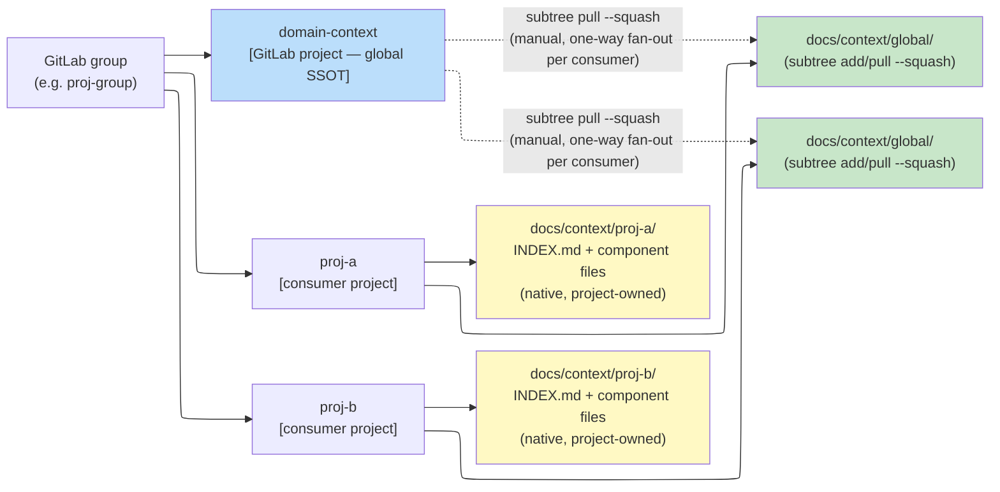

# Website docs — aktualizacja pod mechanizm domain-context SSOT (research)

| Pole | Wartość |
|------|---------|
| Zadanie | Audyt rozbieżności między `website/docs/**` a stanem frameworka po implementacji `global-domain-context-ssot.plan.md` (Fazy 1-6: instalator, MCP `eversis_context_*`, 3 nowe skille, `docker-compose.yml`, `agent-core.md`/`fine-handoff.md`) |
| Jira | DHI-630 (follow-up, poza AC głównego zadania) |
| Status | **Zaakceptowany** (2026-08-26) — Q1-Q5 rozstrzygnięte (§5); Plan w przygotowaniu |
| Powiązane | [`../global-domain-context-ssot/global-domain-context-ssot.research.md`](../global-domain-context-ssot/global-domain-context-ssot.research.md), [`../global-domain-context-ssot/global-domain-context-ssot.plan.md`](../global-domain-context-ssot/global-domain-context-ssot.plan.md) (zaimplementowany w poprzedniej sesji) |
| Data | 2026-08-25 |
| Język | polski (kontynuacja wątku, jak poprzedni research tego zadania) |
| Wzorzec strukturalny | [`../claude-code-setup-website-docs/claude-code-setup-website-docs.research.md`](../claude-code-setup-website-docs/claude-code-setup-website-docs.research.md) — ten sam format audytu, numeracja **WD1-WD28** (Website Domain-context), żeby nie kolidować z `W1-W11` z tamtego wątku |

> **Zasada zakresu:** dokument opisuje wyłącznie `website/docs/**`. `README.md` i `docs/architecture/install-selection.md` zostały już zaktualizowane w tej samej sesji co implementacja (Plan, Task 5.1 + follow-up po pytaniu stakeholdera) — nie są przedmiotem tego audytu.

---

## 0. Zasada nadrzędna — czytelność dla mieszanej publiczności (governing wszystkie WD1-WD28)

Stakeholder wskazał benchmark [aihero.dev/skills](https://www.aihero.dev/skills) jako punkt odniesienia czytelności dla dokumentacji o pracy z agentami AI. Analiza (WebFetch, 2026-08-25) tej strony:

**Co strona robi dobrze, transferowalne wprost:** bardzo krótkie zdania (8-12 słów) i sekcje (2-4 zdania); jeden, identycznie powtórzony szablon per typ elementu (każdy wpis katalogu skilli: nagłówek+link → jedno zdanie opisu); kolejność "akcja/przykład najpierw"; bloki kodu izolowane, gotowe do copy-paste; duży whitespace.

**Czego strona NIE robi — istotne, bo stoi w sprzeczności z priorytetem "szczególnie dla osób bez podstaw w pracy z agentami AI":** żargon ("agent", "skill", "flow") nigdy niezdefiniowany w treści; brak progresji od podstaw do zaawansowania; wyjaśnienie pojęć delegowane do linków zewnętrznych, nie do samego dokumentu. Strona jest zoptymalizowana pod skanowalność dla kogoś, kto **już wie**, czym jest agent AI — nie pod wprowadzenie kogoś, kto nie wie. Wprost skopiowana, dałaby dokument dobry dla stałych użytkowników i wciąż nieprzystępny dla nowicjuszy.

**Synteza przyjęta jako zasada dla tego i przyszłych Planów** (zapisana trwale w `.ai/skills/eversis-writing-repo-documentation/SKILL.md`, sekcja "Writing for a Mixed Audience (`website/docs/`)", żeby nie wymagała przypominania przy każdej kolejnej aktualizacji strony):

1. **Gloss żargonu przy pierwszym użyciu, w jednej linii** — ten sam wzorzec, który `eversis-fine-handoff` już wymaga dla komentarzy QA (`login_required (the user must sign in again)`), rozszerzony na cały `website/docs/`. Nie osobna strona-słownik — gloss dokładnie tam, gdzie termin jest użyty.
2. **Jedno zdanie "po co to istnieje" przed mechaniką** — zanim strona opisze *jak* coś działa, jedno zdanie zwykłym językiem o tym, *po co*.
3. **Jeden szablon per typ powtarzanego elementu**, stosowany identycznie za każdym razem (narzędzia, skille, flagi, kroki workflow).
4. **Krótkie sekcje, duży whitespace** — kilka krótkich sekcji zamiast jednej długiej.
5. **Żaden termin wprowadzony przez stronę nie może być wyjaśniony wyłącznie linkiem zewnętrznym** — link na *więcej* szczegółów jest OK; link zamiast jakiegokolwiek wyjaśnienia zostawia nowicjusza bez gruntu pod nogami.

**Konsekwencja dla §6 (zakres do Planu):** każda poprawka WD1-WD28 w przyszłym Planie stosuje się do tych pięciu zasad, nie tylko do naprawienia faktu. Dotyczy to szczególnie nowej strony koncepcyjnej z Q1 (§5) — jeśli powstanie, jest to pierwszy test tego wzorca w praktyce.

---

## 1. Cel i zakres

**Pytanie:** czy publiczna dokumentacja (`website/docs/**`) opisuje mechanizm domain-context SSOT zgodnie z tym, co framework faktycznie teraz robi po zamknięciu Faz 1-6 `global-domain-context-ssot.plan.md`, czy nadal odzwierciedla stan sprzed tej implementacji?

**W zakresie:** wyłącznie pliki `website/docs/**` wymienione w §3 (znalezione przez `grep -rniE` po zestawie terminów: `docs/context`, `install-selection`, `ssot`, `domain-context`, `eversis_skills_*`, MCP, `docker-compose`, `AGENT_COLLECTIONS_HOME`, tabele flag instalatora, strony getting-started/mcp-setup). Klasyfikacja każdego nieaktualnego/niekompletnego stwierdzenia + rekomendacja korekty.

**Poza zakresem:** `README.md`, `docs/architecture/install-selection.md` (już zaktualizowane), `website/docs/prompts/**` i `website/docs/skills/**` w całości (potwierdzone jako osobny, znacznie większy problem — zob. §3, sekcja "Do NOT touch").

**Metoda:** pełny odczyt 22 plików wytypowanych przez grep, krzyżowa weryfikacja każdego stwierdzenia z rzeczywistym zachowaniem po Fazach 1-6 (`docker-compose.yml`, `mcp/eversis-collections-mcp/src/server.ts`, `docs/architecture/install-selection.md`, `.ai/rules/orchestration/agent-core.md`/`fine-handoff.md`).

---

## 2. Stan wyjściowy — co zmienił `global-domain-context-ssot.plan.md`

Skrót (pełny opis: `global-domain-context-ssot.research.md` Questions 1-13 + `.plan.md` Fazy 1-6, zaimplementowane i zweryfikowane w poprzedniej sesji):

| Obszar | Przed | Po (zaimplementowane) |
|---|---|---|
| Instalator | Brak flag SSOT | `--ssot-source URL`, `--ssot-branch NAME`, `--confluence-space-key KEY` — wszystkie opcjonalne, nigdy nie blokują instalacji |
| Scaffolding | Brak | `docs/context/<project>/INDEX.md` tworzony **przy każdej** instalacji; best-effort `git subtree add` do `docs/context/global/`, jeśli `--ssot-source` osiągalny |
| `install-selection.json` | Bez pola `ssot` | Nowy obiekt `ssot.{externalSsotRepo, projectContextPath, globalContextPath, confluenceSpaceKey}` |
| MCP `eversis-collections` | 14 narzędzi (skills + Word), tylko `/repo` (framework) zamontowany | +3 narzędzia: `eversis_context_get`/`list`/`sync` (razem 17); **drugi wolumen** `${PWD}:/workspace` w `docker-compose.yml`, bo `/repo` nigdy nie widział repo konsumenckiego |
| Skille | — | 3 nowe: `eversis-promote-domain-knowledge`, `eversis-import-confluence-knowledge`, `eversis-audit-domain-knowledge` |
| Krok Research (`agent-core.md`) | Ogólna wzmianka "`docs/context/`" jako źródło | Jawna, ponumerowana procedura odczytu: INDEX.md → dopasuj komponent → czytaj tylko ten plik → linki leniwie |
| Fine (`fine-handoff.md`) | Zawsze dokładnie jeden draft (QA comment) | Opcjonalny **drugi, niezależny** draft (promocja wiedzy) — większość zadań go nie ma, to nie jest nowa reguła "zawsze dwa" |

**Wniosek:** strona www dziś opisuje serwer MCP, instalator i Fine tak, jakby ten mechanizm nie istniał — nie błędnie w sensie "podaje nieprawdę o starym stanie", tylko **niekompletnie**: brakuje całej nowej powierzchni, a kilka miejsc (liczba narzędzi MCP, opis wolumenu Docker, "Fine = dokładnie jeden draft") aktywnie wprowadza w błąd, bo podaje teraz nieaktualną liczbę/regułę jako pewnik.

---

## 3. Znalezione pliki i nieaktualne stwierdzenia

22 pliki potwierdzone jako mające punkty styku. Poniżej — plik po pliku, numeracja **WD1-WD28**.

### `website/docs/intro.md`

**WD1 — linia 30, Średnia**
```
| **MCP** | `mcp/eversis-collections-mcp` | Skills tools via `AGENT_COLLECTIONS_HOME` |
```
Sugeruje, że serwer MCP robi tylko jedną rzecz przez jedną zmienną środowiskową. Narzędzia domain-context czytają/piszą `docs/context/` **repo konsumenckiego**, przez osobny mount `${PWD}:/workspace`, nie `AGENT_COLLECTIONS_HOME`.

### `website/docs/framework-reference.md`

**WD2 — linia 27, Średnia** — ASCII-drzewo `mcp/ → .ai/skills via AGENT_COLLECTIONS_HOME` ma ten sam brak jak WD1.

**WD3 — linia 69, Wysoka** — sekcja "Skills (MCP)" wymienia tylko `eversis_skills_list`/`get`. Brakuje: (a) 3 nowych skilli pod `.ai/skills/eversis-*/`, o których to zdanie formalnie mówi; (b) całej grupy narzędzi `eversis_context_*`, dla której strona nie ma żadnej sekcji.

### `website/docs/isolation.md`

**WD4 — linia 34, Średnia**
```
Consumers ... map those names in **consumer-owned** overlays / `docs/context/` — do **not** commit client names into framework `adapters/profiles/`.
```
Jedyny opis `docs/context/` na tej stronie koncepcyjnej przedstawia katalog jako dowolne, nieustrukturyzowane notatki. Dziś ma zdefiniowany kształt: `docs/context/<project>/INDEX.md` (zawsze scaffoldowany) + pliki komponentów, opcjonalnie `docs/context/global/` (subtree z zewnętrznego repo).

**WD29 — linia 45, Wysoka (nowe znalezisko, wykryte przy przygotowaniu Planu, nie w pierwotnym audycie WD1-WD28)**
```
Empirical pilot notes live under `docs/context/eog/` when present.
```
Ta sama strona, dwa akapity niżej niż zdanie, które sama formułuje regułę ("do **not** commit client names into framework `adapters/profiles/`") — a jednak używa realnego identyfikatora klienckiego (`eog`) jako przykładowej ścieżki, żywego na publicznej stronie frameworka. Dokładnie ta sama klasa naruszenia co znaleziska z `.ai/` w tej samej sesji (`EOG`/`EOP`/`PIUW`/`WUP`/`DAWIS` → `proj`/`proj-a`). Wchodzi do Item 9 zakresu (§6) razem z resztą `isolation.md` — poprawka: zastąpić `docs/context/eog/` neutralnym `docs/context/<project>/` (lub `docs/context/proj-a/`), zgodnie z konwencją już przyjętą we frameworku.

### `website/docs/use-cases.md`

**WD5 — linia 121, Średnia (luka treściowa, nie błąd faktu)** — sekcja "Extending the framework" przedstawia customowe skille/prompty jako **jedyny** sposób "encode your team's domain knowledge... patterns that persist across sessions" — to teraz też, i dużo taniej, dokładnie to, co robi automatycznie drugi draft Fine.

**Analiza propozycji stakeholdera — diagram topologii SSOT (grupa GitLab / repo) dla WD5.** Stakeholder zaproponował diagram mermaid pokazujący topologię grupa GitLab → repo, z warstwą `docs/context/<project>/` (lokalna) i `docs/context/global/` (subtree z zewnętrznego repo). Wniosek: **diagram wart dodania, ale nie w tym miejscu i nie w zaproponowanej treści** — trzy niezależne poprawki:

1. **Neutralność frameworka (blokujące).** Zaproponowana wersja używa realnych identyfikatorów klienta (`DAWIS`, `PIUW`, `WUP`, `EOG`, `EOP`, `User Area`). `website/docs/**` to publiczna, wydawana strona frameworka — obowiązuje ta sama zasada co przy sweepie `.ai/` w tej samej sesji (`docs/architecture/isolation-strategy.md`: żadnych nazw klienckich w dokumentacji/przykładach frameworka). Diagram wymaga genericyzacji do konwencji `proj`/`proj-a`/`proj-b` już ustalonej w `.ai/skills/eversis-promote-domain-knowledge/`.
2. **Błąd faktograficzny w zaproponowanej treści (blokujące dla dokładności).** Węzeł `agent-collections-config` (dostawa `.claude`/`.cursor`/`.mcp.json`/`AGENTS.md`/`CLAUDE.md`/gitmodule przez `subtree pull`) **nie istnieje w zaimplementowanym mechanizmie** — to porzucony wariant z wcześniejszego szkicu tego samego Research (`global-domain-context-ssot.research.md:684`): *"mechanizm subtree (ani dla `domain-context`, ani dla `agent-collections-config`) nie istnieje dziś w kodzie instalatora... realny, już działający precedens instalacyjny to `--vendor submodule`/`copy` (`vendor.sh`)"*. Zaimplementowane (Fazy 1-6) jest wyłącznie `domain-context` → `docs/context/global/` przez `git subtree`. Rysowanie `agent-collections-config` jako równoległego, istniejącego mechanizmu udokumentowałoby zachowanie, które nie zostało potwierdzone w kodzie — narusza zasadę "Accuracy over volume" z `eversis-writing-repo-documentation/SKILL.md`.
3. **Miejsce publikacji.** `use-cases.md` to strona akcyjna (lista use-case'ów z szacunkiem czasu, krótkie sekcje) — pełny diagram topologii łamie tam format "Writing for a Mixed Audience" (jeden szablon per typ elementu, krótkie sekcje). Diagram topologii to treść koncepcyjna, analogiczna do `isolation.md` — właściwe miejsce to nowa strona `website/docs/domain-context.md` z **Q1 (opcja b)**, nie `use-cases.md`. Poprawka WD5 w `use-cases.md` zostaje tekstowa (jedno zdanie + link do nowej strony koncepcyjnej), diagram trafia do tej strony.

**Skorygowana, uproszczona wersja diagramu** (neutralna, ograniczona do potwierdzonego w kodzie mechanizmu — kandydat do `domain-context.md` jeśli Q1=b; mermaid jest już dostępny na stronie: `@docusaurus/theme-mermaid` w `website/docusaurus.config.ts`, choć **żadna istniejąca strona `website/docs/` dziś go nie używa** — pierwsze użycie na stronie wymaga weryfikacji `npm run build`, w tym czy layout `elk` jest wspierany bez dodatkowego pluginu; bez potwierdzenia bezpieczniej zacząć od domyślnego layoutu):



Celowo pominięte względem propozycji: `.claude`/`.cursor`/`.mcp.json`/`AGENTS.md`/`CLAUDE.md`/`.gitmodule`/`agent-collections-config` (punkt 2 wyżej — inny, niezaimplementowany mechanizm, `vendor.sh` ma własny, już opisany gdzie indziej opis) oraz podkatalogi `plans`/`specs` wewnątrz `domain-context` (niepotwierdzone w kodzie — `ssot.sh` mapuje `docs/context/global` 1:1 na root zewnętrznego repo, bez założeń co do jego wewnętrznej struktury poza plikami komponentów).

### `website/docs/getting-started/start-here.md`

**WD6 — linie 18-28, Niska** — checklist "First successful install" nie sprawdza `docs/context/<project>/INDEX.md`, mimo że powstaje przy **każdej** instalacji.

### `website/docs/getting-started/prerequisites.md`

**WD7 — linie 20-28, Średnia (brakujący gotcha)** — brak wzmianki, że `${PWD}` w nowym mouncie zależy od tego, żeby IDE uruchamiało proces MCP z cwd = katalog główny repo konsumenckiego; jeśli nie — `eversis_context_*` cicho montuje zły katalog, bez błędu.

### `website/docs/getting-started/installation.md`

**WD8 — linie 63-77, Wysoka** — tabela "Useful flags" nie ma żadnej z 3 nowych flag (`--ssot-source`, `--ssot-branch`, `--confluence-space-key`). Najbardziej mechaniczna, bezpośrednia luka w całym audycie — `README.md` już je ma, ta strona nie.

**WD9 — linie 97-101, Wysoka** — krok "4. Skills and prompts (MVP)" (kompletna lista tego, co instalator robi) nie wspomina scaffoldingu `docs/context/<project>/INDEX.md` (zawsze) ani best-effort seedu `docs/context/global/`.

**WD10 — linia 110, Średnia**
```
Project-owned paths (stack rule, `docs/context|plans|specs`, ...) are not overwritten without opt-in.
```
`docs/context` sklasyfikowany płasko jako "project-owned, hands off" — nieprecyzyjne: `INDEX.md` jest **aktywnie tworzony** przez instalator, `global/` jest **aktywnie odświeżany** przez `eversis_context_sync`.

### `website/docs/getting-started/mcp-setup.md`

**WD11 — linia 57, Wysoka** — linia `eversis-collections` w "What each MCP is used for" nie wymienia grupy `eversis_context_*`.

**WD12 — linie 27-44, Wysoka** — cała sekcja konfiguracji JSON nie wspomina drugiego wolumenu (`${PWD}:/workspace`) ani wymogu poprawnego cwd. To strona, na którą trafi czytelnik debugujący "dlaczego narzędzia kontekstu nie działają" — dziś nie ma tu żadnej wskazówki.

### `website/docs/getting-started/quick-wins.md`

**WD13 — linia 59, Średnia** — ta sama rama "docs/context = wolny tekst" co WD4; brak scenariusza quick-win dla nowego mechanizmu.

### `website/docs/getting-started/migration-from-cursor-collections.md`

**WD14 — linia 49, Wysoka** — tabela "Ownership model (Local/Core/Generated)" — trójdzielna taksonomia nie ma miejsca na `docs/context/global/`: to nie Local (pochodzi z zewnętrznego repo), nie Core (nie z `agent-collections`), nie Generated (nie z `sync:adapters`) — czwarty rodzaj treści.

**WD15 — linie 55-66, Średnia** — "Capability matrix (Cursor vs Claude MVP)" nie ma wiersza dla domain-context, mimo że dostarczany identycznie obu narzędziom (prosty, symetryczny wiersz do dodania).

### `website/docs/integrations/eversis-collections.md`

**WD16 — linie 33-39, Wysoka** — nagłówek "Tool inventory (14 tools)" i tabela grup: brak wiersza "Domain context" dla 3 nowych narzędzi — prawdziwa liczba to 17, nie 14.

**WD17 — linie 22-31, Średnia** — "Which Agents and Prompts Use It" bez wiersza dla 3 nowych skilli.

**WD18 — linie 189 i 197, Wysoka** — opis "the bind mount" (liczba pojedyncza) jako montowania "tego samego katalogu głównego" — dziś są **dwa** wolumeny z różną logiką rozwiązywania ścieżki (`.` względem pliku compose vs. `${PWD}` względem cwd wywołującego). Zdanie "no other path configuration is needed" nie jest już prawdziwe dla przypadku domain-context.

### `website/docs/integrations/atlassian.md`

**WD19 — linie 21-30, Niska-Średnia** — brak wiersza dla `eversis-import-confluence-knowledge`, nowego konsumenta tej integracji.

### `website/docs/agents/context-engineer.md`

**WD20 — linie 14-19 i 38-47, Wysoka — najważniejsze pojedyncze znalezisko w całym audycie.** Context Engineer wykonuje dokładnie krok Research, którego procedura odczytu `docs/context/` właśnie się zmieniła w `agent-core.md`. Ani Responsibilities, ani tabela Tool Access (brak `eversis-collections` MCP / `eversis_context_get`/`list`) nie wspominają o tym w ogóle.

### `website/docs/agents/business-analyst.md`

**WD21 — linia 36, Średnia (nowa niejednoznaczność)** — nie mówi, czy `task-baseline.md` jest jednym z "komponentów", które indeksuje nowy `INDEX.md`, czy plikiem-rodzeństwem, którego `INDEX.md` nie dotyczy.

### `website/docs/agents/code-reviewer.md`

**WD22 — linia 24, Średnia** — "Read ... `docs/context/` ... when present" brzmi jak instrukcja czytania całego katalogu — dokładnie wzorzec, któremu ma zapobiegać nowa procedura budżetowa.

### `website/docs/agents/engineering-manager.md`

**WD23 — linia 47, Wysoka** — "produce a QA comment draft" (liczba pojedyncza, rodzajnik określony) bez wzmianki o opcjonalnym drugim drafcie.

### `website/docs/workflow/overview.md`

**WD24 — linie 63-67, Krytyczna — najbardziej dźwigniowa poprawka w całym audycie.** Kanoniczna definicja "Fine" na całej stronie, do której linkują 4 inne strony (`standard-flow.md`, `e2e-flow.md`, `frontend-flow.md`, `agents/engineering-manager.md`). Ten sam brak drugiego draftu co WD23, ale to jest **źródło**, z którego kopiowane jest sformułowanie na pozostałe strony.

### `website/docs/workflow/standard-flow.md`

**WD25a — linia 44, Średnia** — lista źródeł Research bez `docs/context/`.
**WD25b — linie 74-76, Wysoka** — ten sam brak drugiego draftu.

### `website/docs/workflow/e2e-flow.md`

**WD26 — linie 30-32, Średnia** — identyczny callout, ten sam brak, trzecie powtórzenie tego samego tekstu.

### `website/docs/workflow/frontend-flow.md`

**WD27 — linie 37-39, Średnia** — identyczny callout, czwarte powtórzenie.

### `website/docs/workflow/workshop-flow.md`

**WD28 — linie 45 i 111, Niska-Średnia** — ta sama niejednoznaczność `task-baseline.md` vs. `INDEX.md` co WD21, w dwóch miejscach tej samej strony (sekwencja numerowana + diagram ASCII).

### Sprawdzone, bez osobnego numeru

`website/docs/integrations/overview.md` — brak bezpośredniego naruszenia (nowe narzędzia żyją wewnątrz istniejącego lokalnego serwera, nie nowej integracji zewnętrznej) — odnotowane wyłącznie jako brak miejsca na wzmiankę `GITLAB_TOKEN` w §5(a).

---

## 4. Wzorzec błędu — cztery powtarzające się przyczyny źródłowe

1. **"Fine produces a QA comment draft" jako liczba pojedyncza, w 4 miejscach naraz** (`workflow/overview.md` — źródło — plus `standard-flow.md`, `e2e-flow.md`, `frontend-flow.md`, `agents/engineering-manager.md`). To jedno zdanie skopiowane niemal dosłownie na 5 stron; naprawa kanonicznego miejsca i powielenie tej samej poprawki jest mechaniczna.
2. **Inwentarz narzędzi MCP i opis wolumenu Dockera nieaktualne w jedynym miejscu, które je opisuje szczegółowo** (`integrations/eversis-collections.md`) — liczba, tabela grup, tabela "kto używa", opis bind-mounta. `mcp-setup.md` i `prerequisites.md` mają tę samą ślepą plamkę co do gotchy `${PWD}`/cwd.
3. **`docs/context/` opisywany wszędzie jako nieustrukturyzowane "notatki konsumenckie"** (`isolation.md`, `quick-wins.md`, tabela ownership w `migration-from-cursor-collections.md`) zamiast jako ustrukturyzowane, częściowo instalator-zarządzane, częściowo zewnętrznie-synchronizowane drzewo.
4. **Nowa, budżetowo-świadoma procedura odczytu `docs/context/` (INDEX.md najpierw, jeden komponent, linki leniwie) nie pojawia się na żadnej stronie opisującej Research/review** (`agents/context-engineer.md` — największa pojedyncza luka — plus `agents/code-reviewer.md`, `workflow/standard-flow.md`), mimo że `agent-core.md` już ma jawną podprocedurę dokładnie na to.

Dodatkowo: flagi instalatora i krok scaffoldingu są po prostu nieobecne (`installation.md`, WD8/WD9/WD10) — prosta luka parytetu względem już zaktualizowanego `README.md`.

---

## 5. Otwarte pytania (do rozstrzygnięcia przed Planem)

| # | Pytanie | Opcje | Rekomendacja |
|---|---------|-------|--------------|
| **Q1** | Czy tworzyć nową stronę koncepcyjną `website/docs/domain-context.md` (analogiczną do `isolation.md`), czy ograniczyć się do punktowych poprawek istniejących stron? | (a) tylko punktowe poprawki (WD1-WD28) · (b) punktowe poprawki + nowa strona koncepcyjna | **(b)** — mechanizm ma dwie warstwy (project/global), zdefiniowany algorytm odczytu, 3 narzędzia MCP, 3 skille i wymóg `GITLAB_TOKEN` bez żadnego miejsca na stronie — porównywalne z `isolation.md`, nie footnote |
| **Q2** | Czy w tym samym Planie poprawić też `website/docs/skills/overview.md` (błędna liczba "43 reusable skills" — realnie 48, w tym 3 nowe bez własnych stron), skoro dotyka tego samego zestawu nowych skilli? | (a) tak, dopisać 3 nowe strony skilli · (b) nie, `skills/**`/`prompts/**` to osobny, większy, już zdiagnozowany problem (W11 z poprzedniego audytu) — nie mieszać | **(b)** — dodanie nowej treści do katalogu o fundamentalnie błędnym modelu (`.cursor/` ścieżki) wymagałoby powtórnej poprawki po naprawieniu W11 |
| **Q3** | Priorytet naprawy — czy zacząć od najbardziej dźwigniowej poprawki (`workflow/overview.md`, WD24, bo linkuje do niej 4 inne strony), czy iść stronami w kolejności katalogów? | (a) najpierw dźwignia (WD24 → propagacja) · (b) kolejność katalogów | **(a)** |
| **Q4** | Czy `integrations/eversis-collections.md` (WD16-WD18) dostaje pełną, szczegółową sekcję "Domain context" (wzorem istniejącej sekcji dla `eversis_skills_*`), czy tylko poprawkę liczby/tabeli? | (a) tylko poprawka liczby i tabel · (b) pełna nowa sekcja z przykładami wywołań | **(b)** — to jedyna strona na docs site z rzeczywistym poziomem szczegółu API; płytka poprawka zostawiłaby czytelnika bez tego, czego szuka na tej konkretnej stronie |
| **Q5** | Czy zakres tego Planu obejmuje też drobne, niżej-priorytetowe dopiski (WD5, WD6, WD7, WD13 — nowy quick-win, checklist item, prerequisite gotcha, use-case) razem z poprawkami błędów, czy zostają jako osobny follow-up? | (a) razem, jeden Plan · (b) błędy teraz, dopiski osobno | Bez rekomendacji — zależy od tego, jak duży Plan stakeholder chce na raz |

**Human gate: Research czeka na odpowiedzi Q1-Q5 przed przejściem do Plan.**

**Decyzje stakeholdera (2026-08-26):**

| # | Decyzja |
|---|---------|
| Q1 | **(b)** — nowa strona koncepcyjna `website/docs/domain-context.md` wchodzi do zakresu. |
| Q2 | **(b)** — `website/docs/skills/overview.md` i `skills/**`/`prompts/**` pozostają poza tym Planem; **dodatkowo: osobny follow-up po zakończeniu tej implementacji** — poprawka liczby ("43 reusable skills" → 48, w tym 3 nowe bez własnych stron) i nowe strony skilli, dopiero po naprawie W11 (błędny model `.cursor/`-ścieżek). Zapisane jako follow-up do zgłoszenia po Fine tego Planu, nie jako zadanie w jego zakresie. |
| Q3 | **(a)** — priorytet od najbardziej dźwigniowej poprawki (`workflow/overview.md`, WD24) w dół. |
| Q4 | **(b)** — `integrations/eversis-collections.md` dostaje pełną nową sekcję "Domain context" z przykładami wywołań. |
| Q5 | **(a)** — drobne dopiski (WD5, WD6, WD7, WD13) wchodzą do tego samego Planu, razem z poprawkami błędów. |

Wszystkie pięć pytań rozstrzygnięte — gate Research → Plan **zamknięty**. Poniższy zakres (§6) jest teraz ostateczny (usunięte warunki "jeśli Qx=y").

---

## 6. Zakres do Planu (ostateczny, po Q1-Q5)

1. `workflow/overview.md` — przepisać sekcję "Status: Fine — handoff" o opcjonalny drugi draft (WD24, najwyższa dźwignia).
2. Powielić to samo sformułowanie w `standard-flow.md`, `e2e-flow.md`, `frontend-flow.md`, `agents/engineering-manager.md` (WD23, WD25b, WD26, WD27).
3. `getting-started/installation.md` — dopisać 3 nowe flagi do tabeli; dopisać krok scaffoldingu; złagodzić "project-owned, nigdy nie nadpisywane" dla `docs/context` (WD8, WD9, WD10).
4. `getting-started/mcp-setup.md` — dopisać `eversis_context_*` do "What each MCP is used for"; nowa podsekcja o drugim wolumenie i wymogu cwd (WD11, WD12).
5. `integrations/eversis-collections.md` — poprawić liczbę narzędzi (14→17) i tabelę grup; nowa sekcja "Domain context" z przykładami wywołań (Q4=b); wiersze w "Which Agents and Prompts Use It"; przepisać opis bind-mounta na dwa wolumeny (WD16-WD18).
6. `agents/context-engineer.md` — dopisać `docs/context/` do Responsibilities i Tool Access, z procedurą odczytu (WD20, najwyższy priorytet wśród stron agentów).
7. `agents/code-reviewer.md`, `workflow/standard-flow.md` — dopasować sformułowanie do tej samej procedury budżetowej (WD22, WD25a).
8. `agents/business-analyst.md`, `workflow/workshop-flow.md` — jedno zdanie o relacji `task-baseline.md` do `INDEX.md` (WD21, WD28).
9. `isolation.md`, `quick-wins.md`, `migration-from-cursor-collections.md` — przeformułować `docs/context/` z "wolnych notatek" na strukturę; nowy wiersz w capability matrix (WD4, WD13, WD14, WD15); zastąpić `docs/context/eog/` neutralnym `docs/context/<project>/` (WD29 — wyciek nazwy klienckiej, wykryty przy przygotowaniu Planu).
10. `integrations/atlassian.md` — wiersz dla `eversis-import-confluence-knowledge` (WD19).
11. `intro.md`, `framework-reference.md` — poprawić opis serwera MCP o grupę domain-context (WD1, WD2, WD3).
12. `use-cases.md`, `quick-wins.md`, `prerequisites.md`, `start-here.md` — dopiski niżej-priorytetowe (WD5, WD6, WD7, WD13); WD5 = jedno zdanie + link do `domain-context.md`, bez diagramu na tej stronie (zob. analiza w sekcji `website/docs/use-cases.md` wyżej).
13. Nowa strona `website/docs/domain-context.md`, `sidebar_position` zaraz po `isolation.md` (autogenerated sidebar — `sidebars.ts` bez zmian, potwierdzone w §7). Zawiera zneutralizowany diagram topologii (grupa GitLab → `domain-context` + repo konsumenckie → `docs/context/<project>/` + `docs/context/global/`) z sekcji `website/docs/use-cases.md` wyżej — zakres ograniczony do potwierdzonego w kodzie mechanizmu.

**Follow-up poza tym Planem (Q2):** po Fine tej implementacji, zgłosić osobne zadanie — napraw W11 (`.cursor/`-ścieżki w `skills/**`/`prompts/**`), następnie popraw liczbę skilli (48) i dodaj strony dla 3 nowych skilli (`eversis-promote-domain-knowledge`, `eversis-import-confluence-knowledge`, `eversis-audit-domain-knowledge`).

**Do NOT touch:**
- `website/docs/prompts/**`, `website/docs/skills/**` w całości — potwierdzony, osobny, większy problem (W11 z poprzedniego audytu); poza tym Planem (Q2=b), adresowany osobnym follow-upem.
- `README.md`, `docs/architecture/install-selection.md` — już zaktualizowane.
- `website/docs/for-ctos.md`, `website/docs/integrations/overview.md` — brak punktu styku z tym mechanizmem.
- `website/sidebars.ts` — potwierdzone: autogenerated (`dirName: '.'`), nowa strona nie wymaga edycji tego pliku, tylko frontmatter `sidebar_position`.
- Link do `.cursor/skills/eversis-fine-handoff/SKILL.md` w `workflow/overview.md` (linia 65) — zauważony, ale to osobny, nie-domain-context bug tej samej rodziny co W11; tylko odnotowany, nie w zakresie.

---

## 7. Źródła

**Metoda:** `grep -rniE` po `website/docs/**` dla zestawu terminów z §1, pełny odczyt 22 trafionych plików, weryfikacja krzyżowa z: `docker-compose.yml`, `mcp/eversis-collections-mcp/src/server.ts`, `docs/architecture/install-selection.md`, `.ai/rules/orchestration/agent-core.md`, `.ai/rules/orchestration/fine-handoff.md`, root `README.md`.

**Pliki poddane audytowi:** `intro.md` · `framework-reference.md` · `isolation.md` · `use-cases.md` · `getting-started/start-here.md` · `getting-started/prerequisites.md` · `getting-started/installation.md` · `getting-started/mcp-setup.md` · `getting-started/quick-wins.md` · `getting-started/migration-from-cursor-collections.md` · `integrations/overview.md` · `integrations/eversis-collections.md` · `integrations/atlassian.md` · `agents/context-engineer.md` · `agents/business-analyst.md` · `agents/code-reviewer.md` · `agents/engineering-manager.md` · `workflow/overview.md` · `workflow/standard-flow.md` · `workflow/e2e-flow.md` · `workflow/frontend-flow.md` · `workflow/workshop-flow.md`.

**Referencja stanu "po":** [`../global-domain-context-ssot/global-domain-context-ssot.plan.md`](../global-domain-context-ssot/global-domain-context-ssot.plan.md) (Fazy 1-6, zaimplementowane i zweryfikowane w poprzedniej sesji) · [`../global-domain-context-ssot/global-domain-context-ssot.research.md`](../global-domain-context-ssot/global-domain-context-ssot.research.md) (Questions 1-13, oryginalna specyfikacja mechanizmu).

**Wzorzec strukturalny audytu:** [`../claude-code-setup-website-docs/claude-code-setup-website-docs.research.md`](../claude-code-setup-website-docs/claude-code-setup-website-docs.research.md) — ta sama metoda (grep → pełny odczyt → numeracja per-plik → wzorzec błędu → otwarte pytania → zakres do Planu), potwierdzona jako już zaakceptowana konwencja w tym repo.
