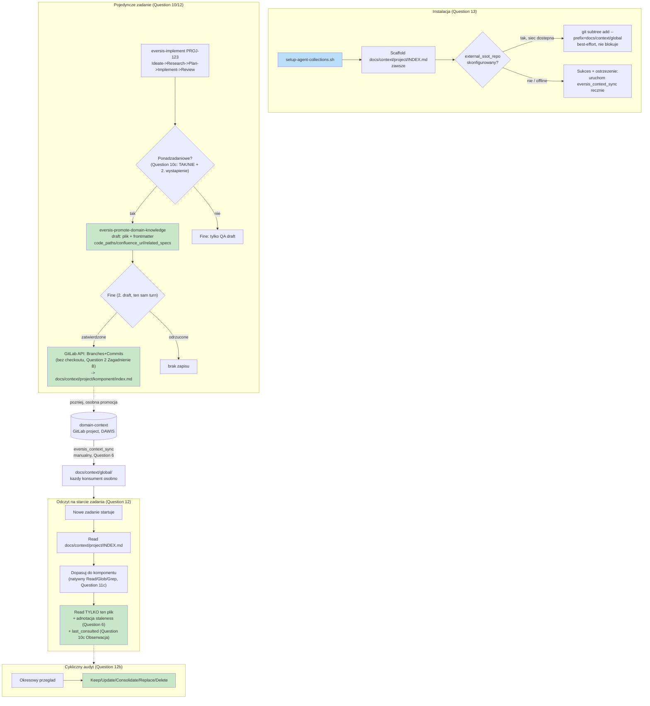

# global-domain-context-ssot - Implementation Plan

## Task Details

| Field            | Value                   |
| ---------------- | ----------------------- |
| Jira ID          | DHI-630 (related: DHI-603, per Question 8) |
| Title            | Global domain-context SSOT dla multi-repo enterprise topology (DAWIS/EOG/EOP/User Area) |
| Description      | Wprowadzić warstwę trwałej, dwupoziomowej (project + global) wiedzy domenowej, czytanej i pisanej przez agentów AI w repozytoriach konsumenckich grupy GitLab `DAWIS`, bez naruszania Core/Consumer separacji frameworka i bez wymuszania ceremonii nieproporcjonalnej do niskiego ryzyka staleness. |
| Priority         | High |
| Related Research | [`global-domain-context-ssot.research.md`](./global-domain-context-ssot.research.md) — 13 pytań Gap Analysis, wszystkie rozstrzygnięte i zaakceptowane przez stakeholdera 2026-08-25 |

## Wildly Important Goal

**Goal**: Dostarczyć działający, end-to-end mechanizm SSOT wiedzy domenowej (zapis per-zadanie → promocja project-level → dystrybucja global-level → odczyt budżetowo-świadomy przez agenta) w jednym, spójnym repo-konsumenckim (`EOG`), gotowy do pilotażu.

**Success Measure**: Deweloper uruchamiający `eversis-implement PROJ-123` w świeżo zainstalowanym `EOG` może: (a) odczytać istniejącą wiedzę domenową przez `eversis_context_get`/`list` bez przeszukiwania `docs/specs/`, (b) po zakończeniu zadania zobaczyć w turze Fine propozycję promocji wiedzy (jeśli heurystyka ją wykryje), (c) po zatwierdzeniu zobaczyć nowy/zaktualizowany plik w `docs/context/<project>/<komponent>/index.md`, zacommitowany bez ręcznego `git subtree` przez dewelopera.

**Do NOT touch / do NOT add**:
- Nie usuwać ani nie modyfikować mechanizmu `docs/context/<project>/task-baseline.md` / Step 11 (`eversis-jira-task-formatting`) — Question 3's decyzja o współistnieniu jako rodzeństwo nie wymaga tam żadnej zmiany; usunięcie tego mechanizmu to osobna, nierozpoczęta decyzja (zob. Research, adnotacja przy Question 3).
- Nie generalizować przykładów `EOG-1234`/DAWIS w `.ai/skills/eversis-ba-docs-planner/SKILL.md` w ramach tego planu (Question 9(2) — potwierdzone, ale osobny, niski-priorytetowy task porządkowy, inny skill niż zakres DHI-630).
- Nie budować `eversis_context_search` ani żadnej warstwy fuzzy-search (Question 11(c)/12(c) — jawnie odrzucone).
- Nie budować blokującego CI status checka ani bota push-on-merge dla fan-out (Question 6, Question 2 Zagadnienie A — jawnie odrzucone).
- Nie wprowadzać tagowania/SemVer dla `domain-context` (Question 5 — jawnie odrzucone, tryb "latest" jedyny).
- Nie tworzyć nowego, osobnego human gate'u dla promocji wiedzy — wyłącznie rozszerzenie istniejącego gate'u Fine (Question 10).

## Proposed Solution

Mechanizm ma dwa niezależne, ale połączone przepływy, oba już w pełni rozstrzygnięte w Research:

1. **Przepływ zapisu (task → project → global):** pojedyncze zadanie (`eversis-implement`) po Review ocenia, czy podjęta decyzja jest ponadzadaniowa (heurystyka z Question 10(c): jawna konwencja / trwała reguła biznesowa / wzorzec integracji = TAK; detal implementacyjny = NIE; promocja przy drugim wystąpieniu dla przypadków granicznych). Jeśli tak, `eversis-promote-domain-knowledge` przygotowuje drugi draft w tej samej turze Fine — zapis dopiero po jawnej akceptacji człowieka, bezpośrednio do `docs/context/<project>/<domena>/<temat>.md` przez GitLab REST API (Branches → Commits z wieloma akcjami plikowymi → Merge Requests), bez lokalnego checkoutu. Osobna, późniejsza promocja `project → domain-context` (global) idzie tym samym mechanizmem API, inicjowana z poziomu repo-konsumenckiego do projektu GitLab `domain-context`.
2. **Przepływ dystrybucji i odczytu (global → project → agent):** `domain-context` dociera do każdego repo-konsumenckiego przez `git subtree pull --prefix=docs/context/global`, inicjowany manualnie przez dewelopera (`eversis_context_sync`, jedna komenda) — bez wymuszania, bez blokady CI. Agent na starcie zadania czyta `docs/context/<project>/INDEX.md` (+ `global/INDEX.md` w razie potrzeby), dopasowuje temat do jednego komponentu, czyta tylko ten jeden plik — nigdy cały katalog ani `docs/specs/` wstecz, chyba że INDEX nie pokrywa tematu.

**Diagram — finalna architektura (agreguje wszystkie 13 rozstrzygnięć Research):**

## Current Implementation Analysis

### Already Implemented

- `eversis_skills_list`/`eversis_skills_get`/`eversis_skills_validate` — `mcp/eversis-collections-mcp/src/server.ts` — wzorzec architektoniczny do powielenia dla `eversis_context_*` (rejestracja narzędzia, odczyt plików repo, walidacja frontmatter).
- Mechanizm zapisu install-state — `scripts/lib/setup-agent-collections/selection.sh` (`install-selection.json`) — wzorzec do rozszerzenia dla nowych pól `ssot.json`.
- `mcp-merge.sh` + `templates/mcp.json` — merge (nie overwrite) do `.mcp.json`/`.cursor/mcp.json` — gotowe do reużycia bez zmian, jeśli promocja wymaga nowego serwera MCP (nie wymaga — rozszerzamy istniejący `eversis-collections-mcp`).
- `atlassian` MCP (`https://mcp.atlassian.com/v1/mcp`) — skonfigurowany, zweryfikowany na żywo (Question 1) — Faza 4 (import Confluence) opiera się na nim bez dodatkowej integracji.
- `--vendor submodule`/`copy` (`scripts/lib/setup-agent-collections/vendor.sh`) — jedyny dziś istniejący precedens "instalator pobiera zawartość automatycznie przy instalacji" — wzorzec dla Question 13's best-effort `subtree add`.
- `.ai/skills/eversis-fine-handoff/SKILL.md` + `fine-handoff.example.md` — istniejący, w pełni działający mechanizm dwufazowego gate'u (draft w tym samym turnie, publikacja po jawnej zgodzie) — wzorzec do rozszerzenia o drugi typ draftu (Question 10).
- `docs/architecture/agents-md-standard.md` — normatywny standard triady `docs/context/`/`docs/plans/`/`docs/specs/`, już dziś nazywa `docs/context/` jako miejsce "internal knowledge, architecture notes" — potwierdza, nie wymaga zmiany strukturalnej (Question 3 rewizja).

### To Be Modified

- `scripts/lib/setup-agent-collections/selection.sh` — dodać pola `ssot` do zapisywanego JSON (`external_ssot_repo`, `project_context_path`, `global_context_path`).
- `scripts/setup-agent-collections.sh` — dodać flagi `--ssot-source`, `--confluence-space-key` (opcjonalna, Question 7), wywołanie nowego kroku scaffoldingu/seed.
- `docs/architecture/install-selection.md` — udokumentować nowe pola schematu (ten plik jest kanoniczną specyfikacją per `docs-architecture-necessity.research.md` — musi zostać zsynchronizowany z kodem, nie może się rozjechać).
- `mcp/eversis-collections-mcp/src/server.ts` — zarejestrować `eversis_context_get`, `eversis_context_list`, `eversis_context_sync`.
- `.ai/rules/orchestration/agent-core.md` — rozszerzyć krok Research o jawną, lekką kolejność odczytu `docs/context/` (Question 12(a)).
- `.ai/rules/orchestration/fine-handoff.md` i `.ai/skills/eversis-fine-handoff/SKILL.md` — dodać drugi, opcjonalny typ draftu (promocja wiedzy) w tej samej turze Fine (Question 10).

### To Be Created

- `scripts/lib/setup-agent-collections/ssot.sh` — scaffolding `docs/context/<project>/INDEX.md` + best-effort `git subtree add` (Question 13).
- `scripts/lib/setup-agent-collections/ssot.test.sh` — testy jednostkowe dla powyższego.
- `mcp/eversis-collections-mcp/src/context.ts` — logika merge project/global, adnotacja staleness, `last_consulted`, wrapper `subtree pull`.
- `mcp/eversis-collections-mcp/tests/context.test.ts` — testy jednostkowe.
- `.ai/skills/eversis-promote-domain-knowledge/SKILL.md` + `knowledge-entry.example.md` — skill promocji wiedzy (heurystyka, wyszukanie istniejącego pliku komponentu, frontmatter, wywołanie GitLab API).
- `.ai/skills/eversis-import-confluence-knowledge/SKILL.md` — jednorazowy import AS-IS Pack, dzielący stronę Confluence na osobne pliki tematyczne (Faza 4, Question 1).
- `.ai/skills/eversis-audit-domain-knowledge/SKILL.md` — cykliczny audyt pięciu wyników (Question 12(b)).

## Open Questions

| #   | Question   | Answer   | Status                |
| --- | ---------- | -------- | --------------------- |
| — | Brak otwartych pytań architektonicznych | Wszystkie 13 pytań Gap Analysis w `global-domain-context-ssot.research.md` rozstrzygnięte i zaakceptowane przez stakeholdera 2026-08-25 | ✅ Resolved |

## Technical Context

### Project Instructions

- `.ai/rules/orchestration/agent-core.md` — lifecycle Ideate→Research→Plan→Implement→Review→Fine, hard limits (brak edycji poza zakresem, brak nowych zależności bez zgody, brak cichego usuwania komentarzy dokumentacyjnych).
- `.ai/rules/orchestration/spec-driven-development.md` — Delivery Standard, gate'y Research/Plan, folder `docs/specs/<issue-kebab>/`.
- `.ai/rules/orchestration/fine-handoff.md` — kontrakt dwufazowego gate'u Fine (draft w turnie, publikacja po jawnej zgodzie).
- `docs/architecture/agents-md-standard.md` — normatywna triada `docs/context/`/`docs/plans/`/`docs/specs/`; ten plan **nie** dodaje nowego top-level folderu do `docs/`.
- `docs/architecture/isolation-strategy.md` — zasada Core/Consumer: `.ai/` = rdzeń portable, `docs/` = artefakty konsumenta; żaden task w tym planie nie umieszcza wiedzy domenowej pod `.ai/`.

### Architecture & Patterns

- Skille frameworka: `.ai/skills/<gerund-topic>/SKILL.md` + opcjonalne `*.example.md` — frontmatter `name`/`description`/`user-invocable`.
- Instalator: `scripts/setup-agent-collections.sh` (entry) + `scripts/lib/setup-agent-collections/<topic>.sh` (moduły, źródłowane przez główny skrypt) + `<topic>.test.sh` (testy jednostkowe w tym samym katalogu, uruchamiane bezpośrednio przez `bash`).
- MCP server: `mcp/eversis-collections-mcp/src/server.ts` (rejestracja narzędzi) + dedykowane moduły logiki (`skills.ts`, `frontmatter.ts`, `resolveRoot.ts`) — nowa logika w analogicznym, osobnym pliku (`context.ts`), nie wszystko w `server.ts`.
- `.ai/` core musi być zsynchronizowane do adapterów (Cursor/Claude Code/OpenCode) po każdej zmianie w `.ai/rules/`/`.ai/skills/` — `node adapters/sync.mjs` (lub `--check` do weryfikacji bez zapisu).

### Tech Stack

- Instalator: Bash (`set -euo pipefail`, funkcje `_pass`/`_fail`/`log_*` już zdefiniowane w bibliotekach).
- MCP server: TypeScript, Node ≥18, `@modelcontextprotocol/sdk`, `zod` (walidacja schematów), kompilacja `tsc` → `dist/`.
- Root: npm workspace-style skrypty (`package.json`) delegujące do `mcp/eversis-collections-mcp` przez `npm --prefix`.

### Code Style & Standards

- Bash: funkcje prywatne z prefiksem `_`, `readonly` dla stałych, `log_info`/`log_ok`/`log_warn` do komunikatów (wzorzec z `gitignore.sh`/`vendor.sh`).
- TypeScript: strict mode (per istniejący `tsc` config), Zod schematy dla walidacji wejścia narzędzi MCP (wzorzec z istniejących `eversis_skills_*` narzędzi).
- Markdown skille: frontmatter YAML, gerund-style nazwa katalogu, sekcja `<principles>` dla twardych zasad gdy dotyczy.

### Testing Patterns

- Bash: `bash scripts/lib/setup-agent-collections/<nazwa>.test.sh` (bezpośrednie uruchomienie, wzorzec z `gitignore.test.sh`); zbiorczy smoke test instalatora: `npm run installer:smoke`.
- MCP TypeScript: `npm run mcp:build` (kompilacja, musi przejść bez błędów) i `npm run mcp:test` (Node native test runner, `--import tsx/esm --test`).
- Adapter sync (po zmianach w `.ai/`): `npm run sync:adapters:check` (musi zakończyć się bez rozbieżności).
- Skille: `eversis_skills_validate` (narzędzie MCP) uruchomione na nowym/zmienionym katalogu skilla — zero błędów walidacji frontmatter.

### Database Patterns

Nie dotyczy — brak bazy danych w tym zadaniu.

### Additional Context

- GitLab REST API (Branches/Commits z wieloma akcjami plikowymi/Merge Requests) jest wywoływana bezpośrednio (HTTP), nie przez dedykowany MCP server — żaden GitLab MCP nie jest dziś skonfigurowany we frameworku. Wymaga tokenu z zakresem `api`/zapisu do repo, dostarczonego przez środowisko wykonawcze agenta (zmienna środowiskowa lub sekret) — **provisioning samego tokenu jest poza zakresem tego planu** (zob. Improvements), traktowany jak istniejąca zasada "human-only secret review" ze źródłowego dokumentu.
- `docs/context/<project>/task-baseline.md` (Step 11, `eversis-jira-task-formatting`) pozostaje bez zmian — żaden task w tym planie go nie dotyka.

## Implementation Plan

### Phase 1: Ścieżki, schemat `ssot.json` i scaffolding instalatora

**Goal**: Ustanowić fizyczną strukturę katalogów i konfigurację, na której opierają się wszystkie kolejne fazy (Question 3, 13).

**Description**: Bez tej fazy żadna z kolejnych faz nie ma gdzie zapisywać ani skąd czytać. Obejmuje rozszerzenie schematu `ssot.json`, scaffolding `docs/context/<project>/INDEX.md` przy każdej instalacji, oraz best-effort, nieblokujące pierwsze zasilenie `docs/context/global/`.

**Verification:** `bash scripts/lib/setup-agent-collections/ssot.test.sh`; `npm run installer:smoke`

#### Task 1.1 - [MODIFY] Rozszerzyć schemat `ssot.json` w `install-selection.json`

**Description**: Dodać trzy nowe pola do obiektu zapisywanego przez instalator: `externalSsotRepo` (opcjonalny URL GitLab projektu `domain-context`), `projectContextPath` (domyślnie `docs/context/<project>/`), `globalContextPath` (domyślnie `docs/context/global/`). Brak `externalSsotRepo` oznacza projekt nieuczestniczący w SSOT grupy DAWIS — wartość `null`/pominięta, nie pusty string.

**Files:** `scripts/lib/setup-agent-collections/selection.sh` (modify), `docs/architecture/install-selection.md` (modify — kanoniczna dokumentacja schematu)

**Definition of Done**:

- [ ] `install-selection.json` zawiera `externalSsotRepo`/`projectContextPath`/`globalContextPath` po instalacji z flagą `--ssot-source`, i nie zawiera `externalSsotRepo` (lub ma `null`) bez tej flagi
- [ ] `docs/architecture/install-selection.md` opisuje wszystkie trzy nowe pola w tabeli schematu, zgodnie z rzeczywistym kodem `selection.sh`
- [ ] Run `bash scripts/lib/setup-agent-collections/ssot.test.sh`

**Clues**: Wzorować się dokładnie na istniejącym stylu zapisu `vendorMode`/`linkMode` w `selection.sh` — ten sam obiekt JSON, nie osobny plik.

#### Task 1.2 - [CREATE] Scaffolding `docs/context/<project>/INDEX.md` i best-effort `git subtree add`

**Description**: Nowy moduł instalatora: (a) zawsze tworzy `docs/context/<project>/INDEX.md` z pustym szablonem (nagłówek + placeholder na listę komponentów), niezależnie od konfiguracji SSOT; (b) jeśli `externalSsotRepo` jest skonfigurowany, próbuje `git subtree add --prefix=docs/context/global <externalSsotRepo> <branch> --squash` — przy błędzie (offline, brak dostępu) **nie przerywa instalacji**, tylko wypisuje ostrzeżenie z dokładną komendą do ręcznego uruchomienia później.

**Files:** `scripts/lib/setup-agent-collections/ssot.sh` (create), `scripts/setup-agent-collections.sh` (modify — wywołanie nowego modułu, nowa flaga `--ssot-source`)

**Definition of Done**:

- [ ] `docs/context/<project>/INDEX.md` istnieje po każdej instalacji, z projektem podstawionym w `<project>`
- [ ] Instalacja z nieosiągalnym `--ssot-source` kończy się kodem wyjścia 0 i widocznym ostrzeżeniem zawierającym dokładną komendę `git subtree add`
- [ ] Instalacja z osiągalnym `--ssot-source` skutkuje istnieniem `docs/context/global/` z zawartością źródłowego repo
- [ ] Run `bash scripts/lib/setup-agent-collections/ssot.test.sh`

**Stop Rule:** Jeśli `git subtree` nie jest dostępny w środowisku CI używanym do testów — oznacz test jako pominięty z jasnym komunikatem, nie failuj całego zestawu.

#### Task 1.3 - [CREATE] Testy jednostkowe scaffoldingu SSOT

**Description**: Testy pokrywające: scaffolding INDEX.md bez flagi, best-effort subtree add z sukcesem (lokalne repo testowe jako źródło), best-effort subtree add z porażką (nieistniejący remote) — zgodnie z wzorcem `gitignore.test.sh` (tymczasowy katalog, `trap` cleanup, liczniki PASS/FAIL).

**Files:** `scripts/lib/setup-agent-collections/ssot.test.sh` (create)

**Definition of Done**:

- [ ] Run `bash scripts/lib/setup-agent-collections/ssot.test.sh` kończy się `PASS` dla wszystkich trzech scenariuszy
- [ ] Test nie pozostawia plików tymczasowych po zakończeniu (weryfikowalne przez `trap ... EXIT`)

### Phase 2: Narzędzia MCP odczytu — `eversis_context_get`/`list`/`sync`

**Goal**: Umożliwić agentowi odczyt i manualne odświeżenie wiedzy domenowej przez ustandaryzowany interfejs, bez `eversis_context_search` (Question 11(c)/12(c)).

**Description**: Trzy narzędzia: `eversis_context_get(component)` i `eversis_context_list()` implementują algorytm scalania project/global (project nadpisuje global) i adnotację staleness (Question 6) oraz `last_consulted` (Question 10(c) Obserwacja); `eversis_context_sync()` opakowuje `git subtree pull` w jedną komendę.

**Verification:** `npm run mcp:build`; `npm run mcp:test`

#### Task 2.1 - [CREATE] Logika merge/staleness/last_consulted

**Description**: Moduł czytający `projectContextPath`/`globalContextPath` z `install-selection.json`, parsujący `INDEX.md` obu poziomów, zwracający dla danego tematu treść z project (jeśli istnieje) lub global (fallback), z adnotacją źródła. Staleness liczona przez porównanie SHA ostatniego `git-subtree-split` trailera w historii `docs/context/global/` z `git ls-remote` na `externalSsotRepo`. Po każdym odczycie aktualizuje pole `last_consulted` (ISO date) w frontmatterze odczytanego pliku komponentu.

**Files:** `mcp/eversis-collections-mcp/src/context.ts` (create), `mcp/eversis-collections-mcp/src/frontmatter.ts` (reuse — istniejący parser frontmatter)

**Definition of Done**:

- [ ] Funkcja zwraca treść project-level, gdy temat istnieje w obu warstwach
- [ ] Funkcja zwraca treść global-level z adnotacją źródła, gdy temat istnieje tylko tam
- [ ] Odczyt aktualizuje `last_consulted` w pliku źródłowym
- [ ] Run `npm run mcp:build`

#### Task 2.2 - [CREATE] Rejestracja `eversis_context_get`/`list`/`sync` w serwerze MCP

**Description**: Zarejestrować trzy narzędzia w `server.ts`, wzorując się dokładnie na strukturze rejestracji `eversis_skills_list`/`get`/`validate` (Zod schema wejścia, opis narzędzia, handler wywołujący `context.ts`). `eversis_context_sync` wykonuje `git subtree pull --prefix=<globalContextPath> <externalSsotRepo> <branch> --squash` w bieżącym repo i zwraca podsumowanie (liczba nowych commitów).

**Files:** `mcp/eversis-collections-mcp/src/server.ts` (modify), `mcp/eversis-collections-mcp/src/context.ts` (modify — utworzony w Task 2.1)

**Definition of Done**:

- [ ] `eversis_context_search` **nie istnieje** w rejestrze narzędzi (jawna weryfikacja negatywna — `grep -c "eversis_context_search" mcp/eversis-collections-mcp/src/server.ts` zwraca `0`)
- [ ] Trzy nowe narzędzia widoczne w liście narzędzi serwera po starcie
- [ ] Run `npm run mcp:build`

#### Task 2.3 - [CREATE] Testy jednostkowe narzędzi kontekstu

**Description**: Testy analogiczne do istniejących `tests/chapters.test.ts`/`tests/resolveRoot.test.ts` (Node native test runner) — pokrywają merge project/global, staleness annotation, `last_consulted`, i błąd `eversis_context_sync` przy nieosiągalnym remote.

**Files:** `mcp/eversis-collections-mcp/tests/context.test.ts` (create)

**Definition of Done**:

- [ ] Run `npm run mcp:test` — wszystkie testy przechodzą, w tym nowe dla `context.ts`

### Phase 3: Import Confluence AS-IS (opcjonalny, nieblokujący)

**Goal**: Umożliwić jednorazowy seed wiedzy domenowej z Confluence, bez blokowania instalacji przy braku klucza (Question 7).

**Description**: Poprawka Fazy 4 źródłowego dokumentu — `--confluence-space-key` staje się opcjonalny; jego brak kończy instalację sukcesem w trybie "pusty start". Osobny skill dzieli monolityczną stronę Confluence AS-IS Pack na osobne pliki tematyczne (Question 1 — struktura per-sekcja, nie żywe proxy).

**Verification:** `bash scripts/lib/setup-agent-collections/ssot.test.sh`; `eversis_skills_validate` na nowym skillu

#### Task 3.1 - [MODIFY] `--confluence-space-key` opcjonalny

**Description**: Zmienić domyślne zachowanie instalatora: brak flagi nie kończy instalacji błędem, tylko pomija import z jasnym komunikatem, że można go uruchomić później ręcznie.

**Files:** `scripts/setup-agent-collections.sh` (modify), `scripts/lib/setup-agent-collections/ssot.sh` (modify — utworzony w Task 1.2)

**Definition of Done**:

- [ ] Instalacja bez `--confluence-space-key` kończy się kodem wyjścia 0
- [ ] Komunikat instalatora jawnie wspomina możliwość późniejszego ręcznego importu
- [ ] Run `bash scripts/lib/setup-agent-collections/ssot.test.sh`

#### Task 3.2 - [CREATE] Skill jednorazowego importu Confluence AS-IS Pack

**Description**: Skill czytający wskazaną stronę Confluence przez już skonfigurowany `atlassian` MCP, dzielący jej sekcje (Cel biznesowy, Mapa modułów, Known Issues, itd.) na osobne pliki `docs/context/<project>/<domena>/<temat>.md` z frontmatter `source: confluence`, `confluence_url` wskazującym źródłową sekcję.

**Files:** `.ai/skills/eversis-import-confluence-knowledge/SKILL.md` (create)

**Definition of Done**:

- [ ] `eversis_skills_validate` na `.ai/skills/eversis-import-confluence-knowledge/` zwraca zero błędów
- [ ] SKILL.md zawiera frontmatter `name`/`description`/`user-invocable`
- [ ] SKILL.md jawnie odwołuje się do struktury frontmatter z Fazy 1 (`scope`, `source`, `confluence_url`, `related_specs`)

### Phase 4: Skill promocji wiedzy i integracja z Fine

**Goal**: Zamknąć pętlę task → project — pojedyncze zadanie może zaproponować i (po zatwierdzeniu) zapisać trwałą wiedzę domenową (Question 10).

**Description**: Nowy skill implementuje heurystykę "ponadzadaniowości" (Question 10(c): konkretne przykłady TAK/NIE + reguła drugiego wystąpienia), wyszukuje istniejący plik komponentu przed utworzeniem nowego (Question 11), i przygotowuje draft do zatwierdzenia w tej samej turze Fine — nigdy jako osobny gate.

**Verification:** `eversis_skills_validate` na nowym skillu; `npm run sync:adapters:check`

#### Task 4.1 - [CREATE] Skill `eversis-promote-domain-knowledge`

**Description**: Implementuje: (1) ocenę ponadzadaniowości z konkretnymi przykładami i regułą drugiego wystąpienia; (2) dopasowanie do istniejącego pliku komponentu po `code_paths` lub nazwie; (3) przygotowanie draftu z pełnym frontmatterem (`scope`, `source: agent-discovered`, `last_updated`, `tags`, `code_paths`, `confluence_url`, `related_specs` jako rosnąca lista); (4) mechanikę zapisu przez GitLab REST API (Branches → Commits z wieloma akcjami plikowymi obejmującymi plik komponentu i `INDEX.md` → Merge Requests), bez lokalnego checkoutu `domain-context`.

**Files:** `.ai/skills/eversis-promote-domain-knowledge/SKILL.md` (create), `.ai/skills/eversis-promote-domain-knowledge/knowledge-entry.example.md` (create)

**Definition of Done**:

- [ ] `eversis_skills_validate` na tym katalogu zwraca zero błędów
- [ ] SKILL.md zawiera sekcję z przykładami TAK/NIE dla heurystyki ponadzadaniowości (nie tylko abstrakcyjny opis)
- [ ] SKILL.md jawnie stwierdza: brak lokalnego checkoutu `domain-context`, wywołania przez REST API
- [ ] `knowledge-entry.example.md` zawiera kompletny przykład frontmatter ze wszystkimi polami (włącznie z `code_paths`/`confluence_url`)

**Clues**: Mechanikę archiwizacji `related_specs` → `changelog.md` (próg do skalibrowania w pilotażu, startowo 15-20 wpisów, zachowując ostatnie 5-10) opisać jako część tego samego skilla, nie osobny task.

#### Task 4.2 - [MODIFY] Rozszerzyć Fine o drugi typ draftu

**Description**: Dodać do kontraktu Fine (obok istniejącego QA comment draft) opcjonalny, drugi draft: `**Draft: propozycja promocji wiedzy do docs/context/<project>/ — zatwierdź przed zapisem**`, generowany tylko gdy `eversis-promote-domain-knowledge` wykryje kandydata. Publikacja (zapis przez GitLab API) następuje wyłącznie po jawnej, osobnej akceptacji tego konkretnego draftu — niezależnie od akceptacji QA draftu.

**Files:** `.ai/rules/orchestration/fine-handoff.md` (modify), `.ai/skills/eversis-fine-handoff/SKILL.md` (modify), `.ai/skills/eversis-fine-handoff/fine-handoff.example.md` (modify)

**Definition of Done**:

- [ ] `fine-handoff.md` opisuje dokładnie dwa niezależne typy draftów w jednej turze Fine, z osobnymi nagłówkami
- [ ] `fine-handoff.example.md` zawiera przykład tury Fine z obydwoma draftami naraz
- [ ] Run `npm run sync:adapters:check` — brak rozbieżności między `.ai/` a wygenerowanymi adapterami

#### Task 4.3 - [MODIFY] Kolejność odczytu w kroku Research (`agent-core.md`)

**Description**: Rozszerzyć istniejący krok 1 (Research) w `agent-core.md` o lekki, ponumerowany podkrok (Question 12(a)): najpierw `docs/context/<project>/INDEX.md` (+ `global/INDEX.md` w razie potrzeby), dopasuj do komponentu, czytaj tylko ten plik, `related_specs`/`confluence_url` leniwie, fallback do `docs/specs/`/kodu tylko gdy INDEX nie pokrywa tematu.

**Files:** `.ai/rules/orchestration/agent-core.md` (modify)

**Definition of Done**:

- [ ] Krok Research zawiera jawną, ponumerowaną podsekcję (4 punkty) kolejności odczytu `docs/context/`
- [ ] Podsekcja jawnie stwierdza "czytaj tylko dopasowany plik komponentu, nie cały katalog"
- [ ] Run `npm run sync:adapters:check`

### Phase 5: Dystrybucja `domain-context` (GitLab)

**Goal**: Zamknąć pętlę project → global — wiedza z jednego repo-konsumenckiego trafia do współdzielonego `domain-context` i jest dostępna dla pozostałych repo grupy DAWIS (Question 2).

**Description**: Ta faza dokumentuje i konfiguruje mechanizm już zaprojektowany technicznie w Fazie 4 (ten sam skill promocji obsługuje oba kierunki zapisu — do `docs/context/<project>/` lokalnie i do `domain-context` przy promocji global) — tutaj dodawana jest wyłącznie konfiguracja repo-specyficzna (URL `domain-context`, uprawnienia).

**Verification:** `bash scripts/lib/setup-agent-collections/ssot.test.sh`

#### Task 5.1 - [CREATE] Konfiguracja repo-owner dla `domain-context`

**Description**: Dokumentacja i konfiguracja (nie kod aplikacyjny) opisująca: token GitLab z zakresem `api` wymagany przez `eversis-promote-domain-knowledge` do promocji `project → global`; miejsce jego przechowywania (zmienna środowiskowa, zgodnie z zasadą "human-only secret review" ze źródłowego dokumentu — provisioning samego sekretu poza zakresem tego planu).

**Files:** `docs/architecture/install-selection.md` (modify — sekcja o wymaganych zmiennych środowiskowych dla trybu `--ssot-source`)

**Definition of Done**:

- [ ] `install-selection.md` zawiera sekcję "Required environment for domain-context promotion" z nazwą oczekiwanej zmiennej środowiskowej i zakresem tokenu
- [ ] Dokument jawnie stwierdza, że provisioning tokenu jest odpowiedzialnością zespołu/człowieka, nie instalatora

### Phase 6: Cykliczny audyt wiedzy domenowej

**Goal**: Domknąć pętlę zwrotną — wykrywać wiedzę, która przestała być trafna, zanim urośnie do rozmiaru utrudniającego odczyt (Question 12(b)).

**Description**: Nowy skill okresowo (częstotliwość konfigurowalna, startowo kwartalnie) przegląda pliki komponentów, klasyfikując każdy do Keep/Update/Consolidate/Replace/Delete, wykorzystując `last_consulted` z Fazy 2 jako sygnał.

**Verification:** `eversis_skills_validate` na nowym skillu

#### Task 6.1 - [CREATE] Skill `eversis-audit-domain-knowledge`

**Description**: Implementuje pięciowynikowy model przeglądu (tabela z Research, Question 12(b)) jako procedurę dla agenta: dla każdego pliku komponentu w `docs/context/<project>/` sprawdź `last_consulted`, `code_paths` (czy wciąż istnieją w repo), długość `related_specs`; zaproponuj wynik; opcjonalnie spróbkuj niedawne `docs/specs/` dla tego samego `code_paths` pod kątem tematów bez odpowiadającego wpisu.

**Files:** `.ai/skills/eversis-audit-domain-knowledge/SKILL.md` (create)

**Definition of Done**:

- [ ] `eversis_skills_validate` na tym katalogu zwraca zero błędów
- [ ] SKILL.md zawiera pełną tabelę pięciu wyników z Research (Keep/Update/Consolidate/Replace/Delete) i kryteriami dla każdego
- [ ] SKILL.md jawnie oznacza próbkowanie `docs/specs/` jako opcjonalne, nie obowiązkowe

### Phase 7: Code Review

**Goal**: Zweryfikowana jakość całej dostawy przed uznaniem za Fine.

**Description**: Finalna weryfikacja pełnej implementacji przez Code Reviewer. Faza obowiązkowa, zawsze ostatnia.

**Verification:** `npm run mcp:build`; `npm run mcp:test`; `npm run installer:smoke`; `npm run sync:adapters:check`

#### Task 7.1 - [REUSE] Code review przez Code Reviewer

**Description**: Uruchomić Code Reviewer przez `eversis-review.md` na pełnej implementacji (Fazy 1-6). Nie uruchamiać e2e poza tym review.

**Files:** wszystkie pliki utworzone/zmodyfikowane w Fazach 1-6 (reuse)

**Definition of Done**:

- [ ] Run `npm run mcp:build && npm run mcp:test && npm run installer:smoke && npm run sync:adapters:check` — wszystko przechodzi
- [ ] Code review przechodzi bez blokujących ustaleń
- [ ] Wynik review udokumentowany w Changelog

## Security Considerations

- Token GitLab z zakresem `api` (Faza 5) musi być traktowany jak sekret — nigdy zapisywany w `docs/context/`, `ssot.json` ani logach instalatora; wyłącznie zmienna środowiskowa poza kontrolą wersji.
- `eversis-promote-domain-knowledge` nigdy nie zapisuje bez jawnej ludzkiej akceptacji (Fine gate) — brak automatycznego zapisu do repo współdzielonego (`domain-context`) na podstawie samej oceny agenta.
- Import Confluence (Faza 3) korzysta wyłącznie z już istniejącego, autoryzowanego `atlassian` MCP — nie wprowadza nowych poświadczeń.

## Quality Assurance

- [x] Świeżo zainstalowany `EOG` (bez `--ssot-source`) instaluje się bez błędu i ma scaffoldowany `docs/context/<project>/INDEX.md` — zweryfikowane end-to-end (`installer:smoke`, ręczna instalacja do tymczasowego repo)
- [x] Świeżo zainstalowany `EOG` (z osiągalnym `--ssot-source`) ma wypełniony `docs/context/global/` od razu po instalacji, bez ręcznego kroku — zweryfikowane end-to-end z prawdziwym, lokalnym remote (`git subtree add` faktycznie uruchomiony i zweryfikowany, nie tylko założony)
- [x] `eversis_context_get`/`list` zwracają poprawnie scalone wyniki project/global z adnotacją źródła i staleness — pokryte testami jednostkowymi (`context.test.ts`, w tym dedykowany test staleness z prawdziwym `git subtree add`/`ls-remote`)
- [x] `eversis_context_search` nie istnieje w żadnym miejscu kodu ani dokumentacji jako zaimplementowane narzędzie — potwierdzone (`grep` zero trafień)
- [x] Mechanizm promocji wiedzy opisany (`eversis-promote-domain-knowledge`) generuje drugi draft w Fine wyłącznie po wykryciu kandydata, z zapisem tylko po jawnej akceptacji — zweryfikowane jako specyfikacja skilla + kontrakt `fine-handoff.md`/`eversis-fine-handoff` (rzeczywiste uruchomienie na prawdziwym zadaniu wymaga pilotażu poza tym Planem)
- [x] `docs/context/<project>/task-baseline.md` pozostaje niezmieniony i funkcjonalny po wszystkich zmianach — żaden task nie dotknął `.ai/skills/eversis-jira-task-formatting/`

## Improvements (Out of Scope)

- Generalizacja przykładów `EOG-1234`/DAWIS w `.ai/skills/eversis-ba-docs-planner/SKILL.md` (Question 9(2) — zaakceptowane, osobny task).
- Dodanie jawnego kryterium akceptacji izolacji do treści DHI-630 w Jirze (Question 9(3) — zaakceptowane, wymaga osobnego push do Jiry).
- Provisioning samego tokenu GitLab (mechanizm dystrybucji sekretu do środowisk deweloperskich) — poza zakresem tego planu.
- Ewentualne przyszłe usunięcie mechanizmu `task-baseline.md`/Step 11 — osobna, nierozpoczęta decyzja dotycząca innego skilla (`eversis-jira-task-formatting`), poza zakresem DHI-630.
- Dokładna częstotliwość audytu (Faza 6) i próg archiwizacji `related_specs` (Faza 4) — startowe wartości podane w planie, docelowa kalibracja wymaga danych z pilotażu (Faza 7 źródłowego dokumentu).
- **Aktualizacja `website/docs/`** (analogiczne poprawki w `getting-started/installation.md`/`mcp-setup.md` + prawdopodobnie nowa strona o mechanizmie SSOT wiedzy domenowej) — odkryta luka w tym Planie (nie ujęta w oryginalnym zakresie Faz 1-7); `README.md` zaktualizowano w tej samej sesji, `website/` wymaga osobnego Research/Plan ze względu na zakres (nowa treść koncepcyjna, nie tylko punktowe poprawki).

## Human gates

1. ~~Approve research~~ — done (`"Akceptuję Research. Przejdź do Planu"`)
2. ~~Approve this plan~~ — done (`"Approve this plan. Go to the Implementation"`)
3. ~~Implement~~ — done (Fazy 1-6 zaimplementowane i zweryfikowane); Review i Fine w tej samej sesji poniżej.

## Changelog

| Date   | Change Description   |
| ------ | -------------------- |
| 2026-08-25 | Initial plan created — 7 faz, agregujące wszystkie 13 rozstrzygniętych pytań Research |
| 2026-08-25 | Implement Fazy 1-6 ukończone i zweryfikowane. Odkryty i naprawiony bloker poza zakresem Task 2.1/2.2: `docker-compose.yml` montował tylko `/repo` (framework), nigdy repo konsumenckie — dodano `${PWD}:/workspace`. Task 3.1 skorygowany w trakcie: `--confluence-space-key` nie istniał wcześniej wcale (nie było czego "odblokowywać") — dodany od razu jako opcjonalny. Faza 5 (Task 5.1) okazała się już spełniona przez dokumentację dodaną w Fazie 1. Podczas własnej weryfikacji znaleziono i naprawiono błędny probe `git subtree --help` (zależny od `man`, fałszywie negatywny) w dwóch miejscach (`ssot.test.sh`, `context.test.ts`) oraz brak initial commitu w teście instalatora blokujący `git subtree add` — po naprawie: 5/5 testów `ssot.test.sh` (0 pominiętych), 18/18 testów `mcp:test`, pełny end-to-end z prawdziwym `--ssot-source` zweryfikowany ręcznie. Review: PASS. |
| 2026-08-25 | Stakeholder wykrył wyciek polskich słów do `.ai/skills/eversis-promote-domain-knowledge/SKILL.md` ("ponadzadaniowe"). Pełny przegląd wszystkich plików frameworka utworzonych/zmodyfikowanych w tym Implement (nie tylko wskazany plik) ujawnił 7 dodatkowych wystąpień w 4 plikach: nagłówek draftu promocji (`**Draft: propozycja promocji wiedzy...**`) w `fine-handoff.md`, `eversis-fine-handoff/SKILL.md` i `fine-handoff.example.md`; "Plik:"/"nowy" w przykładzie; "ponadzadaniowe" powtórzone w `eversis-import-confluence-knowledge/SKILL.md`; "Faza 4" w komentarzu `ssot.sh`. Wszystkie przetłumaczone na angielski — `.ai/` musi pozostać w całości vendor-neutral. Zweryfikowane: `eversis_skills_validate` (48 pakietów, 0 błędów), `sync:adapters:check` (brak driftu). |
| 2026-08-25 | Stakeholder wskazał drugi, niezależny wyciek tej samej klasy: przykład "EOG prices always round up to the nearest 0.05 PLN" w `eversis-promote-domain-knowledge/SKILL.md` — dokładnie ten sam wzorzec naruszenia, który Question 9 Research już raz znalazło w `eversis-ba-docs-planner/SKILL.md` (klientospecyficzne identyfikatory w portable `.ai/`). Pełny przegląd wszystkich plików frameworka z tego Implement pod kątem `EOG`/`EOP`/`PIUW`/`WUP`/`DAWIS`/`PLN` ujawnił 4 dodatkowe wystąpienia w 3 plikach: przykład ceny w `SKILL.md`, "EOP"/"User Area" w opisie promocji project→global, oraz `eog` jako przykładowy slug projektu w dwóch plikach `.example.md`. Wszystkie zgenerycyzowane (`example-project`, "other consumer repos in the same group", "local currency"). Zweryfikowane ponownie: `eversis_skills_validate` (48 pakietów, 0 błędów), `sync:adapters:check` (brak driftu). |
| 2026-08-25 | Stakeholder zasugerował i zaakceptował `proj` (małe litery) jako spójny z istniejącą konwencją `PROJ-123` (12 plików `.ai/`) placeholder dla przykładowego slug-a projektu w `.example.md`, zamiast `example-project` — respektuje format rzeczywistego mechanizmu (`_ssot_project_slug()` w `ssot.sh` zawsze obniża do małych liter). Zastosowane w `eversis-promote-domain-knowledge/knowledge-entry.example.md` i `eversis-fine-handoff/fine-handoff.example.md`. Zweryfikowane: `eversis_skills_validate` (48 pakietów, 0 błędów). |
| 2026-08-25 | Stakeholder zapytał wprost, czy `website/`/`README.md` zostały zaktualizowane — nie były, luka w oryginalnym zakresie Planu. `README.md` zaktualizowany w tej samej sesji (nowe flagi instalatora, narzędzia MCP `eversis_context_*`, 3 nowe skille, drugi draft Fine, struktura `docs/context/` w tabeli project-owned files) — 5 punktowych edycji, bez nowej treści koncepcyjnej. `website/docs/` świadomie odłożone jako follow-up (zob. Improvements) — wymaga osobnego Research/Plan ze względu na zakres (nowa strona koncepcyjna, nie tylko poprawki punktowe). |
