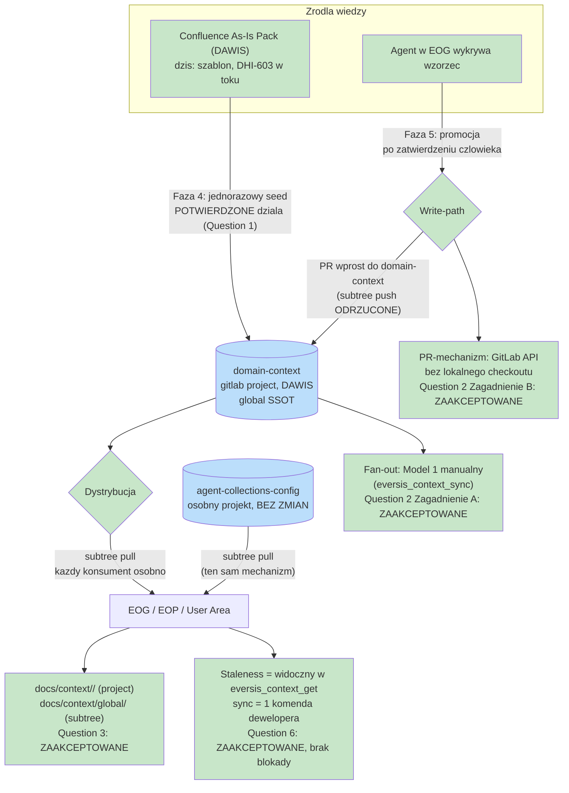
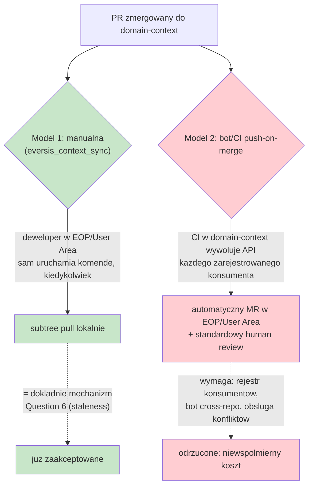
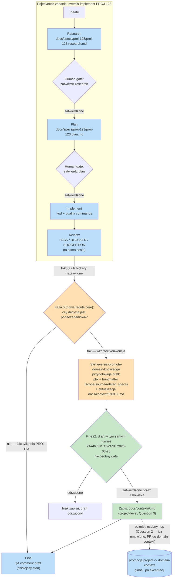
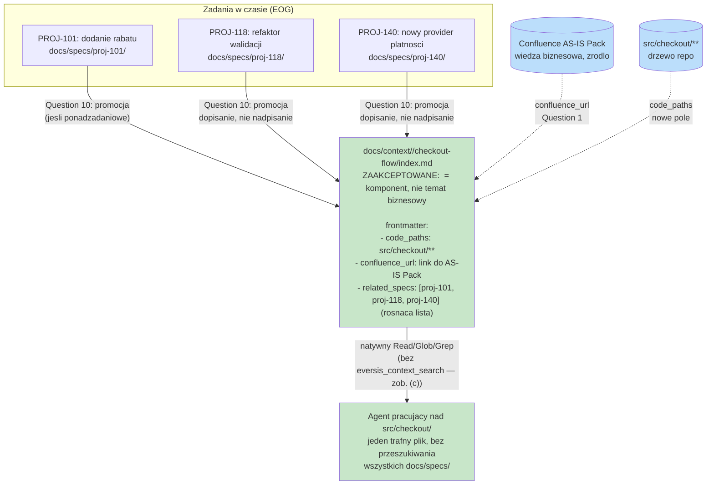
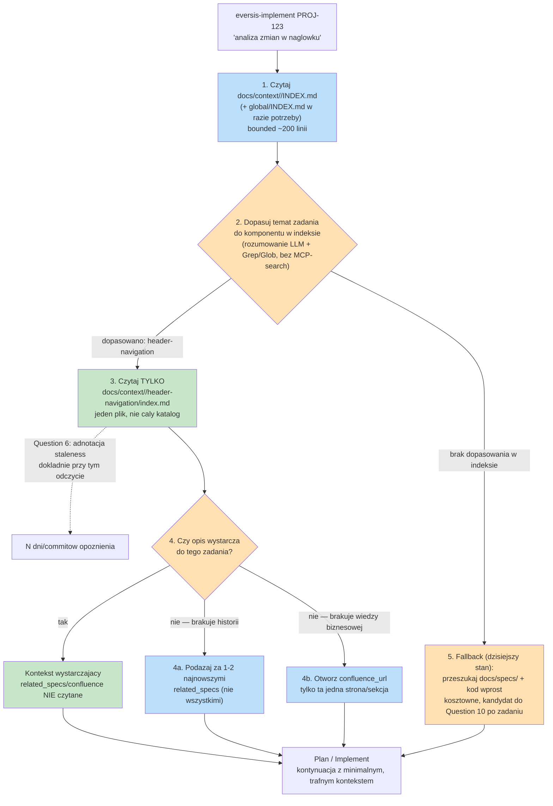
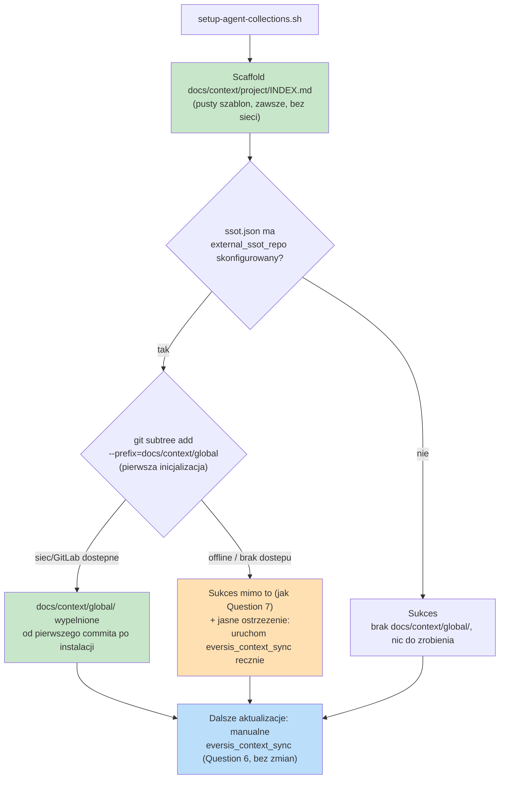

# global-domain-context-ssot - Analysis Result

## Task Details

| Field | Value |
|---|---|
| Jira ID | DHI-630 |
| Title | Global domain-context SSOT dla multi-repo enterprise topology (DAWIS/EOG/EOP/WUP) |
| Description | Zaprojektować i zaimplementować w agent-collections mechanizm trwałej, współdzielonej przez zespół pamięci domenowej, dostępny on-demand dla agenta niezależnie od tego, czy pracuje na poziomie pojedynczego repozytorium (`EOG`) czy grupy repozytoriów (`DAWIS`), fizycznie realizowalny w topologii GitLab (Grupy/Projekty) |
| Priority | High (blocker fizyczny w v1: brak realnego nośnika plików na poziomie grupy GitLab, naprawiony w v2 Fazą 8) |
| Reporter | piotrniemirski |
| Created Date | 2026-08-24 |
| Due Date | Not set |
| Labels | ssot, multi-repo, gitlab, context-isolation |
| Estimated Effort | Not set — 8 fazy w źródłowym planie, brak story-pointów; wymaga podziału na stories przy przejściu do Plan |

## Business Impact

Zespoły pracujące w topologii enterprise multi-repo (GitLab Group `DAWIS` grupujący projekty `EOG`/`EOP`/`WUP`) tracą czas na odtwarzanie wiedzy domenowej ("jak działa moduł X", "dlaczego wybrano rozwiązanie Y") przy każdym nowym zadaniu lub nowym członku zespołu, bo framework agent-collections dziś pokrywa tylko pamięć per-zadanie (`docs/specs/`) i wiedzę proceduralną (`.ai/skills/`) — nie ma warstwy dla trwałej, współdzielonej wiedzy faktograficznej o samej aplikacji. Bez tego mechanizmu każdy agent (Cursor lub Claude Code) startuje "od zera" w kontekście domenowym, co podważa cel izolacji kontekstu WNF-03 (≥30% redukcji materiału) ustalony dla całego epika DHI-515 — bo brakująca wiedza jest odzyskiwana przez pytania do ludzi lub przeszukiwanie całego kodu, zamiast on-demand discovery.

## Gathered Information

### Knowledge Base & Task Management Tools

- **Jira DHI-630 — zweryfikowane na żywo przez `atlassian` MCP** (połączony i potwierdzony działający w tej sesji). Stan faktyczny: **issue type `Task`** (nie `Sub-task` jak zakładał pierwotny draft), status **In Progress**, project `DHI` ("DAWIS HSOM Internal"), structural parent (Epic Link) = **DHI-515**. Opis w Jirze odpowiada dokładnie treści z `jira-tasks.md` z poprzedniej sesji (już wklejony ręcznie przez użytkownika przed tym przebiegiem).
- **Decyzja stakeholdera (ten przebieg): DHI-630 ma być powiązany z DHI-603, nie z DHI-515.** Próba technicznej zmiany rodzica (`parent`/Epic Link) na DHI-603 przez `editJiraIssue` **nie powiodła się** — Jira zwróciła `"Given parent work item does not belong to appropriate hierarchy"`, bo DHI-630 jest typu `Task` (hierarchyLevel 0), a pole `parent`/Epic Link dla Tasków akceptuje wyłącznie `Epic`; DHI-603 też jest typu `Task`, nie `Epic`. Próba konwersji DHI-630 na `Sub-task` (typ, który akceptuje dowolny standardowy issue jako rodzica, w tym Task) również nie powiodła się przez dostępne API MCP — ten sam błąd hierarchii, mimo poprawnych danych; prawdopodobnie wymaga dedykowanego mechanizmu "Move issue" dostępnego tylko w UI Jiry, nie w standardowym endpoincie edycji pól. **Zamiast tego utworzono issue link `Relates` między DHI-630 a DHI-603** (przez `createIssueLink`) — strukturalny rodzic w Jirze pozostaje formalnie DHI-515, dopóki użytkownik nie wykona ręcznej konwersji typu przez UI Jiry (Move issue wizard). Zob. Question 8.
- **DHI-603** (`"[DAWIS] Spec-Driven Development Process"`, typ Task, status In Progress, parent DHI-515, opis pusty w Jirze) — potwierdzone przez MCP jako **realny, aktywny ticket** z 6 worklogami (łącznie 1d 3h 30m) i 9 komentarzami-mentionami z rzeczywistych commitów w **realnych repozytoriach GitLab `dawis/eog` i `dawis/eop`** (`gitlab3.eversis.com/dawis/eog`, `gitlab3.eversis.com/dawis/eop`, branch `agent-collections`) — commity dotyczą dokładnie tematyki tego dokumentu: `.claudeignore`/`.cursorignore` dla `charts/**`, `.mcp.json`, `install-selection.json`, submoduł `agent-collections`. To **bezpośrednio potwierdza**, że `DAWIS`/`EOG`/`EOP` nie są hipotetyczną topologią z dokumentu źródłowego, tylko realną, już częściowo skonfigurowaną infrastrukturą GitLab — i że DHI-603 jest merytorycznie trafniejszym rodzicem dla DHI-630 niż zamknięty epik DHI-515.
- **DHI-515** (epik nadrzędny, zweryfikowany przez MCP: status **Done**, opis: "Establish and deploy a unified, collision-free standard for working with Generative AI tools... in an enterprise Monorepo environment... eliminating context overlap, reducing token consumption costs"). Zgodne z lokalnym `docs/specs/dhi-515/dhi-515.research.md` — 27 stories (DHI-516…542), close-out **implemented** 2026-08-11; stakeholder decyzja **CQ1**: close-out scope = wyłącznie poprawki frameworka + ops Q5, **"no new mega-wave"**. DHI-630 jest nowym zakresem pracy dodanym *po* zamknięciu close-out — potwierdza to zasadność przeniesienia relacji na DHI-603 zamiast domykania jej pod zamkniętym epikiem (zob. Question 8, decyzja podjęta).
- **`docs/context/agent-collections/task-baseline.md`** — istniejący indeks epik/story (Jira project prefix `TASK`, ostatnio odświeżony 2026-07-31, referencjonuje stare klucze `TASK-515…542` sprzed migracji na prefiks `DHI`). **Doprecyzowanie stakeholdera:** ten plik był potrzebny wyłącznie w trakcie migracji frameworka z konwencji cursor-collections do agent-collections (multi-agent) — ta część implementacji jest już zakończona. Zob. Question 4 (odpowiedź zaktualizowana).

### Codebase

- **`.ai/context/` nie istnieje.** Kategoria proponowana w Fazie 1 źródłowego dokumentu jest w pełni greenfield — brak kolizji na poziomie `.ai/`.
- **`.agent-collections/` nie istnieje w tym repo** (katalog, w którym Faza 2 planuje `ssot.json`). Istnieje za to analogiczny, już zaimplementowany plik **`install-selection.json`**, zarządzany przez `scripts/lib/setup-agent-collections/selection.sh` i konsumowany przez `upgrade.sh` — dokument SSOT-v2 poprawnie powołuje się na ten precedens ("analogicznie do istniejącego `install-selection.json`"), co potwierdza wykonalność wzorca dla `ssot.json`.
- **`docs/context/` już istnieje z dwoma podkatalogami**: `docs/context/agent-collections/` (task-baseline.md) i `docs/context/eog/` — oba używane dziś do **innego celu** niż proponowana wiedza domenowa SSOT. Bezpośrednie potwierdzenie ryzyka kolizji nazw z krytycznej analizy.
- **Wzorzec MCP do rozszerzenia (Faza 3)** — `mcp/eversis-collections-mcp/src/server.ts` rejestruje dziś 5 narzędzi: `eversis_skills_list`, `eversis_skills_get`, `eversis_skills_validate`, `eversis_repo_run_script`, `eversis_skill_run_script`. Struktura kodu (`skills.ts`, `frontmatter.ts`, `resolveRoot.ts`) jest bezpośrednio analogiczna do tego, co potrzebowałyby `eversis_context_list/get/search` — potwierdza, że Faza 3 jest technicznie spójna z istniejącym wzorcem, nie wymaga nowej architektury serwera.
- **Konfiguracja MCP** — `templates/mcp.json` + `scripts/lib/setup-agent-collections/mcp-merge.sh` już obsługują dodawanie serwerów przez merge (nie overwrite) do `.mcp.json` / `.cursor/mcp.json`; `atlassian` (`https://mcp.atlassian.com/v1/mcp`, HTTP) jest już częścią oficjalnego szablonu i udokumentowanym serwerem (`website/docs/integrations/atlassian.md`) — Faza 4 (import Confluence) może więc opierać się na już istniejącej, udokumentowanej integracji, nie musi jej projektować od zera.
- **Brak `git subtree` w istniejących skryptach instalatora** — `grep` po `scripts/` nie znajduje żadnego istniejącego użycia `git subtree` w frameworku; Faza 8 (fizyczna dystrybucja przez subtree) byłaby pierwszym takim mechanizmem w tym repo, więc nie ma tu wzorca do skopiowania — cała logika subtree pull/push i CI staleness check musiałaby być zaprojektowana od zera.

### Relevant Links

- Google Drive (źródłowy dokument, research + plan v2 + dodatek krytycznej analizy): `AI_agents/Agent Collections/global-domain-context-ssot-v2.md` — sekcja **Analiza krytyczna (dodatek, ref. DHI-630)** zawiera te same ustalenia co ten research, w kontekście oryginalnego dokumentu.
- `docs/specs/global-domain-context-ssot/critical-analysis.md` — pierwsza wersja krytycznej analizy (ten sam zespół ustaleń, PL, forma standalone).
- `docs/specs/global-domain-context-ssot/jira-tasks.md` — draft opisu ticketu DHI-630 gotowy do wklejenia (Delivery Standard + AC).
- `docs/specs/dhi-515/dhi-515.research.md` — epik nadrzędny (Done, close-out), stan i decyzje CQ1–CQ5.
- Jira DHI-603 — `https://eversis.atlassian.net/browse/DHI-603` — "[DAWIS] Spec-Driven Development Process", nowy powiązany ticket (issue link `Relates`), realna aktywność w `gitlab3.eversis.com/dawis/eog` i `dawis/eop`.
- `docs/context/agent-collections/task-baseline.md` — istniejąca konwencja `docs/context/`, historyczna (zob. Question 4).
- `website/docs/integrations/atlassian.md`, `website/docs/getting-started/mcp-setup.md` — istniejąca dokumentacja integracji Atlassian MCP, punkt wyjścia dla Fazy 4.
- `scripts/lib/setup-agent-collections/selection.sh`, `scripts/lib/setup-agent-collections/mcp-merge.sh` — wzorce konfiguracji per-instalacja (`install-selection.json`, merge do `.mcp.json`) do naśladowania przez `ssot.json` i przyszłe zmiany w `mcp-merge.sh`.

### Relevant Charts & Diagrams

- Diagram mermaid (flowchart LR) w źródłowym dokumencie, sekcja `## global-domain-context-ssot.plan.md` → `### Diagram zmian`: pokazuje topologię `DAWIS` (grupa) → `agent-collections-config` / `domain-context` (nowe projekty GitLab) → dostawa przez `subtree pull (squash)` do `EOG`. Kolorystyka: żółty = pliki wynikowe w repo konsumenckich, niebieski = nowe projekty GitLab, zielony = mechanizm dostawy.
- **Diagram stanu bieżącej analizy Question 2, wersja 3** (ten Research, 2026-08-24 — v2 usunęła propozycję MCP-sibling-checkout; v3 domyka Question 3 jako zaakceptowaną decyzję) — źródła wiedzy, uproszczony write-path/dystrybucja, zaakceptowana struktura ścieżek i pozostałe otwarte punkty:



Legenda: zielony = zweryfikowane/działa lub zdecydowane w tym przebiegu (Question 1, Question 2 — w tym fan-out i mechanizm PR, Question 3 struktura ścieżek, Question 6 model staleness), niebieski = centralny element / istniejący mechanizm. Zmiana vs. wersja 1: opcja "MCP czyta live z `repos/MCP/domain-context`" i jej trzy ryzyka (Wymaganie 9, provisioning, skalowanie ścieżki) zostały usunięte — wycofane przez stakeholdera. Zmiana vs. wersja 2: węzeł `o3` (kolizja `INDEX.md`) zastąpiony węzłem `kn` — zaakceptowana finalna struktura `docs/context/<project>/` + `docs/context/global/`, nie jest już otwartym pytaniem. Zmiana vs. wersja 3: węzeł `o4` (CI staleness nierozstrzygnięte) zastąpiony węzłem `stale`. Zmiana vs. wersja 4 (2026-08-25): węzły `o1`/`o2` (fan-out, mechanizm PR — dawniej otwarte) zastąpione węzłami `fanout`/`prmech`, oba rozstrzygnięte w Question 2 (Zagadnienia A/B) — diagram nie ma już żadnych otwartych (pomarańczowych) węzłów.

## Current Implementation Status

### Existing Components

- `eversis_skills_list` / `eversis_skills_get` / `eversis_skills_validate` — `mcp/eversis-collections-mcp/src/server.ts` — status: **wzorzec do przeniesienia** dla `eversis_context_list/get/search` (Faza 3); nie wymaga modyfikacji, tylko analogicznej implementacji.
- `install-selection.json` mechanizm (`scripts/lib/setup-agent-collections/selection.sh`) — status: **wzorzec do przeniesienia** dla `.agent-collections/ssot.json` (Faza 2).
- `templates/mcp.json` + `mcp-merge.sh` (merge, nie overwrite, do `.mcp.json`/`.cursor/mcp.json`) — status: **gotowe do reużycia bez zmian** dla dystrybucji nowych narzędzi MCP kontekstu.
- `atlassian` MCP server (`https://mcp.atlassian.com/v1/mcp`) — status: **skonfigurowany, połączony i zweryfikowany na żywo** w tej sesji (`getJiraIssue`, `createIssueLink`, `getIssueLinkTypes` wywołane pomyślnie dla DHI-630/DHI-603/DHI-515).
- `docs/context/agent-collections/task-baseline.md`, `docs/context/eog/` — status: **istniejące, historyczny cel** (migracja cursor-collections → agent-collections, zakończona) — zob. Question 4; ryzyko kolizji niższe niż pierwotnie oceniono, ale ścieżka nadal wymaga jawnej decyzji przy Fazie 1.
- `git subtree` mechanizm dystrybucji (Faza 8) — status: **nie istnieje w tym repo**, projektowane od zera.

### Key Files and Directories

- `.ai/skills/`, `.ai/prompts/`, `.ai/rules/` — istniejący wzorzec struktury `.ai/` do naśladowania przez `.ai/context/`.
- `mcp/eversis-collections-mcp/src/server.ts`, `skills.ts`, `frontmatter.ts`, `resolveRoot.ts` — kod do rozszerzenia o narzędzia `eversis_context_*`.
- `scripts/setup-agent-collections.sh`, `scripts/lib/setup-agent-collections/*.sh` (`selection.sh`, `mcp-merge.sh`, `upgrade.sh`) — instalator do rozszerzenia o `--ssot-source`, `--confluence-space-key`.
- `docs/context/<project>/` — miejsce potencjalnej kolizji ścieżek; wymaga decyzji przed Fazą 1.
- `docs/specs/dhi-515/dhi-515.research.md` — źródło stanu epika nadrzędnego i decyzji CQ1 (no new mega-wave), istotne dla sekwencjonowania DHI-630 względem close-out.

## Gap Analysis

### Question 1
#### Czy dane z Jiry (DHI-630, DHI-515) i ewentualnej powiązanej przestrzeni Confluence powinny zostać zweryfikowane bezpośrednio przez Atlassian MCP przed przejściem do Plan, skoro w tej sesji narzędzia MCP nie były jeszcze załadowane?
**Rozwiązane.** Atlassian MCP jest połączony i zweryfikowany na żywo w tej sesji. Ustalono: DHI-630 = issue type `Task` (nie `Sub-task`), status In Progress, opis w Jirze zgodny z `jira-tasks.md`. DHI-515 = Epic, status **Done**. DHI-603 = Task, status In Progress, opis pusty w Jirze, ale z bogatą historią worklogów/commit-mentionów potwierdzającą realną pracę w `dawis/eog` i `dawis/eop` na GitLab.

**Przestrzeń Confluence `DAWIS` — zweryfikowana na żywo, konkretny przykład dla Fazy 4.** Strona [`Spec Driven Development Process`](https://eversis.atlassian.net/wiki/spaces/DAWIS/pages/3237543939/Spec+Driven+Development+Process) (id 3237543939) to wyłącznie widget nawigacyjny (makro Page Tree), bez własnej treści. Realna treść jest w jej dzieciach:
- **`As-Is Pack. — DAWIS v0.1`** (id 3236724739) — ustrukturyzowany szablon dokładnie w duchu Fazy 4/Faza 1: sekcje Cel biznesowy, Mapa modułów, Integracje i zależności, Środowiska/deployment, Known Issues, Decision log, Critical path (regresja), Luki dokumentacji, Szczegóły per-moduł (kopiowalny blok), CR w toku — każda sekcja ma przypisanego właściciela (`@mention` roli: SA/PM/QA/itd.). **Kluczowe zastrzeżenie:** dokument jest obecnie w większości **szablonem z placeholderami `{{...}}`**, nie wypełnioną wiedzą — 0/6 checkboxów "Praca zakończona" odhaczonych. To pokrywa się z worklogami DHI-603 ("Stworzenie listy pain pointów", "Communication with Kamil K.") — DHI-603 **jest** pracą nad wypełnieniem tego dokumentu. Wniosek: seed Fazy 4 uruchomiony dzisiaj dla DAWIS dałby wynik niemal pusty; dojrzałość seedu zależy od postępu DHI-603, nie odwrotnie.
- **`Skrót przed-po`** (id 3237216263) — opisuje sam proces wdrożenia SDD (role, 3 bramki, rola AI jako "junior" produkujący szkice do przeglądu człowieka) — metadokumentacja procesu, nie wiedza domenowa per se.

**Ocena "czy wiedza domenowa może być czerpana z Confluence" (pytanie stakeholdera):** Tak, potwierdzone technicznie — `atlassian` MCP już dziś czyta te strony bez dodatkowej integracji. Ale ze strukturalnym zastrzeżeniem: As-Is Pack to **jedna, monolityczna strona** mieszająca wiele tematów pod jednym ownerem-per-sekcja, podczas gdy Faza 1 zakłada model "jeden temat = jeden plik" z własnym frontmatter (`.ai/context/<domena>/<temat>.md`). Żywe proxy Confluence przy każdym wywołaniu `eversis_context_get(topic)` nie mapuje się czysto na tę granularność — oryginalny projekt Fazy 4 ("jednorazowy import, który **dzieli** stronę na osobne pliki tematyczne") jest lepiej dopasowany do kształtu tej konkretnej strony niż próba żywego proxy na każde zapytanie. To wzmacnia zasadność Fazy 4 jako jednorazowego seedu (nie tylko dlatego, że "ciągła synchronizacja jest poza zakresem", jak zapisano w Założeniach źródłowego dokumentu, ale strukturalnie — bo format strony Confluence tego wymaga).

**Ograniczenie zakresu tej odpowiedzi:** Confluence jako źródło rozwiązuje wyłącznie stronę **odczytu** dla jednorazowego seedu AS-IS (Fazę 4). **Nie zastępuje** decyzji o write-path dla wiedzy odkrywanej przez agenta (Faza 5, zob. Question 2) — zapis ustrukturyzowanych, generowanych maszynowo promocji wiedzy bezpośrednio do szablonowej strony Confluence z ownerami `@mention` i placeholderami `{{}}` przez `updateConfluencePage` byłby znacznie trudniejszym dopasowaniem (ryzyko naruszenia struktury ADF/HTML dokumentu przeznaczonego dla ludzi) niż zapis pliku markdown do repo git — `domain-context` jako cel zapisu (Question 2) pozostaje zasadny niezależnie od tego ustalenia.

### Question 2
#### Jaki jest konkretny mechanizm write-path: promocja wiedzy w `EOG` → zapis do `domain-context` → redystrybucja do `EOP`/`WUP`?
**Rozstrzygnięte (2026-08-25) — wszystkie cztery pod-luki zamknięte.** Zakres doprecyzowany przez stakeholdera, architektura przeprojektowana i w pełni rozstrzygnięta: write-path (PR wprost do `domain-context`), dystrybucja (`subtree pull`), fan-out (Model 1 — manualna synchronizacja, Zagadnienie A) i mechanizm PR (Podejście 2 — GitLab API bez checkoutu, Zagadnienie B).

**Doprecyzowanie zakresu:** poszczególne grupy GitLab (`DAWIS`, `PIUW`, `WUP`, itd.) **nie współdzielą** ze sobą SSOT — wiedza jest budowana wyłącznie na poziomie pojedynczej grupy. To ujawnia realną nieścisłość w dokumencie źródłowym: Wymaganie 9 i kilka Faz posługują się frazą "EOG/EOP/WUP" jak gdyby wszystkie trzy repo odbierały tę samą dystrybucję `domain-context` — zgodnie z flowchartem `WUP` to osobna grupa najwyższego poziomu, sibling wobec `DAWIS`, nie jej dziecko. Poprawny zestaw konsumentów jednego `domain-context` w `DAWIS` to `EOG` / `EOP` / `User Area`; `WUP` uruchamia (jeśli w ogóle) niezależną instancję **tego samego mechanizmu**, nigdy tych samych danych. Rekomendacja: poprawić to sformułowanie w dokumencie źródłowym (Wymaganie 9, Fazy 2/3/8) przy przejściu do Planu.

**Decyzja stakeholdera (ten przebieg): propozycja MCP-sibling-checkout (`repos/MCP/domain-context`) wycofana.** Uproszczony diagram stakeholdera zachowuje wyłącznie: (a) write-path = PR wprost do `domain-context` (bez `subtree push` z `EOG`), (b) dystrybucja = `subtree pull` do każdego konsumenta osobno, tak samo jak `agent-collections-config`. To jest teraz kierunek roboczy dla Question 2, nie jedna z kilku opcji.

**Ocena zaktualizowanej propozycji:**

*Co to rozwiązuje w pełni:*
- **Write-path jest teraz czysty.** Skoro promocja trafia do `domain-context` przez zwykły PR (nie przez `subtree push` z lokalnej, spłaszczonej kopii w `EOG`), cały problem rekonstrukcji historii z punktów 1–2 niżej znika całkowicie — nikt nigdy nie robi `subtree push`.
- **Wymaganie 9 przestaje być w konflikcie** — dystrybucja wraca do czystego `subtree pull`, tego samego mechanizmu, który już wcześniej uznano za spełniający "pliki fizycznie obecne od razu po zwykłym `git clone`" (to dokładnie powód, dla którego Faza 8 pierwotnie wybrała subtree zamiast submodułu).
- **Onboarding dewelopera pracującego wyłącznie na `EOG` jest rozwiązany bez dodatkowego mechanizmu** — taki deweloper po prostu klonuje `EOG` normalnie; cokolwiek zostało ostatnio wciągnięte przez `subtree pull`, jest już fizycznie w jego drzewie. Nie ma osobnego checkoutu do provisioningu.
- **Problem skalowania ścieżki per-grupa znika** — nie ma już jednej stałej ścieżki `repos/MCP/domain-context` obsługującej wszystkie grupy; treść każdej grupy ląduje wyłącznie w repo-konsumenckich tej grupy, naturalnie.
- **Jeden mechanizm zamiast dwóch** — `agent-collections-config` i `domain-context` używają teraz tego samego wzorca (`subtree pull`), więc Faza 8 nie musi tłumaczyć/utrzymywać dwóch różnych ścieżek dystrybucji.

*Co wraca lub pozostaje otwarte (uproszczenie nie usuwa tego automatycznie):*
1. ~~Question 3 (kolizja ścieżek project/global) wraca w pełnej formie~~ — **nieaktualne, Question 3 rozstrzygnięte.** W momencie pisania tej notatki `domain-context` ponownie lądujące fizycznie przez `subtree pull` wewnątrz `EOG`/`EOP`/`User Area` odtwarzało problem dwóch plików `INDEX.md` w jednym katalogu. Zostało to od tego czasu w pełni zaadresowane w Question 3 niżej: zaakceptowana finalna struktura `docs/context/<project>/` (project) + `docs/context/global/` (subtree target, dedykowany sibling) usuwa kolizję nazw plików fizycznie, niezależnie od tego, że dystrybucja nadal idzie przez `subtree pull`. Ta luka nie wymaga już decyzji w Planie — Plan przejmuje gotową strukturę ścieżek.
2. ~~**Question 6 (staleness CI) wraca w pełnej formie**~~ — dotyczyło to ponownie N osobnych repo-konsumenckich zamiast jednego wspólnego punktu świeżości. **Rozstrzygnięte (2026-08-25, zob. Question 6):** model staleness i tak nigdy nie miał być scentralizowany per-checkout — po pełnej analizie reperkusji okazało się, że żadna z nich nie uzasadnia blokady na poziomie gita/CI w ogóle (skoro ryzyko materializuje się dopiero przy odczycie przez agenta, nie przy `git push`), więc "N osobnych repo" przestaje być problemem do rozwiązania wspólnym mechanizmem CI — zamiast tego widoczność przenosi się do `eversis_context_get`/`list` (per-sesja agenta), a odświeżanie zostaje jednokomendowym działaniem dewelopera.
3. ~~Fan-out po stronie odczytu~~ — **Rozstrzygnięte (2026-08-25).** Model 1 (manualna synchronizacja, `eversis_context_sync`) zaakceptowany; kryterium Fazy 7 skorygowane. Zob. Zagadnienie A niżej.
4. ~~Mechanizm "PR wprost do domain-context"~~ — **Rozstrzygnięte (2026-08-25).** Podejście 2 (GitLab API, bez lokalnego checkoutu) zaakceptowane. Zob. Zagadnienie B niżej.

---

#### Zagadnienie A: Fan-out po stronie odczytu (EOP/User Area odbierają zmianę z `domain-context`)

**Dokładny mechanizm dwóch kandydackich modeli:**

**Model 1 — dyscyplina manualna (`eversis_context_sync`, developer-initiated).** Deweloper w `EOP`/`User Area`, w dowolnym momencie, uruchamia jednokomendowy skrypt/MCP-tool ustalony już w Question 6 (`eversis_context_sync`), który wykonuje `git subtree pull --prefix=docs/context/global <remote> <branch> --squash` w jego lokalnym checkoucie. Nic tego nie wymusza — inicjatywa jest po stronie człowieka, dokładnie tak samo jak przyjęty w Question 6 model odświeżania.

**Kluczowe odkrycie: Model 1 to nie nowa propozycja — to dokładnie ten sam mechanizm, który Question 6 już zaakceptowało dla staleness, tylko opisywany z innej strony (dystrybucja vs. świeżość).** Pytanie "kto/co wywołuje `subtree pull` w EOP" i pytanie Question 6 "jak deweloper odświeża nieaktualne dane" mają dokładnie tę samą odpowiedź: `eversis_context_sync`, uruchamiany przez człowieka, bez wymuszania. Ta część luki jest więc już efektywnie zamknięta przez Question 6 — nie wymaga osobnej decyzji, tylko jawnego powiązania w Planie.

**Napięcie, które to ujawnia — bezpośredni konflikt z kryterium Fazy 7.** Faza 7 (Walidacja kontekstowa i pilotaż) formułuje kryterium akceptacji jako "**bez ręcznej synchronizacji**". Model 1 **jest** ręczną synchronizacją — jeden krótki krok, ale wciąż inicjowany przez człowieka, nie automatyczny. To jest dosłowna sprzeczność tekstowa między zaakceptowanym już designem (Question 6) a niezmienionym kryterium źródłowego dokumentu, analogiczna do tej, którą Question 7 już raz naprawiło dla Fazy 4 (`--confluence-space-key` obligatoryjny → korekta AC).

**Model 2 — bot/CI push-on-merge (automatyczny, satysfakcjonujący kryterium Fazy 7 dosłownie).** Mechanika: po zmergowaniu PR do `domain-context`, pipeline CI w projekcie `domain-context` (lub webhook nasłuchiwany przez każde repo-konsumenckie) automatycznie, dla każdego zarejestrowanego konsumenta (`EOG`/`EOP`/`User Area`):
1. Wywołuje `git subtree pull` w imieniu tego repo (przez token/bota z uprawnieniami API do zapisu w repo-konsumenckim),
2. Otwiera **automatyczny MR** w tym repo z wynikiem pulla (nie auto-merguje wprost do `main` — utrzymuje zwykły human-review tego repo, spójnie z filozofią gate'ów tego frameworka),
3. Człowiek w `EOP`/`User Area` zatwierdza ten MR jak każdy inny.

Wymaga: (a) rejestru konsumentów (lista repo, np. w manifeście wewnątrz `domain-context` albo w `ssot.json`), (b) cross-repo uprawnień bota (project/personal access token z zakresem API + zapis do repo-konsumenckich — GitLab-owy odpowiednik service accounta), (c) joba CI w każdym repo-konsumenckim (albo scentralizowanego w `domain-context`, wywołującego API każdego z nich), (d) obsługi konfliktu — co się dzieje, gdy auto-wygenerowany MR koliduje z pracą w toku w danym repie (rekomendacja: nigdy force-push, przy konflikcie zakończyć się czytelnym błędem/powiadomieniem, nie próbować automatycznego rozwiązania).

**Rozstrzygnięte — zaakceptowane przez stakeholdera (2026-08-25): Model 1 (manualna synchronizacja) pozostaje; kryterium Fazy 7 wymaga korekty w Planie** — analogicznie do Faza 4/Question 7. Uzasadnienie opiera się wprost na już zaakceptowanym wniosku z Question 6: pełna analiza reperkusji braku aktualizacji `domain-context` nie znalazła **żadnego** skutku o wadze uzasadniającej infrastrukturę Modelu 2 (rejestr konsumentów, bot cross-repo, obsługa konfliktów w N repo) — ryzyko jest wyłącznie jakością draftu agenta, zawsze pod ludzkim review. Model 2 odrzucony jako nieproporcjonalny koszt inżynieryjny względem already-ustalonego niskiego ryzyka. **Poprawka do Fazy 7 przenoszona wprost do Planu:** "bez ręcznej synchronizacji" → "synchronizacja jednokomendowa, inicjowana przez dewelopera, bez dodatkowej konfiguracji" (dokładnie to, co Question 6 już przyjęło) — nie jest to już punkt do ponownej dyskusji.



---

#### Zagadnienie B: Mechanizm "PR wprost do domain-context" — własny checkout vs. GitLab API bez checkoutu

**Podejście 1 — dedykowany, osobny checkout `domain-context`.** Skill promocji (`eversis-promote-domain-knowledge`, Question 10) utrzymuje osobny lokalny klon `domain-context` (oddzielny od `docs/context/global/` w repo-konsumenckim — to inna kopia, do przygotowywania PR-ów, nie do odczytu). Przy zatwierdzonej promocji: `pull` na tym klonie (żeby był aktualny) → nowa gałąź → edycja pliku → `commit`/`push` → `POST /projects/:id/merge_requests` (GitLab API).
- *Zalety:* zwykłe, dobrze znane operacje gita; pełna semantyka diff/merge; łatwe debugowanie.
- *Wady:* potrzebuje trwałego miejsca na ten klon (albo re-klonowania za każdym razem — wolne dla całej historii `domain-context`); własne poświadczenia (token/SSH) osobne od tych używanych do `docs/context/global/`; **ten klon sam może być nieaktualny** w momencie promocji — dokładnie ten sam problem staleness, który Question 6 rozwiązało dla kopii odczytowej, tu wraca na jeden poziom głębiej, dla kopii służącej do zapisu.

**Podejście 2 — GitLab API bez lokalnego checkoutu (Commits API).** Bez klonowania czegokolwiek: `POST /projects/:id/repository/branches` (nowa gałąź z HEAD) → `POST /projects/:id/repository/commits` z listą akcji na plikach (`create`/`update`, zawartość pliku wprost w body requestu) → `POST /projects/:id/merge_requests`. Jeśli trzeba dopisać do istniejącego pliku (Question 11: `related_specs` jako rosnąca lista, nie nadpisywana) — najpierw `GET /projects/:id/repository/files/:file_path` żeby odczytać obecną treść, zmodyfikować w pamięci, potem wysłać zmodyfikowaną całość przez Commits API. **Commits API wspiera wiele akcji plikowych w jednym commicie** — edycja pliku tematycznego + aktualizacja `INDEX.md` w tym samym, atomowym commicie, bez dwóch osobnych operacji.
- *Zalety:* zero lokalnego stanu do utrzymania/odświeżania — każde wywołanie operuje na aktualnym HEAD pobranym tuż przed utworzeniem gałęzi, więc problem "czy mój checkout jest aktualny" (wada Podejścia 1) **znika strukturalnie**, nie wymaga osobnego rozwiązania; prostsza historia poświadczeń (sam token API, bez zarządzania kluczem SSH/klonem).
- *Wady:* więcej osobnych wywołań API zamiast jednego zestawu poleceń gita; brak pełnej semantyki merge/diff (dla tego przypadku użycia — małe, ustrukturyzowane zmiany markdown+frontmatter — to w praktyce nieistotne, bo nie ma tu złożonych konfliktów do rozwiązywania).

**Rozstrzygnięte — zaakceptowane przez stakeholdera (2026-08-25): Podejście 2 (GitLab API, bez checkoutu).** Powód nie jest estetyczny — Podejście 1 **odtwarzałoby w miniaturze problem staleness**, który cała reszta tego Research (Question 6) już rozwiązała dla warstwy odczytu: osobny checkout do zapisu, trzymany między wywołaniami, wymaga własnego mechanizmu odświeżania, żeby PR nie bazował na nieaktualnym stanie `domain-context`. Podejście 2 nie ma tej klasy problemu w ogóle, bo nie ma nic do odświeżania — każde wywołanie zaczyna od aktualnego HEAD. Dodatkowa zaleta: natywna obsługa "edytuj plik + zaktualizuj `INDEX.md`" jednym atomowym commitem, dokładnie to, czego wymaga mechanizm z Question 10/11. Plan przejmuje to jako gotowe do implementacji (skill promocji wywołuje GitLab REST API — Branches, Commits z wieloma akcjami plikowymi, Merge Requests — bez lokalnego klonu `domain-context`), nie jako punkt do ponownej dyskusji.

**Drobne, nieblokujące ryzyko do odnotowania:** przy równoczesnych promocjach z dwóch różnych sesji agenta trafiających w ten sam plik, Podejście 2 (odczyt-modyfikuj-zapisz przez API) teoretycznie może się wyścigowo zderzyć. W praktyce nieistotne — promocje przechodzą przez human gate (Fine, Question 10), więc częstotliwość jest naturalnie ograniczona tempem ludzkiego review, nie automatyczną, wysokoczęstotliwościową pętlą.

**Mechanika `subtree push`/squash (kontekst historyczny — dlaczego opcja "b" została odrzucona), nadal aktualna jako opis problemu, którego ta decyzja unika:**

1. `git subtree pull --prefix=<path> <remote> <branch> --squash` w `EOG` sprowadza się do **jednego** nowego commitu w historii `EOG`, reprezentującego cały stan `domain-context` na dany moment — cała granularna historia commitów `domain-context` jest spłaszczona (`--squash`) i nie jest zachowana lokalnie w `EOG`.
2. Odwrotna operacja, `git subtree push --prefix=<path> <remote> <branch>`, musi zrekonstruować historię przez diff względem zdalnej gałęzi `domain-context`, bazując tylko na jednym spłaszczonym commicie, nie na prawdziwym punkcie rozejścia — notorycznie generuje konflikty trudne do zinterpretowania, błędy non-fast-forward, i splątaną historię przy niezależnych push z wielu repo-konsumentów. **Ten problem jest teraz nieaktualny** — write-path idzie przez PR wprost do `domain-context`, nie przez `subtree push`.
3. Fan-out (dostarczenie zmiany z `domain-context` do `EOP`/`User Area`) **pozostaje aktualne** — zob. luka 3 wyżej.

### Question 3
#### Jaka konwencja ścieżek/metadanych odróżni katalog dostarczony przez `subtree pull` (global) od natywnej zawartości `docs/context/` repo konsumenckiego (project), skoro oba fizycznie współistnieją w tym samym drzewie po pullu?

**Rozstrzygnięte — rewizja zatwierdzona przez stakeholdera (2026-08-25).** Decyzja z 2026-08-24 (`docs/knowledge/`) została zastąpiona poniższą rewizją (`docs/context/<project>/knowledge/`) po tym, jak stakeholder trafnie zakwestionował pierwotne uzasadnienie — podjęte bez sprawdzenia normatywnego standardu frameworka. Pytanie, które to wywołało: *"DLACZEGO UPIERASZ SIĘ PRZY `docs/knowledge/` A NIE `docs/context/`? `docs/knowledge` aktualnie nie występuje w triadzie `docs`."* Odpowiedź: nie powinienem się upierać — poniżej dowód, że oryginalne uzasadnienie było niekompletne.

**Nowy dowód, sprawdzony dopiero teraz.** `docs/architecture/agents-md-standard.md` (skanonizowany, normatywny standard AGENTS.md — potwierdzony jako "canonical" w osobnym audycie `docs-architecture-necessity.research.md`) definiuje wprost **"Project deliverables triad"**:

> `docs/context/` | Internal knowledge, architecture notes, task baselines (`docs/context/<project>/…`)

Tracked `docs/context/README.md` (jedyny plik z tego katalogu, który zawsze jest w git, niezależnie od trybu instalacji) mówi to samo, jeszcze dobitniej:

> Internal knowledge for this project: architecture notes, ADRs, **wiki sync exports**, onboarding.

**"Wiki sync exports" to dosłownie to, co robi Faza 4 tego dokumentu źródłowego** (jednorazowy import Confluence AS-IS Pack) — normatywny standard frameworka **już dziś, explicite** przewiduje dokładnie tę kategorię treści pod `docs/context/`. `task-baseline.md` jest w tym standardzie wymieniony jako **jeden konkretny plik** wewnątrz `docs/context/<project>/`, nie jako całe znaczenie katalogu — więc oryginalny argument Question 3 ("nazwa jest już zajęta przez task-baseline") mylił "jeden plik w katalogu" z "cały katalog zarezerwowany dla jednego celu".

**Co to zmienia w ocenie dwóch oryginalnych argumentów za `docs/knowledge/`:**

1. **Argument "kolizja nazwy" — osłabiony, niemal nieaktualny.** `docs/context/<project>/business-rules/eog-pricing.md` i `docs/context/<project>/task-baseline.md` mogą współistnieć jako rodzeństwo pod tym samym, normatywnie zdefiniowanym katalogiem bez żadnej niejasności — standard sam nazywa oba rodzaje treści jako należące do tego samego miejsca.
2. **Argument "cicha degradacja przez gitignore" — już wcześniej skorygowany (Question 4/12) do przypadku warunkowego.** `docs/context/README.md` potwierdza jeszcze raz wprost: *"By default this folder is committed like any other project doc."* Gitignore dotyczy wyłącznie jawnego opt-in (`--gitignore-agent-artifacts`) — a w tym trybie deweloper **świadomie** zgodził się nie commitować niczego z `docs/context/`, więc to nie jest "cicha" degradacja w sensie Wymagania 9 (nikt nie został zaskoczony), tylko świadomy wybór obejmujący też inne rzeczy w tym katalogu, które on sam by tam trzymał.

**Dalsze spłaszczenie — zatwierdzone przez stakeholdera (2026-08-25), finalna struktura Question 3.** Stakeholder zaproponował usunąć pośredni segment `/knowledge/` całkowicie: `docs/context/<project>/<domena>/<temat>.md` (płasko, wiedza domenowa tego repo) zamiast `docs/context/<project>/knowledge/<domena>/<temat>.md`. Analiza:

- **Strona project-level — zasadna, mniej zagnieżdżenia.** `docs/context/<project>/business-rules/eog-pricing.md` jako bezpośrednie rodzeństwo `task-baseline.md`/`INDEX.md` — zgodne z normatywnym standardem (dowód wyżej), jeden segment ścieżki krócej.
- **Strona global (subtree) — spłaszczenie do gołego `docs/context/` odrzucone, zastąpione dedykowanym sibling `docs/context/global/`.** `git subtree pull --prefix=docs/context` uczyniłby **cały** katalog `docs/context/` (włącznie z `README.md` i wszystkimi `<project>/`) przedmiotem mechaniki subtree — dokładnie problem, dla którego istnieje to pytanie. `docs/context/global/<domena>/<temat>.md` jako osobny, dedykowany katalog-sibling unika tej kolizji, zachowując płycej niż pierwotna wersja (`docs/context/<project>/knowledge/global/`).
- **Nowy fakt wzmacniający argument za spłaszczeniem project-level (2026-08-25): `task-baseline.md` jest planowany do usunięcia** (osobna decyzja, poza zakresem DHI-630 — dotyka `.ai/eversis-jira-task-formatting`, `.ai/eversis-task-extracting`, `docs/context/README.md`, `agents-md-standard.md`, 4 strony website; **nie wykonane w tej sesji**, tylko przyjęte jako założenie na potrzeby tego Research). Jeśli `task-baseline.md` faktycznie zniknie, `docs/context/<project>/` przestaje mieć jakikolwiek plik do rozgraniczania od wiedzy domenowej — spłaszczenie staje się jeszcze bardziej jednoznaczne. Jeśli usunięcie nigdy nie nastąpi (osobna decyzja może zostać odrzucona), struktura nadal działa poprawnie — normatywny standard już dziś sankcjonuje współistnienie obu jako rodzeństwa (punkt 1 wyżej), więc to ryzyko nie jest blokujące, tylko dodatkowe wzmocnienie.

**Finalna, zatwierdzona struktura:**
```
docs/context/<project>/<domena>/<temat>.md   ← wiedza domenowa tego repo (płasko)
docs/context/<project>/INDEX.md              ← indeks wiedzy domenowej tego projektu
docs/context/<project>/task-baseline.md      ← bez zmian dziś; kandydat do usunięcia (osobna decyzja)

docs/context/global/<domena>/<temat>.md      ← wiedza z domain-context, dedykowany sibling
docs/context/global/INDEX.md
```

**Rewizja decyzji (zatwierdzona przez stakeholdera, 2026-08-25):** powrót do `docs/context/`, jako **podkatalog wyjaśniający**, nie płaski sibling `task-baseline.md`:

```
docs/context/<project>/knowledge/            ← project-level (natywne, git-trackowane domyślnie)
  INDEX.md
  <domena>/<temat>.md

docs/context/<project>/knowledge/global/     ← subtree pull target z domain-context
  INDEX.md
  <domena>/<temat>.md

docs/context/<project>/task-baseline.md      ← bez zmian, rodzeństwo, nie kolizja
```

To zachowuje wszystkie techniczne ustalenia Question 3 (dwa pola w `ssot.json`, algorytm scalania project-nadpisuje-global, `git subtree --prefix` na dokładnym katalogu) — zmienia się **wyłącznie** prefiks ścieżki, z nowego top-level `docs/knowledge/` na podkatalog wewnątrz już udokumentowanej, normatywnej triady `docs/context/`. Unika kosztu, na który słusznie wskazał stakeholder: żadnego 5. top-level folderu w `docs/`, żadnej rozbieżności z `agents-md-standard.md`.

**Konsekwencja dla Question 10/11/12:** wszystkie trzy odwoływały się do `docs/knowledge/...` jako ścieżki docelowej — zaktualizowane (2026-08-25) na `docs/context/<project>/knowledge/...` zgodnie z tą rewizją. Mechanizmy (promocja z Question 10, struktura per-komponent z Question 11, kolejność odczytu z Question 12) pozostają niezmienione — zmienił się wyłącznie prefiks ścieżki.

**Pierwotna treść tej sekcji (decyzja z 2026-08-24, zachowana poniżej dla śladu, obecnie nadpisana powyższą rewizją):**

Propozycja MCP-sibling-checkout z Question 2, która chwilowo omijała ten problem, została wycofana przez stakeholdera — dystrybucja `domain-context` wraca do `subtree pull` wprost do repo-konsumenckich, więc poniższa analiza pozostaje w pełni zasadna.

**Korekta zakresu vs. poprzednia notatka:** to problem **wyłącznie `domain-context`**, nie `agent-collections-config` symetrycznie, jak zapisano wcześniej. `agent-collections-config` dostarcza pliki root-level (`.claude`, `.cursor`, `.mcp.json`, `.agent-collections`) — ugruntowane, jednoinstancyjne ścieżki bez koncepcji `INDEX.md` czy scalania per-projektowej treści. Nie ma tam czego kolidować.

**Źródło problemu jest głębsze niż nazwa katalogu.** Dokument źródłowy jest wewnętrznie niespójny co do tego, gdzie wiedza domenowa ma żyć: Faza 1 (definicja strukturalna, DoD checkbox) mówi `.ai/context/`; Faza 2 (`ssot.json` default), Wymaganie 3, sekcja Bezpieczeństwo mówią `docs/context/`; Fazy 4/5/6 piszą to dosłownie jako `` `.ai/context/`/`docs/context/` `` — ukośnikiem, jak gdyby to były zamienniki. To nie literówka — to nierozstrzygnięta decyzja architektoniczna ukryta pod notacją "/", i ma znaczenie: `.ai/` i `docs/` to w tym frameworku dwie fundamentalnie różne warstwy własności (`agent-core.md`): `.ai/` = rdzeń frameworka, portable, synchronizowany identycznie do adapterów, "jedyne kanoniczne źródło prawdy frameworka" — właścicielem jest framework; `docs/` = artefakty własne konsumenta (`docs/specs/`, `docs/context/<project>/`, `docs/plans/`) — projekt-specyficzne, nigdy część rdzenia. Wiedza domenowa (np. "jak liczymy ceny w EOG") jest z definicji konsument-specyficzna, biznesowa — jak `docs/specs/`, nie jak `.ai/skills/` (procedury reużywalne między projektami). Umieszczenie jej pod `.ai/context/` (Faza 1) łamie własną zasadę Core/Consumer frameworka.

**Kolizja jest już dziś namacalna, nie teoretyczna.** Zweryfikowano strukturę `docs/` w tym repo: `docs/{architecture, context, plans, specs}` — dokładnie ta sama triada `docs/{context,plans,specs}`, którą diagram Fazy 8 pokazuje zarówno jako `docseog` ("docs — project ssot") w repo-konsumenckim, jak i jako `docs` pod `ctxproj`/`domain-context` ("docs — global ssot"). Ta nazwa katalogu jest w tym repo dziś realnie używana do zupełnie innego celu (per-zadaniowe artefakty SDD, task-baseline) niż to, co SSOT-v2 chce tam wsadzić.

**Decyzje (zaakceptowane przez stakeholdera 2026-08-24):**

1. **Nie umieszczać wiedzy domenowej pod `.ai/`** — odrzucić Fazę 1 `.ai/context/` w obecnym brzmieniu, wybrać `docs/` jako jedyną lokalizację, spójnie z zasadą Core/Consumer.
2. **Nie reużywać nazwy `context`** — `docs/context/<project>/` jest już zajęte. Wybrać nową, jednoznaczną nazwę najwyższego poziomu: **`docs/knowledge/`**.
3. **Konkretna struktura ścieżek:**
   ```
   docs/knowledge/            ← project-level (natywne, git-trackowane wprost w repo konsumenckim)
     INDEX.md
     <domena>/<temat>.md

   docs/knowledge/global/     ← subtree pull target z domain-context (zagnieżdżone, nie sibling)
     INDEX.md
     <domena>/<temat>.md
   ```
   Zagnieżdżenie (`global/` wewnątrz `knowledge/`) grupuje semantycznie; `git subtree` operuje na dokładnym prefixie katalogu, sąsiadująca zawartość rodzica (pliki project-level) nie przeszkadza — bezpieczny, standardowy wzorzec.
4. **`ssot.json` — dwa pola ścieżek zamiast jednego:** `project_context_path` (domyślnie `docs/knowledge/`), `global_context_path` (domyślnie `docs/knowledge/global/`), obok istniejących `external_ssot_repo`/`external_ssot_ref`.
5. **Algorytm scalania** (`eversis_context_list`/`get`, Faza 3): czytaj `project_context_path/INDEX.md` i `global_context_path/INDEX.md` jako dwa fizycznie osobne pliki bez kolizji nazw; przy tym samym temacie w obu — project nadpisuje global (zgodnie z Fazą 1), z adnotacją źródła w odpowiedzi.

~~To jest zaakceptowana poprawka do specyfikacji Faz 1–2 — Plan przejmuje ją jako gotowe do implementacji, nie jako punkt do ponownej dyskusji.~~ **Nieaktualne od 2026-08-25 — zob. rewizję na początku tej sekcji.** Prefiks ścieżki (`docs/knowledge/`) jest ponownie otwarty; punkty 4–5 (pola `ssot.json`, algorytm scalania) pozostają technicznie poprawne i przenoszą się bez zmian do wersji z `docs/context/<project>/knowledge/`, zmieniają się tylko nazwy pól (`project_context_path`/`global_context_path` domyślne wartości).

### Question 4
#### Jak rozgraniczyć nowy mechanizm SSOT wiedzy domenowej (`docs/context/` per SSOT-v2) od już istniejącej, aktywnie używanej konwencji `docs/context/<project>/task-baseline.md`?
**Doprecyzowane przez stakeholdera.** `docs/context/agent-collections/task-baseline.md` był niezbędny wyłącznie w momencie przenoszenia frameworka z konwencji cursor-collections do agent-collections (multi-agent) — ta część implementacji jest już zakończona. To istotnie obniża wagę ryzyka kolizji w **tym konkretnym repo** (agent-collections): plik jest historyczny, nie jest aktywnie rozwijanym, konkurencyjnym mechanizmem.

**Zweryfikowane po ustaleniach z Question 9 (2026-08-24): `docs/context/<project>/` jest w całości gitignored w **tym konkretnym repo** (`agent-collections`), nie tylko historyczny.** `.gitignore` tego repo, linia 11: `docs/context/*/` — "Agent context subfolders — local only (README stays tracked)"; `git ls-files docs/context/` potwierdza, że dziś śledzony jest wyłącznie `docs/context/README.md`. `task-baseline.md`, `delivery-index.md` i cała reszta to pliki **lokalne, niezaśledzone**, nigdy nieobecne we współdzielonej historii git — **w tym repo**.

**Korekta (2026-08-25) — dla przyszłych repo-konsumenckich (`EOG`/`EOP`/`User Area`) to NIE jest bezwarunkowe, zweryfikowano wprost w kodzie instalatora.** Poprzednia wersja tej notatki twierdziła, że `gitignore.sh` "templatuje dokładnie ten sam wzorzec do każdego repo zainstalowanego" — to nieprecyzyjne uogólnienie ze stanu tego repo na wszystkie przyszłe instalacje, bez sprawdzenia rzeczywistej logiki warunkowej. Odczytano `scripts/lib/setup-agent-collections/gitignore.sh` (funkcja `manage_gitignore`) i `scripts/setup-agent-collections.sh` (domyślne wartości flag) wprost:

- Domyślna wartość flagi to `ARG_GITIGNORE_AGENT_ARTIFACTS="false"` (`setup-agent-collections.sh`, linia 69) — blok `docs/specs/*/` / `docs/context/*/` **nigdy nie jest dodawany domyślnie**, nawet w trybie lokalnym; wymaga jawnej flagi `--gitignore-agent-artifacts` przy instalacji.
- **Tryb `--vendor submodule` lub `--vendor copy`** (framework zwendorowany fizycznie do repo konsumenta, np. pod `vendor/agent-collections/`): `manage_gitignore()` **jawnie ignoruje** flagę `--gitignore-agent-artifacts` (`log_warn "--gitignore-agent-artifacts is ignored in vendor mode."`) i **usuwa** istniejący blok artefaktów zamiast go dodawać (`_remove_marker_block`, bez wywołania `_append_local_block`). W tym trybie `docs/specs/` i `docs/context/` **pozostają śledzone przez git**, nie są lokalne-only.
- **`--vendor submodule` jest udokumentowanym domyślnym zaleceniem dla EOG** — potwierdzone wprost komentarzem w kodzie (`vendor.sh`, linia 15: `# Epik Q2: EOG default = submodule`) oraz w bare `--non-interactive --vendor` (bez wartości), który domyślnie ustawia `submodule`.
- Tylko **tryb lokalny** (domyślny `VENDOR_MODE`, framework poza repo konsumenta, wskazywany przez `AGENT_COLLECTIONS_HOME`) **i jednocześnie** jawna flaga `--gitignore-agent-artifacts` faktycznie dodaje `docs/context/*/`/`docs/specs/*/` do `.gitignore` repo konsumenckiego.

**Wniosek:** to, że `docs/context/*/` jest gitignored w tym repo (`agent-collections`), jest wynikiem tego, jak **ten konkretny, wewnętrzny dev-setup frameworka** został skonfigurowany (tryb lokalny + flaga), nie uniwersalną, bezwarunkową polityką instalatora. Dla `EOG` w jego **udokumentowanym domyślnym trybie** (`--vendor submodule`) `docs/context/*/` i `docs/specs/*/` **pozostają śledzone przez git** — dokładnie odwrotnie niż poprzednia wersja tej notatki zakładała.

**Nuans, który mimo to zostaje otwarty — doprecyzowane po weryfikacji źródłowej (2026-08-24).** Ogólny mechanizm `docs/context/<project>/task-baseline.md` jest **żywą, ciągle aktywną konwencją frameworka**, potwierdzone wprost w `.ai/skills/eversis-jira-task-formatting/SKILL.md`, Step 11 ("Refresh the project task baseline") — uruchamiany **bezwarunkowo** po każdym udanym push do Jiry, dla dowolnego projektu, nie tylko dla `agent-collections`. Dokładna specyfikacja: ścieżka `docs/context/<project>/task-baseline.md`, `<project>` = klucz Jira lub nazwa folderu warsztatu; sekcje `Baseline Summary`, `Current Epics`, `Current Stories`, `Session Archive Index` (per `task-baseline.example.md`).

**Korekta wcześniejszego dowodu:** poprzednia wersja tej notatki błędnie wskazywała `docs/context/eog/` jako drugi przykład użycia **tej samej** konwencji task-baseline. Po odczytaniu `docs/context/eog/README.md` wprost: ten katalog **nie zawiera** `task-baseline.md` i jawnie deklaruje się jako *"Consumer-specific; not framework SSOT"* — zawiera inny rodzaj treści (`pilot-evidence.md`, `upgrade-runbook.md`, `findings-backlog.md`: notatki pilotażowe o instalacji frameworka w EOG, pisane **przez utrzymujących framework wewnątrz repo `agent-collections`**, nie wewnątrz realnego repo EOG na GitLab). To nie jest instancja Step 11 — to inny, luźniej zdefiniowany sposób użycia tej samej ścieżki nadrzędnej `docs/context/<X>/` do różnych celów (task-baseline dla `agent-collections`, notatki pilotażowe dla `eog`) — co samo w sobie jest **mocniejszym**, nie słabszym, argumentem za tym, że `docs/context/` jest już przeciążoną, wieloznaczną ścieżką.

**Poprawna ewidencja żywotności mechanizmu:** kod Step 11 w aktualnie używanym skillu (bezwarunkowy, nie migracja-specyficzny) + `docs/context/agent-collections/task-baseline.md` jako jedna realna instancja — to wystarcza, bez potrzeby odwoływania się do `eog` jako drugiego przykładu.

**Rzeczywiste, precyzyjne ryzyko na przyszłość — skorygowane po weryfikacji kodu instalatora (2026-08-25).** Poprzednia wersja tej notatki twierdziła, że ryzyko "cichej degradacji" dotyczyłoby **każdego** repo-konsumenckiego bezwarunkowo — to nieprawda po korekcie wyżej. Ryzyko materializuje się **wyłącznie** w kombinacji: tryb lokalny (`VENDOR_MODE` domyślny/pusty, framework poza repo) **i** jawna flaga `--gitignore-agent-artifacts` przy instalacji. Dla `EOG` w jego **udokumentowanym domyślnym trybie** (`--vendor submodule`) ryzyko **nie występuje w ogóle** — `manage_gitignore()` w tym trybie jawnie usuwa blok artefaktów, więc `docs/context/`/`docs/specs/` pozostają śledzone.

Ryzyko pozostaje realne tylko dla repo-konsumenckich, które świadomie wybiorą tryb lokalny **i** poproszą o `--gitignore-agent-artifacts` (np. indywidualny deweloper chcący trzymać własne `docs/specs/`/`docs/context/` poza commitami) — a mimo to kiedyś uruchomią `eversis-analyze-materials`/Step 11 i subtree pull do `docs/context/<project>/knowledge/`.

**Korekta po rewizji Question 3 (2026-08-25).** Poprzednia wersja tej notatki argumentowała, że `docs/knowledge/` (ówczesna decyzja Question 3, poza wzorcem `docs/context/*/`) "całkowicie eliminuje tę klasę ryzyka" niezależnie od trybu instalacji. Po rewizji Question 3 na rzecz `docs/context/<project>/knowledge/` (podkatalog wewnątrz normatywnej triady, nie nowy top-level folder) **to już nieprawda w sensie dosłownym** — `docs/context/<project>/knowledge/` fizycznie leży wewnątrz `docs/context/<project>/`, więc w scenariuszu tryb-lokalny+flaga **byłby** objęty tym samym `.gitignore` co `task-baseline.md`. To jednak nie jest problem: zgodnie z rewizją Question 3, w tym trybie deweloper **świadomie** wybrał trzymać cały `docs/context/<project>/` lokalnie (opt-in, nie domyślne zachowanie) — więc konsekwentne objęcie wiedzy domenowej tą samą, jawnie wybraną regułą nie jest "cichą degradacją" w sensie Wymagania 9, tylko spójnym skutkiem świadomej decyzji instalacyjnej. Nie wymaga to osobnej decyzji w Planie — jedynie upewnienia się, że dokumentacja `--gitignore-agent-artifacts` jasno komunikuje, że flaga obejmuje też promowaną wiedzę domenową, nie tylko `task-baseline.md`.

### Question 5
#### Jak wersjonować wiedzę SSOT względem wersji kodu (tag/branch matching vs. zawsze "latest")?
**Rozstrzygnięte — zaakceptowane przez stakeholdera (2026-08-25): nie kopiować wzorca SemVer z DHI-515.**

**Tryb "latest"** — repo konsumenckie zawsze pobiera aktualny HEAD gałęzi `domain-context` w momencie pull. Zaleta: prostota, zawsze świeże. Wada: brak reprodukowalności — dwóch deweloperów robiących `subtree pull` tego samego dnia w tym samym checkoucie `EOG` dla tego samego commitu kodu może dostać różną treść wiedzy, co łamie własną zasadę frameworka dot. traceability (`related_specs` w frontmacie wiedzy może wskazywać na plik, który w międzyczasie zniknął lub się zmienił, bez ostrzeżenia).

**Tryb tag/branch-pinned** — `domain-context` wydaje tagi SemVer (analogicznie do już podjętej decyzji **Q1 w `dhi-515.research.md`**: "Semver tags on `agent-collections` repo jako jednostka release'u"); `ssot.json` każdego repo-konsumenckiego zapisuje, do jakiego tagu jest przypięty, a `subtree pull` celuje jawnie w ten tag, nie w ruchomy HEAD. Zaleta: reprodukowalność, spójność z istniejącym precedensem DHI-515 Q1. Wada: podbicie pinu to dodatkowy krok per repo-konsument — odtwarza dokładnie problem opóźnienia fan-out z Question 2.

**Decyzja:** mimo że DHI-515 Q1 już rozstrzygnęło analogiczny problem dla samego `agent-collections` (SemVer tag jako jednostka release'u), **nie kopiujemy tego automatycznie** dla `domain-context` — Faza 8 sama zaznacza, że `agent-collections-config` ma **rzadki** cykl zmian (dobry kandydat na tagowanie), a `domain-context` ma **częsty** cykl zmian (tagowanie przy każdej promocji wiedzy byłoby nadmiernym narzutem procesowym, spójnie z odrzuceniem Modelu 2/bota w Question 2 — ten sam wzorzec: nie budować procesu cięższego niż uzasadnia go ryzyko).

**Konsekwencja praktyczna:** skoro tag-pinning odpada, jedyną pozostałą opcją z dwóch przeanalizowanych jest **tryb "latest"** — `subtree pull` zawsze celuje w ruchomy HEAD gałęzi `domain-context`, bez przypinania do tagu. Wada reprodukowalności (opisana wyżej) jest akceptowanym kompromisem z tego samego powodu co w Question 6: brak aktualizacji ma niską, nie krytyczną wagę skutków (jakość draftu agenta, zawsze pod ludzkim review), więc brak twardej reprodukowalności commit-do-commit nie jest problemem wymagającym infrastruktury tagowania. Plan przejmuje "latest" jako domyślny, jedyny tryb dla `domain-context` — bez pola wersji/tagu w `ssot.json` dla tej ścieżki (w odróżnieniu od potencjalnego pinningu `agent-collections-config`, poza zakresem tego Research).

### Question 6
#### Jaki próg "rozjechania się" wersji subtree powinien wywoływać ostrzeżenie w CI, i czy samo ostrzeżenie w logu jest wystarczającą reakcją?
**Rozstrzygnięte — rekomendacja zaakceptowana przez stakeholdera (2026-08-25).** Pierwotne pytanie (próg + eskalacja w CI) okazało się źle postawione: pełna analiza reperkusji braku aktualizacji `domain-context` (niżej) nie znalazła żadnego skutku wagi porównywalnej do tego, co w tym frameworku uzasadnia blokadę procesu deweloperskiego (złamany build, sekret w diffie, naruszenie zakresu). W konsekwencji odrzucono mechanizm CI-per-repo opisany poniżej jako historię problemu, nie jako przyjęte rozwiązanie — zob. **Decyzja** na końcu tej sekcji.

Propozycja MCP-sibling-checkout, która chwilowo sprowadzała staleness do jednego wspólnego checkoutu, została wycofana (zob. Question 2) — dystrybucja `domain-context` i `agent-collections-config` znów działa tym samym mechanizmem `subtree pull` do N repo-konsumenckich, więc poniższy problem CI-per-repo dotyczyłby obu projektów jednakowo, nie tylko `agent-collections-config`, gdyby został przyjęty.

Źródłowy placeholder ("np. 14 dni") nie jest oparty na danych, a jedyną reakcją jest log warning.

**Dlaczego "14 dni" jest niepoparte:** żadne dane o rzeczywistej częstotliwości zmian w `domain-context` jeszcze nie istnieją — Faza 5 (promocja wiedzy) jeszcze nie działa, więc nie ma historii commitów, po której dałoby się oszacować sensowny próg. Jeśli np. `domain-context` docelowo zbiera średnio jedną promowaną zmianę tygodniowo, próg 14-dniowy oznacza, że repo-konsument może już zaległować ~2 aktualizacje, zanim cokolwiek ostrzeże — czy to akceptowalne opóźnienie dla wiedzy, która ma zapobiegać pracy na nieaktualnym kontekście? Uczciwa odpowiedź na etapie Research: **nie da się tego ustalić bez danych z pilotażu** (Faza 7). Rekomendacja: zamiast twardej liczby w specyfikacji, próg powinien być **konfigurowalny** (np. pole w `ssot.json` lub zmienna CI), z konserwatywną wartością startową, korygowaną na podstawie rzeczywistej częstotliwości zaobserwowanej w pilotażu `EOG`.

**Dlaczego log warning może być niewystarczający:** cały problem, który Faza 8 ma rozwiązać, to *cicha* degradacja kontekstu (Wymaganie 9) — więc ostrzeżenie widoczne wyłącznie w logu joba, którego nikt nie czyta poza aktywnym debugowaniem, odtwarza dokładnie ten wzorzec błędu.

**Alternatywy do rozważenia w Planie — dokładny mechanizm każdej, nie tylko nazwa.**

**A. Blokujący status check na merge requestach.**
- *Mechanika:* job w pipeline'ie MR (w `EOG`/`EOP`/`User Area`) porównuje SHA ostatniego `subtree pull` (odczytane np. z trailera `git-subtree-split:` w commit message ostatniego squash-commitu subtree — `git log --grep=git-subtree-split -1 -- docs/context/global/`) z aktualnym HEAD gałęzi `domain-context` (`git ls-remote`). Jeśli delta (liczba commitów lub dni) przekracza próg — job kończy się `failed`. GitLab branch protection ma ten job ustawiony jako **required status check** — merge jest fizycznie niemożliwy, dopóki job nie przejdzie.
- *Co to naprawdę daje:* silny, niepomijalny sygnał — nie da się scalić MR "przez przypadek" z nieaktualnym kontekstem.
- *Realny koszt, nie tylko teoretyczny:* check jest **globalny dla repo**, nie scope'owany do tego, czy dany MR w ogóle dotyka czegoś związanego z `domain-context`. Deweloper poprawiający literówkę w CSS zostaje zablokowany przez nieaktualność `domain-context`, mimo że jego zmiana nie ma z tym nic wspólnego — i zwykle nie ma uprawnień ani wiedzy, żeby to naprawić (nie jest autorem promocji do `domain-context`, może nie wiedzieć jak uruchomić `subtree pull`). Blast radius pojedynczego przeoczonego pulla to **zamrożenie wszystkich merge'y w całym repo**, dopóki ktoś świadomie nie zareaguje — nieproporcjonalne do problemu "wiedza jest nieaktualna", jeśli nie istnieje też jasny "kto to odblokowuje i jak" (np. bot robiący `subtree pull` automatycznie, albo jasno przypisana osoba). Bez tego ownera blokada tylko generuje frustrację/tickety, nie naprawia się sama — to ten sam problem governance co "fan-out" z Question 2 (kto wywołuje `subtree pull`), tylko teraz z twardą karą za brak odpowiedzi zamiast samej sugestii.

**B. Scheduled pipeline z powiadomieniem na monitorowany kanał.**
- *Mechanika:* niezależny, zaplanowany pipeline GitLab (np. `schedule` w `.gitlab-ci.yml`, uruchamiany codziennie/co tydzień), niepowiązany z żadnym MR — liczy tę samą deltę staleness, i jeśli przekracza próg, wysyła powiadomienie (webhook Slack/Teams, utworzenie GitLab issue, e-mail) na wskazany kanał. Nie dotyka branch protection ani pipeline'u MR w ogóle.
- *Co to naprawdę daje:* zero zakłócenia niepowiązanej pracy — czyste rozdzielenie "czy X jest nieaktualne" od "czy Y może się zmergować".
- *Realny koszt, nie tylko teoretyczny:* to w pełni zależy od uwagi człowieka na kanale — jest to dokładnie ten sam wzorzec błędu "log warning, którego nikt nie czyta", tylko przeniesiony z logu joba na czat. To poprawa **widoczności** (push zamiast pull), ale nie **gwarancji strukturalnej** — jeśli kanał jest wyciszony, zaszumiony, albo nikt nie ma przypisanej odpowiedzialności za reagowanie, staleness trwa dokładnie tak cicho jak wcześniej, tylko w innym miejscu. Wymaga jawnie przypisanego ownera powiadomienia — inaczej to ta sama luka governance co w wariancie A, tylko z niższym kosztem bezczynności (nic się nie psuje, więc presja żeby naprawić jest słabsza, nie silniejsza).

**C. Lokalny warning przy `git push`, bez żadnych realnych reperkusji dla samego commit/push (wariant zaproponowany przez stakeholdera).**
- *Mechanika:* `pre-push` (ewentualnie `post-commit`) git hook uruchamiany **lokalnie**, na maszynie dewelopera, przed faktycznym wysłaniem danych do zdalnego repo. Liczy tę samą deltę staleness co warianty A/B (SHA lokalnego `docs/context/global/` vs. `git ls-remote` na `domain-context`), i jeśli przekracza próg — drukuje ostrzeżenie w terminalu, ale **zawsze kończy się kodem 0** — `git push` przebiega dokładnie tak, jakby hooka nie było.
- *Co to naprawdę daje:* najwcześniejszy możliwy punkt w całym cyklu życia sygnału — deweloper widzi go we własnym terminalu, w momencie gdy jest najbardziej aktualny (dosłownie przed wysłaniem zmian), a nie asynchronicznie na kanale dni później (wariant B) ani jako blokada w CI kilka minut później (wariant A). Zerowy blast radius dla cudzej pracy — z definicji nie da się nim zamrozić repo ani zablokować niepowiązanego MR.
- **Dlaczego "brak reperkusji" to nie jest cecha uboczna, tylko dokładnie ten kompromis, o którym mówi cała reszta Question 6.** To jest strukturalnie **najsłabsza** z trzech gwarancji, właśnie dlatego, że nic nie stoi na przeszkodzie, by deweloper zignorował komunikat — i w przeciwieństwie do wariantu B (gdzie powiadomienie zostaje na kanale, widoczne dla innych), warning w terminalu **nie zostawia żadnego śladu poza tym jednym terminalem**. To gorsze niż problem "brakującego submodułu" cytowany w Question 2/Wymaganiu 9 — pusty katalog submodułu jest widoczny w drzewie repo dla każdego, kto na nie spojrzy; zignorowany, jednorazowy warning w cudzym terminalu nie zostawia śladu nigdzie, nawet lokalnie.
- **Realny problem dystrybucji, nie tylko akceptacji.** Git hooks (`.git/hooks/`) **nie są częścią historii repo i nigdy nie są klonowane** — to dobrze znane ograniczenie gita, nie szczegół implementacyjny. Żeby hook w ogóle zadziałał u dewelopera, instalator (`setup-agent-collections.sh`) musiałby albo (a) ustawić `git config core.hooksPath <repo-tracked-dir>` wskazujący na katalog `.githooks/` śledzony w repo — standardowe obejście, ale wymaga jawnego kroku w instalatorze, i nadal nic nie gwarantuje, że deweloper nie nadpisze `core.hooksPath` inną konfiguracją (np. innym narzędziem hooków) — albo (b) wprowadzić menedżera hooków (`husky`/`lefthook`/`pre-commit`) jako nową zależność, co wymaga zgody wg zasady "Hard limits (implement)" (żadnych nowych zależności bez porozumienia z tech leadem). W obu przypadkach: deweloper, który nigdy nie przeszedł tego kroku instalatora, klonuje repo bez ponownego setupu, albo ma nadpisany `core.hooksPath`, **nigdy nie zobaczy ostrzeżenia — i nic nigdzie tego faktu nie odnotuje**. To dokładnie wzorzec "cichej degradacji kontekstu" z Wymagania 9, tylko przeniesiony z warstwy dystrybucji plików na warstwę dystrybucji samego mechanizmu ostrzegania.
- **Łatwo pomijalny nawet gdy zainstalowany.** `git push --no-verify` pomija `pre-push` w całości — legalna, częsta komenda (np. przy naprawianiu czegoś pilnego), nie wymaga złej woli. Pushe z CI/automatyzacji (boty, pipeline'y) zwykle w ogóle nie przechodzą przez lokalne hooki dewelopera — świeży checkout w runnerze CI nie ma ustawionego `core.hooksPath`, chyba że pipeline jawnie to skonfiguruje.
- **Koszt sieciowy przy każdym pushu.** Sprawdzenie aktualnego HEAD `domain-context` wymaga `git ls-remote` (lub cache z TTL) przy każdym pushu — dodaje opóźnienie, albo (przy braku sieci/offline) musi po cichu pominąć sprawdzenie, co samo w sobie jest kolejnym cichym trybem awarii.

**Wniosek: C nie jest substytutem dla A/B, tylko dodatkową, najszybszą warstwą nad nimi.** Ma sens wyłącznie jako pierwszy, najwcześniejszy sygnał w trzypoziomowej eskalacji, nie jako samodzielny mechanizm — właśnie dlatego, że "brak reperkusji" oznacza brak gwarancji, że ktokolwiek kiedykolwiek go zobaczy lub że jego brak instalacji/pominięcie zostanie w ogóle zauważone.

**Zaktualizowana hybryda eskalacyjna (trzy poziomy, nie dwa):**
1. **Tier 0 — lokalny `pre-push` warning (wariant C).** Najszybszy, zerowe zakłócenie, zerowa gwarancja dostarczenia sygnału. Wymaga `core.hooksPath` ustawionego przez instalator jako warunek wstępny — sam w sobie punkt do zapisania jako krok instalacji (Faza 2/8), nie coś, co "po prostu działa" po `git clone`.
2. **Tier 1 — scheduled pipeline + powiadomienie na kanał (wariant B).** Niezależne od tego, czy deweloper zauważył Tier 0 — działa nawet jeśli hook nigdy nie był zainstalowany lub był pominięty. Poniżej progu N.
3. **Tier 2 — blokujący status check (wariant A).** Ostateczny wentyl bezpieczeństwa, wyłącznie powyżej istotnie wyższego progu N2 (poważny dryf, ignorowany przez Tier 0/1 przez dłuższy czas).

Nazwane tu explicite, żeby Plan nie traktował A/B/C jako trzech wzajemnie wykluczających się opcji do wyboru jednej, tylko jako trzy poziomy jednej skali eskalacji o rosnącej sile i malejącej częstości.

To jest kompromis do świadomego wyboru w Planie (w tym wybór progów N/N2, mechanizm dystrybucji `core.hooksPath`, i przypisanie ownera reakcji na Tier 1/2), nie coś, co Research powinien z góry przesądzić.

**Pełna lista realnych reperkusji braku aktualizacji `domain-context` — i dlaczego zmienia to wcześniejszą rekomendację.** Pytanie stakeholdera wymusza odwrócenie kierunku analizy: zamiast pytać "jak silny powinien być mechanizm wymuszający", najpierw ustalić "co konkretnie się psuje, jeśli nikt nic nie wymusi".

1. **Jedyny konsument `docs/context/global/` to agent AI wywoływany przez dewelopera** (`eversis_context_list`/`get`, Faza 3) w ramach Ideate/Research/Plan/Implement. Nieaktualność oznacza, że agent czyta przestarzałe reguły biznesowe, nieaktualny Decision Log, rozwiązane-ale-wciąż-wylistowane Known Issues z Confluence AS-IS Pack (zob. Question 1). Efekt: **gorszej jakości draft** (research/plan wygenerowany przez agenta), nie błąd w kodzie.
2. **Zero wpływu na kompilację, testy, build, runtime.** CI (lint/test/typecheck/build) pozostaje zielone niezależnie od staleness `domain-context` — to jest z definicji niewidoczne dla każdego istniejącego sygnału jakości kodu, ponieważ nigdy nie trafia do żadnego artefaktu, który się kompiluje czy uruchamia.
3. **Zero wpływu bezpieczeństwa/compliance.** `domain-context` z założenia nie niesie sekretów/credentiali (osobny "human-only secret review" w dokumencie źródłowym) — staleness tej warstwy nie jest wektorem podatności.
4. **Brak niekompatybilności między deweloperami.** W przeciwieństwie do nieaktualnych kontraktów API czy współdzielonych definicji typów, rozjazd `domain-context` między dwoma checkoutami **nie może** wygenerować błędu kompilacji ani konfliktu mergowania — najgorszy przypadek to dwóch deweloperów dostających sugestie agenta różnej jakości w tym samym oknie czasowym, i obaj i tak przechodzą przez ten sam gate: **output agenta jest zawsze draftem podlegającym przeglądowi człowieka** (`agent-core.md`, zasada frameworka niezależna od tej analizy) — więc nawet najbardziej nieaktualna wiedza domenowa nigdy nie trafia do repo bez świadomej akceptacji człowieka.
5. **Ryzyko jest tematyczne, nie jednorodne — metryka "dni/commitów za" jest złym proxy realnej ekspozycji.** Deweloper pracujący nad modułem, którego żaden temat w `domain-context` nie dotyczył w oknie "14 dni", ponosi **zerowe** realne ryzyko, mimo że metryka staleness pokazuje czerwony alarm. Odwrotnie: nawet 1-dniowe opóźnienie może być istotne, jeśli akurat dotyczy tematu użytego w danej sesji agenta danego dnia. Sam mechanizm mierzenia "ile czasu/commitów wstecz" (proponowany w CI) nie koreluje z tym, czy ktokolwiek w tym oknie faktycznie skorzystał z przestarzałego tematu.
6. **Ryzyko materializuje się w momencie odczytu przez agenta, nie w momencie `git commit`/`git push`.** Deweloper, który w danej sesji w ogóle nie wywołuje przepływu Ideate/Research/Plan (czysto manualny coding), jest całkowicie niedotknięty przez staleness `domain-context`, niezależnie od tego jak bardzo jest nieaktualny w jego checkoucie. Sprawdzanie na poziomie `git push`/CI karze operację, która **nie jest przyczynowo powiązana** z momentem faktycznego ryzyka.

**Odpowiedź na pytanie wprost: czy aktualizacja powinna pozostawać w gestii dewelopera?** Tak — powyższa lista nie znajduje ani jednego realnego skutku porównywalnego wagą do tych, które w tym frameworku uzasadniają blokadę (złamany build, nieprzechodzące testy, sekret w diffie, naruszenie zakresu — `agent-core.md` Hard limits). To zmienia rekomendację: **blokujący status check (wariant A / dawny Tier 2) przestaje być uzasadniony** — nie ma odpowiadającej mu wagi ryzyka, tylko koszt UX (przerwana, niepowiązana praca). Rekomendacja (zaakceptowana przez stakeholdera, zob. Decyzja niżej):

- **Odświeżanie pozostaje inicjatywą dewelopera**, wspierane jednym, prostym poleceniem zamiast surowej składni `git subtree pull` — np. skrypt/MCP-tool `eversis_context_sync` (analogicznie do istniejącego wzorca `eversis_skills_*`/`eversis_context_*`), który po prostu wykonuje `git subtree pull --prefix=docs/context/global <remote> <branch> --squash` bez konieczności pamiętania parametrów.
- **Widoczność staleness przenosi się z warstwy git (push/CI) na warstwę konsumpcji (odczyt agenta).** Skoro ryzyko materializuje się dopiero w momencie 6. wyżej, sygnał ma sens dokładnie tam: `eversis_context_get`/`eversis_context_list` (Faza 3) dołącza do odpowiedzi adnotację "dane global mają N dni/commitów opóźnienia" widoczną agentowi (i tym samym człowiekowi czytającemu transkrypt sesji) **dokładnie w momencie, gdy wiedza jest faktycznie używana** — nie wcześniej, nie później, i tylko wtedy, gdy ktoś rzeczywiście z niej korzysta.
- **Scheduled powiadomienie (dawny wariant B) zostaje jako opcjonalna, niskoczęstotliwościowa checka porządkowa** dla ownera `domain-context` (żeby wiedzieć, czy w ogóle ktoś kiedykolwiek robi pull) — ale to health-check repozytorium, nie mechanizm wymuszający nic po stronie dewelopera.
- **Blokujący status check (wariant A) — usunięty z rozważań**, chyba że w Planie pojawi się dowód na realną reperkusję pominiętą w tej liście.

**Decyzja (zaakceptowana przez stakeholdera 2026-08-25):** powyższa rekomendacja robocza przyjęta bez zmian. Aktualizacja `domain-context` pozostaje w gestii dewelopera, ułatwiona jednym poleceniem (`eversis_context_sync` lub równoważne); żaden mechanizm progu/eskalacji CI ani status check nie blokuje `git commit`/`git push`/merge z powodu staleness. Jedyny mechanizm widoczności to adnotacja staleness w odpowiedzi `eversis_context_get`/`list` (Faza 3) w momencie faktycznego odczytu przez agenta, plus opcjonalna, niskoczęstotliwościowa checka porządkowa dla ownera `domain-context` (bez reperkusji dla deweloperów). Plan przejmuje to jako gotowe do implementacji w Fazie 3/8, nie jako punkt do ponownej dyskusji — pierwotny placeholder "próg 14 dni + log warning" ze źródłowego dokumentu jest tym samym uchylony.

### Question 7
#### Czy instalacja frameworka powinna być twardo blokowana bez klucza Confluence (Faza 4), czy powinien istnieć tryb "pusty start"?
**Rozstrzygnięte przez stakeholdera: instalacja NIE powinna blokować.** Faza 4 źródłowego dokumentu ("brak flagi `--confluence-space-key` kończy instalację błędem") wymaga korekty w Planie: `--confluence-space-key` powinien być **opcjonalny**, nie obligatoryjny. Instalacja bez klucza powinna kończyć się sukcesem w trybie "pusty start" (bez seedu AS-IS), z jasnym komunikatem/ostrzeżeniem informującym, że import można uruchomić później ręcznie. To zmienia też Kryterium akceptacji Fazy 4 w źródłowym dokumencie ("instalacja bez klucza kończy się błędem" → powinno być "instalacja bez klucza kończy się sukcesem z ostrzeżeniem") — do przeniesienia wprost do Planu jako korekta specyfikacji, nie tylko notatka.

### Question 8
#### Czy DHI-630 powinien być sekwencjonowany jako praca **po** close-out DHI-515 (zgodnie z decyzją CQ1 "no new mega-wave"), czy stakeholder świadomie akceptuje rozszerzenie zakresu epika?
**Rozstrzygnięte przez stakeholdera: DHI-630 przenosi się spod DHI-515 pod DHI-603** ("[DAWIS] Spec-Driven Development Process") — potwierdzone jako trafniejszy, aktywny (In Progress) kontekst niż zamknięty (Done) epik DHI-515, i zgodne z decyzją CQ1 "no new mega-wave" (DHI-630 przestaje być postrzegany jako rozszerzenie zamkniętego epika).

**Stan wykonania (ten przebieg, przez `atlassian` MCP):**
- Próba zmiany strukturalnego rodzica (`parent`/Epic Link) na DHI-603 przez `editJiraIssue` — **odrzucona przez Jirę**: `"Given parent work item does not belong to appropriate hierarchy"`. Przyczyna: DHI-630 to `Task` (hierarchyLevel 0); pole `parent` dla Tasków w tej instancji Jiry akceptuje wyłącznie `Epic`, a DHI-603 też jest `Task`, nie `Epic`.
- Próba konwersji DHI-630 na typ `Sub-task` (który akceptuje dowolny standardowy issue jako rodzica, w tym Task) z jednoczesnym ustawieniem `parent: DHI-603` — **również odrzucona**, ten sam błąd hierarchii, mimo poprawnych danych wejściowych i mimo że metadane pola `parent` dla `Sub-task` nie zgłaszały ograniczenia. Wniosek: ta konkretna zmiana typu wymaga prawdopodobnie dedykowanego mechanizmu "Move issue" Jiry (UI-only), niedostępnego przez standardowy endpoint edycji pól w podłączonym MCP.
- **Zamiast tego utworzono issue link `Relates` między DHI-630 a DHI-603** (`createIssueLink`, potwierdzone: "Issue link created") z komentarzem wyjaśniającym decyzję i ograniczenie techniczne.

**Pozostaje do zrobienia (poza zakresem tego MCP):** jeśli stakeholder chce **strukturalnego** podzadania (Sub-task/parent), a nie tylko powiązania (`Relates`), wymaga to ręcznej konwersji typu DHI-630 przez Jira UI (Move issue wizard) z wyborem DHI-603 jako nowego rodzica.

### Question 9
#### `agent-collections` musi działać w całkowitym oderwaniu od `EOG` — czy obecny stan repo to spełnia?
**Rozwiązane (2026-08-24) — z istotną korektą po weryfikacji git history.**

- **Poziom konfiguracji (`adapters/profiles/*.yaml`) — czysty.** Brak jakichkolwiek wystąpień `portal`/`cms`. Reguła z (byłego) `docs/context/eog/README.md` była faktycznie przestrzegana.
- **Rdzeń portable (`.ai/`) — prawie czysty, drobny wyciek pozostaje.** `.ai/skills/eversis-ba-docs-planner/SKILL.md` nadal zawiera przykłady ilustracyjne ("Jira: EOG-1234, EOG-1235", "DAWIS SDD") — nieusunięte tym przebiegiem, zob. rekomendacja 2 niżej.
- **Korekta wcześniejszej oceny `docs/context/eog/`:** sprawdzono pełną historię git (`git log --all -- docs/context/eog/`, `git show bd0d012`). Ustalenie: **framework już wcześniej naprawił ten problem na poziomie współdzielonej historii** — commit `bd0d012` (2026-08-14, *"Update .gitignore ... to enforce local-only patterns for context subfolders and remove obsolete files"*) usunął `docs/context/eog/{README,findings-backlog,pilot-evidence,upgrade-runbook}.md` z trackingu (`git rm`) i dodał `docs/context/*/` do `.gitignore` — **przed rozpoczęciem tego Research**, nie w reakcji na nie. Treść, którą odczytałem wcześniej w tej sesji, była więc **osieroconym, niezaśledzonym (gitignored) plikiem lokalnym** na tej maszynie deweloperskiej — nigdy niewidocznym dla `git status`, ale wciąż fizycznie obecnym na dysku — nie aktualnym naruszeniem współdzielonej, kanonicznej historii repo. Weryfikacja: `git ls-files docs/context/` pokazuje dziś tylko `README.md` jako trackowany; katalog `agent-collections/` (task-baseline.md, delivery-index.md) jest **tak samo lokalny/gitignored** — konsystentnie z polityką, nie wyjątkiem.
- **Stan po działaniu stakeholdera:** lokalny, osierocony katalog `docs/context/eog/` fizycznie usunięty z dysku — zweryfikowane (`ls` → "No such file or directory", `git status` czysty). Zamyka to znalezisko w pełni, na obu poziomach: współdzielona historia (naprawiona 2026-08-14) i lokalny working tree (naprawiony teraz).
- **Dobra wiadomość dla samego DHI-630, bez zmian:** projekt mechanizmu SSOT-v2 jest już poprawnie odizolowany z założenia — `domain-context`/`agent-collections-config` to projekty GitLab `DAWIS`, framework nigdy ich nie wchłania.

**Rekomendacje (zaktualizowany status):**
1. ~~Przenieść `docs/context/eog/` poza `agent-collections`~~ — **Zrobione.** Współdzielona historia naprawiona 2026-08-14 (`bd0d012`); lokalny leftover usunięty przez stakeholdera w tym przebiegu.
2. **Zaakceptowane przez stakeholdera (2026-08-25):** zgeneryzować przykłady EOG/DAWIS w `eversis-ba-docs-planner/SKILL.md` (np. `PROJ-1234` zamiast `EOG-1234`) — potwierdzone jako do zrobienia; **wykonanie samej edycji `.ai/skills/eversis-ba-docs-planner/SKILL.md` pozostaje poza tą sesją Research** (osobny, niski-priorytetowy task porządkowy, inny skill niż zakres DHI-630) — nie wykonane tutaj, wymaga osobnego przejścia.
3. **Potwierdzone przez stakeholdera (2026-08-25):** dodać jawne kryterium akceptacji izolacji wprost do DHI-630: *"AC: własna historia git `agent-collections` zawiera zero danych specyficznych dla DAWIS/EOG po zamknięciu tej story — treść `domain-context`/`agent-collections-config` żyje wyłącznie w projektach GitLab należących do `DAWIS` i w repo-konsumenckich, nigdy w `agent-collections`."* Plan/aktualizacja treści ticketu (`jira-tasks.md` i/lub live DHI-630) przejmuje to jako gotowe AC do dodania — nie wykonane w tej sesji (wymaga osobnego push do Jiry, poza zakresem samego Research).

### Question 10
#### Jaki jest dokładny mechanizm, którym pojedyncze zadanie (np. `eversis-implement PROJ-123`, pełen flow Ideate→Research→Plan→Implement→Review→Fine) tworzy lub aktualizuje wiedzę **projektową** w `docs/context/<project>/` — zanim cokolwiek trafia do promocji `project → global` (Question 2)?
**Rozstrzygnięte, poza jednym punktem — mechanizm istnieje w dokumencie źródłowym (Faza 5); gate dla zapisu (część Fine) i ścieżka (`docs/context/<project>/`, finalna struktura Question 3) zatwierdzone przez stakeholdera (2026-08-25); pozostaje otwarta wyłącznie heurystyka "ponadzadaniowości" (zob. niżej).**

**Korekta wcześniejszego skrótu w diagramie.** Diagramy w Question 2 i na górze tego dokumentu etykietują węzeł jako *"Agent w EOG wykrywa wzorzec → Faza 5: promocja"* — to nieprecyzyjne złożenie dwóch różnych fragmentów źródła. Fraza "wykrywa wzorzec (np. konwencja logowania błędów) → proponuje promocję → człowiek zatwierdza" pochodzi z **Fazy 7** (przykład pilotażowy, ilustracja), nie z definicji Fazy 5. Faza 5 sama w sobie opisuje coś bardziej konkretnego niż "wykrycie wzorca" — cytat źródłowy:

> **Faza 5 — Proaktywna promocja wiedzy z zadania (Context Engineer).** Dodać mechanizm, dzięki któremu agent podczas pracy nad zadaniem (Research/Plan/Implement) sam wykrywa kandydatów do promocji wiedzy i proponuje ich zapis do SSOT. Utworzyć nowy skill `eversis-promote-domain-knowledge`... Rozszerzyć `eversis-agent-core.mdc` (always-on) o regułę: po zakończeniu fazy Implement/Review agent ocenia, czy podjęta decyzja ma charakter ponadzadaniowy, i jeśli tak — proponuje w podsumowaniu handoffu użycie `eversis-promote-domain-knowledge`. Human gate obowiązkowy: żaden zapis do SSOT nie następuje bez zatwierdzenia człowieka.

**Mechanizm rozłożony na krok po kroku (dla pojedynczego zadania):**

1. Zadanie przechodzi normalny cykl frameworka (`agent-core.md`): Ideate → Research (`docs/specs/proj-123/proj-123.research.md`, human gate) → Plan (`docs/specs/proj-123/proj-123.plan.md`, human gate) → Implement (kod + quality commands) → Review (PASS/BLOCKER/SUGGESTION, w tej samej sesji). To jest już dziś w pełni działający mechanizm frameworka, niezależny od SSOT-v2.
2. **Nowy krok proponowany przez Fazę 5** (nie istnieje dziś w żadnym skillu tego repo): zaraz po Review, reguła w `agent-core` (odpowiednik `eversis-agent-core.mdc` w warstwie Claude Code) ocenia, czy którakolwiek decyzja podjęta w Implement/Review ma charakter **ponadzadaniowy** — czyli odróżnia "fakt specyficzny dla PROJ-123" (należący do `docs/specs/proj-123/`, ulotny) od "wzorca/konwencji przydatnej w przyszłych zadaniach tego projektu" (kandydat do `docs/context/<project>/`, trwały). To jest dokładnie ta sama granica Core/Consumer-podobna, którą Question 3 już zastosowało do samego frameworka (`.ai/` vs `docs/`) — tu zastosowana wewnątrz jednego projektu konsumenckiego, do rozróżnienia `docs/specs/` (per-zadaniowe) od `docs/context/<project>/` (ponadzadaniowe).
3. Jeśli tak — nowy skill `eversis-promote-domain-knowledge` przygotowuje **draft** kandydata: dobiera plik tematyczny (`docs/context/<project>/<domena>/<temat>.md`), wypełnia frontmatter (`scope: project`, `source: agent-discovered`, `last_updated`, `tags`, `related_specs: docs/specs/proj-123/`), aktualizuje `docs/context/<project>/INDEX.md`.
4. **Human gate obowiązkowy przed zapisem** — źródło jest tu jednoznaczne, ale **nie precyzowało, który to gate**. Sam dokument źródłowy nazwał to wprost jako pytanie otwarte (Research, sekcja pytań): *"Kto zatwierdza propozycje promocji wiedzy do SSOT zgłaszane przez agenta — czy to nowy human gate, czy włączenie do istniejącego gate'u 'Fine'?"* — SSOT-v2 samo tego nie rozstrzygało.

**Rozstrzygnięte — zaakceptowane przez stakeholdera (2026-08-25): promocja wiedzy dołącza do gate'u Fine, nie dostaje własnego.** `agent-core.md` (`Fine`) ma dokładnie pasujący wzorzec: **jeden turn, wiele draftów, publikacja tylko po jawnej akceptacji** — Fine już produkuje QA comment draft w tym samym turnie co deklaracja "Fine", z jawnym blokiem `**Draft QA comment — review before posting to Jira**`, i publikacja do trackera wymaga osobnej, jawnej zgody człowieka (`fine-handoff.md`). Propozycja promocji wiedzy pasuje do tej samej mechaniki jeden-do-jednego: **drugi, siostrzany draft w tym samym turnie Fine** (`**Draft: propozycja promocji wiedzy do docs/context/<project>/ — zatwierdź przed zapisem**`), zapis do pliku dopiero po jawnej akceptacji, analogicznie do publikacji QA. To unika duplikowania całej maszynerii gate'ów dla jednego dodatkowego typu draftu — Plan przejmuje to jako gotowe do implementacji (rozszerzenie `fine-handoff.md`/skill `eversis-fine-handoff` o drugi, opcjonalny typ draftu), nie jako punkt do ponownej dyskusji.

**Korekta ścieżki vs. Question 3:** cytat źródłowy Fazy 5 pisze cel zapisu jako `` `.ai/context/`/`docs/context/` `` — to ta sama niejednoznaczna notacja, którą Question 3 już zidentyfikowało i rozstrzygnęło na rzecz `docs/context/<project>/`. Faza 5 (podobnie jak Fazy 1/2/4/6) wymaga tej samej poprawki ścieżki w Planie — nie jest to nowa luka, tylko kolejne miejsce tej samej, już zamkniętej decyzji do zastosowania.

**Diagram — proces dla pojedynczego zadania (zoom-in na krok, który w diagramach Question 2 był uproszczony do jednej strzałki):**



Legenda: niebieski = mechanizm frameworka już dziś istniejący i działający niezależnie od SSOT-v2; pomarańczowy = nowy mechanizm proponowany przez Fazę 5, dziś nieistniejący w żadnym skillu (heurystyka "ponadzadaniowości" z węzła `EVAL` wciąż otwarta do Planu); zielony = rozstrzygnięte w tym Research — gate (`GATE3`, zaakceptowane 2026-08-25: część Fine) i miejsce zapisu (`WRITE`, nazwa/struktura z Question 3). Węzeł `GLOBAL` reprezentuje osobny, późniejszy hop (project → global), już opisany w Question 2 — ten diagram celowo się w niego nie zagłębia, żeby nie duplikować.

**Podsumowanie różnicy względem Question 2:** Question 2 opisuje hop **project → global** (`docs/context/<project>/` → PR do `domain-context` → `subtree pull` do konsumentów). Question 10 opisuje wcześniejszy, w ogóle dotąd nieopisany w tym Research hop **task → project** (`docs/specs/proj-123/` → `docs/context/<project>/`) — to jest warunek wstępny dla Question 2: zanim cokolwiek można promować do `domain-context`, musi to najpierw trafić do `docs/context/<project>/` lokalnie, a to właśnie robi (proponowany) mechanizm Fazy 5.

**Status:** ~~(a) czy promocja wiedzy dołącza do gate'u Fine, czy dostaje własny~~ — **rozstrzygnięte 2026-08-25: część Fine.** ~~(b) korekta ścieżki Fazy 5~~ — **rozstrzygnięte 2026-08-25: `docs/context/<project>/`, finalna struktura Question 3.** (c) dokładna heurystyka "czy decyzja jest ponadzadaniowa" — wyjaśnione dokładnie niżej.

**(c) Dlaczego to jest trudne, dokładnie — nie tylko "źródło nie podaje kryteriów".**

Problem nie jest brakiem dokumentacji — problem jest **strukturalny**: "czy ten fakt przyda się w przyszłych zadaniach" to sąd o **przyszłej** użyteczności, którego nie da się rozstrzygnąć z samej treści bieżącej zmiany. Ten sam fakt bywa jednym i drugim naraz, zależnie od kontekstu, którego bieżąca sesja nie ma:
- *"Zwalidowaliśmy e-mail przez wyrażenie regularne X"* — czy to jednorazowy szczegół implementacyjny PROJ-123, czy konwencja, którą zespół będzie reużywał? Bieżąca sesja nie wie, czy ktoś gdzie indziej w repo waliduje e-maile inaczej, ani czy ktoś zrobi to inaczej w przyszłości.
- Jedyny przykład z dokumentu źródłowego ("konwencja logowania błędów") jest **czysty i jednoznaczny** — jawnie repo-wide, łatwy do rozpoznania. Większość realnych decyzji w Implement leży w szerokim, niejednoznacznym środku między "oczywisty detal implementacyjny" (nazwa zmiennej — oczywiste NIE) a "oczywista konwencja repo-wide" (jak w przykładzie źródła — oczywiste TAK).
- **Nie ma testu obiektywnego** — to wymaga osądu semantycznego/biznesowego, a agent oceniający **własną, dopiero co wykonaną pracę** ma naturalną tendencję do przeceniania jej wagi (self-assessment bias) — to nie jest hipotetyczne ryzyko, to znany wzorzec błędu w samoocenie modeli LLM.

**Dlaczego pomylenie się w obie strony realnie kosztuje (to nie jest abstrakcyjna symetria):**
- **Zbyt wąska heurystyka (under-triggering):** realny, powtarzalny wzorzec zostaje sklasyfikowany jako "tylko dla PROJ-123" i nigdy nie trafia do `docs/context/` — cały sens SSOT-v2 (unikanie odkrywania tego samego po raz N-ty) cicho zawodzi, i **nikt tego nie zauważa**, bo brak promocji nie generuje żadnego sygnału błędu — to dokładnie ten sam rodzaj "cichej degradacji", przed którym przestrzega Wymaganie 9, tylko na wcześniejszym etapie (wiedza nigdy nie powstaje, zamiast: powstaje i staje się nieaktualna).
- **Zbyt szeroka heurystyka (over-triggering):** niemal każde zadanie generuje propozycję promocji w Fine — human reviewer dostaje dwa drafty do przeglądu (QA + promocja) przy każdym tickecie, większość odrzucana jako nieistotna. To prowadzi do **zmęczenia bramką** (gate fatigue) — znany wzorzec, w którym nadmiar próśb o akceptację obniża jakość przeglądu wszystkich próśb, także tych naprawdę wartościowych. Odtwarza dokładnie ten sam koszt UX, który uzasadnił odrzucenie blokującego CI w Question 6 — tylko przeniesiony na warstwę ludzkiego review zamiast automatyzacji.

**Konkretna, startowa heurystyka do pilotażu (nie ostateczne rozstrzygnięcie treściowe — Plan i pilotaż z Fazy 7 kalibrują ją danymi, zgodnie z tym samym podejściem co przy progu staleness w Question 6):**

*TAK, promuj (przykłady):* jawnie nazwana konwencja zespołowa ("MR-y w tym repo muszą odnosić się do klucza Jira"); potwierdzona, trwała reguła biznesowa ("ceny w EOG zawsze zaokrąglane w górę do 0,05 PLN"); wzorzec integracji z zewnętrznym systemem, który będzie reużywany (nowy provider płatności, sposób uwierzytelniania).

*NIE, nie promuj (przykłady):* zmiana nazwy zmiennej/funkcji; poprawka literówki w tłumaczeniu; dostrojenie parametru specyficzne dla jednego przypadku (np. wydłużenie timeoutu dla jednego wolnego zewnętrznego vendora) — **chyba że to samo dostrojenie pojawi się w kolejnym, niezależnym zadaniu** (zob. niżej).

**Refinement zmniejszający ryzyko over-triggering na pierwszym wystąpieniu:** promuj przy **drugim** wystąpieniu podobnej decyzji w obrębie tego samego komponentu, nie przy pierwszym — chyba że fakt jest jednoznacznie repo-wide od razu (jak w przykładzie źródła). Agent sprawdza istniejący plik komponentu (`related_specs`/opis) pod kątem podobnego wcześniejszego zapisu; jeśli coś podobnego już tam jest, to jest to sygnał "to się powtarza, warto skodyfikować", silniejszy niż ocena pojedynczego zdarzenia w izolacji. To odzwierciedla naturalny sposób, w jaki zespoły faktycznie kodyfikują konwencje — zwykle po zauważeniu powtórzenia, nie z góry.

**Dodatkowa faza "Obserwacja" — rekomendacja z tej sesji (2026-08-25), nie z zewnętrznego, sprawdzonego źródła.** Cały mechanizm opisany wyżej (i jego refinement) wciąż jest decyzją podejmowaną **w jednym punkcie w czasie** — przy promocji. Brakuje mechanizmu, który weryfikowałby **po fakcie**, czy dana promocja rzeczywiście okazała się użyteczna. Propozycja: promocja wiedzy przestaje być jednorazowym, ostatecznym osądem — dokłada się do niej lekka pętla zwrotna:
- Gdy plik komponentu jest odczytywany przez `eversis_context_get`/`list` (Question 12, krok 3), zdarzenie to jest **tanio odnotowywane** (np. `last_consulted` w frontmatterze, aktualizowane przy każdym odczycie — pojedyncze pole, zero dodatkowej infrastruktury).
- Wpisy, które nigdy (lub bardzo rzadko) nie są odczytywane mimo upływu czasu, stają się kandydatami do przeglądu w cyklicznym audycie (zob. (b) niżej) — nie automatycznie usuwane, tylko oznaczone do ludzkiej oceny: czy nikt tego nie potrzebował, bo temat faktycznie wygasł, czy dlatego że heurystyka promocji była za szeroka (over-triggering, które nie zostało złapane w momencie promocji).
- To daje **empiryczną**, nie tylko jednorazową, weryfikację trafności heurystyki z tej sekcji — z czasem można ocenić, czy próg "drugie wystąpienie" faktycznie generuje wiedzę, która jest później czytana, czy tylko szum.

**Ograniczenie tej propozycji, nazwane uczciwie:** faza Obserwacji weryfikuje wyłącznie wiedzę, która **już powstała** — nie wykrywa bezpośrednio przypadków under-triggering (wiedzy, która nigdy nie została napisana). Częściowe złagodzenie tego ograniczenia — zob. audyt w Question 12(b), który może dodatkowo próbkować niedawne `docs/specs/` pod kątem tematów bez odpowiadającego wpisu.

### Question 11
#### Jak `docs/context/<project>/<domena>/<temat>.md` ma być zorganizowane, żeby agent pracujący nad **jedną funkcjonalnością/komponentem** dostawał kompletny, aktualny obraz (jak działa dziś + wiedza domenowa z Confluence + co się zmieniało w czasie + wskazanie na drzewo repo), bez przeszukiwania wszystkich poprzednich zadań?
**Rozstrzygnięte (2026-08-25) — wszystkie punkty zaakceptowane przez stakeholdera.**

**Korekta trybu instalacji, istotna dla tej analizy (zweryfikowana w kodzie, 2026-08-25).** Stakeholder doprecyzował dokładny mechanizm `--vendor submodule`/`copy` vs. tryb lokalny w `scripts/lib/setup-agent-collections/gitignore.sh` i `vendor.sh` — zweryfikowano zgodnie co do joty: `ARG_GITIGNORE_AGENT_ARTIFACTS` domyślnie `false`; `manage_gitignore()` w trybie `submodule`/`copy` jawnie usuwa blok artefaktów i ignoruje flagę; `vendor.sh` linia 15 potwierdza `EOG default = submodule`. To poprawia Question 4/Question 9 wyżej (już skorygowane) — dla `EOG` w jego rzeczywistym, dokumentowanym trybie `docs/context/`/`docs/specs/` **nie są** domyślnie gitignored. Niezależnie od tej korekty, decyzja `docs/context/<project>/` z Question 3 pozostaje słuszna z innych powodów (nazwa nie koliduje z task-baseline) — nie jest już jednak jedyną linią obrony przed "cichą degradacją", bo w trybie vendor tej degradacji i tak by nie było.

**Co już jest pokryte — potwierdzenie założenia stakeholdera.** Dwuwarstwowy podział wiedzy — `docs/context/<project>/` per-projekt (EOG buduje własne, dla osób pracujących tylko w EOG) + `domain-context`/`docs/context/global/` per-grupa DAWIS (dla osób pracujących w całym DAWIS) — to dokładnie decyzja Question 3, nie nowe ustalenie. Rozdzielenie działa tak, jak stakeholder zakłada: deweloper pracujący wyłącznie w EOG czyta `docs/context/<project>/` (project) i nie musi "wychodzić na poziom wyżej" do `domain-context`, chyba że temat rzeczywiście jest tam nadpisany/uzupełniony (algorytm scalania, punkt 5 w Question 3).

**Czego NIE pokrywa żadna dotychczasowa decyzja — właściwa treść tego pytania.** "Budowanie SSOT tylko per zadanie" (jak to nazwał stakeholder) to trafny opis obecnego stanu: Question 10 opisuje, jak *pojedyncze* zadanie promuje *pojedynczy* fakt do *pojedynczego* pliku tematycznego (`<domena>/<temat>.md`). Żadna dotychczasowa decyzja nie mówi, jak wiele takich promocji, rozłożonych na dziesiątki zadań w czasie, **kumuluje się** w jeden spójny, aktualny obraz **komponentu/funkcjonalności** — to jest luka, nie tylko brak szczegółu:

1. **Frontmatter z Fazy 1 (`scope`, `source`, `last_updated`, `tags`, `related_specs`) opisuje pojedynczy plik tematyczny, nie komponent.** `related_specs` już dziś wskazuje na `docs/specs/<zadanie>/` — to jest dokładnie mechanizm "co się zmieniało w czasie przez linki do spec", o który pyta stakeholder, ale zdefiniowany jako pojedyncze odniesienie w jednym pliku, nie jako rosnąca, uporządkowana chronologicznie lista linków utrzymywana przez wiele zadań dotykających tego samego komponentu.
2. **Brak pola na wskazanie drzewa repo.** Frontmatter nie ma odpowiednika `code_paths`/`related_paths` — nic nie łączy pliku wiedzy z konkretnymi katalogami/plikami w kodzie, których dotyczy. Bez tego agent i tak musi przeszukiwać repo, żeby ustalić "gdzie fizycznie żyje ten komponent" — dokładnie ten koszt kontekstu, którego stakeholder chce uniknąć.
3. **Brak jawnego pola na link do Confluence.** Question 1 potwierdziło, że Confluence AS-IS Pack może być źródłem (`source: confluence`), ale frontmatter nie ma pola przechowującego **żywy link** do konkretnej strony/sekcji Confluence, z której dana wiedza pochodzi lub którą uzupełnia — bez tego agent czytający plik wiedzy nie ma prostej ścieżki powrotu do pełniejszego kontekstu biznesowego, jeśli plik markdown jest tylko streszczeniem.
4. **Nierozstrzygnięte: czy `<domena>` = temat biznesowy, czy komponent/moduł kodu?** Przykład z Fazy 1 (`business-rules/eog-pricing.md`) sugeruje podział tematyczny (business-rules, infra, itd.), nie podział wg architektury komponentów (checkout-service, pricing-engine). Stakeholder pyta wyraźnie o model **per-funkcjonalność** — to bliżej drugiego podziału, ale żadna decyzja tego nie przesądza; oba podziały mogą współistnieć (temat biznesowy ≠ komponent kodu 1:1), co bez jawnej decyzji prowadzi do tego samego rodzaju rozjazdu nazw, jaki Question 3 już raz naprawiało dla `context` vs `knowledge`.
5. **Mechanizm z Question 10 tworzy/nadpisuje pojedynczy plik per promocję — nie mówi, czy kolejne zadania *dopisują* do istniejącego pliku komponentu, czy tworzą nowe.** Bez jawnej zasady "znajdź istniejący plik dla tego komponentu i rozszerz go" (zamiast zawsze tworzyć nowy), wiedza o jednym komponencie rozproszy się po wielu osobnych plikach z czasem — dokładnie odwrotność tego, o co prosi stakeholder ("wspólny kontekst aplikacji", nie stos osobnych notatek per zadanie.

**Decyzje (zaakceptowane przez stakeholdera, 2026-08-25):**

1. **Rozstrzygnięte: `<domena>` = komponent/funkcjonalność, nie luźny temat biznesowy** — np. `docs/context/<project>/checkout-flow/`, `docs/context/<project>/pricing-engine/`, nie `docs/context/<project>/business-rules/`. Jeden plik `<komponent>/index.md` (lub `overview.md`) = jeden, żywy opis "jak to dziś działa", uzupełniany, nie zastępowany, przy każdej kolejnej promocji, która go dotyczy. **Analiza odkrywalności (pytanie stakeholdera: czy to podejście ułatwia odkrywalność agentowi?):** tak, i to z konkretnego, mechanicznego powodu, nie tylko stylistycznego — nazwa komponentu odpowiada bezpośrednio `code_paths` (punkt 2 niżej) i ścieżkom faktycznie dotykanym przez zadanie/ticket. Agent zaczynający pracę zwykle już wie, jakich plików/katalogów dotyczy zadanie (z opisu ticketu, z Plan/Implement) — dopasowanie "te pliki → ten komponent" jest bezpośrednie i weryfikowalne mechanicznie (dopasowanie ścieżki). Temat biznesowy (np. "business-rules") nie ma tej właściwości — wymagałby od agenta osobnego kroku klasyfikacji "do jakiej kategorii biznesowej należy mój plik", bez kotwicy w czymkolwiek, co agent już zna na starcie zadania. Jedyny uczciwie nazwany koszt: wiedza faktycznie przekrojowa (np. "jak liczymy zaokrąglenia walut" dotycząca wielu komponentów) nie ma jednego naturalnego miejsca — zostaje jako mniejsza, nieblokująca luka do Planu (rozwiązanie: dopuszczalny plik w więcej niż jednym `code_paths`, albo osobny, jawnie nazwany komponent "cross-cutting", nie decyduję tego tutaj jednostronnie).
2. **Rozstrzygnięte: rozszerzyć frontmatter z Fazy 1 o dwa pola:** `code_paths` (lista glob/ścieżek repo, np. `src/checkout/**`, `src/pricing/**`) i `confluence_url` (opcjonalny, bezpośredni link do źródłowej strony/sekcji AS-IS Pack).
3. **`related_specs` staje się rosnącą listą, nie pojedynczym odniesieniem** — każda kolejna promocja (Question 10, krok 3) dopisuje swój `docs/specs/<zadanie>/` do listy zamiast nadpisywać poprzednie; to daje agentowi chronologiczny ślad "co się zmieniało" bez czytania każdego starego `docs/specs/` z osobna.
4. **Krok 2 promocji (Question 10) rozszerzyć o wyszukanie istniejącego pliku komponentu przed utworzeniem nowego** — heurystyka: dopasowanie po `code_paths` (jeśli zmiana dotyka ścieżki już przypisanej do istniejącego pliku) lub po nazwie komponentu podanej explicite przez agenta/człowieka w trakcie zatwierdzania draftu.
5. **Rozstrzygnięte — ZREZYGNOWANO z `eversis_context_search` jako osobnego narzędzia MCP.** Stakeholder trafnie zakwestionował potrzebę tej warstwy abstrakcji: agenci (Claude Code, Cursor) radzą sobie bardzo dobrze z przeszukiwaniem kontekstu natywnymi narzędziami (Read/Glob/Grep) bez dedykowanego API. Szczegółowe uzasadnienie i rekomendacja — zob. punkt (c) w sekcji "Otwarte punkty, wyjaśnione dokładnie" niżej, bo to samo pytanie wraca w Question 12(c) i rozstrzyga oba naraz.

**Diagram — składanie kontekstu jednego komponentu z wielu zadań w czasie:**



Legenda: zielony = zaakceptowana struktura i pożądany efekt końcowy (frontmatter, `<domena>` = komponent, jeden trafny plik zamiast przeszukiwania historii); niebieski = istniejące źródła (Confluence, repo). Zmiana vs. poprzednia wersja: węzeł `eversis_context_search` usunięty — agent dociera do `KB` natywnym Read/Glob/Grep, bez dedykowanego narzędzia MCP (decyzja (c) niżej).

**Status punktów (2026-08-25):** ~~(a) `<domena>` = komponent vs. temat biznesowy~~ — **rozstrzygnięte, zob. punkt 1 wyżej.** ~~(b) dokładny format `code_paths`~~ — **rozstrzygnięte jako koncepcja (lista glob), format zapisu w `ssot.json`/frontmatter to szczegół implementacyjny Planu, nie blokuje Research.**

**(c) Czy potrzebne jest `eversis_context_search` jako osobne narzędzie MCP, czy wystarczą natywne narzędzia agenta? WYJAŚNIONE DOKŁADNIE.**

**Odpowiedź: nie, nie jest potrzebne — rezygnujemy z niego.** Uzasadnienie opiera się na jednej obserwacji strukturalnej: **cały problem "wyszukiwania" istnieje tylko wtedy, gdy stóg siana jest za duży, żeby po prostu go przeczytać.** `docs/context/<project>/INDEX.md` ma z założenia twardy limit ~200 linii (Faza 1 DoD, analogia do `MEMORY.md`) — to jest **na tyle mało**, że zwykłe przeczytanie całego pliku (`Read`) i dopasowanie przez samego agenta (rozumowanie LLM, nie API wyszukiwania) jest tańsze i prostsze niż budowanie, utrzymywanie i wywoływanie osobnego narzędzia. Dla dopasowania po `code_paths` sytuacja jest identyczna: agent, który już wie, że dotyka `src/checkout/`, może to znaleźć zwykłym `grep -l "code_paths.*checkout" docs/context/<project>/**/*.md` albo nawet samym rozumowaniem po strukturze katalogów (skoro komponenty = katalogi, per decyzja (a) — `docs/context/<project>/checkout-flow/` jest już samowyjaśniające się przez samą nazwę). To jest dokładnie to, co stakeholder zaobserwował: agenci w Claude Code/Cursor są już bardzo dobrzy w przeszukiwaniu kontekstu przez natywne narzędzia (`Read`, `Glob`, `Grep`/`grep`) — dodatkowa warstwa API (`eversis_context_search`) rozwiązywałaby problem, który w tej skali nie istnieje.

**Gdzie rozumowanie by się zmieniło (ale to nie jest dzisiejsza skala):** gdyby liczba komponentów urosła na tyle, że pojedynczy `INDEX.md` przekroczyłby limit ~200 linii (dokładnie pytanie (d) niżej) — wtedy "przeczytaj cały indeks i rozumuj" przestaje być tanie, i dopiero wtedy warstwa wyszukiwania miałaby uzasadnienie. Ale nawet wtedy naturalną odpowiedzią nie jest osobne API wyszukiwania, tylko **hierarchia katalogów/indeksów** (zob. (d)) — bo to dokładnie to, w czym natywne narzędzia (`Glob`, drzewa katalogów) są dobre z założenia, więc rozwiązuje ten sam problem bez budowania nowej abstrakcji. Wniosek: `eversis_context_search` nie jest potrzebne ani dziś, ani przy wzroście skali — właściwą odpowiedzią na wzrost skali jest struktura katalogów, nie API.

**Decyzja: `eversis_context_get`/`eversis_context_list` (Faza 3) zostają** — to nie to samo pytanie. Te dwa narzędzia enkapsulują **algorytm scalania project/global** z Question 3 (project nadpisuje global, adnotacja źródła, adnotacja staleness z Question 6) — to jest realna logika wykraczająca poza zwykły odczyt pliku, więc mają uzasadnienie niezależnie od tego, czy istnieje osobne `search`. Rezygnacja dotyczy wyłącznie warstwy **wyszukiwania/dopasowania rozmytego**, nie podstawowego odczytu z logiką scalania.

**(d) Czy limit ~200 linii na `INDEX.md` wytrzyma wzrost liczby komponentów — rekomendacja z perspektywy pracy w Claude Code/Cursor. WYJAŚNIONE DOKŁADNIE.**

**Rekomendacja: tak, planować hierarchię indeksów od początku, nie jako late fix.** Uzasadnienie wprost z tego, jak Claude Code i Cursor faktycznie nawigują po repozytorium: oba narzędzia są **natywnie dobre w nawigacji katalogowej** (`Glob`/listing katalogu → `Read` konkretnego, małego pliku) i **słabsze/kosztowniejsze przy jednym, wielkim, płaskim pliku**, który trzeba sparsować myślą w całości, żeby znaleźć jeden wiersz. To bezpośrednio faworyzuje strukturę: zamiast jednego rosnącego `docs/context/<project>/INDEX.md` z listą wszystkich komponentów, docelowo:

```
docs/context/<project>/INDEX.md              ← lista nazw komponentów + jednolinijkowy opis (nadal ~200 linii, ale rośnie WOLNIEJ — jeden wiersz per komponent, nie per temat)
docs/context/<project>/checkout-flow/index.md ← pełny, żywy opis TEGO komponentu
docs/context/<project>/pricing-engine/index.md
```

To jest naturalny, dwupoziomowy odpowiednik tego, jak Claude Code/Cursor już eksplorują dowolny nieznany kod: najpierw `ls`/`Glob` katalogu najwyższego poziomu (odpowiednik `INDEX.md`), potem wejście w jeden, konkretny podkatalog. Nie trzeba dodatkowej warstwy narzędziowej (zgodnie z (c)) — sama struktura katalogów JEST mechanizmem wyszukiwania, dokładnie tym, do którego te narzędzia są zoptymalizowane. Rekomendacja: **`INDEX.md` z Fazy 1 od razu projektować jako listę komponentów (jedna linia = jeden komponent + link), nie jako listę wszystkich tematów ze szczegółami** — to naturalnie odsuwa moment przekroczenia limitu bardzo daleko, bo rośnie tylko o jedną linię na nowy komponent, nie na każdą promocję wiedzy w istniejącym komponencie (te trafiają do pliku komponentu, per decyzja (a)/punkt 1, nie do `INDEX.md`).

### Question 12
#### Jak agent ma **odczytywać** `docs/context/<project>/` w momencie startu konkretnego zadania (np. `eversis-implement PROJ-123 — przeprowadź analizę zmian w nagłówku`), żeby szybko dotrzeć do właściwego kontekstu funkcjonalności bez przepełniania okna kontekstu?
**Rozstrzygnięte (2026-08-25) — wszystkie punkty zaakceptowane przez stakeholdera.** Odpowiedź buduje na Question 3, 6, 10, 11.

**Punkt zaczepienia w istniejącym mechanizmie frameworka.** `agent-core.md` już dziś definiuje krok 1 Implement: *"Research — Gather context from tickets, `docs/specs/`, `docs/context/`, and attached files."* To jest dokładnie miejsce, w którym SSOT-v2 musi się wpiąć — ale dziś ten krok nie mówi **w jakiej kolejności** i **jak dużo** czytać, tylko *skąd*. Bez jawnej kolejności, naturalny odruch agenta to przeszukanie całego `docs/specs/` wstecz (żeby zrekonstruować historię) i/lub całego `docs/context/<project>/` (żeby nie przegapić niczego) — dokładnie ten koszt kontekstu, którego stakeholder chce uniknąć.

**Proponowana kolejność odczytu (rozszerza krok Research z `agent-core.md`, zamiast go zastępować):**

1. **Zawsze najpierw `docs/context/<project>/INDEX.md`** (project) i, jeśli temat nie jest pokryty lokalnie, `docs/context/global/INDEX.md` — tani odczyt z założenia (twardy limit ~200 linii, Faza 1 DoD), więc nie ma powodu tego pomijać nawet przy najprostszym zadaniu.
2. **Dopasuj temat zadania do jednego komponentu w indeksie** — dla "analiza zmian w nagłówku" agent szuka w INDEX pozycji typu `header-navigation` własnym rozumowaniem (LLM) nad przeczytanym plikiem, ewentualnie wspartym `Grep`/`Glob` po nazwach katalogów — **bez** dedykowanego narzędzia MCP (zob. Question 11(c): `eversis_context_search` odrzucone jako niepotrzebna warstwa abstrakcji przy tej skali). To jest moment, w którym rozstrzygnięcie z Question 11 ("`<domena>` = komponent") faktycznie zarabia — bez niego to dopasowanie nie miałoby jednoznacznego celu.
3. **Czytaj TYLKO ten jeden dopasowany plik** (`docs/context/<project>/header-navigation/index.md`), nie cały katalog `docs/context/<project>/`. To jest właściwy punkt, w którym materializuje się decyzja z Question 6: adnotacja staleness pojawia się dokładnie przy tym jednym odczycie, nie wcześniej.
4. **`related_specs` i `confluence_url` są ładowane leniwie, nie z góry.** Jeśli opis w pliku komponentu **wystarcza** do zrozumienia zadania — agent kończy na tym, nie idzie dalej. Dopiero jeśli plik sygnalizuje lukę (np. "co się zmieniło ostatnio w logice walidacji nagłówka, a plik tego nie opisuje") — agent podąża za **1–2 najnowszymi** wpisami z rosnącej listy `related_specs` (Question 11, punkt 3), nie za wszystkimi historycznymi zadaniami; podobnie `confluence_url` otwierany tylko wtedy, gdy potrzebna jest głębsza wiedza biznesowa, nie rutynowo.
5. **Fallback, jeśli INDEX nie pokrywa tematu** (komponent jeszcze nigdy nie doczekał się promocji wiedzy) — dzisiejszy stan bez zmian: przeszukanie `docs/specs/` i kodu wprost. To jest kosztowne, ale z założenia rzadsze w miarę jak `docs/context/<project>/` dojrzewa (każde takie zdarzenie jest też naturalnym kandydatem do promocji z Question 10, po zakończeniu zadania).

**Diagram — kolejność odczytu na starcie zadania:**



Legenda: niebieski = odczyt zawsze tani/ograniczony (INDEX, ewentualne doczytanie 1-2 spec/Confluence); pomarańczowy = krok decyzyjny lub ścieżka nieistniejąca dziś w żadnym skillu (dopasowanie, fallback); zielony = pożądany efekt — jeden trafny plik, minimalne zużycie kontekstu.

**Napięcie odkryte przy tej analizie — rozstrzygnięte niżej (punkt b).** Rekomendacja Question 11 ("dopisuj do istniejącego pliku komponentu zamiast tworzyć nowy") oznacza, że pojedynczy plik `docs/context/<project>/<komponent>/index.md` **rósłby w nieskończoność** wraz z liczbą zadań dotykających tego komponentu, gdyby nic tego nie ograniczało — to jest dokładnie ten sam problem nieograniczonego wzrostu, który Faza 1 już raz rozwiązała dla `INDEX.md` twardym limitem ~200 linii, ale nie zaproponowała analogicznego limitu dla plików komponentów. Zaakceptowane rozwiązanie: plik komponentu utrzymuje **tylko aktualny, żywy opis stanu** (nadpisywany, nie akumulowany) plus rosnącą listę `related_specs` jako **linki**, nie treść, z archiwizacją do `<komponent>/changelog.md` po przekroczeniu progu — pełna mechanika w punkcie (b) niżej.

**Punkty (a)/(b)/(c), wszystkie rozstrzygnięte (2026-08-25):**

**(a) Rozstrzygnięte — zaakceptowane przez stakeholdera (2026-08-25).** Czy `agent-core.md`/orchestrating-implementation skill dostaje jawny, ponumerowany krok tej kolejności odczytu, czy zostaje ogólną wskazówką?

Dwie opcje, z realnymi konsekwencjami każdej:

*Opcja "jawny, ponumerowany krok"* — rozszerzyć istniejący krok Research w `agent-core.md` (dziś: jedno zdanie, "Gather context from tickets, `docs/specs/`, `docs/context/`, and attached files") o coś w rodzaju:
```
1a. Read docs/context/<project>/INDEX.md (+ global/INDEX.md if uncovered locally).
1b. Match task topic to one component; read only that component's file.
1c. Follow related_specs/confluence_url only if the component file signals a gap.
1d. Fallback to docs/specs/ + code search only if INDEX doesn't cover the topic.
```
Zalety: usuwa niejednoznaczność; wszystkie sesje (nie tylko te prowadzone z pełną świadomością tego Research) podążają za tym samym, budżetowo-świadomym porządkiem; framework **już dziś** koduje inne kroki tak precyzyjnie (czterolinijkowy blok "Implement readiness", dokładna specyfikacja Step 11 w `eversis-jira-task-formatting` z polami Path/Merge rules/Protected status, dokładny nagłówek stringa w Fine) — to nie byłoby wyjątkiem od stylu dokumentu, tylko kontynuacją.

*Opcja "ogólna wskazówka"* — jedno zdanie w `agent-core.md`, np. "preferuj najmniejszy wystarczający odczyt: indeks → dopasowany plik komponentu → podążaj za linkami tylko w razie potrzeby", bez rozpisywania kroków 1a-1d. Zalety: nie rozdyma już gęstego dokumentu; ufa osądowi agenta (spójne z ogólną filozofią frameworka — "Trust internal code and framework guarantees", "Agent output is a draft... self-check"); trywialne zadania nie dostają sztywnej ceremonii, której nie potrzebują.

**Rekomendacja:** lekka, ale jawna forma (krótka lista 3-4 punktów dopisana do istniejącego kroku Research, wagi porównywalnej do Step 11, nie osobna sekcja) — nie czysta proza. Powód: to jest dokładnie ten typ mechanizmu, który bez jawnego zapisu **naturalnie zanika pod presją kontekstu/czasu** — sam fakt, że `docs/context/` jest dziś wymieniony w `agent-core.md` bez żadnej kolejności, i mimo to nikt jej nie stosuje, jest tego żywym dowodem. "Ufaj osądowi agenta" już dziś nie wystarcza, bo dokładnie to zdanie już tam jest.

**(b) Rozstrzygnięte — zaakceptowane przez stakeholdera (2026-08-25).** Limit rozmiaru dla plików komponentów i mechanizm archiwizacji `related_specs`.

Konkretna mechanika, nie tylko koncepcja:
- **Co rośnie, a co nie.** Plik komponentu (`<komponent>/index.md`) ma dwie części: (1) żywy opis stanu — **nadpisywany** przy każdej promocji, nie akumulowany, więc z założenia zostaje mały (analogicznie do tego, jak `docs/context/<project>/INDEX.md` sam jest listą, nie historią); (2) lista `related_specs` — **rośnie**, jedna linia na promocję (np. `- [PROJ-140](../../specs/proj-140/) — nowy provider płatności (2026-09-01)`). To rozróżnienie samo w sobie już ogranicza wzrost — tylko lista rośnie, opis nie.
- **Kiedy i jak archiwizować.** Gdy lista `related_specs` przekroczy próg (np. 15-20 wpisów — liczba do wyboru w Planie na podstawie danych z pilotażu, nie z góry przesądzona w Research), najstarsze wpisy (wszystkie poza ostatnimi ~5-10) przenoszone do `<komponent>/changelog.md`, z jedną linią w `index.md`: "Starsza historia: zobacz `changelog.md`". To **nie jest nowy wzorzec** — to dokładnie ten sam idiom, którego ten framework już używa dla `CHANGELOG.md` (rosnąca, chronologiczna lista dostaw, z najstarszymi wpisami pozostającymi w pliku, ale strukturalnie analogiczna: append-only, nigdy nie edytowana wstecznie). Reużycie znanego wzorca, nie wynalezienie nowego.
- **Kto wykonuje archiwizację i kiedy.** Sam skill promocji (`eversis-promote-domain-knowledge`, Question 10) — przy dopisywaniu nowego wpisu do `related_specs` sprawdza bieżącą długość listy; jeśli przekracza próg, przenosi nadmiarowe najstarsze wpisy do `changelog.md` **w tym samym, atomowym commicie** (Zagadnienie B, Question 2: Commits API wspiera wiele akcji plikowych w jednym commicie — `index.md` i `changelog.md` aktualizowane razem, bez dwóch osobnych operacji).

**Dodatkowy mechanizm — cykliczny audyt pięciu wyników — rekomendacja z tej sesji (2026-08-25), nie z zewnętrznego, sprawdzonego źródła.** Powyższa archiwizacja jest reaktywna (uruchamia się tylko, gdy ktoś akurat dopisuje nowy wpis) — nie ma mechanizmu, który okresowo przegląda **istniejące** pliki komponentów pod kątem tego, czy wciąż są trafne. Propozycja: okresowy (np. kwartalny, częstotliwość do ustalenia w Planie na podstawie pilotażu) przegląd każdego pliku komponentu, klasyfikujący go do jednego z pięciu, zamkniętych wyników — zamknięty zbiór wyborów, nie otwarte pytanie "czy to nadal dobre?":

| Wynik | Kiedy | Akcja |
|---|---|---|
| Keep | Opis wciąż trafny i aktualny | Bez zmian |
| Update | Trafny, ale niekompletny (np. `code_paths` przestały pasować po refaktorze) | Dopisz brakujący szczegół |
| Consolidate | `related_specs`/`changelog.md` zawiera duplikaty tej samej lekcji | Scal duplikaty w jeden wpis |
| Replace | Opis nieaktualny/przestarzały (np. komponent przeszedł przez przeprojektowanie) | Zastąp aktualną wersją |
| Delete | Komponent już nie istnieje w repo (`code_paths` martwe) | Usuń plik |

To bezpośrednio wykorzystuje pole `last_consulted` z fazy Obserwacji (Question 10c) — wpisy nigdy nieodczytywane są naturalnymi kandydatami do `Replace`/`Delete` podczas tego przeglądu, zamiast trwać w nieskończoność jako martwy balast.

**Uczciwe ograniczenie:** ten audyt sam z siebie sprawdza tylko wiedzę, która **już istnieje** — nie wykrywa wprost tematów, które nigdy nie zostały promowane (under-triggering z Question 10c). Żeby częściowo to złagodzić, audyt może dodatkowo (opcjonalnie, do potwierdzenia w Planie) próbkować `docs/specs/` z ostatniego okresu dla danego komponentu (po `code_paths`) i sprawdzać, czy pojawiają się tam powtarzające się tematy bez odpowiadającego wpisu w `index.md` — to nie jest pewne wykrycie, tylko dodatkowy, tani sygnał przy okazji już zaplanowanego przeglądu, nie osobny, nowy mechanizm.

**(c) Potwierdzone przez stakeholdera (2026-08-25).** Dopasowanie temat→komponent pozostaje w pełni odpowiedzialnością agenta (natywne Read/Glob/Grep + rozumowanie LLM), bez dedykowanego narzędzia MCP — spójnie z Question 11(c).

**Rozstrzygnięte — to samo pytanie co Question 11(c), ta sama odpowiedź: w pełni odpowiedzialność agenta, bez dedykowanego narzędzia MCP.** Uzasadnienie (pełne w Question 11(c), streszczenie tutaj dla kompletności tej sekcji): `docs/context/<project>/INDEX.md` ma twardy limit ~200 linii — na tyle mało, że zwykły `Read` + rozumowanie LLM jest tańsze niż budowa/utrzymanie osobnego API wyszukiwania. Agenci w Claude Code/Cursor są już natywnie dobrzy w tego typu dopasowaniu (czytanie małego pliku, dopasowanie po nazwie/kontekście zadania) — to dokładnie obserwacja stakeholdera, która doprowadziła do odrzucenia `eversis_context_search` w Question 11(c). Jedyny scenariusz, w którym to by się zmieniło (znaczący wzrost liczby komponentów przekraczający limit `INDEX.md`), rozwiązuje się przez hierarchię katalogów/indeksów (Question 11(d)), nie przez dodanie warstwy wyszukiwania — z tego samego powodu: struktura katalogowa jest dokładnie tym, w czym te narzędzia są dobre z założenia.

### Question 13
#### Czy instalator (`setup-agent-collections.sh`) powinien wykonać wstępną (pierwszą) synchronizację `domain-context` zaraz po instalacji, czy pozostawić to w pełni deweloperowi?
**Rozstrzygnięte — zaakceptowane przez stakeholdera (2026-08-25).** Odróżnia "pierwsze zasilenie" od "bieżącej aktualizacji" (Question 6), które to rozstrzygnięcie dotąd milcząco zakładało, że coś już istnieje do odświeżenia.

**Weryfikacja stanu faktycznego (2026-08-25).** Sprawdzono `scripts/lib/setup-agent-collections/*.sh` wprost: `grep -rl subtree scripts/` **nie zwraca żadnego trafienia** — mechanizm `subtree` (ani dla `domain-context`, ani dla `agent-collections-config`) **nie istnieje dziś w kodzie instalatora**, tylko w diagramie źródłowego dokumentu (Faza 8, "nowe projekty GitLab"). Realny, już działający precedens instalacyjny to `--vendor submodule`/`copy` (`vendor.sh`) — instalator **już dziś** automatycznie pobiera zawartość (submodule checkout albo kopiowanie plików) jako część jednorazowego przebiegu instalacji, bez żadnego late-manual-step. To jest właściwy punkt odniesienia dla tego pytania, nie hipotetyczny `agent-collections-config`.

**Dlaczego to nie jest to samo pytanie co Question 6.** Question 6 rozstrzygnęło: **bieżące** odświeżanie już-istniejącego `docs/context/global/` pozostaje manualne (`eversis_context_sync`), bo staleness ma niską wagę skutków. To pytanie dotyczy stanu **zaraz po `setup-agent-collections.sh`**, zanim ktokolwiek cokolwiek zsynchronizował — w tym momencie `docs/context/global/` **nie istnieje w ogóle**, nie jest tylko "nieaktualny". Różnica jest istotna: nieaktualny katalog ma treść (choć starą) i adnotację staleness (Question 6); **brakujący** katalog zwraca cicho pustkę przy `eversis_context_get` — bliżej scenariusza "cichej degradacji kontekstu" z Wymagania 9 niż zwykła nieaktualność, bo deweloper po komunikacie "instalacja zakończona sukcesem" nie ma żadnego powodu podejrzewać, że potrzebny jest jeszcze jeden, osobny krok.

**Decyzja — spójna z już przyjętym wzorcem z Question 7 (instalacja nie blokuje), nie nowy paradygmat:**

1. **Scaffolding zawsze, bezwarunkowo:** instalator tworzy `docs/context/<project>/INDEX.md` (pusty szablon) niezależnie od tego, czy `domain-context` jest w ogóle skonfigurowany — tanie, spójne z Faza 1 DoD, nie wymaga sieci.
2. **Best-effort initial fetch, jeśli `ssot.json` wskazuje `external_ssot_repo`/`global_context_path`:** instalator próbuje `git subtree add --prefix=docs/context/global <remote> <branch> --squash` (pierwsza inicjalizacja subtree — techniczna uwaga: to `subtree add`, nie `subtree pull`, bo katalog jeszcze nie istnieje) jako część jednorazowego przebiegu instalacji, analogicznie do tego, co `vendor.sh` już dziś robi dla frameworka.
3. **Brak sieci/dostępu do GitLab nie blokuje instalacji** — dokładnie ten sam wzorzec co Question 7 dla brakującego klucza Confluence: instalacja kończy się sukcesem, z jasnym ostrzeżeniem ("`domain-context` nie zsynchronizowany — uruchom `eversis_context_sync` ręcznie, gdy uzyskasz dostęp"), nie błędem przerywającym instalację.
4. **Nie zmienia Question 6.** To jednorazowe, best-effort zasilenie przy instalacji — wszystkie kolejne odświeżenia pozostają manualne, dokładnie jak ustalono. Te dwie decyzje się uzupełniają, nie konkurują: dobry stan startowy (jeśli sieć pozwala) + brak wymuszania później.



Legenda: zielony = zawsze wykonywane/pożądany wynik; pomarańczowy = zdegradowany, ale wciąż akceptowalny wynik (spójny z Question 7); niebieski = niezmieniony mechanizm z Question 6.

**Pozostaje otwarte do Planu:** dokładna flaga instalatora (np. `--ssot-source`/`--domain-context-repo`, nazwa do ustalenia), oraz czy krok 2 wymaga uwierzytelnienia GitLab dostępnego już w momencie instalacji (dla wielu zespołów może nie być skonfigurowane przy pierwszym uruchomieniu) — to szczegół sekwencjonowania, nie zmienia rekomendacji.

## Human gates

1. Approve research (ten dokument) — **Awaiting approval before plan**
2. Approve plan (once written)
3. Implement → Review → Fine
