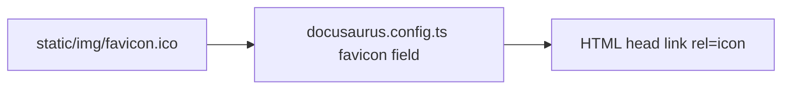

# website favicon - Implementation Plan

## Task Details

| Field            | Value                   |
| ---------------- | ----------------------- |
| Jira ID          | — (local request)       |
| Title            | Wire docs-site favicon in page head |
| Description      | Add Docusaurus top-level `favicon` so the existing `static/img/favicon.ico` is linked from HTML `<head>`. No new artwork. |
| Priority         | Low                     |
| Related Research | `docs/specs/website-favicon/website-favicon.research.md` |

## Wildly Important Goal

**Goal**: Browser tabs for the Agent Collections docs site show the existing brand favicon via a standard head link.

**Success Measure**: Built HTML includes a favicon `<link>` pointing at `/img/favicon.ico` (or the equivalent Docusaurus-resolved path), and that asset returns HTTP 200.

**Do NOT touch / do NOT add**:

- Do not replace or redesign `website/static/img/favicon.ico`
- Do not add apple-touch-icon, SVG, or PNG icon variants
- Do not change navbar logo, Open Graph image, or docs content
- Do not add npm dependencies

## Proposed Solution

Set the Docusaurus config top-level `favicon` field to the path relative to `static/` (`img/favicon.ico`). The classic preset injects the corresponding `<link rel="icon">` into every page head. Asset already exists; this is a one-line config wire-up.

## Current Implementation Analysis

### Already Implemented

- Brand favicon binary — `website/static/img/favicon.ico` — committed ICO (48×48 + 32×32); human confirmed correct
- Site metadata / OG — `website/docusaurus.config.ts` `themeConfig.metadata` — unrelated; leave as-is

### To Be Modified

- Docusaurus root config — `website/docusaurus.config.ts` — add top-level `favicon: 'img/favicon.ico'` next to `title` / `url` / `baseUrl`

### To Be Created

- None

## Open Questions

| #   | Question   | Answer   | Status                |
| --- | ---------- | -------- | --------------------- |
| 1   | Replace the ICO graphic? | No — existing graphic is correct; head link only | ✅ Resolved (`Grafika jest prawidłowa, chodzi mi tylko o dodanie linku w head strony`) |
| 2   | Extra icon formats? | No — classic favicon via Docusaurus config only | ✅ Resolved (same quote) |

## Technical Context

Project conventions, coding standards, and patterns discovered during planning. Downstream agents MUST read this section instead of re-discovering the same context.

### Project Instructions

- `AGENTS.md` / `.cursor/rules/eversis-project-stack.mdc` — framework repo; website under `website/`; quality command for site: `npm run website:build`
- Specs under `docs/specs/website-favicon/` are local / gitignored in this repo

### Architecture & Patterns

- Docusaurus classic preset reads top-level `Config.favicon` (string path relative to `static/`) and emits the head link
- Static files in `website/static/` are copied to site root; `img/favicon.ico` → `/img/favicon.ico`

### Tech Stack

- Docusaurus site in `website/` (TypeScript config: `docusaurus.config.ts`)
- Repo root npm scripts; site deps via `website/package.json` (yarn start used locally)

### Code Style & Standards

- Match existing single-quote string style in `docusaurus.config.ts`
- Place `favicon` near other root site identity fields (`title`, `url`, `baseUrl`), not inside `themeConfig`

### Testing Patterns

- Build: `npm run website:build` (from repo root)
- Inspect: after build, confirm favicon link in `website/build/index.html` (or grepping generated HTML for `favicon` / `rel="icon"`)
- Optional local check with running `yarn start`: page source / Network tab for `/img/favicon.ico` → 200

### Database Patterns

- Not used.

### Additional Context

- Do not invent a second copy at `static/favicon.ico`; config path is enough
- No Figma / `[REUSE]` UI verification for this task

## Implementation Plan

### Phase 1: Wire favicon in Docusaurus config

**Goal**: Head link points at the existing brand ICO so tabs show the icon.

**Description**: One config property; then build to prove the link is present and the asset is served.

**Verification:** `npm run website:build` and confirm generated HTML references the favicon path

#### Task 1.1 - [MODIFY] Add `favicon` to docusaurus.config.ts

**Description**: Add top-level `favicon: 'img/favicon.ico'` on the `Config` object in `website/docusaurus.config.ts` (alongside `title` / `url` / `baseUrl`). Do not change any other branding fields.

**Files:** `website/docusaurus.config.ts` (modify), `website/static/img/favicon.ico` (reuse)

**Definition of Done**:

- [x] `website/docusaurus.config.ts` contains top-level `favicon: 'img/favicon.ico'`
- [x] Run `npm run website:build`
- [x] Built HTML includes an icon link whose `href` resolves to the favicon under `/img/` (e.g. contains `favicon.ico` with `rel` icon)

**Stop Rule:** Stop if build fails for reasons unrelated to favicon; escalate rather than expanding scope.

**Clues**: Docusaurus path is relative to `static/` — use `img/favicon.ico`, not `static/img/favicon.ico` or `/img/favicon.ico`.

### Phase 2: Code Review

**Goal**: Confirm the change is minimal and correct before Fine.

**Description**: Final verification of the config-only change. Mandatory last phase.

**Verification:** Re-run `npm run website:build` if anything changed during review fixes; otherwise reuse Phase 1 build evidence

#### Task 2.1 - [REUSE] Code review by Code Reviewer

**Description**: Run **Code Reviewer** via `eversis-review.md` on the favicon config change. No e2e suite for this site chrome item.

**Files:** `website/docusaurus.config.ts` (reuse)

**Definition of Done**:

- [x] Code review passes with no blocking findings
- [x] Review outcome documented in Changelog

**Clues**: Scope is one config field; flag any drive-by edits.

## Security Considerations

- Favicon is a static local asset under `website/static/`; do not point `favicon` at an external URL

## Quality Assurance

- [x] Page `<head>` includes a favicon link for the docs site
- [x] Link targets the existing `img/favicon.ico` asset (no new graphic)
- [x] `npm run website:build` succeeds
- [x] No unrelated branding or content changes

## Improvements (Out of Scope)

- apple-touch-icon / multiple PNG sizes / SVG favicon
- Moving the file to `static/favicon.ico` for bare `/favicon.ico` probes (unnecessary once config is set)

## Human gates

1. ~~Approve research~~ — done (`Grafika jest prawidłowa, chodzi mi tylko o dodanie linku w head strony`)
2. ~~Approve this plan~~ — done (`Plan is ok, impelement`)
3. ~~Implement → Review → Fine~~ — done (review PASS; Fine declared 2026-10-14)

## Changelog

| Date       | Change Description   |
| ---------- | -------------------- |
| 2026-10-14 | Initial plan created |
| 2026-10-14 | Plan approved; implementation started |
| 2026-10-14 | Code review performed (PASS; no blockers) |

## Code Review Findings

**Verdict:** PASS

**Reviewed:** `website/docusaurus.config.ts` (+2 lines: top-level `favicon: 'img/favicon.ico'`). Research + plan scope: head link only; reuse existing `website/static/img/favicon.ico`.

**Build verification (2026-10-14):**

- `npm run website:build` — succeeded
- Built HTML (`website/build/index.html`) includes `<link data-rh="true" rel="icon" href="/img/favicon.ico">`
- Asset present at `website/build/img/favicon.ico` (15086 bytes)

**STRICT FORBIDDEN checks:**

- Scope — only product file changed is `website/docusaurus.config.ts` (in plan scope)
- Documentation comments — none removed or shortened
- Dependencies — no package-manager changes

### PASS

- Config matches research/plan: top-level `favicon: 'img/favicon.ico'` beside site identity fields; single-quote style preserved
- Generated head link and copied static asset confirm DoD / QA
- No drive-by branding, OG, navbar, or content edits

### BLOCKER

- None

### SUGGESTION

- None material. Out-of-scope note already in plan: bare `/favicon.ico` probe remains unserved unless a root static copy is added later — not required once config injects `rel="icon"`.
