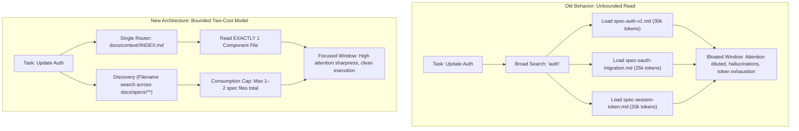
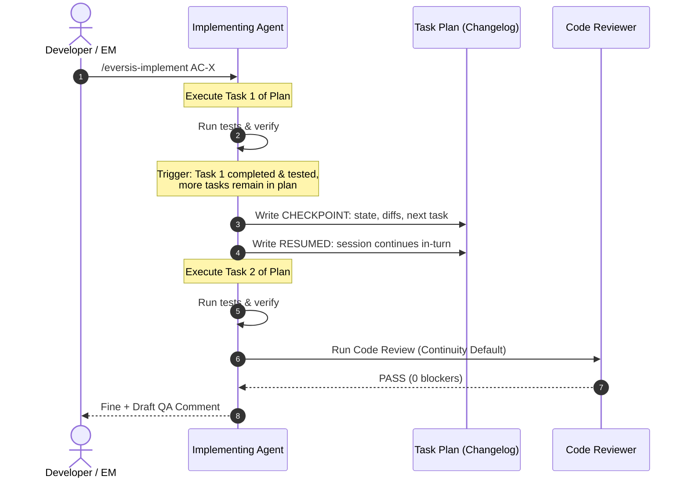
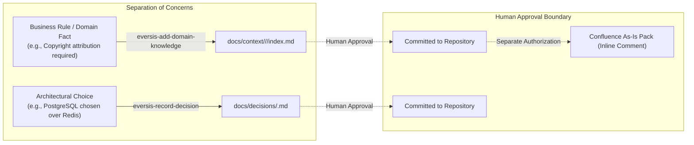

When teams deploy AI coding agents on real-world repositories, they quickly discover that the hardest problem is rarely code generation itself. The hardest problem is **context governance**: controlling what enters the model's limited attention window, preventing historical drift from corrupting implementation, and keeping the development lifecycle coherent across multi-step tasks.

Our latest framework update tackles these challenges head-on. If you caught our team update, you saw the highlights: leaner context reads, smoother multi-step sessions, a dedicated home for architecture decisions, and rock-solid MCP container tooling.

This article provides the underlying technical architecture: why the previous behavior degraded agent performance, how the new mechanisms work under the hood, and where the architectural boundaries lie.

<!-- truncate -->

---

## 1. The Context-Read Budget: Taming Token Bloat and Attention Dilution

### The Failure Mode: The "Lost in the Middle" Trap
In long-running software projects, documentation accumulates rapidly. Under `docs/specs/`, dozens of historical feature specifications, task plans, and research logs describe past architectural iterations. 

Previously, when an agent began an implementation task, it performed broad directory scans and often ingested every historical spec file that matched a keyword. This created three severe engineering problems:

1. **Context Window Saturation:** Loading 5 to 10 historical specification files consumes tens of thousands of tokens before a single line of application code is read.
2. **Attention Dilution & Hallucination:** Large language models suffer from attention degradation when relevant instructions are surrounded by dense historical prose (the well-documented *Lost in the Middle* phenomenon). Agents would frequently follow obsolete schema designs or superseded conventions from months ago.
3. **Loss of Task Focus:** The prompt space became dominated by historical task post-mortems rather than the active task's acceptance criteria.

### The Solution: A Strict Two-Cost Retrieval Model
To eliminate this failure mode, the framework introduces an explicit separation between **Discovery** and **Consumption**, governed by a single deterministic entry point:

#### 1. The Single In-Repo Router
Domain knowledge now routes strictly through `docs/context/<project>/INDEX.md` (or `docs/context/global/INDEX.md` only when a topic is global). `docs/plans/INDEX.md` is explicitly deprecated as a router.
* The agent reads the concise two-column index (`component | one-line summary`).
* It matches the current task to **exactly one** component entry.
* It reads only that single component file: `docs/context/<project>/<component>/index.md`.
* If a component is marked `status: deprecated` or `status: superseded`, the agent is forbidden from basing implementation decisions on it. If `superseded_by` specifies an active successor component, the agent follows that single link and leaves the historical index row intact.

#### 2. Discovery vs. Consumption Caps
When prior task specifications must be consulted, the framework enforces two distinct cost tiers:
* **Discovery (Free & Unrestricted):** Running `grep` or `glob` against `docs/specs/**` for file names or metadata tags is always permitted. This gives the agent full visibility into whether prior work exists without loading file bodies.
* **Consumption (Hard Budget):** Opening full text from matched specs—or following `related_specs` and `confluence_url` links from a domain component—is capped at **1 to 2 files maximum**. Once that budget is spent, further matches remain names only. A keyword hit is never an authorization to load file contents.

---

## 2. Session Continuity: Zero-Compaction Checkpoints Without Artificial Stops

### The Failure Mode: Premature Handoffs and Context Loss
Multi-task implementation plans require executing code edits, running unit and integration test suites, performing internal code review, and drafting QA summaries.

Previously, workflows attempted to prevent token overflow by interrupting sessions based on heuristics like estimated window fill percentages (e.g. "~50% full") or arbitrary message exchange counts. In environments like Cursor IDE and Claude Code, these heuristics failed:
* **Unobservable Window Metrics:** Host IDEs do not expose raw context window utilization percentages to the agent. Attempting to guess percentage thresholds triggered premature aborts.
* **Fragmented Execution:** Stopping a session midway through a planned feature forced developers to open new chat sessions, re-anchor the agent, and reconstruct working state. Crucially, it fractured the code review and verification steps, separating the reviewer context from the implementer context.

### The Solution: In-Session Progression with Checkpoint Anchors
The update replaces arbitrary stops with an observable, deterministic state machine:

1. **The Single Observable Trigger:** A checkpoint is written only when a plan task reaches a **completed and tested state while further tasks remain in the plan**, and the session is not already in Review or Fine.
2. **In-Turn Checkpointing:** When the trigger fires, the agent appends a structured `CHECKPOINT:` entry into the plan's `Changelog` (recording completed state, modified files, and the next scheduled task). In the **very same response**, it writes a `RESUMED:` entry and immediately proceeds to the next task. The active session does not halt or ask the developer to open a new chat.
3. **Precedence at the Finish Line:** When the completed task is the *last* task in the plan, the checkpoint rule yields immediately to review continuity: the agent transitions directly to automated code review and drafts the final QA summary in the same turn.
4. **Clean Crash Recovery:** If a session genuinely terminates (e.g. process crash or manual terminal abort), a fresh session scans the plan changelog from bottom to top. If an unresumed `CHECKPOINT:` exists, it emits `- **Resume:** CHECKPOINT <date>` on the Implement readiness block while preserving the governing `Flow` (`Full`, `Quick`, etc.).

---

## 3. Knowledge Separation: Decoupling Architecture Decisions from Domain Facts

### The Problem: Mixing Long-Term Policies with Feature Knowledge
Engineering projects produce two very different types of knowledge:
1. **Business & Domain Facts:** Stable rules describing product functionality (e.g. *"Thumbnails must display copyright attribution"* or *"Draft orders expire after 14 days"*).
2. **Architecture Decisions (ADRs):** Technical trade-offs made at specific points in time (e.g. *"Using PostgreSQL JSONB over Redis for transactional state"* or *"Adopting Docker Compose for local MCP server isolation"*).

When these two streams were mixed together inside `docs/context/`, domain component files became cluttered with low-level infrastructure notes. Worse, architecture choices recorded only inside ephemeral task plans were effectively lost once the task was closed.

### The Architectural Separation

| Dimension | Domain Knowledge (`docs/context/`) | Architecture Decisions (`docs/decisions/`) |
| :--- | :--- | :--- |
| **Primary Artifact** | `docs/context/<project>/<component>/index.md` | `docs/decisions/<id>.md` (ADR format) |
| **Catalog Index** | `docs/context/<project>/INDEX.md` | `docs/decisions/INDEX.md` (Two columns: `id`, `title`) |
| **Creation Trigger** | `eversis-add-domain-knowledge` (on confirmed business rule) | `eversis-record-decision` (on technical architectural choice) |
| **Lifecycle** | Subject to periodic audit (`Keep`, `Update`, `Replace`, `Delete`) | Permanent historical record; immutable once committed |
| **External Sync** | Proposed inline comments to Confluence As-Is Pack | In-repo only; never auto-published externally |
| **Human Gate** | Explicit human approval required before local disk write | Explicit human confirmation required during research/plan/code |

By keeping `docs/decisions/` strictly decoupled, developers can record an ADR at any point during research, planning, or implementation using `eversis-record-decision`. The decision file is saved in Git alongside the code, while `docs/context/` remains lean, focusing exclusively on active business capabilities.

---

## 4. Predictable Upgrade Contracts and Container Isolation

### Safe Project Upgrades: Protecting Project-Owned Paths
When consumer projects upgrade their Agent Collections framework pin, automated scripts must never overwrite team-specific policies or project customizations. The installer enforces an immutable boundary:

* **Project-Owned (Never Overwritten):**
  * `eversis-project-stack` / project rules
  * `docs/context/`, `docs/plans/`, `docs/specs/`, `docs/decisions/`
  * Local `AGENTS.md` instructions
  * Environment configurations (`.env*`) and local MCP overrides
  * Installation selection record (`.agent-collections/install-selection.json`)
* **Framework-Managed (Updated during `--upgrade --sync`):**
  * Core orchestration rules (`.ai/rules/`)
  * Agent skill packages (`.ai/skills/`) and slash command adapters
  * Scaffolding missing baseline structures (e.g. automatically provisioning `docs/decisions/README.md` and `INDEX.md` if the directory does not yet exist)

### Docker MCP Resolution Across Submodules and Clones
Under the hood, the `eversis-collections` MCP server runs inside a Docker container to provide cross-platform consistency for document parsing and context tooling. 

Previously, when running inside vendored submodule installations (`vendor/agent-collections/`), relative path resolution occasionally caused Docker Compose to treat the vendor folder as the host project root, throwing `install-selection.json not found` errors.

The update resolves this by:
1. Standardizing on `CONSUMER_PROJECT_ROOT` across all host environments.
2. Generating a portable runtime wrapper (`scripts/run-eversis-collections-mcp.sh`) for Claude Code environments that dynamically resolves the consumer workspace root at invocation time.
3. Ensuring that container mounts always bind `${CONSUMER_PROJECT_ROOT:-${PWD}}:/workspace`, guaranteeing identical behavior whether developing locally, in a CI pipeline, or across diverse contributor clones.

---

## What Did Not Change

Maintaining system stability requires knowing what stays constant:
* **The Core Delivery Standard Remains Intact:** Every feature continues through the canonical **Ideate → Research → Plan → Implement → Review → Fine** lifecycle.
* **Human Approval Gates Are Inviolable:** Agents never commit domain knowledge, record architecture decisions, or push documentation comments to external tools (like Confluence or Jira) without explicit human confirmation in chat.
* **The Changelog Is the Single Ledger:** High-level narrative overviews belong here on the blog; granular technical change logs and SemVer release notes remain strictly grounded in the root [Changelog](/changelog/).

---

## Summary

The AC-2 framework update transitions Agent Collections from heuristic context management to **deterministic architectural boundaries**:
* **Context Reads:** 1 component file from the router; max 1–2 spec files for consumption.
* **Session Execution:** Uninterrupted implementation across sub-tasks using in-turn checkpoints.
* **Documentation Architecture:** Clear separation between ADRs (`docs/decisions/`) and business domain rules (`docs/context/`).
* **Environment Stability:** Safe upgrade paths that protect project-owned code, backed by portable container mounting.

For step-by-step upgrade instructions for your projects (Git submodules vs. direct copies), consult your team announcement or review the framework [upgrade documentation](/docs/getting-started/start-here).
