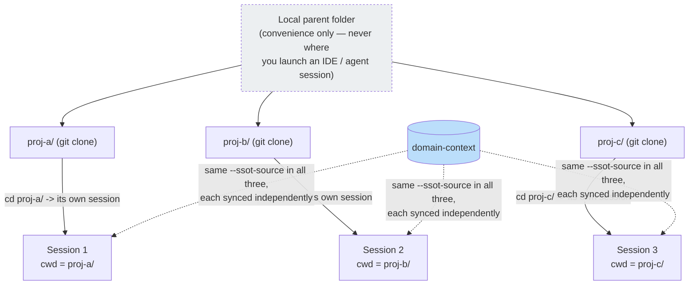

# Domain Context (SSOT)

Generic AI tools don't know your team's business rules or codebase conventions — they either re-explain the same thing every session, or someone writes it into a custom skill or prompt (see [Extending the framework](./use-cases#extending-the-framework)). **Domain context** is a cheaper alternative for the common case: durable facts (a confirmed business rule, a reusable integration pattern) that an agent discovers while working get written into a plain-Markdown store, `docs/context/`, so the next session — in this project or another one — reads them instead of rediscovering them.

**SSOT** (single source of truth) here means one durable fact lives in exactly one file, not copy-pasted across tasks or repos.

## Two layers

`docs/context/` has two layers, both plain Markdown, both readable with normal file tools — no special search tool required.

| Layer | Path | Owned by | How it gets there |
|-------|------|----------|--------------------|
| Project | `docs/context/<project>/` | This repository | `INDEX.md` is scaffolded by the installer on every install; component files are written by agents during Fine (see [Workflow Overview](./workflow/overview#status-fine--handoff)) |
| Global | `docs/context/global/` | A dedicated `domain-context` GitLab project, shared across repos in the same group | Seeded best-effort at install time, refreshed later via `eversis_context_sync` — a **subtree** (a Git mechanism that copies another repository's history into a subfolder of this one) pull, not a live link |

**Project wins on conflict.** When a component exists in both layers, reading it (`eversis_context_get`) returns the project version — the global layer is a shared default, not an override.

## How it's distributed

<figure>
  
  <figcaption><em>One <code>domain-context</code> repo per GitLab group fans out into every consumer project's <code>docs/context/global/</code> via <code>subtree pull --squash</code> — one-way, on request, never automatic. Each consumer keeps its own <code>docs/context/&lt;project&gt;/</code> layer natively, untouched by the sync.</em></figcaption>
</figure>

**Legend:** blue = the SSOT source repository; green = content delivered into a consumer repo via `subtree`; yellow = content native to that consumer repo. Sync is **manual and one-way** — running `eversis_context_sync` in one consumer repo does not affect any other; there is no automatic fan-out or push-back from a consumer into `domain-context`.

## Rolling out across a GitLab group

For a group with several consumer repos (frontend, backend, a portal, …), the target end state is **one `domain-context` project** shared by every repo in the group:

```text
<group>/                              # GitLab group
├── domain-context/                   # new project — global SSOT, shared across the group
│   ├── auth-conventions.md           # one file per durable domain-knowledge component
│   └── billing-integration.md
├── proj-a/                           # existing consumer project
│   ├── .claude/ .cursor/ .mcp.json   # vendored into THIS repo by --vendor submodule|copy
│   ├── vendor/agent-collections/     # only present when --vendor submodule
│   └── docs/context/
│       ├── proj-a/                   # project-owned layer (native, never touched by sync)
│       │   ├── INDEX.md
│       │   └── ...
│       └── global/                   # subtree pull --squash <- domain-context
│           ├── auth-conventions.md
│           └── billing-integration.md
└── proj-b/                           # another consumer project, same shape
    └── docs/context/...
```

Step-by-step:

1. **Create the `domain-context` project once**, at the group level. It can start empty — content grows over time through the Fine promotion flow described below.
2. **Install (or re-install) each consumer**, pointing it at that project:
   ```bash
   bash "$AGENT_COLLECTIONS_HOME/scripts/setup-agent-collections.sh" \
     --build-mcp --non-interactive \
     --agents=cursor,claude \
     --mcp-servers=eversis-collections \
     --profile=fullstack \
     --ssot-source https://gitlab.example.com/<group>/domain-context.git \
     --ssot-branch main
   ```
   This scaffolds `docs/context/<project>/INDEX.md` and best-effort seeds `docs/context/global/` from that URL. The same `--ssot-source` is passed to every consumer in the group — the install itself still runs **per repo**; there is no group-wide install step.
3. **Repeat step 2 for every other consumer repo** in the group.
4. **Keep each consumer's global layer current** with `eversis_context_sync` (or `--upgrade --sync`) — manual and one-way, per repo, same as described above.
5. **Knowledge flows the other direction** (consumer → `domain-context`) only through the Fine second draft, never automatically — see [Publishing to the global layer](#publishing-to-the-global-layer).

### What about a shared repo for `.claude` / `.cursor` / `.mcp.json`?

An earlier design draft also proposed a second group-level project (sometimes called `agent-collections-config`) delivering root-level tool files (`.claude/`, `.cursor/`, `.mcp.json`, `AGENTS.md`, `CLAUDE.md`) into every consumer via the same `subtree` mechanism as `domain-context`. **That variant was considered and not adopted** — the installer has no `subtree` step for anything other than `domain-context`. Root-level files are vendored **per consumer repo**, directly from the `agent-collections` framework repo, via `--vendor submodule|copy` (see [Vendor modes](./getting-started/installation#vendor-modes)) — already a one-shot, automatic part of step 2 above, once per repo. A shared group-level config project isn't part of the framework today; treat it as a fresh proposal rather than an existing mechanism if your group needs one later.

### Working across the whole group yourself

The setup above is written for rolling the framework out to a group's repos one by one. A different situation: **one person** (for example on a platform or DevOps team) who needs to work across every repo in the group day-to-day, not install them once and move on.

The constraint that shapes this is in [MCP Setup](./getting-started/mcp-setup#domain-context-needs-the-project-volume-not-just-the-framework-volume): the container's project volume is resolved from the working directory of whatever process starts it — one process, one repo's `docs/context/`. There is no session that reads or writes across several repos at once; that's a property of how the MCP server is invoked, not a missing setting.



Practical setup:

1. Clone every repo in the group under one local parent folder, purely for your own convenience (browsing, running `git status` across all of them) — never as the directory you launch an IDE or agent session from.
2. Install the framework separately in each repo (as in the steps above), all pointed at the same `--ssot-source`, so every repo reads the same global layer.
3. Open or run each repo as its own IDE root or terminal session — always `cd` into that specific repo first. A shared parent folder is never a valid session root.
4. Treat a task that spans several repos as several independent Implement runs, one per repo, not one session covering all of them. Carry a shared learning between repos through `domain-context` — promote it once (Fine, in whichever repo you did the work first), then `eversis_context_sync` picks it up in the others — rather than expecting one session to see everything at once.
5. Refresh each repo's global layer independently — `eversis_context_sync` never fans out to other repos, so running it in `proj-a/` has no effect on `proj-b/` or `proj-c/`.

This is a workaround for today's one-session-per-repo design, not a documented "group mode" — if your team needs a single session spanning multiple repos routinely, treat that as a fresh proposal rather than an existing capability.

## Reading it — budget-aware, not a full-directory scan

An agent doing Research reads `docs/context/<project>/INDEX.md` first, matches the task's topic to **one** listed component, and reads only that component's file — never the whole `docs/context/` tree by default. Full procedure: [Orchestrating Implementation](./skills/orchestrating-implementation).

## Tools and skills

Three MCP tools (part of the `eversis-collections` server — see [full inventory](./integrations/eversis-collections#domain-context)):

- **`eversis_context_list`** — list known components across both layers.
- **`eversis_context_get`** — read one named component (project first, then global); marks the file's `last_consulted` field.
- **`eversis_context_sync`** — pull the latest `domain-context` content into `docs/context/global/`.

Three skills write and maintain this content: `eversis-promote-domain-knowledge` (the Fine second draft), `eversis-import-confluence-knowledge` (seed from an existing Confluence page, on request), and `eversis-audit-domain-knowledge` (periodic review — keep, update, consolidate, replace, or delete each entry).

## Publishing to the global layer

Writing to `domain-context` happens through the GitLab REST API (branch + commit + merge request), never a local checkout, and always behind the same two-phase human gate as the QA comment draft: a labeled draft first, publication only after explicit approval. It requires a `GITLAB_TOKEN` with write access, provided by the agent's runtime environment — the installer never generates, stores, or requests this token (see [Install Selection Schema](https://github.com/PiotrNie-Eversis/agent-collections/blob/main/docs/architecture/install-selection.md)).

Canonical detail: [`docs/architecture/agents-md-standard.md`](https://github.com/PiotrNie-Eversis/agent-collections/blob/main/docs/architecture/agents-md-standard.md) (the `docs/context`/`docs/plans`/`docs/specs` triad) and [`docs/architecture/install-selection.md`](https://github.com/PiotrNie-Eversis/agent-collections/blob/main/docs/architecture/install-selection.md) (the `ssot.*` install schema) in the repository.
