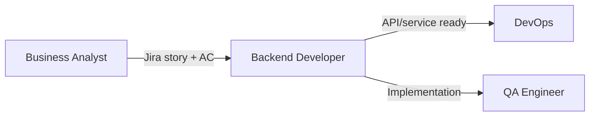

# Backend Developer

**Other guides:** [Web Developer](./web-developer) · **Backend Developer** · [DevOps](./devops) · [Business Analyst](./business-analyst) · [Project Manager](./project-manager) · [QA Engineer](./qa-engineer)

## Hero

As a **Backend Developer**, Agent Collections turns a task description or Jira ticket into a researched, planned, and reviewed implementation — reusing your project's existing conventions instead of re-deriving them from scratch every time.

**[Try it in 5 minutes →](#quick-start)**

## Quick Start

```text
/eversis-implement
<Jira ID or task description>: implement <endpoint/service/migration>.
```

The **Engineering Manager** (the framework's orchestrator role) inspects `docs/specs/` for existing context first, posts a 4-line readiness summary, and only creates research or a plan when a real gap exists — a narrow, well-understood fix can skip straight to implementation ("Quick Flow").

## Daily scenarios

| Situation | What you do | Agent/Skill/Prompt | What you get |
| --- | --- | --- | --- |
| `[Greenfield]` New API endpoint or service | Describe the endpoint/contract to `/eversis-implement` | `eversis-implement`, `eversis-implementing-backend` | Implementation following your project's existing backend patterns |
| `[Maintenance]` A production bug needs a root-cause fix | Attach the bug report to `/eversis-implement` | `eversis-analyzing-bugs`, `eversis-analyzing-regression-risk` | Reproduction, root-cause analysis, and a fix verified by tests |
| `[Greenfield]` Designing a new data model or schema change | Describe the data requirements to `/eversis-implement` | `eversis-sql-and-database-understanding` | Schema/migration work consistent with existing database conventions |
| `[Maintenance]` Checking whether a feature is already partially built | Ask `/eversis-implement` before writing new code | `eversis-implementation-gap-analysing` | A clear map of what exists, what needs extension, and what's missing |

## How you connect to other roles



| Your output | Goes to role | As artifact |
| --- | --- | --- |
| Implemented, tested service/endpoint | QA Engineer | Code review + test results |
| Deployable change | DevOps | Plan tasks routed to infrastructure/CI-CD work |

## Command cheat sheet

:::info Reference
- `/eversis-implement` — research, plan (when needed), implement, and review a backend task end to end
- `/eversis-review` — full code review, runs automatically after implementation
- Skills: `eversis-implementing-backend`, `eversis-sql-and-database-understanding`, `eversis-implementation-gap-analysing`, `eversis-analyzing-bugs`, `eversis-analyzing-regression-risk`
:::

## Next steps

1. [Workflow Overview](../workflow/overview) — the full lifecycle this guide is one slice of
2. [DevOps guide](./devops) — the role that ships and runs what you build
3. [Standard Flow](../workflow/standard-flow) — the full research → plan → implement → review sequence
