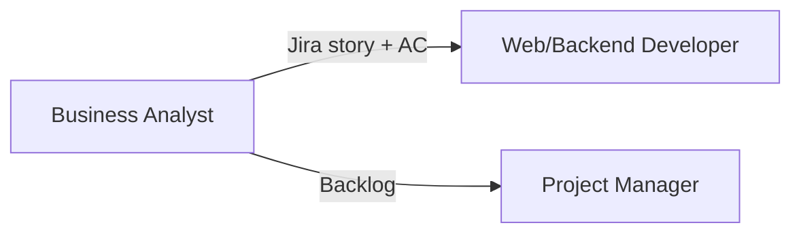

# Business Analyst

**Other guides:** [Web Developer](./web-developer) · [Backend Developer](./backend-developer) · [DevOps](./devops) · **Business Analyst** · [Project Manager](./project-manager) · [QA Engineer](./qa-engineer)

## Hero

As a **Business Analyst**, Agent Collections turns raw workshop transcripts and meeting notes into Jira-ready epics and stories with acceptance criteria — before a developer writes a line of code.

**[Try it in 5 minutes →](#quick-start)**

## Quick Start

```text
/eversis-analyze-materials
Here are the workshop notes/transcript: <paste or attach>.
```

The **Business Analyst** agent (a specialized role the framework hands this work to) cleans the material, extracts discrete tasks, runs a quality review, and formats the result for Jira — passing through **Gate 1, Gate 1.5, and Gate 2** (checkpoints where you approve before anything syncs to Jira).

## Daily scenarios

| Situation | What you do | Agent/Skill/Prompt | What you get |
| --- | --- | --- | --- |
| `[Greenfield]` A discovery workshop just happened | Attach the transcript/notes to `/eversis-analyze-materials` | `eversis-transcript-processing`, `eversis-task-extracting` | Draft epics and stories, ready for your review before Jira sync |
| `[Maintenance]` The existing backlog needs re-formatting or cleanup | Point `/eversis-analyze-materials` at the current backlog | `eversis-task-quality-reviewing`, `eversis-jira-task-formatting` | A quality-reviewed backlog with consistent structure |
| `[Greenfield]` Requirements reference an existing Confluence page | Point `/eversis-analyze-materials` at the page | `eversis-import-confluence-knowledge` | Requirements grounded in the documented source, not re-typed from memory |
| `[Maintenance]` A regulated `.docx` document needs updating after a release | Run `/eversis-ba-docs-planner`, then `/eversis-ba-docs-writer` | `eversis-ba-docs-planner`, `eversis-ba-docs-writer` | A chapter-level update plan, then an applied edit that preserves Word formatting — see [Business Manager Docs](../workflow/business-manager-docs) |

## How you connect to other roles



| Your output | Goes to role | As artifact |
| --- | --- | --- |
| Jira-ready epics/stories with acceptance criteria | Web/Backend Developer | Jira ticket, attached to `/eversis-implement` |
| Groomed backlog | Project Manager | Jira backlog, ready for prioritization |

## Command cheat sheet

:::info Reference
- `/eversis-analyze-materials` — workshop materials → Jira-ready backlog, or iterate on an existing backlog
- `/eversis-ba-docs-planner` → `/eversis-ba-docs-writer` — separate channel for Word `.docx` release documentation, not code delivery
- Skills: `eversis-task-extracting`, `eversis-task-analysing`, `eversis-task-quality-reviewing`, `eversis-jira-task-formatting`, `eversis-import-confluence-knowledge`, `eversis-transcript-processing`
:::

## Next steps

1. [Workflow Overview](../workflow/overview) — the full lifecycle this guide is one slice of
2. [Project Manager guide](./project-manager) — the role that prioritizes what you produce
3. [Workshop Analysis Flow](../workflow/workshop-flow) — Gates 1, 1.5, and 2 explained in full
