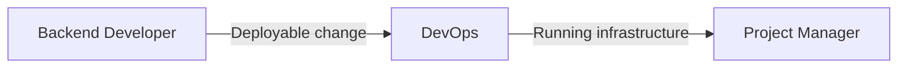

# DevOps

**Other guides:** [Web Developer](./web-developer) · [Backend Developer](./backend-developer) · **DevOps** · [Business Analyst](./business-analyst) · [Project Manager](./project-manager) · [QA Engineer](./qa-engineer)

## Hero

As a **DevOps engineer**, Agent Collections gives you both a standalone infrastructure auditor you can run any time, and Terraform/Kubernetes/pipeline/observability work routed through the same planned, reviewed implementation flow as application code.

**[Try it in 5 minutes →](#quick-start)**

## Quick Start

```text
/eversis-audit-infrastructure
Audit our AWS/GCP infrastructure for security gaps, cost waste, and best-practice violations.
```

This is a directly runnable command — no plan required. It checks infrastructure-as-code first, then validates findings against the live cloud account via API.

## Daily scenarios

| Situation | What you do | Agent/Skill/Prompt | What you get |
| --- | --- | --- | --- |
| `[Greenfield]` Provisioning new infrastructure for a service | Describe the resources to `/eversis-implement` | `eversis-implementing-terraform-modules` | A Terraform module following your project's provisioning conventions |
| `[Maintenance]` Monthly cloud spend needs a review | Run `/eversis-analyze-aws-costs` or `/eversis-analyze-gcp-costs` | `eversis-optimizing-cloud-cost` | A cost-optimization and tagging-compliance report, IaC-checked then live-validated |
| `[Greenfield]` Setting up a CI/CD pipeline for a new service | Describe the stages to `/eversis-implement` | `eversis-implementing-ci-cd` | A pipeline with deployment stages and environment protection |
| `[Maintenance]` Adding metrics/alerting to an existing service | Describe the observability gap to `/eversis-implement` | `eversis-implementing-observability` | Metrics, logs, traces, and alerting wired into the service |

## How you connect to other roles



| Your output | Goes to role | As artifact |
| --- | --- | --- |
| Provisioned/updated infrastructure | Backend Developer | Working environment for the deployed service |
| Cost and security audit findings | Project Manager | Audit report, prioritized for planning |

## Command cheat sheet

:::info Reference
- `/eversis-audit-infrastructure`, `/eversis-analyze-aws-costs`, `/eversis-analyze-gcp-costs` — standalone commands, run directly
- `/eversis-implement` — routes Terraform, Kubernetes, pipeline, and observability tasks through the planned implementation flow. **Note:** the internal prompts behind that routing (`eversis-implement-terraform`, `eversis-deploy-kubernetes`, `eversis-implement-pipeline`, `eversis-implement-observability`) exist but aren't standalone slash commands — you reach them by describing the task to `/eversis-implement`, not by invoking their names directly
- Skills: `eversis-implementing-terraform-modules`, `eversis-implementing-kubernetes`, `eversis-implementing-ci-cd`, `eversis-implementing-observability`, `eversis-optimizing-cloud-cost`, `eversis-managing-secrets`
:::

## Next steps

1. [Workflow Overview](../workflow/overview) — the full lifecycle this guide is one slice of
2. [Backend Developer guide](./backend-developer) — the role whose services you deploy and run
3. [Standard Flow](../workflow/standard-flow) — how infrastructure tasks move through research → plan → implement → review
