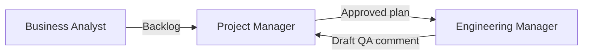

# Project Manager

**Other guides:** [Web Developer](./web-developer) · [Backend Developer](./backend-developer) · [DevOps](./devops) · [Business Analyst](./business-analyst) · **Project Manager** · [QA Engineer](./qa-engineer)

## Hero

**There is no dedicated Project Manager agent, prompt, or skill in Agent Collections today.** Your leverage instead comes from the framework's **human gates** (checkpoints — research and plan must be approved before broad work starts) and the **Fine handoff** (the point where finished work gets a plain-English QA summary for review).

**[See your first step →](#quick-start)**

## Quick Start

There's no single command to run. Your first concrete step is a **gate review**, not a prompt:

1. Open the current task's `docs/specs/<task>/*.plan.md` (the implementation plan an agent produced).
2. Check its scope, phases, and acceptance criteria against what you expect to ship.
3. Approve it, or reply with the specific change needed — the agent won't proceed to broad implementation without your explicit answer.

## Daily scenarios

| Situation | What you do | Agent/Skill/Prompt | What you get |
| --- | --- | --- | --- |
| `[Greenfield]` A new feature's research just landed | Open `*.research.md`, confirm it matches what you asked for | *(human review — no command)* | Either approval to move to planning, or a specific correction the agent applies before you re-review |
| `[Maintenance]` A QA comment triggers a narrower re-scope | Review the updated `*.research.md` (marked as a scope `DELTA`, a targeted update) | *(human review — no command)* | Confirmation the narrowed fix still matches what's needed |
| `[Greenfield]` A plan is ready before broad implementation starts | Review `*.plan.md` phases and acceptance criteria | *(human review — no command)* | Either approval to implement, or a scoped revision request |
| `[Maintenance]` Work is marked "Fine" (ready for QA) | Read the **Draft QA comment** | `eversis-fine-handoff` (produces the draft) | A plain-English summary you can approve, edit, or hold before it's posted to Jira |

## How you connect to other roles

| Your output | Goes to role | As artifact |
| --- | --- | --- |
| Gate decision (approve / request changes) | Engineering Manager (the orchestrator role) | A reply that unblocks or redirects planning/implementation |
| Reviewed QA draft | Business Analyst / stakeholders | Approved or edited Jira comment |

## Command cheat sheet

There is no PM-specific slash command. What you read and act on instead:

:::info Reference
- `*.research.md` — what the agent understood about the problem, under `docs/specs/<task>/`
- `*.plan.md` — the proposed implementation, phased with acceptance checks
- `*.plan-review.md` — an adversarial stress-test of the plan, produced before you review it
- **Draft QA comment** — the Fine-stage handoff summary, always produced in plain language before anything is posted to a tracker
:::

## Next steps

1. [Workflow Overview](../workflow/overview) — the full lifecycle and where your gates sit in it
2. [Business Analyst guide](./business-analyst) — the role that feeds you a prioritizable backlog
3. [Fine Handoff](../../reference/skills/fine-handoff) — how the QA draft you review gets produced
