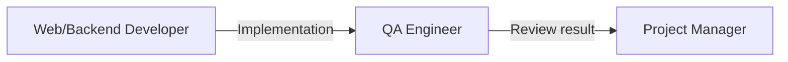

# QA Engineer

**Other guides:** [Web Developer](./web-developer) · [Backend Developer](./backend-developer) · [DevOps](./devops) · [Business Analyst](./business-analyst) · [Project Manager](./project-manager) · **QA Engineer**

## Hero

As a **QA Engineer**, Agent Collections gives you one entry point for test planning, regression analysis, acceptance-criteria verification, bug reports, and quality-health checks — instead of hunting for the right specialized command each time.

**[Try it in 5 minutes →](#quick-start)**

## Quick Start

```text
/eversis-qa-workflow
Verify acceptance criteria for <task/Jira ID>, or: plan regression tests for <feature area>.
```

State what you need — AC verification, a bug report, a test plan, or a quality-health check — and the workflow routes to the matching procedure. No dedicated single "QA agent" persona exists; this command is your consistent entry point across all of those needs.

## Daily scenarios

| Situation | What you do | Agent/Skill/Prompt | What you get |
| --- | --- | --- | --- |
| `[Greenfield]` A new feature needs a test plan before release | Ask `/eversis-qa-workflow` for a test plan | `eversis-planning-tests`, `eversis-functional-testing` | A structured manual test plan covering the feature's critical paths |
| `[Maintenance]` A change might have broken something else | Ask `/eversis-qa-workflow` for a regression analysis | `eversis-verifying-acceptance-criteria` | A prioritized list of areas at risk, checked against acceptance criteria |
| `[Greenfield]` A new UI component needs Figma verification | Handled automatically inside `/eversis-implement`'s UI loop | `eversis-ui-verifying`, `/eversis-review-ui` | An EXPECTED (Figma) vs. ACTUAL (browser) comparison report |
| `[Maintenance]` Finished work needs a structured code review | Runs automatically after implementation | `eversis-code-reviewing`, `/eversis-review` | A PASS / BLOCKER / SUGGESTION report before work is marked Fine |

## How you connect to other roles



| Your output | Goes to role | As artifact |
| --- | --- | --- |
| Review/verification result | Web/Backend Developer | PASS, or BLOCKER findings routed back for a fix |
| Quality-health signal | Project Manager | Status visible before work is marked Fine |

## Command cheat sheet

:::info Reference
- `/eversis-qa-workflow` — single entry point: test planning, regression, AC verification, bug reports, quality health, accessibility audits
- `/eversis-review` — structured code review (PASS / BLOCKER / SUGGESTION)
- `/eversis-review-ui` — Figma-vs-browser UI verification
- Skills: `eversis-planning-tests`, `eversis-functional-testing`, `eversis-verifying-acceptance-criteria`, `eversis-accessibility-auditing`, `eversis-e2e-testing`, `eversis-code-reviewing`, `eversis-ui-verifying`
- **Note:** Playwright end-to-end tests are created through `/eversis-implement` (an internal prompt, `eversis-implement-e2e`, handles this behind the scenes) — not a standalone slash command
:::

## Next steps

1. [Workflow Overview](../workflow/overview) — the full lifecycle this guide is one slice of
2. [Backend Developer guide](./backend-developer) — the role whose work you verify most often
3. [QA Workflow](../workflow/qa-workflow) — the full manual QA practice, in detail
