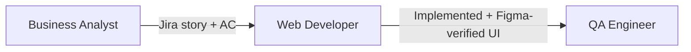

# Web Developer

**Other guides:** **Web Developer** · [Backend Developer](./backend-developer) · [DevOps](./devops) · [Business Analyst](./business-analyst) · [Project Manager](./project-manager) · [QA Engineer](./qa-engineer)

## Hero

As a **Web Developer**, Agent Collections turns a task description (with a Figma URL, when the work is design-driven) into implemented UI — with an automated verification loop that compares your rendered page against the design before a human has to.

**[Try it in 5 minutes →](#quick-start)**

## Quick Start

```text
/eversis-implement
Build the <component/page> per Figma <url>. Task: <short description>.
```

The **Engineering Manager** (the framework's orchestrator role) posts a 4-line readiness summary, then runs research and planning only where a gap actually exists. For UI work, implementation is followed automatically by a Figma-vs-browser check — you don't have to remember to ask for it.

## Daily scenarios

| Situation | What you do | Agent/Skill/Prompt | What you get |
| --- | --- | --- | --- |
| `[Greenfield]` New page from a Figma design | Attach the Figma URL + task to `/eversis-implement` | `eversis-implement-ui-common-task`, `eversis-review-ui` | Implemented component, auto-verified against the design before review |
| `[Maintenance]` A UI bug report needs reproducing and fixing | Attach the bug report to `/eversis-implement` | `eversis-implement` (checks if existing research/plan still cover the bug) | A scoped fix, with research updated only if the bug changed the known context |
| `[Greenfield]` Adding a form with validation | Describe the fields and rules to `/eversis-implement` | `eversis-implementing-forms` | Form implementation following the project's existing validation patterns |
| `[Maintenance]` Improving accessibility on an existing page | Ask `/eversis-implement` to audit and fix a specific page | `eversis-optimizing-frontend`, `eversis-ensuring-accessibility` | Concrete fixes checked against the project's accessibility targets |

## How you connect to other roles



| Your output | Goes to role | As artifact |
| --- | --- | --- |
| Implemented, Figma-verified UI | QA Engineer | Code review + UI verification report |
| Scope or acceptance-criteria questions | Business Analyst | Chat clarification, or a plan's Open Questions row |

## Command cheat sheet

:::info Reference
- `/eversis-implement` — implement a feature; add a Figma URL for design-driven UI work
- `/eversis-review-ui` — Figma-vs-browser verification (runs automatically inside the UI implementation loop)
- `/eversis-review` — full code review, runs automatically after implementation
- Skills: `eversis-implementing-frontend`, `eversis-optimizing-frontend`, `eversis-reviewing-frontend`, `eversis-implementing-filters`, `eversis-implementing-forms`, `eversis-ensuring-accessibility`, `eversis-ui-verifying`
:::

## Next steps

1. [Workflow Overview](../workflow/overview) — the full lifecycle this guide is one slice of
2. [QA Engineer guide](./qa-engineer) — the role that verifies what you ship
3. [Frontend Flow](../workflow/frontend-flow) — the full Figma verification loop, step by step
