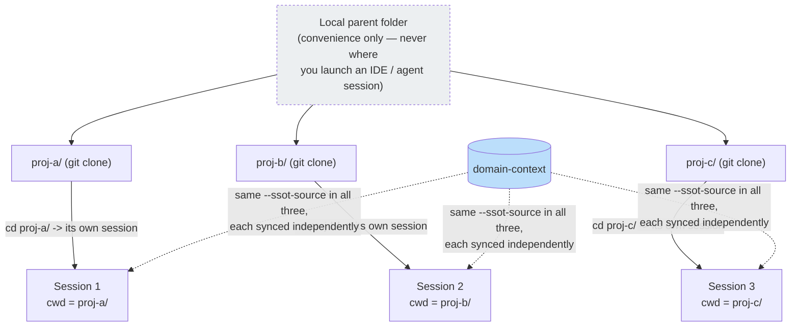
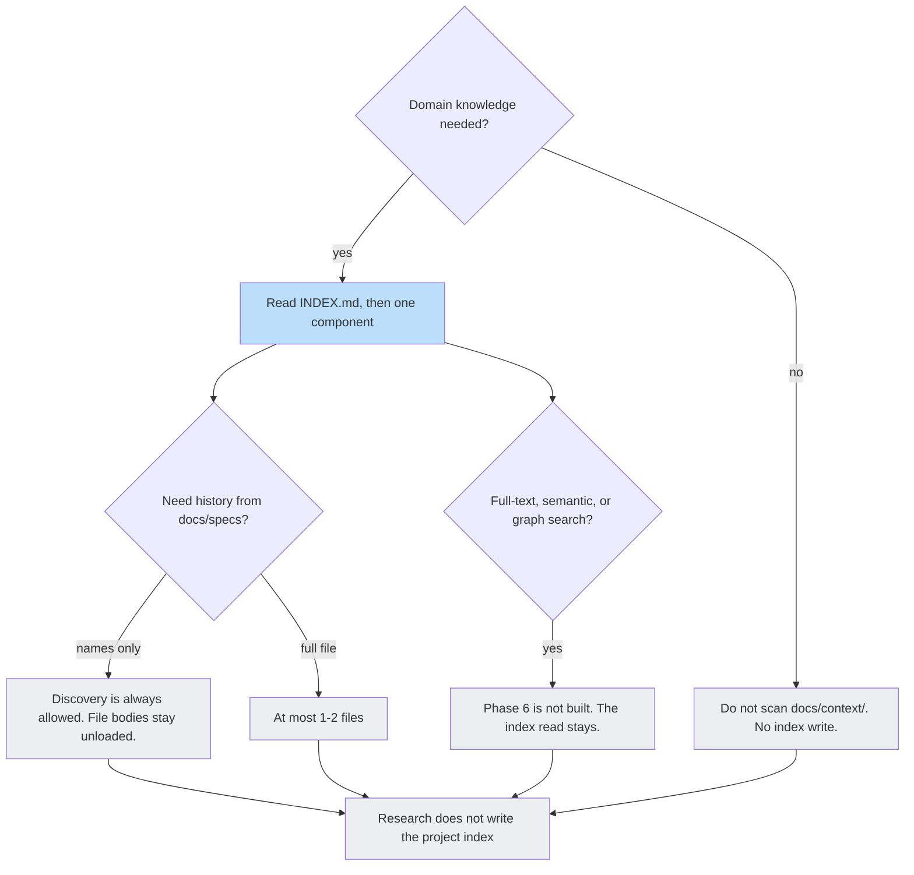
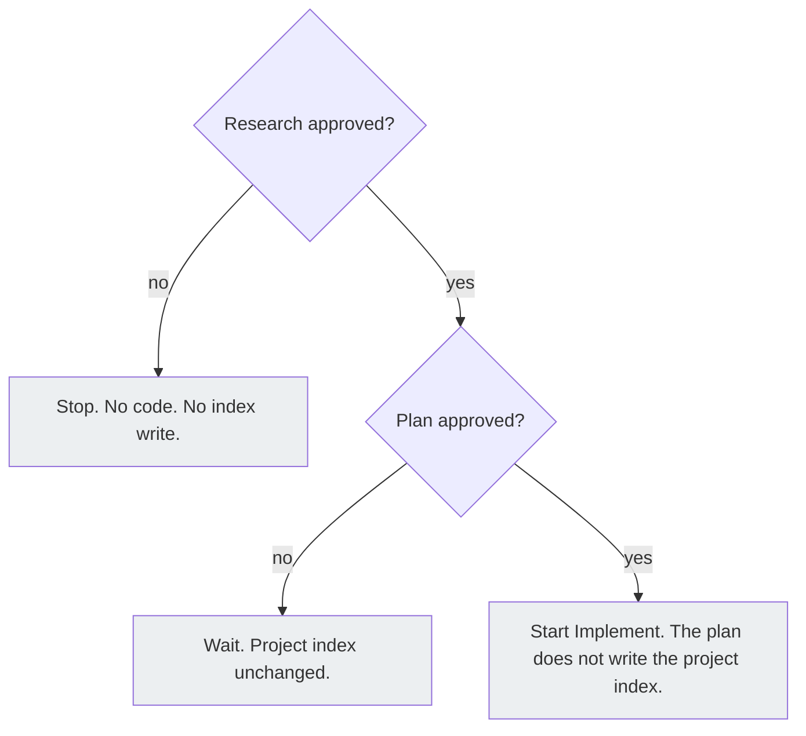
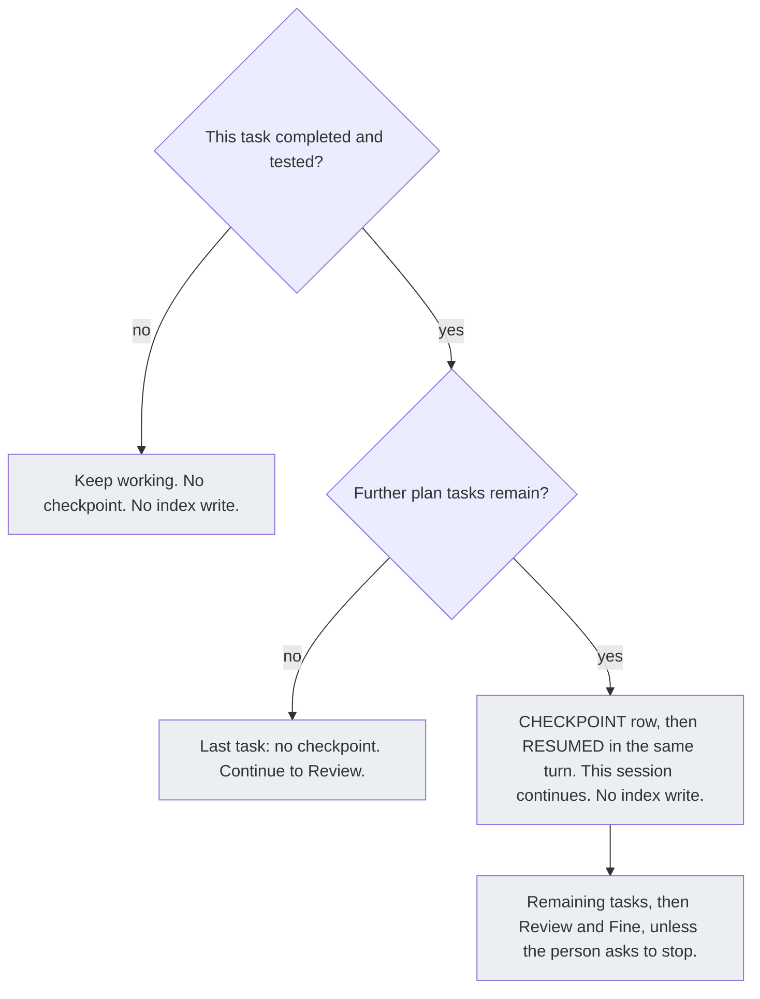
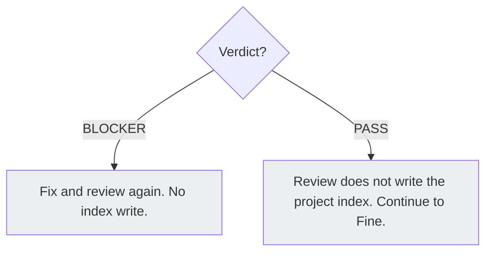
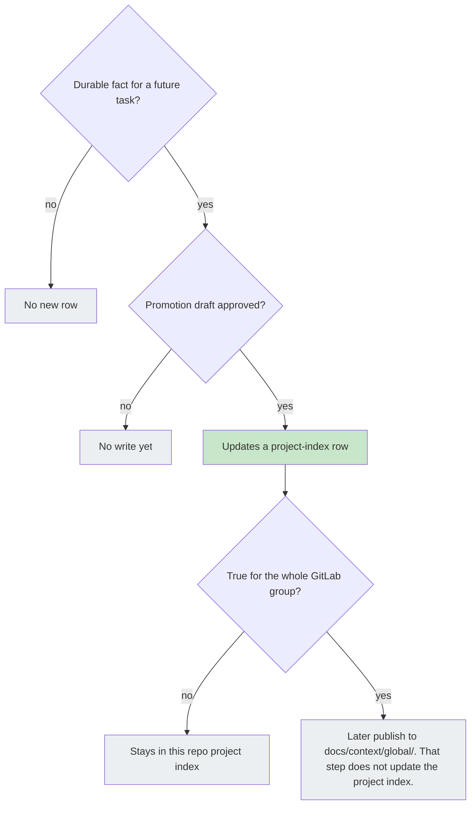
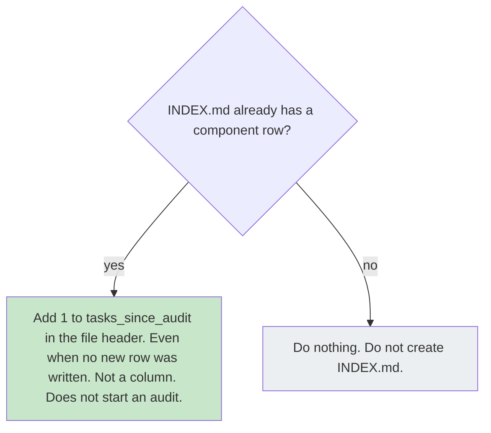
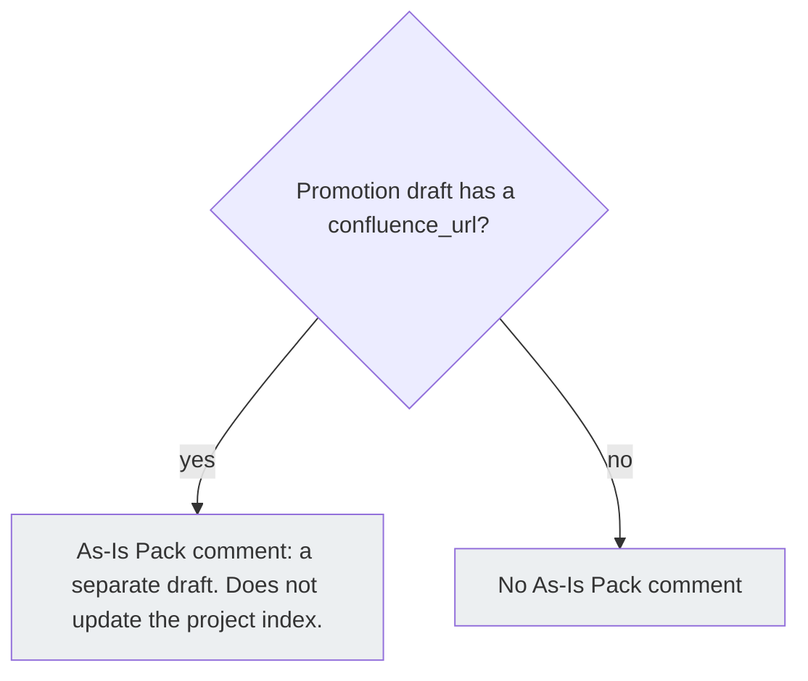
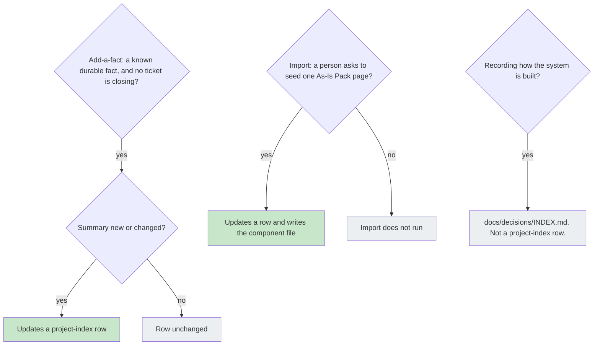

# Domain Context (SSOT)

Generic AI tools don't know your team's business rules or codebase conventions — they either re-explain the same thing every session, or someone writes it into a custom skill or prompt (see [Extending the framework](./main-flow/use-cases#extending-the-framework)). **Domain context** is a cheaper alternative for the common case: durable facts (a confirmed business rule, a reusable integration pattern) that an agent discovers while working get written into a plain-Markdown store, `docs/context/`, so the next session — in this project or another one — reads them instead of rediscovering them.

**SSOT** (single source of truth) here means one durable fact lives in exactly one file, not copy-pasted across tasks or repos.

## Two layers

`docs/context/` has two layers, both plain Markdown, both readable with normal file tools — no special search tool required.

| Layer   | Path                      | Owned by                                                                           | How it gets there                                                                                                                                                                                            |
| ------- | ------------------------- | ---------------------------------------------------------------------------------- | ------------------------------------------------------------------------------------------------------------------------------------------------------------------------------------------------------------ |
| Project | `docs/context/<project>/` | This repository                                                                    | `INDEX.md` is scaffolded by the installer on every install; component files are written by agents during Fine (see [Workflow Overview](./main-flow/workflow/overview#status-fine--handoff))                  |
| Global  | `docs/context/global/`    | A dedicated `domain-context` GitLab project, shared across repos in the same group | Seeded best-effort at install time, refreshed later via `eversis_context_sync` — a **subtree** (a Git mechanism that copies another repository's history into a subfolder of this one) pull, not a live link |

**Project wins on conflict.** When a component exists in both layers, reading it (`eversis_context_get`) returns the project version — the global layer is a shared default, not an override.

## How it's distributed

<figure>
  
  <figcaption><em>One <code>domain-context</code> repo per GitLab group fans out into every consumer project's <code>docs/context/global/</code> via <code>subtree pull --squash</code> — one-way, on request, never automatic. Each consumer keeps its own <code>docs/context/&lt;project&gt;/</code> layer natively, untouched by the sync.</em></figcaption>
</figure>

**Legend:** blue = the SSOT source repository; green = content delivered into a consumer repo via `subtree`; yellow = content native to that consumer repo. Sync is **manual and one-way** — running `eversis_context_sync` in one consumer repo does not affect any other; there is no automatic fan-out or push-back from a consumer into `domain-context`.

## Rolling out across a GitLab group

For a group with several consumer repos (frontend, backend, a portal, …), the target end state is **one `domain-context` project** shared by every repo in the group:

```text
<group>/                              # GitLab group
├── domain-context/                   # new project — global SSOT, shared across the group
│   ├── auth-conventions.md           # one file per durable domain-knowledge component
│   └── billing-integration.md
├── proj-a/                           # existing consumer project
│   ├── .claude/ .cursor/ .mcp.json   # vendored into THIS repo by --vendor submodule|copy
│   ├── vendor/agent-collections/     # only present when --vendor submodule
│   └── docs/context/
│       ├── proj-a/                   # project-owned layer (native, never touched by sync)
│       │   ├── INDEX.md
│       │   └── ...
│       └── global/                   # subtree pull --squash <- domain-context
│           ├── auth-conventions.md
│           └── billing-integration.md
└── proj-b/                           # another consumer project, same shape
    └── docs/context/...
```

Step-by-step:

1. **Create the `domain-context` project once**, at the group level. It can start empty — content grows when a **group-wide** fact is published into it ([Tools and skills](#tools-and-skills), step 6), not on every Fine.
2. **Install (or re-install) each consumer**, pointing it at that project:
   ```bash
   bash "$AGENT_COLLECTIONS_HOME/scripts/setup-agent-collections.sh" \
     --build-mcp --non-interactive \
     --agents=cursor,claude \
     --mcp-servers=eversis-collections \
     --profile=fullstack \
     --ssot-source https://gitlab.example.com/<group>/domain-context.git \
     --ssot-branch main
   ```
   This scaffolds `docs/context/<project>/INDEX.md` and best-effort seeds `docs/context/global/` from that URL. The same `--ssot-source` is passed to every consumer in the group — the install itself still runs **per repo**; there is no group-wide install step.
3. **Repeat step 2 for every other consumer repo** in the group.
4. **Keep each consumer's global layer current** with `eversis_context_sync` (or `--upgrade --sync`) — manual and one-way, per repo, same as described above.
5. **Knowledge flows the other direction** (consumer → `domain-context`) only when you later publish a **group-wide** fact — never automatically, and not on every Fine. Everyday Fine writes stay in that consumer's `docs/context/<project>/`. See [Tools and skills](#tools-and-skills).

### What about a shared repo for `.claude` / `.cursor` / `.mcp.json`?

An earlier design draft also proposed a second group-level project (sometimes called `agent-collections-config`) delivering root-level tool files (`.claude/`, `.cursor/`, `.mcp.json`, `AGENTS.md`, `CLAUDE.md`) into every consumer via the same `subtree` mechanism as `domain-context`. **That variant was considered and not adopted** — the installer has no `subtree` step for anything other than `domain-context`. Root-level files are vendored **per consumer repo**, directly from the `agent-collections` framework repo, via `--vendor submodule|copy` (see [Vendor modes](./getting-started/installation#vendor-modes)) — already a one-shot, automatic part of step 2 above, once per repo. A shared group-level config project isn't part of the framework today; treat it as a fresh proposal rather than an existing mechanism if your group needs one later.

### Working across the whole group yourself

The setup above is written for rolling the framework out to a group's repos one by one. A different situation: **one person** (for example on a platform or DevOps team) who needs to work across every repo in the group day-to-day, not install them once and move on.

The constraint that shapes this is in [MCP Setup](./getting-started/mcp-setup#domain-context-needs-the-project-volume-not-just-the-framework-volume): the container's project volume is resolved from the working directory of whatever process starts it — one process, one repo's `docs/context/`. There is no session that reads or writes across several repos at once; that's a property of how the MCP server is invoked, not a missing setting.



Practical setup:

1. Clone every repo in the group under one local parent folder, purely for your own convenience (browsing, running `git status` across all of them) — never as the directory you launch an IDE or agent session from.
2. Install the framework separately in each repo (as in the steps above), all pointed at the same `--ssot-source`, so every repo reads the same global layer.
3. Open or run each repo as its own IDE root or terminal session — always `cd` into that specific repo first. A shared parent folder is never a valid session root.
4. Treat a task that spans several repos as several independent Implement runs, one per repo, not one session covering all of them. Carry a shared learning between repos by promoting it in the repo where you did the work (Fine → `docs/context/<project>/`), then — only if it is true for the whole group — publishing into `domain-context` and running `eversis_context_sync` in the others. Do not expect one session to see every repo at once.
5. Refresh each repo's global layer independently — `eversis_context_sync` never fans out to other repos, so running it in `proj-a/` has no effect on `proj-b/` or `proj-c/`.

This is a workaround for today's one-session-per-repo design, not a documented "group mode" — if your team needs a single session spanning multiple repos routinely, treat that as a fresh proposal rather than an existing capability.

## Reading it — budget-aware, not a full-directory scan

An agent doing Research reads `docs/context/<project>/INDEX.md` first, matches the task's topic to **one** listed component, and reads only that component's file — never the whole `docs/context/` tree by default. Full procedure: [Orchestrating Implementation](./reference/skills/orchestrating-implementation).

Looking further, into `docs/specs/` task history, splits into two different costs: **discovery** (checking whether prior work on a topic exists — a filename or topic grep across `docs/specs/**`) is always cheap and always allowed, since it loads no file content; **consumption** (reading a matched file's full content) is capped at 1-2 files total, whether the match came from the component's own `related_specs` or from discovery. The budget is on reading content, not on checking what exists.

## What updates the project index

Several finished pieces of work touch domain knowledge. Only some of them change a row in `docs/context/<project>/INDEX.md` (the project's table of known topics).

**Promote and import (AC-2)** — A durable fact from a closed task, or a topic seeded from Confluence, needs a lasting home in this repo. Promote and import update a row in that index and write the component file (the Markdown file for that topic).

**Add-a-fact (AC-22)** — Sometimes you already know a durable fact and no ticket is closing. `eversis-add-domain-knowledge` updates that row when the summary is new or changed.

**Audit count (AC-18)** — Teams need a lightweight signal that stored knowledge is due for review. The audit count lives on that index file. Fine (the delivery close-out step) increments it even when promotion writes nothing. Topic status is not a column of the index.

**Architecture decisions (AC-16)** — Choosing how the system is built is separate from storing a domain fact. Decisions use `docs/decisions/INDEX.md`. A decision is not a row in the project knowledge index.

**As-Is Pack comment (AC-17)** — At Fine, a draft may note what the product looked like before the change. That comment is a draft on the Pack page — see [Workflow Overview](./main-flow/workflow/overview#status-fine--handoff). It does not update that index file. Separate from import, which does write the index row.

**Session checkpoint (AC-19)** — A long Implement session needs a resume marker without rewriting knowledge files. The checkpoint is a row in the plan changelog — see [Orchestrating Implementation](./reference/skills/orchestrating-implementation). It does not update that index file.

Full-text, semantic, or graph retrieval over the store (Phase 6) is not built yet.

### During one delivery

Decisions about the project index from Research through Fine. Each phase is its own chart.

#### Research

The agent reads the project index first, then one matching component. Discovery of older task files is always allowed. This phase does not write the index.



#### Plan

The project index stays unchanged. Implementation starts only after both research and the plan are approved.



#### Implement

A checkpoint is a row in the plan changelog when this task is done and tested and later tasks remain. The same turn writes RESUMED and this session continues through the remaining tasks, Review, and Fine, unless the person asks to stop. The checkpoint does not update the project index.



#### Review

A blocker sends the work back for a fix. A pass moves on to Fine. Neither writes the project index.



#### Fine — durable fact

A new index row is written only when a future task would need this fact and the promotion draft is approved. Sharing it with the whole GitLab group is a later step and does not change this index.



#### Fine — audit count

When the index already lists a component, Fine adds 1 to the audit count in the file header, even if no new row was written. An empty or missing index is left alone.



#### Fine — As-Is Pack comment

This is a separate close-out note about the product as it is now. It does not update the project index.



### Outside one ticket

Add-a-fact, import, and architecture decisions. These are not a phase of one delivery.



**Legend:** green updates the project index (a row, or `tasks_since_audit` in the file header); blue is a read of that index; gray does not update it. The Implement checkpoint is a completed-and-tested task while further plan tasks remain. The same turn writes RESUMED and the session continues. It does not update the project index, and it is not a window-fill check and not an exchange-count check.

## Tools and skills

Agents forget facts between tasks. **MCP tools** (functions the assistant calls on the `eversis-collections` server) **read** the store. **Skills** (written procedures the assistant follows) **write or clean** it. A human approves every write.

Tool inventory: [eversis-collections — Domain context](./reference/integrations/eversis-collections#domain-context).

### The loop (learn this first)

1. **Read** during Research: `eversis_context_list` → pick **one** name → `eversis_context_get` (or open that one file). Do not scan all of `docs/context/`.
2. **Do the task** as usual.
3. **Add a known fact** when no ticket is closing: the person starts `eversis-add-domain-knowledge` for a durable fact they already know (a team convention, a confirmed business rule, or a reusable pattern). The agent shows a draft first and writes nothing until that draft is approved. The write is a local edit of `docs/context/<project>/` that also updates a row in `docs/context/<project>/INDEX.md` when the summary is new or changed; the person commits. This is not close-out promotion — close-out promotion (`eversis-promote-domain-knowledge`) remains the Fine procedure.
4. **Promote** at Fine, if a _future different task_ would need this fact (a named convention, a durable business rule, or a reusable pattern): follow [`eversis-promote-domain-knowledge`](./reference/skills/promote-domain-knowledge). When it writes, it updates a row in `docs/context/<project>/INDEX.md` and writes the component file. Most tasks produce **no** draft.
5. **Approve that draft** separately from the QA comment. The write goes to **this repo**: `docs/context/<project>/`.
6. **Share with other repos** (optional, later): only if the fact is true across the GitLab group. Publish into the shared `domain-context` project, then each consumer runs `eversis_context_sync`. Not the same Fine turn — see [Publishing to the global layer](#publishing-to-the-global-layer).
7. **Seed from Confluence once** (optional): [`eversis-import-confluence-knowledge`](./reference/skills/import-confluence-knowledge) when `ssot.confluenceSpaceKey` is set **and** there is **one AS-IS Pack page** (a single Confluence page split into topics). Import updates a row in `docs/context/<project>/INDEX.md` and writes the component file. Not the installer. Not a whole space. Skip empty template sections.
8. **Clean the project layer** (optional, on a team cadence such as quarterly): [`eversis-audit-domain-knowledge`](./reference/skills/audit-domain-knowledge). Never edit `docs/context/global/` in place — the next sync overwrites it.

### What to use

| You want to…                                    | Use                                                                                     | Writes to                                           | When                                      |
| ----------------------------------------------- | --------------------------------------------------------------------------------------- | --------------------------------------------------- | ----------------------------------------- |
| See what knowledge exists                       | `eversis_context_list`                                                                  | nowhere (read)                                      | Research                                  |
| Read one topic                                  | `eversis_context_get`                                                                   | `last_consulted` only                               | Research                                  |
| Refresh the shared copy in this repo            | `eversis_context_sync`                                                                  | `docs/context/global/` (pull)                       | After someone updated `domain-context`    |
| Record a durable fact you already know, without closing a ticket | `eversis-add-domain-knowledge`                                         | `docs/context/<project>/`, including a row in `docs/context/<project>/INDEX.md` when the summary is new or changed, after that draft is approved | Person starts it; local file edit; the person commits |
| Save a fact from this task                      | [`eversis-promote-domain-knowledge`](./reference/skills/promote-domain-knowledge)       | `docs/context/<project>/` after draft OK            | Fine; skip if not durable                 |
| Share that fact with other repos                | same GitLab publish, targeting `domain-context`                                         | the shared GitLab project                           | Later, explicit; then others sync         |
| Seed from Confluence once                       | [`eversis-import-confluence-knowledge`](./reference/skills/import-confluence-knowledge) | `docs/context/<project>/`                           | Human asks; one pack page                 |
| Clean old project files                         | [`eversis-audit-domain-knowledge`](./reference/skills/audit-domain-knowledge)           | `docs/context/<project>/`                           | Team cadence (for example quarterly)      |

### The four write skills

You can still hand-edit the knowledge files under `docs/context/<project>/` yourself; these skills do not replace that.

**`eversis-add-domain-knowledge`** — Person starts it when they already know a durable fact and no ticket is closing. Draft first; nothing is written until that specific draft is approved. The write is a local working-tree edit of `docs/context/<project>/` that updates a row in `docs/context/<project>/INDEX.md` when the summary is new or changed; the person commits. **Do not** treat this as Fine close-out promotion — that remains `eversis-promote-domain-knowledge`.

**[Promote](./reference/skills/promote-domain-knowledge)** — Optional Fine draft for a durable fact. **Do not** invent a new approval gate, and **do not** emit a draft when nothing is durable.

**[Import](./reference/skills/import-confluence-knowledge)** — Split one AS-IS Pack page into topic files. `--confluence-space-key` only **records** the space; it does not import. **Do not** live-sync Confluence or copy the whole page into one file.

**[Audit](./reference/skills/audit-domain-knowledge)** — Exactly five outcomes: Keep, Update, Consolidate, Replace, Delete. **Do not** run this on every Fine, and **do not** patch `docs/context/global/`.

## Publishing to the global layer

Everyday Fine writes stay in `docs/context/<project>/` (step 5 above). Publishing to `domain-context` is **step 6**: only facts that remain true in other repos in the same GitLab group.

That publish uses the GitLab REST API (branch + commit + merge request), never a local checkout of `domain-context`. It uses the same two-phase human gate as the QA comment: a labeled draft first, then explicit approval. It needs a `GITLAB_TOKEN` with write access from the agent's environment — the installer never generates, stores, or requests this token (see [Install Selection Schema](https://gitlab3.eversis.com/eversis-ai/agent-collections/-/blob/master/docs/architecture/install-selection.md)).

After the merge, each consumer refreshes with `eversis_context_sync`. Sync in one repo does not update the others.

Canonical detail: [`docs/architecture/agents-md-standard.md`](https://gitlab3.eversis.com/eversis-ai/agent-collections/-/blob/master/docs/architecture/agents-md-standard.md) (the `docs/context`/`docs/plans`/`docs/specs` triad) and [`docs/architecture/install-selection.md`](https://gitlab3.eversis.com/eversis-ai/agent-collections/-/blob/master/docs/architecture/install-selection.md) (the `ssot.*` install schema) in the repository.
