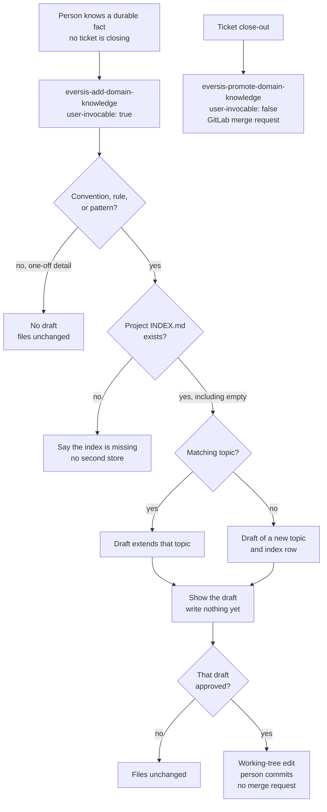

# Adding domain knowledge

**Folder:** `.ai/skills/eversis-add-domain-knowledge/`  
**Used by:** the person, on purpose, when they already know a durable fact and no ticket is closing. Not the Fine turn.

Person-started draft of one durable fact into `docs/context/<project>/`. Show the draft first. After that draft is approved, write a local working-tree edit; the person commits. The agent does not open a merge request and does not run `git commit`. This is not close-out promotion.

## Principles

- **Draft before write** — show the component file and the two-column index row; write nothing until that specific draft is approved.
- **One-off produces nothing** — a rename, a typo, or a single timeout is not a draft. Starting the command is not proof the fact is durable. Accept only a team convention, a confirmed business rule, or a reusable pattern.
- **Missing index stops** — if `INDEX.md` under `ssot.projectContextPath` does not exist, say so and do not create a second store. An empty index is not missing.

Close-out promotion stays a separate path and is not this command.

## See also

- [Domain context](../../domain-context) — how knowledge is saved
- [Promoting domain knowledge](./promote-domain-knowledge) — close-out promotion at Fine (`user-invocable: false`); not this command
