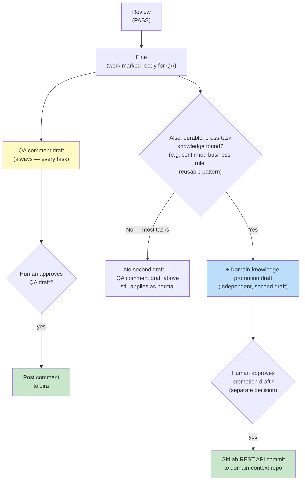

# Workflow Overview

**Agent Collections** covers the **full product lifecycle**:

> **Ideate → Implement → Review**

Attach **`@eversis-implement`** (or `/eversis-implement`) for the Implement phase — research and planning run inside that flow. Each phase produces documented artifacts with **human gates** where the prompts require them.

:::tip The relay race
Each phase passes a reviewed deliverable to the next. Workshop materials feed the backlog; the Engineering Manager orchestrates research, planning, and implementation; implementation feeds review.
:::

## The phases

### 1. Ideate

- **Role:** Business Analyst
- **Prompt:** `@eversis-analyze-materials`
- Workshop materials → Jira-ready epics and stories with acceptance criteria.
- **Gates:** Gate 1, Gate 1.5, and Gate 2 before Jira sync — see [Workshop Analysis Flow](./workshop-flow).

### 2. Implement

- **Role:** Engineering Manager (delegates Context Engineer, Architect, Plan Reviewer, implementers)
- **Prompt:** `@eversis-implement` with a Jira ID, task description, or `@docs/specs/.../*.plan.md`
- The EM’s **first response** is always an **Implement readiness** block (Flow / Research / Plan / Next gate) — before any artifacts or code. See [Orchestrating Implementation](../skills/orchestrating-implementation#implement-readiness-mandatory-first-output).
- **Entry signals** — existing adequate `*.research.md` + attached plan (after **adequacy checklist**) → skip new research/plan. No need to type “Research” in the prompt. Pure analysis without implement is also valid (chat + specs).

#### Flow selection

At Step 0 the EM recommends **Quick** or **Full** (you may override). See [Orchestrating Implementation](../skills/orchestrating-implementation).

| Flow | Steps | When to use |
| ---- | ----- | ----------- |
| **Quick** | implement → quality checks → `@eversis-review` → **Fine** + QA draft | Criteria pass, artifacts exist |
| **Full** | research → plan → plan validation → code → **Fine** + QA draft | Artifacts missing or scope requires it |

:::info Quick vs Full
**Hard exclusion:** Figma, UI verification tasks, cross-domain work, or likely >3 files → **Full Flow only**. Quick is for narrow, low-risk fixes after you confirm the EM recommendation.
:::

- **Produces:** `*.research.md`, `*.plan.md`, `*.plan-review.md` **when a gap exists**; code changes; Implement readiness summary in chat.

### 3. Review

- **Role:** Code Reviewer
- **Prompt:** `@eversis-review`
- Structured review — PASS / BLOCKER / SUGGESTION.

## Implement → Review

| Step | Attach | What happens |
| ---- | ------ | ------------ |
| Implement (Quick) | `@eversis-implement` | EM: implement → review → Fine + QA draft |
| Implement (Full) | `@eversis-implement` | EM: research → plan → plan validation → implementation → Fine + QA draft |
| Review | `@eversis-review` | Structured code review |

## Status: Fine — handoff

When Implement is complete, the Engineering Manager declares **Fine** and **must** output a **QA comment draft in the same response** (not a separate turn). Normative procedure: [`.cursor/skills/eversis-fine-handoff/SKILL.md`](https://github.com/PiotrNie-Eversis/agent-collections/blob/main/.cursor/skills/eversis-fine-handoff/SKILL.md) or MCP `eversis_skills_get` for `eversis-fine-handoff`. Onboarding overview: [Fine Handoff](../skills/fine-handoff).

The draft is labeled **`QA comment — review before posting to Jira`**. Post to Jira only after you approve (copy-paste or explicit Atlassian MCP instruction).

### Domain-knowledge promotion

So that a durable fact learned during one task (a confirmed business rule, a reusable integration pattern — not a one-off implementation detail) survives beyond that single task and beyond a single repo, Fine can also produce a **second, independent draft**: a proposal to write that fact into `docs/context/<project>/` (the project's own **domain knowledge** store — durable notes about the codebase and business rules, separate from per-task history). Most tasks do **not** produce this kind of finding — it appears only when the task actually surfaces one.

This second draft is labeled **`Draft: domain-knowledge promotion to docs/context/<project>/ — approve before writing`** and has its **own** approval: accepting or rejecting the QA comment draft has no effect on it, and vice versa. Once approved, it publishes via the GitLab REST API directly to the `domain-context` repository — never a local checkout.

## Workflow diagram

import SdlcDiagram from '@site/src/components/SdlcDiagram';

<SdlcDiagram />

## Human review at every step

:::warning Important
Each step requires your review. Open generated documents, iterate until correct, then approve before proceeding. AI output is always a draft.
:::

## Workflow variants

| Variant | Entry | Use when |
| ------- | ----- | -------- |
| **Standard flow** | `@eversis-implement` → `@eversis-review` | Backend / fullstack — Quick or Full at Step 0 |
| **UI + Figma** | `@eversis-implement` + `@eversis-review-ui` loop | Design-driven UI |
| **[Workshop analysis](./workshop-flow)** | `@eversis-analyze-materials` | Workshop → Jira only |
| **[E2E testing](./e2e-flow)** | `@eversis-implement` (E2E tasks in plan) | Playwright coverage |
| **[Business Manager Docs](./business-manager-docs)** | `@eversis-ba-docs-planner` → writer | Word `.docx` release docs |
| **[Repo Docs](./repo-docs)** | `@eversis-repo-docs-writer` (or EM delegate) | README, CHANGELOG, `website/docs` after Implement |
| **[QA workflow](./qa-workflow)** | `@eversis-qa-workflow` | Manual test planning, regression, AC verify, quality health |

:::info Standard flow
Full step-by-step: [Standard Flow](./standard-flow) — **Quick vs Full** at Step 0, then research, plan, implement, review with human gates.
:::

:::info Frontend / UI flow
Figma-driven UI with verification loop: [Frontend Flow](./frontend-flow) — includes the 5-step UI verification loop (`@eversis-review-ui`).
:::

:::info Workshop analysis
Ideate-only with Gates 1, 1.5, 2: [Workshop Analysis Flow](./workshop-flow).
:::

:::info E2E testing
Playwright work inside Implement: [E2E Testing Flow](./e2e-flow).
:::

:::info Repo Docs
Repository markdown after Implement: [Repo Docs](./repo-docs) — `@eversis-repo-docs-writer` (not Word `.docx`).
:::

:::info QA workflow
Manual QA practice (separate from Fine handoff): [QA Workflow](./qa-workflow) — `@eversis-qa-workflow`.
:::

:::info Business Manager Docs
Word `.docx` via `eversis-collections` MCP: [Business Manager Docs](./business-manager-docs).
:::

## Workflow playbooks

- [Standard Flow](./standard-flow)
- [Frontend Flow](./frontend-flow)
- [Workshop Analysis Flow](./workshop-flow)
- [E2E Testing Flow](./e2e-flow)
- [Business Manager Docs](./business-manager-docs)
- [Repo Docs](./repo-docs)
- [QA Workflow](./qa-workflow)
